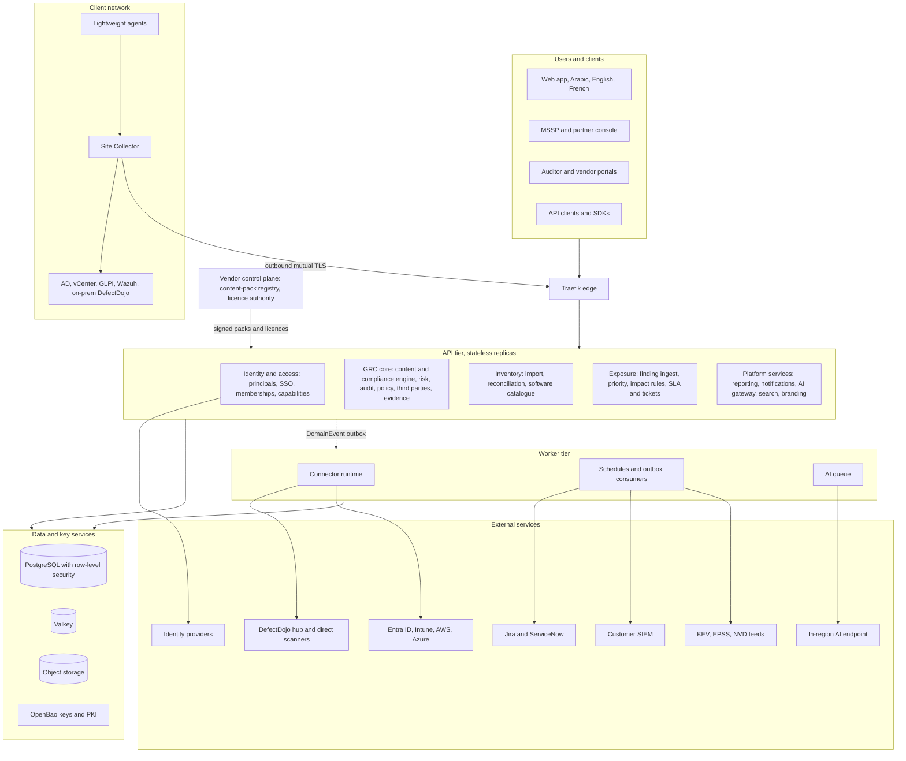
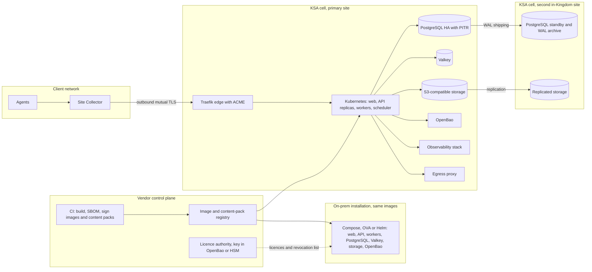
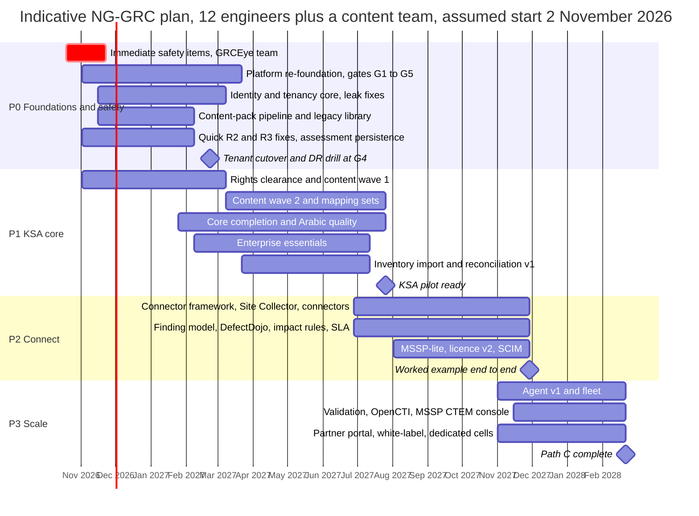
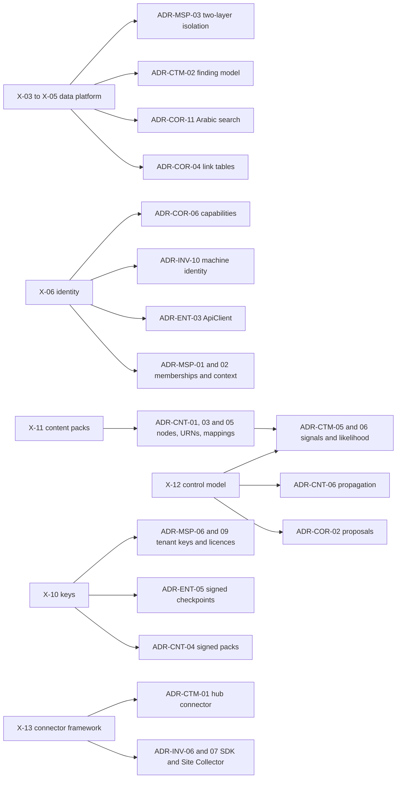
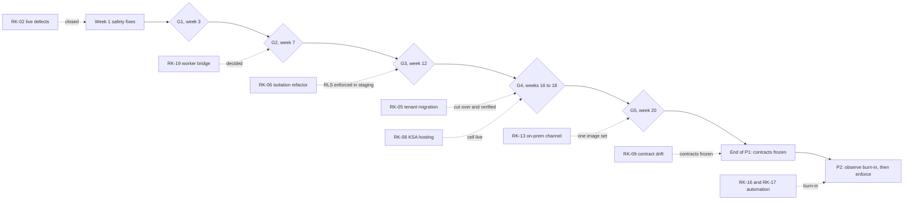

# NG-GRC Reference Architecture

**Volume 1 — Decision dossier** · From the GRCEye core to Path C — GRC core · Inventory collector · CTEM connection

| | |
|---|---|
| Reference | NG-GRC-ARCH-01 |
| Version | 1.0, draft for the Technical Committee |
| Date | 16 October 2026 |
| Follows | BM-01 Open source benchmark: GRC · Inventory · CTEM (v3, October 2026) |
| Basis | GRCEye repository at commit `98020b3` (30 September 2026) and its shipped seed database |
| Method and owner | Static code assessment performed by AI agents (large-language-model instances orchestrated by a scripted workflow; §2.4, Appendix C.1). A named GRCEye technical lead, [name, role], must validate and own the conclusions before the committee relies on them |
| Audience | Next Step × SEIZE Technical Committee; GRCEye engineering |
| Classification | Confidential. Technical Committee members and GRCEye engineering only; no onward distribution. Part II and §6.5 describe weaknesses of the live service that are not yet fixed |

This volume is for the Technical Committee. It contains:
- the decision summary (Part I);
- the fit-gap against BM-01 (Part III);
- the target-architecture overview (chapter 7);
- the roadmap, decisions, risks and open questions (Part V);
- the method and glossary (Appendices C and D).

Volume 2 describes GRCEye as it is today (Part II, Appendices A–B). Volume 3 details the target architecture block by block (chapters 8–14). Chapter numbers are the same in every volume, so cross-references such as §9.7 or §5.8 point into the other volumes. Section 6.5 states findings about the running platform at architectural level; code-level detail is kept in an internal evidence pack that GRCEye engineering holds outside the repository (Appendix C.2).

## Contents

- **[Part I — Decision summary](#part-i--decision-summary)**
  - [1. Executive summary](#1-executive-summary)
  - [2. Context, scope and method](#2-context-scope-and-method)
- **[Part III — Fit-gap against the NG-GRC need](#part-iii--fit-gap-against-the-ng-grc-need)**
  - [6. Fit-gap against the NG-GRC need](#6-fit-gap-against-the-ng-grc-need)
- **[Part IV — Target architecture: overview](#part-iv--target-architecture-overview)**
  - [7. Principles and target overview](#7-principles-and-target-overview)
- **[Part V — Delivery](#part-v--delivery)**
  - [15. Roadmap](#15-roadmap)
  - [16. Decisions, risks and open questions](#16-decisions-risks-and-open-questions)
- **[Appendices](#appendices)**
  - [Appendix C. Method and evidence](#appendix-c-method-and-evidence)
  - [Appendix D. Glossary](#appendix-d-glossary)

# Part I — Decision summary

## 1. Executive summary

BM-01 concluded that no open-source platform meets the NG-GRC need: the best two, CISO Assistant and Probo, reach 44% of it on the deck's scorecard, which its decision slide rounds to "best case: 50%". It asked one question: *which starting point gets us to Path C, a platform designed for the need, fastest?* This document assesses one candidate answer: GRCEye, the existing GRC platform proposed as the Path C starting point (IP holder to be confirmed, NG-10). It compares GRCEye with BM-01's Paths A and B in qualitative terms (§6.6); it does not cost those alternatives. The document does three things:
- maps GRCEye's architecture from its code;
- scores it on BM-01's eight requirements with the same bar the deck applied to open source;
- designs the target architecture and the roadmap that turn it into NG-GRC: one data model joining the GRC core, the inventory collector and the CTEM connection, KSA first.

### Bottom line

- **GRCEye covers 56% of the NG-GRC need today, against 44% for the best open-source platforms on the deck's scorecard.** That is a lead of 12 points, or 6 points against the deck's rounded "best case: 50%". GRCEye is the only candidate rated at least Partial on all eight requirements (none Missing), and the only one that scores on both native Arabic (R3) and commercial freedom (R5). On R3 it sits at the top of the Partial band, ahead of CISO Assistant; on R5 it is Strong on the deck's licence-only bar, level with Probo. Every rating was set by AI judge agents instructed to refute positive claims in the code, with the lower rating kept when in doubt (§2.4). A named GRCEye technical lead, [name, role], must validate and own these conclusions before the committee relies on them.
- **Its gaps are real and specific.** KSA regulatory content is its weakest point: none of the eight KSA frameworks is complete at official granularity (two exist only as paraphrases), whereas CISO Assistant has four complete. Like every benchmarked platform, it lacks an MSSP layer, a collector and an automated exposure → control → risk chain. Its platform foundations (a single host, SQLite, in-process schedulers, manual migrations, no working CI or automated tests) must be rebuilt before it can carry MSSP-grade, KSA-hosted operation. Knowledge of the code is also concentrated in one human author (RK-26).
- **Recommendation: adopt GRCEye as the Path C starting point, conditional on a first phase, P0 "Foundations and safety".** With about 12 engineers and a regulatory content team, the plan reaches:
  - a KSA pilot at about month 9, covering 81% of the need (75% unless redistribution rights are cleared or the committee decides that reference mode meets R1);
  - the BM-01 worked example end to end at about month 13 (88%, or 81% if R1 stays Partial);
  - full Path C at about month 16 (100%, or 94% if R1 stays Partial).

  Total effort is about 700 person-weeks, ±30%. It covers engineering and first-pass content authoring (about 30 person-weeks in §8, P1). The standing content team (about 4.5 FTE, about 170 person-weeks over the 38 weeks of content waves to the end of P1, with a smaller team continuing afterwards) also covers subject-matter-expert (SME) review, Arabic legal-linguistic QA, mapping maintenance and regulatory watch, which are outside the 700.
- **Some findings cannot wait for the programme.** The immediate safety items (§6.5) include cross-tenant read paths, deployment-wide administrative functions open to tenant administrators, unencrypted stored secrets, the licence-signing key on the internet-facing SaaS host, the absence of scheduled backups, and production data tracked in the repository (classification to confirm; treat as PDPL-relevant until confirmed). They start now under the GRCEye team's ownership and do not wait for the committee's decisions.

### Scorecard

● Strong · ◐ Partial · ○ Missing. The open-source column shows BM-01's own ratings: for each requirement, the best rating any benchmarked platform received. It mixes platforms, so it does not add up to the total, which is the best single platform's score. The last column gives the phase from which the requirement is rated Strong (phases P0–P3, see the roadmap below).

| Requirement | GRCEye today (verified) | Best open-source rating (BM-01) | Strong from |
|---|---|---|---|
| R1 Complete KSA content | ◐ 0 of 8 fully; 2 paraphrased | ◐ CISO Assistant: 4 of 8 fully | ● P1 ¹ |
| R2 Full GRC lifecycle | ◐ All six areas; audits complete, rest partial | ● CISO Assistant, Eramba: Yes | ● P1 |
| R3 Native Arabic and RTL | ◐ AR 100%, RTL; PDF fonts host-dependent | ◐ CISO Assistant: AR ≈95%, RTL to test | ● P0 |
| R4 Multi-entity and MSSP | ◐ Tenants only, no MSSP layer | ◐ Several: organisations or domains | ● P3 |
| R5 White-label and commercial freedom | ● Proprietary; rebrand needs rebuild | ● Probo: MIT | ● today (runtime white-label in P3) |
| R6 Built-in inventory collection | ◐ CSV import by API only; external discovery (EASM); no agent | ◐ Comp AI, Probo: device checks | ● P3 |
| R7 Native CTEM connection | ◐ Scanner connectors; findings do not change compliance status or risk scores | ◐ CISO Assistant: records, no connectors | ● P2 |
| R8 Enterprise-ready base | ◐ LDAP-only SSO; no API keys | ● Probo: Yes | ● P1 |
| **Share of the need covered** | **56%** | **44%** (best single platforms: CISO Assistant, Probo) | **100% at P3** ¹ |

¹ Only if redistribution rights for the official KSA texts are cleared or the committee decides that reference mode meets R1 (§15.3). Otherwise R1 stays Partial and the total at P3 is 94%.

### What GRCEye already brings

- **A broad GRC core in one model.** It has 581 API routes in 63 routers, 113 database tables and 58 screens covering:
  - risks with scenario chains;
  - multi-framework compliance;
  - a complete audit lifecycle with enforced separation of duties;
  - policies;
  - third parties with AI contract review;
  - evidence with integrity checks;
  - reporting.
- **Arabic as a first-class language.** All 6,460 interface keys exist in Arabic (99.2% in Arabic script), with RTL layout and Arabic e-mails, notifications, API messages and AI answers. Arabic PDF reports are complete in code but need a bundled font outside the appliance (§6.2 R3).
- **Business context that inventory and CTEM tools lack** (§6.3). Assets carry an owner, a business process, an entity, a criticality rating, a confidentiality–integrity–availability grid and recovery objectives, and they are linked to risk scenarios.
- **A vulnerability ingest pipeline.** It has scheduled connectors (Nessus, Qualys, Tenable.io, a generic EASM connector), three file formats and NVD, CWE and CISA KEV feeds. This is the starting point for the CTEM connector.
- **Commercial machinery.** The code is proprietary (IP holder to be confirmed, NG-10) and links no GPL or AGPL dependency; three weak-copyleft libraries (LGPL and MPL) carry notice and relink duties. It already has Ed25519 licensing, protected on-prem build pipelines (to repair, §6.5) and a per-tenant hash-chained audit trail.

### What must be built

| Area | What is built | Chapter |
|---|---|---|
| Block 1 · GRC core | The eight KSA frameworks in official Arabic and English, cross-mapped, delivered as signed content packs. One control model linking requirements, implemented controls, tests and evidence. Completed lifecycle workflows. Arabic quality gates. | §8 |
| Block 2 · Inventory collector | CSV/XLSX import with a reconciliation engine (one asset view); connectors to the client's on-premises tools (AD, vCenter, Wazuh, GLPI), through a Site Collector for SaaS tenants, and to its cloud services (Entra ID, Intune, Azure, AWS) from the platform; a read-only agent; a software inventory matched to vulnerabilities | §9 |
| Block 3 · CTEM connection | DefectDojo as findings hub; an exposure model with KEV and EPSS; control-impact rules that turn a requirement such as ECC-2:2024 2-10 non-compliant; automatic risk recalculation; SLA-driven tickets in Jira or ServiceNow; validation evidence | §10 |
| Multi-entity, MSSP and white-label | Partners, memberships and a consented MSSP console; entity scoping; runtime branding and custom domains; licence model v2 | §11 |
| Enterprise base | OIDC/SAML SSO and SCIM; API clients with scopes; audit trail with signed checkpoints and SIEM streams; signed webhooks | §12 |
| Platform foundations | PostgreSQL with row-level security; a worker tier; OpenBao keys; a licence authority on a separate, isolated host; object storage; observability; backup and DR; CI and supply-chain gates; one image set for SaaS and on-prem; a KSA SaaS cell (a complete, self-contained hosting stack in the Kingdom, §13.2.14) | §13 |

The target is one platform, not an assembly (§7.3). External tools such as scanners, the findings hub, directories, cloud APIs and ITSM tools feed GRCEye's single data model through one connector framework. Every automated change is explainable, reversible and recorded in the audit trail.

### Roadmap

| Phase | Goal | Indicative end | Coverage |
|---|---|---|---|
| P0 Foundations and safety | Platform re-foundation, identity and tenancy core, content-pack pipeline, immediate safety items (§6.5), quick lifecycle and Arabic fixes; KSA cell live; the 11 existing SaaS tenants moved to the new stack (region decided under NG-08) | March 2027 (month 5) | 63% |
| P1 KSA core | KSA content in official AR/EN, core completion, SSO and API keys, audit trail v2, CSV/XLSX inventory import | July 2027 (month 9), **KSA pilot ready** | 81% ¹ |
| P2 Connect | Connectors and Site Collector, DefectDojo hub, exposure → control → risk → ticket chain | November 2027 (month 13) | 88% ¹ |
| P3 Scale | Agent, validation, MSSP partner portal, runtime white-label, dedicated cells | February 2028 (month 16) | 100% ¹ |

¹ 75% at P1 unless redistribution rights are cleared or the committee decides that reference mode meets R1 (§15.3). Without either, R1 stays Partial in every later phase too, and P2 and P3 reach 81% and 94%.

### Decisions requested

§16.1 lists twelve decisions. The most important are:
- **NG-02:** adopt GRCEye as the Path C starting point, conditional on P0.
- **NG-03:** approve P0. The immediate safety items (§6.5) are reported to the committee but do not wait for this decision: they start now under the GRCEye team's ownership.
- **NG-04:** mandate the KSA content programme, start the rights requests now and decide whether reference mode meets R1 (Q-01).
- **NG-05 and NG-06:** confirm the CTEM approach and the inventory sequencing (BM-01-D04 and D05).
- **NG-08:** choose the KSA hosting provider and the placement of the 11 existing tenants.
- **NG-10:** name the entity that holds the IP and settle chain of title before any partner or resale contract.
- **NG-11:** approve the team and a planning workshop within 30 days.
- **NG-12:** accept the target architecture (Part IV) and the cross-cutting decisions X-01–X-18 as the working baseline; block ADRs stay Proposed until the design authority reviews them at the planning workshop.

## 2. Context, scope and method

### 2.1 The NG-GRC need

BM-01 defined NG-GRC as three blocks that must share one data model:

| Block | Question it answers | What it contains |
|---|---|---|
| **1 · GRC core** | What does the regulator expect? | NCA and SAMA frameworks, PDPL; risks, controls, evidence, audits; dashboards; Arabic; multi-tenant |
| **2 · Inventory collector** | What does the client own? | CSV/XLSX import; connectors to tools the client already runs; a lightweight agent |
| **3 · CTEM connection** | What can an attacker exploit? | Findings from CTEM tools, linked to assets and controls, with risk updated automatically |

The deck's key message: *the GRC core is the heart. Inventory and CTEM only create value once they land in its data model.* It set eight requirements as the yardstick:

| ID | Requirement | Definition used in BM-01 |
|---|---|---|
| R1 | Complete KSA content | NCA ECC-2, CCC-2, DCC, CSCC, OTCC, TCC, SAMA CSF, PDPL, cross-mapped |
| R2 | Full GRC lifecycle | Risks, controls, evidence, policies, audits, third parties |
| R3 | Native Arabic and RTL | Interface, reports and AI answers in Arabic |
| R4 | Multi-entity and MSSP | Many clients on one platform, strict separation |
| R5 | White-label and commercial freedom | Rebrand, keep our code, resell as SaaS or via MSSPs |
| R6 | Built-in inventory collection | CSV import, connectors and a lightweight agent |
| R7 | Native CTEM connection | Exposures linked to assets, controls and risks |
| R8 | Enterprise-ready base | API, SSO and audit trail included |

BM-01 scored five open-source GRC platforms on this yardstick (Strong = 1, Partial = 0.5, Missing = 0, averaged over R1–R8). The best two, CISO Assistant and Probo, each reached 44% (3.5 of 8) on the deck's scorecard (slide 6), and none covered the inventory or CTEM blocks. The deck's summary slides round this ceiling to "half of the need" (slide 7) and to 50% (Path A on slide 16, and BM-01-D02's "best case: 50%"). This document uses the scorecard figure. Where the comparison with GRCEye matters it gives both: GRCEye's 56% is 12 points above the scorecard's 44% and 6 points above the deck's rounded 50%.

The deck compared three paths (slide 16):

- **A** — adapt CISO Assistant, the best open-source match, under AGPL or a licence fee, with a fork to maintain.
- **B** — assemble open-source products for GRC, inventory and CTEM: five products with mixed licences.
- **C** — build a platform designed for the need, with the GRC core, collector and CTEM in one data model.

It left one question open: *which starting point gets us to Path C fastest?* §6.6 compares the three paths on the deck's six attributes, with Path C starting from GRCEye. The deck also put five decisions on the table (slide 17). D01–D03 adopt R1–R8, acknowledge the open-source ceiling and discuss the Path C starting point. D04 connects CTEM through a findings hub rather than embedding scanners. D05 sequences inventory as CSV and connectors first, agent next. §16.1 answers each of them.

### 2.2 Why GRCEye is assessed as the starting point

GRCEye is the existing GRC platform proposed as the Path C starting point. Its code is proprietary (IP holder to be confirmed, NG-10). It runs as a multi-tenant SaaS at grceye.com and is packaged for on-premises delivery as a Docker bundle and a virtual appliance. It is trilingual (English, French, Arabic). Its scope is much broader than the original GRC core: assets with business context, vulnerability management with scanner connectors, a CVE knowledge base, threat intelligence, incidents and AI-assisted workflows. These overlap directly with Blocks 2 and 3.

This document applies BM-01's yardstick to GRCEye on the same rating bar, checked against the code (§2.4). It then designs the shortest credible route from what GRCEye is today to Path C.

### 2.3 Scope

**In scope:**
- The GRCEye repository at commit `98020b3` (branch `main`, 30 September 2026): FastAPI backend, React SPA, Next.js marketing site and gateway, packaging (Docker on-prem bundle, OVA/ISO appliance), CI.
- The shipped seed database `release/seed/grc_seed.db` (the framework catalogue and one test tenant), queried read-only on a copy.
- The repository documentation, including the customer-facing documents it holds (datasheet, bid documents).

**Not verified:**
- The production host's configuration and database. They are not on the analysis machine, so production-only facts are reported as such. Examples are the production framework count and the active configuration profile.
- Runtime behaviour, performance and load. The analysis is static.
- Customer data. The analysis queried only the seed database. The production data that the repository holds (classification to confirm; treat as PDPL-relevant until confirmed) was not opened; §6.5 covers its removal.
- A legal review of third-party licences. As in BM-01, licence observations need confirmation by legal review.

### 2.4 Method

The assessment was performed by AI agents (large-language-model instances orchestrated by a scripted workflow) as a staged code review. Each agent had a defined role, inputs and evidence rules; the readers, judges, architects, writers, editor and reviewers named below are all such agents. The conclusions must be validated and owned by a named GRCEye technical lead, [name, role], before the committee relies on them (step 5).

Every claim in Parts II and III is traceable to repository evidence (`path:line`). For unfixed security weaknesses, the pointers are kept only in the internal evidence pack, which GRCEye engineering holds outside the repository (Appendix C.2).

**Status vocabulary used throughout:**
- **Implemented** — wired end to end.
- **Partial** — some functions are wired end to end, others are missing or broken. This is an implementation status, distinct from the ◐ Partial rating used in the scorecards.
- **Backend-only** — no UI path.
- **UI-only/mock** — a screen exists but shows placeholder or mock data, with no working backend path.
- **Model-only** — schema exists, nothing writes it.
- **Documented-only** — claimed in documentation, not found in code.
- **Absent** — neither code nor a documentation claim exists.

**Steps:**

1. **Mapping.** Twelve reader agents worked in parallel, each on one subsystem: platform and operations; identity, tenancy and API; compliance content; risk; audit, policy and governance; third parties and reporting; inventory; vulnerabilities and CTEM; AI and internationalisation; frontend; data model; documentation and known issues. Each produced a detailed evidence report (about 1 MB in total). Each also proposed ratings against R1–R8.
2. **Adversarial verification.** One judge agent per requirement re-checked the code and tried to refute every positive claim a rating depended on. A capability counts only if it is reachable end to end in the current code (route + persistence + UI, or a documented API path). Model-only, backend-only, mock or documented-only capabilities count as ◐ Partial at most. When in doubt the lower rating applies.
3. **Target design.** Seven block-architect agents designed the target architecture: KSA content; core completion and Arabic; MSSP and white-label; inventory collector; CTEM connection; enterprise base; platform foundations. Each started from its verified current state and a shared set of baseline assumptions, so the blocks fit together (§7).
4. **Synthesis and review.** Writer agents and an editor agent consolidated the chapters into this document. Independent reviewer agents then checked it for factual accuracy against the code, completeness against BM-01, internal consistency and sensitivity.
5. **Human validation (pending).** The named technical lead checks the ratings, designs and estimates against the code and the evidence pack, records any corrections and takes ownership of the conclusions. Until then, this document is an AI-produced draft.

**Effort sizes:**
- **S** ≤ 2 person-weeks.
- **M** 2–6 person-weeks.
- **L** 6–12 person-weeks.
- **XL** > 12 person-weeks.

Effort figures cover engineering and first-pass content authoring (about 30 person-weeks in §8, P1). The standing content team (about 4.5 FTE, about 170 person-weeks over the 38 weeks of content waves to the end of P1, with a smaller team continuing afterwards) also covers SME (subject-matter expert) review, Arabic legal-linguistic QA, mapping maintenance and regulatory watch, which are outside the 700 person-weeks of §15.4.

### 2.5 How to read this document

- **Part I** (this part) is for decision-makers. It stands on its own.
- **Part II** describes GRCEye as it is today, as an engineering reference.
- **Part III** scores GRCEye against R1–R8 and against BM-01's inventory and CTEM criteria, in the deck's own format.
- **Part IV** is the target architecture: principles, then each block, then the consolidated data model.
- **Part V** sequences the work, records the architecture decisions and lists what the committee needs to decide.
- **Appendices** inventory every module and framework, explain the evidence base and define terms.

Readers coming from the BM-01 deck can use this index to check that each of its elements is answered:

| BM-01 element | Where this document answers it |
|---|---|
| Three blocks and R1–R8 (slides 3–4) | §2.1; scores §6.1–§6.2; designs §8–§13; coverage by phase §15.3 |
| Open-source scores (slides 6–7) | §2.1; §6.1 |
| Inventory criteria (slide 9) | §6.3 |
| Collector channels and properties (slide 10) | §6.2 (R6), §6.3; design §9.2.2–§9.2.8 |
| CTEM in five steps (slide 11) | §6.4; design §10.2.2 |
| CTEM criteria (slide 12) | §6.4 |
| Connector and worked example (slide 13) | §6.4; §7.5; design §10.2.3 and §10.2.11 |
| Limits and "still to build" (slides 14–15) | §6.6; the "dependency and support" limit as it applies to GRCEye: RK-26 (§16.3) |
| Three paths (slide 16) | §2.1; §6.6 |
| Decisions D01–D05 (slide 17) | §16.1: NG-01 (D01, D02), NG-02 (D03), NG-05 (D04), NG-06 (D05) |

# Part III — Fit-gap against the NG-GRC need

## 6. Fit-gap against the NG-GRC need

This chapter scores GRCEye on BM-01's yardstick: R1–R8, Strong = 1, Partial = 0.5, Missing = 0. The bar is the one the deck applied to the open-source platforms. Each rating was set by an AI judge agent whose brief was to refute every positive claim in the code; §2.4 describes the method and who validates its conclusions. A capability counts only if it works end to end today. When the evidence was ambiguous, the lower rating was kept. The open-source ratings are BM-01's own (checked on 6 October 2026) and were not re-assessed here.

### 6.1 Scorecard

● Strong · ◐ Partial · ○ Missing

| Requirement | **GRCEye** (verified in code) | CISO Assistant | Eramba | SimpleRisk | Comp AI | Probo |
|---|---|---|---|---|---|---|
| R1 · Complete KSA content | ◐ **0 of 8 fully; 2 paraphrased** | ◐ 4 of 8 fully | ○ Not in library | ○ None | ○ None | ○ None |
| R2 · Full GRC lifecycle | ◐ **All six; audits complete, rest partial** | ● Yes | ● Yes | ◐ Risk-centric | ◐ SOC 2 focus | ◐ Light |
| R3 · Native Arabic and RTL | ◐ **AR 100%, RTL; PDF fonts host-dependent** | ◐ AR ≈95%, RTL to test | ○ No | ○ No | ○ No | ○ No |
| R4 · Multi-entity and MSSP | ◐ **Tenants only, no MSSP layer** | ◐ Domains only | ○ No | ◐ Paid Extra | ◐ Organisations | ◐ Organisations |
| R5 · White-label and commercial freedom | ● **Proprietary; rebrand needs rebuild** | ○ AGPL; branding paid | ○ No modification | ◐ Partly (MPL) | ○ AGPL | ● MIT |
| R6 · Built-in inventory collection | ◐ **API-only CSV, EASM, no agent** | ○ No collector | ○ No collector | ○ No collector | ◐ Device checks | ◐ Device posture |
| R7 · Native CTEM connection | ◐ **Connectors; no control/risk propagation** | ◐ Records, no connectors | ○ No | ◐ Paid import | ○ No | ○ No |
| R8 · Enterprise-ready base | ◐ **LDAP-only SSO; no API keys** | ◐ SSO, audit trail paid | ○ API, SSO paid | ○ API, SSO paid | ◐ SSO to confirm | ● Yes |
| **Share of the need covered** | **56%** | 44% | 13% | 25% | 25% | 44% |

**Reading the scorecard:**

- **GRCEye covers 56% of the need today, against 44% for the best single open-source platforms on the deck's scorecard**, a lead of 12 points. The deck's summary slides round the open-source best case to half of the need (slide 7) and 50% (slide 16 and BM-01-D02); against that figure the lead is 6 points. GRCEye is the only candidate rated at least Partial on all eight requirements (none Missing). It is also the only candidate that scores on both Arabic (R3, at the top of the Partial band) and commercial freedom (R5, Strong, level with Probo's MIT licence); no open-source platform scores on both.
- **R5 is Strong on the deck's own bar, level with Probo.** The deck rated Probo Strong on its MIT licence alone. GRCEye's code is proprietary (IP holder to be confirmed, NG-10) and links no GPL or AGPL dependency. Runtime white-labelling does not exist yet. If it were required for Strong, R5 would be Partial and the total 50%: still 6 points above the scorecard's 44%, and level with the deck's rounded 50%.
- **R1 is GRCEye's weakest requirement, and here it is behind CISO Assistant.** Both score 0.5, but CISO Assistant holds 4 of the 8 KSA frameworks at full granularity and GRCEye holds none. Content is, however, the gap least tied to the platform choice. The work is engine-neutral (§8), and four of the frameworks (CCC-2:2024, DCC, CSCC, TCC) are missing on every platform, so they must be authored and maintained on any path. On GRCEye, the four that CISO Assistant holds must be rebuilt as well (§6.6).
- **Besides R1 (content, above), the six other Partial requirements fall into two groups.**
  - Near misses, closable with S/M work on existing code: R2 (unwired UI steps and workflow defects), R3 (font packaging), R8 (federated SSO and machine credentials).
  - Missing blocks that every benchmarked platform also lacks: R4's MSSP layer, R6's collector and R7's exposure → control → risk chain. These are the blocks Path C exists to build.

### 6.2 Findings by requirement

#### R1 · Complete KSA content — ◐ Partial (0 of 8 fully; 2 paraphrased)

GRCEye ships two of the eight required catalogues, and neither carries the official text.

**NCA ECC-2:2024** has NCA's exact skeleton: 4 domains, 28 subdomains and the 108 main-control IDs with NCA's per-subdomain counts, checked against NCA's published PDF. However, each row is a one-line English paraphrase, only about one statement in five matches NCA's requirement, and the 92 sub-controls are absent.

**SAMA CSF** is a 57-row approximation with non-official numbering.

**CCC-2:2024, DCC, CSCC, OTCC, TCC and PDPL are absent** (PDPL exists only as a string in an AI prompt). No KSA control is cross-mapped. No Arabic regulatory text ships, although NCA makes the Arabic version binding; Arabic exists only as runtime machine translation.

On-prem installs receive content as a database snapshot frozen at first boot, with no update path. The rating stays Partial only because the content that does exist works end to end: catalogue, assessment, gaps and action plan.

| Framework or criterion | Rating | Finding |
|---|---|---|
| NCA ECC-2:2024 | ◐ | 108/108 main IDs, 0/92 sub-controls; paraphrased; English only |
| NCA CCC-2:2024 | ○ | Absent (no CCC-1:2020 either) |
| NCA DCC · CSCC · TCC | ○ | Absent |
| NCA OTCC | ○ | Absent; only generic OT catalogues (IEC 62443, NIST SP 800-82, ENISA ICS) |
| SAMA CSF | ◐ | 57 rows (15 sections + 42 items), non-official 1.x–3.x numbering; English only |
| SDAIA PDPL | ○ | Absent |
| Legacy ECC-1:2018 (not counted) | — | 30 subdomain-level rows, non-official titles; none of the official controls |
| Cross-mapping | ○ | 0 KSA mappings; only 199 ISO → SOC 2/NIST CSF pairs ship |
| Official Arabic text | ○ | None; machine translation of the English paraphrase only |
| Content delivery (SaaS / on-prem) | ◐ | Shared built-in rows on SaaS; frozen snapshot on-prem |

**Gaps to close:**
- Six frameworks to author, two to rebuild on official text, all in Arabic and English with sub-controls (blocking).
- KSA cross-mappings (major).
- A versioned, engine-neutral content pipeline that can update installed appliances (major).
- Conditional applicability, e.g. CCC provider vs tenant, OTCC levels and ECC 4-2 for cloud users (minor).
- An ECC-1 → ECC-2 edition transition (minor).
- KSA regulatory-watch sources (minor).

The design is in §8.

#### R2 · Full GRC lifecycle — ◐ Partial (all six areas; audits complete, the rest partial)

All six lifecycle areas have modules, persistence and screens; the breadth matches the deck's "Yes" for CISO Assistant and Eramba.

**One area is complete, and part of another.** The audit engagement lifecycle runs end to end, from plan through findings and recommendations to report approval (with enforced separation of duties) and distribution. Within Controls, the applied-control register is also complete; requirement-level assessment is not.

**The rest stop short in day-to-day maintenance:**
- **Risks** can be created but not re-assessed, closed or deleted in the UI, and the treatment form rejects its default option.
- **Vendors** cannot be edited, re-tiered or off-boarded after onboarding, and prescreen answers are not stored.
- **Policy** approval has no separation of duties, and attestations cannot be acknowledged.
- **Requirement-level verdicts and evidence** exist only after self-registration or an AI run. They are CISO-only while nine roles see the screens, and an AI re-analysis silently deletes and recreates them, evidence included (PRD-03, §5.8).

Most gaps are UI wiring and workflow fixes over an existing backend, estimated at three to four person-months to reach the "Yes" bar.

| Lifecycle area | Rating | Finding |
|---|---|---|
| Risks (register, scenarios, treatment, acceptance) | ◐ | Create-only in the UI; no re-assess or close |
| Controls (applied controls and requirement assessment) | ◐ | Register complete; assessments AI-seeded and CISO-only |
| Evidence | ◐ | Strong integrity; no expiry; lost on AI re-runs |
| Policies | ◐ | Versions and AI drafting; no SoD; no acknowledgement |
| Audits | ● | End to end; SoD on report approval |
| Third parties | ◐ | Onboarding, AI contract review and portal; no maintenance; a data-model island |

**Gaps to close:**
- **Blocking (S/M):** risk maintenance UI; AI re-analysis that merges instead of recreating; vendor maintenance UI.
- **Major:** assessment rows on creation; capability-based access instead of CISO-only; the requirement ↔ applied-control bridge; evidence validity and many-to-many links; the policy approval workflow; persisted vendor assessments; vendor links to assets, risks and controls.

The design is in §8.

#### R3 · Native Arabic and RTL — ◐ Partial (AR 100%, RTL; PDF fonts host-dependent)

**Interface.** All 6,460 runtime UI keys exist in Arabic, and 99.2% carry Arabic script. RTL is applied globally and documented by 36 Arabic screenshots in the repository. API errors, notifications and e-mails are localised.

**AI.** AI answers are steered to Arabic at every one of the 24 prompt call sites, but the output language is never checked.

**PDF reports.** The Arabic code is complete (shaping, bidi, RTL layout), but glyphs render only where Arabic fonts sit at fixed Linux paths. Only the appliance installs them; the three Docker images ship none, and the SaaS host could not be checked. The judge therefore kept Partial.

**Regulatory content.** No Arabic regulatory text ships; all of it is machine translation (shared with R1).

Bundling an OFL Arabic font in the backend package, declaring `arabic-reshaper` and `python-bidi` in `pyproject.toml` (the generic image installs from it and lacks both) and running the Arabic PDF self-test in CI is a small fix (S). It lifts R3 to Strong on the stated scope: interface, reports and AI answers.

| Criterion | Rating | Finding |
|---|---|---|
| Interface in Arabic | ● | 100% key parity; a few raw English enum values |
| RTL layout | ● | `dir=rtl`, global CSS layer, runtime screenshots |
| PDF reports | ◐ | Shaped and RTL in code; fonts only in the appliance |
| E-mail and in-app notifications | ● | Recipient language, `dir=rtl` |
| API error messages | ● | All error details localised |
| AI answers | ● | Prompt-enforced on every route; output unchecked |
| Regulatory content in Arabic | ◐ | Machine translation only |

Compared with the best open-source rating (CISO Assistant, "AR ≈95%, RTL to test"), GRCEye is ahead on both points the deck records: full key coverage (99.2% in Arabic script) against ≈95%, and RTL documented at runtime rather than "to test". It sits at the top of the Partial band. The design is in §8.

#### R4 · Multi-entity and MSSP — ◐ Partial (tenants only, no MSSP layer)

GRCEye is a working multi-tenant SaaS. All tenants share one schema, and every query filters on a tenant resolved from the user's database row. Self-registration creates tenants end to end, and a vendor console manages them.

Separation is enforced only in application code: there is no row-level security, no global filter and no isolation test. Of 29 sampled query sites, 26 were correctly scoped. **Three code paths let one tenant read metadata or controls of another tenant's custom frameworks**, and deployment-wide administrative functions are reachable by tenant-level roles (§6.5).

There is no MSSP layer: one tenant per user, no partner tier, no tenant switcher and no consolidated view. Entities inside a tenant are reporting perimeters, not access boundaries.

| Criterion | Rating | Finding |
|---|---|---|
| Many clients on one platform | ● | Shared schema, self-service tenants |
| Isolation enforcement | ◐ | Application-level predicates only; 3 cross-tenant read paths found |
| Entities within a tenant | ◐ | Reporting perimeters, no access scoping |
| MSSP / partner layer | ○ | None |
| Cross-tenant operator console | ◐ | Vendor console; no tenant lifecycle |
| Per-tenant configuration | ◐ | LDAP and trust-center settings; no branding |

GRCEye sits in the same Partial band as four of the five open-source platforms (the deck rates Eramba Missing). No benchmarked platform reaches Strong on R4, and neither does GRCEye: it has no MSSP layer, and its entities carry no access scoping. Its value for Path C is the choke point: a single tenant resolver and role dependency where memberships, partners and RLS can attach. The design is in §11 (MSSP) and §13 (isolation mechanics).

#### R5 · White-label and commercial freedom — ● Strong (proprietary; rebrand needs rebuild)

**Commercial freedom.** On the deck's licence-only bar (Probo "MIT" = Strong), GRCEye is Strong:
- **Code.** The code carries no open-source licence, no third-party headers, no vendored code and no copied copyleft code.
- **Dependencies.** All 497 frontend packages are permissive. The backend's only weak-copyleft dependencies (LGPL `ldap3` and `python-bidi`, MPL `certifi`) carry notice and relink duties, and the `certifi` file that the appliance build modifies must be made available under MPL-2.0, but none forces disclosure of GRCEye's own code. The licence policy (X-14) allows LGPL only when unmodified, dynamically imported, replaceable and excluded from compilation, and copyleft tools only over the network or through file formats. Today the appliance's Nuitka build compiles the two LGPL libraries into its binary, so it does not yet meet that policy.
- **Resale machinery.** GRCEye already has the licensing half of item 06 on BM-01's "still to build" list: Ed25519 licence issuance and activation, protected on-prem build pipelines (very likely failing to build at the current commit, §6.5) and plans with per-tenant overrides, with the gaps listed in the table below. The white-label half is still to build.

**Two conditions keep the rating honest:**
- **Chain of title.** It must be documented and the IP holder confirmed (NG-10): the repository has no LICENSE, EULA or IP assignment, and several entity names appear.
- **Third-party content.** Eight unused CISO Assistant library files carrying third-party copyright text ship in the on-prem artefacts and must be removed.

**White-label.** It is model-only today: the brand is hard-coded about 400 times across the code, templates and PDFs, and the branding fields are never read.

| Criterion | Rating | Finding |
|---|---|---|
| Proprietary code | ● | No open-source licence; IP holder to be confirmed and chain of title to be documented (NG-10) |
| Dependency licences | ● | No copyleft linked; LGPL/MPL duties to honour |
| Runtime rebranding (white-label) | ○ | Hooks unused; brand hard-coded |
| Resale licensing | ◐ | Ed25519 licences; revocation, limits and billing gaps |
| MSSP resale readiness | ○ | No reseller tier or sub-branding |

The design is in §11 (white-label, licence v2) and §13 (licence authority, supply-chain policy).

#### R6 · Built-in inventory collection — ◐ Partial (API-only CSV, EASM, no agent)

None of slide 10's three channels exists as specified:

| Channel | Today |
|---|---|
| CSV/XLSX import | Backend-only CSV or XML route: reads 7 fields, always inserts, has no template, XLSX, dry run or screen |
| Connectors | None of the seven named connectors exists. AD/LDAP is used for login only. The only automatic asset source is a generic EASM connector that adds internet-facing hosts with no owner. |
| Agent | None |

There is also no software inventory and no identity or merge logic, so there is no "one asset view".

What GRCEye adds is the landing model: a mandatory owner, business processes, an entity tree, criticality and CIA, and UI-wired links to risk scenarios and asset-scoped assessments. That is strong business context, but it is not collection. §6.3 scores the block against the deck's inventory criteria. The design is in §9.

#### R7 · Native CTEM connection — ◐ Partial (connectors; no control or risk propagation)

**Ingestion is real.** Nessus and OpenVAS XML, generic CSV, and scheduled pull connectors (Nessus, Qualys, Tenable.io, a generic EASM connector) feed one de-duplicating pipeline. It string-matches findings to assets and auto-creates a planned remediation control. That is already more than CISO Assistant's "records, no connectors".

**The chain is missing.**
- **Asset matching** works only on exact name equality.
- **No path leads from a finding to a framework requirement**, so ECC-2:2024 2-10 can never turn non-compliant.
- **Risk impact is only suggested**, by design.
- **Enrichment:** KEV flags only the CVE catalogue, never findings, and EPSS is absent.
- **Hub, push and mobilisation:** no findings-hub connector, no machine credential for push ingestion, no SLA, no Jira/ServiceNow, and webhooks never fire.

Strong requires the automated exposure → control → risk → ticket chain of the deck's worked example. §6.4 scores the block against the deck's CTEM criteria. The design is in §10.

#### R8 · Enterprise-ready base — ◐ Partial (LDAP-only SSO; no API keys)

All three pillars exist, but only the REST surface is at enterprise level:

| Pillar | Today |
|---|---|
| API | 581 HTTP routes on 63 routers, with OpenAPI. No machine credential: the API-token table has no routes, so every integration logs in as a human. |
| SSO | An AD/LDAP bind with group → role mapping. No SAML or OIDC; LDAPS does not validate certificates; directory users enrolled in MFA cannot complete sign-in in the UI. |
| Audit trail | Tamper-evident within the database: per-tenant SHA-256 chain, verify, seals, login journal and logging of sensitive reads. |

**Audit trail limits:**
- Entries are written best-effort and dropped on a timeout.
- Denials are not logged.
- The chain has no key.
- Verify, seals and the login journal have no screen.
- There is no export or SIEM feed.

**Webhooks** never fire.

| Criterion | Rating | Finding |
|---|---|---|
| REST API | ● | 581 routes + 1 WebSocket; OpenAPI |
| Machine credentials | ○ | Model only; no routes, scopes or per-client limits |
| SSO (SAML/OIDC) | ○ | None; Keycloak settings unused |
| Directory login (LDAP/AD) | ◐ | Bind and group → role; no certificate validation |
| MFA | ◐ | TOTP second step; not mandatable; LDAP + MFA broken in the UI |
| Audit trail integrity | ◐ | Keyless chain; verify API-only |
| Audit trail coverage | ◐ | Authenticated 2xx writes and key reads; best-effort |
| Audit export / SIEM | ○ | None |
| Webhooks | ○ | Configuration and test ping only |
| Sessions and tokens | ◐ | Revocable sessions; logout client-only; tokens in `localStorage` |

**Gaps to close:**
- **Blocking:** federated SSO (M); API keys or service accounts with scopes (M).
- **Major:** audit export and SIEM; keyed and anchored audit integrity; denial and field-level coverage; a webhook dispatcher; MFA policy; LDAP hardening; server-side logout with cookie sessions.

The design is in §12.

### 6.3 Inventory block against the BM-01 criteria

BM-01 compared five inventory tools on six criteria (slide 9). GRCEye today and the NG-GRC target on the same criteria (target phases from §9.7):

| Tool | Agent collection | CSV import | Software and versions | Owner and business process | Link to controls and risks | Multi-tenant |
|---|---|---|---|---|---|---|
| **GRCEye today** | ○ None | ◐ API-only, insert-only, 7 fields | ○ None | ● Mandatory owner; processes and entities | ◐ Scenarios yes; controls indirect | ● Tenants |
| **NG-GRC target (phase)** | ● Own read-only agent (P3) | ● Template, dry run, idempotent upsert (P1) | ● CPE/PURL software model (P2) | ● Context rules (P1); directory owners (P2) | ● Scope facts and control coverage (P1–P2) | ● RLS-enforced tenants (P0); partner layer (P2–P3) |
| GLPI + GLPI Agent | ● | ● | ● | ◐ Owner, entity | ○ | ◐ Entities |
| OCS Inventory NG | ● | ◐ | ● | ○ | ○ | ○ |
| osquery / Fleet | ● | ○ | ● | ○ | ○ | ◐ Teams |
| Wazuh (inventory) | ● | ○ | ● | ○ | ◐ Config checks | ◐ Groups |
| Snipe-IT | ○ | ● | ◐ Software seats | ● Assignment | ○ | ◐ Companies |

The deck's key message was that these tools "collect what is installed, not why it matters". GRCEye is the mirror image: it knows why an asset matters (owner, process, criticality, scenarios), but it collects almost nothing. The two are complementary. This is why the target design treats GLPI, Wazuh and directory or cloud sources as connectors into GRCEye's reconciled asset model (§9) and does not replace them.

Against the four properties slide 10 requires of a GRC collector:

| Property (slide 10) | Today | Target (phase) |
|---|---|---|
| One asset view: duplicates merged across channels | ○ No identity keys or merge logic | Identifier model and reconciliation engine (P1–P2) |
| Business context: owner, process, criticality | ◐ Rich model, but collected assets arrive bare | Context rules and criticality inherited from processes (P1); owners from directories (P2) |
| Linked to compliance: asset in scope of controls and scenarios | ◐ Scenario and assessment scope only | Asset scope facts and control coverage (P1–P2) |
| Ready for CTEM: software matched to vulnerabilities | ○ No software inventory | Software model (CPE + PURL) and confidence-banded CVE matching (P2–P3) |

### 6.4 CTEM block against the BM-01 criteria

BM-01 compared eight CTEM tools on seven criteria (slide 12). GRCEye today and the target on the same criteria (target phases from §10.2.2 and §10.7):

| Criterion (slide 12) | GRCEye today | Notes | Target (phase) |
|---|---|---|---|
| Asset discovery | ◐ | Only the generic EASM connector creates assets (external hosts, no owner); scanner imports never do | EASM through the reconciliation engine, unknown hosts raised for review (P1); inventory connectors (P2) |
| Vulnerability scanning | ○ | None, by design: per BM-01-D04 GRCEye ingests scanner results and does not embed scanners | Still not embedded, by design; the client's scanners connected through the hub and direct pulls (P2) |
| Aggregation and dedup | ◐ | One pipeline, 3 file formats, 4 pull connectors; weak dedup (no fingerprint, no auto-close, unmatched hosts collapse) | DefectDojo hub, fingerprints, per-asset occurrences (P2) |
| Prioritisation | ◐ | CVSS plus an on-demand composite score; KEV not on findings; no EPSS | KEV and EPSS on findings, priority at ingest (P1); versioned priority policy with business context (P2) |
| Threat intelligence | ◐ | NVD, CWE, KEV (catalogue only), SANS ISC, ATT&CK; not joined to findings; no STIX/TAXII | KEV, EPSS and NVD joined to findings (P1); OpenCTI over TAXII and Saudi CERT (P3) |
| Validation | ○ | No proof of exploitability; a manual triage button only | Hub "verified" findings become confirmed (P2); Nuclei and Caldera evidence (P3) |
| Link to GRC | ◐ | Automatic asset link (exact match), auto remediation control, manual scenario links; no requirement link | Control-impact rules, requirement signals, risk recalculation and SLA tickets (P2) |

No benchmarked CTEM tool has a "Link to GRC" better than Partial. GRCEye's Partial is the same score, reached from the other side: it has the GRC model but not the automation.

**The five CTEM steps (slide 11):**

| Step | Today | What is missing |
|---|---|---|
| 01 Scope | ◐ Asset criticality, business value, process and entity live in the core | A CTEM scope object, crown-jewel designation, exposure context |
| 02 Discover | ◐ Nessus, Qualys, Tenable.io, OpenVAS (file), CSV, generic EASM | Findings hub, Nuclei / ProjectDiscovery / Wazuh adapters, push ingestion |
| 03 Prioritise | ◐ On-demand composite score | KEV and EPSS on findings, asset-aware priority at ingest |
| 04 Validate | ○ | Ingestion of validation evidence (Nuclei, Caldera, verified flags) |
| 05 Mobilise | ◐ Manual due dates; auto-created remediation control without owner or SLA | SLA policy, Jira/ServiceNow tickets, escalation, webhooks |

**The deck's worked example, today:**

| Step of the example | Today | Why |
|---|---|---|
| 01 Detected: Nuclei finds a critical CVE on an internet-facing web server | ◐ | A critical CVE from Nessus, Qualys or EASM lands as a finding; there is no Nuclei adapter, and the asset link needs an exact name match |
| 02 Prioritised: listed in CISA KEV, high EPSS | ○ | No hub, no EPSS; KEV is visible only on the separate CVE knowledge-base page |
| 03 Linked: crown-jewel asset; ECC-2:2024 2-10 turns non-compliant | ◐ | Asset criticality exists; no code path leads from a finding to a requirement, and 2-10 exists only as paraphrased rows |
| 04 Acted on: risk score rises; a ticket opens with an SLA | ◐ | A planned remediation control opens without an owner or SLA; the risk moves only when a person edits the scenario; no external ticket |

### 6.5 Findings that need action before the upgrade

The assessment surfaced issues in the running platform that should not wait for any phase of the upgrade. They are stated here at the architectural level. Code-level evidence is in the internal evidence pack, which GRCEye engineering holds outside the repository (Appendix C.2), and in the debt register (§5.8). These immediate safety items start now, under the GRCEye team's ownership, and do not wait for committee decisions (§16.3, no-regret actions). NG-03 informs the committee of them and asks it to approve P0; it does not gate them. Their structural follow-ups are delivered in P0.

| # | Finding | Why it matters now | Action (owner chapter) |
|---|---|---|---|
| 1 | Three code paths let one tenant read metadata or controls of another tenant's custom frameworks; one of the three is a notification sent to every tenant on deployments that run a background worker (TEN-01) | Breaks strict separation (R4) on a live multi-tenant SaaS | Fix now, with regression tests (§11) |
| 2 | Deployment-wide administrative functions, including writes to catalogues that every tenant reads, are reachable by tenant-level roles rather than by a platform operator (TEN-03) | Cross-tenant blast radius on the shared SaaS | Restrict now; platform-operator role and deployment modes in P0 (§11) |
| 3 | Second-factor seeds, directory bind credentials, webhook secrets and scanner API keys are stored unencrypted, although an encryption helper exists (SEC-03) | A database or backup read exposes credentials | Encrypt now; envelope encryption in P0 (§13) |
| 4 | A production database snapshot is tracked in the repository, and production data and uploads exist in its history; a tracked configuration file holds a non-placeholder credential (SEC-07). Tracked developer notes also record default account credentials and where signing material is kept | Production data in every clone (classification to confirm; treat as PDPL-relevant until confirmed); credential exposure | Untrack, rotate and purge history before any repository sharing; sanitise the tracked developer notes; confirm that no seeded default account remains active on the SaaS host (§13) |
| 5 | Browser sessions: client-only logout, tokens in `localStorage` without a CSP, MFA-enrolled directory users cannot sign in from the UI, LDAPS without certificate validation (SEC-01, SEC-04) | Account takeover risk; blocks regulated onboarding | Quick fixes now; cookie sessions in P1 (§12) |
| 6 | AI re-analysis deletes and recreates assessment rows, losing manual verdicts and evidence links (PRD-03) | Silent loss of customers' compliance work | Merge-based proposals in P0 (§8) |
| 7 | No scheduled backups or restore drill, against the one-hour RPO promised in customer-facing documents (RUN-03) | Unbounded data loss; exposure if those statements are relied on | Schedule backups now; PITR and drills in P0 (§13) |
| 8 | The licence-signing key sits on the internet-facing SaaS host (PKG-02) | A host compromise allows licences to be minted | Move the key off the SaaS host in week 1 (PF-02); in P0, the licence authority runs on a separate, isolated host, not on the internet-facing SaaS host (§13) |
| 9 | The on-prem bundle and appliance very likely fail to build at the current commit (missing dependency, unwired migrations, stale seed; PKG-01) | No deliverable on-prem artefact | Repair before the next on-prem delivery; unified packaging in P0 (§13) |
| 10 | The production configuration profile could not be verified from the repository, whose sources disagree | A development profile would leave hardening guards off | Verify on the host in week 1 (Q-47); fail-safe profiles in P0 (§13) |

### 6.6 What the fit-gap means for Path C

BM-01 listed what remains to build if open source is the starting point (slide 15). The same list, starting from GRCEye:

| "Still to build" (BM-01) | On an open-source base | On GRCEye |
|---|---|---|
| 01 Missing KSA frameworks and their mappings | 4 of 8 to author at best (CISO Assistant); mappings to build | **All 8 to author or rebuild** in official AR/EN; mappings to build (§8). GRCEye's real gap. |
| 02 Arabic and RTL across the whole product | To build (Arabic partial at best, RTL untested) | **Largely done**: 100% UI keys, RTL, Arabic PDFs, e-mails, notifications, AI answers; font packaging, AI output check and official Arabic content remain (§8) |
| 03 MSSP multi-tenancy | To build (organisations or domains at best) | **Tenancy exists; MSSP layer to build**, plus DB-enforced isolation (§11, §13) |
| 04 Four connectors and a reconciliation engine | To build | **To build**, generalising the existing scanner/EASM connector runtime (§9) |
| 05 Exposure-to-control-to-risk logic | To build | **To build** on the existing ingest pipeline and risk engine (§10, §8) |
| 06 White-label and commercial licensing | To build; constrained by AGPL where it applies | **Licensing exists** (Ed25519, protected build pipelines to repair, §6.5) with gaps; white-label to build (§11) |

**The three paths of slide 16.** The deck rated three paths on six attributes. The table keeps the deck's own ratings for Paths A and B and adds Path C starting from GRCEye, rated on this chapter's evidence. The deck's own Path C row describes the end state that every path aims at (Strong on all six attributes), so it is not repeated.

| Path | KSA content | Inventory collector | CTEM connection | Arabic and multi-tenant | Commercial freedom | Integration effort |
|---|---|---|---|---|---|---|
| A · Adapt CISO Assistant (deck: "best open source match, 50% of the need"; 44% on its scorecard) | ◐ 4 of 8 | ○ To build | ◐ To build | ◐ To build | ○ AGPL or licence fee | ◐ Fork to maintain |
| B · Assemble open source (GRC + inventory + CTEM tools) | ◐ 4 of 8 | ◐ GLPI / osquery | ◐ Connectors to build | ○ To build | ◐ Mixed licences | ○ 5 products |
| C · Starting from GRCEye (56% today) | ◐ 0 of 8 fully; all 8 to author or rebuild (§8) | ◐ Business context, API-only CSV and EASM; channels and reconciliation to build (§9) | ◐ Scanner connectors and ingest pipeline; exposure → control → risk chain to build (§10) | ◐ Arabic largely done; tenants exist, MSSP layer and database-enforced isolation to build (§11, §13) | ● Proprietary code (IP holder to be confirmed, NG-10); runtime white-label to build (§11) | ◐ One data model; platform foundations to rebuild first (P0, §13) |

**This document does not cost Paths A and B.** Only Path C starting from GRCEye is estimated (§15.4), and the ratings of A and B are the deck's, not re-assessed (Appendix C.4). The comparison is therefore qualitative. On the deck's own scale, Path C from GRCEye starts behind A and B on KSA content (no framework complete, against four), ahead of both on commercial freedom, and level with or ahead of them on the other four attributes. It also uses Path B's tools where clients run them (DefectDojo, Wazuh, GLPI, Nuclei, Caldera, OpenCTI), as data sources connected over their APIs or through file formats and never embedded (X-01). Those connectors must still be built and maintained (§9, §10), but the tools' data models stay outside GRCEye's.

Three conclusions follow:

1. **On functional scope, GRCEye is the stronger starting point.** It scores 56% against 44% on the deck's scorecard (and 6 points above the deck's rounded 50%), and it is the only candidate rated at least Partial on all eight requirements (none Missing). Its code is proprietary (IP holder to be confirmed, NG-10). It is well advanced on two items the deck lists as still to build on open source: Arabic across the product (largely done; R3 at the top of the Partial band) and commercial licensing (machinery in place with gaps; white-label still to build). Its core data model already ties assets to an owner, a business process, an entity, a criticality and risk scenarios. The deck found that no inventory tool ties an asset to a business process, a control and a risk; GRCEye has the process and risk links, and its link to controls is still indirect.
2. **On content, GRCEye starts behind.** All eight KSA frameworks must be authored or rebuilt from official sources. Four of them (CCC-2:2024, DCC, CSCC, TCC) are missing on every platform and must be authored on any path; the deck rates the other four (ECC-2:2024, OTCC, SAMA CSF, PDPL) as complete in CISO Assistant. The work is engine-neutral and can start immediately, in parallel with engineering. The effort figures cover engineering and first-pass content authoring (about 30 person-weeks in §8, P1). The standing content team (about 4.5 FTE, about 170 person-weeks over the plan) also covers SME review, Arabic legal-linguistic QA, mapping maintenance and regulatory watch, which are outside the 700 person-weeks of §15.4.
3. **On platform foundations, GRCEye carries debt that must be paid first.** It runs on a single host with SQLite, in-process schedulers, manual migrations and no working CI. Part of this work would not be needed on a more mature open-source codebase. Phase P0 (§13, §15) pays it down before the blocks are built, at about a quarter of the programme's effort. P0 is also where the multi-tenant isolation that an MSSP platform needs becomes enforceable by the database. GRCEye also carries its own counterpart to the deck's "dependency and support" limit: knowledge is concentrated in one human author, with no automated tests and documentation that has drifted from the code (RK-26, §16.3).

Taken together, the evidence supports GRCEye as the Path C starting point, conditional on P0. The judgement rests on what remains to build on each path, not on a costed comparison. Part IV describes the target; Part V sequences it.

# Part IV — Target architecture: overview

> Chapters 8–14 (the block designs and the target data model) are in Volume 3.

## 7. Principles and target overview

NG-GRC is BM-01's Path C: one platform in which the GRC core, the inventory collector and the CTEM connection share a single data model, built for the KSA market first. It starts from GRCEye, the existing GRC platform proposed as the Path C starting point (NG-02). This chapter sets out the principles and the cross-cutting decisions every block follows. It then shows how the blocks fit together. Chapters 8–10 detail the three blocks, chapters 11–13 the cross-cutting areas, and chapter 14 consolidates the data model.

### 7.1 Architecture principles

Principle numbers (P1–P10) are distinct from the delivery phases P0–P3 defined in X-02 and from the finding-priority bands P1–P4 of §10.

| # | Principle | What it means in practice |
|---|---|---|
| P1 | **The GRC core is the heart** | Inventory and exposure data land in the same schema as requirements, controls, risks and evidence. There is no second product database, and every link is a real relation (BM-01's key message). |
| P2 | **Integrate, don't embed** | Scanners, findings hubs, CMDBs, EDR/MDM, IdPs and ITSM tools are integrated through their APIs or file formats. Copyleft tools are never linked into the product (BM-01-D04, R5). |
| P3 | **KSA first, bilingual by design** | Official Arabic and English regulatory text sit side by side. Arabic is a release criterion for UI, reports and AI answers. KSA tenants' data and AI processing stay in the Kingdom by default; an AI endpoint outside the Kingdom is possible only after an explicit, audited opt-in by the tenant administrator (X-18). |
| P4 | **Isolation by construction** | The tenant boundary is enforced by the database as well as the application. MSSP access exists only through consented, audited links. |
| P5 | **Evidence-grade automation** | Automated signals overlay human verdicts and never overwrite them. AI and machine changes arrive as proposals. Every effect is explainable, reversible and recorded in the audit chain. |
| P6 | **Reuse before rebuild** | The design extends what works today rather than replacing it: the ingest pipeline, the connector scheduler, the risk scoring, the audit chain, the licensing, Arabic PDF rendering, the AI provider layer and the org/process backbone. |
| P7 | **One artefact set everywhere** | SaaS, MSSP-hosted and on-prem deployments run the same signed images. Regulatory content ships as signed packs through the same installer. |
| P8 | **Commercial freedom preserved** | Every release is checked against a dependency licence policy and an SBOM, and chain of title is documented. |
| P9 | **API-first and event-driven** | Every capability is reachable through the API; machine credentials reach the published operations under explicit scopes, which never write compliance verdicts or administer identity (§12.2.5, X-12). Business changes emit events from a transactional outbox. |
| P10 | **Foundations before features** | The gates of phase P0 (§13, §15) must pass before the inventory and CTEM blocks are built on the platform. |

### 7.2 Cross-cutting decisions

The seven design papers were produced in parallel from a shared baseline (Appendix C.1). Several designers challenged the baseline, and these decisions settle those challenges. Chapters 8–14 apply them and the decision log (§16.2) records what each one supersedes.

The committee is asked to accept these decisions, with the target architecture of Part IV, as the working baseline (NG-12); the block ADRs stay Proposed until the design authority reviews them at the planning workshop. Three of them also wait on other committee decisions: X-03 (existing contracts, NG-07), X-14 (counsel's confirmation and chain of title, NG-07 and NG-10) and X-15 (placement of the existing tenants, NG-08).

| ID | Decision |
|---|---|
| X-01 | **Path C on GRCEye** (NG-02). The three blocks land in GRCEye's single data model. External tools are integrated over APIs or file formats and never embedded. |
| X-02 | **Phasing.** P0 *Foundations and safety*: the immediate safety items (§6.5), platform re-foundation, identity and tenancy core, content-pack pipeline, quick R2/R3 fixes (UI wiring of existing APIs, bundled Arabic fonts), assessment persistence, the link tables and the capability core. P1 *KSA core*. P2 *Connect*. P3 *Scale*. BM-01-D04 and D05 apply. The immediate safety items start now under the GRCEye team's ownership and do not wait for committee decisions; NG-03 informs the committee of them and asks it to approve P0. |
| X-03 | **PostgreSQL 16+ only.** It is the only system of record in every channel. SQLite remains only as a legacy import format. Oracle and SQL Server support is withdrawn, subject to the committee's confirmation against existing commitments. |
| X-04 | **Alembic baseline.** Expand/contract migrations run as explicit jobs, never at boot. The JSON id lists (43 fields) become 36 association tables once, during the SQLite → PostgreSQL migration, with a dual-read shim for one release (§14.4). |
| X-05 | **Isolation enforced twice.** An app-layer TenantSession (ORM auto-filter and flush guard) and PostgreSQL row-level security on a transaction-local tenant setting. Database roles: grc_app, grc_auth, grc_platform and grc_readonly at runtime; grc_migrator for administration; and a non-login owner, grc_owner, that holds the audit-chain functions. No runtime role bypasses RLS. Identity tables are protected by grc_auth. Isolation tests gate CI. |
| X-06 | **Identity.** Each person has one identity per region, used in every tenant they belong to in that region; Memberships (user × tenant × roles × entity scope) define what they may do in each tenant. One Principal abstraction covers humans, API clients, system tasks and machines. Platform staff reach tenant data only through tenant-approved access grants. |
| X-07 | **Runtime.** Stateless API replicas run behind a Traefik v3 edge, which also serves verified custom domains with ACME certificates. A Celery worker tier with Valkey and a leader-elected RedBeat scheduler runs all background work. Valkey is mandatory. Outbound traffic goes through an allow-listing egress proxy. |
| X-08 | **Events.** A transactional outbox with CloudEvents envelopes and a governed catalogue, supporting platform-scope and batch events. SIEM streams read the audit chain by cursor. |
| X-09 | **Files.** A StorageBackend abstraction: filesystem for a single node, the customer's S3 or bundled SeaweedFS for on-prem HA, and in-region S3-compatible storage for SaaS. MinIO (AGPL-3.0) is not bundled. |
| X-10 | **Keys.** OpenBao is the key service: per-tenant envelope encryption, Ed25519 signing and PKI. Each purpose has its own key: licence, content packs, intel bundles, images, audit checkpoints, API-token signing, API-key pepper, machine certificates and agent updates. The licence authority runs on a separate, isolated host, not on the internet-facing SaaS host (§13.2.8). Small on-prem installs may hold install-local keys at a stated lower assurance. |
| X-11 | **Content as signed packs.** Official AR/EN text, hierarchy, mappings, applicability and impact-rule templates ship as signed packs through one installer. Requirements carry stable URNs, and revisions are immutable. |
| X-12 | **One control model.** Requirements ↔ ControlImplementation ↔ applied controls ↔ tests and evidence. Automated signals never overwrite the assessor's verdict: depending on the rule's mode, a signal shows a badge (observe), creates a downgrade proposal (propose) or sets the effective status to the worse of verdict and signal (enforce). AI changes are proposals. |
| X-13 | **One connector framework** serves inventory and CTEM. A Site Collector in the client network connects outbound only, over mutual TLS. Machines use short-lived certificates. |
| X-14 | **Licence and supply-chain policy.** Permissive dependencies by default. LGPL only when unmodified, dynamically imported, replaceable and excluded from compilation (python-bidi, ldap3). Copyleft tools (for example Wazuh, OpenVAS and poppler) are used only over the network or through file formats, as separate programs that are never linked into NG-GRC's code. Valkey replaces Redis 7.4+. No AGPL components are distributed. SBOM and licence allow-list are release gates. Nuitka compiles first-party code only and PyArmor is retired. Chain of title is documented (IP holder to be confirmed, NG-10). The policy is subject to counsel's confirmation (Q-03). |
| X-15 | **Hosting.** A cell-based SaaS. The KSA cell runs on a cloud provider licensed by the Communications, Space and Technology Commission (CST) and compliant with NCA CCC, with in-region HA and DR at a second in-Kingdom site. Dedicated database cells are offered by contract. On-prem is built from the same images. The 11 existing tenants migrate to the new stack in P0; their region is the committee's decision (Q-52, NG-08). |
| X-16 | **Observability and quality gates** come before large refactors: JSON logs, OpenTelemetry, metrics, real probes, and CI with PostgreSQL, isolation, RTL, SAST, SBOM, licence and container scanning. |
| X-17 | **Naming.** Common entity names are used across all blocks; §14.5 records the conflicts resolved. |
| X-18 | **AI residency.** Per-tenant and per-partner AI provider configuration with encrypted keys. KSA tenants' AI processing stays in the Kingdom by default, on an in-region inference endpoint rather than the hosted relay; an AI endpoint outside the Kingdom is possible only after an explicit, audited opt-in by the tenant administrator, and is refused for regulated tenants (§13.2.15). There is a per-tenant AI switch and budget, AI calls are audited, and an Arabic output guard applies. |

### 7.3 Target logical view

**Data responsibilities:**
- **GRC core:** owns requirements, controls, risks, evidence and the compliance engine.
- **Inventory:** owns the reconciled asset record and the software catalogue.
- **Exposure:** owns findings, priorities, impact rules and remediation tickets.

The blocks communicate through shared tables, under one transaction and one tenant context, and through outbox events for asynchronous work: recalculation, notifications, webhooks and synchronisation.

**Today's other modules.** Modules outside the three blocks move to the new platform with their `/api/v1` paths unchanged (§13.6). Each follows the chapter that owns its data:
- incidents, the threat library and governance (RACI, committees, document repository) get link tables in P0 (§8, §14.2), and incidents also gain entity scope (§11);
- regulatory watch gains KSA sources (§8, B1-24);
- archiving, file versions and reports move to the StorageBackend (§13.6);
- reports and document capture (OCR) work in Arabic in every channel, with bundled fonts and Arabic OCR data in the images (§8, §13.2.12);
- the trust center becomes a branded public page on the tenant's domain (§11);
- the support desk's realtime chat runs over Valkey (§13), and platform support staff reach tenant data only through tenant-approved access grants (§11);
- AI features, including the Doc Generator, run under per-tenant AI residency (X-18).

### 7.4 Target deployment view

**Deployment shapes**, all built from one image set (§13):
- **SaaS** in the KSA cell.
- **MSSP-hosted**: the same Helm chart with its `mssp` profile, operated by a partner (§11, §13).
- **On-prem**: compose or OVA, or the chart's `onprem-k8s` profile on the customer's Kubernetes, with feeds and AI configurable for air-gapped sites.

Regions are hard partitions. A tenant lives in exactly one cell, and dedicated database cells are available for regulated tenants (§11, §13).

### 7.5 The BM-01 worked example, end to end

Slide 13 says the chain from a critical vulnerability to a non-compliant control, a higher risk and a ticket "exists in no open source product today". In NG-GRC it runs as follows. §10 gives the full sequence diagram.

| Step | What happens | Main components | Chapters |
|---|---|---|---|
| 01 Detected | Nuclei reports a critical CVE on an internet-facing web server. The finding reaches NG-GRC through DefectDojo (authoritative incremental pull) or the push API. The reconciliation engine resolves the scanned host to the golden asset through its identifiers, and the ingest service then creates or updates the Finding and its FindingOccurrence on that asset. | DefectDojo connector, AssetIdentifier reconciliation, FindingIngestService | §10, §9 |
| 02 Prioritised | The CVE signal table adds the CISA KEV listing and the daily EPSS score. The tenant's priority policy combines them with asset value (crown jewel, inherited from its business process) and exposure (internet-facing), and the occurrence becomes top priority with a stored explanation. | CveSignal, PriorityPolicy | §10 |
| 03 Linked | A control-impact rule shipped in the ECC-2:2024 content pack matches an open, KEV-listed occurrence in the top priority band on an internet-facing crown-jewel asset, observed by a scanner or the hub (inferred exposures never trigger it). It produces a signal on the targeted ECC-2:2024 2-10 (Vulnerabilities Management) requirement. The signal fans out over the mapping graph to equivalent requirements in other adopted frameworks. Once the rule is in enforce mode, after its 30-day observe burn-in (NG-05), the requirement's effective status turns non-compliant as an overlay: the assessor's verdict is kept, and evidence is attached automatically. | ControlImpactRule, RequirementSignal, RequirementMapping, compliance engine | §10, §8 |
| 04 Acted on | Risk recalculation raises the computed likelihood of the scenario linked to the asset, never below the assessor's baseline. The risk score rises on the dashboard with a new risk version and an appetite alert. A remediation ticket opens under a KEV-aware SLA policy and syncs both ways with Jira or ServiceNow. On fix and re-test, the occurrence closes, the signal clears and the requirement reverts. | RiskRecalculation, SlaPolicy, RemediationTicket, ITSM connector | §8, §10 |
| Throughout | Each step emits outbox events and chained audit entries. Exposure, SLA and control-impact dashboards are updated, and the customer SIEM receives the audit stream. | DomainEvent outbox, audit trail v2 | §12 |

# Part V — Delivery

## 15. Roadmap

The roadmap sequences the deliverables of chapters 8–13 into the four phases of X-02. It applies BM-01-D04 (a findings hub rather than embedded scanners) and D05 (CSV and connectors first, the agent next). Durations are indicative. They assume the team described in §15.4 and a start on 2 November 2026 (the immediate safety items start earlier, §15.5), and they should be validated in a planning workshop before any commitment is made.

### 15.1 Phases and exit criteria

| Phase | Goal | Main content | Exit criteria | Coverage at exit |
|---|---|---|---|---|
| **P0 Foundations and safety** | Make GRCEye a platform that can safely carry MSSP-grade, KSA-hosted multi-tenancy | Immediate safety items (§6.5), owned by the GRCEye team and started ahead of the programme; PostgreSQL, Alembic baseline and migration of every tenant; TenantSession, RLS, memberships and the Principal model; Traefik edge, worker tier, mandatory Valkey, egress proxy; OpenBao, envelope encryption, isolated licence authority; StorageBackend; observability, backups and DR, CI v1; unified packaging; content-pack pipeline with the legacy library (today's catalogue repackaged as the first, paraphrase-labelled pack); quick R2/R3 fixes, assessment persistence, link tables, capability core; KSA cell live | Gates G1–G5 (§13.7): immediate safety items closed and CI green on PostgreSQL (week 3); Alembic migration baseline and a validated async bridge for the worker tier, or the Procrastinate fallback chosen (week 7); RLS enforced and the 12 in-process scheduler loops moved out of the web tier (week 12); KSA cell live, 11 tenants cut over, DR drill passed (weeks 16–18); Helm, compose and OVA built from the same signed images (week 20) | **63%**, with R3 Strong |
| **P1 KSA core** | Be KSA pilot-ready | The eight KSA frameworks in official Arabic and English with sub-controls, mappings, applicability and SoA; one control model, evidence as an artefact, risk recalculation, KRIs, policy workflow, TPRM in the graph; Arabic quality gates; OIDC and SAML SSO, cookie sessions, API clients, audit trail v2, SIEM streams, webhooks; CSV/XLSX import with reconciliation v1; KEV and EPSS on findings; entity scoping, tenant lifecycle, brand tokens; AI residency | A pilot tenant runs ECC-2:2024 and PDPL assessments in Arabic on the KSA cell; a repeat of the §6 fit-gap assessment rates R1, R2 and R8 Strong | **81%**, with R1, R2 and R8 Strong (75% unless redistribution rights are cleared or the committee decides that reference mode meets R1; §8.7, §15.3) |
| **P2 Connect** | Connect Blocks 2 and 3 to the core (agent and validation follow in P3) | Connector framework, Site Collector, connector waves 1 and 2, software and CPE model; Finding model, DefectDojo hub, direct sources, priority policy, control-impact rules, risk contribution, SLA and Jira/ServiceNow tickets, CTEM UI; SCIM and audit anchoring; MSSP-lite (partner access to linked client tenants, §11.7), licence v2, per-tenant fairness limits | The BM-01 worked example runs end to end on a pilot tenant (§7.5, §10) | **88%**, with R7 Strong (81% if R1 stays Partial, §15.3) |
| **P3 Scale** | Complete Path C for MSSPs | Agent v1 and fleet management; validation evidence (Nuclei, Caldera), OpenCTI enrichment; partner portal, runtime white-label and custom domains, dedicated database cells, licence pools | An MSSP partner operates several branded client tenants with agents deployed | **100%**, with R4 and R6 Strong (94% if R1 stays Partial, §15.3) |

### 15.2 Indicative timeline

**Four properties of the plan:**
- **Safety work does not wait for the plan.** The immediate safety items (§6.5) start now, under the GRCEye team's ownership and ahead of any committee decision, and close by gate G1 (week 3). The chart therefore starts them before the programme.
- **Content work starts on day one.** Rights clearance and authoring of wave 1 do not depend on the platform. Content wave 1 runs in parallel with P0; wave 2 and the mapping sets follow alongside P1 engineering.
- **P1 engineering overlaps P0 from week 13.** Its main streams start right after gate G3 (week 12), in late January 2027, while P0 runs to week 20; content authoring and design work start earlier. From gate G2 (week 7), all new work already follows the new conventions: Alembic for columns, tasks for background work, repositories for data access, StorageBackend for files (§13.7).
- **The critical path is P0 → the P1 core services (signal service, risk recalculation, reconciliation v1) → the P2 CTEM chain.** §10 depends on these being stable at the end of P1.

### 15.3 Requirement coverage by phase

● Strong · ◐ Partial · ○ Missing

| Requirement | Today | End of P0 | End of P1 | End of P2 | End of P3 |
|---|---|---|---|---|---|
| R1 Complete KSA content | ◐ | ◐ | ● ¹ | ● ¹ | ● ¹ |
| R2 Full GRC lifecycle | ◐ | ◐ | ● | ● | ● |
| R3 Native Arabic and RTL | ◐ | ● | ● | ● | ● |
| R4 Multi-entity and MSSP | ◐ | ◐ | ◐ | ◐ MSSP-lite | ● |
| R5 White-label and commercial freedom | ● ² | ● | ● | ● | ● runtime white-label |
| R6 Built-in inventory collection | ◐ | ◐ | ◐ CSV and reconciliation | ◐ connectors, no agent | ● |
| R7 Native CTEM connection | ◐ | ◐ | ◐ KEV and EPSS | ● | ● validation added |
| R8 Enterprise-ready base | ◐ | ◐ | ● | ● | ● |
| **Share of the need covered** | **56%** | **63%** | **81%** ¹ | **88%** ¹ | **100%** ¹ |

¹ Only if NCA, SAMA and SDAIA redistribution rights are cleared, or the committee decides that reference mode meets R1 (packs carry IDs, structure and links while tenants load the text; Q-01, NG-04). Otherwise R1 stays Partial in every later phase, because no engineering effort substitutes for the rights, and the figures are 75% at the end of P1, 81% at the end of P2 and 94% at the end of P3.
² On BM-01's licence-only bar. With runtime white-label required, R5 is Partial until P3, and the figures are 50%, 56%, 75%, 81% and 100%.

R6 reaches Strong only in P3. This is because BM-01 defines the requirement as three channels and the agent comes last under D05. Channels 1 and 2, the one asset view and the software inventory are already in place at the end of P2 (§9.7).

### 15.4 Effort, team and timeline

Effort by chapter and phase, in person-weeks at T-shirt midpoints, with each deliverable counted once in its owner chapter:

| Chapter | P0 | P1 | P2 | P3 | Total |
|---|---|---|---|---|---|
| §8 Block 1 — GRC core, KSA content, Arabic | 58.5 | 103 | 24.5 | 20 | 206 |
| §9 Block 2 — Inventory collector | 3 | 23 | 41 | 29.5 | 96.5 |
| §10 Block 3 — CTEM connection | 3 | 7 | 71.5 | 17.5 | 99 |
| §11 Multi-entity, MSSP and white-label | 12.5 | 24 | 15 | 44.5 | 96 |
| §12 Enterprise base | 11 | 33.5 | 12.5 | 3 | 60 |
| §13 Platform foundations | 100 | 14 | 19 | 9.5 | 142.5 |
| **Total** | **188** | **204.5** | **183.5** | **124** | **≈ 700** |

**How to read the effort figures:**
- **Scale.** About 700 person-weeks is about 13.5 person-years. T-shirt sizing is accurate to roughly ±30%.
- **Content authoring and the content team.** Effort figures cover engineering and first-pass content authoring (about 30 person-weeks in §8, P1: authoring the KSA frameworks and building the mapping sets, done by the content team's subject-matter experts rather than by engineers). The standing content team (about 4.5 FTE, about 170 person-weeks over the 38 weeks of content waves in §15.2, to the end of P1, with a smaller team continuing afterwards) also covers SME review, Arabic legal-linguistic QA, mapping maintenance and regulatory watch, which are outside the 700.
- **Foundations.** P0 is about a quarter of the programme. More than half of P0 is platform work (§13) on which every block depends.

**Team assumed for the timeline:**

| Role | FTE |
|---|---|
| Architect / technical lead | 1 |
| Backend engineers (Python, FastAPI, PostgreSQL) | 6 |
| Frontend engineers (React, RTL) | 2 |
| Platform / SRE engineers (Kubernetes, PostgreSQL, OpenBao, CI/CD) | 2 |
| Security and test-automation engineer | 1 |
| Regulatory content team (content lead, two KSA subject-matter experts, half-time Arabic legal-technical linguist, content engineer), from P0 | about 4.5 |
| Legal counsel (rights, licences, chain of title) | part-time |

During P0, three of the six backend engineers work as platform engineers. With the two platform/SRE engineers and the test engineer, they form the platform team that §13.7 sizes: four platform engineers, one SRE and one test engineer.

With about ten effective engineering person-weeks per calendar week, the plan in §15.2 delivers:
- a KSA pilot at about month 9 (end of P1);
- the BM-01 worked example at about month 13 (end of P2);
- full Path C at about month 16 (end of P3).

Coverage at these three points is 81%, 88% and 100%. It is 75%, 81% and 94% unless redistribution rights are cleared or the committee decides that reference mode meets R1 (§15.3).

**Sensitivity:**
- **Eight engineers:** the plan stretches to about 22 months.
- **Sixteen engineers:** it compresses to about 13 months. P0 cannot go much below 20 weeks because its gates are sequential.

### 15.5 The first 60 days

These items are on the critical path or carry long lead times. Item 1 repairs the live service: it starts now, under the GRCEye team's ownership, and does not wait for the committee. Items 2–7 can start as soon as the committee decides (§16.1):

1. **Immediate safety items** (§6.5): fix the cross-tenant read paths; restrict the deployment-wide functions; encrypt the stored secrets; move the licence-signing key off the internet-facing SaaS host; clean the repository and rotate the exposed credential; schedule backups; verify the production configuration in week 1 (Q-47). The whole set closes by gate G1 (week 3, §13.7).
2. **Planning workshop** within 30 days: validate the estimates, name an owner per chapter and confirm the team; plan the team's ramp-up on today's code, with pairing (RK-26); and have the design authority review the block decisions of §16.2 (NG-12).
3. **Legal:** request redistribution rights from NCA, SAMA and SDAIA (long lead); settle chain of title (IP holder, LICENSE/EULA, assignment, repository under a company organisation); have counsel confirm the licence policy (X-14), including its LGPL conditions (unmodified, dynamically imported, replaceable and excluded from compilation) and its rule that copyleft tools are used only over the network or through file formats.
4. **Content:** staff the content team; open the content repository; start authoring wave 1 (ECC-2:2024 official text with sub-controls, the SAMA CSF rebuild, PDPL with its regulations).
5. **Hosting:** shortlist and procure the KSA cell provider (CST-licensed, NCA-CCC-compliant); confirm capacity, availability and RPO/RTO targets; decide where the 11 existing tenants are placed.
6. **Engineering spikes** for gates G1 and G2: CI v1 on PostgreSQL, reproducible build, PostgreSQL portability fixes, and the Celery async-bridge spike.
7. **Customer communication:** plan the migration of the existing tenants, including the cutover window at G4.

## 16. Decisions, risks and open questions

### 16.1 Decisions requested from the committee

BM-01 put five decisions on the table (D01–D05). This document provides the evidence for them and adds the decisions needed to start Path C. The question IDs (Q-nn) refer to §16.4, where each question carries a default answer and a deadline.

| ID | Decision requested | Basis | Relates to |
|---|---|---|---|
| NG-01 | **Adopt R1–R8 as the NG-GRC reference and record the open-source ceiling.** On BM-01's scorecard the best open-source platforms (CISO Assistant and Probo) score 44%; the deck rounds this ceiling to "best case: 50%" in BM-01-D02. GRCEye, assessed on the same bar, covers 56%: 12 points above the scorecard figure and 6 points above the rounded one. On the strict reading of R5 (runtime white-label required), GRCEye scores 50%, level with the rounded figure (§6.1). | §6.1 | BM-01-D01, D02 |
| NG-02 | **Adopt GRCEye as the Path C starting point, conditional on P0.** It is the only candidate rated at least Partial on all eight requirements (none Missing), and the only candidate that scores on both R3 and R5. Its code is proprietary (IP holder to be confirmed, NG-10), and it is well advanced on Arabic and commercial licensing. Its weakness, KSA content, has to be built on any path. §6.6 compares it qualitatively with Paths A and B, which were not costed in this document. | §6.1, §6.6 | BM-01-D03 |
| NG-03 | **Approve P0 "Foundations and safety" as the first phase**, including the approval to rewrite the repository history after the cutover (Q-53); that history holds production data (classification to confirm; treated as PDPL-relevant until confirmed). For information: the immediate safety items (§6.5), including the week-1 check of the production configuration (Q-47), do not wait for this decision. They start now under the GRCEye team's ownership and close by gate G1 (§15.5). | §6.5, §13, §15.5 | — |
| NG-04 | **Mandate the KSA content programme.** It covers eight frameworks in official Arabic and English with sub-controls, mappings and applicability. Staff the content team (Q-15). Request redistribution rights now, and accept reference mode as the delivery fallback: packs carry IDs, structure and links, and tenants load the official text themselves. Decide whether reference mode meets R1 if the rights are not cleared (Q-01); by default it does not, and coverage at the end of P1 is then 75% instead of 81% (§15.3). Adopt ISO/IEC 27001:2022 Annex A as the mapping hub (Q-16), and limit PDPL to assessable obligations (Q-19). | §8, §15.3 | R1 |
| NG-05 | **Confirm the CTEM approach.** DefectDojo (BSD-3-Clause) is the default findings hub, read through its API, and direct scanner connectors are kept. NG-GRC never runs scans or exploits. Rules that let a KEV-listed finding affect compliance start in observe mode (a badge only) for a 30-day burn-in. The proposed default afterwards is enforce mode, which downgrades the requirement's effective status while keeping the assessor's verdict; it is confirmed with pilot tenants before the burn-in ends (Q-30). A tenant may always choose a milder mode: observe, or propose, which creates a downgrade proposal. | §10, §8 | BM-01-D04, R7 |
| NG-06 | **Confirm the inventory sequencing.** CSV/XLSX with reconciliation in P1; connectors in P2 (AD, Entra ID, Intune, vCenter, then Wazuh, GLPI, Azure, AWS); NG-GRC's own read-only agent in P3; osquery not bundled. | §9 | BM-01-D05, R6 |
| NG-07 | **Approve the platform choices and the licence policy.** PostgreSQL only (X-03, which withdraws Oracle and SQL Server: check existing contracts, Q-04); Traefik, Celery/Valkey and SeaweedFS (X-07, X-09); OpenBao for keys, with the licence authority on a separate, isolated host, not on the internet-facing SaaS host (X-10); the licence policy confirmed by counsel (X-14, Q-03): permissive dependencies by default, LGPL only when unmodified, dynamically imported, replaceable and excluded from compilation, and copyleft tools only over the network or through file formats; cryptographic algorithms, HSM and time-stamping authority (Q-38). | §7.2, §13 | R5, R8 |
| NG-08 | **Decide hosting.** Choose the KSA cell provider and data classification (Q-50). Confirm the capacity, availability and RPO/RTO targets (Q-51). Place the 11 existing tenants: a non-KSA cell adds one medium work item (M, 2–6 person-weeks; Q-52). Set the defaults for regulated tenants: just-in-time partner access, lockbox and dedicated cells (Q-22). | §13, §11 | R4 |
| NG-09 | **Set the commercial model.** Decide which capabilities are base and which are paid (Q-07), the commercial metric (Q-08), invoicing in partner channels (Q-11), how deep white-labelling may go (Q-12) and whether partners may publish content packs (Q-13). | §11 | R5 |
| NG-10 | **Settle chain of title.** Name the entity that holds the IP. Sign a proprietary LICENSE/EULA and an IP assignment, and move the repository to a company organisation before any partner or resale contract (Q-02). | §6.2 R5, X-14 | R5 |
| NG-11 | **Approve the resourcing.** About 12 engineers plus a regulatory content team of about 4.5 FTE for an indicative 16-month plan, with a planning workshop within 30 days to validate estimates and owners. The ≈700 person-weeks cover engineering and first-pass content authoring; the content team's SME review, Arabic legal-linguistic QA, mapping maintenance and regulatory watch are outside them (§15.4). | §15.4 | — |
| NG-12 | **Accept the target architecture (Part IV) and the cross-cutting decisions X-01–X-18 as the working baseline.** Block ADRs stay Proposed until the design authority reviews them at the planning workshop (§15.5). The committee's review can concentrate on the load-bearing decisions: X-03 to X-06 and X-10 to X-13 (§16.2). | Part IV, §7.2, §16.2 | X-01–X-18 |

### 16.2 Architecture decision log

This log is the single list of the architecture decisions behind Part IV. It holds two kinds of entries:
- **Cross-cutting decisions X-01 to X-18.** The seven block designs were written in parallel from a shared baseline of 14 assumptions, cited in the "supersedes" column as B1–B14 (baseline listed in Appendix C.1), as in the design papers. Several designers challenged that baseline, and some papers contradicted each other. §7.2 settles those points, chapters 8–14 apply the settlement, and the first table below records what each decision replaces.
- **Block decisions.** The 76 decisions that the seven papers took inside their own scope, renumbered per paper and kept in the papers' order.

Three conventions apply:
- **Precedence.** Where a design paper differs from an X-decision, the X-decision prevails (Appendix C.2). An amended block decision names the X-decision that amended it.
- **Status.** Every entry is *Proposed* today. NG-12 (§16.1) asks the committee to accept the target architecture of Part IV and X-01 to X-18 as the working baseline; the block decisions stay *Proposed* until the design authority reviews them at the planning workshop (§15.5). Once accepted, an entry changes only through a new numbered entry that supersedes it, so the log keeps its history.
- **Licences.** Third-party components carry their licence at their first mention in this chapter.

Three X-decisions are not final without the committee. X-03 withdraws Oracle and SQL Server support, subject to existing commitments (Q-04, NG-07). X-15 moves the 11 existing tenants to the new stack but leaves their region open (Q-52, NG-08). X-14 requires counsel's confirmation and a documented chain of title, which is legal work rather than engineering (Q-02, Q-03, NG-07, NG-10). One further choice is deferred by design: under X-07, gate G2 replaces Celery with Procrastinate if the async-bridge spike fails (Q-39).

#### Cross-cutting decisions

| ID | Decision | Rationale | Supersedes |
|---|---|---|---|
| X-01 | **Path C on GRCEye.** The three blocks land in GRCEye's single data model. Findings hubs, scanners, EDR/MDM, CMDBs, IdPs and ITSM tools integrate over APIs or file formats and are never embedded (BM-01-D04). | GRCEye scores 4.5/8 (56%) against 44% for the best single open-source platforms on the deck's scorecard: 12 points ahead, or 6 points ahead of the deck's rounded "best case: 50%" (§6.1). It is the only candidate rated at least Partial on all eight requirements (none Missing), and the only candidate that scores on both R3 and R5. Its code is proprietary (IP holder to be confirmed, NG-10), and it already holds the business context that BM-01 found missing in inventory and CTEM tools (§6.6). | BM-01-D03's open choice between paths A, B and C (NG-02). §6.6 compares the paths qualitatively; A and B were not costed in this document. No paper proposal is overridden. |
| X-02 | **Phasing.** P0 *Foundations and safety*: platform re-foundation, identity and tenancy core, content-pack pipeline, live security fixes, quick R2/R3 fixes (UI wiring of existing APIs, bundled Arabic fonts), assessment persistence, link tables, capability core. P1 *KSA core*, P2 *Connect*, P3 *Scale*. BM-01-D04 and D05 apply. | Foundation debts gate every block (DAT-04, DAT-05, TEN-01, PRD-01, RUN-04; §5.8), while the quick fixes need no re-foundation and make R3 strong at the end of P0. | The baseline phasing (B13): a platform-only P0, content delivery in P1, memberships and RLS in P3. Adopts the pull-forwards every paper proposed: the pack installer, R2/R3 quick fixes, Membership and RLS, live session fixes and CTEM hygiene into P0; KEV/EPSS enrichment and asset identity v1 into P1; the software model into P2. |
| X-03 | **PostgreSQL 16+ only** (PostgreSQL Licence) as the system of record in every channel, dev and demo included. SQLite (public domain) remains a legacy import format. Oracle and SQL Server (proprietary) support is withdrawn, subject to the committee's check of existing commitments. | RLS, JSONB and transactional DDL need one engine and one test matrix; today Oracle DDL fails on 42 of 84 tables and PostgreSQL starts with no frameworks (DAT-05). | The baseline SQLite runtime for dev and demo (B3); the documented four-database support; the SQLite fallbacks in the inventory paper (fuzzy matching) and the CTEM paper (demo installs without partitions). |
| X-04 | **Alembic (MIT) baseline** from the corrected models. Expand/contract migrations run as explicit jobs, never at boot. The JSON id lists (43 fields) become 36 association tables once, inside the SQLite → PostgreSQL migration, with a dual-read shim for one release (§14.4). | One data migration replaces several per-block ones, and no data migration is written against SQLite (DAT-01, DAT-04). | Boot-time `create_all` and the hand-run ALTER scripts; per-block link migrations scheduled later, such as the CTEM paper's P2 migration of `affected_assets` (its base occurrences now land in P0). |
| X-05 | **Isolation enforced twice.** An app-layer TenantSession (ORM auto-filter and flush guard) and PostgreSQL row-level security on a transaction-local tenant setting. Database roles: runtime `grc_app`, `grc_auth`, `grc_platform` and `grc_readonly`; administrative `grc_migrator`; and the non-login owner `grc_owner`, which holds the audit-chain SECURITY DEFINER functions. No runtime role bypasses RLS. Identity tables are protected by `grc_auth`. Isolation tests gate CI. | Each layer catches the other's misses; today's app-only predicates already leak in three places (TEN-01, §6.5). | The baseline's RLS on a tenant setting alone (B3) and RLS in P3 (B13); the tenancy paper's `grc_catalogue` role and `app.user_id` policies on identity tables; the enterprise paper's `grc_audit` role. |
| X-06 | **Identity.** A global, per-region User with Memberships (user × tenant × roles × org scope). Tenant context is resolved per request from a validated `X-Tenant-Id`. One Principal covers browser sessions, API clients, system tasks, token holders and mTLS machines. Platform staff reach tenant data only through tenant-approved AccessGrants (lockbox). Partners act through PartnerTenantLink consent records; audit firms are a partner type. OrgEntity scoping is enforced in the application layer through a closure table. | One MFA, session and audit identity per person; ApiClients, IdPs and machines all bind to memberships, so authorisation migrates once (TEN-02, TEN-04). | Today's one tenant per user and the JWT tenant claim; the baseline tenancy vocabulary (B8), with platform staff as tenant members and a super-admin auto-pass on tenant data. |
| X-07 | **Runtime.** Stateless API replicas behind a Traefik v3 (MIT) edge in every channel; `grc-web`, an image based on nginx (BSD-2-Clause), serves the SPA, and `gateway.js` is retired. Verified custom domains become dynamic Traefik routers with ACME certificates. All background work runs on Celery (BSD-3-Clause) workers with Valkey (BSD-3-Clause) and a leader-elected RedBeat (Apache-2.0) scheduler. Existing DB claims stay the correctness guarantee. Dedicated queues include a low-concurrency `ai` queue. Procrastinate (MIT) replaces Celery if the async-bridge spike fails at G2. Valkey is mandatory for shared state. Outbound traffic passes the Smokescreen (MIT) allow-listing egress proxy. | Scale-out needs shared state and background work outside the web tier (RUN-01, RUN-02), and one edge model must serve SaaS and on-prem. | The tenancy paper's Caddy (Apache-2.0) on-demand TLS edge; the inventory paper's Envoy (Apache-2.0) or nginx collect gateway, replaced by a dedicated Traefik entrypoint that verifies machine client certificates (§9); today's optional Redis (RSALv2/SSPLv1 from version 7.4, with AGPL-3.0 added in Redis 8; external source, to verify) and the 12 in-process loops. |
| X-08 | **Events.** A transactional outbox (DomainEvent) with a CloudEvents 1.0 envelope and a governed catalogue. Platform-scope events (null tenant) fan out per tenant, and bulk ingest emits batch events that reference a change-set. Consumers drive automation, notifications and webhooks. SIEM streams read the chained audit log by cursor, not the outbox. Trail events use `audit_trail.*`, because `audit.*` means audit engagements. | One catalogue feeds every channel; one event per row would flood the outbox on large imports; a SIEM needs ordered, gap-detectable delivery (PRD-01). | The baseline's tenant-scoped, per-entity events feeding every consumer, SIEM included (B5); the papers' divergent event names. |
| X-09 | **Files.** A StorageBackend abstraction: the filesystem on single nodes, the customer's S3 or bundled SeaweedFS (Apache-2.0) for on-prem HA, an in-Kingdom S3-compatible service for SaaS. Per-tenant keys with app-side encryption; the SHA-256 version ledger is kept. MinIO (AGPL-3.0) is not bundled. | Keeps AGPL code whose community distribution was reduced (external source, to verify) out of every artefact; app-side encryption works on any S3 store. | The baseline's MinIO bundled on-prem (B6) and the core paper's on-prem MinIO. |
| X-10 | **Keys.** OpenBao (MPL-2.0) is the key service (per-tenant envelope encryption, Ed25519 transit signing, PKI). Separate keys per purpose: licence, content packs, intel bundles, images, audit checkpoints, API-token signing (JWT and JWKS), API-key HMAC pepper, machine certificates and agent updates. The licence authority runs on a separate, isolated host, not on the internet-facing SaaS host. Small on-prem installs may hold install-local keys at a stated lower assurance. | Not every cloud KMS signs Ed25519, and a key service reachable from the SaaS host would still let a compromised host mint licences (SEC-03, PKG-02). | The baseline's "every signing key in a KMS or HSM" with a single signing purpose (B7); the papers' unspecified "KMS or HSM"; today's single deployment key and the signing key on the SaaS host. |
| X-11 | **Content as signed packs.** Regulatory content (official AR/EN text, node hierarchy, guidance, evidence expectations, mappings, applicability, impact-rule templates) ships as signed, versioned ContentPacks through one engine-neutral installer for SaaS and on-prem. Requirements carry stable URNs, framework revisions are immutable, and tenants adopt new versions through a diff. | One verifiable delivery path, which also gives PostgreSQL its frameworks; audits keep the exact text that was assessed (DAT-04, DAT-05, I18N-02). | The seed database, the hand-run SQLite content scripts and the uncalled YAML loader; content delivery in P1 (B13); the baseline's assumption that official Arabic always ships and always prevails (B11), refined by ADR-CNT-02 and reference mode; the platform paper's upsert-in-place install. |
| X-12 | **One control model.** FrameworkControl node tree ↔ ControlImplementation ↔ AppliedControl ↔ ControlTest and EvidenceLink. Automated signals overlay human verdicts: the effective status is the worse of verdict and signal, in observe, propose or enforce mode. AI and machine changes arrive as AssessmentProposals, never as destructive re-runs. | Requirements and measures are disconnected today (DAT-02), and AI re-runs destroy human work (PRD-03); the overlay automates BM-01's step 03 while keeping the assessor's verdict. | The core paper's machine-verified downgrades written as verdicts (`status_source=exposure_rule`), a choice the CTEM paper had left open between the core and content mechanisms. |
| X-13 | **One connector framework** (SDK, runtime, ConnectorRun journal) for inventory and CTEM. A Site Collector in the client network connects outbound only, over mutual TLS, runs on-prem connectors and keeps their credentials locally. Machines authenticate with short-lived certificates from the platform PKI; ApiClient keys and OAuth2 serve system-to-system pushes. | One identity-resolution, journal and audit path for every source; banks refuse inbound access, and the platform never holds directory passwords. | Today's separate scanner, EASM and import code paths and the model-only ApiToken (PRD-01); the baseline's on-prem source credentials held by the platform (B7); the baseline collector (B9), refined to map on site and relay agents without terminating their TLS. |
| X-14 | **Licence and supply-chain policy.** Permissive dependencies by default. LGPL only when unmodified, dynamically imported, replaceable and excluded from compilation (python-bidi and ldap3, both LGPL-3.0). Copyleft tools only over the network or through file formats. Valkey instead of Redis 7.4+ (RSALv2/SSPLv1; Redis 8 adds AGPL-3.0, also excluded here; external source, to verify). No AGPL component distributed (MinIO; Grafana, Loki and Tempo). osquery (Apache-2.0 OR GPL-2.0-only, with GPL libraries in its Linux build) not bundled. A CycloneDX (Apache-2.0) SBOM and a licence allow-list are release gates. Nuitka (Apache-2.0) compiles first-party code only; PyArmor (commercial) is retired. The intuitem YAMLs (from the AGPL-3.0 CISO Assistant project) leave the artefacts. Chain of title is documented (LICENSE/EULA, IP assignment; IP holder to be confirmed, NG-10). The policy is subject to counsel's confirmation (Q-03). | R5's "keep our code" must be provable at every build, and R3's Arabic PDFs need an LGPL library. | The baseline's "no copyleft code linked" (B2), which would forbid python-bidi and ldap3; today's ungated builds (no SBOM or notices, LGPL compiled into Nuitka, a modified MPL file, Redis 7 images). |
| X-15 | **Hosting.** A cell-based SaaS. The KSA cell runs on a CST-licensed, NCA-CCC-compliant cloud provider, with in-region HA and DR at a second in-Kingdom site. Regions are hard partitions. Dedicated database cells by contract (P3). On-prem is built from the same images (Helm, compose, OVA). The 11 existing tenants migrate to the new stack; their placement is the committee's call. | Residency is guaranteed per deployment rather than per row, and customers run exactly what SaaS runs (RUN-03, PKG-01). | Today's single host on SQLite with four divergent delivery channels; the tenancy paper's proposal to leave the 11 tenants in a legacy cell. |
| X-16 | **Observability and quality gates first.** structlog (MIT or Apache-2.0) JSON logs, OpenTelemetry (Apache-2.0), Prometheus (Apache-2.0) metrics, real liveness and readiness probes, JobExecution records; permissive back ends (VictoriaMetrics, VictoriaLogs, Jaeger and Perses, all Apache-2.0; GlitchTip, MIT). CI with PostgreSQL integration tests, isolation tests, RTL checks in Playwright (Apache-2.0), SAST, SBOM, licence policy, Trivy (Apache-2.0) and signed images comes before the large refactors. | Failures are invisible today and CI cannot pass (RUN-04); refactors of this size are unsafe without gates. | Today's absence of logging configuration, metrics, probes and a passing CI; Grafana, Loki and Tempo (AGPL-3.0) as distributed back ends. |
| X-17 | **Naming.** One vocabulary across the document: the baseline names (Partner, Membership, BrandingProfile, IdentityProvider, ApiClient, DomainEvent, ContentPack, RequirementMapping, Finding and others) plus the designers' additions (MappingSet, ScopeFact, EvidenceLink, AssessmentProposal, RequirementSignal and others). §14 holds the full list. | Seven parallel papers coined different names for the same concepts. | Paper-local synonyms, resolved in §14.5; the baseline vocabulary (B10), extended. |
| X-18 | **AI residency.** AI provider configuration per tenant and per partner, with envelope-encrypted keys, through an API and UI built on today's unused TenantAIConfig table and `ai_provider.py`. KSA tenants' data and AI processing stay in the Kingdom by default: they use an in-region inference endpoint (a self-hosted open-weight model or an in-Kingdom provider), never the hosted "-cloud" relay. An AI endpoint outside the Kingdom is possible only after an explicit, audited opt-in by the tenant administrator, and is refused for regulated tenants (§13.2.15). A per-tenant AI switch and token budget in Valkey; AI calls pass the egress allow-list and are audit-logged; the Arabic output-language guard and per-model Arabic certification apply. | Today's default model is relayed to a hosted service (§4.8, §5.6), which a KSA residency and PDPL posture cannot accept. | Today's default relay and per-process AI quota. No paper owned AI residency, so this is an editor addition delivered in §13; it generalises the core paper's in-country model for KSA tenants. |

The "supersedes" column shows five patterns:
1. **P0 widened.** The baseline put only platform work in P0 and left memberships and row-level security for P3. Every paper argued for pulling its safety-critical or authorisation-bearing work forward. ApiClients, identity providers and machine principals all bind to memberships, so a late move would migrate authorisation twice. X-02 adopts those pull-forwards.
2. **One tool per concern.** Papers proposed different tools for the same job: Traefik, Caddy or Envoy at the edge; an unspecified KMS, an HSM or OpenBao for keys; MinIO or SeaweedFS for objects. The log keeps one permissively licensed choice for every channel, so SaaS and on-prem are operated and tested the same way.
3. **One migration pass.** Link tables, connector tables, base finding occurrences and the `tenant_id` backfill all ride in the single SQLite → PostgreSQL import (X-04). The 11 tenants' data is transformed once and verified once.
4. **A precise licence policy.** The baseline's blanket "no copyleft linked" would have forbidden the LGPL library that Arabic PDFs need. X-14 allows LGPL only when it is unmodified, dynamically imported, replaceable and excluded from compilation, and admits copyleft tools only over the network or through file formats. It is stricter elsewhere: no AGPL component and no Redis release from 7.4 on in any artefact.
5. **Events with explicit exceptions.** The outbox gains platform-scope and batch events. The SIEM export reads the audit chain by cursor instead of the outbox, because a SIEM needs every entry in order, which a notification bus does not guarantee.

#### Load-bearing decisions

The 94 entries do not weigh the same. A handful carry most of the others, and they become expensive to reverse once tenant data has moved, packs have shipped or installations have been licensed. The committee's review can concentrate on them. The figure shows which block decisions rest on each.

- **The data platform (X-03, X-04, X-05).** PostgreSQL only, one migration that turns JSON lists into link tables, and row-level security. After the cutover at G4, a second engine or a return to JSON links would mean a second migration of every tenant. Composite tenant foreign keys (ADR-COR-04), in-database Arabic search (ADR-COR-11) and the occurrence tables of ADR-CTM-02, hash-partitioned and loaded with PostgreSQL's `MERGE`, all assume this platform.
- **Identity (X-06).** Every principal binds to a Membership: browser users, partner analysts, ApiClients (ADR-ENT-03) and, through the Principal resolver, machines (ADR-INV-10). Reversing it means migrating authorisation across about 580 routes a second time, which is exactly what moving it into P0 avoids.
- **Content identity (X-11 with ADR-CNT-01, ADR-CNT-03 and ADR-CNT-05).** URNs are written into assessments, mappings, impact rules and evidence links in every installation, on-prem included. The URN scheme must be right before the first official pack ships, because changing it later means re-pointing tenant data everywhere.
- **The control model (X-12 with ADR-COR-02, ADR-CNT-06, ADR-CTM-05 and ADR-CTM-06).** The overlay and the proposal model define what an auditor reads as the verdict. Changing them after go-live would change the meaning of records already in the audit trail.
- **Keys (X-10).** One key per purpose and an isolated licence authority. Existing licences keep verifying because today's key is imported rather than regenerated (ADR-PLT-08); a later change of algorithm or authority means re-issuing licences and re-signing checkpoints.
- **One connector framework (X-13).** Inventory and CTEM share the SDK, the run journal and the Site Collector (ADR-INV-06, ADR-INV-07, ADR-CTM-01). Splitting them again would duplicate identity resolution, credential handling and egress control.

Several other choices can be revisited without moving data: the worker framework (bounded by gate G2 and hidden behind tasks), the edge product, the observability back ends, the default hub (another hub is one more adapter on the SDK), the rate-limit algorithm and the KRI providers. They are recorded with the same care, but a wrong call there costs configuration and code, not a migration.

#### Block decisions

Each paper's decisions keep their original order under a prefix per paper:

| Design paper | IDs in the paper | IDs in this log | Chapter |
|---|---|---|---|
| KSA regulatory content and cross-mapping | C-01 to C-08 | ADR-CNT-01 to ADR-CNT-08 | §8 |
| GRC core completion and Arabic quality | ADR-01 to ADR-12 | ADR-COR-01 to ADR-COR-12 | §8 |
| Inventory collector | ADR-INV-01 to ADR-INV-11 | ADR-INV-01 to ADR-INV-11 (unchanged) | §9 |
| CTEM connection | ADR-C1 to ADR-C11 | ADR-CTM-01 to ADR-CTM-11 | §10 |
| Multi-entity, MSSP and white-label | T01 to T11 | ADR-MSP-01 to ADR-MSP-11 | §11 |
| Enterprise base | E01 to E11 | ADR-ENT-01 to ADR-ENT-11 | §12 |
| Platform foundations | ADR-P01 to ADR-P12 | ADR-PLT-01 to ADR-PLT-12 | §13 |

The tables follow chapter order. Each row gives the decision, a one-line rationale and the options the paper rejected; an amendment by an X-decision is named in the decision text. The rejected options matter as much as the choice. Several of them are open-source or source-available products that a reader might expect to find in the design, and the row records why each was not taken.

**§8 KSA content (ADR-CNT).** These decisions make regulatory text data with provenance. They extend the existing catalogue tables instead of replacing them, so every compliance foreign key survives (ADR-CNT-01). They also give X-11 its mechanics: URN identity, immutable revisions and adoption per tenant. ADR-CNT-06 is the propagation rule that X-12 generalises into the signal overlay, and ADR-CNT-07 consumes the asset scope facts that §9 supplies.

| ID | Decision | Rationale | Options rejected | Status |
|---|---|---|---|---|
| ADR-CNT-01 | Extend `framework_controls` into a typed node tree: node type, depth, assessable flag, stable URN, applicability condition | Every compliance foreign key already points at it, so nothing moves; grouping nodes get a computed roll-up status | A new requirement-node table; one table per hierarchy level | Proposed |
| ADR-CNT-02 | Official bilingual text as typed text rows (kind, authority, source document and page); English mirrored into the base columns; authoritative language set per framework | One text resolver for UI, PDF and AI; NCA's Arabic is binding, while SAMA's language follows its register | `title_ar`/`title_en` columns; JSON on the row | Proposed |
| ADR-CNT-03 | Immutable framework revisions with stable URNs, an `is_current` flag and per-tenant adoption through a diff and URN re-pointing | Audits reference the exact text assessed, tenants can defer, and the existing fork diff/sync logic is reused | Update in place with history; per-tenant copies | Proposed |
| ADR-CNT-04 | YAML authored in a reviewed repository, compiled to signed JSON packs (Ed25519 over the exact manifest bytes, per-file SHA-256), with a dedicated content key in OpenBao (X-10) | Engine-neutral, verifiable offline, one path for SaaS and on-prem, no canonicalisation library | The SQLite seed and scripts; Alembic data migrations; OSCAL catalogues (possible later as an export); intuitem YAML | Proposed |
| ADR-CNT-05 | RequirementMapping keyed by URN, with NIST IR 8477 relationships, rationale, provenance and confidence; ISO/IEC 27001:2022 Annex A as the hub and NIST CSF 2.0 as secondary hub; a materialised closure | Mappings survive revisions; the hub matches existing tooling and KSA ISMS practice; control IDs carry no copyright exposure | JSON code pairs; SCF as hub (its licence limits derivative works; external source, to verify); NIST CSF as primary hub; an own common-control catalogue | Proposed |
| ADR-CNT-06 | Suggestion-first propagation along set semantics: evidence linked, never copied; inferred two-hop links never change status; signals overlay verdicts (generalised by X-12) | Regulator-grade explainability, no silent status changes, and the end of today's case-sensitive copy defect | Automatic status copying along any mapping; today's file-copy propagation | Proposed |
| ADR-CNT-07 | Applicability from pack-declared conditions, tenant scope facts inherited down the OrgEntity tree and explicit overrides; a Statement of Applicability per OrgEntity | Encodes NCA's conditional and tiered applicability once, and ends the refused N/A on ECC 4-2 | Manual N/A only; per-assessment flags; free tags | Proposed |
| ADR-CNT-08 | Retire the seed database and hand-run scripts through a one-time legacy library pack, `ngc.legacy-library`, labelled `paraphrase` | Honest labelling, one delivery path, frameworks on PostgreSQL | Regenerating the seed for each release; rewriting the scripts for each database engine | Proposed |

**§8 GRC core and Arabic quality (ADR-COR).** The core decisions close the R2 and R3 gaps without new services: link tables, proposals, capabilities and approvals are code inside the existing API. X-12 amends ADR-COR-02: machine-verified downgrades become overlays, not written verdicts. ADR-COR-04 runs inside X-04's single migration, ADR-COR-09 depends on X-14's LGPL conditions, and ADR-COR-10 is the certification gate that X-18 relies on for in-region models.

| ID | Decision | Rationale | Options rejected | Status |
|---|---|---|---|---|
| ADR-COR-01 | Bridge requirements and applied controls with ControlImplementation, ControlAssetCoverage and ControlTest | One control satisfies ECC, SAMA and ISO lines; built-in requirements stay read-only; every screen survives | One merged control table; reference controls in the CISO Assistant style | Proposed |
| ADR-COR-02 | AssessmentProposal per source instead of delete-and-recreate: AI output is reviewed (first-run auto-apply on never-assessed rows as a tenant opt-in), upgrades need a person, and human decisions pin the status. Machine-verified downgrades arrive as overlays (amended by X-12) | Keeps human work while still allowing automation, with full provenance | A warning before replacing; AI writing only to empty rows | Proposed |
| ADR-COR-03 | Evidence is a tenant artefact linked through an exclusive-arc EvidenceLink (typed nullable foreign keys, exactly one set) | Real foreign keys and cascades in one table; reuse becomes linking | A polymorphic (type, id) pair; one join table per target | Proposed |
| ADR-COR-04 | About 33 typed link tables (§8.2.2; X-04's 36 association tables are mapped in §14.4) with composite tenant foreign keys replace the JSON soft links, by expand, migrate and contract inside X-04's single migration | Integrity, indexed reverse lookups and RLS; a cross-tenant edge cannot be stored | Validated JSON; one generic polymorphic link table | Proposed |
| ADR-COR-05 | Store assessed and computed residual side by side; the effective value follows the tenant's residual mode, conservative `max` by default | Honours both "suggestion, not overwrite" and BM-01's "updated automatically", and stays explainable | Overwriting the assessed value; suggestion only | Proposed |
| ADR-COR-06 | An in-code capability catalogue over the 13 roles, with scopes (any, entity, own, assigned), a shadow mode and a route-coverage test | Ends the drift between SPA and API role lists without a policy language or extra service | Hand-synced role lists; OPA or Casbin (both Apache-2.0) | Proposed |
| ADR-COR-07 | One light ApprovalService for maker-checker and separation of duties, binding administrators too | Consistent rules and one approval history | Ad hoc rules per module; a BPMN engine (Flowable, Apache-2.0 but heavy; Camunda 8, not open source) | Proposed |
| ADR-COR-08 | TPRM inside the core graph: vendor links to assets, processes, risks and controls; versioned questionnaire templates shipped in packs; VendorAssessment activated; VendorRisk folded into the register | R7 needs vendor-hosted assets, and the register needs third-party risk | A separate TPRM vertical | Proposed |
| ADR-COR-09 | Arabic PDF kit: Amiri and Noto Sans Arabic (OFL-1.1) bundled in the backend package, arabic-reshaper (MIT) and unmodified python-bidi under X-14, report-parity tests | Smallest change, since every generator already uses the shared Arabic PDF helper | Fonts installed per image; headless-Chromium (BSD-3-Clause) HTML-to-PDF; PyICU (MIT-style) with ICU (Unicode licence) | Proposed |
| ADR-COR-10 | Arabic AI quality gate: output-script check with one retry and a stream-prefix guard, per-model and per-task certification, rule-based rationales stored as i18n keys | Failures become measurable, and in-region and on-prem models are gated (X-18) | The prompt's language instruction alone; translating English output | Proposed |
| ADR-COR-11 | Arabic search inside PostgreSQL: a normalisation function, `simple` tsvector columns and `pg_trgm` (PostgreSQL Licence) indexes, mirrored in Python for queries | No extra service per install, and RLS still applies | OpenSearch (Apache-2.0); Meilisearch (MIT); Elasticsearch (ELv2, SSPL or AGPL) | Proposed |
| ADR-COR-12 | KRIs entered manually or computed by registered providers with a parameter schema; no user SQL | User SQL is an injection risk and could bypass RLS | User-defined SQL; an external BI tool | Proposed |

**§9 Inventory collector (ADR-INV).** Inventory decisions favour explainable identity over clever matching: deterministic keys, reversible merges and provenance per field. ADR-INV-06 and ADR-INV-07 are the connector framework and Site Collector of X-13, shared with §10. ADR-INV-10 issues machine certificates from X-10's PKI. ADR-INV-04 settles a disagreement with the core paper in favour of synchronous re-pointing.

| ID | Decision | Rationale | Options rejected | Status |
|---|---|---|---|---|
| ADR-INV-01 | Extend `assets` as the golden record, with identity and source side tables | No existing link, index or RLS policy moves; the golden record is derived state that can be rebuilt from source records | A new canonical table; a view computed on read | Proposed |
| ADR-INV-02 | Deterministic-first matching: typed keys, correlation rules, additive scores with tenant thresholds and vetoes, then a review queue; no machine learning in v1 | A false merge corrupts risk, audit and finding links; this approach is auditable and cheap at 100k assets | Rules only; probabilistic linkage (Splink, MIT); machine learning; a commercial MDM | Proposed |
| ADR-INV-03 | Field-level survivorship by source precedence, freshness and manual locks, with stored provenance | Standard CMDB practice that explains every value | Last writer wins; one winning source per record | Proposed |
| ADR-INV-04 | Reversible tombstone merges; references re-pointed synchronously through the asset reference registry | Every merge is audited and can be undone, with no window in which links point at a tombstone | Hard delete; waiting for the join tables | Proposed |
| ADR-INV-05 | A file import is a connector run: dry run by default, idempotent upsert, rollback through change sets | One matching path and one audit model for every channel | Separate import code, as today | Proposed |
| ADR-INV-06 | An own connector SDK in the empty integrations package, generalising today's adapters and shared with §10 (X-13) | Identity mapping is the hard part; the licences stay clean and working code is reused | Airbyte (platform under ELv2); Singer or Meltano taps (mixed licences, no identity model) | Proposed |
| ADR-INV-07 | An outbound-only mTLS Site Collector that maps on site, seals on-prem credentials locally with age (BSD-3-Clause) and relays agents without terminating their TLS | Banks refuse inbound access, and the platform never holds directory or vCenter passwords | Inbound access to client systems; a VPN | Proposed |
| ADR-INV-08 | An own read-only Go agent in P3; osquery (Apache-2.0 OR GPL-2.0-only, with GPL-2.0-or-later libraries statically linked in its Linux build) is not bundled, but an optional mode calls a client-installed osquery | Clean licence (X-14), small footprint, own signing and update chain | Bundling osquery; stock osquery with a fleet-management server; connectors only | Proposed |
| ADR-INV-09 | Software identified by CPE 2.3 plus PURL; applicability from several sources; confidence bands, with only the high band promoted to §10, flagged as inferred | NVD enrichment has narrowed (external source, to verify), and distribution backports defeat upstream version ranges | NVD CPE data only; no inference | Proposed |
| ADR-INV-10 | 30-day mTLS certificates for machines from the OpenBao PKI, with a deny list; ApiClient for system-to-system pushes | Keys never leave the device, the tenant is bound into the certificate, and no CRL infrastructure is needed | Bearer API keys; long-lived certificates; step-ca (Apache-2.0) | Proposed |
| ADR-INV-11 | Declarative JSON-DSL context rules with preview and precedence (manual > import > rule > directory hint); DirectoryPerson for owners without a login | No tenant code runs in SaaS, every effect is audited, and collected assets can have owners who are not users | Hard-coded mappings; scripted rules | Proposed |

**§10 CTEM connection (ADR-CTM).** CTEM decisions keep raw scanner output in the hub and its meaning in GRC. ADR-CTM-05 and ADR-CTM-06 draw the line with §8: CTEM decides what an exposure means, and §8 decides what happens to requirements and risks, as overlays and versioned changes (X-12). ADR-CTM-09 is the reason X-08 allows batch events, and ADR-CTM-11 answers the inventory paper's question about inferred exposures.

| ID | Decision | Rationale | Options rejected | Status |
|---|---|---|---|---|
| ADR-CTM-01 | DefectDojo (BSD-3-Clause) is the default hub, read by authoritative incremental API pull; its webhooks are hints only. Direct sources are kept | Meets BM-01-D04 with hundreds of parsers; experimental webhooks without HMAC cannot be the record | Embedding DefectDojo; an own hub; webhooks only | Proposed |
| ADR-CTM-02 | Vulnerability evolves into Finding, FindingOccurrence and FindingSourceRecord, keeping ids | Per-asset lifecycle, SLA and identity need an occurrence; kept ids spare the link migration a remap | JSON `affected_assets`; a parallel exposures table; DefectDojo's own model | Proposed |
| ADR-CTM-03 | A global `cve_signals` table recomputed from FIRST EPSS and CISA KEV | Works with or without a hub, and is bulk-replaceable | About 300k stub CVE rows; per-tenant copies; the hub's paid-tier enrichment (external source, to verify) | Proposed |
| ADR-CTM-04 | Priority and exploitability per occurrence, explainable and versioned | Asset value and exposure differ per asset, and auditors must see why a finding is P1 | CVSS only; an SSVC tree only; machine learning | Proposed |
| ADR-CTM-05 | CTEM owns rules and matches; requirement effects go through §8's RequirementSignal overlay (X-12) | One owner per state machine; assessor judgement preserved; URN targets reach every mapped framework | CTEM writing assessments directly; a separate technical score | Proposed |
| ADR-CTM-06 | Exposure moves scenario likelihood only, never impact and never below the assessor's baseline; §8 computes, CTEM supplies exploitability and links | "Risk updated automatically", with versions and reversibility | Suggestion only (fails BM-01); CTEM writing risks itself | Proposed |
| ADR-CTM-07 | GRC owns RemediationTicket and SlaPolicy, syncs Jira and ServiceNow (both proprietary) in both directions and adopts hub-created issues | SLAs must span hub and direct sources, and ServiceNow too | DefectDojo's own Jira integration; one-way webhooks | Proposed |
| ADR-CTM-08 | Validation means ingesting evidence; GRC never executes exploits | BM-01-D04 and the client's legal authorisation | Running Nuclei (MIT) or Caldera (Apache-2.0) from the Site Collector | Proposed |
| ADR-CTM-09 | Bulk ingest emits run-level change-set events, plus per-transition events and a nightly reconciliation (X-08) | One event per occurrence would flood the outbox on large imports | One event per occurrence | Proposed |
| ADR-CTM-10 | Scope and crown jewels are defined in GRC from processes and inherited criticality, then exported to the hub and scanners | BM-01 places scope in the GRC core, and hubs have no business context | — | Proposed |
| ADR-CTM-11 | Inferred exposures enter as occurrences capped at P2 and excluded from enforce rules until a scanner or the hub confirms them | Delivers BM-01's software-to-vulnerability matching without false non-compliance | — | Proposed |

**§11 Multi-entity, MSSP and white-label (ADR-MSP).** Tenancy decisions make the tenant the hard boundary and treat entities and partners as consented, audited views over it. ADR-MSP-03, ADR-MSP-06 and ADR-MSP-11 are delivered in §13 under the effort-ownership rules. X-07 amends ADR-MSP-08 (Traefik routers instead of Caddy), and ADR-MSP-07 waits on X-15's placement question.

| ID | Decision | Rationale | Options rejected | Status |
|---|---|---|---|---|
| ADR-MSP-01 | A global, per-region User with Memberships (roles and scope per tenant); `users.tenant_id` becomes a nullable default (X-06) | One MFA, session and audit identity per person; today's data maps one to one | Per-tenant user rows linked by a person id; aliases | Proposed |
| ADR-MSP-02 | Tenant context from a validated `X-Tenant-Id`, checked on every request against membership, partner link, access grant and authentication policy; cached for 60 s | Token claims are never trusted; analysts work on several clients in several tabs; single-tenant users see no change | A tenant bound into the token; the URL as authority | Proposed |
| ADR-MSP-03 | Two-layer isolation: ORM criteria plus RLS on transaction-local settings, denormalised `tenant_id`, FORCE RLS, no runtime BYPASSRLS (X-05; RLS delivered in §13) | Each layer catches the other's misses, as the two-key tests prove | RLS only; ORM only; a schema or database per tenant | Proposed |
| ADR-MSP-04 | Partners read consented TenantKpiSnapshot rows only; drill-down is an audited context switch recorded in both the partner's and the client's chains | No runtime path reads raw data across tenants | Privileged cross-tenant SQL; a data warehouse | Proposed |
| ADR-MSP-05 | Entity scoping in the application layer, from the membership's scope and a closure table | A soft boundary whose visibility derives from parents; legally separate entities become tenants | Entity scoping in RLS, with heavy and fragile parent joins | Proposed |
| ADR-MSP-06 | Per-tenant data keys under an OpenBao KEK, bound by additional authenticated data, with app-side file encryption and crypto-shredding at offboarding (X-10; delivered in §13) | A bounded blast radius on any S3 store | One deployment key; a key-service call on every use | Proposed |
| ADR-MSP-07 | Regions as hard partitions with their own control plane and cells; a shared KSA cell by default; dedicated cells by contract (X-15) | Residency per deployment at a low operating cost | A global control plane | Proposed |
| ADR-MSP-08 | Runtime white-label: profile inheritance (platform, partner, tenant), host-first resolution, a CSS-variable palette, i18next (MIT) brand variables, raster-only assets; verified domains served as dynamic Traefik routers with ACME (amended by X-07; the paper proposed Caddy) | No rebuild per partner, and safe under the CSP | A build per partner; free CSS or HTML | Proposed |
| ADR-MSP-09 | Licence v2 (key id, modules, limits, pools, install binding), a signed CRL and offline challenge-response, issued only by a separate Licence Authority | Closes today's revocation and activation gaps, polices resale and works air-gapped (PKG-02) | Patching v1; a commercial licensing service | Proposed |
| ADR-MSP-10 | `DEPLOYMENT_MODE` (saas, msp_hosted, appliance) gates deployment-wide functions behind platform or appliance operators | Ends tenant reach into shared state (TEN-03) with one code base | The status quo, in which tenant administrators reach platform functions | Proposed |
| ADR-MSP-11 | A licence allow-list, CycloneDX SBOM and notices as a release gate (X-14; delivered in §13) | R5's "keep our code" must hold at every build | The status quo: no SBOM, notices or gate | Proposed |

**§12 Enterprise base (ADR-ENT).** Enterprise decisions keep identity, sessions and the audit trail inside the product rather than in an external broker, so one user store, one session model and one chain serve every channel. ADR-ENT-05's checkpoint keys follow X-10, including its lower-assurance on-prem option. ADR-ENT-06 is the SIEM exception recorded in X-08.

| ID | Decision | Rationale | Options rejected | Status |
|---|---|---|---|---|
| ADR-ENT-01 | An embedded SSO broker: Authlib (BSD-3-Clause) for OIDC, python3-saml (MIT) for SAML with pysaml2 (Apache-2.0) as fallback, hardened ldap3; Keycloak (Apache-2.0) only as the CI test IdP | One user store, session model and trail, and no JVM on appliances; realm-per-tenant brokering is expected to strain at about 1,000 tenants (to verify) | A Keycloak broker; a hosted IdP | Proposed |
| ADR-ENT-02 | Opaque `__Host-` cookie sessions issued by the API as a same-origin BFF; bearer tokens only for non-browser clients | Instant revocation and idle timeouts, and no token reaches JavaScript (SEC-01) | Tokens in `localStorage`; an in-memory token with a refresh cookie; a separate BFF | Proposed |
| ADR-ENT-03 | ApiClient = service User + `system` Membership + scopes ∩ the creator's capabilities; API key or OAuth2 client credentials | No handler changes, an exact audit actor, and never more rights than the creator | Personal tokens; a separate machine authorisation model | Proposed |
| ADR-ENT-04 | Audit rows written in the business transaction; an asynchronous single-writer chainer per tenant | Nothing is lost and nothing is serialised, at the cost of seconds of monitored lag | Post-response middleware, as today; a chain lock per transaction | Proposed |
| ADR-ENT-05 | Ed25519-signed checkpoints through OpenBao, plus external anchors (X-10) | Verifiable with a public key, and rewrites are detected; unanchored on-prem has a stated lower assurance | An HMAC on every entry | Proposed |
| ADR-ENT-06 | SIEM streams read the chain by `seq` cursor, not the outbox (X-08) | Ordered, complete and replayable, without doubling writes | Streaming from the outbox | Proposed |
| ADR-ENT-07 | A CloudEvents 1.0 envelope and Standard Webhooks HMAC signing | Interoperable; receivers verify with stock libraries; the standard library suffices on our side | Proprietary formats | Proposed |
| ADR-ENT-08 | A curated stable API with major versions in the URI, RFC 9745/8594 deprecation headers and a spec exported at build time | Only a tested surface is a contract, and internal routes stay free to change | Publishing all ~580 routes | Proposed |
| ADR-ENT-09 | Valkey GCRA rate limits keyed on the Principal and the tenant | Per-client and per-tenant fairness (SEC-02) | slowapi (MIT) keyed on IP only | Proposed |
| ADR-ENT-10 | SCIM 2.0 on scim2-models (Apache-2.0); SCIM Groups map to Team Groups | Reuses today's groups, and touches only the calling tenant | A directory sync job | Proposed |
| ADR-ENT-11 | Notifications as event consumers; Teams and Slack (both proprietary) as webhook kinds | One retry and dead-letter engine, and existing templates kept | A sender per channel | Proposed |

**§13 Platform foundations (ADR-PLT).** Most platform decisions became cross-cutting decisions with little change, so the X-decision cited in each row is the binding text. ADR-PLT-04 is delivered by §8, which owns the pack format and installer under the effort-ownership rules. X-07 extends ADR-PLT-06 to custom domains and the machine entrypoint.

| ID | Decision | Rationale | Options rejected | Status |
|---|---|---|---|---|
| ADR-PLT-01 | PostgreSQL is the only system of record; SQLite is an import format; Oracle and SQL Server are dropped (X-03) | RLS, JSONB, transactional DDL and one test matrix | Four dialects; PostgreSQL plus a SQLite runtime | Proposed |
| ADR-PLT-02 | A re-baselined Alembic; migrations run as explicit expand/contract jobs (X-04) | Already a dependency and verifiable, and CI blocks drift | Keeping the scripts; another migration tool | Proposed |
| ADR-PLT-03 | Double isolation: TenantSession plus RLS on a transaction-local setting, with dedicated roles (X-05) | Schema-per-tenant multiplies migrations by up to 1,000, and RLS alone gives poor errors | An application filter only; a schema per tenant; RLS only | Proposed |
| ADR-PLT-04 | Signed ContentPacks replace the seed database; format and installer delivered by §8 (X-11) | Engine-neutral, updatable offline, verifiable provenance | Seed dumps; SQL scripts | Proposed |
| ADR-PLT-05 | Celery on Valkey with a RedBeat-elected beat; DB claims stay the correctness guarantee; Procrastinate if the G2 spike fails (X-07) | Already a dependency, widely known, and the claim patterns are proven | arq (MIT); Procrastinate as first choice | Proposed |
| ADR-PLT-06 | Traefik v3 and the nginx-based `grc-web` replace `gateway.js` in every channel (X-07) | WebSockets, ACME and one configuration model for Kubernetes and compose | Fixing `gateway.js`; nginx alone; Envoy Gateway (Apache-2.0) | Proposed |
| ADR-PLT-07 | Pluggable storage (`fs` or S3-compatible); SeaweedFS for on-prem HA; MinIO only as a customer-provided endpoint (X-09) | No AGPL component with an uncertain supply in artefacts | Bundling MinIO | Proposed |
| ADR-PLT-08 | OpenBao, envelope encryption v2 and an isolated licence authority (X-10) | A permissive licence, one tool in every channel, Ed25519 transit with BYOK | HashiCorp Vault (BUSL-1.1); a cloud KMS only | Proposed |
| ADR-PLT-09 | structlog, OpenTelemetry and Prometheus with permissive back ends; AGPL tools kept internal and never shipped (X-16) | Failures become visible without licence exposure | Distributing Grafana, Loki and Tempo | Proposed |
| ADR-PLT-10 | One Nuitka-compiled, licence-enforced image set for every channel; the OVA runs compose (X-14) | SaaS runs what customers receive, PyArmor's cost ends, and the compiled-build smoke test becomes a CI gate | Per-channel builds with PyArmor, as today | Proposed |
| ADR-PLT-11 | A cell-based KSA SaaS on a CST-licensed provider, with PITR and an in-Kingdom DR site (X-15) | Residency is guaranteed per deployment rather than per row | — | Proposed |
| ADR-PLT-12 | Fail-safe configuration profiles: production by default, validated at start-up | Unsafe settings are refused instead of discovered in production | Development as the default, with environment-only kill switches, as today | Proposed |

#### Conflicts between design papers settled in Part IV

Some disagreements between papers were settled inside chapters 8–13 rather than by a separate X-decision. They are recorded here so that nobody reads the design papers (Appendix C.2) against the document. Naming conflicts, such as `network_zone` against `exposure_level` or the divergent event names, are resolved in §14.5 and not repeated.

| Topic | Positions in the papers | Settlement | Where |
|---|---|---|---|
| How an exposure downgrades a requirement | Core: the ProposalService auto-applies machine-verified downgrades as a written status. Content: a RequirementSignal overlay, suggestion-first | An overlay in observe, propose or enforce mode per rule; the verdict is never written (X-12) | §8, §10 |
| Edge and machine ingress | Platform: Traefik. Tenancy: Caddy with on-demand TLS. Inventory: an Envoy or nginx collect gateway | Traefik everywhere; verified domains as dynamic routers; the `collect.` host on a dedicated Traefik entrypoint that verifies machine client certificates (X-07, §9) | §9, §11, §13 |
| Database roles | Tenancy: `grc_app`, `grc_catalogue`, `grc_migrator`. Enterprise: a `grc_audit` role for chain columns | X-05's roles: runtime `grc_app`, `grc_auth`, `grc_platform` and `grc_readonly`, administrative `grc_migrator`, and the non-login owner `grc_owner`; catalogue writes by `grc_platform`; chain columns and purges only through SECURITY DEFINER functions owned by `grc_owner` | §12, §13 |
| Protection of identity tables | Tenancy: RLS policies keyed on a user setting. Platform: a dedicated role | The `grc_auth` role plus application checks; the only extra policy class is §13.2.2's Partner class: partner reads of consented TenantKpiSnapshot rows, and tenant reads of the partner configuration they inherit (X-05) | §11, §13 |
| Re-pointing links on an asset merge | Inventory: synchronously, through the asset reference registry. Core: on the `asset.merged` event | Synchronously, in the merge transaction; `asset.merged` only refreshes caches and read models (ADR-INV-04) | §9, §8 |
| Installing content packs | Platform: an idempotent upsert keyed on stable UUIDs. Content: insert-only, immutable revisions keyed by URN | Immutable revisions keyed by URN; the `ngc.legacy-library` pack adopts today's rows with their ids, so references stay valid (X-11) | §8, §13 |
| Ticket synchronisation | Core: should ActionItem and RemediationTicket share one sync model? | One ExternalTicketLink serves both action items and remediation tickets | §8, §10 |
| Inferred exposures and compliance | Inventory: may inferences change a control's status? | Not until a scanner or the hub confirms them (ADR-CTM-11) | §9, §10 |
| The 11 existing tenants | Tenancy: stay in a legacy cell in their region. Platform: migrate to the new stack | Migrate in P0; the region is the committee's decision (X-15, Q-52) | §11, §13 |

### 16.3 Risk register

This register consolidates more than 70 risks from the seven design papers and chapters 8–13 into the 25 that matter most to the programme, and adds RK-26, which applies BM-01's "dependency and support" limit to GRCEye itself. Entries that describe the same failure are merged, and their mitigations combined; risks that one component owner can handle alone stay in that chapter's table. Delivery risks sit beside the technical ones: scope, team, knowledge of today's code, content rights, chain of title, the migration of the 11 tenants and isolation regressions. Several of them threaten the timetable more than any design choice does.

Four conventions apply:
- **Likelihood.** H: more likely than not during the programme. M: plausible, with a precedent in this codebase or in comparable programmes. L: unlikely but credible.
- **Impact.** H: blocks a requirement's target rating or the KSA launch, or causes a security, data-loss or legal incident. M: delays a phase or degrades a capability. L: local rework.
- **Order.** By severity, taken as likelihood times impact. Equal scores put the higher impact first. Within a band, the risk that can strike earlier comes first. RK-26 keeps the last number so that the other IDs stay stable; the table lists it after RK-07, the staffing risk it compounds.
- **Owner chapter.** The chapter whose deliverables carry the mitigation. A named person per risk should be assigned at the planning workshop that validates the estimates (Appendix C.4).

| ID | Risk | L | I | Mitigation | Owner chapter |
|---|---|---|---|---|---|
| RK-01 | **P0 re-foundation slips.** PostgreSQL and Alembic, RLS, the worker tier, keys, storage, packaging, the importer and the KSA cell share one critical path; §13's share alone is about 100 person-weeks, and every later block builds on it. | H | H | Gates G1–G5 with exit criteria, and the critical path tracked weekly. Work that needs no new platform (content authoring, import design, Arabic UI fixes, identity) starts in week 0. New conventions are mandatory from G2. The quick R2/R3 fixes stay off the critical path, so R3 still turns strong. The worker-tier fallback is decided at G2 (RK-19). | §13, §15 |
| RK-02 | **A live defect causes an incident before P0 fixes it:** the cross-tenant framework leaks, tenant reach into deployment-wide functions, unencrypted second factors and integration secrets, the licence-signing key on the internet-facing host, no scheduled backups, production data in repository history (classification to confirm; treated as PDPL-relevant until confirmed), an unverified production profile (§6.5; TEN-01, TEN-03, SEC-03, SEC-07, RUN-03, PKG-02). | M | H | §6.5's immediate safety items, which the GRCEye team starts now without waiting for committee decisions (NG-03 informs the committee but does not gate them), closed by G1: backups scheduled now, interim encryption of clear-text secrets after a snapshot, the licence-signing key moved off the internet-facing SaaS host (PF-02), the profile verified in week 1 (Q-47), leak fixes with regression tests, credential rotation and repository hygiene. | §13, §11, §12 |
| RK-03 | **Rights to official texts are refused, unclear or slow.** Official Arabic and English NCA, SAMA and SDAIA text cannot ship, and R1 stays partial. | M | H | Legal opinion and written requests started in P0 as a long-lead item; the licence basis recorded per SourceDocument; reference-mode packs (IDs, labels, deep links, tenant-loaded text) as fallback; the committee decides whether reference mode meets R1 (Q-01). | §8 |
| RK-04 | **Chain of title cannot yet be demonstrated.** The repository has no LICENSE, EULA or IP assignment, sits in a personal account, and carries three entity names and commits co-authored with AI tools (legal effect for counsel to assess); "keep our code and resell" (R5) cannot be warranted to partners. | M | H | A proprietary LICENSE/EULA and an IP assignment to the entity named under NG-10, before the first partner or resale contract; the repository moved to a company organisation; X-14's release gates. Counsel's work sits outside the engineering estimates (Q-02). | §16.1 (committee); policy §11 |
| RK-05 | **The migration of the 11 live tenants fails or corrupts data:** orphans and duplicates left while foreign keys were off, JSON links that point nowhere, secrets that need the old key to re-encrypt, audit chains that must verify to the same head, and a production system that runs from a git working copy (DAT-01, DAT-04, DAT-05). | M | H | A read-only snapshot through the SQLite backup API, never the live file; an importer with quarantine and dangling-id reports; two rehearsals in KSA staging; a signed verification report (row counts and checksums, foreign keys, chain heads, file SHA-256, acceptance tests) as go/no-go; an announced weekend window; the old host kept read-only for 14 days as rollback; an early placement decision (Q-52). | §13 (link transform §8) |
| RK-06 | **The isolation refactor regresses.** TenantContext, Membership and RLS touch about 580 routes, about 70 direct tenant reads and 32 sessions opened outside requests; a miss leaks across tenants or, failing closed, breaks a hidden path (TEN-01). | M | H | A two-key isolation suite (ORM-only and RLS-only runs) with a two-tenant crawler, OpenAPI fuzzer, canary values and an AST lint; every route and table classified; TenantTask fails closed; the full suite under forced RLS; a missing-context metric; enforcement in staging one table group at a time; `get_tenant_id` keeps its signature; flags per router. | §13, §11 |
| RK-07 | **Key skills are not staffed in time:** KSA content SMEs (assessor and PDPL legal), an Arabic legal-technical linguist, PostgreSQL/RLS and in-Kingdom SRE skills for P0, Go development for the agent, and SAML and code-signing security expertise. | M | H | A staffing plan per phase (§15), with the content team in place from P0 (Q-15), and P0's platform share staffed from the §15.4 team: the two platform/SRE engineers, the security and test-automation engineer and about three backend engineers (§13.7); a partner consultancy as the content fallback; external penetration tests where in-house security depth is thin (SAML, the agent). Knowledge transfer on today's code is RK-26. | §15, §8 |
| RK-26 | **Knowledge of today's code is concentrated.** The repository history shows one human author for about 380 commits since February 2026, there is no automated test suite (§5.7), and the documentation has drifted from the code (Appendix C.3). A team of about 12 (§15.4) must learn about 200 kLOC while P0 rewrites the foundations. This is GRCEye's counterpart to the "dependency and support" limit that BM-01 sets against the open-source route. | M | H | Team ramp-up planned at the planning workshop (§15.5): pairing with today's author on each subsystem through P0, and subsystem walkthroughs in the first 30 days, using Part II, Appendix A and the evidence pack (Appendix C.2). CI v1, the self-tests ported to pytest and `acceptance.py` form the regression net before any refactor (X-16, gate G1). This architecture is kept current with the code at every gate. | §15, §13 |
| RK-08 | **KSA hosting is late or incomplete.** Procuring a CST-licensed, NCA-CCC-compliant provider outlasts the 16–18 weeks to G4, or managed PostgreSQL, S3 storage or KMS are missing. | M | H | Procurement from a shortlist started at programme start (Q-50); a VM fallback stack (RKE2 and CloudNativePG, both Apache-2.0, with SeaweedFS and OpenBao); a staging cell for the rehearsals; the G4 date tied to the contract date. | §13 |
| RK-09 | **Cross-chapter contracts drift on the P2 critical path.** The worked example needs §9's reconciliation, §8's signals and recalculation, §10's ingest and §12's events to agree, and CTEM's ~70 person-weeks of P2 work wait on them. | M | H | Versioned service contracts and event schemas frozen at the end of P1; integration tests per contract; the event catalogue rejects unregistered or non-additive changes. | §10 (with §8, §9, §12) |
| RK-10 | **Automation acts on the wrong object.** A false asset merge, a weak identifier match or a wrong mapping turns a requirement non-compliant, or raises a risk, for the wrong asset or framework (DAT-02, DAT-03). | M | H | Deterministic-first matching with vetoes, a review queue and reversible merges (ADR-INV-02, ADR-INV-04); enforce rules require strong identifier matches; inferred exposures excluded from enforce rules (ADR-CTM-11); set-semantic propagation in which inferred links never change status (ADR-CNT-06); the overlay keeps the assessor's verdict (X-12); a 30-day observe burn-in. | §9, §10, §8 |
| RK-11 | **Data leaves the Kingdom, or PDPL duties are missed:** today's hosted AI relay, out-of-region webhook, chat, SIEM or ITSM endpoints, partner or operations staff abroad, personal data in telemetry, no erasure path (DAT-06; §5.6). | M | H | X-18's in-region inference, with "-cloud" models refused in the `saas` profile; the egress allow-list; a residency class with transfer-basis checks and minimal payloads; in-region telemetry with redaction; lockbox and access logging; erasure that pseudonymises without rewriting the chain; the committee's transfer decisions (Q-06). | §13, §11, §12 |
| RK-12 | **The new external attack surface is exploited:** SAML and OIDC federation, machine credentials, the agent update chain, the Site Collector, outbound webhooks and connectors. | M | H | A strict SAML profile with negative tests; identity keyed on IdP and subject, with JIT only on verified domains; scoped, expiring, IP-limited ApiClients revocable within 60 s; a read-only agent with TUF updates (go-tuf, Apache-2.0), keys in OpenBao or an HSM, and rollout rings; the egress allow-list and private-range denial in SaaS; penetration tests before general availability. | §12, §9, §13 |
| RK-13 | **The on-prem channel fails customers.** Today's protected builds very likely fail, upgrades of SQLite appliances are untested, and licence checks could lock out air-gapped sites (PKG-01, PKG-02). | M | H | One signed image set with a compiled-build smoke test in CI; `grc upgrade` backs up first and can roll back; `--from-legacy` keeps the old volume; grace days, warning-only stale CRLs and signed renewal files; an inventory of installed sites (Q-49). | §13, §11 |
| RK-14 | **External data and APIs shift under the connectors.** NVD enrichment has narrowed since April 2026 (external source, to verify), distribution backports defeat version ranges, DefectDojo's webhooks are experimental (external source, to verify), and the Microsoft Graph, vSphere, Jira and ServiceNow APIs (all proprietary), Wazuh (GPL-2.0) and GLPI (copyleft) change. | H | M | Applicability from several sources (CVE records with CNA and ADP data, then CSAF/VEX and OSV) with confidence bands; inferred matches labelled; an authoritative API pull with a capability probe; contract tests against pinned versions and recorded fixtures; idempotency keys and echo filters on ITSM sync. | §9, §10 |
| RK-15 | **Scope and effort overrun.** Estimates carry about ±30% (Appendix C.4). They cover engineering and first-pass content authoring (about 30 person-weeks in §8, P1); the standing content team (about 4.5 FTE, about 170 person-weeks over the 38 weeks of content waves to the end of P1, with a smaller team continuing afterwards) also covers SME review, Arabic legal-linguistic QA, mapping maintenance and regulatory watch, which are outside the ≈700 person-weeks (§15.4). The judges' earlier figures were lower than the designers' (5–6 person-weeks for the missing frameworks without applicability or evidence work, against 20–23 for full content; 3–4 person-months for R2, against about 35 person-weeks for its minimum path), and P2 concentrates the hub chain. | H | M | A planning workshop validates the estimates before commitments; protected minimum paths per requirement (the R2/R3 minimum path; content waves with ECC-2:2024, SAMA CSF and PDPL first; a minimal content variant); CTEM fixes pulled into P0 and P1; phase gates that allow descoping. | §15 |
| RK-16 | **Auditors, regulators or risk committees reject automated non-compliance or automatic risk increases.** | M | M | The overlay never writes the verdict; an explanation and automated evidence on every signal; observe and propose modes; time-boxed, justified suppression; computed likelihood never below the assessor's baseline; a RiskVersion on every move; tenant-selected modes (Q-23, Q-30). | §10, §8 |
| RK-17 | **Automation overwhelms tenant teams at go-live:** mass downgrades, ticket floods, recalculation storms, alert fatigue and growing review queues (reconciliation issues, proposals, software curation). | M | M | Simulate endpoints; SLA clocks of legacy rows start at go-live; grouping and per-run caps; staged enforcement; coalesced recalculation with hysteresis and digests; bulk actions, auto-resolution policies and ageing metrics on every queue. | §10, §8, §9 |
| RK-18 | **Volumes exceed the design point, or tenants starve each other:** about 60 million finding occurrences platform-wide, millions of software installations, audit-diff growth, connector bursts. | M | M | Hash partitions and MERGE staging; rollups for dashboards; load gates of 1 million occurrences and 100k assets before general availability; per-tenant semaphores, quotas and dedicated queues; bulk audit summaries and signed archives. | §10, §9, §11, §13 |
| RK-19 | **The Celery async bridge proves unstable with asyncpg.** | M | M | A week-2 spike; one persistent event loop and connection pool per worker process; Procrastinate chosen at G2 if the spike fails, with Valkey kept for state only (Q-39). | §13 |
| RK-20 | **The access-control and session migrations change who can do what.** The capability catalogue, membership-based roles and cookie sessions can grant or remove access by mistake, or break streaming and downloads (while fixing TEN-04, PRD-04 and SEC-01). | M | M | A default capability matrix equal to today's access; a shadow mode that logs every difference before enforcement; a role-by-capability test matrix; cookie and bearer dual mode behind a flag; Playwright flows in Arabic and English. | §8, §11, §12 |
| RK-21 | **Arabic quality falls short.** In-region models answer poorly in Arabic or lack GPU capacity, official Arabic text is mis-extracted, or identifiers reorder inside RTL text (I18N-01, I18N-02). | M | M | The output-language guard and per-model, per-task certification; an in-Kingdom provider as fallback and a per-tenant AI switch (Q-42); verbatim capture, double extraction and linguist proofreading; parity tests and RTL snapshot gates. | §8, §13 |
| RK-22 | **Regulators change the ground:** a new framework edition (for example CCC), cryptographic standards that reject Ed25519, or expected SLA and retention values that the defaults do not meet. | M | M | Regulatory watch feeding the content backlog; immutable revisions with edition-transition mapping sets; the algorithm recorded per signing purpose, so checkpoints can move to ECDSA P-384 without a format change; tenant-set SLA and retention values; early questions to the regulators (Q-20, Q-21, Q-38). | §8, §13, §12 |
| RK-23 | **Partner over-reach, insider abuse or brand misuse.** An MSSP analyst reaches beyond the client's consent, or a white-label profile is used for phishing. | L | H | Role ceilings, JIT windows, MFA and IP allow-lists for partner staff; consented KPI snapshots only; mirrored chain entries and a transparency view; instant revocation; review of partner profiles, reserved names, verified domains and raster-only assets. | §11 |
| RK-24 | **A signing key is compromised after the move:** the licence, content-pack, audit-checkpoint, machine-PKI or agent-update key. | L | H | Non-exportable keys in OpenBao or an HSM; one key per purpose, with domain-separated payloads and key ids; rotation and signed revocation lists; the licence authority on a separate, isolated host, not on the internet-facing SaaS host, and the only caller of its signing key. | §13, §8 |
| RK-25 | **Third-party licence or content terms undermine commercial freedom:** an LGPL condition rejected by counsel, a copyleft tool linked by mistake, third-party control text in shipped catalogues, or data feeds bundled against their terms. | L | H | X-14's allow-list and SBOM as release gates; a notices bundle; the intuitem YAMLs removed; ISO material shipped as IDs and short labels; a legal check before bundling feeds; the PyICU replacement path for python-bidi, about 2 person-weeks (Q-03, Q-10). | §13, §8 |

**Where the risk concentrates.** Three clusters stand out.
- **The first five months.** RK-01, RK-02, RK-05, RK-06, RK-08 and RK-19 all sit on P0's critical path, and the live platform stays exposed (RK-02) until the week-1 safety fixes land. Gates G1–G5 are the control points, and each one retires or tests specific risks (figure below). A slip at G2 or G3 moves every later phase. This is why X-02 keeps the quick R2/R3 fixes and content authoring off that path. RK-26 weighs on all of them, because the team that runs P0 is still learning the code it rewrites.
- **Legal and content.** RK-03, RK-04, RK-07 and RK-25 cannot be reduced by engineering effort. R1 becomes strong at the end of P1 only if RK-03 is cleared. Without cleared rights, packs ship in reference mode and R1 stays partial, unless the committee accepts reference mode as meeting the bar (Q-01); coverage at the end of P1 is then 75% instead of 81%. RK-04 blocks partner and resale contracts, not development, so it can be worked in parallel, but it must close before the first contract.
- **Automation in front of auditors.** RK-10, RK-16 and RK-17 decide whether the BM-01 worked example is accepted in practice, not merely delivered. They share one strategy: effects that explain themselves, overlays rather than overwrites, an observe-mode burn-in before enforcement, and modes chosen per tenant.

The figure maps the control points of P0, P1 and P2 to the risks they retire or test. RK-01 is measured at every gate.

**Risks to the coverage trajectory.** Each step of the scorecard depends on a few risks more than on the others:
- **63% at the end of P0 (R3 strong).** The bundled fonts, the language guard and the RTL gate sit off the critical path. RK-01 delays them only if CI v1 slips, because their tests run there.
- **81% at the end of P1 (R1, R2 and R8 strong; 75% unless redistribution rights are cleared or the committee decides that reference mode meets R1).** R1 depends on RK-03 (rights) and RK-07 (content staffing). R2 depends on RK-20, because the capability migration carries the compliance and policy workflows. R8 depends on RK-12 (federation and the API surface) and on the cookie migration in RK-20.
- **88% at the end of P2 (R7 strong; 81% if R1 stays partial).** The worked example depends on RK-09 (contracts between chapters), RK-10 (effects on the right objects), RK-14 (external data and APIs) and RK-16 (acceptance of automated non-compliance).
- **100% at the end of P3 (R4 and R6 strong; 94% if R1 stays partial).** R4 depends on RK-06 holding across the partner layer and on RK-23. R6 depends on the agent's update chain (RK-12) and on Go and signing skills (RK-07).

**No-regret actions.** Six mitigations cost little and should start before P0's first gate, whatever the committee decides elsewhere:
1. the week-1 safety fixes (RK-02), which the GRCEye team starts now, without waiting for the committee (§6.5, §15.5);
2. the written requests to NCA, SAMA and SDAIA and the legal opinion on their texts (RK-03);
3. the LICENSE/EULA and the IP assignment (RK-04);
4. recruiting the content team (RK-07);
5. the cloud procurement for the KSA cell (RK-08);
6. the planning workshop that validates the estimates, names an owner for each risk and plans the team's ramp-up on today's code, with pairing (RK-15, RK-26).

Each of them has a long lead time, and none depends on another open design decision.

**Residual risks accepted by design.** Some limits are deliberate. They are stated rather than mitigated:
- Crypto-shredding a tenant's data key destroys its secrets, files and exports. Rows in a shared cell are deleted rather than shredded, and remain in backups until those expire. Tenants that need key separation for all their data take a dedicated cell or on-prem, and the deletion certificate says what the key covered (ADR-MSP-06).
- On-prem installs without an HSM sign audit checkpoints with a local or TPM-sealed key, at a lower, documented assurance; external anchoring restores it (X-10, ADR-ENT-05).
- Entity scoping inside a tenant is a soft boundary enforced by the application, not by RLS. Legally separate subsidiaries should be separate tenants (ADR-MSP-05).
- Partner portfolio figures lag by up to an hour, because partners read consented snapshots, never live tenant data (ADR-MSP-04).
- Inferred software exposures never drive enforce-mode rules. Some real exposures therefore act on compliance only once a scanner or the hub confirms them (ADR-CTM-11).
- Two-hop mappings through the hub never change a status, so part of the cross-framework coverage stays a human task (ADR-CNT-06).
- DefectDojo webhooks carry no HMAC (external source, to verify). They only trigger an authoritative API re-read and are never stored as data (ADR-CTM-01).
- Search ranking is limited to what PostgreSQL offers (ADR-COR-11), and approvals have no visual workflow designer (ADR-COR-07).

**Keeping the register live.** The designs already define the indicators that show a risk materialising, so the register can be reviewed with data rather than opinion:
- gate exit criteria met or missed against the plan, week by week (RK-01);
- transactions without a tenant context, and the isolation suite's results (RK-06);
- contract-test results, and changes the event catalogue rejects (RK-09);
- outbox lag, chainer lag and unchained audit entries (RK-18);
- each job's last success against twice its interval, and queue age (RK-19);
- ageing of reconciliation issues, pending proposals and the software curation queue (RK-17);
- the rate of `language_mismatch` flags per model and task (RK-21);
- the verification reports of the import rehearsals (RK-05);
- backup age and restore-drill results (RK-02).

The register should be re-scored at each P0 gate and at each phase end, alongside the requirement scorecard.

### 16.4 Open questions

The seven papers and chapters 8–14 raised about 80 questions. Deduplicated, 55 remain; questions that a cross-cutting decision or a chapter has since settled are listed at the end with their answers. Each remaining question carries:
- a **working assumption**: what the design does until the question is answered, so that work can start without the answer and the cost of a different answer stays visible;
- a **needed by** point: the phase or gate after which the assumption becomes expensive to change;
- the **chapters** it affects.

Questions that need the committee itself, rather than counsel, a regulator or engineering, are carried into §16.1. Six are time-critical because they sit on a long lead time or on P0's critical path: Q-01 (rights to official texts), Q-02 (chain of title), Q-15 (content team), Q-47 (production state), Q-50 (cloud provider) and Q-52 (placement of the 11 tenants).

**Who answers.** The questions route to five kinds of answerer:
- **The committee:** Q-01 (whether reference mode meets R1), Q-04, Q-07, Q-08, Q-11 to Q-13, Q-15, Q-16, Q-19, Q-22 and Q-50 to Q-53.
- **Counsel:** Q-01 (the rights themselves), Q-02, Q-03, Q-06, Q-09 and Q-10.
- **Regulators, through the content team:** Q-17, Q-18, Q-20, Q-21 and Q-38.
- **Customers and partners, mostly through pilot tenants:** Q-05, Q-14, Q-23 to Q-37 and Q-54.
- **Engineering and operations:** Q-39 to Q-49 and Q-55.

**Answers that would change the plan.** Most working assumptions can absorb a different answer at the cost of configuration or a small deliverable. Five cannot, and they should be settled first:
- **Q-04.** If a contract requires Oracle or SQL Server, X-03 falls, and with it row-level security (X-05), the single migration and the single test matrix. The design's answer to such a contract is PostgreSQL managed inside the appliance, plus a reporting export.
- **Q-01.** If the rights are refused, R1 stays partial in reference mode unless the committee accepts reference mode as meeting the bar. No engineering effort substitutes for the rights.
- **Q-52.** A placement outside KSA adds a second cell in P0 (about one M) with its own control plane, because regions are hard partitions.
- **Q-03.** If counsel refuses the LGPL conditions, the Arabic PDF layer replaces python-bidi (about 2 person-weeks), and ldap3, used by LDAP sign-in and the AD connector, needs a replacement that the papers have not sized.
- **Q-38.** If Ed25519 is not accepted, keys and checkpoints change algorithm. SigningKey records the algorithm per purpose, so this is a key rotation rather than a redesign, but every installation then needs the new public keys.

#### Commercial and legal

Rights, ownership, licences and money. Most of these need counsel or a commercial decision rather than engineering. Only Q-04 can change P0's scope: a contract that requires another database engine would reopen X-03.

| ID | Question | Working assumption until decided | Needed by | Affects |
|---|---|---|---|---|
| Q-01 | Are the official NCA, SAMA and SDAIA texts (Arabic and English) redistributable in a commercial SaaS and on-prem product? Who requests written permission? Does reference mode meet R1 if they are not? | Packs ship in reference mode (IDs, labels, deep links; tenants load the text) until a licence basis is recorded per source document; R1 counts as strong only with cleared rights | P0 start (long lead); before wave 1 ships in P1 | §8 |
| Q-02 | Which entity holds the IP? When are the proprietary LICENSE/EULA and the IP assignment signed, and the repository moved from a personal account to a company organisation? | No partner or resale contract before this is settled; the legal work sits outside the engineering estimates | Before the first partner or resale contract | §11, §13 |
| Q-03 | Does counsel confirm X-14? That covers LGPL python-bidi and ldap3, used only unmodified, dynamically imported, replaceable and excluded from compilation; copyleft tools such as Wazuh (GPL-2.0), OpenVAS/Greenbone (AGPL/GPL) and poppler (GPL-2.0+) used only over the network or through files; and the WiX Toolset (MS-RL, with a maintenance fee for revenue-generating users) used only at build time | The policy applies as written; if LGPL is refused, python-bidi is replaced with PyICU and ICU, about 2 person-weeks | P0, before the first gated release | §13, §8, §9 |
| Q-04 | Does any existing contract require Oracle or SQL Server? | Support withdrawn (X-03); a customer that mandates Oracle gets PostgreSQL managed inside the appliance, plus a reporting export | P0 start | §13 |
| Q-05 | What code-protection level do MSSP partners and on-prem customers need? | Nuitka-compiled first-party code, licence enforcement in every image, signed images, no shipped source | P0 (image set) | §13, §11 |
| Q-06 | May regulated tenants use endpoints outside the Kingdom (webhooks, chat, SIEM, ITSM ticket content, time-stamping) with a recorded transfer basis? May partner or operations staff outside KSA reach tenant data or production? | Regulated tenants are limited to in-Kingdom endpoints; ticket and chat payloads are minimised; staff abroad are blocked or logged according to tenant policy | P1 (webhooks, SIEM streams, AI residency) | §12, §10, §11, §13 |
| Q-07 | Which capabilities are in the base product and which are paid: KSA packs; treatment plans, risk appetite, control effectiveness and scenario versioning (Elite today); the inventory and CTEM modules; SSO, audit trail, verification and exports against SIEM streams, anchoring and SCIM? | Recommended: SSO, trail, verification and exports in the base product; SIEM, anchoring and SCIM in higher tiers; the four Elite risk features move to core. BM-01 counted paid SSO and audit trail against open-source products, so moving them to a paid tier weakens the R8 reading | P1 (entitlement chain); P2 (licence v2 modules) | §11, §8, §9, §10, §12 |
| Q-08 | What is the commercial metric (tenants, seats or assets), which seats are free, and may asset owners be directory people without a licensed seat? | A billable seat is an active membership with a write role; viewers, executives and external auditors are free up to a limit; owners may be DirectoryPerson records | P1 (quotas) | §11, §9 |
| Q-09 | Do vendor attestations and policy acknowledgements need a legally binding KSA e-signature? | An acknowledgement records time, IP address, user agent and version hash, without a qualified signature | P1 (attestation campaigns) | §8 |
| Q-10 | May public intelligence data (FIRST EPSS, CISA KEV, NVD, optional OpenCTI under Apache-2.0) be redistributed in signed offline bundles? May shipped catalogues keep third-party control titles (ISO, PCI DSS, SOC 2, CIS, COBIT, HITRUST)? | Offline intel bundles wait for a legal check; ISO and similar catalogues ship as IDs and short labels; the intuitem YAMLs leave the artefacts | P2 (offline intel bundles); before on-prem resale | §10, §8 |
| Q-11 | Who invoices end customers in partner channels, and through which payment rails? | Usage metering and partner statements are built; billing waits for the answer | P3 (licence pools and statements) | §11 |
| Q-12 | How deep may white-label go: hiding "Powered by", renaming the product in regulator-facing PDFs, signing agents under a partner's name, or using a client's own PKI for machine certificates? | Allowed per entitlement, except reserved names (regulators, banks); agent packages signed by the vendor; machine certificates from the platform CA, or a local CA on-prem | P3 (runtime white-label, agent) | §11, §9 |
| Q-13 | May MSSP partners publish their own content packs and mapping sets? | Partner-scoped packs, entitlements and a partner mirror arrive in P3; none before | P3 | §8, §11 |

#### Regulatory content

What the regulators' texts and expectations require of the content and of the defaults. The content team needs Q-14 to Q-19 answered before wave 1 starts in P1.

| ID | Question | Working assumption until decided | Needed by | Affects |
|---|---|---|---|---|
| Q-14 | Which editions are clients audited on today (ECC-1:2018 or ECC-2:2024; CCC-1:2020 or CCC-2:2024), and which production assessments must carry over? | The targets are ECC-2:2024 and CCC-2:2024; ECC-1 and legacy SAMA assessments carry over as suggestions only | P0 (content plan) | §8 |
| Q-15 | Who authors and reviews content: in-house KSA SMEs or a partner consultancy? Who is the named reviewer of record, and who supplies the default KSA KRI library? | A content lead, two KSA SMEs (assessor, PDPL legal), a half-time Arabic legal-technical linguist and a content engineer, staffed from P0 (about 4.5 FTE; first-pass authoring is inside the ≈700 person-weeks, while review, Arabic QA, mapping maintenance and regulatory watch are outside them, §15.4) | P0 start | §8, §15 |
| Q-16 | Is ISO/IEC 27001:2022 Annex A the mapping hub, rather than NIST CSF 2.0 or a platform common-control catalogue? | The ISO hub, with NIST CSF 2.0 as secondary hub (ADR-CNT-05) | Start of the P1 mapping work | §8 |
| Q-17 | Must verdicts follow NCA's reporting granularity and templates, down to sub-controls? | Sub-controls are assessable nodes; domains and subdomains roll up | P1 wave 1 | §8 |
| Q-18 | Is there an official Arabic SAMA CSF, and should Arabic be the default display for KSA frameworks? | The authoritative language is set per framework: Arabic for NCA and SDAIA, SAMA according to its register; the Arabic UI shows official Arabic first | P1 wave 1 | §8 |
| Q-19 | Does PDPL coverage stop at obligations as assessable nodes, or include a privacy module (records of processing, DPIA) as an R2 extension? | Obligations only | P1 wave 1 | §8 |
| Q-20 | May banks purge audit data, or only archive it under legal hold? Does SAMA expect retention beyond 12 months? | A 365-day floor, which meets ECC-2:2024 2-12-3-5; purges need a signed seal, plus four-eyes approval for regulated tenants | P1 (retention and seals) | §12 |
| Q-21 | Do NCA or SAMA expect specific remediation windows that should become SLA defaults? | Illustrative defaults (KEV on internet-facing assets 7 days; P1 15; P2 30; P3 90; P4 180) that each tenant replaces with its approved values | P2 (SLA policy) | §10 |
| Q-22 | Must regulated tenants (SAMA, government) use just-in-time partner access, lockbox support, and a dedicated cell or on-prem? | Yes by default for tenants flagged as regulated; a dedicated cell by contract | P2 (partner links); P3 (dedicated cells) | §11, §13 |

#### Product and customers

Defaults and scope choices that customers will notice. Each working assumption comes from the design papers, and the answers mostly tune behaviour rather than change the architecture.

| ID | Question | Working assumption until decided | Needed by | Affects |
|---|---|---|---|---|
| Q-23 | Which residual mode do KSA tenants get by default, and will client risk committees accept automatic increases? | Conservative: the effective residual is the higher of assessed and computed, so computed values never lower it | P1 (risk recalculation) | §8 |
| Q-24 | Is single-approver mode acceptable for small tenants? | Allowed as an explicit, logged setting that is printed on reports | P1 (approval service) | §8 |
| Q-25 | Do corporate groups need entity-scoped access inside one tenant, or separate tenants with a consolidated group view (for example a group partner type)? | Entity scoping inside a tenant from P1; legally separate subsidiaries become tenants | P1 | §11 |
| Q-26 | Which IdPs are certified first, and does any government customer require Nafath sign-in? | Entra ID and ADFS, then Okta (all proprietary services); Nafath is not planned | P1 (SSO) | §12 |
| Q-27 | Should MFA be required for every SaaS user, and is the idle timeout 15 or 30 minutes? | MFA for all users in SaaS and for privileged users at minimum on-prem; 30-minute idle and 12-hour absolute timeouts | P1 | §12 |
| Q-28 | Which domains and SDK languages form stable API v1, and is a PowerShell SDK needed? | About 60–90 operations (assets, findings, compliance status, risks, evidence ingest, audit trail, webhooks, SCIM); Python and TypeScript SDKs | P1 | §12 |
| Q-29 | Is Hijri display mandatory for government clients, and are Hijri dates in imports converted or rejected? | Gregorian UTC storage; Hijri optional for display; Hijri-looking years flagged at import | P1 | §8, §9 |
| Q-30 | Should KEV impact templates switch to enforce after the 30-day observe burn-in, and may `equal` mappings at high confidence ever apply a status automatically? | KEV templates enforce after the burn-in, as §10 recommends; propagation stays suggestion-only unless a tenant opts in | P2 (end of the burn-in) | §10, §8 |
| Q-31 | How deep may the partner hierarchy go, and is partner access standing or just-in-time by default? | Two levels; the access mode is set per partner link, with JIT for regulated tenants (Q-22) | P2 (MSSP-lite) | §11 |
| Q-32 | May a partner's IdP sign partner staff into client tenants? | Only where the client's membership policy accepts that IdP | P2 (partner IdPs) | §11, §12 |
| Q-33 | Which collection scope comes next: in-Kingdom clouds after AWS and Azure (Google Cloud Dammam, Oracle Cloud Jeddah and Riyadh, Huawei Cloud, operator clouds), OT monitoring platforms for OTCC (Nozomi, Claroty, Dragos, Tenable OT), and which operating system the agent covers first? | Driven by client demand; each cloud is about S on the SDK; all are proprietary services reached by API only | P2 (connector waves); P3 (agent) | §9 |
| Q-34 | Is asset retirement automatic or reviewed, and how long are retired assets kept? | Only system-created assets without GRC links retire automatically; all others raise a review item | P2 (stale detection) | §9 |
| Q-35 | Is GRC or the hub the authority for tickets and risk acceptance, and which ServiceNow table is used? | GRC owns tickets and acceptances and adopts hub-created Jira issues; ServiceNow incidents or catalogue tasks, or Vulnerability Response items where licensed | P2 | §10 |
| Q-36 | Which tenants need a dedicated database cell or on-prem, and do banks require BYOK or HYOK? | The shared KSA cell by default; dedicated cells by contract and customer-held checkpoint keys in P3 | P3 | §11, §13 |
| Q-37 | May validation tools ever run from the Site Collector under BM-01-D04? | No: GRC ingests validation evidence and triggers re-tests only through the client's own tools | P3 (validation) | §10 |

#### Technical

Choices that need a spike, a benchmark, a schema review or a regulator's view on cryptography. Engineering owns all of them except Q-38, which needs regulator or counsel input. Q-40, Q-41 and Q-45 come from §14.

| ID | Question | Working assumption until decided | Needed by | Affects |
|---|---|---|---|---|
| Q-38 | Do the NCA cryptographic standards accept Ed25519, AES-GCM and HKDF, or require ECDSA P-384? Must SaaS keys sit in an HSM? Which time-stamping authority, preferably KSA-accredited, anchors the audit chain? | Ed25519 and AES-256-GCM, with the algorithm recorded per key purpose so that it can change without a format change; OpenBao with a cloud KMS or HSM root | P0 (keys and signing) | §13, §12 |
| Q-39 | Does the Celery async bridge pass its week-2 spike, or does the worker tier move to Procrastinate? | Celery, with one persistent event loop and pool per worker process | G2 (week 7) | §13 |
| Q-40 | Pre-baseline schema choices: do keys move from `varchar(36)` to the native `uuid` type? Does `assets.business_process_id` survive beside BusinessProcessAsset as a mirror of the primary process? What becomes of `control_requirements` once packs express sub-requirements as nodes? | Decided in the baseline review; a key-type change only if the importer first proves that every legacy id parses as a UUID | G2 (Alembic baseline) | §14, §13, §8, §9 |
| Q-41 | Is a ScopeFact's subject an exclusive arc (OrgEntity, BusinessProcess or Asset, all empty meaning the whole tenant) or a `(subject_type, subject_id)` pair? | The exclusive arc that §14 recommends, so asset merges and deletes follow the reference registry; §8 to confirm | G2 (models before the baseline) | §8, §9, §14 |
| Q-42 | Which AI models are certified for Arabic tasks, at which thresholds and with which reviewer? Is the KSA endpoint a self-hosted open-weight model (served with vLLM, Apache-2.0, or Ollama, MIT) or an in-Kingdom provider? | Per-task certification gates every Arabic AI task; KSA tenants never use the hosted relay by default (X-18) | P1 | §8, §13 |
| Q-43 | Does PostgreSQL full-text search serve Arabic well enough with the normalisation function, and is the Snowball Arabic stemmer worth adding? | `simple` tsvector, `pg_trgm` and normalisation; stemming evaluated later | P1 (Arabic search) | §8, §13 |
| Q-44 | Is scenario exposure aggregated by the maximum (method v1) or by noisy-OR over the top ten occurrences (v2)? | v1 at launch; v2 offered as a versioned method | P2 | §8, §10 |
| Q-45 | If the trail, DomainEvent, JobExecution and ConnectorRun are partitioned by month, three planned keys cannot be globally unique: the trail's `(tenant_id, seq)`, `dedup_key` and `idempotency_key`. Which partition key, or per-partition uniqueness enforced by the single writer and checked by verification? | Unpartitioned until the P2 partitioning work decides | P2 (partitioning) | §13, §12, §14 |
| Q-46 | Do Traefik's per-instance ACME store and certificate-authority rate limits require cert-manager (Apache-2.0) for custom domains on Kubernetes cells (external source, to verify)? | cert-manager per domain on Kubernetes; Traefik's ACME resolver on single nodes | P3 (custom domains) | §13, §11 |

#### Operations

Facts about today's estate, and decisions about where and how the platform runs. Q-47 to Q-49 are facts to establish in the first weeks; if the answers differ from the assumptions, the migration plan changes.

| ID | Question | Working assumption until decided | Needed by | Affects |
|---|---|---|---|---|
| Q-47 | What runs in production today (processes, configuration profile, Redis, AI relay), where is the host, and which interfaces does it expose publicly? | Unverified, because the repository's sources disagree (§6.5, item 10); the week-1 check on the host settles it, and fail-safe profiles follow in P0 | Week 1 | §13, §12 |
| Q-48 | What does the live database hold: how many built-in frameworks (the seed has 77; production reportedly about 94), which hand-run scripts were applied, how much data per tenant? | The `ngc.legacy-library` pack and the importer's drift map are built from a read-only production snapshot | P0 (first import rehearsal) | §8, §13 |
| Q-49 | Which on-prem installations exist, on which releases and datastores? | Each upgrades through `grc upgrade --from-legacy`, which keeps the old volume as rollback | P0 (upgrade path) | §13 |
| Q-50 | Which cloud provider and data classification apply to the KSA cell? Does the SaaS itself need CST registration? Where do the key root and the Licence Authority run? | A shortlist of SCCC, STC, Google Cloud (Dammam) and Oracle Cloud (Jeddah, Riyadh), all commercial services (external source, to verify); the Licence Authority in KSA | P0 start (procurement) | §13, §11 |
| Q-51 | Can the committee confirm the capacity assumptions (200 tenants and 5,000 users at launch; 1,000 tenants and 50,000 users at P3), 99.9% availability and the RPO/RTO targets? | §13's figures are used for sizing | P0 (cell sizing) | §13 |
| Q-52 | Do the 11 existing tenants move to the KSA cell or to a cell in their current region? | They move to the new stack in P0 either way; a non-KSA cell adds about one M of effort | Before the first rehearsal (G3); cutover at G4 | §13, §11 |
| Q-53 | Should the repository move to a company organisation with CI runners in KSA, and who approves rewriting the git history that holds production data (classification to confirm; treated as PDPL-relevant until confirmed)? | Credentials rotated now; history rewritten after cutover, once approved (NG-03) | P0 | §13 |
| Q-54 | How is the hub operated: open-source DefectDojo per client, one shared instance per MSSP, or DefectDojo Pro (commercial)? | Client-operated open-source DefectDojo; for MSSPs, one instance per partner with one product type per client | P2 | §10 |
| Q-55 | Who curates the shared software-alias catalogue, and may names observed at tenants feed it? | Vendor-curated; tenant aliases stay with the tenant | P2 (software model) | §9 |

#### Questions closed by this document

These questions from the papers have answers in Part IV and are not carried forward:
- **Which edge?** Traefik everywhere, including custom domains and the machine entrypoint (X-07).
- **Which event names?** The §12 catalogue under X-08; the naming resolutions are in §14.5.
- **Which mechanism downgrades a requirement?** The signal overlay (X-12). The default modes remain open as Q-30.
- **Are merges re-pointed synchronously or by event?** Synchronously (ADR-INV-04).
- **May inferred exposures change a control's status?** Not until a scanner or the hub confirms them (ADR-CTM-11).
- **Is LGPL python-bidi acceptable?** Yes, if it stays unmodified, dynamically imported, replaceable and excluded from compilation (X-14), subject to counsel (Q-03).
- **Do the 11 tenants stay on today's stack?** No. They move to the new stack in P0; only their region is open (X-15, Q-52).
- **Should action items and remediation tickets share one ticket sync?** Yes, through one ExternalTicketLink (§8, §10).

# Appendices

> Appendices A (module inventory) and B (framework content catalogue) are in Volume 2.

## Appendix C. Method and evidence

### C.1 Assessment pipeline

The assessment was performed by AI agents: large-language-model instances orchestrated by a scripted workflow. Every role in stages 1–5 below was played by such an agent, working to written instructions and evidence rules. The conclusions must be validated and owned by a named GRCEye technical lead, [name, role], before the committee relies on them (stage 6).

| Stage | Who | Input | Output |
|---|---|---|---|
| 1. Mapping | 12 AI code-reader agents, one per subsystem | Repository at `98020b3`, shipped seed database (queried read-only on a copy), repository documentation, including the customer-facing documents it holds | 12 evidence reports (about 1 MB) with `path:line` references, proposed ratings and a debt list |
| 2. Adversarial verification | 8 AI judge agents, one per requirement R1–R8 | Evidence reports, BM-01 brief, the code | Verdicts listing every claim checked (confirmed, refuted, corrected or unverifiable), criteria tables, sized gaps, and corrections to stage 1 |
| 3. Target design | 7 AI block-architect agents | Verdicts, evidence reports, a shared baseline of 14 assumptions | 7 design papers (about 390 KB) with components, data model, flows, phasing, ADRs, risks and challenges to the baseline |
| 4. Writing | 13 AI chapter-writer agents and an AI editor agent | Stages 1–3 and the cross-cutting decisions X-01–X-18 | This document: as-is chapters from the evidence reports, target chapters from the design papers, and Parts I, III and V by the editor |
| 5. Review | Independent AI reviewer agents | The assembled document and the code | Accuracy, completeness against BM-01, consistency and sensitivity checks, applied before release |
| 6. Validation (pending) | A named GRCEye technical lead: [name, role] | This document, the evidence pack (C.2) and the code | Ratings, designs and estimates confirmed or corrected; ownership of the conclusions before the committee relies on them |

**Baseline given to the block architects.** All seven architect agents designed within the same 14 assumptions, so that their blocks would fit together. Each was asked to challenge any assumption that did not hold for its block. The cross-cutting decisions X-01–X-18 (§7.2) settle those challenges, and the decision log (§16.2) cites the baseline items it supersedes. The committee is asked to accept X-01–X-18 as the working baseline (NG-12, §16.1).

| ID | Baseline assumption | Outcome |
|---|---|---|
| B1 | One data model; external tools integrated, never embedded | Kept (X-01) |
| B2 | No copyleft code linked or vendored | Refined: LGPL only when unmodified, dynamically imported, replaceable and excluded from compilation; copyleft tools only over the network or through file formats (X-14) |
| B3 | PostgreSQL 16+, Alembic, isolation in the app layer and through RLS | Kept and tightened: no SQLite runtime; identity tables protected by role (X-03, X-05) |
| B4 | Stateless API tier; Celery worker tier on Valkey; leader-elected scheduler | Kept, with an AI queue and a Procrastinate fallback (X-07) |
| B5 | Transactional outbox for domain events | Kept, with platform-scope and batch events; SIEM reads the audit chain (X-08) |
| B6 | S3-compatible object storage (MinIO on-prem) | Changed: MinIO not bundled (X-09) |
| B7 | Envelope encryption; signing keys in KMS/HSM | Made concrete: OpenBao, keys per purpose, the licence authority on a separate, isolated host, not on the internet-facing SaaS host, and install-local keys for small on-prem installs (X-10); on-prem source credentials stay on the Site Collector (X-13) |
| B8 | Platform → Partner → Tenant → OrgEntity → Process → Asset; memberships | Kept, with access grants and consented partner links (X-06) |
| B9 | One connector framework; Site Collector | Kept and refined: the Site Collector maps data on site and relays agent traffic without terminating its TLS (X-13) |
| B10 | Canonical entity names | Extended (X-17, §14.5) |
| B11 | KSA first: bilingual content, residency, on-prem first-class | Kept, with two refinements. Official text ships where redistribution rights allow, otherwise in reference mode, and the authoritative language is set per framework (X-11). AI residency is added: KSA tenants' data and AI processing stay in the Kingdom by default, and an AI endpoint outside the Kingdom is possible only after an explicit, audited opt-in by the tenant administrator (X-18) |
| B12 | Reuse before rebuild | Kept (P6) |
| B13 | Phases P0–P3 | Changed: P0 widened to "Foundations and safety" (X-02) |
| B14 | T-shirt effort sizes | Kept |

**External verification.** One judge agent compared the shipped ECC-2:2024 catalogue with NCA's published ECC-2:2024 document: 4 main domains, 28 subdomains, 108 main controls and 92 sub-controls, with the Arabic version binding. That comparison is the basis for the R1 finding. Other external facts quoted from the design papers are marked "external source, to verify" where they are used: licence or distribution changes of third-party products, NVD enrichment policy, and regulator redistribution terms.

### C.2 Evidence pack

The working papers behind this document are kept with GRCEye engineering:

| Location | Content | Audience |
|---|---|---|
| Evidence pack: a restricted store held by GRCEye engineering outside the repository (not under `docs/architecture/`) | The 12 stage-1 evidence reports, including the itemised list of customer-facing statements to correct (C.3), and the stage-2 verdicts | GRCEye engineering only: they contain code-level security findings |
| `docs/architecture/designs/` | The 7 stage-3 design papers | Engineering; they are the detailed specification behind chapters 8–14. Where a paper differs from X-01–X-18 (§7.2), the decisions in this document prevail. |

### C.3 Statements in existing documentation found to be out of date

The assessment corrected several statements in `CLAUDE.md`, the README and customer-facing documents. They are listed so that those documents can be updated:

| Statement | Finding |
|---|---|
| The dashboard is served by a bare Vite process behind the marketing site | Since 2026-08-27 a gateway (`gateway.js`) serves the static SPA build and routes API and marketing traffic (§3.2) |
| "94 built-in frameworks" | The shipped seed holds 77 frameworks and 3,799 controls; 94 may describe the production database, which was not available (§4.1, Appendix B) |
| The `roles` JSON is ignored by backend authorization | Authorization now resolves an effective role set that includes it (§5.2) |
| SettingsPage user management is mock data | It now reads real data; mock fallbacks remain in RisksPage, SuperAdminPage and notifications (§3.6) |
| shadcn/ui components; Zustand auth state | Components are hand-written Tailwind; stores are hand-written (`useSyncExternalStore`) (§3.4, §3.6) |
| Doc Generator with 29 document types | 27 types in 4 categories (§4.3) |
| A 5xx error hard-redirects the SPA to `/service-down` | Only a missing response triggers a `/health` probe, which always succeeds behind the gateway (§3.6) |
| 29 endpoint files, 59 pages | 63 routers (581 HTTP routes + 1 WebSocket) and 62 page files (58 routed) |
| Customer-facing material (datasheet, bid documents) on AI data flows, backups, audit-trail coverage and supported databases | Not supported by the current code; to be corrected before reuse (itemised in the internal evidence pack, C.2) |

### C.4 Limitations

- **AI-produced, not yet validated.** Stages 1–5 were performed by AI agents (C.1). Their output can contain errors that the adversarial and review stages did not catch. A named GRCEye technical lead, [name, role], must validate and own the conclusions before the committee relies on them.
- **Static analysis only.** No build, test suite or server was run. Statements such as "the on-prem build very likely fails" are inferences from code and are labelled as such.
- **Production not observed.** The production host, its configuration profile and its database were not available. Production-only figures (tenant counts, throughput) come from the team's issue register and are labelled.
- **Licences.** Licence observations are engineering findings, not legal advice. As in BM-01, they need confirmation by legal review.
- **Estimates.** Effort is T-shirt sizing by the block-architect agents (S ≤ 2, M 2–6, L 6–12, XL > 12 person-weeks), summed at midpoints. It is accurate to about ±30% and should be validated in a planning workshop before commitments are made. Effort figures cover engineering and first-pass content authoring (about 30 person-weeks in §8, P1). The standing content team (about 4.5 FTE, about 170 person-weeks over the plan) also covers SME review, Arabic legal-linguistic QA, mapping maintenance and regulatory watch, which are outside the 700 person-weeks (§15.4).
- **Open-source ratings.** These are BM-01's own, read from public code and documentation on 6 October 2026, and were not re-assessed. Only GRCEye was scored in this document, and it was checked against its code.

## Appendix D. Glossary

| Term | Meaning in this document |
|---|---|
| **ADR** | Architecture Decision Record: one decision with its context, options, rationale and consequences |
| **Agent (lightweight)** | Small read-only program installed on a client endpoint that reports inventory outbound to the platform (Block 2, channel 3) |
| **Alembic** | The standard schema-migration tool for SQLAlchemy (MIT); in the target, versioned Alembic migrations replace today's hand-run ALTER scripts (X-04) |
| **AppliedControl** | GRCEye's record of a security measure the organisation implements (owner, cost, progress), distinct from a framework requirement |
| **ASM / EASM** | (External) Attack Surface Management: discovery of internet-facing assets and exposures |
| **AssessmentProposal** | Target record of a suggested change to a control assessment (from AI, mappings, rules or auditors), applied under tenant policy instead of overwriting human work |
| **BFF** | Backend-for-frontend: here the API itself issues cookie sessions to the browser, so tokens are never exposed to JavaScript |
| **BrandingProfile** | Target entity holding a partner's or tenant's product name, logos, theme, domains and templates (white-label) |
| **CCC** | NCA Cloud Cybersecurity Controls (CCC-2:2024 is the current edition named in BM-01) |
| **Cell** | A complete platform stack in one region. Each tenant is pinned to exactly one cell; the shared KSA cell is the default, and dedicated database cells are offered by contract (§11.2.4, §13.2.14) |
| **CloudEvents** | CNCF specification for event envelopes, used for DomainEvents and webhooks |
| **CMDB / EDR / MDM** | Configuration management database / endpoint detection and response / mobile device management: client tools that NG-GRC reads through connectors and never embeds |
| **ContentPack** | Target unit of regulatory content: a signed, versioned bundle of frameworks, controls, mappings, guidance and templates in Arabic and English |
| **ControlImpactRule** | Target rule that turns exposure conditions (e.g. a KEV-listed critical finding on an in-scope asset) into an effect on a requirement's status |
| **ControlImplementation** | Target bridge between a framework requirement and the applied controls that implement it |
| **Copyleft** | Licence terms that require derivative works to be distributed under the same licence. Strong copyleft (GPL, and AGPL, which also covers software offered over a network) reaches the combined program; weak copyleft (LGPL, MPL) is limited to the library or file. X-14 allows LGPL only when unmodified, dynamically imported, replaceable and excluded from compilation, and uses copyleft tools only over the network or through file formats |
| **CPE** | Common Platform Enumeration: the NVD naming scheme for software products and versions, used to match installed software to CVEs |
| **Crown jewel** | An asset whose effective criticality is critical, or that is flagged by hand; crown jewels drive CTEM scope and priority (§9.2.6, §10.2.10) |
| **CSCC** | NCA Critical Systems Cybersecurity Controls |
| **CST** | Communications, Space and Technology Commission: the Saudi regulator that licenses cloud service providers; the KSA cell's provider must be CST-licensed (X-15) |
| **CTEM** | Continuous Threat Exposure Management: scope → discover → prioritise → validate → mobilise (Gartner's five-step cycle used in BM-01) |
| **CVE / CWE / CVSS** | Vulnerability identifier / weakness class / severity score (MITRE, NVD, FIRST) |
| **CveSignal** | Target global table of per-CVE intelligence (KEV listing, EPSS score, exploit maturity) joined to findings |
| **DCC** | NCA Data Cybersecurity Controls |
| **DefectDojo** | Open-source (BSD-3-Clause) vulnerability management and findings aggregation hub; BM-01's proposed findings hub |
| **DomainEvent / outbox** | Target pattern: business changes write an event row in the same transaction; workers consume events to drive automation, webhooks and SIEM export |
| **DR / HA** | Disaster recovery / high availability |
| **ECC** | NCA Essential Cybersecurity Controls (ECC-1:2018 legacy; ECC-2:2024 current) |
| **EPSS** | Exploit Prediction Scoring System (FIRST): daily probability that a CVE will be exploited |
| **Finding / FindingOccurrence** | Target exposure record (evolution of today's Vulnerability) and its per-asset occurrence with first/last seen and status |
| **FTE** | Full-time equivalent |
| **Gate (G1–G5)** | One of the five P0 checkpoints, each with exit criteria and a target week, from G1 (week 3) to G5 (week 20) (§13.7, §15.1) |
| **HSM** | Hardware security module: tamper-resistant hardware that stores and uses cryptographic keys |
| **IdP** | Identity provider: the directory or service that authenticates users for single sign-on over OIDC or SAML |
| **ITSM** | IT service management tools, such as Jira and ServiceNow, in which remediation tickets are raised and tracked |
| **KEV** | CISA Known Exploited Vulnerabilities catalogue |
| **KRI** | Key risk indicator: a measured value with thresholds that signals a change in a risk's level |
| **Membership** | Target link user × tenant × roles, allowing one identity (e.g. an MSSP analyst) to work in several tenants |
| **MSSP** | Managed Security Service Provider: a partner operating the platform for several client organisations |
| **MSSP-lite** | The P2 subset of the MSSP layer: partners, consented links to client tenants, delegated memberships, just-in-time access and a tenant switcher; the partner portal and the rest of the layer follow in P3 (§11.7) |
| **NCA / SAMA / SDAIA** | Saudi National Cybersecurity Authority / Saudi Central Bank / Saudi Data & AI Authority (PDPL regulator) |
| **OIDC / SAML / SCIM** | Single sign-on protocols (OpenID Connect, SAML 2.0) and the user-provisioning protocol (SCIM 2.0) |
| **OpenBao** | MPL-2.0 fork of HashiCorp Vault, used as the key service (encryption keys, signing, PKI) |
| **OrgEntity / BusinessProcess** | GRCEye's entity tree (subsidiaries, departments) and business-process records inside a tenant |
| **OTCC** | NCA Operational Technology Cybersecurity Controls |
| **Partner** | Target tenancy level above tenants: an MSSP or reseller, optionally white-labelled |
| **Path A / B / C** | BM-01's three routes to NG-GRC: A adapts CISO Assistant; B assembles open-source products; C builds a platform designed for the need, with the GRC core, collector and CTEM in one data model. This document assesses GRCEye, the existing GRC platform proposed as the Path C starting point (§2.1, §6.6) |
| **PDPL** | Saudi Personal Data Protection Law (SDAIA) and its implementing regulations |
| **PITR / RPO / RTO** | Point-in-time recovery / recovery point objective / recovery time objective |
| **PURL** | Package URL: a standard identifier for software packages, used alongside CPE to match installed software to vulnerabilities |
| **RedBeat** | Apache-2.0 Celery scheduler that stores schedules in a Redis-protocol store and elects a single leader |
| **Reference mode** | Fallback delivery of a KSA content pack when redistribution rights are not cleared: the pack carries structure, IDs, platform labels, applicability, mappings and deep links, and the tenant loads the official text itself (§8.2.1). Whether it meets R1 is a committee decision (Q-01); if it does not and the rights are not cleared, R1 stays Partial and coverage at the end of P1 is 75% instead of 81% (§15.3) |
| **RequirementMapping** | Target crosswalk row linking two requirements with a typed relationship (equal, subset, superset, intersects), provenance and confidence |
| **RequirementSignal** | Target record of an automated effect (from an exposure rule, expired evidence or a failed test) overlaid on a requirement's effective status without changing the assessor's verdict |
| **RLS** | PostgreSQL row-level security: the database enforces tenant filters on every query |
| **SAMA CSF** | SAMA Cyber Security Framework |
| **SBOM** | Software Bill of Materials (e.g. CycloneDX) listing every dependency and its licence |
| **SeaweedFS** | Apache-2.0 distributed object store, the bundled S3-compatible option for on-prem high availability |
| **SIEM** | Security information and event management system; NG-GRC streams its audit trail to it (X-08) |
| **Site Collector** | Target component deployed in the client network that runs connectors against on-prem systems and relays agent traffic outbound to the platform |
| **SME** | Subject-matter expert; here, a KSA regulatory specialist on the content team |
| **SoA** | Statement of Applicability: which requirements apply to which scope, with justification |
| **TCC** | NCA Telework Cybersecurity Controls |
| **Tenant** | One client organisation; the hard isolation boundary for data |
| **TPRM** | Third-party risk management |
| **Traefik** | MIT-licensed edge proxy, replacing `gateway.js` as the single entry point in every channel |
| **T-shirt sizing** | Effort sizing in four bands: S ≤ 2, M 2–6, L 6–12, XL > 12 person-weeks, summed at midpoints (§2.4, Appendix C.4) |
| **TUF** | The Update Framework: a design for securing software update channels, used for agent updates |
| **URN (requirement)** | Stable identifier of a requirement across content revisions, e.g. `urn:ngc:nca:ecc:2-2024:2-10-3` (illustrative) |
| **Valkey** | BSD-licensed fork of Redis, proposed for queues, caches and shared state to avoid Redis's licences from 7.4 onward (RSALv2/SSPLv1, plus AGPL-3.0 as an option from Redis 8; external source, to verify) |
