# NG-GRC Reference Architecture

**Volume 2 — GRCEye today** · From the GRCEye core to Path C — GRC core · Inventory collector · CTEM connection

| | |
|---|---|
| Reference | NG-GRC-ARCH-01 |
| Version | 1.0, draft for the Technical Committee |
| Date | 16 October 2026 |
| Follows | BM-01 Open source benchmark: GRC · Inventory · CTEM (v3, October 2026) |
| Basis | GRCEye repository at commit `98020b3` (30 September 2026) and its shipped seed database |
| Method and owner | Static code assessment performed by AI agents (large-language-model instances orchestrated by a scripted workflow; §2.4, Appendix C.1). A named GRCEye technical lead, [name, role], must validate and own the conclusions before the committee relies on them |
| Audience | Next Step × SEIZE Technical Committee; GRCEye engineering |
| Classification | Confidential. Technical Committee members and GRCEye engineering only; no onward distribution. Part II and §6.5 describe weaknesses of the live service that are not yet fixed |

This volume is the engineering reference for GRCEye as it is at commit `98020b3`: platform, functional modules, cross-cutting architecture, technical debt (Part II), the full module inventory and the framework catalogue (Appendices A–B). Every subsection ends with its evidence and an assessment for the NG-GRC upgrade. Volume 1 holds the decision summary and the fit-gap; Volume 3 the target design. Section 5.8 (technical debt) is written at architectural level; code-level detail of unfixed weaknesses is kept in an internal evidence pack that GRCEye engineering holds outside the repository (Appendix C.2, Volume 1).

## Contents

- **[Part II — GRCEye today](#part-ii--grceye-today)**
  - [3. GRCEye today — platform overview](#3-grceye-today--platform-overview)
  - [4. GRCEye today — functional modules](#4-grceye-today--functional-modules)
  - [5. GRCEye today — cross-cutting architecture](#5-grceye-today--cross-cutting-architecture)
- **[Appendices](#appendices)**
  - [Appendix A. Module inventory](#appendix-a-module-inventory)
  - [Appendix B. Framework content catalogue](#appendix-b-framework-content-catalogue)

# Part II — GRCEye today

## 3. GRCEye today — platform overview

GRCEye is a multi-tenant GRC web application. A React single-page application (SPA) and a Next.js marketing site sit in front of one FastAPI monolith, which keeps its data in one SQLAlchemy model (72 model files, 113 tables) and a local file store, and runs its background jobs inside the web workers. It runs as a SaaS on one Linux host (grceye.com) and is packaged for on-premises delivery as a Docker bundle and a virtual appliance. The API has 63 routers with 581 HTTP routes and one WebSocket under `/api/v1`; the SPA has 62 page files and 66 API client objects; the code is about 84 kLOC of Python and 115 kLOC of TypeScript. The chapter describes commit 98020b3 (2026-09-30).

### 3.1 System context

All browser traffic reaches one origin, and the role model has 13 roles. Tenant users and tenant admins work in the dashboard SPA. External auditors use an assignment-scoped portal inside it, and vendors and third-party evidence providers use unauthenticated share-token pages. The vendor's platform super-admin has a separate console that also issues licence keys. The public sees the marketing site, whose contact form and support chat call public endpoints; a public trust-center endpoint exists but no page renders it (Backend-only).

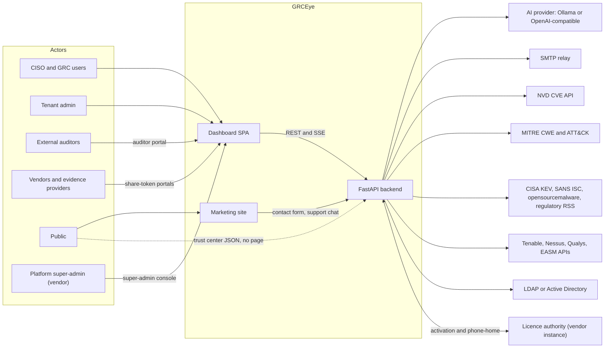

| External system | Direction | Protocol | Purpose | Optional? |
|---|---|---|---|---|
| Load balancer and TLS terminator | Inbound | HTTPS, then plain HTTP to the gateway | SaaS edge; health-checks `/` | SaaS only; not in the repo |
| AI provider: Ollama (default model `gpt-oss:120b-cloud`) or an OpenAI-compatible endpoint | Outbound | HTTP(S), JSON and streaming | All AI features; background machine translation | Yes (AI calls fail with HTTP 424); the `-cloud` model is relayed to Ollama's hosted service |
| SMTP relay | Outbound | SMTP | Notifications, scheduled reports, invitations, password reset | Yes |
| NVD; MITRE CWE and ATT&CK | Outbound | HTTPS | CVE and CWE catalogues; technique import on demand | Yes |
| CISA KEV, SANS ISC, opensourcemalware.com; regulatory RSS (CISA, UK NCSC, SANS, Krebs, tenant sources) | Outbound | HTTPS, JSON or RSS | Threat watch, KEV flags, regulatory watch | Yes |
| Tenable.io, Nessus, Qualys VM, generic EASM REST | Outbound | HTTPS with per-connector keys | Vulnerability findings; EASM asset discovery | Yes, per tenant |
| LDAP / Active Directory | Outbound | LDAP or LDAPS bind | Directory login, group-to-role sync | Yes, per tenant |
| Licence authority (the vendor's SaaS) | Outbound from on-prem | HTTPS | Revocation check every 12 h; online activation (vendor route missing) | Yes; offline activation works |
| DuckDuckGo Instant Answer API | Outbound | HTTPS | Lookup during vendor AI analysis | Not configurable |
| Redis; Sentry; webhook receivers | Internal; outbound | RESP; HTTPS | Shared state and Celery broker; error tracking; test ping only, no event ever dispatched | All optional; code comments say no Redis is reachable on the SaaS |

Every system integration is outbound and started by the backend: with no inbound machine credential (API key or service account), no findings hub, collector or agent can push data in. SaaS defaults send data off the host (AI relay, public search), and no default feed covers a KSA regulator (NCA, SAMA, SDAIA).

Evidence: `backend/app/core/config.py:128-179`, `backend/app/services/threat_feeds.py`, `backend/app/services/scanner_connectors.py`, `backend/app/services/license_phone_home.py`, `backend/app/api/v1/endpoints/vendors.py:402`, `backend/app/api/v1/endpoints/webhooks.py:16`

**Assessment:**
- Strength: the pull-based connector plumbing (scheduler, SSRF guard, scan journal) is the natural runtime for a findings-hub connector (CTEM) and for inventory connectors.
- Constraint: push-based CTEM and agent channels need an inbound machine identity first.
- Constraint (KSA): data residency needs a pinned, in-region AI endpoint per tenant and an inventory of every egress; today's defaults leave the host.

### 3.2 Deployment models

Four delivery channels share the code but not the build, configuration or background-job model: there are three nginx configurations and four backend Dockerfiles, and Celery runs in one on-prem channel only.

| | SaaS (grceye.com) | On-prem Docker bundle | Virtual appliance (OVA, VHD, ISO) | Dev and test composes |
|---|---|---|---|---|
| Packaging | PM2 on one Linux host: `gateway.js`, uvicorn (2 workers, loopback only), Next.js; TLS on an external load balancer | Saved images and a compose file: nginx (plain HTTP), backend, Celery worker, Redis, optional Ollama | Packer and shell stages on Ubuntu 24.04; systemd; restricted console | Postgres, Redis, Celery, Flower, Keycloak (dev); nginx and backend (test); Windows `setup.ps1` |
| Database | One SQLite file (WAL) | SQLite on a volume, seeded from the release seed | SQLite, seeded from the release seed | Postgres 16 (dev); SQLite seed (test) |
| Schedulers | 12 loops per worker; no Celery, no cron | 12 loops, 1 worker; Celery worker, no beat | 8 of 12 loops off at first boot; no Celery | Celery worker and beat (dev) |
| AI | Local Ollama, `-cloud` model relayed | Optional Ollama container or bring-your-own | Bring-your-own only | Ollama |
| Outbound | Feeds, NVD, scanners, SMTP, LDAP on | As configured | Feeds off by default | — |
| Code protection | None | PyArmor; licence enforcement baked in | Nuitka binary; licence enforcement; the network ISO ships readable source | None |
| Viability today | **Implemented**; the only proven channel | **Partial**: no column migrations at start-up; `cryptography` (imported at boot) is missing from `requirements.txt`, so fresh images likely fail (not executed); no OCR packages or Arabic fonts | **Partial**: the build gate fails on 16 unwired column migrations; the Nuitka include list names a package no longer installed; plain HTTP by design | Dev **Documented-only** (cannot build); test **Partial** (stale seed); Windows **Implemented** for development |

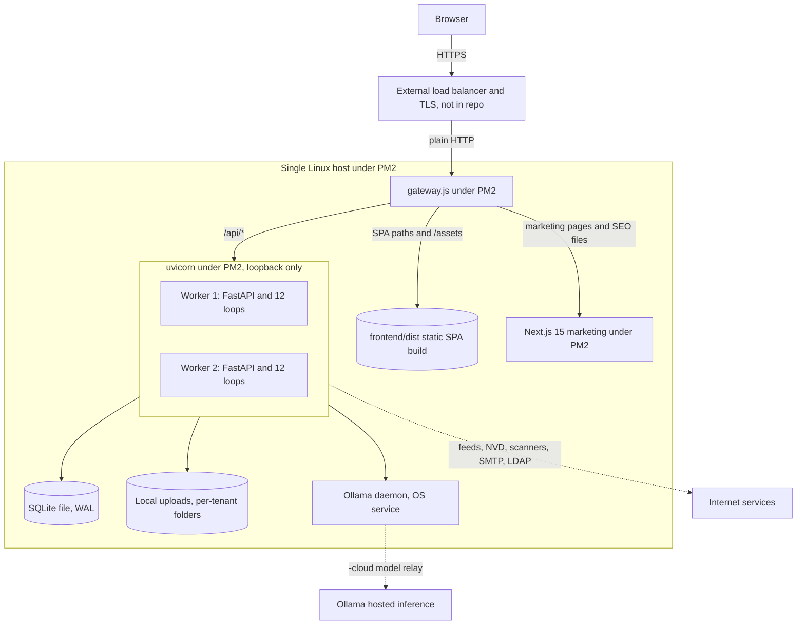

- **Topology.** Since 2026-08-27 `gateway.js` has been the single entry point behind the load balancer and serves the static SPA build. CLAUDE.md's "marketing in front of a bare Vite process" is out of date, though `marketing/next.config.js`, `DEPLOY_ELITE.md` and `frontend/ecosystem.config.cjs` still encode older variants.
- **Production profile.** Which configuration profile production runs is unverified: the project's sources disagree, and the production environment file is not on the analysis machine (§6.5, item 10). The development profile switches off production hardening (hidden API documentation, HSTS, start-up secret checks) and logs SQL parameters.
- **Reference content.** On-prem channels copy `release/seed/grc_seed.db` at first boot. The appliance build ships the committed file (2026-08-10; 77 built-in frameworks, 3,799 controls); the Docker release script first regenerates it from the live database (Appendix B.2). The committed file is 60 tables and 141 columns behind the models. CLAUDE.md's 94 built-in frameworks describes the production database, which is not on this machine (unverified).
- **Upgrades and backups.** The SaaS is updated by a manual runbook; the Docker bundle has no working column-migration path and the appliance no update mechanism. No channel schedules backups.
- **Capacity** (team measurement, not re-run): 934 requests/s at a 93 ms median with 2 workers, CPU-bound; 11 tenants and 17 users on 2026-09-04.

Evidence: `backend/ecosystem.config.js:5-13`, `gateway.js:149-204`, `docker-compose.onprem.yml`, `infrastructure/docker/entrypoint.backend.sh`, `build ova/scripts/20-app.sh:84-98`, `build ova/scripts/firstboot.sh:150-157`, `release/seed/grc_seed.db`

**Assessment:**
- Strength: the protected on-prem packaging (obfuscation or native compilation, offline Ed25519 licensing, leak-guarded builds, a hardened appliance) suits KSA customers who require on-prem or air-gapped delivery.
- Constraint: only the PM2 SaaS is demonstrably viable; the dependency manifest, migration wiring and seed must be repaired before any on-prem delivery.
- Constraint: one host, one SQLite file, local disk and in-worker schedulers mean no HA, no point-in-time recovery and no horizontal scale — not a base for an MSSP-scale SaaS.

### 3.3 Runtime view

| Process | Supervisor | Exposure | Role |
|---|---|---|---|
| `gateway.js` (Node, built-ins only) | PM2, 1 instance | Public interface, behind the load balancer | Serves the SPA build, proxies `/api` and marketing. No WebSocket upgrade, no CSP |
| uvicorn and FastAPI | PM2, 2 workers | Loopback only | API; every worker also runs `create_all()`, seeding and the 12 loops |
| Next.js 15 | PM2 | Reached through the gateway | Marketing site |
| Ollama daemon | OS service | Loopback only | Inference or relay |

Redis, Celery workers and cron are reported absent on the SaaS host (code comments, team register; not verifiable here).

**Background loops.** Each worker starts 12 asyncio tasks that share the request event loop, so a CPU-heavy cycle delays requests. Kill switches (`ENABLE_*`) are read from the process environment, not from the dotenv files, except for the notification and report loops.

| Loop | First run, cadence | Cross-worker guard |
|---|---|---|
| Threat feeds (CISA KEV, SANS ISC, opensourcemalware) | +120 s, every 24 h | `flock` file in the OS temp directory; UNIQUE item de-duplication |
| Scheduled reports | Every 300 s | Optimistic UPDATE claim on `next_run_at` |
| CVE/NVD sync (CWE when stale) | +180 s, wakes every 6 h, syncs if data is over 20 h old | Atomic O_EXCL lock file in the OS temp directory (stale after 2 h), plus the "recently synced" check; one sync per host |
| Scanner connectors | +90 s, hourly; per-connector interval | Optimistic UPDATE claim on `last_sync_at` |
| Audit recurrence | +60 s, hourly | Optimistic claim, released on failure |
| Archiving rules | Every 300 s | Atomic claim per occurrence |
| File retention purge | Hourly; acts only if enabled | Row claim (`purging`), resumable |
| Risk snapshots | +45 s, hourly; one row per tenant per day | UNIQUE constraint as claim |
| Licence phone-home | +120 s, every 12 h; licensed builds only | None (idempotent) |
| Notification sweep | +90 to 690 s, every 6 h plus jitter | `flock` sweep lock and de-duplication |
| Trend snapshots | +60 s, hourly | UNIQUE constraint as claim |
| Machine translation | +90 s; 300 s idle, 60 s with a backlog | Process-lifetime `flock` singleton |

DB and UNIQUE claims would hold across hosts; the four lock files in the OS temp directory (three `flock`, POSIX only, and one O_EXCL) hold on one host only, and there is no scheduler framework or distributed lock. The appliance switches 8 loops off at first boot.

**Celery** is configured (Redis broker, five task modules, five beat entries) but half-built: three task modules are empty, so two beat entries name missing tasks. With no worker, beat or Redis on the SaaS, its eight `.delay()` notification calls are caught and silently dropped (Partial). The Docker bundle runs a worker without beat; the appliance runs neither.

**Shared state.** `core/shared_state.py` keeps revoked refresh-token ids and public-endpoint counters in Redis when reachable, else in a per-process TTL dictionary; slowapi picks Redis or per-worker memory at import. The AI quota, licence verdict cache, view de-duplication, WebSocket rooms, SSE queues and AI semaphore are always per process. Without Redis, refresh-token revocation and rate limits are per worker; session revocation is DB-backed. Team code comments also state that the backend sees one client address behind the gateway, so IP-keyed authentication limits may act as one shared bucket, depending on the load balancer (not in the repository).

**File storage.** Files sit on local disk under `UPLOADS_DIR`, mostly in per-tenant folders. SHA-256 is recorded at upload and re-checked on read, a version ledger retires rather than deletes, and an opt-in purge checks live references. S3 settings exist without an S3 client (Model-only). The default cap is 2 MB (overrides up to 40 MB); request-size limits are inconsistent across tiers and enforced only after the body is read. There is no per-tenant quota and no encryption at rest.

**Observability.** No logging configuration exists, so scheduler INFO lines are lost; there are no metrics or tracing, and Sentry is optional. `/health` is static and outside `/api`, so through the gateway it returns the SPA shell; only the tenant-admin self-test touches the DB.

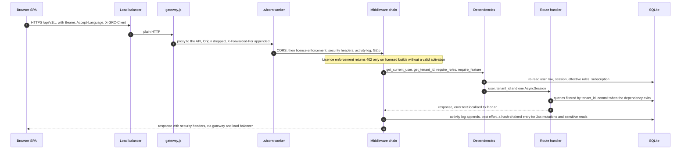

Evidence: `backend/app/main.py:45-125`, `backend/app/core/shared_state.py`, the rate limiter (evidence pack, Appendix C.2), `backend/app/workers/celery_app.py`, `backend/app/services/threat_scheduler.py:28-90`, `backend/app/services/file_integrity.py`

**Assessment:**
- Strength: the DB-level claim patterns are idempotent and can move to a dedicated job runner unchanged; the scanner-connector loop is the runtime to extend for inventory connectors and findings-hub pulls.
- Constraint: in-worker jobs with host-local guards and per-process state block a second host; an MSSP-grade SaaS needs a job runner with distributed locks and mandatory Redis.
- Constraint: operating many tenants needs metrics, routed health checks and retained job logs; none exist.

### 3.4 Technology stack

Python versions are floors from `requirements.txt` (there is no Python lockfile); JavaScript versions are resolved from the lockfiles.

| Layer | Technology | Version | Notes |
|---|---|---|---|
| Edge | `gateway.js` on Node.js | Not pinned on the SaaS host | No npm dependencies; images use Node 20 or 22 |
| Backend | Python; FastAPI, Starlette, uvicorn[standard]; Pydantic, pydantic-settings | 3.12; ≥0.141.1, ≥1.3.1, 0.32.x; 2.10+, ≥2.14.2 | OpenAPI generated; docs hidden in production mode |
| ORM and drivers | SQLAlchemy (asyncio); aiosqlite, asyncpg, oracledb, aioodbc | 2.0.x; ≥0.20, 0.30.x, 2.x, optional | Only SQLite is proven |
| Migrations | Alembic | 1.x | Installed, no revisions; 40 SQLite ALTER scripts instead |
| Identity | PyJWT, argon2-cffi, pyotp, ldap3 | ≥2.13, ≥23.1, ≥2.9, 2.9.x | HS256 JWT, Argon2, TOTP, LDAP bind |
| Cryptography | cryptography | ≥50, pyproject only | Ed25519 licences, AES-GCM secret box; missing from `requirements.txt` |
| Jobs | asyncio loops; Celery, redis-py | 5.4+, 5.2+ | Celery not deployed on the SaaS |
| Other backend libraries | httpx, slowapi, aiosmtplib, Jinja2, structlog, sentry-sdk | 0.28.x, 0.1.9+, ≥5.1.2, ≥3.1.4, 24.x, 2.x | Outbound HTTP, rate limits, e-mail, logging (default configuration) |
| Documents and OCR | ReportLab, openpyxl, python-docx, pypdf, arabic-reshaper, python-bidi; pytesseract, pdf2image | 4.2.5+, 3.1.5+, 1.1.2+, ≥6.16.1, 3.x, ≥0.6; 0.3.x, 1.17+ | Arabic PDFs need fonts at fixed Linux paths; OCR needs OS tesseract and poppler |
| AI | Ollama or OpenAI-compatible HTTP APIs, through httpx | — | No vendor SDK; default model `gpt-oss:120b-cloud` |
| SPA | React, TypeScript, Vite, react-router-dom | 18.3.1, 5.9.3, 6.4.3, 7.18.3 | Build is `vite build` without a type-check |
| SPA UI, data, i18n | Tailwind CSS, lucide-react; axios, TanStack Query, recharts; i18next, react-i18next | 3.4.19, 0.468.0; 1.20.0, 5.90.21, 2.15.4; 25.8.14, 16.5.4 | Hand-written components, no Radix or shadcn/ui; Query in about ten files, charts in three |
| Unused dependencies | Backend: boto3, anthropic, stripe, pgvector, tenacity. SPA: 11 Radix packages, react-hook-form, zod, zustand, date-fns, react-dropzone, cva, clsx, tailwind-merge | — | Declared, never imported |
| Marketing | Next.js (App Router), React, Tailwind CSS | 15.5.25, 18.3.1, 3.4.19 | Upgraded from Next 14 on 2026-09-09 |
| Quality tooling | vitest, Playwright, ESLint; pytest, ruff, mypy | 4.1.11, 1.58.2, 9.39.3; declared in pyproject | No test files, no ESLint config; CI non-functional |
| Packaging | Docker, PyArmor, Nuitka, Packer, Ubuntu 24.04 | Nuitka 2.5 | Images: nginx, `redis:7-alpine`, `ollama/ollama` |

**Dependency-licence posture (R5).** No GPL or AGPL code is linked into GRCEye and the main stack is permissive, so keeping the code proprietary and reselling it as SaaS, on-prem or through MSSPs is legally feasible once these items are handled:

| Item | Licence | Where | Effect on resale |
|---|---|---|---|
| Frontend runtime (497 lockfile packages) | MIT, ISC, Apache-2.0, BSD | Every browser and image | Attribution only; no third-party notice file is generated today |
| `ldap3`, `python-bidi` | LGPL-3.0 (to confirm for python-bidi 0.6) | Backend | Acceptable only unmodified, dynamically imported, replaceable and excluded from compilation, as site-packages are on the SaaS and Docker; the Nuitka appliance compiles them into its binary, which breaks these conditions (X-14) |
| `certifi` | MPL-2.0 | Backend | The appliance build rewrites one file, which must be published |
| poppler-utils | GPL-2.0+ | Separate OCR process, appliance | Source-offer duty when the appliance is distributed |
| `redis:7-alpine` | RSALv2/SSPLv1 from 7.4 | Docker bundle | Fine internally; review for resale or switch to a BSD fork (Valkey) |
| PyArmor runtime; Ollama hosted relay | Proprietary; service terms | Docker bundle; SaaS | Paid licence and EULA; third-party data processing |
| 8 unused framework library YAMLs from CISO Assistant (an AGPL-3.0 project) | Third-party content, including PCI SSC and AICPA copyright text | Copied into the on-prem image, the OVA and the ISO, although nothing loads them | Remove from every artefact before resale (X-14); not an encumbrance on the code |

Marketing-only LGPL and MPL packages are optional or lint-time and are not shipped on-prem. Two non-code items weigh more: the repository has no LICENSE file and sits under a personal account, so the code is proprietary with the IP holder to be confirmed (NG-10); and the framework catalogue carries text from licensed standards such as ISO, PCI DSS and COBIT (Appendix B).

Evidence: `backend/requirements.txt`, `backend/pyproject.toml:9,37`, `frontend/package-lock.json`, `marketing/package.json`, `build ova/scripts/25-protect-app.sh:166-260`, `docker-compose.onprem.yml:62-72`

**Assessment:**
- Strength: a mainstream, permissively licensed stack supports R5 commercial freedom and eases hiring.
- Constraint: manifests drift (`requirements.txt` against `pyproject.toml`, dead and unused packages, no Python lockfile) and CI runs no SBOM or licence scan, which enterprise buyers will ask for.
- Constraint: Redis licensing and LGPL handling in the native-compiled appliance need decisions before MSSP or appliance resale.

### 3.5 Backend architecture

| Package (`backend/app/`) | Contents | Convention and reality |
|---|---|---|
| `api/v1/endpoints/`, `router.py` | 63 router modules (about 50 kLOC), mounted by 63 `include_router` calls | Route handlers that also hold schemas, queries and business logic |
| `api/v1/dependencies/` | `auth.py`, `features.py`, `pagination.py` | Single gate for identity, tenant, role and plan |
| `services/` | 48 modules | AI foundation, schedulers, connector ingest, scoring, renderers, e-mail, audit chain |
| `models/` | 72 files, 113 tables | One declarative `Base` |
| `core/` | Config, database, datastore selection, security, shared state, rate limit, three middlewares, licensing, secret box, i18n catalogues | Cross-cutting concerns |
| `workers/`, `templates/email/` | Celery app with five task modules (three empty); three Jinja2 templates | Celery not deployed on the SaaS; brand hard-coded in templates |
| `frameworks/`; `schemas/`, `repositories/`, `integrations/` | YAML loader; empty packages | Dead code; intended layers never built |

**Layering.** The intended flow is endpoint → service → model, with `dependencies/` as the gate and `core/` for cross-cutting concerns. The code follows it only in part:
- **Schemas** are inline in endpoint modules (406 Pydantic classes).
- **Data access** is direct: 58 of the 63 endpoint modules query the ORM, so there is no data-access boundary and no single place for a global tenant filter. Tenancy is a `tenant_id` predicate repeated in each query, and about 50 cross-module links are JSON id lists (chapter 5).
- **Business logic** sits in very large endpoint modules: `compliance.py` has 5,688 lines, `frameworks.py` 3,100, `audits.py` 2,577, `ai.py` 2,235, `vendors.py` 2,047. Endpoints hold about 50 of the 84 kLOC.
- **Services** hold schedulers, connectors and renderers; the largest (`notification_generator.py`, `ai_prompts.py`) exceed 100 KB. Framework content bypasses the dead YAML loader: scripts write it as SQL into the SQLite file.

**Middleware**, outermost first: (1) **CORS**, inert behind the gateway, which drops `Origin`; (2) **licence enforcement**, returning 402 on `/api/v1/*` without a valid Ed25519 activation (login, refresh, `/auth/me` and `/license/*` exempt), a no-op unless the build is licensed or enforcement is switched on; (3) **security headers**: nosniff, `X-Frame-Options: DENY`, Referrer-Policy, Permissions-Policy, HSTS only in production mode, no CSP; (4) **activity log**, appending, best effort, authenticated 2xx mutations (except login, token-refresh, notification and activity-log routes) and a whitelist of sensitive reads to a per-tenant hash chain, in its own DB session, and dropping an entry whose write times out after 5 s or fails; (5) **GZip**, then the router.

**Errors and localisation.** Exception handlers translate the human-readable text of `HTTPException` details, 422 messages and the 429 message into French or Arabic from `Accept-Language` (catalogues in `core/locales`), leaving machine codes unchanged; AI failures map to HTTP 424. There is no common error envelope: lists mix `{items, total}` objects and bare arrays, shared pagination serves two routes, and versioning is the single `/api/v1` prefix.

**Configuration.** One pydantic-settings class declares 88 settings, read in rising priority from three dotenv files and the process environment; files resolve relative to the working directory, and `extra="ignore"` silently drops unknown keys. About 30 further flags, including most `ENABLE_*` kill switches, are read with `os.getenv` and work only from the process environment; 16 declared settings are never read. `ENVIRONMENT=production` only hides the API docs, turns on HSTS, lowers Sentry sampling, skips the demo seed and refuses to start with a weak `SECRET_KEY` or `DEBUG=true`; `DEBUG` also enables SQL echo. A datastore selection saved in a JSON file can override `DATABASE_URL` at start-up. Editing that selection is a deployment-wide function that today sits within tenant-administrator reach (§6.5, item 2); route-level detail is in the internal evidence pack (Appendix C.2).

**Database layer.** An async SQLAlchemy engine is built from `DATABASE_URL`: SQLite through aiosqlite (WAL, 30 s busy timeout, no foreign-key enforcement), or PostgreSQL, Oracle and SQL Server with a 20 + 40 pool and pre-ping. `Base` gives every table a UUID key and timestamps; `get_db` yields one session per request and commits when the dependency exits. Every worker runs `create_all()` at boot, which adds tables but never columns. Columns come from 40 hand-written, SQLite-only ALTER scripts, run by hand or by three orchestrators with different lists (6, 23 or all 40); Alembic has no revisions and nothing records the schema version. SQLite is the only working datastore in practice: built-in content exists only as SQLite rows, so PostgreSQL boots with zero frameworks, and the team reports Oracle DDL failures on JSON columns.

Evidence: `backend/app/main.py:156-197`, `backend/app/core/config.py:11-213`, `backend/app/core/database.py`, `backend/app/api/v1/dependencies/auth.py:35-215`, `backend/app/api/v1/endpoints/compliance.py`, `backend/appliance_cli.py:81-131`

**Assessment:**
- Strength: one async app, one declarative model, a dialect-aware engine and a single dependency choke point are where machine identities, an MSSP tenant context and a global tenant filter can be added.
- Constraint: without a repository layer, and with 5,000-line endpoint modules, a canonical asset and finding model (Blocks 2 and 3) cannot be added cleanly until data access is refactored.
- Constraint: Path C needs PostgreSQL with an Alembic baseline and engine-neutral content packs, including the KSA frameworks.

### 3.6 Frontend and marketing site

**SPA structure.** `frontend/src` holds 62 page files (58 routed; HowItWorks, Solutions, RiskQuantification and TrustCenterConfig are orphans), 43 shared component files, the API layer, two stores, two contexts, the i18n bundles and a 36-article trilingual knowledge base, all imported eagerly into one bundle. Three shells exist: the tenant layout (11 sidebar groups, banners, notification bell, AI assistant, onboarding tour), the auditor portal and the super-admin console. There is no 404 route, and the super-admin cannot enter a tenant's app (no impersonation).

**Routing and guard layers.** 70 `<Route>` elements cover public pages (login, register, password reset, licence, share-token portals, docs), the super-admin console, the auditor portal and 48 tenant routes. Four overlapping layers decide what a user sees; the backend's `require_roles` and `require_feature` remain the real enforcement.

| Layer | Source | Applied to | Nature |
|---|---|---|---|
| Role | `role` and `roles`, refreshed from `/auth/me` | `ROUTE_ROLES` (24 paths; a missing entry means open) and per-item nav roles | UX mirror; the two lists disagree on 4 paths |
| Tier module | `accessible_modules` from `/auth/me` | 22 routes | UX only; can contradict entitlements |
| Entitlement | `/subscriptions/current/entitlements` | Nav locks on 7 modules; in-page checks | UX; fails open on error |
| Plan | `user.plan`, synced from `/subscriptions` | Badge, trial banner and modal | Cosmetic |

**API client and tokens.** One axios instance adds the bearer token, `Accept-Language` (API messages, exports, reports and AI answers follow the UI language) and an `X-GRC-Client` audit hint. A missing response triggers a `/health` probe and then `/service-down`; a 402 shows an upsell or redirects to `/license`; a 401 triggers one refresh and replay. The weaknesses are architectural:
- tokens persist in `localStorage`, and no layer sets a CSP;
- refresh has no single-flight lock while the backend rotates refresh tokens, so concurrent 401s can wipe a valid session;
- logout is client-only;
- SSE and WebSocket channels put the token in the URL and read a storage key nothing writes, so support chat and reply notifications never authenticate;
- behind the gateway `/health` is an SPA path, so the outage probe always succeeds.

**State.** TanStack Query serves about ten files; other pages fetch in `useEffect`. Auth and appearance are hand-written `useSyncExternalStore` stores over `localStorage`, and two contexts hold the selected frameworks and plan features. Appearance is per browser, and its accent and reduced-motion options have no visible effect.

**Internationalisation.** One i18next namespace merges English, French and Arabic catalogues with overlay bundles and completes Arabic plural forms; `<html dir lang>` follows the language, which is chosen per browser, not per user or tenant. RTL relies on about 110 global `[dir=rtl]` CSS overrides plus `rtl:` variants and logical utilities, which is brittle because every new physical class needs a rule. Machine-translated system content carries an "auto-translated" badge with "show original". No Arabic web font is bundled (Geist has no Arabic glyphs), and charts are not mirrored.

**Design system and branding.** Components are hand-written Tailwind (no shadcn/ui, contrary to CLAUDE.md), with every palette hue remapped onto the brand kit at build time. The product name appears about 300 times in source and locale files, logos are static files, SEO metadata names grceye.com, `VITE_APP_NAME` is never read, and the backend's tenant `logo_url`, `settings.branding` and `white_label` flag are never consumed. A rebrand means editing source and rebuilding.

**Dashboards.** `DashboardPage` (executive summary, framework overview, risk trend, saved widget layout) and `AnalyticsPage` sit beside an Elite-gated `ModuleDashboard` with per-module KPIs and PDF/Excel export, mounted on nine pages; recharts appears in three files.

**Gaps.** Several backend capabilities have no screen: asset, risk and vendor import, access governance, tenant branding, audit-trail verification, the trust center, risk quantification and the self-test. Mock fallbacks remain in `RisksPage`, `SuperAdminPage` and the notification bell (SettingsPage user management, listed as mock in CLAUDE.md, now reads real data). A debug page ships in production; there are no frontend tests, ESLint configuration or build-time type-check; and modals lack dialog roles and focus management.

**Marketing site and request routing.** The Next.js 15.5.25 App Router site serves 14 page types under `/en`, `/fr` and `/ar`, with a custom i18n provider, an hreflang sitemap and JSON-LD. Its middleware locale-redirects marketing paths (rewriting `/`, which the load balancer health-checks) and marks other paths `noindex`. It calls only the public contact and support-chat endpoints, sets no security headers and is not shipped on-prem; its `next.config.js` still carries the earlier topology's rewrites, including Vite dev-server paths. The gateway routes as follows:

| Request path | Served by |
|---|---|
| `/api`, `/api/*` | FastAPI, proxied (`Origin` dropped, `X-Forwarded-For` appended) |
| `/_next/image*` | Refused (404) |
| `/assets/*`, `/login`, `/register`, `/app`, `/app/*` | SPA static build |
| `/sitemap.xml`, `/robots.txt`, `/site.webmanifest`, `/og-image.png` | Next.js |
| Other paths with a file extension | SPA build if the file exists, otherwise Next.js |
| Marketing page roots, optionally locale-prefixed (`/`, `/about`, `/blog` …) | Next.js |
| Anything else (SPA deep links such as `/dashboard`, and `/docs`) | SPA `index.html`, `noindex` except `/docs` |

Evidence: `frontend/src/App.tsx:67-294`, `frontend/src/api/client.ts:106-226`, `frontend/src/store/auth.ts:150-228`, `frontend/src/components/layout/Layout.tsx:40-148`, `frontend/tailwind.config.js:10-37`, `marketing/middleware.ts`

**Assessment:**
- Strength: the UI covers the GRC lifecycle broadly and is mostly wired, and the trilingual interface with RTL and an Arabic knowledge base is a strong base for R3.
- Strength: the data-driven navigation, entitlement context and API-client interceptors are natural hooks for MSSP tenant switching, white-label and new Inventory and CTEM modules.
- Constraint: there is no runtime white-label (hard-coded brand, build-time palette) and no Arabic web font; R5 and MSSP resale need a branding and theming layer.
- Constraint: token handling (`localStorage`, no single-flight refresh, client-only logout, no CSP) and the absence of tests must be fixed before enterprise and KSA public-sector buyers.

## 4. GRCEye today — functional modules

GRCEye exposes its functions through 63 FastAPI routers (581 HTTP routes and one WebSocket under `/api/v1`) and a React SPA of 62 page files, 58 of them routed. The map groups every functional module into three domains: the **GRC core** (what the regulator expects), **security operations** (what the client owns and what threatens it, overlapping Blocks 2 and 3) and **platform services** shared by both. Labels give router prefixes; arrows show today's integration, not the target. Sections 4.1–4.3 cover the core modules that carry most of R1 and R2. Not drawn: the support desk and public chat, the public contact form, the system self-test and database-configuration routes, and the changelog page.

```mermaid
flowchart LR
  subgraph PLAT["Platform services"]
    P1["Identity and access: /auth /users /groups /access-governance /mfa /sso /activity-log"]
    P2["Tenancy and licensing: /tenants /subscriptions /admin /license /licenses"]
    P3["Reporting and dashboards: /reports /report-builder /report-schedules /dashboard /dashboards /dashboard-export"]
    P4["Notifications and webhooks: /notifications /webhooks"]
    P5["Import and export: /data"]
    P6["AI: /ai and AI access"]
    P7["Internationalisation: /admin/translations and locale catalogues"]
    P8["Archiving and retention: /archiving"]
  end
  subgraph SECOPS["Security operations"]
    S1["Assets and business context: /assets /asset-graph"]
    S2["Vulnerabilities and scanners: /vulnerabilities /vuln-import /cve"]
    S3["Threat intelligence: /threats"]
    S4["Incidents: /incidents"]
    S5["Applied controls and exceptions: /applied-controls /control-evaluations /security"]
  end
  subgraph CORE["GRC core"]
    C1["Compliance and frameworks: /frameworks /compliance /requirements /compliance-scales"]
    C2["Risk: /risks /risk-scenarios /scenario-versions /risk-matrices /risk-cartographies /risk-treatment"]
    C3["Audit: /audits /audit-campaigns /audit-grids /audit-comments /auditor-portal"]
    C4["Policy and documents: /policies, Doc Generator, /ocr"]
    C5["Governance: /governance"]
    C6["Third-party risk: /vendors /contract-collab"]
    C7["Regulatory watch: /regulatory"]
    C8["Trust center: /trust-center"]
  end
  PLAT -->|"shared services"| SECOPS
  PLAT -->|"shared services"| CORE
  SECOPS -.->|"manual links held as JSON id lists, no automatic propagation"| CORE
```

### 4.1 Compliance and framework engine

The engine is a catalogue-plus-assessment design behind 84 routes in five routers: `/frameworks` (24), `/compliance` (45), `/requirements` (3), `/compliance-scales` (7) and `/control-evaluations` (5, which evaluates applied controls and is drawn under security operations). Twelve pages use it, from the framework editor and AI builder to a public evidence-upload page.

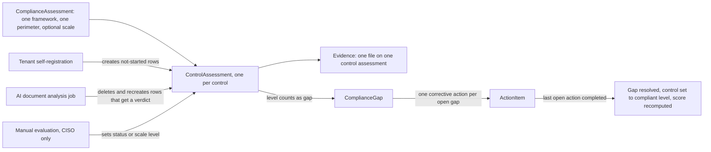

**Catalogue model and hierarchy.** `frameworks` → `framework_controls` → `control_requirements` (must/should/may lines). Frameworks carry a `source_type` (standard, regulation, law, internal policy); controls carry code, title, description, guidance, a free-text `category`, a controlled `domain` (ISO 27002 themes, NIST CSF functions), a `requirement_type`, a mandatory flag and crosswalk pairs. A self-referencing `parent_id` allows a hierarchy, but no shipped control uses it; regulator structure such as an ECC subdomain survives only in the `category` text. There is no unique key on framework plus control code and no edition family or "supersedes" link, so ECC-1:2018 and ECC-2:2024 are unrelated rows and an edition change means a new assessment. Requirement lines can be written but no route reads them, and the shipped corpus has none.

**Built-in versus tenant-owned content.** Built-in frameworks (`is_builtin`, no tenant) are one shared, read-only copy. No API edits them, the super-admin console included, so built-in content changes only through hand-run SQLite scripts. Tenants own and customise content in five ways, all Implemented with UI:

| Path | Behaviour |
|---|---|
| Clone ("Customize") | Copies metadata, controls, parent links, requirements and crosswalks; records the source framework |
| Empty custom framework | Draft framework; controls added in the editor |
| AI builder | Ollama proposes controls with a source reference; the tenant picks them |
| Referential import | CSV, XLSX or YAML; upsert on control code, cycle-checked parent links, dry run, file hash chained; 8 MB or 20,000 rows |
| Human translations | FR, AR or EN text per control, on forks only |

Control edits are snapshotted; changes to domain, type, mandatory flag and crosswalks are not. Upstream diff and sync adopt new controls from the source and refresh untouched ones, never deleting or overwriting local edits. This fork lineage is a tenant's only content-update channel. Two hazards: `is_builtin` defaults to true, so a careless future creation path would publish a tenant's framework to every tenant; and framework-change notifications go to all active users of all tenants with the framework's name and id. The first is latent. The second is dormant only on the PM2 SaaS, which runs no Celery worker, and live on the Docker stacks, which run one (§3.3, §5.3; §6.5, item 1).

**Crosswalks.** Each control holds a JSON list of (framework short name, control code) pairs: one direction, no relationship type, confidence or provenance. The seed's only crosswalks are 199 pairs from 93 ISO 27001 controls to SOC 2 and NIST CSF, written in upper case against lower-case codes. The read-side resolver ignores case and resolves all 199; the evidence-propagation resolver is case-sensitive and resolves none. A script adds ISO-hub maps for PCI DSS, SWIFT CSP and DORA; it is not applied to the seed and has nothing for KSA.

**Assessment model and scoping.** A `ComplianceAssessment` binds a tenant, one framework and one perimeter: the tenant, an org entity, a business process or a validated asset set. It may use a custom compliance scale (levels with weight, gap flag and FR/EN/AR labels) and runs draft → in progress → under review → completed → archived. Creation de-duplicates per perimeter; coverage rolls up by entity subtree, process and asset. An assessment's framework cannot be changed.

**Control-assessment lifecycle.** One `ControlAssessment` per control holds status or scale level, owner, notes, N/A justification, AI confidence and a separate auditor verdict. Rows are created only at tenant self-registration (one per control of each selected framework) and by the AI analysis job; creating an assessment creates none. A framework added later, every entity-, process- or asset-scoped assessment, and every tenant created on-prem (appliance CLI or release seed, neither of which creates rows) can therefore be evaluated only after documents are uploaded and analysed by a configured AI endpoint. Manual evaluation (a CISO-only PATCH) sets the level, opens or resolves the gap, creates the action item, re-scores and chains resolutions. Uploading a checklist document bulk-promotes controls to "partially implemented" with no gap sync or re-score.

**AI analysis and the destructive re-run.** `POST /analyze` runs as a FastAPI background task inside the web worker, not on a queue. It assesses every uploaded document's full text against every control (map-reduce, honouring a tenant's own AI provider). The run fails if fewer than half the controls get a verdict, and controls without one keep their rows. Every control that gets a verdict has its row deleted and recreated, with its evidence rows (file versions retired, bytes kept) and its gap. Each re-run therefore loses manual status, owner, notes, N/A justification, auditor verdict and per-control evidence on those controls, and orphans their share-link tokens; action items survive and are re-pointed. A run cut off by a worker restart stays "running" forever, blocking re-analysis and status changes.

**Gaps to action items.** A gap opens when a level counts as a gap. Severity comes from the model's rubric or a rule on "must" requirements; the certification-blocker flag also needs a "must" requirement, so it is always false on shipped content. One corrective action is created per open gap after each evaluation and on every action-plan read (a write on read). When a gap's last open action completes, the gap resolves, the control moves to the scale's compliant level and the score is recomputed (Implemented). Action recurrence is stored, but nothing spawns the next occurrence (Documented-only). The remediation planner streams an AI plan that is not saved.

**Evidence model.** One `Evidence` row is one file on one control assessment; nothing links one item to several controls. Cross-framework reuse copies the file into mapped controls of other assessments through the case-sensitive resolver, so it copies nothing on shipped data, and copies are not marked as shared. Assessment-level documents reach controls only through the ISO 27001 mandatory-document checklist, whose 45 seed rows use a lower-case key that the code queries in upper case (empty on a seed-based install). Internal upload is CISO-only with a 2 MB cap; external parties use share links (§4.3). Freshness and automation fields (`valid_from`, `valid_until`, `is_automated`, `source_integration`, `raw_data`) are Model-only, and nothing reminds on evidence expiry.

**Scoring.** The stored score is (implemented + 0.5 × partial) / (controls − N/A), or the mean level weight when a scale is used; the AI path divides by the framework's control count, the manual path by assessed rows. The dashboard card recomputes its own figure without excluding N/A or applying the scale, and counts a gap as open until its recommendation is accepted, so two screens can disagree. Scale-weight edits do not re-score, the scale's default flag is not applied, and the hourly Celery re-score task points at an empty module.

**Applicability and SoA.** `ControlApplicability` records an applicable, not-applicable or partial decision per control, org-wide or per entity or process, with justification, decider and review date. N/A is refused on mandatory controls and changes are chained. The requirements register and regulatory approval read it; assessments, AI analysis and scoring do not, and nothing checks the review date. There is no Statement of Applicability output (Partial).

**Control evaluation.** `/control-evaluations` (Elite flag `control_effectiveness`) scores an *applied* control on five 0–2 criteria and derives a performance level. It feeds the residual-risk suggestion (§4.2), not requirement status. The only bridge to requirements, `AppliedControl.framework_control_ids`, is Backend-only and unread, so requirements and implemented measures are two disconnected control models.

**Traceability.** Each assessment has a control → gap → action matrix (Implemented). The "cross-framework summary" lists other assessments' scores, and per-control coverage is the raw crosswalk list; the README's automatic cross-framework coverage is Documented-only. `/requirements` is a read-only register combining framework controls, policies, governance documents and regulatory updates.

**Role mismatch between API and UI.** The SPA opens `/compliance` to nine non-admin roles and `/action-plan` to eight, but every assessment read and write requires CISO (admins pass automatically). Compliance managers, control owners, risk managers, viewers and executives get 403 errors on the compliance page, and control owners cannot assess their own controls. Framework import, translation and applicability writes do admit compliance managers.

**Content inventory.** The shipped seed (`release/seed/grc_seed.db`, 2026-08-10) holds 77 built-in frameworks and 3,799 controls; Appendix B lists them.

| Family / region | Frameworks | Controls | Examples |
|---|---:|---:|---|
| KSA (NCA, SAMA) | 3 | 195 | ECC-2:2024, ECC-1:2018, SAMA CSF |
| Other GCC | 5 | 207 | UAE IAS, UAE IA, Dubai ISR, Qatar NIA, Bahrain CBB |
| ISO standards | 12 | 535 | 27001 (2022 and 2013), 27002, 27701, 22301, 42001 |
| NIST publications | 10 | 666 | CSF 2.0 and 1.1, SP 800-53, 800-171, AI RMF |
| Cross-sector catalogues and assurance | 12 | 712 | SOC 2 (two), CIS, CSA CCM, SCF, HITRUST, COBIT, OWASP |
| Financial sector and payments | 9 | 302 | PCI DSS (two), SWIFT CSP, DORA (two), PSD2, NYDFS 500 |
| Privacy and data protection | 10 | 250 | GDPR (two), CCPA, LGPD, PIPL, POPIA |
| US public sector and health | 6 | 352 | FedRAMP, CMMC, CJIS, HIPAA (two) |
| OT/ICS and automotive | 4 | 395 | IEC 62443, TISAX, ENISA ICS, NERC CIP |
| National baselines and AI regulation | 6 | 185 | NIS2, EU AI Act, ANSSI RGS, BSI C5, Essential Eight |
| **Total** | **77** | **3,799** | |

Seed-wide, no control has a parent, guidance is empty everywhere and description on 3,171 controls, there are no requirement rows or Arabic characters, only ISO 27001 carries crosswalks, and eight families ship overlapping editions with no relationship between them. Seventy-two frameworks exist only as database rows. The YAML loader is dead code, eight YAML files are CISO Assistant (intuitem) library files, and a CIS FortiGate script cites Tenable audit files, so provenance needs a licence review (R5). CLAUDE.md's "94 built-in frameworks" describes the production database, which is not on the analysis machine. Code comments cite about 95 frameworks and 4,537 controls, probably counting tenant forks and unseeded scripts (CIS FortiGate, five non-GCC national legal texts) (unverified). Content reaches the SaaS through hand-run SQLite scripts and on-prem appliances only through the seed copied at first boot.

**KSA and GCC content.** ECC-2:2024 was checked against NCA's published text (4 domains, 28 subdomains, 108 main controls, 92 sub-controls; the Arabic version is binding). The seed keeps NCA's 108 IDs and per-subdomain counts exactly, but only about one statement in five carries NCA's requirement. ECC-1:2018, SAMA CSF and the GCC sets were not checked against official text.

| Framework | Version (short name) | Controls | Granularity | Official vs paraphrased | Arabic | Mappings | Gaps |
|---|---|---:|---|---|---|---|---|
| NCA ECC-2:2024 | 2:2024 (`nca-ecc-2024`) | 108 | Main controls 1-1-1 to 4-2-4, flat; domains and 28 subdomains only in category text; per-subdomain counts match NCA's; all mandatory | Paraphrased one-liners, title equal to description; about 1 in 5 matches NCA's requirement | Runtime machine translation only | None | 0 of NCA's 92 sub-controls; no guidance or evidence expectations |
| NCA ECC-1:2018 (legacy) | 1:2018 (`ksa-ecc`) | 30 | Subdomain level (1-1 to 5-2); no descriptions | Numbering diverges from the official edition (here 2-10 is "Penetration Testing", officially Vulnerabilities Management) | None | None | No link to ECC-2; no source file |
| SAMA CSF | 1.0 (`sama-csf`) | 57 | 15 section rows and 42 items; flat; no descriptions; none mandatory | Numbering 1.x–3.x, not the official 3.1–3.4 sections | None | None | No maturity scale shipped; no source file |
| NCA CCC-2:2024, DCC, CSCC, OTCC, TCC | — | 0 | — | — | — | — | Absent; OT only generic (IEC 62443, NIST SP 800-82, ENISA ICS) |
| SDAIA PDPL | — | 0 | — | — | — | — | Absent; only a country hint in an AI prompt |
| Other GCC: UAE IAS 86, UAE IA 20, Dubai ISR 49, Qatar NIA 27, Bahrain CBB 25 | 2.0, 2019, 2.0, 1.0, 1.0 | 207 | Flat one-liners; UAE IA without descriptions | Paraphrased; UAE IAS uses ISO 27001:2013-style families, not the official ones | None | None | Counts not checked against official catalogues |

Of BM-01's eight R1 frameworks, two are present (ECC-2:2024, SAMA CSF) in paraphrased, single-level, English-only form, six are absent and none is cross-mapped. Arabic requirement text exists only as a per-installation machine translation of the English paraphrase.

Evidence: `backend/app/models/framework.py:37-169`, `backend/app/models/compliance.py:36-286`, `backend/app/api/v1/endpoints/frameworks.py:1184-1272`, `backend/app/api/v1/endpoints/compliance.py:2505-2850`, the self-registration handler (evidence pack, Appendix C.2), `frontend/src/App.tsx:127`, `backend/add_gcc_frameworks.py:741-777`, `release/seed/grc_seed.db`

**Assessment:**
- **Strength.** The assessment → verdict → gap → action → closure → re-score loop works end to end, with scales, perimeter scoping and hash-chained governance acts. It is the state machine a CTEM connector should drive, once callable as a service without a user token.
- **Strength.** Fork, import and upstream sync already form a content-pack path; the catalogue can hold KSA content once hierarchy, editions and official Arabic text are first-class.
- **Constraint (R1).** KSA coverage is two of eight frameworks, paraphrased, English-only and unmapped; built-ins change only through SQLite scripts; the crosswalk model is too weak for NCA ↔ ISO, NIST and SAMA mapping.
- **Constraint (R2, R7).** Control rows appear only through registration or AI, an AI re-run destroys manual work, evidence is copied per control, and nothing (applicability, applied controls, exposures) changes requirement status automatically.

### 4.2 Risk management

The risk engine has 64 routes in nine routers over about 15 tables: `/risks` (13), `/risk-scenarios` (7), `/scenario-versions` (3), `/risk-matrices` (4), `/risk-cartographies` (7), `/risk-treatment` (8), `/applied-controls` (10), `/security` (7, exceptions and acceptances) and `/control-evaluations` (5, shared with §4.1). The backend logic is rich; the UI wires only part of it.

| Method | What the code does | Status |
|---|---|---|
| Qualitative likelihood × impact | Server-side scoring from a tenant-configurable JSON matrix | Implemented (matrix management Backend-only) |
| Scenario chains, ISO 27005 style | Threat → vulnerability → asset → control, plus incidents, threat actor, strength of knowledge, loss range | Partial (UI creates and lists only) |
| Scenario prioritisation | Matrix score × regulatory-exposure factor × asset-criticality factor; tenant multipliers and alert threshold | Implemented |
| Monte Carlo quantification | 10,000 triangular draws: ALE, P90, P95, residual ALE | Backend-only (page not routed; nothing saved) |
| Risk cartographies | CISO-owned maps with scope filters, manual positions, EN/FR/AR PDF | Implemented (inherent values only) |
| AI risk analysis | Streamed Markdown: suggested scores, treatments, controls, KRI ideas | Implemented; nothing stored |
| KRIs, FAIR, EBIOS RM | — | Absent |

**Scoring engine and matrices.** The scoring service resolves the risk's or tenant's matrix (falling back to a hard-coded 5×5), reads the grid cell, and stores a level and severity, using residual values when both are set and inherent ones otherwise. Severity is recomputed only when the risk itself is written. A new default matrix does not re-score the register (its docstring says it does), and CSV import stores no severity. The inherent, residual and target "scores" are raw products while severity uses the grid cell, so the two diverge on custom grids. The UI ignores matrices: a hard-coded 5×5 heatmap, preview thresholds (20/12/6) that differ from the backend bands (19/13/7), and no matrix screen.

**Scenarios.** A `RiskScenario` holds JSON id lists (threats, vulnerabilities, assets, applied controls, incidents), current and target probability and impact, a loss range, appetite, review date, regulatory weight and a stored priority, but no org scope or lifecycle. Each new scenario creates its own `Risk` (foreign key); later edits overwrite that risk's likelihood and impact without a risk version or appetite alert. No API attaches a scenario to an existing risk, so consolidation is always one scenario to one new risk, and scenario targets never reach the risk. Vulnerability severity, CVSS, KEV and EPSS are not priority inputs.

**Quantification.** `POST /risks/quantify` multiplies a triangular loss draw by a yes/no occurrence draw 10,000 times and returns ALE, P90, P95, a histogram and a residual ALE from a user-typed effectiveness. Nothing is saved. It is not FAIR, ignores the scenario's loss fields and has an unenforced plan flag, and its page (hard-coded USD) is one of the four orphans.

**Residual computation.** Residual likelihood and impact are typed in through the API only. A control-based residual exists only as an on-request suggestion, never stored and without UI: inherent × (1 − effectiveness × coverage), where effectiveness is the mean latest evaluation (1.0, 0.5 or 0.1) and coverage the share of linked controls operating and validated. It credits only the statuses "active" and "in_progress"; "active" does not exist and "implemented" is excluded, so an implemented, validated control earns nothing. No event or job recalculates a risk when controls, evaluations, vulnerabilities, asset criticality, compliance results or incidents change; jobs only count or notify.

**Treatment.** `/risk-treatment` (Elite `risk_treatment_plans`) allows one live plan per risk, enforced by a unique key that SQLite can relax only with a table rebuild. A plan has an option (mitigate, accept, transfer, avoid) with a mandatory justification, a complexity-adjusted priority, costs, progress, and tracking of overdue and over-budget plans. Superseding snapshots the plan; a plain PATCH does not. The UI shows the justification field only for "accept", so the other three options fail with 422, and it has no PATCH client. Accepting a plan does not change the risk's status, plans have no action items, and there is no ticketing.

**Acceptances and exceptions.** `/security` holds time-boxed waivers (`SecurityException`, with polymorphic entity ids and compensating controls) and `RiskAcceptance` records (risk and scenario ids, approver, expiry). Any user creates them; the CISO approves under four-eyes control with a state guard. Expiry is applied lazily when lists are read and is chained, with no scheduler. Exceptions cannot be updated or revoked, acceptances cannot be rejected and do not change the risk's status, linked ids are unvalidated, and the UI sends none, so in practice both are free-text records.

**Versioning and history.** Risk versions snapshot 15 fields with transition, reason and author on each PATCH or appetite change (not on create, scenario propagation or import) and survive deletion, but their read routes have no UI. Status transitions are free except reopening a closed risk, and "accepted" needs no acceptance record. Scenario versions are Elite-gated; without the entitlement, automatic snapshots are skipped silently. Treatment versions are written on supersede, applied-control history keeps field-level diffs, and deletes write the final state into the hash-chained log.

**Snapshots, trends and appetite.** A daily job stores each tenant's open-risk counts by severity, claiming its run through a unique (tenant, date) row; it feeds the trend chart and executive summary. Trend snapshots cover vulnerabilities, threats and governance, not risk. Appetite thresholds per risk and per scenario (Elite `risk_appetite`) raise alerts on write and in the 6-hourly sweep, and a gate validates targets against appetite. The API response omits `target_over_appetite`, so the UI badge never shows and validation is offered, then refused.

**Org scoping.** Only `Risk` has org-entity and business-process foreign keys, tenant-validated and filterable server-side. The response omits them, the create form has no inputs, and the register filters client-side on the null fields, so the entity filter empties the list. Scenarios, controls, treatments, exceptions and cartographies have no entity scope, and risks do not inherit scope from their assets. Business and control owners may write only records they own, but UI-created risks have no owner.

**Link types.** Solid edges are foreign keys; dotted edges are JSON or string references without database integrity.

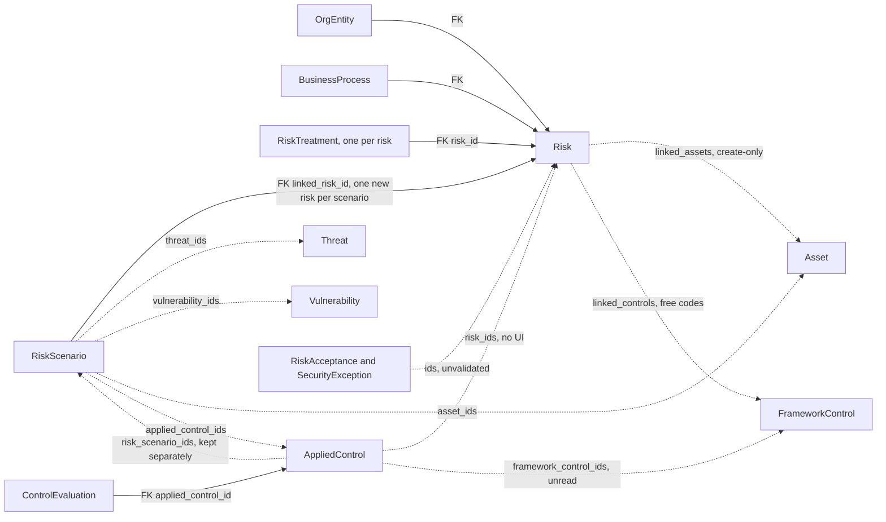

Of the dotted links, only the control's risk and scenario lists are tenant-validated on write (scenario-to-vulnerability links too, when set from the vulnerability side). Reverse lookups scan JSON text with LIKE, and deletes leave dangling ids that later break edits resending them. No relational path runs from asset to control, risk and requirement.

**UI coverage gaps.**

| Page | Exposes | Missing |
|---|---|---|
| Risk register | List, create, appetite, target validation, AI panel | Edit, delete, status, residual, owner, scope, linked items, versions; the status sent on create is dropped |
| Risk scenarios | Create with chain pickers, priority criteria, version history | Edit and delete; incident links chosen at create are dropped; loss fields |
| Risk treatment | Create, supersede, history, tracking | Non-accept options (422), PATCH, owner, complexity, actual cost |
| Matrices, quantification, residual suggestion | — | No reachable UI |
| Applied controls | Register, validation, history, obsolescence | Links to risks, requirements or vulnerabilities (scenarios only) |
| Exceptions and acceptances | Create, approve, reject exceptions | Links to any risk, control, vulnerability or asset |

The four Elite risk flags (`risk_appetite`, `risk_treatment_plans`, `scenario_versioning`, `control_effectiveness`) are off for the default on-prem tenant, which is on the enterprise tier.

Evidence: `backend/app/services/risk_scoring.py:77-142`, `backend/app/models/risk_scenario.py:53-56`, `backend/app/services/residual_risk.py:46`, `backend/app/api/v1/endpoints/risks.py:209-231`, `backend/app/api/v1/endpoints/risk_scenarios.py:517-534`, `backend/app/api/v1/endpoints/risk_treatment.py:247-254`, `backend/app/api/v1/endpoints/security_exceptions.py:166-281`, `frontend/src/pages/RisksPage.tsx`

**Assessment:**
- **Strength.** The engine already has the nouns Path C needs: configurable server-side scoring, ISO 27005-shaped scenarios, per-object history with hash-chained deletes, four-eyes approvals, and daily snapshots with a claim that is safe across workers.
- **Constraint (R7).** "Risk updated automatically" is absent. Nothing recalculates on events or on a schedule, every chain link is JSON, and the residual suggestion has a status defect. Path C needs association tables and a recompute service that writes a computed residual with provenance and a version.
- **Constraint (R2).** The UI exposes a fraction of the backend: no risk edit, delete, status, residual or scope; treatment creation fails for three of four options; matrices and quantification are unreachable.
- **Constraint (KSA, MSSP).** The UI assumes USD and a 5×5 grid, scoping inside a tenant exists only on `Risk` and is broken, and no route rolls risk up across tenants.

### 4.3 Audit, policy, governance and evidence

This area has 128 routes in nine routers: `/audits` (40), `/audit-campaigns` (8), `/audit-grids` (12), `/audit-comments` (5), `/auditor-portal` (13), `/policies` (15), `/governance` (23), `/archiving` (10) and the public evidence upload (2). Auditor management in `/users` and evidence routes in `/compliance` complete it. The audit engagement is the most complete workflow in GRCEye.

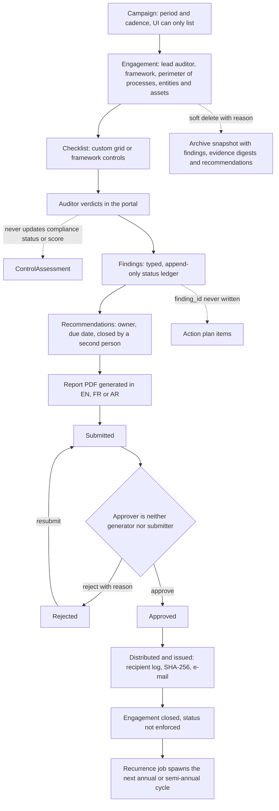

**Engagement lifecycle.** Campaigns (period, cadence, summary, stakeholder announcement) are complete in the backend, but the UI only lists them, so they cannot be created or announced on screen, and cadence generates nothing. An engagement carries a lead auditor, framework, optional compliance assessment, campaign, grid and a perimeter of processes, entities and assets held as tenant-validated JSON lists. It has a filtered register, an AI-drafted plan, and soft delete with a mandatory reason that first snapshots it into the archive. The status sequence (planning to closed) is not enforced: any audit-write role, including an assigned auditor, can set any status.

**Checklists and verdicts.** Grids carry their own verdict levels (FR/EN/AR labels, weight, gap flag) and can be seeded from any visible framework, including `nca-ecc-2024` and `sama-csf`. Without a grid, verdicts sit on the control assessment. Verdicts are overwritten in place, with history only in the activity chain, and never feed compliance status or score. The internal team's answering routes have no UI; the checklist screen serves the auditor role only.

**Findings, recommendations and action plans.** Findings are typed (major or minor nonconformity, observation, improvement), with an append-only status ledger, auditee responses, and closure by someone other than the remediation owner. Recommendations have an owner, due date and progress, close under separation of duties, and are chased by an escalation ladder. `ActionItem.finding_id` is read by the progress roll-up and the report's action-plan section but never written, so progress never derives, findings never auto-advance and that report section is always empty. Findings link only to framework controls, not to risks, gaps, applied controls or vulnerabilities. The portal's finding-creation path defaults to type keys that the register and report do not recognise.

**Report approval and distribution.** The report has its own state machine. Each generation writes a new file version (EN/FR/AR, 107 labels per language) and resets the report to draft. Before approval, only the audit team can download it. The approver cannot be the generator or submitter, admins included. Distribution needs an approved report, logs up to 20 recipients with the version and SHA-256, and e-mails the PDF only after re-checking the approved digest; scheduled distribution reuses this. The AI narrative report is not saved. `/audits` evidence and report downloads skip hash verification; portal and archive downloads perform it.

**Recurrence.** An hourly in-process job claims closed annual or semi-annual audits and spawns the next cycle under a system actor. It ignores soft deletion, and the successor drops the campaign, grid, assessment, perimeter and plan. There is no quarterly option, and campaign cadence and audit recurrence use different vocabularies.

**Auditor portal and external isolation.** Tenant admins create auditor accounts with an external flag, organisation and expiry, checked on every request. Assignment targets compliance assessments only, so an auditor reaches an engagement as its lead or through its linked assessment. Three separate rule sets keep auditors to their engagements in the audit routes, the portal and comment threads. Four shared surfaces are scoped by role, or not at all, rather than by engagement: archives, campaign engagement listings, generic file-version access (which reaches other engagements' draft reports and evidence in the same tenant) and comment threads for non-auditor users. A user belongs to one tenant with a platform-unique e-mail, so an audit firm needs one account per client.

**Policy lifecycle.** Policies have five statuses, review dates, an owner, process and entity links, linked controls (resolved both ways), versions with restore, attestations, an Arabic-capable PDF and AI drafting, including the Doc Generator (27 document types in four categories; CLAUDE.md says 29). It is a record, not a workflow:
- A policy manager or CISO can set any status, "published" included.
- Version approval is a stamp, with no separation of duties, status effect or chain entry. The Doc Generator lets one user create, approve and set "approved".
- Attestations are not de-duplicated, have no decline route, and acknowledgement has no UI.
- No job sends review or attestation reminders, despite the help text, and the review frequency never sets the next review date.
- Drafts are visible to all tenant users, auditors included, and compliance managers can open `/policies` but get 403 on writes.

**Governance.** The Elite governance module holds RACI assignments (by role, user or group, with activities and entities as free text), groups, committees and a trend. Committees have unvalidated policy and document links and no minutes, decisions or attendance. A text-only document repository has versions and per-document access lists, whose "validate" right equals "edit". The UI covers create, delete and access lists only. Policies and governance documents are separate stores; neither holds binary files or links to the mandatory-document catalogue, which has 45 ISO 27001:2022 rows and nothing for NCA, SAMA or PDPL.

**Evidence integrity, versioning, retention and archiving.**

| Capability | Mechanism | Status |
|---|---|---|
| Integrity at upload | SHA-256 on control evidence, assessment documents, audit evidence, action attachments and vendor contracts | Implemented |
| Verification on download | Refuse on mismatch, with a logged CISO override | Partial: `/audits` downloads skip it |
| Version ledger | Per-parent versions (current, superseded, deleted); deletes retire versions and keep bytes | Implemented (deleted-files list and integrity report Backend-only) |
| File retention | Opt-in purge of superseded (365 days) and deleted (90 days) versions; keeps the last 10; checks live references first | Backend-only, off by default |
| Legal hold, freshness, automated evidence | Flags and validity fields on the models | Model-only |
| External collection | Share link per control assessment: expiry, use limit, per-IP rate limits, MIME and magic-byte checks | Implemented; no uploader identity or activity-log entry; stored outside the tenant folder; a duplicated ISO clause reference fails some uploads after the write |
| Archiving | JSON snapshots of 8 entity types (audits with children and evidence digests), rule-based auto-archiving, integrity-checked archived-evidence download, purge with a chained manifest | Implemented, Elite (content view Backend-only; auto-archiving not logged; live rows untouched) |
| Activity-log retention | Seal-then-purge of chained ranges (365-day floor, 3,650-day default) | Backend-only, off by default (UI removed in commit `bc8421f`) |
| Upload limits | 2 MB for compliance, portal and public uploads; 20 MB for `/audits` evidence | Implemented, inconsistent across routes |

Files sit on local disk in per-tenant folders, except public uploads and audit-report PDFs; the S3 columns are unused. Audit, policy and archive PDFs render Arabic right to left, but fonts come only from three fixed Linux paths and none is bundled: the OVA installs Amiri, the Docker on-prem image installs nothing, and a missing font silently turns Arabic into unreadable Helvetica. Whether the SaaS host has the fonts cannot be verified from the repository. Authenticated 2xx mutations are hash-chained on a best-effort basis (login, token-refresh, notification and activity-log writes are skipped, and an entry is dropped if its write times out after 5 s or fails), with explicit before/after entries for audits; policies, governance, `/audit-comments` and internal grid answers get only generic entries, and external uploads and auto-archiving are not logged (§5 covers the trail).

Evidence: `backend/app/api/v1/endpoints/audits.py:1281-1713`, `backend/app/models/action_item.py:73-75`, `backend/app/services/audit_recurrence_scheduler.py:66-104`, `backend/app/api/v1/endpoints/policies.py:328-830`, `backend/app/api/v1/endpoints/governance.py`, `backend/app/services/file_integrity.py`, `backend/app/services/file_retention.py`, `backend/app/services/pdf_arabic.py:37-44`

**Assessment:**
- **Strength (R2, R8).** The audit engagement ties its perimeter to inventory objects and adds typed findings with a ledger, separation-of-duties approval and integrity-checked distribution. It is the reusable "validated deliverable" pattern for CTEM and regulator reports, and recommendations with the escalation ladder give a remediation and SLA skeleton.
- **Strength.** Evidence integrity (hashes, version ledger, recoverable deletes, reference-checked retention) is a sound base for collector and automated evidence.
- **Constraint (R2).** Policy and governance are records, not workflows: no enforced approval, separation of duties or reminders, and text-only documents. The finding-to-action link cannot be written, and verdicts never move compliance status.
- **Constraint (R3, R4, MSSP).** External-auditor scoping leaks on shared surfaces stay inside the client tenant (other engagements' files and archives, not other tenants), and auditors are single-tenant, so an audit firm needs one account per client. Arabic PDFs depend on host fonts, and mandatory documents cover ISO 27001 only.

### 4.4 Third-party risk, regulatory watch and trust center

#### Third-party risk management (TPRM)

TPRM is the deepest and most AI-assisted vertical in this area. It rests on `Vendor` (tier, five statuses, owner, DPA flag, contract expiry, `risk_score`), `VendorContract` (file, SHA-256, extracted text, AI review, approval workflow) and `ContractCollaboration`/`ContractMessage` (the external negotiation portal). `VendorAssessment` and `VendorRisk` are Model-only: only the vendor-delete cleanup touches them. Vendor statuses are labels with no transition rules.

| Step | What the code does | Status |
|---|---|---|
| Onboarding pre-screen | 15 questions hard-coded in the frontend; the AI may move a deterministic baseline score by ±1; Saudi regimes (PDPL, NCA ECC-2:2024, SAMA CSF) are injected for KSA vendors. Answers and narrative are discarded on save | Partial |
| AI risk assessment | Six-domain rubric report in en/fr/ar after a public web lookup of the vendor name; it overwrites `Vendor.description`, and the score is saved through an approval call but supplied by the client | Implemented |
| Tiering and score | Tier is manual; `risk_score` holds three scales (1–40 at creation, 1–10 after AI approval, 1–25 in the cartography) | Partial |
| Contract upload and AI review | 2 MB cap, type and magic-byte checks, SHA-256 versions; whole-document map-reduce review with OCR fallback, run as an in-process task with no retry | Implemented (onboarding wizard only) |
| CISO approval | Maker-checker, CISO only | Implemented |
| Send to vendor | Sets a timestamp; nothing is sent | Partial |
| Negotiation portal | Unauthenticated share-token page: edit, chat, agree, typed-name signature; the signed agreement is archived as a contract version with SHA-256 | Implemented |
| Risk cartography | Six likelihood × impact dimensions from vendor fields and English keywords in the AI review, so Arabic or French reviews match few keywords | Implemented (heuristic) |
| Alerts | Contract expiry (90/60/30/7/0 days), CISO queue, negotiation deadlines; in-app only | Implemented |
| Periodic reassessment | Review dates exist only in report text; the reminder task points at an empty module | Model-only |
| Edit, delete, status or tier change, contract upload after onboarding, CSV import | API routes only; no screen reaches them, so a vendor cannot be off-boarded and a renewed contract and its `contract_expiry`, which drives the alerts, cannot be recorded from the UI | Backend-only |

Vendors are an island in the data model. Outside TPRM, only `Incident.linked_vendors` (JSON) points at a vendor, and the `supplier` asset type has no vendor reference, so vendor risk is invisible to the risk register, CTEM and control applicability. The portal's share tokens cannot be revoked, their expiry is chosen by the caller (default 30 days, no ceiling), their routes are not rate-limited and their actions are not written to the hash-chained trail. The token is also exposed to internal users, so a vendor signature is a typed name not bound to a verified identity.

#### Regulatory watch

| Aspect | Today |
|---|---|
| Sources | Tenant-owned feeds (RSS, Atom, JSON or manual) with jurisdiction, issuer and language. Four defaults per tenant: CISA, UK NCSC, SANS ISC, Krebs on Security. No KSA source (NCA, SAMA, SDAIA, CST) and no Arabic default |
| Ingestion | Manual trigger only; none of the 12 scheduler loops fetches feeds. SSRF guard on every redirect hop; 12 items per source; deduplication by title |
| AI triage | `regulatory_impact` task in batches of up to 20 items, limited to the tenant's selected frameworks; relevant items become `pending_approval` drafts with rationale and confidence, machine-translated at read time |
| Approval chain | Version snapshot → affected controls resolved → `ControlApplicability` set to applicable where undecided → one preventive `ActionItem` per control, due at the deadline → hash-chained activity entry |
| UI | Lists, creates, fetches, approves, rejects and drafts a control. Source management, history, edit and delete are Backend-only: client wrappers exist, no page calls them |

#### Trust center

Configuration is a JSON block in `tenant.settings`. An unauthenticated endpoint publishes, per tenant slug, assessment names and scores, published policy names, subprocessor counts and countries, and "certifications" that are simply assessments scoring 70 or more ("Compliant" from 90). There is no branding, document vault, NDA flow or rate limit, and the `trust_center` plan flag is not enforced. The configuration page has been unrouted since commit `013a77e` (28 August 2026) and nothing renders the public endpoint, although marketing copy advertises the feature. Status: Backend-only.

Evidence: backend/app/models/vendor.py:31-163, backend/app/api/v1/endpoints/vendors.py, backend/app/api/v1/endpoints/contract_collab.py, backend/app/api/v1/endpoints/regulatory.py:62-87, backend/app/api/v1/endpoints/trust_center.py:107-204, frontend/src/pages/VendorsPage.tsx, frontend/src/pages/RegulatoryUpdatesPage.tsx

**Assessment:**
- **Strength:** the TPRM workflow (baselined AI pre-screen, whole-contract review, maker-checker approval, negotiation portal with archived agreements) covers the third-party leg of R2 up to onboarding, and the prompts already name the Saudi regimes.
- **Constraint (GRC core):** vendors are not linked to assets, risks or controls, cannot be maintained or off-boarded from the UI, and questionnaires are not persisted. The core needs those links and a persisted KSA questionnaire library (NCA ECC third-party and TCC clauses, SAMA third-party requirements).
- **Constraint (KSA):** the approval chain (update → applicability → action items → trail) is reusable, but KSA sources, scheduled fetching and a source-management UI are missing.
- **Constraint (MSSP):** the share-token portal needs revocation, rate limiting, audit logging and vendor identity before it serves many client tenants; the trust center is not usable today.

### 4.5 Asset inventory and business context

GRCEye's inventory is a GRC asset register with strong business context. It is not a collector.

#### Asset model

`Asset` is one tenant-scoped table of 34 columns (31 declared plus the inherited id and timestamps).

| Column group | Columns | Remarks |
|---|---|---|
| Identity and class | `name`, `asset_type` (14 values, including process, data, person, site, supplier), `asset_class` (primary or support), description, tags | `name` is the de facto key and is not unique |
| Business value | Criticality (4 levels), `business_value` (free text), C/I/A (1–5), RTO/RPO/MTD, data classification (free text), PII/PHI/PCI flags | C/I/A history is kept; no score reads C/I/A |
| Ownership and context | `owner_id` (mandatory on API create), `business_process_id`, `org_entity_id`, `serves_asset_ids` (dependency, JSON) | |
| Lifecycle | 5 lifecycle states, 5 operational statuses, acquisition, end-of-life and review dates | Transitions and deletes are hash-chained; EOL and review alerts |
| Hosting | Hosting type, cloud provider, `location` (free text) | `location` doubles as a scanner match key |
| Provenance | `integration_source`, `external_id`, `raw_metadata` | Written only by EASM discovery; not returned by the API |
| Absent | Hostname, FQDN, IP, MAC, serial, OS, cloud resource id, last seen, software and versions | No unique constraint besides the primary key |

#### Business-context backbone and cartography

Solid lines are foreign keys; dotted lines are JSON id lists with no database integrity.

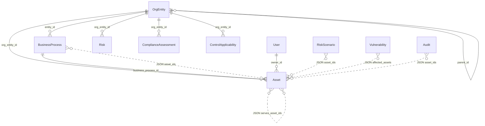

`OrgEntity` is a self-referencing tree with cycle protection. `BusinessProcess` carries an owner, a free-text criticality, an operating entity and an asset list. Risks, policies, assessment scope, control applicability and audit perimeters reuse this backbone. It has no process-level BIA and no process-to-process or process-to-vendor links. The process–asset relation is stored twice (FK and JSON) and the two can diverge. Deleting an entity or process leaves dangling references in risks, policies, assessments and applicability rows, which becomes an integrity error on server databases.

The cartography service returns the whole estate, unpaginated, as an entity → process → asset graph, adding an "owned by" edge inferred from a shared owner and filtering by entity subtree and asset type. `AssetGraphPage` draws a fixed-size ring layout and creates and deletes entities and processes but cannot edit them; asset dependencies and risk, control or vulnerability overlays are not drawn. The feature is Elite-gated.

#### Collection channels, identity and UI

| Channel | Today | Status |
|---|---|---|
| Manual entry | Create form on `AssetsPage` | Implemented |
| CSV/XML file | `POST /data/import/assets`: CSV or XML, 2 MB, 7 fields (name, type, criticality, status, description, hosting type, location). Values are silently coerced and every row is INSERTed; no owner, template, dry run or UI | Backend-only |
| Connectors (AD/Entra ID, Intune, GLPI, Wazuh, vCenter, AWS, Azure) | None; AD/LDAP serves login only | Absent |
| EASM discovery | Creates an owner-less asset tagged `internet-facing` for each unmatched external host or IP (up to 1,000 per run) | Implemented (external only) |
| Scanner files and pulls | Match findings to existing assets; never create assets | Implemented (matching only) |
| Lightweight agent | None: no enrolment or machine credential (`ApiToken` is Model-only) | Absent |

There is no "one asset view". Matching is exact lower-cased equality between a scanner's host name or IP and `name`, `external_id` or `location`; there is no identifier table, merge function or confidence model. CSV re-imports duplicate every row, and EASM can create one asset for a machine's hostname and another for its IP.

`AssetsPage` lists one page of 200 assets with client-side filters and creates assets with the classification hard-coded to "internal". It has no detail, edit, delete or lifecycle transition, and no fields for RTO/RPO/MTD, PII flags, process or entity, although the API client already wraps update, delete and C/I/A. Owner-perimeter scoping, applied to risks, does not cover assets. On-prem, the committed seed lacks 14 asset columns and the entity and process tables, and no on-prem channel runs every asset migration, so an install built on that committed seed would fail on asset queries (inferred, not executed). The documented Docker release rebuilds the seed from the live database, and the OVA build currently stops earlier at its migration gate (§3.2, Appendix B.2).

#### Current state against the BM-01 inventory criteria

| Criterion | Current state | Status |
|---|---|---|
| Agent collection | None | Absent |
| CSV import | API-only; 7 fields; insert-only; errors as strings; no template, XLSX or UI | Backend-only |
| Software and versions | No software, OS, version or CPE data; the NVD sync keeps no CPE; Nessus informational output is dropped | Absent |
| Owner and business process | Owner mandatory on API and UI create; FKs to process and entity. Import and EASM create owner-less assets, and the UI cannot set an asset's process or entity; these weaknesses count under slide 10's business-context property (§6.3) | Implemented (strong model) |
| Link to controls and risks | No direct asset–control link (only via scenarios, vulnerabilities or asset-scoped assessments); risks via scenario `asset_ids` (not tenant-validated) and the create-only `Risk.linked_assets` | Partial |
| Multi-tenant | NOT NULL `tenant_id`, filtered in every query, with cross-tenant link guards. Application-level only; no MSSP view | Implemented |

Evidence: backend/app/models/asset.py:98-189, backend/app/models/org_unit.py:21-61, backend/app/api/v1/endpoints/assets.py, backend/app/api/v1/endpoints/asset_graph.py:379-518, backend/app/api/v1/endpoints/data_io.py:280-304, backend/app/services/scanner_import.py:384-409, backend/app/services/easm_connector.py:732-787, frontend/src/pages/AssetsPage.tsx

**Assessment:**
- **Strength:** business context (owner, process, entity, criticality, C/I/A, RTO/RPO/MTD, lifecycle) is first-class and already reused by risks, policies, compliance scope, applicability and audits. It is the "why it matters" that BM-01 says collectors lack.
- **Constraint (collector):** there is no identity, source-record or software model, so neither the merged asset view nor CVE-to-software matching fits today's columns. Every channel is thin or absent, and connectors or agents have no machine credential to push data.
- **Constraint (GRC core):** ten tables reference assets through JSON id lists with no cleanup on delete, and the UI exposes a fraction of the model.

### 4.6 Vulnerabilities, scanners and threat intelligence

This area combines a vulnerability register fed by one normalised ingest pipeline, a CVE/CWE knowledge base, a threat watch and register, and incident management. Scanner import and connectors, the CVE knowledge base, impact scoring and threat profiles are Elite-gated.

#### Ingest pipeline

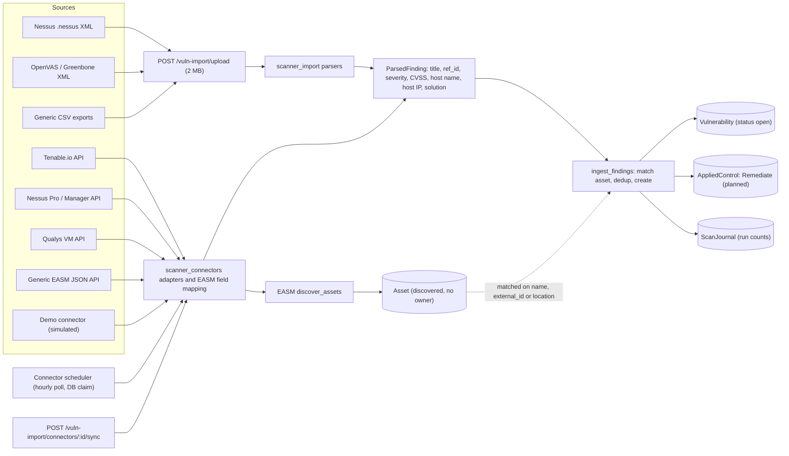

| Source | Mode | Host identity | CVE, CVSS, remediation |
|---|---|---|---|
| Nessus `.nessus` v2 | File | IP, FQDN, NetBIOS | First CVE (else plugin id), CVSS, solution; informational items dropped |
| OpenVAS / Greenbone XML | File (no GMP pull) | Host | CVEs, severity, solution |
| Generic CSV (Qualys, OpenVAS, Nessus exports) | File | Mapped from header synonyms | Mapped from header synonyms |
| Tenable.io | Scheduled pull | None (plugin aggregates) | No CVE, CVSS or solution |
| Nessus Pro / Manager | Scheduled pull | IP, FQDN, NetBIOS | CVEs, CVSS, solution |
| Qualys VM | Scheduled pull | IP, DNS, NetBIOS | QID reference; CVEs, CVSS, solution from the knowledge base |
| Generic EASM JSON | Scheduled pull | Mapped host, domain or IP | CVE when present; configurable auth, pagination and field map; creates assets; tested only against mocks |
| Demo | Simulated pull | Seeded asset names | Fabricated findings, offered to every tenant |

Not supported: Nuclei/ProjectDiscovery, DefectDojo, Wazuh, Prowler, ZAP/Burp, SARIF, Caldera, OpenCTI/MISP/STIX-TAXII, Jira/ServiceNow.

Connector credentials are stored in plaintext although an AES-GCM helper exists. The scheduler polls hourly and runs each due connector (default every 168 hours) under a database claim, so only one worker runs it; it notifies on failure, but scheduled runs are not in the activity trail. Outbound calls refuse metadata and link-local addresses but may reach private networks by default.

#### Matching, deduplication and finding lifecycle

- Asset matching is the string equality described in §4.5 (host name, then IP).
- The deduplication key is (CVE or title, matched asset) across the whole register. The same finding on several unmatched hosts collapses into one row; closed or false-positive findings never reopen; findings absent from a later scan never close; there is no port, component or fingerprint.
- Imported findings are created `open`, bypassing the `pending_validation` gate of manual entries, with no owner, due date or impact score.
- One `planned` "Remediate: …" `AppliedControl` is created per unique remediation text, with no owner, ETA or SLA.
- `ScanJournal` counts findings per run; it has no connector reference, and findings carry no run reference.
- `Vulnerability` has eight lifecycle states and no state machine. The UI "New vulnerability" form omits the asset the API requires, so manual creation from the UI fails with a 422.

#### Prioritisation and GRC propagation

Prioritisation uses the scanner CVSS and an impact score computed only on request: 60% CVSS plus 40% of the business value of the most valuable linked asset, multiplied by an operational-context weight chosen by the user. CISA KEV is never joined to findings, EPSS is absent, and asset criticality is not used. A vulnerability can be linked by hand to risk scenarios, incidents and threats; the scenario view suggests an impact level that is never written. Nothing changes a framework control's status, re-scores a risk, opens a ticket or fires a webhook; the team documents this suggestion-only design as deliberate.

#### CVE knowledge base and feeds

| Feed | Mechanism | Cadence | Lands in |
|---|---|---|---|
| NVD CVE API 2.0 | CVEs published in the last 3 days (default), plus refresh of rows held; CVSS vector, CWE, ranked references; no CPE, no historical load | Every 6 h, if data is over 20 h old | `CveEntry` (global) |
| MITRE CWE | Weaknesses with mitigations and CAPEC ids | When older than 30 days | `CweEntry` (global) |
| CISA KEV | 30 most recent entries per cycle; flags only CVEs already held | Daily | `CveEntry` flags, watch |
| SANS ISC | RSS, top 15 | Daily | Threat watch |
| opensourcemalware.com | Malicious packages; API key required | Daily | Threat watch |
| MITRE ATT&CK | Enterprise techniques | Manual import | Global threats (691 in the seed) |

The CVE page searches by text, CWE, vector, score and KEV, and stores per-tenant triage (relevance, notes, linked assets) in `CveAnnotation`, separate from the findings' asset links. Any tenant's CISO or security analyst can trigger the global NVD sync and the ATT&CK import, so tenant actors write platform-wide catalogues.

#### Threat watch and threat register

Feed items land per tenant in `ThreatWatchItem`, where an analyst dismisses them or promotes them into a pending tenant threat. The register combines adoptable built-in threats (null tenant) with tenant threats. Profiles (origin, objectives, frequency, probability, severity, linked assets and vulnerabilities) are signed off by a CISO or risk manager and reviewed on a cadence; an immutable `ThreatHistory` keeps every change. Critical items raise notifications, and feed text is machine-translated into French and Arabic. There is no STIX/TAXII, OpenCTI, MISP or regional CERT feed.

#### Incidents

Incident management is Implemented end to end: 10 categories, 6 statuses, key timestamps, affected assets (tenant-validated), links to vulnerabilities, risks, controls and vendors (unvalidated), financial impact, breach-notification fields, statistics and a "draft a risk scenario" action. Breach-notification deadlines are not tracked, which matters for PDPL and NCA windows. `IncidentTimelineEntry` is Model-only; the UI "timeline" is three timestamps.

Evidence: backend/app/services/scanner_import.py:482-584, backend/app/services/scanner_connectors.py, backend/app/services/easm_connector.py, backend/app/models/vulnerability.py:44-143, backend/app/api/v1/endpoints/vulnerabilities.py:539-708, backend/app/services/nvd_sync.py, backend/app/services/threat_feeds.py, backend/app/models/incident.py

**Assessment:**
- **Strength (CTEM):** one normalised ingest seam (parsed finding → ingest → journal) with scheduled connectors that are safe across both workers and a configurable JSON connector: the natural landing point for a findings hub (decision D04).
- **Constraint (CTEM):** `Vulnerability` lacks hub-grade attributes (fingerprint, first/last seen, KEV, EPSS, component, SLA, ticket), and asset matching depends on string equality.
- **Constraint (GRC core):** there is no exposure → control → risk → ticket propagation, prioritisation has no exploitation signal, and validation is absent.
- **Constraint (MSSP, KSA):** tenant actors write global catalogues, connectors may reach private networks, and there is no KSA CERT or STIX/TAXII feed.

### 4.7 Reporting, dashboards, notifications and data exchange

#### PDF reports, report builder and schedules

| Capability | Today | Status |
|---|---|---|
| Narrative PDF reports | Five types (executive, risk, vendor, compliance, audit) over a rolling 7-day window, plus a per-engagement audit report; en/fr/ar with RTL layout. Each generation is archived with SHA-256, downloads re-verify the digest, and both enter the hash-chained trail | Implemented |
| Report builder (Elite) | 10 datasets (risks, vulnerabilities, assets, applied controls, audits, threats, audit findings, incidents, policies, compliance); SQL filters, 10,000-row cap; XLSX, CSV or PDF. No vendor, regulatory or exposure dataset. Templates, filters and column choice are API-only | Partial |
| Schedules and distribution (Elite) | Daily, weekly or monthly to free e-mail recipients. A 5-minute in-process loop claims each run, so delivery is exactly-once across both workers. PDFs are archived, mailed in the tenant's or scheduler's language and logged in `ReportDistribution`; engagement reports go out only when approved with an intact digest. Schedules cannot run builder templates or dashboard exports | Implemented |
| Branding | Colours hard-coded, tenant name in the header, "GRC Platform" in the footer; `Tenant.logo_url` and branding settings are never read | Absent |

#### Dashboards and exports

| Surface | Content | Gate | Status |
|---|---|---|---|
| Main dashboard | Summary KPIs, risk trend from daily snapshots, framework overview, per-user widget layout | All users (layout save Elite) | Implemented |
| Executive summary | Cross-module KPIs, including vendors by tier | Executive, CISO | Implemented |
| Module dashboards | Assets, vulnerabilities, threats, risks, controls, governance, audit; none for TPRM, regulatory watch or exposures | Elite and role | Implemented |
| Dashboard export | 9 dashboards to XLSX or PDF | Elite | Implemented |
| Register exports | 11 registers in CSV, XML, XLSX or PDF; headings translated, values not; no vulnerability or incident register; the UI exposes only frameworks, framework controls and audit findings | Any user | Partial |

#### Notification engine

- **Model:** 37 types on two channels, in-app and e-mail; no webhook, SMS, Teams or Slack channel and no exposure, KEV or SLA type. Rows store English text plus an i18n key and parameters, rendered in the reader's language at read time.
- **Sweep:** 22 checks every 6 hours under a cross-worker file lock (POSIX only), covering contracts, risks, compliance actions, assets, threat profiles, scenarios, controls, treatments, findings, recommendations and audits. Event-driven writers add more.
- **Escalation:** overdue items are chased at J+1, J+3, J+7, J+14 and J+30, then monthly, and escalate to CISO, tenant admin and executive from J+7.
- **E-mail:** an outbox flushed after commit (at most 200 per run) honours a tenant kill switch and user preferences and renders in the recipient's language. Only four sweep checks send mail (action items, audit schedule, finding assigned, recommendation due), plus password reset, welcome and report delivery. Vendor alerts are in-app only. Other e-mail helpers run only from Celery tasks, and the SaaS runs no Celery worker or beat.
- **UI:** the bell polls every 30 seconds and shows five invented notifications while loading or on error (UI-only/mock fallback).

#### Webhooks, import and OCR

| Capability | Today | Status |
|---|---|---|
| Webhooks | List in `tenant.settings` (no table), 20 event names, CISO-managed, URL SSRF check, unsigned test ping. No dispatcher: no event is ever emitted, the stored secret signs nothing, no retries, no delivery log. No inbound API keys for integrators either | Partial (configuration); delivery Documented-only |
| CSV/XML import | Risks, vendors and assets; CSV or XML (XLSX refused); 2 MB. The parser assumes UTF-8 without BOM and commas, so typical Excel exports fail on the first column. Always INSERT (the exported id is ignored); errors as strings; no template, dry run or screen | Backend-only |
| Other imports | Framework import (CSV, XLSX, YAML, with UI); scanner import (§4.6) | Implemented |
| OCR capture (Elite) | Tesseract; French, English and Arabic combinations, default French + English; 40 MB / 40 pages; exports a text PDF (Arabic shaped) or searchable PDF. Nothing is persisted or linked to evidence; also the TPRM fallback for scanned contracts. OS packages are installed only by the OVA build | Implemented (utility) |

Evidence: backend/app/services/report_generator.py:1760-1905, backend/app/services/report_scheduler.py, backend/app/api/v1/endpoints/report_builder.py, backend/app/api/v1/endpoints/dashboard_export.py:77-80, backend/app/services/notification_generator.py:2413-2652, backend/app/api/v1/endpoints/webhooks.py, backend/app/api/v1/endpoints/data_io.py:74-94, backend/app/services/ocr_service.py

**Assessment:**
- **Strength:** a trilingual, integrity-checked report archive with exactly-once scheduled distribution, and a reusable notification engine (i18n catalogue, escalation ladder, outbox): a good base for KSA reporting and CTEM SLA alerts.
- **Constraint (CTEM, R8):** no outbound integration. Webhooks never fire and there is no ticketing connector, so CTEM "mobilise" and SIEM export have no channel.
- **Constraint (collector):** import is not usable as collector Channel 1; exports omit vulnerabilities and incidents; the builder has no vendor or exposure dataset.
- **Constraint (MSSP, R5):** no runtime branding in reports, e-mails or dashboards.

### 4.8 AI services

#### Provider abstraction and components

AI runs on a provider-neutral foundation of five pure services, refactored in September 2026.

| Component | Responsibility |
|---|---|
| `ai_prompts` | Registry of 19 tasks (role, grounding rules, schema, examples, decoding preset, rubric). Prompts are Python constants with no database storage, editor or per-tenant override. Deterministic fix-ups, e.g. "implemented" needs a quotation and confidence ≥ 0.7 |
| `ai_structured` | Extracts and validates JSON, applies semantic checks, makes one repair turn and salvages valid items; never raises on model errors |
| `ai_chunking` | Script-aware token estimates, overlapping chunks, map-reduce, and a locate-then-judge control assessment whose quotations are verified against the source with Arabic-aware normalisation |
| `ai_locale` | Answer-language resolution and localised failure messages |
| `ai_provider` | Native Ollama or any OpenAI-compatible endpoint; configuration layers compiled default → environment → tenant row; typed failures returned as HTTP 424; SSE streaming with preflight; decoding presets; delimiting of untrusted text; per-process concurrency limit |

The compiled default is Ollama on localhost with `gpt-oss:120b-cloud`; the local daemon relays a `-cloud` model to Ollama's hosted service, which the platform's own self-test flags as a data-residency issue. CLAUDE.md says no environment file overrides this default; production's configuration cannot be checked from this machine. The on-prem compose file offers an optional local Ollama. There are no embeddings, retrieval or vector store.

#### Feature catalogue

| Feature | Route (under `/api/v1`) | Task | UI | Status |
|---|---|---|---|---|
| GRC assistant (streamed) | `POST /ai/chat` | assistant_chat | Floating assistant | Implemented |
| Policy and document drafting | `POST /ai/generate-policy`, `/ai/generate-policy-content`, `/ai/generate-document` | policy_generation, document_generation | Policy generator modal, Policies page, Doc Generator (27 types) | Implemented |
| Risk analysis | `POST /ai/analyze-risk` | risk_analysis | Risk AI panel | Implemented |
| Audit programme | `POST /ai/generate-audit-plan` | audit_plan | Audit plan modal | Implemented |
| Remediation plan | `POST /ai/stream-remediation-plan` | remediation_plan | Remediation planner | Implemented |
| Contract negotiation analysis | `POST /ai/stream-contract-analysis` | contract_extract → contract_analysis | Contract collaboration | Implemented |
| Ad hoc evidence and vendor analysis | `POST /ai/analyze-evidence`, `/ai/analyze-vendor` | control_assessment, vendor_analysis | None | Backend-only |
| Diagnostics and quota | `GET /ai/models`, `/ai/health`, `/ai/access-check` | — | Cheat sheet, quota hook | Implemented |
| Compliance document assessment | `POST /compliance/assessments/{id}/analyze` | control_assessment | Assessment detail | Implemented |
| Clause tagging of uploads | `POST /compliance/assessments/{id}/documents` | clause_coverage | Upload flow | Implemented |
| Vendor pre-screen | `POST /vendors/prescreen` | vendor_prescreen | Vendor wizard | Implemented |
| Stored-vendor analysis | `POST /vendors/{id}/analyze` | vendor_analysis | Vendor AI modal | Implemented |
| Contract review on upload | `POST /vendors/{id}/upload-contract` | contract_extract → contract_review | Vendors, CISO queue | Implemented |
| Framework builder | `POST /frameworks/builder/ai-suggestions` | framework_builder | Framework builder | Implemented |
| Regulatory triage | `POST /regulatory/fetch-news` | regulatory_impact | Regulatory updates | Implemented |
| Auditor formal report | `POST /auditor-portal/assessments/{id}/generate-report` | audit_report | Auditor report | Implemented |
| Public website bot | `POST /public/support-chat` | public_support | Marketing widget | Implemented |
| System-content translation | Background worker | Translation prompt | "Machine translated" badge | Implemented |

The compliance assessment writes control status directly, with no approval step, unlike vendor scores and contract reviews.

#### Answer language

The language is resolved in this order: explicit body `language`, `Accept-Language` (the SPA sends the UI language on every call), tenant locale (no screen sets it), English; chat routes also detect Arabic in the last message. Every system prompt carries a LANGUAGE block after the output rules (only the optional CONTEXT block follows it); the Arabic one, written in Arabic, requires Modern Standard Arabic prose with English JSON keys and enums, unchanged identifiers and Western digits. Failures are localised. Nothing checks the output language, and stored AI narratives (control notes, gap descriptions, vendor and contract reviews) stay in the language of the user who triggered them.

#### Quotas

- A per-user daily budget of 10 million tokens lives in each worker's memory and is never persisted; a monthly database quota row resets itself instead of blocking and is display-only.
- The UI AI gate is a pass-through and no route checks the tenant `ai` module flag: there is no per-tenant AI off-switch, budget or metering.
- Only the public chatbot is rate-limited (20 requests per 10 minutes per IP, in shared state).

#### Privacy posture

- By default, prompts and documents leave the host through the `-cloud` relay; the public chatbot's product facts describe AI hosting inaccurately and must be corrected.
- Stored-vendor analysis sends the vendor's name to a public web-search API on every run; this cannot be switched off.
- Prompts are not logged by default; untrusted text is delimited and labelled as data; the assistant sees only the organisation profile and selected frameworks.
- Machine translation sends platform content only, never tenant-authored text.
- Persisted AI outputs record no model, provider or prompt version.

#### Bring-your-own AI

| Level | Mechanism | Status |
|---|---|---|
| Deployment | Environment variables select Ollama or an OpenAI-compatible endpoint (OpenAI, Azure, vLLM, LiteLLM and similar), model, key and private CA | Implemented |
| Tenant | `TenantAIConfig` row (provider, URL, model, AES-GCM-encrypted key, enabled flag), overlaid when enabled and when tenant override is allowed | Model-only: read path only; no API or UI writes it |
| Call-site coverage | Most AI calls honour the tenant row | Partial: clause tagging, the public chatbot and machine translation always use the deployment model |
| Client model choice | A model named by the client is honoured when no API key is configured | Implemented (any model on a shared daemon can be requested) |

Evidence: backend/app/services/ai_provider.py, backend/app/services/ai_prompts.py:106-117, backend/app/services/ai_locale.py, backend/app/services/ai_chunking.py, backend/app/core/ai_quota.py:20-27, backend/app/models/tenant_ai_config.py, backend/app/api/v1/endpoints/ai.py, backend/app/api/v1/endpoints/system.py:177-200

**Assessment:**
- **Strength:** a provider-neutral foundation with validated output, honest failure states and Arabic-aware long-document handling. New tasks (CTEM triage, CSV column mapping, NCA/SAMA assessment) are registry additions.
- **Constraint (KSA):** the default model relays data to a hosted service, and per-tenant sovereign AI cannot be configured without editing the database.
- **Constraint (MSSP):** no per-tenant budget, metering or off-switch; quotas are per process.
- **Constraint (GRC core):** no provenance on AI outputs and no approval gate for AI compliance verdicts; the persona ("GRCeye") is hard-coded; prompt knowledge of KSA stops at ECC-2:2024, SAMA CSF and PDPL.

### 4.9 Internationalisation and Arabic

#### UI catalogues and coverage

The SPA uses react-i18next with one namespace. All catalogues are bundled at build time, with no lazy loading and no tenant overrides, and merged at start-up: base en/fr/ar files, then the Elite and menu bundles (overwrite), then gap-fills, fixes and seven per-screen "sweep" bundles (fill only), then a runtime pass that fills the six Arabic plural forms.

This document recounted the catalogue by replaying that merge over the current files:

| Measure | Value |
|---|---|
| English runtime keys | **6,460** |
| English keys present in Arabic | 6,460, i.e. **100%** (French also 100%) |
| Arabic values in Arabic script | About 99%; the rest are brand names, acronyms, placeholders and a few untranslated strings (e.g. the SoA subtitle) |
| Arabic leaves | 6,530 after the merge, 6,619 after the plural fill. The extra keys are Arabic plural forms, which explains the 6,530 figure quoted elsewhere |

A static scan found all 3,718 literal `t()` keys used in the code in the three catalogues; 303 template-literal keys cannot be checked statically. The help knowledge base has 36 articles per language, and the marketing site is trilingual with RTL. The language is chosen per browser; no screen sets the server-side tenant locale. Dates use Arabic month names with Latin digits, Gregorian only.

#### RTL approach

`applyDirection` sets `dir="rtl"` and `lang` on `<html>`. About 110 global `[dir="rtl"]` rules in `index.css` pin the sidebar right, flip Tailwind physical utilities (margins, paddings, positions, borders, radii, alignment) and mirror directional icons; components add about 90 `rtl:` variants. Physical utilities still outnumber logical ones roughly three to one, so each new physical class needs an override or renders unflipped. Charts are not mirrored. No Arabic web font is bundled: Geist has no Arabic glyphs, so text falls back to Segoe UI, Tahoma or Arial. The repository holds no visual RTL test.

#### Server-side localisation

| Surface | Mechanism | Arabic |
|---|---|---|
| API errors and validation | Global exception handlers translate English messages by `Accept-Language` from extracted catalogues; some routes add their own trilingual tables | 438 of 439 static messages, 218 of 218 templates (missing: "CVE") |
| In-app notifications | English stored with key and parameters, rendered at read time | 162 catalogue keys |
| E-mails | Templates with `lang` and `dir="rtl"`; recipient language = last-seen UI language, else tenant locale, else English | Complete; brand strings hard-coded |
| PDF reports | Localised labels, RTL alignment, mirrored headers and tables, localised dates | Complete |
| Register exports | Headings translated, cell values not; XLSX has no right-to-left sheet view | Partial |

#### Arabic PDFs and fonts by packaging channel

Every ReportLab generator, archiving and register exports included, goes through one helper. It reshapes Arabic (`arabic_reshaper`), applies bidi ordering (`python-bidi`) after line-breaking, and registers a font from fixed Linux paths: Amiri, then DejaVu Sans, then Noto Sans Arabic. No font file ships in the repository; without one, the helper falls back to Helvetica and Arabic prints as empty boxes. The OCR text-PDF export has its own lookup.

| Packaging channel | Arabic PDF font | Shaping libraries | Arabic OCR |
|---|---|---|---|
| SaaS (PM2 on a Linux host) | System fonts; not verifiable from this machine | Listed in `requirements.txt` | Not verifiable |
| OVA / VHD / ISO appliance | Amiri installed by the build | From `requirements.txt` | Installed |
| Docker on-prem image | None | From `requirements.txt` | None (no Tesseract) |
| Poetry-built Docker image (composes) | None | Missing from `pyproject.toml`: text stays unshaped | None |
| Windows hosts | Linux paths never match | — | — |

#### Content translation pipeline

- **Scope:** system content only: built-in frameworks and controls, built-in and feed threats, watch and regulatory feed items, CVE descriptions on demand. Tenant-authored text is never sent.
- **Storage:** `content_translations`, keyed by a hash of the source text and the language, so identical text is translated once across tenants.
- **Worker:** a background loop kept single by a file lock (both workers run it on Windows); up to 64 text–language pairs per cycle; deployment model only; acceptance checks (Arabic script present, CVE ids preserved, length bounds).
- **Read side:** responses overlay translations and keep the original; the UI shows a "machine translated / show original" badge.
- **Human translations:** `control_translations` rows take precedence, but their write API is limited to tenant-owned (cloned) frameworks. There is no Arabic seed for built-ins (only a French seed for ISO 27001 and GDPR), and the framework importer has no per-language columns.
- **Seed:** zero Arabic characters across 77 frameworks, 3,799 controls and 691 threats; the KSA content (ECC-1:2018, ECC-2:2024, SAMA CSF) is English paraphrase. A fresh install queues about 10,900 text–language pairs, and Arabic requirement text is machine-translated, not the regulators' official wording.

#### Gaps

- **Content:** no official Arabic regulatory text.
- **Rendering:** no bundled fonts, override-based RTL, unmirrored charts, no visual RTL test.
- **Settings:** per-browser language; no tenant default language or terminology overrides.
- **KSA polish:** no Hijri dates, no Arabic letter-variant folding in search (alef/hamza, taa marbuta, diacritics), OCR defaults to French + English, no Arabic regulatory feed.
- **AI:** output language unverified; stored AI narratives monolingual.

Evidence: frontend/src/i18n/index.ts:55-118, frontend/src/index.css, backend/app/core/i18n_messages.py, backend/app/services/notification_i18n.py, backend/app/services/pdf_arabic.py:37-87, backend/app/services/content_translation.py, backend/app/services/translation_worker.py, infrastructure/docker/Dockerfile.backend.onprem:65-75

**Assessment:**
- **Strength:** interface Arabic is complete at key level (100% of 6,460 keys) and backed by server-side localisation of errors, notifications, e-mails and PDFs. This is GRCEye's strongest R3 asset.
- **Constraint (KSA content):** official Arabic NCA, SAMA and SDAIA texts must be sourced and loaded as human translations of built-in frameworks, a path that does not exist today.
- **Constraint (packaging):** Arabic rendering depends on fonts the product does not ship; PDF and web fonts must be bundled for every channel.
- **Constraint (MSSP, R5):** catalogues are build-time and brand strings are hard-coded, so per-tenant terminology and branding need a runtime overlay.

## 5. GRCEye today — cross-cutting architecture

### 5.1 Data architecture

**Conventions.** One SQLAlchemy 2.0 async declarative base: 72 model files, 113 tables. `Base` gives every table a `String(36)` UUID4 key and timezone-aware `created_at` / `updated_at`. There is no tenant mixin, soft-delete mixin, `created_by` or optimistic locking; authorship lives only in the activity log. The model holds about 1,250 columns, including 229 foreign keys and 114 JSON columns, 43 of which are lists of ids pointing at other rows (§14.4 maps them to 36 association tables). 76 date-like columns are ISO strings, 74 are `DateTime`. Production runs one SQLite file (WAL) without `PRAGMA foreign_keys`, so declared foreign keys are not enforced there.

**Tables by domain cluster.**

| Cluster | Tables | Key tables |
|---|---|---|
| Tenancy and identity | 12 | tenants, users, groups, custom roles, delegations, sessions, MFA devices |
| Licensing and subscription | 3 | subscriptions, issued licences, activations |
| Frameworks and compliance | 13 | frameworks, framework controls, assessments, control assessments, gaps, action items |
| Evidence and documents | 6 | evidence, uploaded documents, stored file versions |
| Risk and implemented controls | 15 | risks, scenarios, treatments, acceptances, applied controls, evaluations, matrices |
| Assets and business context | 4 | assets, org entities, business processes |
| Threats, vulnerabilities, scanners | 11 | vulnerabilities, threats, CVE/CWE catalogues, scanner connectors, scan journals |
| Incidents | 2 | incidents, timeline entries |
| Audit | 11 | audits, findings, campaigns, grids, recommendations, auditor assignments |
| Policy and governance | 9 | policies, versions, attestations, RACI, governance documents |
| Third parties | 6 | vendors, contracts, contract collaboration |
| Reporting and dashboards | 5 | templates, schedules, distributions, layouts, trend snapshots |
| Notifications | 2 | notifications (37 types), preferences |
| AI and translation | 7 | tenant AI configs, AI quotas, control and content translations |
| Platform and operations | 7 | activity logs, audit-log seals, archives, support |
| **Total** | **113** | |

Five tables are model-only in practice: `api_tokens`, `risk_assessments`, `incident_timeline_entries`, `vendor_assessments`, `vendor_risks`.

**Tenancy classes.**

| Class | Tables | Examples | Scoping |
|---|---|---|---|
| `tenant_id` NOT NULL | 64 | assets, risks, vulnerabilities, audits, vendors, evidence | predicate per handler (62 with FK to `tenants`) |
| Child of a scoped parent | 25 | control assessments, audit findings, vendor contracts, framework controls | join to, or fetch-then-verify, the parent |
| Nullable `tenant_id` | 10 | NULL = shared built-in row in frameworks, threats, matrices, scales, regulatory feeds; incidental in five login, session and AI/token tables | `is_builtin OR tenant_id = :tenant` |
| Per-user or per-ticket | 6 | MFA devices, reset tokens, preferences, ticket messages | via the owning user or ticket |
| Global catalogue or platform | 8 | tenants, licences, CVE/CWE catalogues, mandatory documents, content translations | none |

`Framework.is_builtin` defaults to `True`; every creation path overrides it today, but a new path that forgets would publish a tenant's framework to all tenants.

**Core entity-relationship view.** Solid lines are FK columns; dotted lines are JSON or string soft links with no database integrity. `tenant_id` is drawn once.

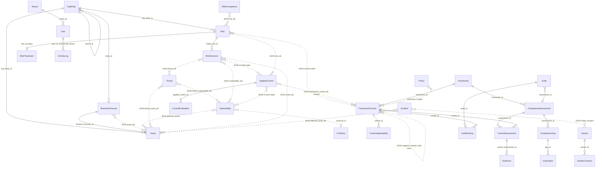

**The GRC link graph.** "Tenant-checked" = the API verifies on write that each referenced id belongs to the caller's tenant.

| Link | Mechanism | Tenant-checked | Notes |
|---|---|---|---|
| Entity → parent; process → entity; asset → entity, process, owner | FK | not verified | strongest part of the business context |
| Process → assets | JSON soft link | yes | reverse duplicate of the asset FK; can disagree |
| Vulnerability → asset | JSON soft link | on create only | no cleanup on delete |
| Vulnerability → CVE catalogue | string soft link | n/a | KEV flag stays on the catalogue |
| Vulnerability → scan run, connector | none | — | journals are run-level only |
| Scenario → threat, vulnerability, asset | JSON soft link | no | reverse lookup by `LIKE` on JSON text |
| Scenario ↔ applied control; control ↔ vulnerability | JSON on both sides | partly | sides maintained independently |
| Scenario → risk | FK | server-set | scenario edits overwrite risk likelihood and impact |
| Risk → asset; risk → requirement | JSON soft link | no | assets create-only; requirements as ambiguous codes |
| Applied control → requirement | JSON soft link | no | unread by compliance, no UI |
| Assessment → control assessment → evidence; gap → action | FK | server-set | |
| Control ↔ control (crosswalk) | JSON code pairs | canonicalised | resolvers disagree on case |
| Requirement → applicability per entity | association (FKs) | not verified | not used by scoring |
| Policy → requirement | JSON (ids or codes) | partial | |
| Audit → assets, processes, entities | JSON soft link | yes | |
| Finding → action item | FK, never written | — | model-only |
| Finding → risk, control, asset; vendor → asset, risk, control | none | — | vendor is an island |
| Incident → asset; → risk, control, vendor, vulnerability | JSON soft link | yes; no | risks, controls, vendors shown as counts only |
| Acceptance, exception → any | JSON (polymorphic) | no | no UI |

**Two disconnected control worlds.**

| | Requirement world | Measure world |
|---|---|---|
| Tables | frameworks → framework controls → control assessments → evidence | applied controls → control evaluations |
| Drives | compliance score, gaps, audit checklists | residual-risk suggestion, effectiveness KPIs |
| Linked to | assessments, audits, policies | risks, scenarios, vulnerabilities |

The only bridge, `AppliedControl.framework_control_ids`, is read only by the CSV export and has no UI. No data path leads from a vulnerability or a failing control to a requirement such as NCA ECC-2:2024 2-10.

**Schema drift against the shipped seed.** The release seed (`release/seed/grc_seed.db`, 2026-08-10) holds 53 tables, 77 built-in frameworks, 3,799 controls, 691 threats and one tenant. It is 60 tables and 141 columns behind the models. `create_all()` adds the tables at first boot, not the columns, and 69 columns are added by no migration the appliance runs. Because the ORM selects every mapped column, a seed-based install without the other scripts fails on core tables such as users and audits (inferred, not executed). Indexes drift both ways: model indexes never reach `ALTER`ed tables, and the unique `(tenant_id, ref_id)` index on scenarios exists only in a script, so a fresh database lacks it.

**Migration mechanics.** Every worker runs `create_all()` at boot; it never adds columns, indexes or enum values. Alembic has no revisions and no version table. Columns come from 40 hand-run, idempotent scripts that read SQLite `PRAGMA table_info` and issue `ALTER TABLE ADD COLUMN`; none targets PostgreSQL, Oracle or SQL Server. §5.7 covers which lists run where.

Evidence: `backend/app/core/database.py:43-79`, `backend/app/main.py:50-53`, `backend/app/models/applied_control.py:74-82`, `backend/app/models/risk_scenario.py:53-63`, `backend/app/models/framework.py:51`, `backend/app/api/v1/endpoints/vulnerabilities.py:215-229`, the shared migration helper in `backend/scripts/`, `release/seed/grc_seed.db`

**Assessment:**
- **Strength.** The nouns NG-GRC needs exist (asset with business context, finding, control, scenario, risk, requirement, evidence, exception) under UUID keys with `tenant_id` on every business root, so the schema itself ports to PostgreSQL without redesign.
- **Constraint (CTEM, collector).** The BM-01 chain runs on JSON soft links; association tables with FKs (scenario–asset, control–requirement, exposure–asset) must replace them first.
- **Constraint (GRC core).** The two control worlds must be unified or mapped for "exposure → control → requirement" to exist.
- **Constraint (platform).** No migration framework: Path C needs an Alembic baseline and an engine-neutral content pipeline before PostgreSQL.

### 5.2 Identity and access management

**Authentication.**

| Capability | Status | Notes |
|---|---|---|
| Password login | Implemented | Argon2; 12-character policy (skipped on super-admin user creation); per-tenant lockout, default 5 attempts / 15 min |
| Tokens | Implemented | HS256 JWT; 30-min access; 7-day refresh rotated on use; type allowlist; user row re-read per request |
| Sessions | Partial | DB-backed, self-service revoke; password change does not revoke others; no idle timeout; sign-out is client-only (the SPA never calls the server logout, so the session and its 7-day refresh token stay valid after sign-out) |
| TOTP MFA | Partial | real second step: a 5-min single-use challenge redeemed at `/auth/mfa-login`. The LDAP route issues the same challenge, but the SPA's directory form ignores it and stores the empty token, so MFA-enrolled directory users cannot sign in through the UI; not mandatable; no recovery codes; secret unencrypted |
| Login journal | Backend-only | every attempt and outcome; no UI |
| Forced password change | Partial | flag returned at login, not enforced server-side |
| Self-registration | Implemented | always open, also on appliances; creates a tenant, 14-day trial and a CISO; no e-mail verification |
| AD/LDAP login | Partial | per-tenant `ldap3` bind; fails in the UI for MFA-enrolled users (see TOTP MFA); password transits the backend; group-to-role mapping re-applied at each login; LDAPS without certificate validation; bind password unencrypted |
| SAML, OIDC, OAuth | Documented-only | Keycloak settings and `users.keycloak_id` unused; `sso_saml` is a plan flag |
| SCIM | Absent | |

The SPA keeps tokens in `localStorage` with no Content-Security-Policy; support SSE/WebSocket channels carry the token in the URL. Refresh-token revocation uses Redis when reachable, else per-worker memory; session revocation is DB-backed.

**Authorization.** 13 fixed roles: super_admin, tenant_admin, ciso, risk_manager, compliance_manager, auditor, policy_manager, vendor_manager, control_owner, business_owner, security_analyst, executive, viewer. `require_roles` passes super_admin and tenant_admin on their scalar role; for others it computes, on every check, personal roles (`roles` JSON, else scalar) ∪ group roles ∪ active custom-role base roles ∪ live delegations − `excluded_roles`. The CLAUDE.md note that the roles JSON is ignored is out of date. Viewer and executive are write-blocked centrally; a strict variant without the admin pass guards 4 routes.

| Mechanism | Status | Notes |
|---|---|---|
| Team groups | Implemented | every check scans all of the tenant's groups |
| Custom roles, delegations, access reviews | Backend-only | 13 routes; custom roles only compose built-ins |
| Perimeter scoping | Partial | business_owner and control_owner may act only on records they own; risks and treatment plans only (4 call sites); reading stays tenant-wide |
| Org-entity scoping | Partial | filters only; no user is bound to an entity |
| Capability model | Absent | role names on about 580 routes |

A static pass classifies the routes: 234 role-guarded, 42 role-and-feature, 53 feature-only, 18 super-admin, 4 strict, 204 authenticated only (some check in-handler) and 27 with no auth dependency (auth flows, share tokens, public pages, licence check-in, and support channels that take the token in the URL). Some modules still test the scalar role, so group- or delegation-granted roles behave inconsistently there.

**Plan gating.** The server gates 17 Elite flags (HTTP 402) and the LDAP entitlement; the rest is unenforced (§5.5). The SPA's four gates (route roles, tier modules, fail-open entitlements, a cosmetic plan field) have drifted from the backend: compliance pages are shown to roles the CISO-only API rejects.

**External parties.** Auditors are tenant users flagged `is_external`, with optional expiry; assignments scope the auditor portal, whose reads are logged. Global e-mail uniqueness forces one account per client tenant. Scoping is incomplete: some read paths outside the auditor portal ignore assignments, an intra-tenant scope gap (SEC-06). Vendors have no accounts; they use share tokens (no revocation, client-set expiry, unlogged writes) and expiring evidence-upload links.

Evidence: `backend/app/api/v1/endpoints/auth.py:280-502`, `backend/app/api/v1/dependencies/auth.py:35-136`, `backend/app/services/authz.py:15-70`, `backend/app/services/perimeter.py:1-111`, `backend/app/services/directory_auth.py:203-244`, `backend/app/models/user.py:9-60`; pointers for the session, directory-login and token-storage weaknesses are in the evidence pack (Appendix C.2)

**Assessment:**
- **Strength.** Sound local-auth fundamentals; the central effective-role resolver is the hook for API scopes, entity perimeters and MSSP delegated roles.
- **Constraint (R8, KSA).** Federated SSO (SAML/OIDC to Entra ID or ADFS) must be built; LDAP needs certificate validation and encrypted credentials.
- **Constraint (MSSP).** Role-name checks, no capabilities and single-tenant identities mean an MSSP analyst needs a new principal model.
- **Constraint (all blocks).** Browser token storage without CSP, client-only sign-out, the directory-login MFA failure and the unenforced forced password change must be fixed before any regulated customer onboards.

### 5.3 Multi-tenancy and isolation

One database and one schema serve all tenants. A request's tenant is the `tenant_id` on the user's database row, never the JWT claim. Handlers add a `tenant_id` predicate; child rows are reached through a tenant-checked parent.

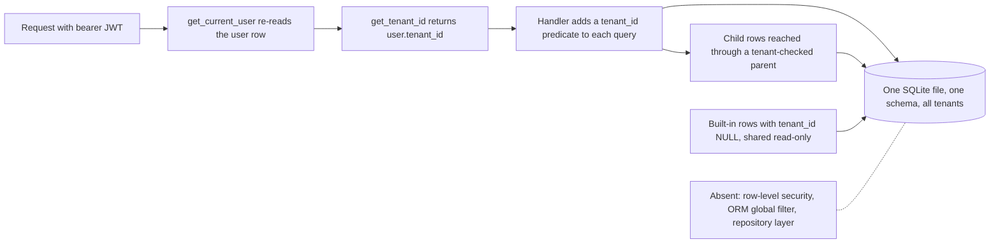

| Aspect | AS-IS |
|---|---|
| Enforcement | application-level only; the RLS claim in the `Tenant` docstring is documented-only; FKs unenforced on SQLite |
| Verification | static scan: 111 of 380 id-based statements lack a tenant predicate. Of 29 sampled query sites, 26 were correctly scoped, but three code paths let one tenant read metadata or controls of another tenant's custom frameworks; one of them, a notification task, is active only on stacks that run a Celery worker (§6.5, item 1). No isolation tests |
| Referenced ids | shared helpers check tenant ownership on write; about half the JSON soft links use them |
| Shared rows | built-in frameworks, threats, matrices, scales and feeds shared read-only, tenants edit clones; tenant roles can trigger a CVE sync and import ATT&CK into the shared catalogue |
| Files | local disk under per-tenant folders with path checks; vendor contracts and the report archive sit in shared folders; no encryption at rest, quota or object storage |
| Keys | one deployment secret signs JWTs and derives the AES-GCM key |
| Identity | one tenant per user; e-mail globally unique |
| Lifecycle | self-registration or appliance CLI only; `Tenant.is_active` not enforced; offboarding by script; no tenant export |
| Partner or MSSP layer | absent: no hierarchy, membership, switching, impersonation, consolidated view or delegated admin; super_admin sits in a platform tenant and cannot read tenant data through normal routes |
| Deployment-global functions | datastore selection and test, licence activation (one global row) and self-test need only tenant_admin of any tenant (§6.5, item 2) |
| Entities inside a tenant | `OrgEntity` tree and `BusinessProcess`, referenced by assets, risks, policies, assessments and audits; filters, not boundaries; the risk API omits them, so the register's entity filter returns nothing |
| Batch actor | one inactive system user per tenant writes batch entries into that tenant's chain |

Evidence: `backend/app/api/v1/dependencies/auth.py:202-215`, `backend/app/models/tenant.py:3`, `backend/app/core/database.py:43-53`, `backend/app/core/security_utils.py:226-262`, `backend/app/models/user.py:51-54`; pointers for the cross-tenant read paths, the deployment-global functions and the shared file folders are in the evidence pack (Appendix C.2)

**Assessment:**
- **Strength.** A DB-resolved tenant and `tenant_id` on every business root make a PostgreSQL RLS retrofit mechanical.
- **Constraint (R4, MSSP).** Isolation rests on developer discipline, and the three live leaks show its limits; an MSSP platform needs DB-enforced isolation and isolation tests in CI.
- **Constraint (R4, MSSP).** Hierarchy, membership and cross-tenant principals are absent; deployment-global endpoints and shared-catalogue writes belong to a platform-operator role.
- **Constraint (KSA groups).** Multi-entity customers get structure but no access separation inside a tenant.

### 5.4 Audit trail and integrity

| Capability | Status | Notes |
|---|---|---|
| Mutation logging | Partial | middleware records authenticated 2xx writes: verb, entity, resolved name, redacted query, origin; login, token-refresh, notification and activity-log routes excluded. Best effort: it writes after the response, in its own session with a 5 s timeout, and drops the entry on a timeout or error, recording the loss only in the application log. The IP is proxy-derived, not a verified end-user address |
| Read-access logging | Implemented | whitelisted sensitive reads (downloads, auditor portal, exports, archives, the trail); per-object "who accessed" report |
| Semantic entries | Implemented | 29 modules: rights changes with before/after, group grants, delegations, MFA, LDAP sync, retention; audit before/after |
| Per-tenant hash chain | Implemented | unique `seq` per tenant; SHA-256 over `prev_hash`, immutable fields and canonical details; under chain contention an entry is stored unchained after 8 failed inserts, but an entry the middleware fails to write is lost (see Mutation logging) |
| Chain verification | Backend-only | walks seals then entries; Elite-gated; no UI |
| Sealed retention | Backend-only | manual seal-then-purge, dry run by default, 365-day floor, chained seals |
| Login journal | Backend-only | all attempts; client-supplied forwarding IP; not chained |
| System actor for batch work | Partial | 3 callers; feed, CVE, scanner, snapshot, archiving and report jobs log nothing |
| Field diffs for generic changes | Absent | method, path and query only |
| Denials, failures, unauthenticated writes | Absent | non-2xx, vendor e-signatures, share-link uploads, password resets, SSO auto-provisioning |
| SIEM, syslog, CEF export | Absent | no export path |
| File integrity | Implemented | SHA-256 at upload, re-verified on read; version ledger keeps deleted versions; opt-in retention; some audit downloads skip the check; legal hold model-only |

The chain is keyless (no HMAC, signature or anchor), so a database-level actor can rewrite and re-chain history. The API lets CISOs, compliance managers, auditors, risk managers and admins read it, but only tenant admins (company-admin console) and the platform super-admin have a screen; verify, seals and login events lost their UI with the activity-log page (2026-09-28). The team's register records most production entries (529 of 726 at the register date) as unchained legacy rows, which contradicts a customer-facing claim about the chain (details in the evidence pack, Appendix C.2). Super-admin actions chain into the platform tenant, not the affected one.

Evidence: `backend/app/core/activity_middleware.py:232-309,646-760`, `backend/app/services/activity_chain.py:48-232`, `backend/app/api/v1/endpoints/activity_log.py:340-634`, `backend/app/services/audit_retention.py:27-64`, `backend/app/services/file_integrity.py`, `backend/app/models/stored_file_version.py:27-80`

**Assessment:**
- **Strength.** A built-in per-tenant tamper-evident chain with verify, seals, login journal and read logging, which the benchmarked open-source tools lack or charge for: a solid R8 base.
- **Constraint (R8, KSA).** NCA- and SAMA-grade evidence needs a keyed or anchored chain and syslog/CEF forwarding.
- **Constraint (CTEM, collector).** Machine writers are unlogged; every connector run and automatic re-scoring must write through the system actor.
- **Constraint (R8).** Investigations need entries that cannot be silently dropped, field-level diffs and denial logging.

### 5.5 Licensing, plans and packaging

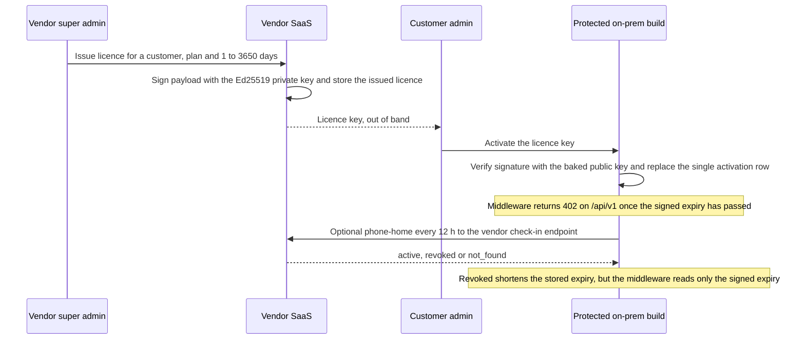

**Licence pipeline.** Issue, offline activation, phone-home and enforcement (402 on `/api/v1`, WebSockets gated, 24 h clock-rollback guard, 60 s verdict cache per worker) are Implemented. Online activation is Partial: the client calls a vendor endpoint that does not exist. Revocation is Partial: recorded, not enforced, as the code acknowledges. Licences carry no seat, tenant or module dimension and no machine binding; one activation per installation cannot represent several resold tenants. Only starter, professional and enterprise are licensable, so on-prem Elite modules depend on per-tenant overrides. There is no reseller issuance or metering. The private signing key sits on the internet-facing multi-tenant SaaS host, which is the minting authority.

**Plans.** Four tiers (starter, professional, enterprise, elite), five statuses, tier quotas (frameworks, admin users, vendors, integrations), platform flags (including `white_label` and `sso_saml`) and 22 Elite features; a per-tenant override map and a per-user Elite grant sit on top. `require_feature` enforces 17 Elite flags; LDAP is checked inline. Quotas, platform flags, subscription status and trial expiry are enforced nowhere; tier-to-module visibility is applied only in the SPA. Stripe settings exist without billing code. There is no runtime white-label: logo, palette, name, e-mails, PDFs and TOTP issuer are hard-coded; `tenants.logo_url` and branding settings are never read.

**Packaging channels.**

| Channel | Protection | Runtime | Status |
|---|---|---|---|
| SaaS on PM2 | none | gateway, 2 uvicorn workers, SQLite, no Celery | Implemented, the only proven channel |
| On-prem Docker bundle | PyArmor, licensed build | nginx over plain HTTP, 1 worker, Celery without beat, Redis, SQLite volume | Partial: `cryptography` missing from `requirements.txt`; no migrations at start; no OCR or Arabic fonts |
| Appliance (OVA, VHD, ISO) | Nuitka binary, hardened Ubuntu | nginx over plain HTTP, 1 worker, no Redis or Celery | Partial: build gate fails on 16 unwired `migrate_add_*` scripts; Nuitka includes removed `jose`; network ISO ships readable source |
| Dev and test composes | none | Postgres and Keycloak dev stack; test stack on the seed | Documented-only (dev cannot start) |

No GPL or AGPL code is linked. Obligations come from LGPL `ldap3` and `python-bidi`, MPL `certifi` (modified by the OVA build), GPL `poppler` as a subprocess, the source-available Redis 7.4+ image and the commercial PyArmor runtime. The repository has no LICENSE file. Shipped content also needs review: the on-prem Docker image, the OVA and the ISO copy eight unloaded library files from CISO Assistant, an AGPL project, three of them with PCI SSC or AICPA copyright notices (Appendix B.2).

Evidence: `backend/app/core/licensing.py:1-140`, `backend/app/core/license_middleware.py:38-175`, `backend/app/services/license_phone_home.py:12-20`, `backend/app/api/v1/endpoints/admin.py:864-1001`, `backend/app/models/subscription.py:45-192`, `backend/app/api/v1/dependencies/features.py:59-84`, `build ova/scripts/20-app.sh:84-98`, `infrastructure/docker/Dockerfile.backend.onprem`

**Assessment:**
- **Strength.** A working Ed25519 pipeline and one entitlement map are the base for R5 commercial packaging.
- **Constraint (R5, MSSP).** Licences need tenant, seat and module dimensions, enforced revocation and reseller issuance; the signing authority should leave the SaaS host.
- **Constraint (R5).** Server-side entitlements cover only Elite flags and white-label is absent; MSSP plans need enforcement and a branding layer.
- **Constraint (KSA on-prem).** No on-prem channel builds at HEAD without dependency, migration and seed fixes.

### 5.6 Integration surface

| Surface | Status | Notes |
|---|---|---|
| REST API | Implemented | 63 routers, 581 HTTP routes and 1 WebSocket under `/api/v1`; FastAPI OpenAPI 3, exposed only outside production mode; no versioning policy; shared pagination on 2 routes; mixed envelopes; errors localised to FR/AR |
| Machine credentials | Model-only | `api_tokens` has no routes; no API keys, scopes, service accounts or SCIM; integrations need a human JWT |
| Public endpoints | Implemented | 27 routes: auth, LDAP login, vendor share-token portal (7), evidence upload by token (2), public AI chat and contact, trust-center JSON (no UI), catalogues, licence check-in, support SSE/WS (token in URL) |
| Outbound webhooks | Partial | settings JSON, 20 event names, SSRF-checked URL, unsigned test ping; nothing dispatched, signed or retried |
| Threat feeds | Implemented | NVD CVE, MITRE CWE, CISA KEV (flags catalogue CVEs only), SANS ISC, opensourcemalware; no EPSS |
| Scanner and EASM connectors | Implemented | files: Nessus, OpenVAS/Greenbone XML, CSV; API pull: Tenable.io, Nessus, Qualys VM, configurable EASM JSON (creates assets); per-connector schedule; credentials unencrypted; private targets allowed by default |
| Regulatory watch | Partial | tenant RSS/Atom/JSON sources with AI triage; manual fetch; no KSA sources |
| CSV/XML import | Backend-only | risks, vendors, assets; insert-only; no XLSX, template, dry run or UI |
| SMTP | Implemented | one global sender; EN/FR/AR templates; Celery-queued e-mails dropped in the SaaS |
| AI provider | Implemented | Ollama or any OpenAI-compatible endpoint; default `gpt-oss:120b-cloud` is relayed to Ollama's hosted service, so prompts leave the host by default; per-tenant BYO-AI table has no API or UI; vendor analysis runs a public web search |
| LDAP/AD | Implemented | authentication only, no directory inventory |
| Ticketing, SIEM, findings hub, DMS, object storage | Absent | no Jira/ServiceNow, SIEM, DefectDojo, CMIS or S3 client |

Evidence: `backend/app/api/v1/router.py:69-143`, `backend/app/main.py:156-197`, `backend/app/models/ai_access.py:71-90`, `backend/app/api/v1/endpoints/webhooks.py:16-156`, `backend/app/services/scanner_import.py:482-584`, `backend/app/services/scanner_connectors.py` (target-check detail in the evidence pack, Appendix C.2), `backend/app/core/config.py:130`

**Assessment:**
- **Strength.** One normalised ingest path, a connector framework with scheduler claims and run journals: the landing point for a DefectDojo connector (BM-01-D04) and inventory connectors.
- **Constraint (CTEM, collector, R8).** No machine credentials or inbound receiver: a hub or collector cannot push until scoped API keys exist.
- **Constraint (CTEM mobilise).** Outbound eventing is inert; webhooks need a dispatcher, signing and retries.
- **Constraint (KSA residency).** Default AI egress, web search and no per-tenant AI configuration conflict with PDPL expectations.

### 5.7 Operations

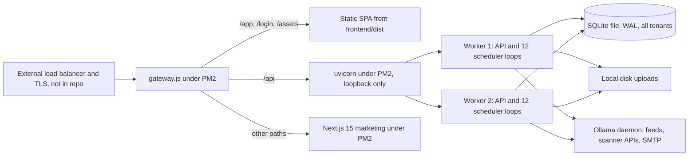

**Runtime.** gateway.js has fronted the SaaS since 2026-08-27; CLAUDE.md's topology is out of date, and an old ecosystem file still defines a `vite preview` process. The gateway handles no WebSocket upgrades and does not route `/health` to the backend; the load balancer checks the marketing root. Ollama runs outside PM2; there is no crontab.

**Background jobs.** Each worker runs 12 asyncio loops in its web event loop, each with its own guard.

| Guard | Loops | With 2 workers |
|---|---|---|
| DB optimistic claim | report schedules, scanner connectors, audit recurrence, archiving, file retention (opt-in) | one run per occurrence |
| Unique-insert claim | risk and trend snapshots | one row per tenant per day |
| `flock` file in OS temp dir | threat feeds, notification sweep, translation worker | one runner per host; both on Windows |
| Heuristic or none | CVE/NVD sync, licence phone-home | duplicates possible |

Kill switches are read from the process environment, not the `.env` files (three exceptions); INFO logs are discarded; the appliance disables 8 loops at first boot.

**Celery.** Configured with five task modules, three of them empty files that two beat entries reference. The SaaS runs no worker, beat or Redis, so `.delay()` notifications (8 call sites, wrapped in try/except) are dropped. The Docker bundle runs a worker without beat; the appliance runs neither.

**Shared state.** `shared_state.py` and the rate limiter use Redis when reachable, else per-worker memory; code comments say production has no reachable Redis (unverifiable here). Always per worker: AI quota, licence verdict cache, support WebSocket/SSE pub-sub, AI concurrency limit. Rate limits are keyed on a proxy-derived address rather than a verified client, so per-client throttling is unreliable; the exact effect depends on the load balancer, which is not in the repository.

**Migrations in practice.** Upgrades follow a manual runbook (copy DB, install, run scripts, restart, rebuild SPA). Three orchestrators run different lists: `deploy_elite_pack.py` (6), `appliance_cli.py migrate` (23, skipped on non-SQLite; 17 scripts unwired, 7 unwireable as written) and the operator (all 40). The Docker entrypoint runs none. With no version table, the register records unexplained drift twice.

**Backups and DR.**

| Item | Today |
|---|---|
| Backups | `backup_db.py` (DB only) exists, unscheduled; newest 8 days old at register date |
| RPO, RTO, availability | unbounded, single host |
| PITR, replication, restore drill | none |

The one-hour RPO promised in customer-facing documents is not met (§6.5, item 7); the full comparison with those documents is in the evidence pack (Appendix C.2).

**CI, tests, observability.** The CI workflow cannot pass: Poetry installs from a `pyproject.toml` missing 11 runtime packages, pytest finds no tests, ESLint has no config, Vitest no tests, and the frontend Docker context is wrong. No deploy stage or dependency, licence or SBOM scan. Outside CI: a live acceptance harness and 14 self-test scripts. No logging configuration (root WARNING), no metrics or tracing, Sentry only with a DSN, unrotated PM2 logs; `/health` is static and unrouted; the deep self-test is tenant_admin-only with no UI.

**Environments and configuration.** Settings load from three dotenv files in a fixed precedence order (later wins), resolved from the working directory. Of 88 declared names, 16 are never read (Keycloak, S3/AWS, Anthropic, Stripe and others); about 30 job switches bypass the files; 3 names are read but undeclared. A guard refuses insecure secrets and `DEBUG` in production mode. Whether grceye.com runs in production mode is unverified: the sources disagree (CLAUDE.md says development, the issue register records a switch on 2026-09-07), and the production environment file is not on this machine (§6.5, item 10). In development mode the API docs are public, HSTS is off and `DEBUG` echoes SQL with parameters into logs. The register records 934 requests/s (p50 93 ms, CPU-bound at 2 workers) and 11 tenants / 17 users on 2026-09-04.

Evidence: `gateway.js:88-204`, `backend/ecosystem.config.js`, `backend/app/main.py:74-98,193-195`, `backend/app/workers/celery_app.py:5-49`, `backend/app/core/shared_state.py:69-141`, `backend/appliance_cli.py:81-131,253-315`, `backend/scripts/backup_db.py:1-50`, `.github/workflows/ci.yml`

**Assessment:**
- **Strength.** The DB-level claim patterns carry over to a dedicated job runner; a self-test endpoint and an acceptance harness exist.
- **Constraint (MSSP scale).** One host, SQLite, in-worker schedulers and optional Redis rule out HA and scale-out; Path C needs PostgreSQL, mandatory shared state and a job runner.
- **Constraint (KSA, regulated customers).** No scheduled backup, PITR or restore drill, against the one-hour RPO promised in customer-facing documents.
- **Constraint (delivery).** CI, automated tests and observability must precede large refactors.

### 5.8 Technical debt register

Deduplicated from the readers' lists; severity is impact on the NG-GRC upgrade. Chapter 4 details module-level defects.

**Security**

| ID | Area | Issue | Impact on NG-GRC | Sev. | Evidence |
|---|---|---|---|---|---|
| SEC-01 | Browser session | Tokens in `localStorage`, no CSP, tokens in SSE/WS URLs, refresh races; sign-out is client-only | XSS becomes account takeover; blocks regulated onboarding | High | Evidence pack (Appendix C.2), SEC-01 |
| SEC-02 | Rate limiting | Keyed on a proxy-derived address; per-worker without Redis; auth routes only | No per-client brute-force protection or per-tenant API quotas | High | Evidence pack (Appendix C.2), SEC-02 |
| SEC-03 | Secrets at rest | TOTP, LDAP bind, webhook and scanner secrets unencrypted despite an AES-GCM helper | DB or backup read exposes second factors and integration credentials | High | Evidence pack (Appendix C.2), SEC-03 |
| SEC-04 | Identity | No SAML/OIDC; LDAPS unvalidated; MFA not mandatable; MFA-enrolled directory users cannot sign in from the UI; forced change and tenant suspension unenforced; open registration | No enterprise or KSA IdP federation; weak account lifecycle | High | Evidence pack (Appendix C.2), SEC-04 |
| SEC-05 | Audit trail | Keyless chain; no SIEM export, field diffs or denial logging; jobs unlogged | Weak R8 evidence; connector writes invisible | Medium | `backend/app/services/activity_chain.py:48-116`, `backend/app/core/activity_middleware.py:664-680` |
| SEC-06 | External parties | Auditor access not fully scoped; vendor share tokens unrevocable and unlogged | Outside firms can read engagements beyond their appointment | High | Evidence pack (Appendix C.2), SEC-06 |
| SEC-07 | Repository hygiene | Production DB snapshot tracked at HEAD; live DB and uploads in history; a tracked config file holds a non-placeholder API credential | Production data in every clone (classification to confirm: the team register calls it test data; treat as PDPL-relevant until confirmed); history rewrite and rotation needed | High | `TODO-KNOWN-ISSUES.md:54,138-147`, `.gitignore:59-63` |

**Tenancy and isolation**

| ID | Area | Issue | Impact on NG-GRC | Sev. | Evidence |
|---|---|---|---|---|---|
| TEN-01 | Isolation | Application-level only; no RLS, global filter or isolation tests; some shared file folders; three live cross-tenant read paths around custom frameworks (§6.5, item 1) | One missed predicate leaks across tenants | High | `backend/app/core/database.py:43-53`, `backend/app/models/tenant.py:3`; read paths: evidence pack (Appendix C.2), TEN-01 |
| TEN-02 | MSSP model | One tenant per identity; no hierarchy, membership, consolidated view, quotas or tenant keys | R4 MSSP unmet | High | `backend/app/models/user.py:51-54`, `backend/app/models/tenant.py:10-48` |
| TEN-03 | Platform functions | Datastore, licence and self-test endpoints open to any tenant_admin; tenants write shared catalogues (§6.5, item 2) | Cross-tenant blast radius on the SaaS | High | Evidence pack (Appendix C.2), TEN-03 |
| TEN-04 | Authorization model | Role names on about 580 routes; no capabilities; perimeter covers risks only | Least-privilege, entity and MSSP roles need a refactor | Medium | `backend/app/services/authz.py:15-70`, `backend/app/services/perimeter.py` |

**Data and migrations**

| ID | Area | Issue | Impact on NG-GRC | Sev. | Evidence |
|---|---|---|---|---|---|
| DAT-01 | Link graph | 43 JSON id-list fields, about half unvalidated; `LIKE` reverse lookups; no cleanup on delete | No reliable asset → control → risk → requirement chain | High | `backend/app/models/risk_scenario.py:53-63`, `backend/app/api/v1/endpoints/vulnerabilities.py:215-229` |
| DAT-02 | Control model | Requirement and measure worlds disconnected | Exposures cannot change compliance; BM-01 example fails at step 3 | High | `backend/app/models/applied_control.py:74-76` |
| DAT-03 | CTEM and inventory entities | Finding lacks fingerprint, source ref, first/last seen, run FK, EPSS/KEV, SLA, ticket; asset lacks identity keys and software | Hub and collector cannot land without remodelling | High | `backend/app/models/vulnerability.py:115-143`, `backend/app/models/asset.py:98-189` |
| DAT-04 | Schema evolution | Alembic dead; 40 SQLite-only scripts; three orchestrators; seed 60 tables / 141 columns behind | Manual, drift-prone upgrades; seed-based installs fail | High | `backend/appliance_cli.py:81-131`, the shared migration helper in `backend/scripts/` |
| DAT-05 | Database engines | SQLite in production; Oracle DDL fails; PostgreSQL starts with zero frameworks; JSON `LIKE` casts; UI datastore switch inert (import cycle, static analysis) | No HA or PITR; PostgreSQL needs a baseline and engine-neutral content | High | `backend/app/core/db_config.py:16-23,195-236`, `TODO-KNOWN-ISSUES.md:70-106` |
| DAT-06 | Data-subject rights | No erasure path; user deletion orphans rows | PDPL rights unmet | High | `TODO-KNOWN-ISSUES.md:121-136` |

**Runtime and scaling**

| ID | Area | Issue | Impact on NG-GRC | Sev. | Evidence |
|---|---|---|---|---|---|
| RUN-01 | Background jobs | 12 loops per web worker with host-local guards; Celery half-wired | Duplicate or missed jobs on scale-out; connectors compete with API traffic | High | `backend/app/main.py:74-98`, `backend/app/workers/celery_app.py:5-49` |
| RUN-02 | Shared state | Per-process pub-sub, AI quota, licence cache; Redis optional | Split-brain; no horizontal scaling | High | `backend/app/core/shared_state.py:69-141` |
| RUN-03 | Backup and DR | No scheduled backup, PITR or drill, against the one-hour RPO promised in customer-facing documents | Unbounded data loss; exposure if those documents are relied on | High | `backend/scripts/backup_db.py:1-50`, `TODO-KNOWN-ISSUES.md:82-90` |
| RUN-04 | Engineering hygiene | CI cannot pass; no unit tests, logging config or metrics; 16 dead settings | Regressions and outages unnoticed | High | `.github/workflows/ci.yml`, `backend/tests/acceptance.py` |

**Product defects**

| ID | Area | Issue | Impact on NG-GRC | Sev. | Evidence |
|---|---|---|---|---|---|
| PRD-01 | Integrations | API tokens model-only; webhooks never dispatched; both advertised | No push from hub or collector; no ITSM or SIEM mobilise | High | `backend/app/models/ai_access.py:71-90`, `backend/app/api/v1/endpoints/webhooks.py:16-156` |
| PRD-02 | Residual risk | Counts a non-existent `active` status and ignores `implemented` controls | Automatic re-scoring would inherit the error | High | `backend/app/services/residual_risk.py:46` |
| PRD-03 | Compliance data loss | AI re-analysis recreates control assessments, losing status, owners, verdicts and evidence links | Manual work lost; no stable landing for automated evidence | High | `backend/app/api/v1/endpoints/compliance.py:2645-2747` |
| PRD-04 | UI/API drift | UI 422s; risk API omits entity fields; SPA roles exceed API roles; backend-only features; mock fallbacks | Capabilities invisible or broken for evaluators | Medium | `backend/app/api/v1/endpoints/risk_treatment.py:247-254`, `frontend/src/components/layout/Layout.tsx:218-250` |

**Packaging**

| ID | Area | Issue | Impact on NG-GRC | Sev. | Evidence |
|---|---|---|---|---|---|
| PKG-01 | On-prem channels | Missing `cryptography`; Nuitka includes `jose`; OVA gate fails; Docker runs no migrations; stale seed | No buildable on-prem artefact; KSA on-prem blocked | High | `build ova/scripts/20-app.sh:84-98`, `infrastructure/docker/entrypoint.backend.sh:8-11` |
| PKG-02 | Licensing | Revocation unenforced; online activation broken; no tenant, seat or module dimensions; signing key on SaaS host | Resold and MSSP deployments cannot be policed | Medium | `backend/app/services/license_phone_home.py:12-20`, `backend/app/core/licensing.py:28-37` |
| PKG-03 | Commercial packaging | Quotas, flags, status, trial unenforced; no billing; no runtime white-label | R5 white-label and MSSP plans unmet | High | `backend/app/models/subscription.py:71-192`, `frontend/src/components/layout/Layout.tsx:721` |

**Internationalisation**

| ID | Area | Issue | Impact on NG-GRC | Sev. | Evidence |
|---|---|---|---|---|---|
| I18N-01 | Arabic output | PDF fonts only at Linux paths the OVA installs; AI output language never checked | Arabic reports unreadable outside the OVA; R3 at risk | High | `backend/app/services/pdf_arabic.py:37-87`, `backend/app/services/ai_locale.py:118-154` |
| I18N-02 | Arabic content | KSA frameworks English-only (Arabic by machine translation); no per-tenant label overrides | No regulator-authoritative Arabic; no white-label vocabulary | High | `backend/app/services/translation_worker.py:57-60`, `TODO-KNOWN-ISSUES.md:328-337` |

Evidence: `TODO-KNOWN-ISSUES.md`, `backend/app/core/database.py:43-79`, `backend/app/main.py:74-98`, `backend/app/services/authz.py:15-70`, `backend/app/models/applied_control.py:74-82`, `backend/appliance_cli.py:81-131`, `backend/app/core/licensing.py`. Code pointers for unfixed security weaknesses (SEC-01 to SEC-04, SEC-06, TEN-01's read paths, TEN-03) are kept only in the internal evidence pack, which GRCEye engineering holds outside the repository (Appendix C.2); they return to this register once each weakness is fixed.

**Assessment:**
- **Strength.** Most high-severity items are additive (keys, RLS, association tables, a job runner, a migration baseline) rather than rewrites of the functional modules.
- **Constraint (sequencing).** DAT-04/05, TEN-01, PRD-01 and RUN-04 gate every block; Path C should clear them before building the collector and CTEM connector.
- **Constraint (KSA).** SEC-07, DAT-06, I18N-01/02 and the AI egress in §5.6 bear directly on PDPL and NCA expectations and need owners before a KSA pilot.

# Appendices

## Appendix A. Module inventory

### A.1 API routers

`backend/app/api/v1/router.py` mounts 63 routers under `/api/v1`, one per file in `backend/app/api/v1/endpoints/`. Together they declare 582 routes: 581 HTTP routes and one WebSocket (support chat). Counts are route decorators per file. A regex count over the source and the AST route table built by the security reader agree file by file.

Outside `/api/v1`, `main.py` adds an unauthenticated `GET /health`. The interactive API documentation (OpenAPI, Swagger, ReDoc) is served whenever `ENVIRONMENT` is not `production`. Which mode grceye.com runs in could not be verified from this machine: the sources disagree (§6.5, item 10).

This appendix assigns each router to a domain that matches the chapters of this document. Rows are sorted by domain, then by route count.

| # | Router file | Prefix (under `/api/v1`) | Routes | Domain | Purpose |
|---|---|---|---|---|---|
| 1 | `access_governance.py` | `/access-governance` | 13 | Identity & access | Delegations, access-review campaigns, custom roles; no UI caller. |
| 2 | `auth.py` | `/auth` | 13 | Identity & access | Login, MFA second step, registration, refresh, password reset, logout, sessions, /me. |
| 3 | `users.py` | `/users` | 11 | Identity & access | Tenant user and auditor management, multi-role, password reset, auditor assignments. |
| 4 | `groups.py` | `/groups` | 4 | Identity & access | Team groups granting assignable roles to their members. |
| 5 | `mfa.py` | `/mfa` | 4 | Identity & access | TOTP status, enrol, verify, disable; 'Elite Pack' tag is a label only. |
| 6 | `sso.py` | `/sso` | 2 | Identity & access | AD/LDAP status and directory login (credential bind); no SAML or OIDC. |
| 7 | `admin.py` | `/admin` | 17 | Tenancy, plans & licensing | Super-admin console: cross-tenant users, feature packs, subscriptions, AI access, licences. |
| 8 | `tenants.py` | `/tenants` | 8 | Tenancy, plans & licensing | Current tenant profile, whitelisted settings, lockout policy, LDAP configuration and test. |
| 9 | `subscriptions.py` | `/subscriptions` | 5 | Tenancy, plans & licensing | Plan catalogue, current subscription, limits and entitlement map. |
| 10 | `license.py` | `/license` | 3 | Tenancy, plans & licensing | Client licence status and activation; online activation targets a missing vendor route. |
| 11 | `license_server.py` | `/licenses` | 1 | Tenancy, plans & licensing | Vendor-side licence check-in answering appliance phone-home. |
| 12 | `compliance.py` | `/compliance` | 45 | Compliance | Assessments, AI document analysis, control status, evidence, gaps, action plan, file versions. |
| 13 | `frameworks.py` | `/frameworks` | 24 | Compliance | Catalogue, clone, edit, import, AI builder, crosswalk, applicability, translations, upstream sync. |
| 14 | `compliance_scales.py` | `/compliance-scales` | 7 | Compliance | Configurable conformity scales with weights and FR/EN/AR labels. |
| 15 | `requirements.py` | `/requirements` | 3 | Compliance | Read-only register uniting controls, policies, governance documents and regulatory updates. |
| 16 | `risks.py` | `/risks` | 13 | Risk & controls | Risk register, heat map, versions, lifecycle, appetite, residual suggestion, Monte Carlo. |
| 17 | `applied_controls.py` | `/applied-controls` | 10 | Risk & controls | Applied-control register, validation, obsolescence alerts, change history. |
| 18 | `risk_treatment.py` | `/risk-treatment` | 8 | Risk & controls | Treatment plans, tracking, supersede with versions, untreated scenarios. |
| 19 | `risk_cartographies.py` | `/risk-cartographies` | 7 | Risk & controls | Saved risk heat maps with manual positions; EN/FR/AR PDF. |
| 20 | `risk_scenarios.py` | `/risk-scenarios` | 7 | Risk & controls | Threat-vulnerability-asset-control scenarios, priority criteria, auto-linked risk. |
| 21 | `security_exceptions.py` | `/security` | 7 | Risk & controls | Security exceptions (waivers) and risk acceptances with approval. |
| 22 | `control_evaluation.py` | `/control-evaluations` | 5 | Risk & controls | Five-criteria effectiveness evaluation of applied controls; remediation follow-up. |
| 23 | `risk_matrices.py` | `/risk-matrices` | 4 | Risk & controls | Custom probability x impact matrices and default selection; no UI. |
| 24 | `scenario_versions.py` | `/scenario-versions` | 3 | Risk & controls | Scenario snapshots, timeline and diff. |
| 25 | `audits.py` | `/audits` | 40 | Audit | Engagements, findings, recommendations, evidence, report approval and distribution, soft delete. |
| 26 | `auditor_portal.py` | `/auditor-portal` | 13 | Audit | Assignment-scoped auditor checklists, verdicts, findings, evidence, AI report. |
| 27 | `audit_grids.py` | `/audit-grids` | 12 | Audit | Custom evaluation grids, framework seeding, internal grid answering. |
| 28 | `audit_campaigns.py` | `/audit-campaigns` | 8 | Audit | Audit programmes, consolidated summary, stakeholder notification. |
| 29 | `audit_comments.py` | `/audit-comments` | 5 | Audit | Threaded comments on audits, findings and checklist lines. |
| 30 | `governance.py` | `/governance` | 23 | Policy, governance & regulatory | RACI, governance groups, document repository with ACL, committees, trend. |
| 31 | `policies.py` | `/policies` | 15 | Policy, governance & regulatory | Policy CRUD, versions, approval stamp, attestations, control links, PDF. |
| 32 | `regulatory.py` | `/regulatory` | 15 | Policy, governance & regulatory | Regulatory updates, feed sources, AI triage, approval chain, version history. |
| 33 | `archiving.py` | `/archiving` | 10 | Policy, governance & regulatory | Entity snapshots, auto-archiving rules, integrity-checked download, purge, export. |
| 34 | `contract_collab.py` | `/contract-collab` | 15 | Third parties | Contract negotiation sessions; share-token vendor portal with typed signatures. |
| 35 | `vendors.py` | `/vendors` | 15 | Third parties | Vendor register, AI prescreen and analysis, contracts, CISO review, cartography. |
| 36 | `assets.py` | `/assets` | 12 | Inventory | Asset register, stats, picker options, CIA valuation, EOL list, incidents per asset. |
| 37 | `asset_graph.py` | `/asset-graph` | 11 | Inventory | Org entities, business processes, entity-process-asset cartography. |
| 38 | `threats.py` | `/threats` | 18 | Exposure & threat | Threat catalogue and register, MITRE import, feeds, watch, profiles, history. |
| 39 | `vulnerabilities.py` | `/vulnerabilities` | 12 | Exposure & threat | Vulnerability register, validation, impact scoring, scenario links, trend. |
| 40 | `vuln_import.py` | `/vuln-import` | 8 | Exposure & threat | Scanner file import, scan journal, Tenable/Nessus/Qualys/EASM connector management and sync. |
| 41 | `incidents.py` | `/incidents` | 7 | Exposure & threat | Incident register, stats, risk-scenario draft from an incident. |
| 42 | `cve.py` | `/cve` | 5 | Exposure & threat | Global NVD/CWE knowledge base with KEV flags, sync, tenant annotations. |
| 43 | `data_io.py` | `/data` | 14 | Reporting & data | Exports of 11 registers; insert-only CSV/XML import of risks, vendors, assets. |
| 44 | `dashboard.py` | `/dashboard` | 7 | Reporting & data | Main KPIs, executive summary, framework overview, risk trend, widget layout. |
| 45 | `dashboards.py` | `/dashboards` | 7 | Reporting & data | Seven module dashboards: assets, vulnerabilities, threats, risks, controls, governance, audit. |
| 46 | `report_builder.py` | `/report-builder` | 6 | Reporting & data | Ad-hoc tabular exports over ten datasets; saved templates. |
| 47 | `ocr.py` | `/ocr` | 5 | Reporting & data | Tesseract OCR: text extraction, text PDF, searchable PDF; nothing persisted. |
| 48 | `report_schedules.py` | `/report-schedules` | 5 | Reporting & data | Recurring e-mailed PDF report schedules; run now. |
| 49 | `reports.py` | `/reports` | 5 | Reporting & data | Five PDF report types: generate, preview, archived history. |
| 50 | `dashboard_export.py` | `/dashboard-export` | 2 | Reporting & data | XLSX/PDF export of nine dashboards. |
| 51 | `ai.py` | `/ai` | 13 | AI | Chat, policy and document generation, risk analysis, audit and remediation plans, contract analysis. |
| 52 | `ai_access.py` | `/auth/ai-access` | 4 | AI | AI access requests, quota status and usage; quotas auto-approve. |
| 53 | `activity_log.py` | `/activity-log` | 9 | Audit trail | Hash-chained trail list, access report, verify, retention seals, login events. |
| 54 | `support.py` | `/support/tickets` | 12 (1 WS) | Platform & integration | Support tickets to platform staff; SSE alerts and WebSocket chat. |
| 55 | `notifications.py` | `/notifications` | 8 | Platform & integration | In-app feed, read and delete, preferences, manual deadline sweep. |
| 56 | `webhooks.py` | `/webhooks` | 5 | Platform & integration | Outbound webhook configuration and unsigned test ping; no event is ever dispatched. |
| 57 | `database_config.py` | `/system` | 3 | Platform & integration | Deployment-wide datastore selection and connection test. |
| 58 | `system.py` | `/system` | 1 | Platform & integration | Deployment self-test checklist. |
| 59 | `translations_admin.py` | `/admin/translations` | 1 | Platform & integration | Machine-translation worker status for super admin. |
| 60 | `trust_center.py` | `/trust-center` | 3 | Public & external | Trust-center settings and anonymous public JSON by tenant slug; no page. |
| 61 | `public_upload.py` | `/public` | 2 | Public & external | Token-based evidence upload without login. |
| 62 | `public_chat.py` | `/public` | 1 | Public & external | Unauthenticated marketing support chatbot (AI). |
| 63 | `public_contact.py` | `/public` | 1 | Public & external | Unauthenticated contact form e-mailed to fixed recipients. |
| | **Total: 63 routers** | | **582** (581 HTTP + 1 WebSocket) | | Plus `GET /health` outside `/api/v1`. |

Routes by domain:

| Domain | Routers | Routes |
|---|---|---|
| Identity & access | 6 | 47 |
| Tenancy, plans & licensing | 5 | 34 |
| Compliance | 4 | 79 |
| Risk & controls | 9 | 64 |
| Audit | 5 | 78 |
| Policy, governance & regulatory | 4 | 63 |
| Third parties | 2 | 30 |
| Inventory | 2 | 23 |
| Exposure & threat | 5 | 50 |
| Reporting & data | 8 | 51 |
| AI | 2 | 17 |
| Audit trail | 1 | 9 |
| Platform & integration | 6 | 30 |
| Public & external | 4 | 7 |
| **Total** | **63** | **582** |

Notes:

- **Shared prefixes.** Three routers share `/public` and two share `/system` (`system.py` and `database_config.py`). `ai_access.py` declares its own `/auth/ai-access` prefix, and `/admin/translations` sits beside `/admin`.
- **"Elite Pack" tags.** Fourteen routers carry an "(Elite Pack)" OpenAPI tag. On the server, `require_feature` enforces 17 distinct Elite flags. The tags on `mfa.py` and `sso.py` are labels only: MFA is not gated, and SSO checks its flag inline.
- **Routes without an auth dependency.** 27 routes have no FastAPI auth dependency:
  - auth flows (7);
  - LDAP status and login (2);
  - the vendor share-token portal (7);
  - evidence share links (2);
  - public chat and contact (2);
  - the trust-center public JSON (1);
  - static catalogues (3);
  - the licence check-in (1);
  - the support SSE and WebSocket channels, which read the token from the query string (2).

  477 routes depend on `get_tenant_id`, directly or through a module-local wrapper.
- **No machine credential.** No router issues or validates a machine credential. The `api_tokens` table has no route, and the frontend wrappers for it are marked deprecated.
- **Stale counts in CLAUDE.md.** Its "377 routes" and "29 endpoint files" are out of date.

Evidence: `backend/app/api/v1/router.py:71-143`, `backend/app/main.py:155-196`, `backend/app/api/v1/endpoints/ai_access.py:18`, `backend/app/api/v1/endpoints/support.py:587`, `backend/app/api/v1/dependencies/features.py:59-84`, `backend/app/models/ai_access.py:71-90`

**Assessment:**
- **Strength.** The REST surface is consistent and broad. 477 of 582 routes depend on `get_tenant_id`. The GRC-core domains (compliance, risk and controls, audit, policy and governance) total 284 routes, which form the reusable heart of Block 1.
- **Gap for Blocks 2 and 3.** No route accepts a machine credential and there is no inbound receiver.
  - Inventory has 23 routes, and its import is insert-only.
  - Exposure has 50 routes, built around scanner pulls and file uploads.
  - The collector API and the findings-hub connector both have to be added.
- **MSSP blocker.** Several routers change deployment-wide state yet accept a tenant-level administrator (§6.5, item 2; detail in the evidence pack, Appendix C.2). No router exposes a tenant hierarchy or tenant switching.
- **Maintainability.** Several routers are large single files with inline schemas and no repository layer (`compliance.py` has 45 routes, `audits.py` 40, `frameworks.py` 24). New connectors will have to be added into these modules or alongside them.

### A.2 Service modules

`backend/app/services/` holds 49 files: 48 modules and an empty `__init__.py`. Twelve modules provide the starters of the 12 asyncio loops that `main.py` launches inside every uvicorn worker (kind `loop`). Each loop has its own guard against running twice across workers.

Callers are import sites found by scanning `backend/`. Only import statements count, comments are excluded, and self-test scripts are omitted.

Kinds:
- `AI`: the provider-neutral AI foundation.
- `connector`: outbound pulls from external systems.
- `render`: document writers.
- `i18n`: language resolution and translation.
- `core lib`: domain logic called by endpoints.

| # | Module | Kind | Purpose | Main callers |
|---|---|---|---|---|
| 1 | `__init__.py` | package | Empty package marker (0 lines). | - |
| 2 | `activity_chain` | core lib | Per-tenant SHA-256 hash chain for the activity log; system actor for batch writes. | activity middleware; 28 endpoint modules; audit_recurrence_scheduler |
| 3 | `ai_chunking` | AI | Token estimates, chunking, map-reduce and quote-verified document-versus-controls assessor. | ai, compliance, frameworks, regulatory, vendors, auditor_portal |
| 4 | `ai_locale` | AI | Resolves en/fr/ar per request; Arabic language block; localised AI failure texts. | 26 endpoint modules; i18n_messages; report services |
| 5 | `ai_prompts` | AI | Registry of 19 expert AI tasks: prompts, schemas, fix-ups, scoring rules. | ai, compliance, frameworks, regulatory, vendors, auditor_portal, public_chat |
| 6 | `ai_provider` | AI | Provider resolution (Ollama or OpenAI-compatible, tenant BYO), transport, SSE, typed failures. | ai, compliance, frameworks, regulatory, vendors, auditor_portal, public_chat, system |
| 7 | `ai_structured` | AI | JSON extraction, schema validation, one repair turn, typed AiResult. | ai, compliance, frameworks, regulatory, vendors; ai_chunking |
| 8 | `archiving_engine` | loop | Builds archive snapshots; 5-minute auto-archiving rule loop with DB claim. | archiving, audits; main.py lifespan |
| 9 | `audit_recurrence_scheduler` | loop | Hourly loop spawning the next cycle of closed recurring audits. | main.py lifespan |
| 10 | `audit_retention` | core lib | Seal-then-purge retention of the activity log; 365-day floor. | activity_log |
| 11 | `authz` | core lib | Effective roles: roles JSON, groups, custom roles, delegations, minus exclusions. | dependencies/auth (require_roles); 11 endpoint modules |
| 12 | `content_translation` | i18n | Machine translation of system content en/fr/ar with DB cache and read overlay. | frameworks, compliance, requirements, threats, cve, regulatory, policies, dashboard |
| 13 | `control_registry` | core lib | Field-level change history for applied controls. | applied_controls, control_evaluation |
| 14 | `directory_auth` | core lib | AD/LDAP bind, tenant configuration overlay, group-to-role mapping. | sso, tenants |
| 15 | `easm_connector` | connector | Configurable EASM REST pull; creates assets for unmatched hosts. | vuln_import; scanner_connectors |
| 16 | `email_service` | core lib | SMTP with Jinja templates; recipient-language RTL mail; brand hard-coded. | auth, users, audits, public_contact; notification_generator, report_scheduler |
| 17 | `excel_export` | render | Generic XLSX writer with cell sanitisation. | data_io, report_builder, dashboard_export, archiving |
| 18 | `file_integrity` | core lib | SHA-256 at upload, verification on read, stored-file version ledger. | compliance, audits, auditor_portal, vendors, governance, public_upload, reports |
| 19 | `file_retention` | loop | Opt-in purge of retired file versions with reference checks; hourly loop. | compliance; main.py lifespan |
| 20 | `license_client` | connector | Online licence activation and check-in client to the vendor server. | license; license_phone_home |
| 21 | `license_phone_home` | loop | 12-hour revocation check-in; shortened expiry is ignored by the licence gate. | main.py lifespan |
| 22 | `mitre_cwe_sync` | connector | MITRE CWE catalogue sync on 30-day staleness. | nvd_sync |
| 23 | `notification_generator` | loop | Deadline and threshold checks; 6-hourly sweep under a file lock; e-mail leg. | notifications, risks, risk_scenarios, governance, auth; main.py lifespan |
| 24 | `notification_i18n` | i18n | Renders notifications in en/fr/ar at read time. | notifications; notification_generator; Celery notification task |
| 25 | `nvd_sync` | loop | NVD CVE publication and refresh passes; 6-hour wake loop. | cve; main.py lifespan |
| 26 | `ocr_service` | core lib | Tesseract OCR for images and PDFs (fra, eng, ara). | ocr, vendors, system |
| 27 | `pdf_arabic` | render | Arabic shaping, bidi and font registration for ReportLab PDFs. | report_generator, tabular_pdf, policies, risk_cartographies, archiving |
| 28 | `perimeter` | core lib | Owner-only writes for business and control owners on risks and treatments. | risks, risk_treatment |
| 29 | `report_generator` | render | Five trilingual PDF reports plus audit report; archived with SHA-256. | reports, audits, policies, risk_cartographies, data_io; report_scheduler |
| 30 | `report_scheduler` | loop | 5-minute loop delivering scheduled PDF reports with exactly-once claim. | report_schedules, audits; main.py lifespan; Celery reports task |
| 31 | `residual_risk` | core lib | Residual-risk suggestion from control evaluations; ignores 'implemented' controls. | risks |
| 32 | `risk_scoring` | core lib | Matrix-driven likelihood x impact scoring; built-in matrices. | risks, risk_scenarios, risk_matrices, vulnerabilities; scenario_priority |
| 33 | `risk_snapshot_scheduler` | loop | Hourly loop writing one open-risk count row per tenant per day. | main.py lifespan |
| 34 | `risk_versioning` | core lib | Pre-change risk snapshots and version diffs. | risks |
| 35 | `scanner_connectors` | connector | Tenable, Nessus, Qualys, EASM and demo pulls; OpenVAS pull raises. | vuln_import; vuln_scanner_scheduler; easm_connector |
| 36 | `scanner_import` | core lib | Nessus/OpenVAS/CSV parsing; asset match, dedup, journal, remediation controls. | vuln_import; scanner_connectors; easm_connector |
| 37 | `scenario_priority` | core lib | Configurable scenario priority formula and alert threshold. | risk_scenarios; notification_generator |
| 38 | `tabular_pdf` | render | Generic landscape PDF table for register exports. | data_io, report_builder, dashboard_export |
| 39 | `threat_feeds` | connector | Parsers for opensourcemalware, CISA KEV and SANS ISC feeds. | threats; threat_scheduler; threat_watch_ingest |
| 40 | `threat_registry` | core lib | Threat change history, profile state, review cadence. | threats |
| 41 | `threat_scheduler` | loop | 24-hour feed fetch into tenant threat watch under a file lock. | main.py lifespan |
| 42 | `threat_translation` | i18n | Identifies feed-imported threats and serves their FR/AR text. | threats; translation_sources |
| 43 | `threat_watch_ingest` | core lib | Routes feed items to threat watch; flags KEV on the CVE catalogue. | threats; threat_scheduler |
| 44 | `translation_sources` | i18n | Registry of system content to machine-translate, with priorities. | translation_worker; regulatory |
| 45 | `translation_worker` | loop | Single-worker background machine translation of system content. | main.py lifespan; cve; translations_admin |
| 46 | `trend_snapshot_scheduler` | loop | Daily vulnerability, threat and governance trend rows; hourly loop. | main.py lifespan; vulnerabilities, threats, governance |
| 47 | `user_language` | i18n | User language outside requests: last seen, tenant locale, then English. | auth, users, notifications; notification_generator, report_scheduler |
| 48 | `vuln_scanner_scheduler` | loop | Hourly connector auto-sync with optimistic DB claim. | main.py lifespan |
| 49 | `xml_export` | render | Generic XML export and safe XML import. | data_io |

Kinds: AI 5; loop 12; connector 5; render 5; i18n 5; core lib 16; package 1; total 49 files.

Notes:

- **Loop cadences.**
  - Threat feeds: every 24 h.
  - Scheduled reports: every 5 min.
  - NVD: wakes every 6 h and syncs when the catalogue is more than 20 h old.
  - Scanner connectors: hourly poll.
  - Audit recurrence: hourly.
  - Archiving rules: every 5 min.
  - File retention: hourly, and acts only when enabled.
  - Risk snapshot: hourly, at most one row per tenant per day.
  - Licence phone-home: every 12 h.
  - Notification sweep: every 6 h. A comment in `main.py` says 24 h, but the constant is 6 h.
  - Trend snapshot: hourly.
  - Translation worker: every 5 min when idle, every 1 min while busy.

  The appliance's firstboot disables eight of these loops. It leaves file retention, notifications, trend snapshots and translation on.
- **Celery.** Celery lives outside `services/`, in `backend/app/workers/`. It has five task modules, three of which are empty files. No Celery worker or beat runs in the PM2 SaaS.
- **No repository layer.** `app/repositories/`, `app/integrations/` and `app/schemas/` contain only an empty `__init__.py`. Endpoints query the ORM directly and declare their schemas inline.

Evidence: `backend/app/main.py:16-27`, `backend/app/main.py:74-98`, `backend/app/services/scanner_import.py:403-482`, `backend/app/services/residual_risk.py:46`, `backend/app/services/notification_generator.py:2538`, `backend/app/services/activity_chain.py:80-190`, `backend/app/workers/celery_app.py`

**Assessment:**
- **Strength.** Reusable building blocks already exist:
  - a provider-neutral AI foundation with Arabic output control;
  - one ingest pipeline (`scanner_import`) behind pluggable pull connectors;
  - file integrity;
  - a per-tenant hash chain with a system actor for batch writers.

  These are the natural extension points for the collector and the CTEM connector.
- **Constraint.** All 12 schedulers run inside every web worker. Each has its own guard: a DB claim, a unique-insert claim or a host-local file lock. There is no job runner and no coordination across hosts, so collector and CTEM jobs need a real worker tier.
- **Gap for Block 3.** No service carries an exposure through to a control assessment, scenario or risk.
  - `scanner_import` creates only vulnerabilities and planned applied controls.
  - `residual_risk` counts a control status (`active`) that applied controls never take, so implemented controls are ignored.
- **KSA and white-label.** Built-in text is translated by machine only. `email_service` and `report_generator` hard-code the product brand, so rebranding means editing the source.

### A.3 Data model by cluster

72 model files declare 113 tables on one SQLAlchemy declarative base; `__init__.py` imports all of them. Every table inherits a UUID string key and `created_at`/`updated_at`. `create_all()` runs at every boot: it creates missing tables but never adds columns.

The tenancy class of each table comes from an AST scan of its `tenant_id` column: presence, nullability and foreign key. This appendix repeated the scan independently and the result matches the data-model reader. The clusters are the data-model reader's.

"In seed" compares each table with the committed `release/seed/grc_seed.db` (2026-08-10). "n col(s) missing" counts the model columns that the seed table lacks.

Tenancy classes:
- **T**: `tenant_id` NOT NULL with a foreign key to `tenants` (62 tables).
- **T\***: `tenant_id` NOT NULL without a foreign key (2).
- **S**: nullable `tenant_id`; NULL marks a shared built-in row (5).
- **N**: nullable `tenant_id` for another reason, such as rows written before login or a legacy column style (5).
- **C**: no `tenant_id`; scoped through a parent row (25).
- **U**: no `tenant_id`; a per-user or per-ticket row (6).
- **G**: no `tenant_id`; a global or platform catalogue (8).

| Cluster | Tables | T | T\* | S | N | C | U | G | In seed |
|---|---|---|---|---|---|---|---|---|---|
| Tenancy and identity | 12 | 5 | 1 | - | 3 | - | 2 | 1 | 3 |
| Licensing and subscription | 3 | 1 | - | - | - | - | - | 2 | 3 |
| Framework and compliance | 13 | 4 | - | 3 | - | 6 | - | - | 8 |
| Evidence and documents | 6 | 4 | 1 | - | - | - | - | 1 | 4 |
| Risk and implemented controls | 15 | 10 | - | 1 | - | 4 | - | - | 9 |
| Asset and inventory | 4 | 4 | - | - | - | - | - | - | 1 |
| Threat, vulnerability and scanners | 11 | 7 | - | 1 | - | 1 | - | 2 | 2 |
| Incidents | 2 | 1 | - | - | - | 1 | - | - | 2 |
| Audit | 11 | 6 | - | - | - | 5 | - | - | 4 |
| Policy and governance | 9 | 6 | - | - | - | 3 | - | - | 3 |
| Third parties (TPRM) | 6 | 2 | - | - | - | 4 | - | - | 6 |
| Reporting and dashboards | 5 | 5 | - | - | - | - | - | - | 0 |
| Notifications | 2 | 1 | - | - | - | - | 1 | - | 2 |
| AI and i18n | 7 | 1 | - | - | 2 | 1 | 1 | 2 | 2 |
| Platform and operations | 7 | 5 | - | - | - | - | 2 | - | 4 |
| **Total** | **113** | **62** | **2** | **5** | **5** | **25** | **6** | **8** | **53** |

Notes:

- **Reconciling the class counts.** Elsewhere this document quotes 64 NOT NULL, 25 parent-scoped, 10 nullable and 8 global tables. These are T+T\*, C, S+N and G. The six U tables complete the 113. Only five of the ten nullable tables hold shared built-in rows (S); the other five (N) are nullable for login-time or legacy reasons.
- **Application-level isolation.** Handlers filter on the `tenant_id` read from the user row. There is no row-level security: the claim in `tenant.py` is documented-only. SQLite runs without `PRAGMA foreign_keys`, so declared foreign keys and the two `ON DELETE CASCADE` clauses are not enforced on the production engine.
- **JSON soft links.** 43 JSON columns hold id lists that point to other rows (§14.4 maps them to 36 association tables), and about half are validated against the tenant on write. They carry most of the NG-GRC chain: asset, vulnerability, threat, scenario, applied control and requirement.
- **Seed drift.**
  - 60 model tables are absent from the seed; `create_all()` creates them at first boot.
  - 141 model columns are missing from 25 seed tables, and `create_all()` never adds them.
  - On-prem installs therefore depend on hand-run SQLite scripts. Only 23 of the 40 are wired into the appliance CLI.

**Tenancy and identity (12 tables)**

| Table | Purpose | Tenancy | In seed | Notes |
|---|---|---|---|---|
| `tenants` | Customer organisation; isolation root; settings and feature JSON. | G | yes | logo_url and branding settings never read by the UI |
| `users` | Account bound to one tenant; scalar role plus roles JSON. | T | yes, 9 cols missing | e-mail globally unique |
| `groups` | Team group granting roles to its members. | T | no |  |
| `custom_roles` | Tenant-named role composed of built-in roles. | T | no | Backend-only |
| `access_delegations` | Time-bound lending of roles to a colleague. | T | no | Backend-only |
| `access_review_campaigns` | Access recertification round. | T | no | Backend-only |
| `access_review_items` | One user's entitlement snapshot and reviewer decision. | T\* | no | Backend-only |
| `mfa_devices` | TOTP secret per user. | U | no | secret stored in plaintext |
| `password_reset_tokens` | Hashed single-use password-reset token. | U | no |  |
| `login_events` | Journal of every authentication attempt. | N | no | no UI |
| `user_sessions` | Revocable login session behind the sid claim. | N | no | last_seen never updated |
| `api_tokens` | Hashed personal API token. | N | yes | Model-only: no route issues or checks tokens |

**Licensing and subscription (3 tables)**

| Table | Purpose | Tenancy | In seed | Notes |
|---|---|---|---|---|
| `subscriptions` | Tenant plan, status and entitlement overrides. | T | yes | quotas, status and trial not enforced |
| `issued_licenses` | Licence keys minted by the vendor SaaS. | G | yes, 1 col missing |  |
| `license_activations` | The single activated licence of an installation. | G | yes | one global row per install |

**Framework and compliance (13 tables)**

| Table | Purpose | Tenancy | In seed | Notes |
|---|---|---|---|---|
| `frameworks` | Framework catalogue entry; shared built-in or tenant fork. | S | yes, 2 cols missing | is_builtin defaults to true |
| `framework_controls` | Requirement line; the atomic compliance unit. | C | yes, 2 cols missing | parent_id unused in seed; crosswalk JSON |
| `framework_control_versions` | Pre-edit snapshot of a tenant-owned control. | C | no |  |
| `control_requirements` | must/should/may sub-requirement of a control. | C | yes | 0 rows in seed; no read route |
| `control_applicability` | Applicability decision per tenant, entity or process. | T | no | not used by assessments or scoring |
| `compliance_scales` | Configurable conformity scale with FR/EN/AR labels. | S | no | UI only selects a scale |
| `compliance_assessments` | Assessment of one framework at tenant, entity, process or asset scope. | T | yes, 4 cols missing |  |
| `control_assessments` | Status of one requirement inside one assessment. | C | yes, 5 cols missing | rows created only at registration or by AI |
| `compliance_gaps` | Gap on a control with remediation recommendation. | C | yes |  |
| `action_items` | Corrective or preventive task from a gap or finding. | T | yes, 5 cols missing | recurrence stored, never spawned |
| `regulatory_feeds` | Regulatory-watch source. | S | no | Backend-only; no KSA default |
| `regulatory_updates` | Tracked regulatory change with impact and deadline. | T | yes |  |
| `regulatory_update_versions` | Immutable snapshot before each update change. | C | no | Backend-only |

**Evidence and documents (6 tables)**

| Table | Purpose | Tenancy | In seed | Notes |
|---|---|---|---|---|
| `evidence` | File proving one control assessment. | T | yes, 1 col missing | validity and automation fields never written |
| `uploaded_documents` | Assessment document for AI analysis. | T | yes, 1 col missing |  |
| `evidence_upload_tokens` | No-login upload link for one control assessment. | T | yes |  |
| `mandatory_documents` | Global catalogue of mandatory documents per clause. | G | yes | 45 rows, ISO 27001 only |
| `stored_file_versions` | File version ledger that survives deletion. | T\* | no | legal_hold never written |
| `action_item_attachments` | Proof file for an action item. | T | no |  |

**Risk and implemented controls (15 tables)**

| Table | Purpose | Tenancy | In seed | Notes |
|---|---|---|---|---|
| `risks` | Risk register entry with inherent, residual and target scoring. | T | yes, 9 cols missing |  |
| `risk_assessments` | Point-in-time likelihood and impact assessment. | C | yes | Model-only |
| `risk_treatments` | Treatment plan; one per risk. | C | yes, 8 cols missing |  |
| `risk_treatment_versions` | Snapshot of a superseded treatment plan. | C | no |  |
| `risk_versions` | Pre-change risk snapshot and lifecycle transition. | T | no | no UI |
| `risk_scenarios` | Threat-vulnerability-asset-control chain linked to one risk. | T | yes, 7 cols missing | chain held in JSON id lists |
| `risk_scenario_versions` | Point-in-time scenario snapshot. | C | no |  |
| `risk_matrices` | Configurable probability x impact scales. | S | yes | no UI |
| `risk_cartographies` | Saved heat map with manual positions. | T | yes |  |
| `risk_snapshots` | Daily open-risk counts by severity. | T | no | scheduler-written |
| `risk_acceptances` | Formal risk acceptance with approver and expiry. | T | yes | targets are unvalidated JSON |
| `security_exceptions` | Time-bound waiver for a risk, control, vulnerability or asset. | T | yes | polymorphic JSON targets; no UI link |
| `applied_controls` | Implemented measure: cost, effort, progress, validation. | T | yes, 5 cols missing | requirement link not read by compliance; no UI |
| `applied_control_history` | Field-level change log that survives deletion. | T | no |  |
| `control_evaluations` | Five-criteria effectiveness score of an applied control. | T | no |  |

**Asset and inventory (4 tables)**

| Table | Purpose | Tenancy | In seed | Notes |
|---|---|---|---|---|
| `assets` | Asset with owner, process, entity, CIA, RTO/RPO, lifecycle. | T | yes, 14 cols missing | no identity keys or software inventory |
| `asset_valuation_history` | CIA valuation change log. | T | no | Backend-only |
| `org_entities` | Organisation hierarchy node. | T | no | only intra-tenant multi-entity construct |
| `business_processes` | Business process with owner, criticality and assets. | T | no |  |

**Threat, vulnerability and scanners (11 tables)**

| Table | Purpose | Tenancy | In seed | Notes |
|---|---|---|---|---|
| `threats` | Built-in threat catalogue and tenant threat register. | S | yes, 19 cols missing | nullable without FK; 691 built-in ATT&CK rows |
| `threat_history` | Immutable threat change log. | T | no |  |
| `threat_watch_items` | Raw feed item before promotion to a threat. | T | no |  |
| `vulnerabilities` | Security finding; the only finding entity. | T | yes, 5 cols missing | no fingerprint, EPSS, KEV, SLA or ticket |
| `vulnerability_impact_history` | Composite impact-score changes. | C | no |  |
| `scan_journals` | One row per scanner import or connector sync. | T | no | no link to the findings it created |
| `scanner_connectors` | Pull-connector configuration and schedule. | T | no | credentials stored in plaintext |
| `scanner_connector_settings` | Non-secret connector settings (EASM field mapping). | T | no |  |
| `cve_entries` | Global NVD CVE catalogue with CISA KEV flags. | G | no |  |
| `cve_annotations` | Tenant CVE triage and asset links. | T | no |  |
| `cwe_entries` | Global MITRE CWE catalogue. | G | no |  |

**Incidents (2 tables)**

| Table | Purpose | Tenancy | In seed | Notes |
|---|---|---|---|---|
| `incidents` | Incident with impact, root cause and breach fields. | T | yes, 2 cols missing |  |
| `incident_timeline_entries` | Timestamped investigation log. | C | yes | Model-only |

**Audit (11 tables)**

| Table | Purpose | Tenancy | In seed | Notes |
|---|---|---|---|---|
| `audits` | Engagement: scope, campaign, grid, report workflow. | T | yes, 18 cols missing | soft delete |
| `audit_findings` | Audit finding, optionally on a framework control. | C | yes, 5 cols missing |  |
| `audit_evidence` | File collected during an audit. | C | yes, 6 cols missing |  |
| `audit_campaigns` | Audit programme for a period. | T | no | UI lists only |
| `audit_grids` | Custom checklist with its verdict scale. | T | no |  |
| `audit_grid_items` | Checklist row, optionally copied from a control. | C | no |  |
| `audit_grid_responses` | Verdict on one grid item for one audit. | C | no |  |
| `audit_comments` | Threaded auditor-auditee message. | T | no | soft delete |
| `audit_finding_status_events` | Append-only log of finding status changes. | C | no |  |
| `audit_recommendations` | Recommendation tracked to closure. | T | no |  |
| `auditor_assignments` | Grants an auditor access to an assessment or audit. | T | yes, 1 col missing |  |

**Policy and governance (9 tables)**

| Table | Purpose | Tenancy | In seed | Notes |
|---|---|---|---|---|
| `policies` | Policy register entry with review cycle and scope. | T | yes, 4 cols missing |  |
| `policy_versions` | Content version of a policy. | C | yes |  |
| `policy_attestations` | User acknowledgement of a policy version. | C | yes |  |
| `raci_assignments` | R/A/C/I on an activity by role, user or group. | T | no |  |
| `governance_groups` | Named set of users for RACI. | T | no |  |
| `governance_documents` | Governance repository document. | T | no |  |
| `governance_document_versions` | Governance document content version. | C | no |  |
| `governance_document_access` | Per-document access rule for a user or role. | T | no |  |
| `governance_committees` | Steering committee: members, cadence, policies. | T | no |  |

**Third parties (TPRM) (6 tables)**

| Table | Purpose | Tenancy | In seed | Notes |
|---|---|---|---|---|
| `vendors` | Third party with tier, status and contract expiry. | T | yes | no FK to asset, risk or control |
| `vendor_assessments` | Questionnaire sent to a vendor. | C | yes | Model-only in practice |
| `vendor_contracts` | Contract file with AI review and CISO approval. | C | yes, 1 col missing |  |
| `vendor_risks` | Vendor-specific risk outside the register. | C | yes | Model-only in practice |
| `contract_collaborations` | Negotiation session shared with the vendor by token. | T | yes |  |
| `contract_messages` | Message in a negotiation session. | C | yes |  |

**Reporting and dashboards (5 tables)**

| Table | Purpose | Tenancy | In seed | Notes |
|---|---|---|---|---|
| `report_templates` | Saved custom report: dataset, columns, filters. | T | no | templates are API-only |
| `report_schedules` | Recurring e-mailed PDF report. | T | no |  |
| `report_distributions` | Log of reports sent to recipients. | T | no |  |
| `dashboard_layouts` | Per-user widget layout and refresh cadence. | T | no |  |
| `trend_snapshots` | Daily per-tenant metric totals. | T | no |  |

**Notifications (2 tables)**

| Table | Purpose | Tenancy | In seed | Notes |
|---|---|---|---|---|
| `notifications` | In-app notification with i18n keys. | T | yes, 3 cols missing | webhooks live in tenant settings JSON, not a table |
| `notification_preferences` | Per-user channel preference per type. | U | yes |  |

**AI and i18n (7 tables)**

| Table | Purpose | Tenancy | In seed | Notes |
|---|---|---|---|---|
| `ai_access_requests` | User request for AI feature access. | N | yes |  |
| `ai_usage_quotas` | Monthly AI quota per user. | N | yes | auto-approves and self-resets |
| `tenant_ai_configs` | Encrypted bring-your-own AI provider per tenant. | T | no | read by resolver; no route writes rows |
| `control_translations` | Human requirement text per language. | C | no | French seed script only; no Arabic |
| `content_translations` | Machine-translation cache of system content. | G | no |  |
| `content_translation_requests` | On-demand translation queue. | G | no |  |
| `user_locales` | Last UI language per user. | U | no |  |

**Platform and operations (7 tables)**

| Table | Purpose | Tenancy | In seed | Notes |
|---|---|---|---|---|
| `activity_logs` | Hash-chained per-tenant audit trail. | T | yes, 4 cols missing |  |
| `audit_log_seals` | Seal over a purged activity-log range. | T | no | Backend-only |
| `archive_records` | JSON snapshot of an entity with retention date. | T | no |  |
| `archiving_rules` | Auto-archiving rule. | T | no |  |
| `support_tickets` | Support ticket raised by a tenant user. | T | yes |  |
| `ticket_messages` | Message on a support ticket. | U | yes |  |
| `chat_sessions` | Live chat attached to a ticket. | U | yes | WebSocket chat cannot authenticate |

Evidence: `backend/app/models/__init__.py`, `backend/app/core/database.py:43-79`, `backend/app/main.py:50-53`, `backend/app/api/v1/dependencies/auth.py:202-215`, `backend/app/models/tenant.py:3`, `backend/app/models/user.py:51-54`, `backend/appliance_cli.py:107-131`, `release/seed/grc_seed.db`

**Assessment:**
- **Strength.** Every business table is tenant-scoped: 64 carry a NOT NULL `tenant_id` and 25 child tables are scoped through a parent. Shared built-in rows (frameworks, threats, matrices, scales, feeds) already provide a platform-library pattern that an MSSP or content-pack model can extend.
- **MSSP constraint.**
  - Isolation is application-level only, with no row-level security and no foreign-key enforcement on SQLite.
  - A user belongs to exactly one tenant, with a globally unique e-mail.
  - There is no tenant hierarchy or membership table.
- **Gap for Blocks 2 and 3.**
  - The inventory and exposure clusters have no asset identity, software or finding-lifecycle tables.
  - The asset → control → risk → requirement chain rests on JSON id lists.
  - `applied_controls` and `framework_controls` form two separate control worlds.
- **On-prem.** The shipped seed is 60 tables and 141 columns behind the models, so every on-prem upgrade depends on hand-run SQLite migrations.

### A.4 Frontend pages

`frontend/src/pages/` holds 62 page files. `App.tsx` imports and routes 58 of them eagerly, with no code splitting; the other four are orphans. Routes are relative to the SPA root: `/app` on grceye.com behind `gateway.js`, and `/` on-prem. Nav groups are the 11 sidebar groups of `Layout.tsx`, which hold 32 items; a page reached from another page shows "(from …)". The SPA gates only mirror the backend for the user's convenience; the backend `require_roles` and `require_feature` checks are what enforce access.

Gate legend (every role set includes tenant_admin):

- **Role sets:**
  - **R9**: tenant_admin, ciso, risk_manager, compliance_manager, control_owner, business_owner, security_analyst, viewer, executive.
  - **R10**: R9 + policy_manager.
  - **R8nc**: R9 − compliance_manager.
  - **FW6**: tenant_admin, ciso, compliance_manager, policy_manager, viewer, executive.
  - **AUD5**: tenant_admin, ciso, compliance_manager, viewer, executive.
  - **AUD7**: AUD5 + risk_manager, auditor.
  - **REC9**: tenant_admin, ciso, compliance_manager, risk_manager, auditor, control_owner, business_owner, viewer, executive.
  - **GRID3**: tenant_admin, ciso, compliance_manager.
  - **ARCH5**: tenant_admin, ciso, compliance_manager, auditor, risk_manager.
  - **PGEN5**: tenant_admin, ciso, policy_manager, viewer, executive.
  - **VEN5**: tenant_admin, ciso, vendor_manager, viewer, executive.
  - **ADM1**: tenant_admin.
- **Route guards:**
  - **open**: no route guard; any tenant user can open the page.
  - **none (nav X)**: no route guard, although the sidebar item shows only to X. Any role can deep-link.
- **Module and entitlement gates:**
  - **mod:x**: tier module from `/auth/me` (`PrivateRoute requiredModule`).
  - **ent:x**: sidebar entitlement lock from `/subscriptions/current/entitlements`. It fails open: if the entitlements call fails, the item is shown.
- **Redirects:** auditors are redirected to `/auditor/portal`, and super_admin to `/super-admin`, before any role check.

Status values:
- **Implemented**: the page's main flow works against real routes.
- **Partial**: the page has a mock fallback or a broken call, or lacks edit flows that the backend supports.
- **Backend-only**: the page code exists but is not routed, so the capability is reachable only through the API.

| # | Page | Route(s) | Nav group | Roles / gate | Status | Note |
|---|---|---|---|---|---|---|
| 1 | `DashboardPage` | `/dashboard` | Overview | open | Implemented |  |
| 2 | `AnalyticsPage` | `/analytics` | Overview | R9 | Implemented | Elite datasets answer 402 (upsell) |
| 3 | `AssetsPage` | `/assets` | Asset Management | open | Partial | list and create only; no edit, delete or import |
| 4 | `AssetGraphPage` | `/asset-graph` | Asset Management | R9 · mod:asset-graph · ent:asset_cartography | Implemented |  |
| 5 | `RisksPage` | `/risks` | Risk Management | R9 · mod:risks | Partial | demo rows on API error; no edit, delete or status change |
| 6 | `RiskScenariosPage` | `/risk-scenarios` | Risk Management | R9 | Partial | create and list only; no scenario edit |
| 7 | `RiskCartographyPage` | `/risk-cartography` | Risk Management | R9 · mod:risks | Implemented |  |
| 8 | `RiskTreatmentPage` | `/risk-treatment` | Risk Management | none (nav R8nc) · ent:risk_treatment_plans | Partial | mitigate/transfer/avoid plans fail 422 (justification not sent) |
| 9 | `VulnerabilitiesPage` | `/vulnerabilities` | Exposure Management | R9 (nav: all roles) | Partial | manual create omits the required asset (422) |
| 10 | `CvePage` | `/cve` | Exposure Management | none · ent:cve_knowledge_base | Implemented |  |
| 11 | `ThreatLibraryPage` | `/threats` | Exposure Management | R9 | Implemented |  |
| 12 | `IncidentsPage` | `/incidents` | Exposure Management | R9 | Implemented | timeline is three timestamps |
| 13 | `CompliancePage` | `/compliance` | Compliance Management | R10 · mod:compliance | Partial | assessment API is CISO-only; other admitted roles get 403 |
| 14 | `AssessmentDetailPage` | `/compliance/:assessmentId` | (from Compliance) | R10 · mod:compliance | Partial | same CISO-only API |
| 15 | `RemediationPlannerPage` | `/compliance/assessments/:assessmentId/remediation-plan` | (from Compliance) | R10 · mod:compliance | Implemented | AI plan not persisted |
| 16 | `TraceabilityPage` | `/compliance/:assessmentId/traceability` | (from Compliance) | R10 · mod:compliance | Implemented |  |
| 17 | `FrameworksPage` | `/framework` | Compliance Management | FW6 · mod:frameworks | Implemented |  |
| 18 | `CustomFrameworkPage` | `/framework/custom/new` | (from Frameworks) | FW6 · mod:frameworks | Implemented |  |
| 19 | `FrameworkBuilderPage` | `/framework/builder` | (from Frameworks) | FW6 · mod:frameworks | Implemented |  |
| 20 | `EditFrameworkPage` | `/framework/:id/edit` | (from Frameworks) | FW6 · mod:frameworks | Implemented |  |
| 21 | `RequirementsPage` | `/requirements` | Compliance Management | FW6 · mod:frameworks | Implemented |  |
| 22 | `ActionPlanPage` | `/action-plan` | Compliance Management | R9 · mod:compliance | Implemented |  |
| 23 | `AppliedControlsPage` | `/applied-controls` | Control Management | R9 | Implemented | no link to framework requirements |
| 24 | `ControlEffectivenessPage` | `/control-effectiveness` | Control Management | none (nav R8nc) · ent:control_effectiveness | Implemented |  |
| 25 | `SecurityExceptionsPage` | `/security-exceptions` | Control Management | R9 | Partial | waived entity cannot be linked |
| 26 | `AuditsPage` | `/audits` | Audit Management | AUD5 · mod:audits | Implemented |  |
| 27 | `AuditDetailPage` | `/audits/:auditId` | (from Audits) | AUD7 · mod:audits | Implemented |  |
| 28 | `RecommendationsPage` | `/recommendations` | Audit Management | REC9 · mod:audits | Implemented |  |
| 29 | `AuditGridBuilderPage` | `/audit-grids` | Audit Management | GRID3 · mod:audits | Implemented |  |
| 30 | `PoliciesPage` | `/policies` | Policies & Documents | FW6 · mod:policies | Implemented |  |
| 31 | `PolicyGeneratorPage` | `/policy-generator` | Policies & Documents | PGEN5 · mod:policy-generator | Implemented |  |
| 32 | `OcrCapturePage` | `/ocr` | Policies & Documents | none · ent:ocr_capture | Implemented |  |
| 33 | `VendorsPage` | `/vendors` | Third-Party Management | VEN5 · mod:vendors | Partial | no vendor edit or delete; prescreen result not saved |
| 34 | `ContractReviewPage` | `/vendors/contract-review` | (from 3rd Parties) | VEN5 · mod:vendors | Implemented |  |
| 35 | `ContractCollaborationPage` | `/vendors/collaboration/:collabId` | (from 3rd Parties) | VEN5 · mod:vendors | Implemented |  |
| 36 | `GovernancePage` | `/governance` | Governance | none (nav FW6) · ent:raci_governance or document_repository | Partial | no RACI update, document edit or version view |
| 37 | `RegulatoryUpdatesPage` | `/regulatory` | Governance | FW6 | Partial | feed sources and version history are API-only |
| 38 | `ArchivingPage` | `/archiving` | Governance | ARCH5 · ent:archiving | Implemented |  |
| 39 | `WebhooksPage` | `/webhooks` | Governance | ADM1 | Partial | configuration and test ping; backend never dispatches events |
| 40 | `ReportsPage` | `/reports` | Reports & Support | open | Implemented |  |
| 41 | `SupportPage` | `/support` | Reports & Support | open | Partial | live chat and SSE alerts never authenticate |
| 42 | `CompanyAdminPage` | `/company-admin` | Bottom bar (tenant_admin) | in-page tenant_admin check | Implemented |  |
| 43 | `SettingsPage` | `/settings`, `/auditor/settings` | Bottom bar | tabs self-guard | Implemented | profile read-only; admin tab is a read-only roster |
| 44 | `HelpPage` | `/help`, `/auditor/help` | Bottom bar | open | Implemented | static content |
| 45 | `DocsSite` | `/docs`, `/docs/:pageId`, `/:locale/docs`, `/:locale/docs/:pageId` | Bottom bar; header help | public | Implemented | static trilingual knowledge base |
| 46 | `MfaSetupPage` | `/mfa-setup` | - (help link) | open | Implemented |  |
| 47 | `AuditorPortalPage` | `/auditor`, `/auditor/portal` | Auditor shell | AuditorRoute | Implemented |  |
| 48 | `AuditChecklistPage` | `/auditor/portal/audits/:auditId`, `/auditor/portal/:assessmentId` | Auditor shell | AuditorRoute | Implemented |  |
| 49 | `AuditReportPage` | `/auditor/portal/audits/:auditId/report`, `/auditor/portal/:assessmentId/report` | Auditor shell | AuditorRoute | Implemented |  |
| 50 | `SuperAdminPage` | `/super-admin` | Platform console (9 tabs) | SuperAdminRoute | Partial | mock fallbacks; PDF framework upload calls a missing route |
| 51 | `LoginPage` | `/login` | Public | public-only | Implemented | password, MFA step, LDAP form (fails for MFA-enrolled directory users) |
| 52 | `RegisterPage` | `/register` | Public | public-only | Implemented | self-service tenant creation, always open |
| 53 | `ResetPasswordPage` | `/reset-password` | Public | public-only | Implemented |  |
| 54 | `EvidenceUploadPage` | `/upload/:token` | Public | share token | Implemented |  |
| 55 | `VendorCollaborationPage` | `/vendor-collab/:shareToken` | Public | share token | Implemented |  |
| 56 | `LicenseActivationPage` | `/license` | Public (402 target) | none | Implemented | offline activation only |
| 57 | `ServiceDownPage` | `/service-down` | Public | none | Partial | retry probes a non-existent path |
| 58 | `CheatSheetPage` | `/cheat` | - (hidden) | open to every tenant user | Implemented | debug API runner shipped in the production bundle |
| 59 | `RiskQuantificationPage` | not routed | - | - | Backend-only | Monte Carlo reachable through the API only |
| 60 | `TrustCenterConfigPage` | not routed | - | - | Backend-only | trust-center settings and public JSON API only |
| 61 | `HowItWorksPage` | not routed | - | - | - | dead copy of a marketing page |
| 62 | `SolutionsPage` | not routed | - | - | - | dead copy of a marketing page |

Routed: 58 (Implemented 43, Partial 15); orphans: 4; total 62 page files.

Notes:

- **No import screen.** No page imports assets, risks or vendors. The `DataActions` import widget is mounted only with import switched off.
- **Backend-only features.** These capabilities have backend routes but no page:
  - access governance (delegations, reviews, custom roles);
  - tenant profile, branding and lockout settings;
  - audit-trail verification, seals and login events;
  - risk versions and lifecycle.
- **CLAUDE.md traps re-checked.**
  - The Settings user list uses real data: a read-only roster, with management in CompanyAdminPage.
  - Mock fallbacks remain in RisksPage, SuperAdminPage and the notification bell, which shows five invented notifications when the feed fails.

Evidence: `frontend/src/App.tsx:67-156`, `frontend/src/App.tsx:190-294`, `frontend/src/components/layout/Layout.tsx:40-144`, `frontend/src/pages/RisksPage.tsx:95`, `frontend/src/pages/SuperAdminPage.tsx:41`, `frontend/src/components/common/DataActions.tsx`, `frontend/src/context/EntitlementsContext.tsx`

**Assessment:**
- **Strength.** The SPA covers the GRC lifecycle: 43 routed pages are implemented, with trilingual chrome and RTL, plus a separate auditor shell. This is a usable front end for Block 1.
- **Constraint.** 15 routed pages are partial.
  - The risk register, scenarios, treatment, vulnerabilities, assets and vendors lack edit flows or fail on create.
  - The compliance screens admit roles that the API rejects.
- **Gap for Blocks 2 and 3.** There is no screen for inventory import, connectors or reconciliation, and no findings-hub or exposure-to-control view. The Trust Center and risk quantification pages are not routed.
- **MSSP and white-label.** There is no tenant switcher and no branding setting. Four overlapping gating layers remain to be rationalised: roles, tier modules, entitlements and a cosmetic plan badge.

## Appendix B. Framework content catalogue

### B.1 Built-in frameworks in the shipped seed

Source: a read-only query (`python -I`, `sqlite3 'file:…?mode=ro'`) of a copy of `release/seed/grc_seed.db`, last committed on 2026-08-10. All 77 rows are built-in: `is_builtin = 1`, `tenant_id` NULL and status `active`. 72 rows were created on 2026-03-04 and five on 2026-05-13, the GCC batch from `add_gcc_frameworks.py`.

How to read the table:
- **Family** is assigned by this appendix. The database holds only free-text region and industry JSON.
- **Stored regions** are shown exactly as stored, including inconsistent spellings such as `middle_east` and `middle-east`.
- **Issuer** is the stored `issuing_body`, shortened to the acronym where the value gives one. 14 rows store a bare lower-case code such as `sama`, `nist` or `iso/iec`.

| Family | Frameworks | Controls |
|---|---|---|
| KSA regulation | 3 | 195 |
| Other GCC regulation | 5 | 207 |
| ISMS and control catalogues | 9 | 749 |
| Cloud security | 4 | 220 |
| Privacy and data protection | 12 | 317 |
| Financial sector and payments | 9 | 302 |
| Health | 3 | 183 |
| Government, defence and national schemes | 9 | 473 |
| OT/ICS and industrial | 5 | 418 |
| AI governance | 5 | 205 |
| Risk and IT governance | 4 | 136 |
| Service, quality and continuity | 4 | 136 |
| Application security and threat | 3 | 142 |
| Assurance reports | 2 | 116 |
| **Total** | **77** | **3,799** |

| # | Short name | Name (as stored) | Version | Issuer | Controls | Family · stored regions |
|---|---|---|---|---|---|---|
| 1 | `ksa-ecc` | KSA Essential Cybersecurity Controls (ECC-1:2018) | 1:2018 | NCA | 30 | KSA regulation · middle-east, saudi-arabia |
| 2 | `nca-ecc-2024` | KSA Essential Cybersecurity Controls (ECC-2:2024) | 2:2024 | NCA | 108 | KSA regulation · Saudi Arabia, GCC |
| 3 | `sama-csf` | SAMA Cybersecurity Framework | 1.0 | sama | 57 | KSA regulation · middle_east |
| 4 | `bahrain-cbb-isr` | Bahrain CBB Information Security Regulation (ISR) | 1.0 | CBB | 25 | Other GCC regulation · Bahrain, GCC |
| 5 | `dubai-desc-isr` | Dubai Information Security Regulation (DESC ISR) | 2.0 | DESC | 49 | Other GCC regulation · Dubai, UAE, GCC |
| 6 | `qatar-nia-csf` | Qatar National Cybersecurity Framework (NIA CSF) | 1.0 | NIA | 27 | Other GCC regulation · Qatar, GCC |
| 7 | `uae-ia` | UAE IA Standard - Information Assurance Standard | 2019 | TDRA | 20 | Other GCC regulation · middle-east, uae |
| 8 | `uae-nesa-ias` | UAE National Information Assurance (NESA IAS) | 2.0 | NESA | 86 | Other GCC regulation · UAE, GCC |
| 9 | `cis-csc` | CIS Critical Security Controls v8 | 8.0 | cis | 79 | ISMS and control catalogues · global |
| 10 | `iso-27002` | ISO/IEC 27002:2022 - Information Security Controls | 2022 | ISO | 93 | ISMS and control catalogues · global |
| 11 | `ISO27001` | ISO/IEC 27001:2022 - Information Security Management System | 2022 | iso/iec | 118 | ISMS and control catalogues · global |
| 12 | `iso27001-2013` | ISO/IEC 27001:2013 - Information Security Management System (Legacy) | 2013 | iso/iec | 33 | ISMS and control catalogues · global |
| 13 | `nist-800-53` | NIST SP 800-53 Rev 5 - Security and Privacy Controls | rev5 | nist | 84 | ISMS and control catalogues · global, usa |
| 14 | `nist-csf` | NIST Cybersecurity Framework 2.0 | 2.0 | nist | 103 | ISMS and control catalogues · global, usa |
| 15 | `nist-csf-smb` | NIST CSF 2.0 Community Profile - Small Business | 2.0 | NIST | 67 | ISMS and control catalogues · global |
| 16 | `nist-csf-v1` | NIST Cybersecurity Framework 1.1 | 1.1 | NIST | 107 | ISMS and control catalogues · global |
| 17 | `SCF` | Secure Controls Framework (SCF) | 2024.2 | Secure Controls Framework Council | 65 | ISMS and control catalogues · global |
| 18 | `bsi-c5` | BSI C5:2020 - Cloud Computing Compliance Criteria Catalogue | 2020 | BSI | 56 | Cloud security · europe, germany |
| 19 | `csa-ccm` | CSA Cloud Controls Matrix (CCM) | 4.0 | CSA | 105 | Cloud security · global |
| 20 | `iso-27017` | ISO/IEC 27017:2015 - Code of Practice for Cloud Services Security | 2015 | ISO | 34 | Cloud security · global |
| 21 | `iso-27018` | ISO/IEC 27018:2019 - Protection of PII in Public Clouds | 2019 | ISO | 25 | Cloud security · global |
| 22 | `CCPA` | California Consumer Privacy Act (CCPA/CPRA) | 2023 | CPPA | 29 | Privacy and data protection · usa |
| 23 | `GDPR` | General Data Protection Regulation (GDPR) | 2018 | European Parliament | 36 | Privacy and data protection · europe, global |
| 24 | `gdpr-checklist` | GDPR Implementation Checklist | 2023 | EDPB | 40 | Privacy and data protection · europe |
| 25 | `india-dpdpa` | India Digital Personal Data Protection Act 2023 (DPDPA) | 2023 | MeitY | 23 | Privacy and data protection · asia-pacific, india |
| 26 | `iso-27701` | ISO/IEC 27701:2019 - Privacy Information Management System | 2019 | ISO | 27 | Privacy and data protection · global |
| 27 | `LGPD` | LGPD - Lei Geral de Protecao de Dados (Brazil) | 2020 | ANPD | 21 | Privacy and data protection · latin-america, brazil |
| 28 | `nist-pf` | NIST Privacy Framework 1.0 | 1.0 | NIST | 40 | Privacy and data protection · global |
| 29 | `pdpa-sg` | PDPA - Personal Data Protection Act (Singapore) | 2021 | PDPC | 20 | Privacy and data protection · asia-pacific, singapore |
| 30 | `pdpa-th` | PDPA - Personal Data Protection Act (Thailand) | 2022 | PDPC | 21 | Privacy and data protection · asia-pacific, thailand |
| 31 | `PIPEDA` | PIPEDA - Personal Information Protection and Electronic Documents Act (Canada) | 2019 | OPC | 18 | Privacy and data protection · canada, north-america |
| 32 | `PIPL` | PIPL - Personal Information Protection Law (China) | 2021 | Standing Committee of the National People's Congress, China | 22 | Privacy and data protection · asia-pacific, china |
| 33 | `POPIA` | POPIA - Protection of Personal Information Act (South Africa) | 2020 | Information Regulator of South Africa | 20 | Privacy and data protection · africa, south-africa |
| 34 | `cps-234` | APRA CPS 234 - Information Security | 2019 | APRA | 16 | Financial sector and payments · asia-pacific |
| 35 | `dfs-500` | NYDFS Part 500 - Cybersecurity Requirements for Financial Services | 2023 | NYDFS | 22 | Financial sector and payments · usa, new-york |
| 36 | `DORA` | Digital Operational Resilience Act (DORA) | 2022 | European Parliament | 27 | Financial sector and payments · europe |
| 37 | `dora-detail` | DORA - Digital Operational Resilience Act (Detailed) | 2025 | European Parliament and Council | 25 | Financial sector and payments · europe |
| 38 | `finma-2023` | FINMA Circular 2023/1 - Operational Risks and Resilience | 2023 | FINMA | 25 | Financial sector and payments · europe, switzerland |
| 39 | `pci-dss` | Payment Card Industry Data Security Standard 4.0 | 4.0 | PCI SSC | 63 | Financial sector and payments · global |
| 40 | `pci-dss-v3` | PCI DSS v3.2.1 - Payment Card Industry Data Security Standard (Legacy) | 3.2.1 | PCI Security Standards Council | 65 | Financial sector and payments · global |
| 41 | `PSD2` | PSD2 - Payment Services Directive 2 (Open Banking) | 2018 | EBA | 24 | Financial sector and payments · europe |
| 42 | `swift-csp` | SWIFT Customer Security Programme (CSP) Controls Framework | 2024 | SWIFT | 35 | Financial sector and payments · global |
| 43 | `HIPAA` | Health Insurance Portability and Accountability Act (HIPAA) | 2013 | hhs | 43 | Health · usa |
| 44 | `hipaa-sec` | HIPAA Security Rule - Technical Safeguards Detail | 2023 | HHS | 47 | Health · usa |
| 45 | `hitrust-csf` | HITRUST CSF - Common Security Framework | 11.2 | HITRUST Alliance | 93 | Health · usa, global |
| 46 | `anssi-rgs` | ANSSI RGS - General Security Framework (France) | 2.0 | ANSSI | 21 | Government, defence and national schemes · europe, france |
| 47 | `CJIS` | CJIS Security Policy - Criminal Justice Information Services | 5.9.5 | FBI | 28 | Government, defence and national schemes · usa |
| 48 | `CMMC` | Cybersecurity Maturity Model Certification 2.0 | 2.0 | US DoD | 61 | Government, defence and national schemes · usa |
| 49 | `cyber-essentials` | Cyber Essentials - UK Government Cybersecurity Certification | 2023 | NCSC | 21 | Government, defence and national schemes · europe, uk |
| 50 | `essential-8` | Australian Cyber Security Centre Essential Eight | 2023 | acsc | 24 | Government, defence and national schemes · apac |
| 51 | `FEDRAMP` | FedRAMP Rev 5 - Federal Risk and Authorization Management Program | rev5 | GSA | 150 | Government, defence and national schemes · usa |
| 52 | `ITAR` | ITAR - International Traffic in Arms Regulations | 2024 | DDTC | 23 | Government, defence and national schemes · usa |
| 53 | `NIS2` | NIS2 Directive - Network and Information Security | 2022 | European Parliament | 35 | Government, defence and national schemes · europe |
| 54 | `nist-800-171` | NIST SP 800-171 Rev 2 - Protecting Controlled Unclassified Information | rev2 | NIST | 110 | Government, defence and national schemes · usa |
| 55 | `enisa-ics` | ENISA Cybersecurity Framework for ICS/SCADA | 2022 | ENISA | 31 | OT/ICS and industrial · europe |
| 56 | `iec-62443` | IEC 62443 - Industrial Automation and Control Systems Security | 2023 | IEC | 259 | OT/ICS and industrial · global |
| 57 | `nerc-cip` | NERC CIP - Critical Infrastructure Protection Standards | 2024 | NERC | 31 | OT/ICS and industrial · usa, canada |
| 58 | `nist-800-82` | NIST SP 800-82 Rev 3 - Guide to OT/ICS Security | rev3 | NIST | 23 | OT/ICS and industrial · usa, global |
| 59 | `TISAX` | TISAX - Trusted Information Security Assessment Exchange | 6.0 | ENX Association / VDA | 74 | OT/ICS and industrial · europe, global |
| 60 | `EU-AI-ACT` | EU Artificial Intelligence Act | 2024 | European Parliament and Council | 28 | AI governance · europe |
| 61 | `google-saif` | Google Secure AI Framework (SAIF) | 2023 | Google LLC | 27 | AI governance · global |
| 62 | `iso-42001` | ISO/IEC 42001:2023 - AI Management System | 2023 | iso/iec | 51 | AI governance · global |
| 63 | `nist-ai-play` | NIST AI RMF Playbook - AI Risk Management Practice | 1.0 | NIST | 36 | AI governance · global |
| 64 | `nist-ai-rmf` | NIST AI Risk Management Framework 1.0 | 1.0 | nist | 63 | AI governance · global, usa |
| 65 | `cobit-2019` | COBIT 2019 - Control Objectives for Information Technologies | 2019 | isaca | 40 | Risk and IT governance · global |
| 66 | `iso-27005` | ISO/IEC 27005:2022 - Information Security Risk Management | 2022 | ISO | 26 | Risk and IT governance · global |
| 67 | `iso-31000` | ISO 31000:2018 - Risk Management Guidelines | 2018 | ISO | 37 | Risk and IT governance · global |
| 68 | `nist-rmf` | NIST SP 800-37 Rev 2 - Risk Management Framework | rev2 | NIST | 33 | Risk and IT governance · usa |
| 69 | `iso-20000` | ISO/IEC 20000-1:2018 - IT Service Management | 2018 | ISO | 33 | Service, quality and continuity · global |
| 70 | `iso-22301` | ISO 22301:2019 - Business Continuity Management System | 2019 | ISO | 30 | Service, quality and continuity · global |
| 71 | `iso-9001` | ISO 9001:2015 - Quality Management System | 2015 | ISO | 28 | Service, quality and continuity · global |
| 72 | `itil-v4` | ITIL v4 - IT Service Management | 4.0 | axelos | 45 | Service, quality and continuity · global |
| 73 | `mitre-attck` | MITRE ATT&CK Framework - Adversarial Tactics, Techniques and Common Knowledge | 14.0 | MITRE Corporation | 37 | Application security and threat · global |
| 74 | `owasp-asvs` | OWASP Application Security Verification Standard 4.0 | 4.0 | owasp | 65 | Application security and threat · global |
| 75 | `owasp-top10` | OWASP Top 10 - Web Application Security Risks | 2021 | OWASP | 40 | Application security and threat · global |
| 76 | `SOC2` | SOC 2 - Trust Services Criteria | 2017 | aicpa | 55 | Assurance reports · global |
| 77 | `soc2-type2` | AICPA SOC 2 - System and Organization Controls 2 | 2023 | AICPA | 61 | Assurance reports · global |
| | **77 frameworks** | | | | **3,799** | |

Facts that apply to the whole corpus:

- **Hierarchy.** The seed holds 3,799 controls, and `parent_id` is NULL on every row. The regulator's structure survives only in the free-text `category`, which takes 138 distinct values.
- **Text.**
  - `guidance` is empty on every row, and `description` is empty on 3,171 rows.
  - On the 295 rows of the GCC batch (`nca-ecc-2024`, `uae-nesa-ias`, `dubai-desc-isr`, `qatar-nia-csf`, `bahrain-cbb-isr`), the description repeats the title.
- **Requirements and mandatory flags.** `control_requirements` has 0 rows. 1,026 controls in 16 frameworks are flagged mandatory.
- **Language.** No framework or control text contains a single Arabic-script character, and the translation tables do not exist in the seed.
- **Crosswalks.**
  - The 199 pairs sit on 93 `ISO27001` controls: 136 point to `SOC2-TYPE2` and 63 to `NIST-CSF`.
  - The seed spells those short names `soc2-type2` and `nist-csf` and stores control ids in lower case. The case-sensitive evidence-propagation code therefore matches none of them.
  - The read-side crosswalk resolver is case-insensitive and does resolve them.
- **Short-name casing.** 19 short names are upper case, such as `ISO27001`, `GDPR` and `SOC2`; the rest are lower case.
- **Overlapping editions.** These pairs and sets ship side by side, with no family or supersedes link between them:
  - `ISO27001` and `iso27001-2013`;
  - `nist-csf`, `nist-csf-v1` and `nist-csf-smb`;
  - `pci-dss` and `pci-dss-v3`;
  - `SOC2` and `soc2-type2`;
  - `DORA` and `dora-detail`;
  - `GDPR` and `gdpr-checklist`;
  - `HIPAA` and `hipaa-sec`;
  - `uae-ia` and `uae-nesa-ias`;
  - `ksa-ecc` and `nca-ecc-2024`.
- **Other reference content.**
  - 691 built-in threats, all of them MITRE ATT&CK techniques.
  - 45 mandatory-document rows, for ISO 27001 only. They are keyed `iso27001`, while the code queries `ISO27001`.
- **The live database differs.** CLAUDE.md's "94 built-in frameworks" describes the production database, which is not on this machine. Code comments cite 94, 95 and 100 framework rows and 4,537 controls for the live database. These figures most likely include tenant forks and content added by the B.2 scripts; none of them could be verified.

Evidence: `release/seed/grc_seed.db`, `backend/app/models/framework.py:37-122`, `backend/add_gcc_frameworks.py:33-45`, `backend/app/api/v1/endpoints/frameworks.py:984-1040`, `backend/app/api/v1/endpoints/compliance.py:3776-3830`, `backend/app/core/seed_mandatory_docs.py:381-395`, `backend/scripts/make_client_seed_db.py:40-53`

**Assessment:**
- **Strength.** The catalogue is broad: 77 frameworks and 3,799 controls, shared read-only by every tenant. Clone, import, edit and upstream-sync tooling lets each tenant maintain its own copies.
- **Thin content.** The lists are flat, with no guidance, no requirement lines and no Arabic. Statements are paraphrased, and crosswalks exist only from ISO 27001, where their casing does not match the target short names.
- **R5 provenance.** Most rows have no recorded source, and several catalogues derive from licensed standards (ISO/IEC, PCI DSS, AICPA SOC 2, CIS). Legal review is needed before resale.
- **KSA and GCC.** KSA content amounts to three sets (195 controls) and GCC content to five sets (207 controls), all at the depth described in B.3.

### B.2 Content added outside the seed

Framework content is not packaged as content; it lives only in database rows. Everything beyond the committed seed comes from two sources:
- **Hand-run Python scripts** that write SQLite directly. The `backend/add_*.py` scripts open `grc_dev.db` relative to the working directory. Most `backend/scripts/*` content scripts default to `backend/grc_dev.db` or `GRC_DB_PATH`, and only dry-run unless given `--apply`.
- **Eleven YAML files** that nothing loads.

Whether each script has been applied to the production database cannot be verified from this machine.

| Source | What it adds | In committed seed | Delivery notes |
|---|---|---|---|
| `backend/add_gcc_frameworks.py` | Five built-ins: `nca-ecc-2024` (108), `uae-nesa-ias` (86), `dubai-desc-isr` (49), `qatar-nia-csf` (27), `bahrain-cbb-isr` (25); inserts only if the short name is absent | Yes (rows dated 2026-05-13) | Paraphrased one-liners; `mapped_controls` written as empty |
| `backend/add_ot_auto_frameworks.py` | Rewrites `iec-62443` (259) and `TISAX` (74) in place; deletes controls missing from its list without checking dependants | Yes (counts match) | The API refuses the same deletions |
| `backend/add_cis_fortigate_framework.py` | `cis-fortigate-7.4` v1.0.1: 64 controls with rationale and CLI remediation as guidance; text taken from Tenable audit files | No | Content licence to review |
| `backend/scripts/seed_tn_legal_frameworks.py` | Five Tunisian texts (BCT-2006-19, BCT-2021-05, TN-LOI-2004-5, TN-DEC-2004-1250, TN-LOI-2004-63): 74 article rows, French non-verbatim summaries, `source_type`, crosswalks to GDPR and ISO | No | Needs client-specific columns |
| `backend/scripts/seed_framework_crosswalks.py` | ISO 27001 hub crosswalks for PCI DSS 4.0 (63 controls, 109 pairs), SWIFT CSP (35, 59) and DORA (25, 46) in both directions; `--mirror` makes existing pairs symmetric | No (seed holds the 199 one-way pairs only) | No KSA mapping |
| `backend/scripts/seed_control_translations_fr.py` | French titles for ISO 27001 (118) and GDPR (36) as human translations | No (table absent) | The seed builder never copies translations |
| `backend/scripts/backfill_framework_source_type.py` | `source_type` (loi, reglementation, norme) for each built-in; KSA and GCC rows become `reglementation` | No (column absent) | Travels with `frameworks` if applied before a release build |
| `backend/scripts/backfill_control_domain.py` | Controlled `domain` derived from free-text `category` by an exact map; ECC-2 subdomains mapped to ISO-style themes | No (column absent) | Travels with `framework_controls` likewise |
| `backend/scripts/seed_default_compliance_scale.py` | Built-in conformity scale (conforme, partiellement conforme, non conforme, non applicable) | No (table absent) | Also created on first `GET /compliance-scales` |
| `backend/scripts/seed_threat_register.py` | 38 bank-oriented starter threats as built-ins, drawn from EBIOS RM, ISO 27005 and ENISA taxonomies | No (seed holds ATT&CK techniques only) | Would travel with built-in threats |
| `backend/app/core/seed_mandatory_docs.py` | 45 ISO 27001 mandatory documents, inserted at every boot if the table is empty | Yes (45 rows) | Key casing mismatch (see B.1) |
| `frameworks/**/*.yaml` (11 files) | 1 native ISO 27001:2022 file (45 controls, 17 requirements); 8 intuitem (CISO Assistant) library files carrying provider copyright notices; 2 files containing `404: Not Found` | No | Never loaded: the loader has no caller and the import route cannot read the intuitem format. Yet the on-prem Docker image (PyArmor build), the OVA and the ISO copy the whole folder |
| Demo scripts: `seed_demo_data.py` (via the API), `seed_demo_tenant_users.py`, a client dashboard-profile script, `seed_asset_lifecycle_dates.py` | Demo tenant data and accounts, not reference content | No | Emptied by the seed builder |

Runtime content is not a script: the NVD CVE and MITRE CWE catalogues, the CISA KEV, SANS ISC and opensourcemalware feeds, `POST /threats/import-mitre`, and the machine translations of built-in text. In-process loops and endpoints write all of it at runtime, provided the host can reach the sources and an AI endpoint.

How content reaches each deployment:

| Channel | How content arrives | After installation |
|---|---|---|
| SaaS (grceye.com, PM2) | Scripts run by hand on the host against the live SQLite file. Built-in rows (`tenant_id` NULL) become visible to every tenant at once | Same mechanism; no content version or changelog. Tenants that forked a built-in can pull changes through upstream diff and sync |
| On-prem Docker bundle | `build_client_release.sh` rebuilds the seed from the live database with `make_client_seed_db.py`, which keeps only `frameworks`, `framework_controls`, `control_requirements`, built-in `threats` and `mandatory_documents`. The image copies it, and the entrypoint seeds `/data/grc.db` only if absent | Frozen. There is no migration step and no content-update command; translations, scales and feeds never travel |
| Appliance (OVA, VHD, ISO) | The build copies the committed `release/seed/grc_seed.db` (2026-08-10). Firstboot copies it only if no database exists, then runs `appliance-api migrate` (create_all plus 23 of 40 column scripts) | Frozen. There is no content-update subcommand, firstboot switches the outbound feed loops off, and translation needs a configured BYO AI endpoint |
| PostgreSQL, Oracle, SQL Server | No path: every content script uses `sqlite3` | A fresh non-SQLite database boots with zero frameworks |

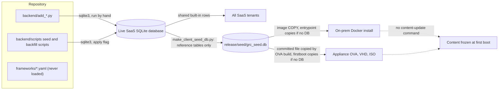

Evidence: `backend/add_gcc_frameworks.py:11`, `backend/add_ot_auto_frameworks.py:420-450`, `backend/add_cis_fortigate_framework.py:1-12`, `backend/scripts/seed_framework_crosswalks.py:63-211`, `backend/scripts/make_client_seed_db.py:40-53`, `backend/app/frameworks/loader.py:20-42`, `infrastructure/docker/entrypoint.backend.sh`, `build ova/scripts/firstboot.sh:98-109`

**Assessment:**
- **Strength.** The raw material for a content-pack pipeline already exists:
  - idempotent scripts with dry-run;
  - a referential import route (CSV, XLSX, YAML) with dry-run and hierarchy support;
  - upstream diff and sync for forks;
  - a seed builder with data-leak guards.
- **Constraint.** Content operations are hand-run, SQLite-only and unversioned. There is no package format, no content version and no engine-neutral export.
- **On-prem.** Docker and appliance installs stay frozen at the seed they were born with. Translations and scales never ship, and the committed seed predates the classification and crosswalk work.
- **R5.** `frameworks/` holds eight intuitem library files from CISO Assistant, an AGPL project; three of them carry PCI SSC "All Rights Reserved" or AICPA copyright notices. Nothing loads them, yet the on-prem Docker image (PyArmor build), the OVA and the ISO copy them. Tenable-sourced CIS text also sits in the repository. Remove `frameworks/` from the images and settle provenance before resale.

### B.3 KSA and GCC content detail

Facts below come from the seed copy and the content scripts. Statements about NCA ECC-2:2024 were checked against NCA's published document (4 domains, 28 subdomains, 108 main controls, 92 sub-controls; the Arabic version is binding; Appendix C). Other statements about official NCA, SAMA and GCC documents come from general knowledge and were not checked against the regulators' texts; they are marked "unverified". "Arabic" refers to stored requirement text; machine-translated overlays generated at runtime are covered after the tables.

KSA requirements of BM-01 R1, plus the legacy ECC-1:

| Required content | In GRCEye | Version · short name | Granularity | Rows | Official vs paraphrased | Arabic | Mappings | Main gaps |
|---|---|---|---|---|---|---|---|---|
| NCA ECC-2:2024 | Present (seed; `add_gcc_frameworks.py`) | `2:2024` · `nca-ecc-2024` | Main controls `1-1-1` to `4-2-4`; 4 domains and 28 subdomains held only in `category` text; flat; no sub-controls | 108, all mandatory | Paraphrased one-line statements, description equal to title (for example 2-10-3 "Subscribe to threat intelligence feeds and security advisories"); about 1 statement in 5 carries NCA's requirement; the 108 IDs and per-subdomain counts match NCA's exactly | None | None | NCA's 92 sub-controls (verified); official Arabic and English text (Arabic binding); guidance and evidence expectations; links to ECC-1, ISO and SAMA |
| NCA ECC-1:2018 (legacy, not in R1) | Present (seed only; no source file in the repo) | `1:2018` · `ksa-ecc` | Subdomain level `1-1` to `5-2`; generic categories (organizational, technological, physical) | 30, none mandatory | Titles only, descriptions empty; numbering diverges from the official edition (seed 2-8 "Vulnerability Management", 2-10 "Penetration Testing"; official 2-10 is Vulnerabilities Management, unverified) | None | None; no ECC-1 to ECC-2 link | No control level; no supersedes link to ECC-2 |
| SAMA Cyber Security Framework | Present (seed only; no source file) | `1.0` · `sama-csf` | 15 section rows and 42 item rows (`1.1` to `3.1.3`), flat | 57, none mandatory | Short paraphrased titles, descriptions empty; numbering does not follow the official sections 3.1 to 3.4 (for example 3.3.5 IAM, which GRCEye's own AI prompt cites; unverified) | None | None | Official structure and text; maturity levels (none shipped, although `compliance_scales` could hold them); guidance |
| NCA CCC-2:2024 (or CCC-1:2020) | Absent | - | - | - | - | - | - | Whole framework |
| NCA DCC | Absent | - | - | - | - | - | - | Whole framework |
| NCA CSCC | Absent | - | - | - | - | - | - | Whole framework |
| NCA OTCC | Absent (generic OT only: `iec-62443`, `nist-800-82`, `enisa-ics`; 2 ICS rows in ECC-1) | - | - | - | - | - | - | Whole framework |
| NCA TCC | Absent | - | - | - | - | - | - | Whole framework |
| SDAIA PDPL | Absent as a framework; named only in the AI vendor-contract regime string | - | - | - | - | - | - | Whole framework |

Other GCC content in the seed (not required by R1):

| Framework | Version · short name | Granularity | Rows | Official vs paraphrased | Arabic | Mappings | Main gaps |
|---|---|---|---|---|---|---|---|
| UAE NESA IAS | `2.0` · `uae-nesa-ias` | `IS-1.1` to `IS-14.7` in 14 families shaped like ISO 27001:2013; flat | 86, all mandatory | Paraphrased, description equal to title; the official IAS uses management (M1–M6) and technical (T1–T9) families (unverified) | None | None | Official structure and text; overlaps `uae-ia` with no link |
| UAE IA Standard | `2019` · `uae-ia` | `ias-1` to `ias-20`, topic level | 20, none mandatory | Titles only, descriptions empty | None | None | No control level |
| Dubai DESC ISR | `2.0` · `dubai-desc-isr` | `ISR-1.1` to `ISR-13.4` in 13 families | 49, all mandatory | Paraphrased, description equal to title; counts against the official ISR unverified | None | None | Official text, guidance |
| Qatar NIA CSF | `1.0` · `qatar-nia-csf` | `QCF-1.1` to `QCF-6.4`: the five NIST CSF functions plus a Qatar-specific group | 27, all mandatory | Paraphrased, description equal to title; relation to Qatar's official standard unverified | None | None | Official text |
| Bahrain CBB ISR | `1.0` · `bahrain-cbb-isr` | `BH-ISR-1.1` to `BH-ISR-7.3` in 7 families | 25, all mandatory | Paraphrased, description equal to title; relation to the CBB Rulebook unverified | None | None | Official text, sector modules |

Other KSA-related content:

- **Regulatory watch.** The default feeds are CISA, UK NCSC, SANS ISC and Krebs on Security. There is no NCA, SAMA or SDAIA source, and tenants can add RSS, Atom or JSON feeds only through the API.
- **AI.**
  - The AI personas cite ECC-2:2024 and SAMA CSF.
  - The vendor-contract regime map lists "Saudi PDPL, NCA ECC 2:2024, SAMA CSF" for Saudi Arabia.
  - The framework builder can generate KSA-labelled controls into a tenant framework. That content is generated, not curated.
- **Classification scripts.** `backfill_framework_source_type.py` classifies the three KSA and five GCC frameworks as `reglementation`. `backfill_control_domain.py` maps ECC-2 subdomains onto ISO-style domains (for example 2-10 becomes Technological), so NCA domains are not first-class values.
- **Arabic.** Requirement text is stored in English only. Arabic appears in two ways only:
  - as a runtime machine-translation overlay produced by the background worker and flagged as auto-translated in the UI;
  - as human translations that a tenant types into a forked framework, through `control_translations`.

  The AI reader estimated about 10.9k text and language pairs to translate after a first boot.
- **Worked example.** The BM-01 worked example names ECC-2:2024 control 2-10. In GRCEye, 2-10 exists as four paraphrased rows (`2-10-1` to `2-10-4`) with no sub-controls. No data path links a vulnerability to them.

R1 tally against the deck's eight items:
- **Present: 2**, ECC-2:2024 and SAMA CSF. Both are paraphrased, English-only and single-level.
- **Absent: 6**: CCC-2, DCC, CSCC, OTCC, TCC and PDPL.
- **Cross-mapped: 0.**

The legacy ECC-1:2018 is also present, but it is not one of the eight items.

Evidence: `backend/add_gcc_frameworks.py:736-777`, `release/seed/grc_seed.db`, `backend/app/services/ai_prompts.py:746-754`, `backend/app/api/v1/endpoints/regulatory.py:62-87`, `backend/scripts/backfill_framework_source_type.py:57-62`, `backend/scripts/backfill_control_domain.py:194-220`, `backend/app/models/control_translation.py:23-44`

**Assessment:**
- **R1 is weak.** Two of the eight required KSA items exist, as paraphrased, English-only, single-level lists with zero cross-mappings. CCC, DCC, CSCC, OTCC, TCC and PDPL are missing entirely.
- **Block 3 example.** The BM-01 example cannot be represented faithfully: ECC-2:2024 2-10 has no sub-controls, and no vulnerability can reach it.
- **Reusable schema.** The schema can already hold hierarchy (`parent_id`), human translations per language, applicability per entity or process, and custom compliance scales. Once redistribution rights are secured, official Arabic text can be loaded as `control_translations` with `source="human"`.
- **GCC content.** The five GCC sets help regional resale but share the same quality limits and have no relationship to the KSA sets.
