# NG-GRC Reference Architecture

**Volume 3 — Target architecture** · From the GRCEye core to Path C — GRC core · Inventory collector · CTEM connection

| | |
|---|---|
| Reference | NG-GRC-ARCH-01 |
| Version | 1.0, draft for the Technical Committee |
| Date | 16 October 2026 |
| Follows | BM-01 Open source benchmark: GRC · Inventory · CTEM (v3, October 2026) |
| Basis | GRCEye repository at commit `98020b3` (30 September 2026) and its shipped seed database |
| Method and owner | Static code assessment performed by AI agents (large-language-model instances orchestrated by a scripted workflow; §2.4, Appendix C.1). A named GRCEye technical lead, [name, role], must validate and own the conclusions before the committee relies on them |
| Audience | Next Step × SEIZE Technical Committee; GRCEye engineering |
| Classification | Confidential. Technical Committee members and GRCEye engineering only; no onward distribution. Part II and §6.5 describe weaknesses of the live service that are not yet fixed |

This volume details the NG-GRC target architecture block by block (chapters 8–13) and the consolidated target data model (chapter 14). It applies the principles and cross-cutting decisions X-01–X-18 of chapter 7 (Volume 1). Each chapter gives the current state in brief, the target design, data model changes, interfaces, security and deployment considerations, the migration from today's code, delivery by phase, and key decisions and risks. The roadmap and the decision log are in Volume 1.

## Contents

- **[Part IV — Target architecture: block designs](#part-iv--target-architecture-block-designs)**
  - [8. Block 1 — GRC core: KSA content, core completion and Arabic](#8-block-1--grc-core-ksa-content-core-completion-and-arabic)
  - [9. Block 2 — Inventory collector](#9-block-2--inventory-collector)
  - [10. Block 3 — CTEM connection](#10-block-3--ctem-connection)
  - [11. Multi-entity, MSSP and white-label](#11-multi-entity-mssp-and-white-label)
  - [12. Enterprise base: API, SSO, audit trail and events](#12-enterprise-base-api-sso-audit-trail-and-events)
  - [13. Platform foundations and deployment](#13-platform-foundations-and-deployment)
  - [14. Target data model](#14-target-data-model)

# Part IV — Target architecture: block designs

## 8. Block 1 — GRC core: KSA content, core completion and Arabic

This chapter designs the block that BM-01 calls "what the regulator expects". It serves R1 (complete, cross-mapped KSA content), R2 (full GRC lifecycle) and R3 (native Arabic and RTL). It also owns the compliance side of R7: the requirement-signal fan-out and the compliance engine that perform step 03 "Linked" of the slide-13 worked example, and the risk recalculation in step 04. It answers the deck's Block 1 definition, its R1 framework table, and items 01 (KSA frameworks and mappings) and 02 (Arabic and RTL) of the "still to build" list on slides 14–15; with §10 it also answers item 05 (exposure-to-control-to-risk logic). Today GRCEye holds two of the eight KSA frameworks, as English paraphrases loaded by hand-run SQLite scripts. It runs two disconnected control models, whose assessments an AI re-run can overwrite, and renders Arabic PDFs only where the host has Arabic fonts. The target ships all eight frameworks as signed bilingual content packs joined by a typed mapping graph. It runs one control model in which machines propose and people decide, and makes Arabic a release gate tested in CI.

### 8.1 Current state in brief

§4.1–§4.4 and §4.9 describe the compliance, risk, audit, TPRM and Arabic modules, §6.2 rates them, and §5.8 lists the debt IDs cited below. This chapter acts on these gaps:

- **Content (R1).** Only two of the eight frameworks exist:
  - ECC-2:2024 has NCA's exact skeleton, but its statements are English paraphrases and its 92 sub-controls are missing.
  - SAMA CSF uses non-official numbering.

  The other six are absent. There is no Arabic text, no hierarchy in use, no edition lineage, no conditional applicability and no KSA mapping. The only crosswalks are 199 untyped ISO pairs, which evidence propagation cannot resolve. Content reaches the SaaS through hand-run SQLite scripts, and appliances through a seed frozen at first boot. PostgreSQL starts with no frameworks (DAT-05).
- **Lifecycle (R2).**
  - Requirements and applied controls are disconnected (DAT-02), and about 50 JSON soft links carry the graph (DAT-01).
  - AI re-analysis deletes verdicts and evidence (PRD-03), and residual risk ignores implemented controls (PRD-02).
  - Risk, vendor and attestation maintenance is API-only, and compliance is CISO-only (PRD-04, TEN-04).
  - Policy approval has no separation of duties, and vendors are an island in the data model.
  - Auditor and vendor-portal access is too wide (SEC-06).
- **Arabic (R3).** The UI, RTL layout, e-mails and errors are complete. Arabic PDFs need fonts that only the appliance installs, AI answer language is never checked (I18N-01), and regulatory text is machine-translated (I18N-02).

Most R2 and R3 work is wiring and packaging over working code. R1 is new content.

### 8.2 Target design

Block 1 extends what works in GRCEye rather than replacing it (P6, §7.1): the catalogue and its fork lineage, the compliance state machine, the risk engine, the audit lifecycle and the Arabic rendering. Five design rules apply:

1. **One identity per regulator requirement.** A stable URN survives content revisions. A new edition gets new URNs and an explicit transition (X-11).
2. **Content is signed data, never code.** It carries provenance and reaches SaaS and on-prem through one installer (X-11).
3. **One graph.** Every cross-entity relationship is a typed, tenant-checked row with real foreign keys (X-04).
4. **Machines propose; people or an explicit tenant policy decide.** Automated signals overlay human verdicts and never overwrite them. Nothing deletes a status, an evidence item or a note that a person entered (X-12).
5. **Arabic is a release gate.** Fonts, RTL rendering, AI answer language and report parity are tested in CI (X-16).

| Part | Component | Type | Responsibility | Extends existing code or new |
|---|---|---|---|---|
| (a) | Content repository and CI | Vendor git repo, CI pipeline, Python compiler | YAML sources per framework edition in Arabic and English, mapping sets, evidence, questionnaire and impact-rule templates, source register; maker-checker pull requests; validation, diff, compile, sign, publish | New. Absorbs `add_gcc_frameworks.py`, `add_ot_auto_frameworks.py`, the `scripts/seed_*` content scripts and `frameworks/*.yaml`; reuses the import parsers in `frameworks.py:1816-1980` |
| (a) | Content signer and registry | OpenBao transit key and vendor control-plane service | Ed25519 signature over manifest bytes; key ids and rotation; stable and preview channels; signed revocation list; licence-entitled download | Extends the Ed25519 primitives of `core/licensing.py`, moved into a `core/signing.py` key ring |
| (a) | Pack verifier and installer | Worker job and operator CLI | Verify, stage and insert framework revisions, texts, mappings and closure in one transaction; record the installation; emit the install event | New. Replaces `frameworks/loader.py`, `scripts/make_client_seed_db.py`, the seed database and the SQLite scripts |
| (a) | Content update client | Service | On-prem pull over outbound HTTPS, authenticated by the licence; offline upload | Extends `services/license_client.py` |
| (a) | Adoption service | Service and API | Per-tenant diff, adopt or defer, re-point references by URN, re-review flags, edition transitions | Extends the fork upstream diff and sync (`frameworks.py:2853-3100`) |
| (a) | Requirement catalogue | API | Node tree with roll-up status, texts with provenance, revision-aware visibility | Extends `frameworks.py`, `requirements.py` and `_get_visible_framework` (`frameworks.py:236-252`) |
| (a) | Mapping service | Service and API | RequirementMapping, closure, propagation rules, coverage between frameworks | New. Replaces every reader of `mapped_controls` |
| (a) | Applicability and SoA service | Service and API | Dimensions, scope facts inherited down the OrgEntity tree, derived applicability, overrides, bilingual SoA | Extends `models/control_applicability.py` and `report_generator.py` |
| (a) | Content UI | React (MIT) | Publisher-grouped catalogue with badges, bilingual tree viewer, diff and adopt, typed crosswalk, SoA, platform content console | Extends `FrameworksPage`, `EditFrameworkPage`, `RequirementsPage`, `AssessmentDetailPage` |
| (b) | Compliance engine (`ControlAssessmentService`) | Service | The single writer of requirement status: verdict, effective status, gaps, actions, closure, re-score, history; callable without a user token | Refactors `_rescore`, `_sync_gap_for_control`, `sync_action_items`, `update_control_assessment` and `_apply_action_closure` in `compliance.py` |
| (b) | Requirement signal service | Service | Fan-out from a control-impact match to requirement rows through the mapping closure and the applicability filter; open and clear signals; automated evidence | New. Called by the §10 ControlImpactEngine |
| (b) | ProposalService and AnalysisRun | Service and `ai`-queue task | Create, supersede, apply and reject AssessmentProposals under the tenant's policy; AI analysis that writes proposals | New; refactors the analysis at `compliance.py:2505`; reuses `ai_chunking.assess_controls_over_document` |
| (b) | ControlGraphService | Service | Creation and traversal of every typed link; traceability read model; lookups for Blocks 2 and 3 | New `services/control_graph.py`; reuses the tenant guards in `core/security_utils.py:226-262` |
| (b) | Control tests, effectiveness and roll-up | Service and worker | ControlTest runs, effectiveness v2, requirement roll-up proposals | Extends `residual_risk.py` and `control_evaluation.py` |
| (b) | EvidenceService | Service and API | Evidence artefacts, links, review, validity, expiry, ingest | Extends `file_integrity.py`, `file_retention.py` and the token pattern of `public_upload.py` |
| (b) | Risk recalculation, KRIs and quantification | Service and outbox consumer | Coalesced recomputation of likelihood and residual with versions and events; KRIs; stored Monte Carlo runs | Extends `residual_risk.py`, `scenario_priority.py`, `risk_scoring.py`, `risk_versioning.py`, `risks.py:966-1054` |
| (b) | ApprovalService and policy workflow | Service and API | Maker-checker steps, separation of duties, approval records; policy lifecycle, attestation campaigns, review cycle | Generalises `audits.py:1446-1471`; extends `policies.py` |
| (b) | TPRM graph | Service and API | Vendor links, versioned questionnaires, stored assessments, reassessment, offboarding, hardened portal | Extends `vendors.py` and `contract_collab.py`; fills the empty `workers/tasks/vendor_assessments.py` |
| (b) | Capability layer | API dependency and SPA guard | Capability catalogue, role defaults, scopes, shadow mode; SPA navigation and buttons from the API | Extends `services/authz.py`, `dependencies/auth.py`, `services/perimeter.py`; replaces `ROUTE_ROLES` (`App.tsx:120-162`) and the nav role arrays in `Layout.tsx` |
| (c) | Arabic PDF kit | Library and CI | Bundled fonts, shaping, report-parity tests, RTL spreadsheets | Extends `pdf_arabic.py`, `report_generator.py`, `excel_export.py`, `ocr.py` |
| (c) | AI language guard and certification | Library and CI | Output-script check with one retry; per-task, per-model Arabic evaluation | Extends `ai_locale.py`, `ai_provider.py`, `ai_structured.py` |
| (c) | Arabic search | SQL and service | Normalisation function, text and trigram indexes, Python mirror | New; mirrors `ai_chunking.normalize_ws` (`:378`) |
| (c) | RTL quality kit | Frontend and CI | Screenshot regression, logical-class ratchet, chart mirroring, Arabic web font | New; `@playwright/test` is already a dev dependency |

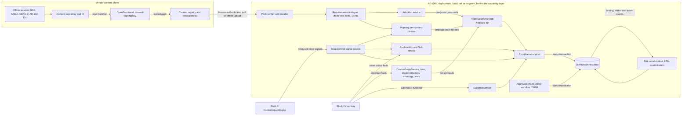

Authored sources become signed packs in the vendor's registry. In every deployment, the installer writes immutable framework revisions, and the adoption, mapping and applicability services decide what each tenant sees and how statuses relate across frameworks. Every change of requirement status, from a person, a proposal or a signal, goes through the one compliance engine, which writes its outbox event in the same transaction. Blocks 2 and 3 feed the graph, evidence and signals in the same data model, but never write verdicts (X-01).

#### 8.2.1 KSA content and mapping (R1)

**Requirement identity and the node tree (ADR-CNT-01, ADR-CNT-03).** Every node of a regulator document becomes a `framework_controls` row with a `node_type` (domain, subdomain, control or sub-control; chapter, article or paragraph for laws), a `parent_id` (present today but unused), a `depth` and an `is_assessable` flag. Grouping nodes are not assessable: their status is a computed roll-up, and every count, score and AI analysis filters on `is_assessable`.

Each node carries a stable URN, `urn:ngc:<publisher>:<family>:<edition>:<code>`, for example `urn:ngc:nca:ecc:2-2024:2-10-3-1`. Each edition has its own URN (`urn:ngc:nca:ecc:2-2024`), and legacy rows get `urn:ngc:legacy:<short_name>:<version>:<code>`. A *content revision*, such as official text replacing a paraphrase, keeps every URN. A new *edition*, such as ECC-1:2018 → ECC-2:2024, gets new URNs, linked to the old ones by an edition-transition mapping set.

Packs install each revision as new immutable rows. `Framework.is_current` marks the revision used for new assessments, and existing assessments stay on theirs until the tenant adopts. Mappings, impact rules (§10) and tenant references point at URNs, so they survive revisions.

**Bilingual official text with provenance (ADR-CNT-02).** `control_translations` becomes the requirement-text store. Each row has a `text_kind` (`official`, `official_translation`, `platform_label`, `platform_translation`, `human` or `ai`), an authority flag, and a citation to a `SourceDocument` and page. The authoritative language is set per framework: Arabic for NCA and SDAIA, and for SAMA whichever language the source register confirms. NCA's main controls have no titles, so the display title is a platform label and the statement carries the official text. The installer copies the English text into `title` and `description` for existing readers. `SourceDocument` records publisher, edition, language, SHA-256, Gregorian and Hijri publication dates and licence basis. `EvidenceExpectation` extends today's ISO-only mandatory-document list to every requirement and flags evidence that CTEM, inventory or the identity provider can supply. A compiled node (placeholders, not NCA wording):

```json
{"urn": "urn:ngc:nca:ecc:2-2024:2-10-3-1", "node_type": "subcontrol", "parent": "urn:ngc:nca:ecc:2-2024:2-10-3",
 "assessable": true, "mandatory": true, "applicability": null,
 "texts": {"ar": {"kind": "official", "authoritative": true, "source": "nca-ecc2-ar", "page": "<n>"},
           "en": {"kind": "official_translation", "source": "nca-ecc2-en", "page": "<n>"}},
 "evidence": [{"code": "EV-VM-REMEDIATION", "kind": "record", "automatable": "ctem", "freshness_days": 30}]}
```

The Arabic UI shows official Arabic first with an "official text" badge; the English UI shows NCA's own English, labelled "official translation; Arabic prevails". Machine translation remains a badged fallback, and the translation worker skips fields that already have official text.

**Content packs and the installer (ADR-CNT-04, ADR-CNT-08).** Content is authored as YAML in a vendor git repository through maker-checker pull requests: one source per framework edition in both languages, plus mapping sets, evidence, questionnaire and impact-rule templates and the source register. Content CI checks the schema with Pydantic (MIT), ID grammar, count locks per level and subdomain (verified for ECC-2:2024, §6.2), hierarchy integrity, Arabic/English pairing on every assessable node, script and list-item parity, and mapping integrity. It also produces a hub-coverage report, a diff, a carry-over simulation and RTL snapshots of IDs in Arabic text, then compiles to JSON.

A pack holds `manifest.json` (key, semantic version, minimum platform version, languages, terms, a SHA-256 per file), JSON Lines data and a detached Ed25519 signature over the exact manifest bytes. The manifest carries `typ: "ngc-content-pack"`, so no licence or audit-checkpoint signature can validate as a pack. The content-signing key lives in the vendor's OpenBao transit engine (MPL-2.0) or an HSM, separate from the licence key; only vendor CI signs, and cells and appliances hold verification keys (X-10). The registry, in the vendor control plane off the SaaS host, serves stable and preview channels, a signed revocation list and licence-entitled downloads.

The installer is a worker job running as a platform principal under `grc_platform`, the only role that writes shared catalogue rows (X-05). It:
1. verifies signature, key id, revocation, anti-rollback (a downgrade needs an operator override) and schema, with zip-slip and size guards;
2. inserts revisions, texts, mappings and closure in one transaction and records a `PackInstallation`;
3. emits the platform-scope `content_pack.version_installed`, which fans out to tenants as an "update available" notice (X-08).

Re-installing a version is a no-op, and superseded revisions are kept while referenced. One verifier serves the SaaS operator, the on-prem `grc content sync` pull (outbound HTTPS, licence-authenticated) and offline upload.

The first pack, `ngc.legacy-library` (the legacy built-in pack that §13's importer installs), is exported once from a read-only production snapshot. Every built-in becomes pack content labelled `fidelity=paraphrase`, with legacy URNs and its existing row ids, so references stay valid. Only `nca-ecc-2024` receives its target URNs now, so the official revision can carry its assessments forward. PostgreSQL installs (X-03) then get frameworks from bundled packs at first boot, and the seed database and SQLite scripts retire (DAT-05).

**Adoption.** For each framework in use, a tenant reviews a diff (nodes, Arabic and English texts, mappings, applicability, impact on its assessments) and adopts or defers. Adoption re-points live references by URN through a registry of every reference to `framework_controls`, kept complete by a test over the SQLAlchemy (MIT) metadata. Changed rows are flagged for re-review, completed assessments and closed audits stay on their revision, and `content_pack.version_applied` is emitted. On SaaS, patch versions adopt automatically, minor versions after 30 days unless deferred, and major versions only by a person. Tenant forks keep upstream sync, now by URN.

**Content plan for the eight frameworks.** Only the ECC-2:2024 structure is verified against the regulator's text. The other sizes are estimates, which authoring locks in a structure file.

| Wave | Framework | Official sources | Structure | Nodes (est.) | Effort (person-weeks) |
|---|---|---|---|---|---|
| 1 | NCA ECC-2:2024 | NCA publication in Arabic (binding) and English | 4 domains, 28 subdomains, 108 main controls, 92 sub-controls (verified, §6.2) | 232 | 3 |
| 1 | SAMA CSF | SAMA CSF document and Rulebook; whether an official Arabic version exists is to be confirmed (if not, English is authoritative) | Domains 3.1–3.4, subdomains, control considerations; maturity levels shipped as a built-in compliance scale | 200–300 | 3 |
| 1 | SDAIA PDPL | Official Arabic law, Implementing Regulation and Transfer Regulation; SDAIA English translations (external source, to verify) | Chapters, articles, paragraphs; obligations as assessable nodes | 150–250 | 3–4, legal SME |
| 2 | NCA CCC-2:2024 | NCA, Arabic and English | ECC extension with provider and tenant control sets | 150–250 | 3–4 |
| 2 | NCA DCC | NCA, Arabic and English | ECC extension tiered by data classification | 60–100 | 2 |
| 2 | NCA CSCC | NCA, Arabic and English | ECC extension for critical systems | 100–150 | 2 |
| 2 | NCA OTCC | NCA, Arabic and English | ECC extension for OT, by facility level | 150–250 | 3 |
| 2 | NCA TCC | NCA, Arabic and English | ECC extension for telework | 40–80 | 1 |

Full content takes about 20–23 person-weeks in two L waves, and mapping sets 8–10 more. A minimal text-and-structure variant would take 11–13; the stage-2 judges' earlier estimate of 5–6 person-weeks (Appendix C) leaves out applicability and evidence work (RK-15, §16.3). The team is a content lead, two KSA subject-matter experts (an assessor, and a legal expert for PDPL), a half-time Arabic legal-technical linguist and a content engineer, about 4.5 FTE; §8.7 states which part of its work the effort figures cover. Each framework follows one reviewed workflow: licence basis, structure extraction (assisted by `pypdf`, BSD-3-Clause, on authoring machines only), verbatim Arabic and English capture, SME annotation, second-SME mapping review, CI, staging carry-over simulation, then signature; errata ship as patch versions. AI may draft mappings and PDPL obligations, but nothing ships unreviewed. Wave 1 authoring starts in week 0, in parallel with P0 (§15.2, §15.5); only signing and installation wait for the P0 pipeline (B1-02 to B1-05), and the wave 1 packs ship in P1 (B1-18).

**Mapping strategy (ADR-CNT-05, ADR-CNT-06).** `RequirementMapping` replaces the untyped `mapped_controls` pairs. Each mapping has a NIST IR 8477 set-theory relationship (`equal`, `subset_of`, `superset_of`, `intersects`, `not_related`; external source, to verify), or `related` for unqualified legacy rows; a rationale (syntactic, semantic or functional); a provenance (`regulator_stated`, `publisher_official`, `expert_authored`, `ai_suggested_reviewed`, `tenant_authored`, `legacy_import`); and a confidence. Mappings reference URNs. The hub is ISO/IEC 27001:2022 Annex A, that is, the 93 ISO/IEC 27002:2022 control IDs used as IDs and labels only, with NIST CSF 2.0 as secondary hub; today's ISO rows and crosswalk script already use it. A closure table materialises direct relations and two-hop relations through the hub.

| # | Mapping set (P1) | Provenance | Expected relationships |
|---|---|---|---|
| 1 | NCA family: CCC, DCC, CSCC, OTCC and TCC to the ECC controls they extend | `regulator_stated` | `superset_of` (kind extension), so an ECC failure propagates to every extension |
| 2 | SAMA CSF ↔ ECC-2:2024 | `expert_authored` | Mostly `intersects`; `equal` where the texts align |
| 3 | PDPL and its regulations ↔ DCC and the ECC subdomains 2-7, 2-8 and 2-13 | `expert_authored` | Mostly `intersects`; security-of-processing articles map to DCC |
| 4 | KSA frameworks → ISO/IEC 27001:2022 Annex A hub | `expert_authored` | Mixed, each with a confidence |
| 5 | Hub → NIST CSF 2.0 | `publisher_official` where NIST publishes informative references, otherwise `expert_authored` | Re-qualifies the 63 legacy pairs |
| 6 | Edition and legacy transitions: `ksa-ecc` → ECC-2:2024; legacy `sama-csf` → official SAMA CSF | `expert_authored` | `intersects` at subdomain level |

Other frameworks reach the KSA set through the hub as each is mapped to it (P2). The 199 legacy pairs become low-confidence `related` rows, used only for evidence suggestions until re-qualified.

| Relationship (A to B) | Evidence reuse | "Compliant" propagates | "Non-compliant" or a signal propagates |
|---|---|---|---|
| `equal` | Link proposed; auto-accepted if the tenant enables it | Both ways, as a proposal; automatic only by tenant policy at high confidence | Both ways |
| `subset_of` (A ⊂ B) | Proposed | B → A only | A → B only |
| `superset_of` (A ⊃ B) | Proposed | A → B only | B → A only |
| `intersects`, `related` | Proposed and flagged for review | None (review hint) | "At risk" hint only |
| Two-hop through the hub | Suggestion only | Never | Never |

Evidence is linked, never copied, and resolved by URN, which removes today's case-sensitivity defect.

**Applicability and SoA per OrgEntity (ADR-CNT-07).** Packs declare applicability dimensions and attach conditions to nodes. Tenants state scope facts about a subject: the tenant, an OrgEntity, a business process or an asset. The values come from the official texts and are confirmed during authoring (external source, to verify).

| Framework | Dimension | Typical subject |
|---|---|---|
| ECC-2:2024 | `ecc.uses_cloud` (conditions subdomain 4-2) | Tenant, OrgEntity |
| CCC-2:2024 | `ccc.role` ∈ {csp, cst}, plus the CCC level | OrgEntity |
| DCC | `dcc.data_class` ∈ {top_secret, secret, restricted} | OrgEntity, business process, asset |
| CSCC | `cscc.critical_system` | Asset |
| OTCC | `otcc.facility_level` | OrgEntity (site), asset |
| TCC | `tcc.telework_enabled` | OrgEntity |
| SAMA CSF | `sama.member_organisation` | Tenant |
| PDPL | `pdpl.role` (controller or processor), `pdpl.sensitive_data`, `pdpl.cross_border_transfer` | Business process (processing activity) |

Facts are inherited down the OrgEntity tree through §11's closure table, the closest ancestor winning; an asset inherits from its entity unless it states its own facts, and Block 2 supplies asset facts such as `cscc.critical_system` (§9). Applicability is decided in order:
1. A false condition makes the requirement *not applicable by rule*, with no manual justification needed.
2. Otherwise a manual override applies; N/A stays forbidden on unconditionally mandatory nodes.
3. Otherwise the requirement applies.

Derived decisions are stored in `ControlApplicability` with `basis=rule` and an optional `asset_id`; overrides keep `basis=manual`. This fixes today's refusal of N/A on ECC 4-2, which NCA conditions on cloud use. Registration, AI analysis and scoring skip non-assessable and non-applicable nodes, and Blocks 2 and 3 derive asset and CTEM scope from the results. The Statement of Applicability, per OrgEntity and framework revision, lists each requirement's derived applicability, override and justification, effective status, implementing controls, evidence count and owner. It exports to PDF and XLSX in Arabic or English, and approval stores the export as a governance-document version with its SHA-256.

**Edition transitions.** A transition, for example ECC-1:2018 to ECC-2:2024 or legacy SAMA CSF to the official 3.1–3.4 structure, creates a successor assessment over the new edition's assessable, applicable nodes. `equal` pairs copy status, owner, notes and evidence links (marked `carried_over`), other pairs produce proposals, and new requirements start as not started; the CISO gets a report of carried, to-review, new and retired requirements. Today's legacy ECC-1 rows are subdomain headings and the legacy SAMA numbering is invented, so both transitions work at `intersects` level and only suggest. The legacy frameworks become `superseded` (ECC-1) and `withdrawn` (SAMA).

**Redistribution rights and reference mode.** Shipping official text commercially needs a right to redistribute it. Counsel must decide whether the official-documents exclusion in the Saudi copyright law or the regulators' website terms govern NCA, SAMA and SDAIA publications (external source, to verify). Written permission is requested in P0, because the lead time is long, and the result is recorded in `SourceDocument.licence_basis`. Without a cleared basis, a pack ships in *reference mode*: structure, IDs, platform labels, applicability, mappings, evidence expectations and deep links, with the customer loading the official text as a tenant-scoped copy through the import, which gains Arabic and English columns. Sourcing rules are fixed: no CISO Assistant (intuitem) libraries, which come from an AGPL-3.0 repository, and the eight intuitem YAML files leave the artefacts (X-14); no Secure Controls Framework mappings, whose licence limits derivative works (to verify); ISO content as IDs and labels only; NIST content is public domain.

#### 8.2.2 Core completion (R2, and the compliance side of R7)

**One control model (ADR-COR-01).** Today requirements (`framework_controls`) and measures (`applied_controls`) are joined only by a JSON list that nothing reads (DAT-02). The target bridges them rather than merging them, so one EDR control can satisfy ECC, SAMA and ISO lines while built-in requirements stay read-only (X-12):
- **ControlImplementation** links an applied control to a requirement node with a coverage (`full`, `partial`, `supporting`), a contribution between 0 and 1, an optional entity or process scope, a state (`proposed`, `active`, `retired`) and a source. Mappings and AI suggest links; a control implementing ISO 27002 8.8, for example, is proposed for ECC 2-10-3.
- **ControlAssetCoverage** records whether a control protects an asset (`protected`, `gap`, `unknown`), entered by hand or written by Block 2's connectors (§9).
- **ControlTest** and **ControlTestRun** hold design and operating tests (inquiry, inspection, reperformance, automated) with frequency, pass criteria, runs and reviewer.
- **Effectiveness v2** combines today's five-criterion design evaluation, operating test results and asset coverage, stored with inputs and method version.

A `RequirementRollup` worker turns implementations, tests, coverage, evidence freshness and auditor verdicts into proposals; it never sets a verdict.

**The compliance engine service.** `_rescore` (`compliance.py:990`), `_sync_gap_for_control` (`:1045`), `sync_action_items` (`:1112`), `update_control_assessment` (`:2937`) and `_apply_action_closure` (`:4523`) move into `ControlAssessmentService`. Route handlers, workers, connectors and Block 3 call it as a system principal, without a user token (X-06), and it is the only writer of requirement status. It creates one not-started row per assessable, applicable requirement when an assessment is created, through one `instantiate_control_rows()` shared with registration, framework selection and the CLI, and backfills assessments without rows. It holds the **verdict** (`status_key` with source, author, time and optional pin) and the **effective status**, runs gap sync, actions, closure and re-scoring on the effective status, computes roll-up nodes, writes history, and emits its outbox event in the same transaction. The effective status is the worse of the verdict and any open enforce-mode signal (X-12); *non-compliant* maps to the scale's lowest level and *partially compliant* to its regression level (`compliance.py:1027`). Only draft, in-progress and under-review assessments receive signals.

**Assessment proposals (ADR-COR-02).** AI analysis becomes an `AnalysisRun` on the low-concurrency `ai` queue (X-07), with a heartbeat so that a run interrupted by a restart fails instead of blocking the assessment. AI verdicts, roll-ups, auditor verdicts, mapping propagation, edition carry-over and content updates all arrive as `AssessmentProposal`s carrying source, proposed level, direction, confidence, citations and provenance (provider, model, prompt task, method version); a newer pending proposal from the same source supersedes the older. Five merge rules end the destructive re-run (PRD-03, §6.5):
1. Rows are never deleted; a row retires only when a revision removes its requirement.
2. A human decision pins the verdict until new evidence arrives or the pin expires.
3. An upgrade to a compliant level needs a person, optionally with four eyes. The exception is an opt-in first-run auto-apply on never-assessed rows, which reproduces today's behaviour; those rows stay marked `status_source=ai` until confirmed.
4. An analysis never detaches evidence.
5. AI rationale is stored with its language; rule-based rationale as an i18n key rendered in the reader's language.

Apply modes per source live in a typed `TenantGrcPolicy` table, and the proposal inbox offers diffs, citations and bulk decisions under capability and separation-of-duties checks.

**Requirement signals: step 03 "Linked".** Block 3 owns `ControlImpactRule` and `ControlImpactMatch` (§10); Block 1 owns what a match does to compliance. When a match opens, the ControlImpactEngine calls the signal service in its worker transaction with the rule, version, target URN and match. The service:
1. expands the target over the mapping closure, following only direct edges along which the propagation table lets a non-compliant signal travel: `equal` either way, `subset_of` from A to B and `superset_of` from B to A, so the extensions mapped `superset_of` their ECC base are reached (a rule's `subset_of` relation is read from the target's side); `intersects` and two-hop relations give observe-only hints;
2. keeps the rows of open assessments whose perimeter and SoA include the affected assets;
3. opens one `RequirementSignal` per row, idempotent on match and row, linking an automated `Evidence` record (`kind=automated`, `source_kind=rule`, the match explanation as raw data);
4. hands each row to the engine in the rule's mode: *observe* shows a badge, *propose* creates a downgrade proposal, *enforce* applies the overlay.

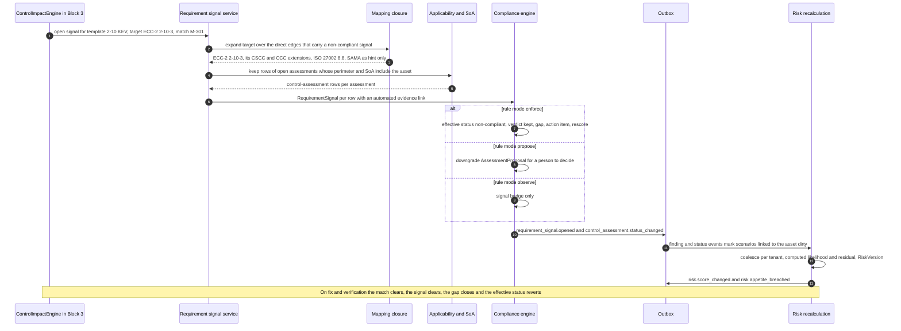

Rule modes come from the pack templates, for example *enforce* for a KEV-listed critical finding on an internet-facing crown jewel, *propose* for a scan-coverage lapse and *observe* for a missing re-test. Templates run in observe mode for a 30-day burn-in after go-live (§10), and a tenant can lower any mode. When the finding is fixed and verified, the match and signal clear, `_apply_action_closure` resolves the gap if nothing else holds it open, and the effective status reverts. The verdict is never written, so auditors see both values with the evidence trail.

Because rules name URNs, a new pack mapped directly to ECC-2 2-10-3 by an edge that step 1 follows extends a rule's reach with no rule edit; a requirement reached only by `intersects` or through the hub receives an observe-only hint. Illustrative direct targets, to be confirmed by the content team, are the CSCC and CCC extensions of 2-10 and ISO/IEC 27002:2022 8.8. The SAMA CSF vulnerability-management control (mostly `intersects`, mapping set 2), NIST CSF 2.0 ID.RA-01 and PCI DSS 4.0 6.3.3 (both reached through the hub) receive hints unless the content team authors a direct mapping that step 1 follows. The same overlay handles the expiry of a requirement's only evidence (P1) and failed automated control tests (P2).

**Evidence as an artefact (ADR-COR-03).** An `Evidence` row becomes a tenant artefact with a `kind` (file, record, link, automated), a `source_kind` (upload, share link, connector, agent, API, rule), an object key under a per-tenant prefix (X-09) with today's SHA-256 ledger, validity dates, a review status and a legal-hold flag. The object key stays in the existing `s3_key` column, whatever the storage backend. `kind` and `source_kind` are the source of truth for automated evidence; today's `is_automated` and `source_integration` remain read-only mirrors for one release. An `EvidenceLink` ties it to exactly one target per row (a control assessment, library requirement, applied control, test run, audit finding, policy version, vendor assessment or risk) through typed nullable foreign keys and a CHECK constraint. Each link records a reason (`primary`, `mapped`, `carried_over`, `automated`), the justifying mapping and a state (proposed, accepted, rejected).

Linking evidence to a requirement proposes links to the mapped rows of the tenant's other active assessments, following the propagation table, auto-accepted only where the tenant enables it for `equal` mappings. This replaces the file copying at `compliance.py:3775-3869`. Reminder jobs emit `evidence.expiring` and `evidence.expired`, and when a requirement's only valid evidence expires, an `evidence_expiry` signal applies the regression level. From P2, machines push evidence through an ingest API.

**Association tables (ADR-COR-04).** Typed link tables replace the JSON id lists (DAT-01). The import converts all 43 JSON id-list fields of today's model into the 36 association tables listed in §14.4; JSON fields that hold no row ids stay JSONB. The link tables that §8 specifies, including new vendor, campaign and KRI links, are:

| Area | Link tables |
|---|---|
| Risk and treatment | `RiskAsset`, `RiskControl`, `RiskRequirement`, `TreatmentScenario` |
| Scenario | `ScenarioAsset`, `ScenarioThreat`, `ScenarioFinding`, `ScenarioIncident`, `ScenarioControl` (replaces two lists that drift apart today) |
| Policy | `PolicyRequirement`, `CampaignPolicy` |
| Vendor | `VendorAsset`, `VendorProcess`, `VendorRiskLink`, `VendorControl` |
| Acceptances, exceptions, KRIs | `RiskAcceptanceTarget`, `ExceptionTarget`, `ExceptionControl`, `KriRiskLink` |
| Assessments and audits | `AssessmentAsset`, `AuditScope` (exclusive arc over processes, entities and assets), `AssignmentDocument` |
| Incidents and threats | `IncidentAsset`, `IncidentRisk`, `IncidentControl`, `IncidentVendor`, `IncidentFinding`, `ThreatAsset`, `ThreatFinding` |
| Governance and framework selection | `GroupMember`, `GovernanceMember`, `CommitteeLink`, `TenantFrameworkSelection` (by framework edition URN) |

Each table has `tenant_id`, both foreign keys, a relation, a source (manual, import, connector, rule, AI, legacy JSON), author and time, and a unique key on tenant, ends and relation. Composite foreign keys `(tenant_id, x_id) → x(tenant_id, id)` to every tenant-owned parent mean a cross-tenant edge cannot be stored even if a handler forgets its filter. Deleting an asset deletes its edges, never the risk, and links to shared catalogue rows, such as requirements and built-in threats, are plain foreign keys with a visibility check in the service. Asset-side link tables, ControlAssetCoverage and ControlApplicability register synchronous re-point and delete handlers in §9's asset reference registry (ADR-INV-04), so an asset merge re-points them inside the merge transaction; the `asset.merged` event serves only read models and caches. A `ControlGraphService` owns creation, traversal, the traceability read model and the lookups of Blocks 2 and 3. The transform runs once, inside the SQLite → PostgreSQL migration, with a dual-read shim for one release (X-04, §13).

**Risk recalculation and KRIs (ADR-COR-05, ADR-COR-12).** BM-01 wants risk "updated automatically"; today's rule is "suggestion, not overwrite". Both hold if the risk stores both values: the assessor's residual stays untouched, the computed residual is stored with inputs and method version, and the effective residual follows the tenant's `residual_mode`, by default the conservative `max(assessed, computed)`. Method v1:
- **Computed residual** = inherent × (1 − effectiveness × coverage), with `COUNTS_AS_ACTIVE` fixed so implemented controls count (PRD-02).
- **Exposure-driven likelihood** (P2) = max(assessed, mapped band of the highest exploitability Block 3 supplies for the scenario's open findings), with thresholds in `TenantGrcPolicy`.
- **Batching.** Consumers mark scenarios and risks dirty in Valkey (BSD-3-Clause, X-07); idempotent per-tenant batches every 30–60 s write a `RiskVersion` with origin `system` only when a value changes, and emit `risk.score_changed` and `risk.appetite_breached`. A matrix change triggers a re-score, and so does an asset merge: the synchronous re-point handlers for `RiskAsset` and `ScenarioAsset` (ADR-INV-04) mark the affected scenarios and risks dirty.

A KRI is a manual value or a metric from a registered provider with a parameter schema, never user SQL, which would be an injection path around RLS. It has thresholds, a direction, an owner, banded measurements and risk links, and a breach emits `kri.threshold_breached`. Monte Carlo runs (§4.2) are stored with currency (SAR by default), iterations, seed, inputs and ALE, P50, P90 and P95 results, and the existing quantification page gets a route.

**ApprovalService and policy workflow (ADR-COR-07).** Only audit-report approval enforces separation of duties today (`audits.py:1446-1471`). A light `ApprovalService` generalises it: declarative maker-checker steps per subject type, SoD rules that bind tenant administrators too, and an `ApprovalRecord` per decision; §12 reuses it for MFA resets and sensitive API scopes. A tenant may enable single-approver mode, which is logged and printed on reports. Policy versions move through submit, approve, reject, publish and retire actions; PATCH status changes are refused once `policy_workflow_enforced` is on (by default for new tenants, after notice for existing ones). Publication sets the effective and review dates and opens an attestation campaign for roles, groups or entities. Employees acknowledge or decline in Arabic or English from a "My attestations" inbox, and the record keeps time, IP address, user agent and version hash under a PDPL retention rule. Reminders run at J-7 and J-1, then follow the existing escalation ladder, and a review-due job reads `next_review_date`. Together these produce the evidence the ECC policy subdomains expect.

**TPRM in the graph (ADR-COR-08).** Vendors link to the assets they provide or host, the processes they support, the risks they cause and the controls they operate. Questionnaires become versioned templates shipped in packs, with KSA third-party questions. `VendorAssessment`, model-only today, records prescreen, periodic and offboarding assessments with answers, a 0–100 score and AI-summary provenance, so approving an analysis no longer overwrites the vendor description. `VendorRisk` folds into the register as a risk plus a `VendorRiskLink`. A reassessment scheduler fills today's empty task module, and offboarding becomes a workflow. The portal is hardened with hashed, revocable tokens that expire within 30 days, a one-time code on submission, Valkey rate limits and external actors in the audit trail, which closes the vendor half of SEC-06.

**Capability layer (ADR-COR-06).** Role names guard about 580 routes, and the SPA's role lists have drifted from the API (TEN-04, PRD-04). An in-code catalogue of `domain.object.action` capabilities, with role defaults and custom-role grants, replaces both. `require_capability` evaluates the roles and org scope of the caller's TenantContext (§11, X-06) and returns list filters and record checks for four scopes: `any`; `entity`, the membership's OrgEntity subtree, enforced in the application layer; `own`, owner or assignee, generalising `perimeter.py`; and `assigned`, for auditors and vendor-portal users. The default matrix reproduces today's access with documented fixes: compliance managers gain assessment write, control owners assess their own controls, and the auditor's over-wide read access closes under the `assigned` scope (SEC-06; the affected areas are listed in the internal evidence pack). A shadow mode logs every difference from `require_roles` before enforcement, and a CI test rejects routes that declare no capability unless marked public or platform. The SPA derives guards, navigation and buttons from `GET /auth/me/capabilities`, replacing the hand-synchronised maps in `App.tsx` and `Layout.tsx`. Machine and API-client principals (§12) receive only the machine scopes set out in §8.5.

#### 8.2.3 Arabic-native quality (R3)

**Fonts and packaging (ADR-COR-09).** Amiri and Noto Sans Arabic (SIL OFL-1.1) ship in the backend package. They are registered by package path, ahead of the fixed Linux paths that `pdf_arabic.py:37-44` and the OCR code search today. `arabic-reshaper` (MIT) and `python-bidi` (LGPL-3.0) move from `requirements.txt` into `pyproject.toml`. `python-bidi` stays unmodified, dynamically imported, replaceable and outside Nuitka (Apache-2.0) compilation (X-14); PyICU (MIT) is the fallback. A readiness probe reports whether Arabic PDF output works. §13's images install the package, so no channel depends on host fonts. This closes the reports half of I18N-01 and lifts R3 to strong (§6.2).

**Report parity.** Every PDF generator renders in Arabic. A CI test compares the label tables, renders each report in Arabic and asserts that no U+25A0 boxes appear and that the Arabic text can be extracted (`pypdf`, test-only). New reports (SoA, KSA compliance with official text, attestation, vendor assessment, KRIs) are bilingual, with an optional side-by-side layout, and XLSX sheets are right-to-left in Arabic. Hyphenated IDs such as "2-10-3" are wrapped in left-to-right isolates (`<bdi dir="ltr">` in React, U+2066–U+2069 in PDFs) so they do not reorder in RTL text.

**RTL regression.** From P0, a Playwright (Apache-2.0) screenshot suite covering 20 key pages, in English and Arabic, at 1440 and 390 px, on a seeded tenant with bundled fonts, gates CI (X-16). A ratchet fails the build if the number of physical Tailwind direction classes (about 500 today) grows, moving code to logical `ms-`, `me-`, `ps-`, `pe-`, `start-` and `end-` classes, with none left by P3. Recharts (MIT) axes mirror in RTL, Noto Sans Arabic becomes the `:lang(ar)` web font, the raw English enum badges and untranslated SoA subtitle are fixed, and the stored tenant default language gets a UI.

**AI output-language guard and certification (ADR-COR-10).** Prompts ask for Arabic at every call site, but nothing checks the answer. The guard requires at least 60% Arabic letters once code, identifiers and quotations are excluded, reusing `ai_locale.guess_language` and the script check in `content_translation.py`. A failure gets one retry; a second is delivered with a `language_mismatch` flag and counted, and streams buffer their first 300 letters for the same check. Certification is per model: 15–30 cases for each of the 19 AI tasks measure script ratio, JSON validity, enum preservation and use of the NCA glossary shipped in packs, and an Arabic-speaking reviewer scores a sample. The set runs nightly against the KSA in-region model (X-18) and the on-prem candidates, and a task is enabled in Arabic for a model only above agreed thresholds. AI assessment reads official text in the document's language and cites URNs.

**Arabic search (ADR-COR-11).** An immutable SQL function, `grc_ar_normalize`, removes tashkeel and tatweel, folds أ, إ, آ and ٱ to ا, ى to ي and ة to ه, and maps Arabic-Indic digits to Latin. Generated `to_tsvector('simple', …)` columns and `pg_trgm` GIN indexes, both PostgreSQL built-ins, cover requirements, policies, risks, assets and vendors, so RLS still applies and no search service is added. A Python mirror normalises queries, with parity tests, replacing 16 `ilike` filters that fold no letters today.

**Calendar and locale.** Dates are stored as Gregorian UTC. Hijri (Umm al-Qura) display is a P3 option, through `Intl` (`-u-ca-islamic-umalqura`) in the SPA and `hijridate` (MIT) in PDFs. Source documents record Hijri dates from the start. Due dates follow the tenant's work week (Sunday to Thursday for KSA), and SAR is the default currency.

### 8.3 Data model changes

Block 1 extends the catalogue and compliance tables in place, and adds the content, mapping, control-model and workflow entities below. Every new tenant-owned table carries `tenant_id` under the RLS policies of §13. The shared catalogue tables `framework_controls`, `control_translations` and `requirement_mappings` carry a nullable `tenant_id`, as `frameworks` already does: shared built-in rows have `tenant_id` NULL, while forks, tenant-authored mappings and reference-mode texts carry their tenant's id. One read policy, "shared rows plus the tenant's own", then covers built-in and forked content. Bilingual display labels on built-in content, such as `title_i18n` and `values_i18n`, are `*_i18n` JSONB maps; requirement text itself stays in ControlTranslation rows. The content design's `AssessmentSuggestion` is folded into `AssessmentProposal` (X-17). §14 consolidates the model.

| Entity | New or changed | Key fields | Relations | Phase |
|---|---|---|---|---|
| Framework | Changed | `urn`, `family_key`, `edition`, `revision`, `pack_version_id`, `lifecycle` (current, superseded, withdrawn), `fidelity` (official, paraphrase, reference), `authoritative_lang`, `supersedes_urn`, `effective_from`, `transition_until`, `is_current`; `is_builtin` defaults to False | FrameworkControl; ContentPackVersion | P0 |
| FrameworkControl (requirement node) | Changed | `urn` (unique per revision), `node_type`, `depth`, `is_assessable`, `applicability_condition`, `content_hash`, nullable `tenant_id` (NULL on built-in rows); unique (framework, code) | Parent tree; ControlTranslation; RequirementMapping by URN; ControlImplementation | P0 |
| ControlTranslation | Changed | `text_kind`, `is_authoritative`, `objective`, `source_document_id`, `page_ref`, `pack_version_id`, nullable `tenant_id`, normalised search column | FrameworkControl; SourceDocument | P0 |
| SourceDocument | New | publisher, title, edition, lang, url, sha256, `published_at`, `published_hijri`, `licence_basis` | ControlTranslation; MappingSet | P0 |
| EvidenceExpectation | New | requirement, code, kind, `freshness_days`, `automatable` (ctem, inventory, idp), `template_key`, `title_i18n` | FrameworkControl | P0, filled P1 |
| ContentPack, ContentPackVersion | New | key, publisher, channel; version, manifest, signature, `signing_key_id`, status, `min_platform_version`, `requires` | Framework, MappingSet; SigningKey (§13) | P0 |
| PackInstallation | New | `pack_version_id`, `installed_at`, `installed_by`, `previous_version_id`, result | ContentPackVersion | P0 |
| TenantContentAdoption | New | `tenant_id`, pack, `adopted_version_id`, `pending_version_id`, status, policy, `diff_summary` | Tenant; ContentPackVersion | P1 |
| MappingSet, RequirementMapping | New; replace `mapped_controls` | kind (crosswalk, extension, edition transition), source and target framework URNs; `source_urn`, `target_urn`, relationship, rationale, confidence, provenance, status, nullable `tenant_id` (NULL on shipped rows) | FrameworkControl by URN | P0 schema, P1 |
| RequirementMappingClosure | New | `source_urn`, `target_urn`, `derived_relationship`, `hops`, `via_urn`, `min_confidence` | RequirementMapping | P1 |
| ApplicabilityDimension, ScopeFact | New | framework URN, key, `values_i18n`; `tenant_id`, `subject_type` (tenant, org_entity, business_process, asset), `subject_id`, dimension, value, justification, `review_date`, source | OrgEntity, BusinessProcess, Asset | P1 |
| ControlApplicability | Changed | adds `asset_id`, `basis` (rule, manual) | Existing foreign keys unchanged | P1 |
| ControlImplementation | New | `tenant_id`, `applied_control_id`, `framework_control_id`, coverage, contribution, scope entity and process, state, source | AppliedControl ↔ FrameworkControl | P0 |
| ControlAssetCoverage | New | `tenant_id`, `applied_control_id`, `asset_id`, state (protected, gap, unknown), source, `observed_at` | AppliedControl ↔ Asset | P0; §9 writes it from P1 |
| ControlTest, ControlTestRun | New | kind, method, frequency, `connector_id`, `pass_criteria`, `next_due_at`; result, score, `executed_by_id`, `connector_run_id`, `reviewed_by_id`, `executed_at` | AppliedControl; EvidenceLink | P1 |
| ControlAssessment | Changed | `status_key` (verdict), `status_source`, `status_set_by_id`, `status_set_at`, `pinned_until`, `effective_status_key`, `open_signal_count`, `pending_proposals`, `requires_review`, `carried_over_from_id`, `is_rollup` | AssessmentProposal, RequirementSignal, EvidenceLink, history | P0; effective status P1 |
| ControlAssessmentEvent | New | from and to levels, source, actor, reason, event id | ControlAssessment | P0 |
| AnalysisRun | New | `tenant_id`, `assessment_id`, status, lang, model, `heartbeat_at`, counts | ComplianceAssessment; AssessmentProposal | P0 |
| AssessmentProposal | New | source (ai_document, control_rollup, auditor_verdict, mapping_propagation, edition_carry_over, content_update, exposure_rule), `source_ref_id`, `proposed_status_key`, direction, confidence, rationale key and parameters, citations, provenance, state, `decided_by_id`, `mapping_id` | ControlAssessment; AnalysisRun; RequirementMapping | P0 |
| RequirementSignal | New | `tenant_id`, `control_assessment_id`, `source_kind` (exposure_rule, evidence_expiry, control_test), `control_impact_match_id`, `evidence_id`, `control_test_run_id`, `target_urn`, `via_mapping_id`, effect, mode, `opened_at`, `cleared_at` | ControlAssessment; ControlImpactMatch (§10); EvidenceLink | P1 (evidence expiry); P2 (CTEM, tests) |
| Evidence | Changed | `kind` and `source_kind` (the source of truth; `is_automated` and `source_integration` stay as read-only mirrors for one release), `connector_run_id`, the existing `s3_key` as object key for any backend, typed `valid_from` and `valid_until`, `review_status`, `reviewed_by_id`, `legal_hold`; `control_assessment_id` becomes nullable, then is dropped | EvidenceLink | P0 schema and import; P1 service |
| EvidenceLink | New | `evidence_id`; exactly one of control assessment, requirement, applied control, test run, audit finding, policy version, vendor assessment or risk; reason; `mapping_id`; state | Evidence and its targets | P0 schema, created and filled inside the import (one link per existing evidence row); P1 service and UI |
| Link tables (about 33) | New; replace JSON id lists (§14.4 maps all 43 fields to 36 tables), plus new vendor, campaign and KRI links | `tenant_id`, two foreign keys, relation, source, `created_by_id`, `created_at`; composite tenant foreign keys | §8.2.2 list | P0, inside the import; vendor, campaign and KRI links P1 |
| Risk, RiskScenario, RiskVersion | Changed | `residual_computed_likelihood`, `residual_computed_impact`, `effective_residual_score`, `residual_mode_used`, `residual_inputs`, `residual_method_version`; `probability_computed`, `exposure_inputs`, `org_entity_id`; `change_origin`, `event_ids` | Link tables | P1; exposure inputs P2 |
| Kri, KriMeasurement, RiskQuantificationRun | New | `provider_key`, `provider_params`, direction, thresholds, owner; value, band, `measured_at`; currency, iterations, seed, inputs, results | KriRiskLink; Risk; RiskScenario | P1 |
| ApprovalRecord | New | `subject_type`, `subject_id`, `step_no`, `decided_by_id`, decision, reason | Any approvable subject | P1 |
| PolicyVersion, PolicyAttestation, AttestationCampaign | Changed, changed, new | `workflow_state`, `submitted_by_id`, `content_sha256`, `published_at`; `campaign_id`, `declined_reason`, `version_sha256`, `ip_address`; audience, `due_date`, status | Policy; ApprovalRecord | P1 |
| QuestionnaireTemplate, VendorAssessment, Vendor | New, activated, changed | template versions from packs; `template_version_id`, kind (prescreen, periodic, offboarding), status, `score_100`, AI provenance; `next_assessment_due`, `risk_score_100`, `risk_score_legacy`, offboarding fields | Vendor link tables | P1 |
| ActionItem | Changed | writable `finding_id`, `recommendation_id`, `risk_treatment_id`, source | AuditFinding; AuditRecommendation; ExternalTicketLink (§10) | P0; ticket sync P2 |
| CustomRole | Changed | `capabilities` | Membership (§11) | P0 |
| TenantGrcPolicy | New | residual mode; apply mode per proposal source; signal-mode limits; single-approver mode; default language, calendar, work week; currency | Tenant | P1 |
| Deprecated | — | `VendorRisk` (becomes Risk plus VendorRiskLink), `RiskAssessment` (model-only), JSON link columns and `mapped_controls` (read-only for one release) | — | Dropped P3 |

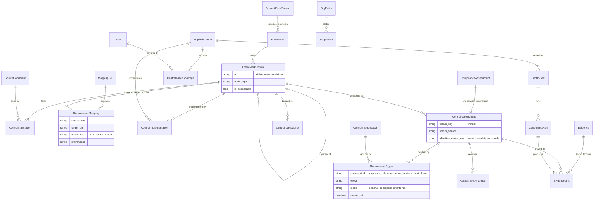

### 8.4 Interfaces

All routes sit under `/api/v1` and declare a capability. Operator routes use the `/platform/` prefix of §11 and §13, reached by the platform operator or, on an appliance, its operator. Existing routes keep their shapes (§8.6).

| Method | Path | Purpose |
|---|---|---|
| GET | `/platform/content-packs`, `/platform/content-packs/{key}/versions/{v}` | Packs, installed and available versions, signature status, manifest and counts |
| POST | `/platform/content-packs/upload` | Offline upload: verify only, return the manifest |
| POST | `/platform/content-packs/{key}/versions/{v}/install` | Asynchronous install (202 with a job id); `GET /platform/content-packs/jobs/{id}` for status |
| POST | `/platform/content-packs/sync` | Pull from the update channel (on-prem) |
| GET | `/content-updates`, `/content-updates/{id}/diff` | A tenant's pending updates; node, text, mapping and applicability diff with the impact on assessments |
| POST | `/content-updates/{id}/adopt`, `/content-updates/{id}/defer` | Adopt with re-review flags, or defer |
| GET | `/frameworks/{id}/tree`, `/frameworks/{id}/controls/{cid}/texts` | Node hierarchy with roll-up status; all texts with kind, authority and source page |
| GET | `/frameworks/{id}/controls?text=official\|machine\|both` | Flat list of assessable nodes, shape unchanged |
| GET | `/requirements/{urn}/mappings`, `/frameworks/{a}/coverage?target={b}` | Direct and inferred mappings with relationship, provenance and confidence; coverage of B obtained from A |
| POST, PATCH, DELETE | `/mappings`, `/mappings/{id}` | Tenant-authored mappings |
| GET | `/requirements/{urn}/impact-targets` | Preview of a rule target's fan-out in this tenant |
| GET, PUT | `/applicability/facts`; GET `/applicability/dimensions` | Scope facts per subject; dimension vocabulary |
| GET | `/soa`, `/soa/export?format=pdf\|xlsx&lang=ar` | Statement of Applicability per OrgEntity and framework revision |
| POST | `/compliance/assessments`, `/compliance/assessments/{id}/transition` | Create an assessment with its rows; successor assessment for a new edition with carry-over |
| POST, GET | `/compliance/assessments/{id}/analysis-runs`, `/compliance/analysis-runs/{id}` | AI analysis as a run (202); `/analyze` stays as an alias |
| GET, POST | `/compliance/assessments/{id}/proposals`, `/compliance/proposals/{id}/accept\|reject`, `/compliance/proposals/bulk-decide` | Proposal inbox |
| GET | `/compliance/control-assessments/{id}/history`, `/compliance/control-assessments/{id}/signals` | Status history; open and cleared signals with explanations |
| GET, POST, PATCH, DELETE | `/control-implementations`; POST `/control-implementations/suggest` | Requirement ↔ applied-control links; suggestions from mappings and AI |
| GET, PUT | `/applied-controls/{id}/assets`; GET `/applied-controls/{id}/effectiveness` | Asset coverage; effectiveness with its inputs |
| GET, POST, PATCH | `/control-tests`, `/control-tests/{id}/runs` | Control tests and runs |
| GET | `/graph/neighbourhood?type=&id=&depth=` | Traceability traversal |
| POST, GET, PATCH | `/evidence`, `/evidence/{id}`, `/evidence/{id}/links`, `/evidence/{id}/review\|supersede`; GET `/evidence/expiring` | Evidence artefacts, links, review, replacement and expiry |
| POST | `/evidence/ingest` | Machine ingest, ApiClient scope `evidence:ingest` (P2) |
| GET, PUT | `/risks/{id}/assets\|controls\|requirements` and the scenario, policy and vendor equivalents | Link replacement |
| POST, GET | `/risks/{id}/transitions`, `/risks/{id}/residual`, `/risks/recalculate` | Risk lifecycle with reasons; assessed, computed and effective residual; recompute |
| GET, POST, PATCH | `/kris`, `/kris/{id}/measurements`, `/risks/{id}/quantification-runs` | KRIs and stored quantification runs |
| POST | `/security/acceptances/{id}/reject\|revoke`, `/security/exceptions/{id}/revoke` | Completion of acceptances and exceptions |
| GET, PUT | `/tenants/current/grc-policy` | TenantGrcPolicy |
| POST | `/policies/{id}/versions/{vid}/submit\|approve\|reject`, `/policies/{id}/publish\|retire` | Policy workflow with SoD |
| GET, POST | `/attestation-campaigns`, `/me/attestations`, `/me/attestations/{id}/acknowledge\|decline` | Campaigns and the personal inbox |
| POST | `/compliance/action-plan` (with `finding_id`, `recommendation_id`) | Action from an audit finding or recommendation |
| GET, POST | `/questionnaire-templates`, `/vendors/{id}/assessments\|offboard`, `/vendor-portal/{token}/assessment` | TPRM assessments, offboarding and the hardened portal |
| GET, PUT | `/auth/me/capabilities`, `/capabilities`, `/custom-roles/{id}` | Capability catalogue and grants |
| GET | `/search?q=` | Search with Arabic normalisation |

Report routes also accept `lang=ar` and `layout=bilingual`.

**Events** use the CloudEvents envelope and the catalogue of §12 (X-08). The ControlImpactEngine calls the signal service directly; its `control_impact.*` events feed notifications and webhooks only.

| Direction | Events |
|---|---|
| Emitted, content | `content_pack.version_installed` (platform scope, fanned out per tenant), `content_pack.version_applied` |
| Emitted, compliance | `control_assessment.status_changed` (verdict and effective status), `assessment_proposal.created`, `requirement_signal.opened`, `requirement_signal.cleared`, `control.effectiveness_changed`, `control_test.completed`, `evidence.expiring`, `evidence.expired` |
| Emitted, risk and workflow | `risk.score_changed`, `risk.appetite_breached`, `kri.threshold_breached`, `policy.published`, `attestation.overdue`, `vendor.assessment_due`, `action_item.*` |
| Consumed | `finding.*` (§10); `asset.updated`, `asset.scope_changed`, `asset.merged` (read models and caches only, since links are re-pointed synchronously under ADR-INV-04) and `connector_run.completed` (§9) |

**UI changes:**
- **Catalogue and content:** publisher grouping and status badges on FrameworksPage; a typed crosswalk (=, ⊂, ⊃, ∩) with confidence and provenance; a side-by-side Arabic/English tree viewer; new pages for content updates (text diff with jsdiff, the `diff` package, BSD-3-Clause), the platform content console, and applicability and SoA.
- **AssessmentDetailPage:** proposal inbox, provenance chips, signal and evidence-link badges, history timeline, edition-transition wizard, and a Results tab that is always enabled.
- **Controls and risk:** requirement, coverage, test, evidence and effectiveness tabs on AppliedControlsPage; a RisksPage edit drawer with assessed, computed and effective residual, versions, transitions and tenant-matrix colours; scenario editing with finding and incident pickers; a routed quantification page in SAR; a KRI page.
- **Dashboards:** the executive and analytics dashboards show posture per framework revision and OrgEntity from the engine's effective status, with signal overlays, computed against assessed residual risk, and KRIs.
- **Workflows:** policy actions, approval history and campaign wizard; "My attestations" with a header badge; "create action" from an audit finding; vendor editing and detail tabs; the Evidence Library.
- **Shell:** capability-driven navigation, routes and buttons; Settings gains language, calendar, work week, GRC policy and single-approver mode.

### 8.5 Security, tenancy, Arabic/KSA and deployment considerations

**Shared content and tenant rows.** Built-in content is read-only to tenants; only the installer, as a platform principal under `grc_platform`, writes rows whose `tenant_id` is NULL. Tenant mappings, facts, overrides, forks and reference-mode texts carry their tenant's `tenant_id`, a column that is nullable only on the shared catalogue tables, and are read under a "shared or own" policy (X-05, §13). One revision-aware visibility helper, built on `_get_visible_framework`, replaces about 20 inline built-in checks, and `is_builtin` now defaults to False, closing a latent path that could publish a tenant's framework to every tenant. §11 closes the three cross-tenant read paths of §6.5 item 1 in P0 (T0.1).

**Pack integrity.** Signatures are mandatory, with key ids, a signed revocation list and anti-rollback; validation is strict, with column-length limits; appliances accept JSON only; extraction is guarded against path traversal and oversized content. The content key is one of X-10's per-purpose keys and never leaves OpenBao or an HSM.

**Graph and automation.** All new tables are under RLS. AI output is untrusted: quotations are machine-verified against the source document, and an AI proposal never overwrites a status set by a person. Separation of duties binds administrators; single-approver mode is explicit and printed on reports. The audit trail (§12) records decisions, auto-applications, signals, recalculations, adoptions and approvals with their event ids. The `assigned` scope and hardened vendor portal close SEC-06. No machine or API-client scope can write a verdict (X-12): the machine scopes for compliance are `evidence:ingest`, `graph:coverage:write` and `proposal:create`.

**Evidence and personal data.** Evidence sits under per-tenant prefixes with its SHA-256 ledger, is served through short-lived URLs and supports legal hold. Optional malware scanning uses an external clamd (ClamAV, GPL-2.0) over the network only (X-14). Attestation IP addresses and user agents follow a PDPL retention rule.

**Arabic and KSA.** Regulatory watch adds NCA, SAMA and SDAIA sources (`regulatory.py:62-87`), manual where no feed exists; a regulator publication opens a content backlog item linked to the pack version that answers it. KSA tenants' AI processing stays in the Kingdom by default, on the in-region endpoint, because proposals quote client documents; an AI endpoint outside the Kingdom is possible only after an explicit, audited opt-in by the tenant administrator (X-18). The vendor web lookup (`vendors.py:391-425`) is off on-prem and a tenant setting on SaaS.

| Aspect | SaaS (KSA cell) | On-prem (compose or OVA) |
|---|---|---|
| Content delivery | The cell is a registry consumer. The operator installs once, and each tenant adopts on its own schedule (patch automatic, minor after 30 days, major manual) | Bundled packs at first boot, after the migration job; `grc content sync` pull or offline upload; one verifier for both |
| Keys | Verification keys only; no signing key on the cell | Same |
| AI | In-region endpoint by default; an endpoint outside the Kingdom only after an audited opt-in by the tenant administrator (X-18); Arabic tasks enabled per certified model | Customer-chosen endpoint; fewer Arabic tasks may pass certification |
| Evidence storage | KSA-region S3-compatible storage, per-tenant prefixes (X-15) | Filesystem on a single node, or the customer's S3 or bundled SeaweedFS (Apache-2.0) for HA; MinIO (AGPL-3.0) is not bundled (X-09) |
| Fonts and search | In the package and in PostgreSQL | Same; nothing depends on the host OS |
| Packaging tiers | Treatment plans, appetite, control effectiveness and scenario versioning are Elite-gated today | The same gates turn them off for the default on-prem tenant; the committee is asked to move them to core (§8.8) |
| MSSP | Partner packs and mapping sets (P3) | A partner mirror serves customer sites (P3) |

### 8.6 Migration from today's code

| File or area | Action | Change |
|---|---|---|
| `models/framework.py`, `control_translation.py`, `control_applicability.py`, `compliance.py`, `applied_control.py`, `risk.py`, `risk_scenario.py`, `policy.py`, `vendor.py`, `action_item.py` | Extend | Columns of §8.3; unique keys after a duplicate check; `is_builtin` default False; evidence decoupled from a single row |
| New model modules (content pack, mapping, applicability, source document, evidence expectation and link, signal, implementation, coverage, test, proposal, analysis run, KRI, quantification, policy workflow, questionnaire, link tables, GRC policy) | New | In the corrected models before the Alembic baseline is cut, or as later expand revisions (X-04) |
| `endpoints/compliance.py` | Refactor | Extract the engine, analysis and evidence services. Replace the deletion block (`:2640-2697`) with proposals and the copy propagation (`:3775-3869`) with links. Share row instantiation with `create_assessment`, the registration and framework-selection handlers in `auth.py`, and the CLI. Apply assessable filters, derived N/A and effective status in scoring, AI and the mandatory guard (`:2989-3004`) |
| `endpoints/frameworks.py`, `requirements.py` | Refactor | Visibility helper; `/tree` and `/texts`; the crosswalk reads RequirementMapping; the import gains Arabic and English text columns, `node_type` and typed crosswalk columns |
| `dashboard.py`, `audit_grids.py`, `data_io.py`, `report_generator.py` | Refactor | Assessable nodes only; mappings instead of `mapped_controls`; dashboard score from the engine |
| `core/licensing.py`, `services/license_client.py`, `appliance_cli.py` | Extend | `core/signing.py` key ring; content pull; `grc content list, verify, install, sync, export` on §13's CLI |
| `frameworks/loader.py`, `scripts/make_client_seed_db.py`, `release/seed/grc_seed.db`, `add_gcc_frameworks.py`, `add_ot_auto_frameworks.py`, the `scripts/seed_*` content scripts, `frameworks/*.yaml` | Replace | Converted once into content-repository sources, then archived; the seed stays only as a test fixture; intuitem files removed |
| `translation_sources.py`, `regulatory.py:62-87`, the framework notices in `workers/tasks/notifications.py` | Extend, extend, replace | Skip official text; KSA watch sources; update notices fanned out per tenant from `content_pack.version_installed` (X-08) |
| `residual_risk.py`, `risk_versioning.py`, `scenario_priority.py`, `risks.py`, `risk_scenarios.py`, `risk_treatment.py`, `security_exceptions.py` | Fix, then refactor | `COUNTS_AS_ACTIVE`; fold into `services/risk_recalc.py`; change origin; `RiskCreate.status`; scope fields; `linked_incident_ids`; reject and revoke |
| `policies.py`, `vendors.py`, `contract_collab.py`, `workers/tasks/vendor_assessments.py`, `notification_generator.py` | Extend | Workflow actions; vendor links and assessments; hardened portal; reassessment task; checks moved to scheduled jobs |
| `authz.py`, `dependencies/auth.py`, `perimeter.py`, new `core/capabilities.py`; `App.tsx`, `Layout.tsx`, `store/auth.ts`, `EntitlementsContext.tsx` | Extend, replace | Capability catalogue and scopes; SPA guards from the API |
| `pdf_arabic.py`, `report_generator.py`, `excel_export.py`, `ocr.py`, `pyproject.toml`; `ai_locale.py`, `ai_provider.py`, `ai_structured.py`; `index.css`, `public/fonts` | Extend | Bundled fonts and libraries; report parity; RTL spreadsheets; language guard; web font and logical classes |

**Data migration.** The transform is a step of §13's SQLite → PostgreSQL importer: dry runs on a read-only production snapshot, two rehearsals and reviewed reports, never against the live database. On-prem SQLite installs follow the same path. In order:
1. **Schema:** content, link, control-model, proposal and run tables, nullable or empty.
2. **Legacy library pack:** every built-in (77 in the seed, more in production) goes into `ngc.legacy-library@1.0.0` with `fidelity=paraphrase`, legacy URNs (target URNs for `nca-ecc-2024`), `node_type=control` and assessable; French human titles become `text_kind=human`. Installation keeps every row id, and must precede step 3 because new link rows reference built-in requirements.
3. **JSON id lists → link rows:** same-tenant targets only, de-duplicated, dangling and cross-tenant ids reported, one-sided pairs merged.
4. **Implementations and risk links:** `framework_control_ids` and `reference_control_id` become ControlImplementations (`active`, `legacy_json`); `Risk.linked_controls` codes become RiskRequirement rows, resolved case-insensitively, with unresolved codes kept as `legacy_ref` and reported.
5. **Mappings:** `mapped_controls` pairs become `related` mappings (`legacy_import`); unresolved pairs go to a review report.
6. **Control assessments:** rows get `status_source` `ai_legacy` or `human_legacy`, so scores do not move; assessments without rows are backfilled without re-scoring; runs stuck in `running` become failed AnalysisRuns.
7. **Evidence:** each row keeps its id and gets one EvidenceLink to its old row; validity strings become dates; `kind` and `source_kind` are filled from `is_automated` and `source_integration`; duplicates are flagged by tenant and SHA-256, not merged.
8. **Policies and vendors:** policies published without an approval record are marked `legacy_unrecorded`; vendors keep `risk_score_legacy` and are flagged for reassessment, the old scale being ambiguous.
9. **Official KSA packs (P1):** `ksa.nca.ecc@2.0.0` adds 32 grouping nodes and 92 sub-controls and replaces the statements, moving assessments by URN with `requires_review` on changed rows. Official SAMA CSF installs with new identities and suggestion-only carry-over, and legacy `sama-csf` is `withdrawn`; `ksa-ecc` is `superseded`.

**Compatibility.** Old revision rows are kept while referenced, so existing foreign keys stay valid. For one release, responses still carry the JSON arrays, computed from the link tables with `Deprecation` and `Sunset` headers, and array writes become link replacements; the columns drop in P3. `GET /frameworks/{id}/controls` keeps its flat shape, the crosswalk route keeps `mapped_to` and adds typed `mappings`, and the per-row evidence route wraps EvidenceLink. `/analyze` returns 202 with a run id, the switch from replace to propose is announced, and the first-run opt-in keeps today's experience. `require_roles` remains a shim over capabilities, `policy_workflow_enforced` is on for new tenants and enabled for existing ones after notice, and `Tenant.selected_framework_ids` resolves by URN.

### 8.7 Delivery by phase

Phasing follows X-02, and sizes follow §15: S ≤ 2, M 2–6, L 6–12 and XL > 12 person-weeks. Under the effort-ownership rules, this chapter counts the content-pack mechanism and legacy-library pack, the bundled Arabic fonts, the requirement-signal fan-out, the compliance engine service and the link transform, including the association tables that only §14.4 names; items owned by other chapters appear only under "Depends on".

| ID | Phase | Deliverable | Size | Depends on |
|---|---|---|---|---|
| B1-01 | P0 | Content schema in the corrected models: node tree, URNs, text kinds, sources, evidence expectations, packs, mappings, scope facts, nullable `tenant_id` on the shared catalogue tables | M | Lands before §13's Alembic baseline is cut |
| B1-02 | P0 | Pack format, `core/signing.py` key ring, content-signing key in OpenBao transit, verifier with key id, revocation and anti-rollback | M | §13 OpenBao |
| B1-03 | P0 | Engine-neutral installer as a `grc_platform` worker job; `grc content` commands; bundled-pack first boot | M | B1-01, B1-02; §13 worker tier and CLI |
| B1-04 | P0 | `ngc.legacy-library` exported from a production snapshot; seed database and SQLite content scripts retired; PostgreSQL gets frameworks | M | B1-03; §13 importer rehearsal |
| B1-05 | P0 | Content repository and CI: schema, ID and count locks, AR/EN parity, mapping checks, diff, sign, publish | M | §13 CI v1 |
| B1-06 | P0 | Content registry and update channel: stable and preview channels, signed revocation list, licence-entitled download, on-prem `grc content sync` client | S | B1-02; §13 vendor control plane |
| B1-07 | P0 | Redistribution-rights clearance for NCA, SAMA and SDAIA texts (long lead) | S | Legal counsel |
| B1-08 | P0 | Revision-aware visibility helper; `is_builtin` default False | S | None (the three cross-tenant read-path fixes are §11's T0.1) |
| B1-09 | P0 | R2 UI wiring of existing APIs: risk edit, status, residual, delete and scope; scenario edit; treatment rationale and PATCH client; vendor edit and contracts; attestation acknowledgement; action from a finding | M | None |
| B1-10 | P0 | Backend fixes: `RiskCreate.status`, risk scope fields in responses, `linked_incident_ids`, prescreen kept, writable `finding_id`, `COUNTS_AS_ACTIVE` (PRD-02), acceptance reject | S | None |
| B1-11 | P0 | Amiri and Noto Sans Arabic bundled in the backend package, package-path registration, shaping libraries in `pyproject.toml`, readiness probe | S | §13 CI v1 runs the self-tests; §13 images install the package |
| B1-12 | P0 | AI output-language guard: script ratio, one retry, stream prefix, `language_mismatch` flag and metric | S | None |
| B1-13 | P0 | RTL baseline: Playwright screenshot gate (20 pages, two languages, two widths); raw-enum badges and SoA subtitle fixed | S | §13 CI v1 |
| B1-14 | P0 | Link transform inside the import: all 43 JSON id-list fields into the 36 association tables of §14.4, with the P0 link tables of §8.2.2, ControlImplementation, ControlAssetCoverage and the EvidenceLink schema; the asset lists, including `Audit.asset_ids`, `Incident.affected_asset_ids`, `Threat.linked_asset_ids`, `CveAnnotation.linked_asset_ids` and `ComplianceAssessment.in_scope_assets`, all registered in §9's asset reference registry with synchronous re-point and delete handlers (ADR-INV-04); dangling-id report; dual-read shim | XL | §13 importer, Alembic, RLS; §9 asset reference registry; BusinessProcessAsset and AssetDependency (§9), FindingOccurrence and FindingControl (§10), counted there |
| B1-15 | P0 | Assessment persistence and compliance engine service: row instantiation and backfill, `ControlAssessmentService` without a user token, AnalysisRun, AssessmentProposal merge rules, history (PRD-03) | M | §13 worker tier, `ai` queue and outbox |
| B1-16 | P0 | Capability core: catalogue, role defaults, scopes, `/auth/me/capabilities`, shadow mode, route-coverage test | M | §11 Membership and TenantContext |
| B1-17 | P1 | Hierarchy and official text through APIs and the engine: tree, texts, roll-up nodes, assessable-only scoring, registration and AI on official text | M | B1-01, B1-15 |
| B1-18 | P1 | Content wave 1: ECC-2:2024 official AR/EN with 92 sub-controls; SAMA CSF on 3.1–3.4 with its maturity scale; PDPL with its Implementing and Transfer Regulations | L | B1-05, B1-07 |
| B1-19 | P1 | Content wave 2: CCC-2:2024, DCC, CSCC, OTCC, TCC | L | B1-18 conventions |
| B1-20 | P1 | Mapping service: API, closure, coverage, propagation proposals, typed crosswalk UI | M | B1-01, B1-15 |
| B1-21 | P1 | Six mapping sets authored with second-SME review | L | B1-18, B1-19, B1-20 |
| B1-22 | P1 | Applicability engine and SoA: dimensions, inherited scope facts, derived N/A, bilingual SoA export and approval | M | B1-17, B1-11; §11 OrgEntity closure |
| B1-23 | P1 | Adoption flow (diff, adopt or defer, URN re-pointing) and edition-transition wizard | M | B1-17, B1-20 |
| B1-24 | P1 | KSA regulatory-watch sources linked to the content backlog | S | None |
| B1-25 | P1 | Proposal inbox, TenantGrcPolicy apply modes, auditor verdicts as proposals, bulk decisions with SoD | M | B1-15, B1-16 |
| B1-26 | P1 | ControlTest and runs, effectiveness v2, requirement roll-up proposals, applied-control tabs | L | B1-14, B1-15 |
| B1-27 | P1 | Evidence as an artefact: EvidenceLink service and UI, review, validity, expiry jobs and signals, Evidence Library, mapping-based link proposals | M | B1-14, B1-20; §13 StorageBackend |
| B1-28 | P1 | Risk recalculation on internal events; stored computed and effective residual; re-score on matrix change | M | B1-14, B1-26; §13 outbox |
| B1-29 | P1 | KRIs (manual and internal providers); stored quantification runs; routed page in SAR | M | B1-28 |
| B1-30 | P1 | Acceptance and exception completion: links, reject and revoke, risk status sync, scheduled expiry | S | B1-14 |
| B1-31 | P1 | ApprovalService, policy workflow with SoD, review reminders | M | B1-16; §13 scheduler |
| B1-32 | P1 | Attestation campaigns, "My attestations" inbox, bilingual completion report | M | B1-31 |
| B1-33 | P1 | TPRM in the graph: vendor links, KSA questionnaires, stored assessments, hardened portal, reassessment, offboarding | L | B1-14, B1-16, B1-18 |
| B1-34 | P1 | Capability rollout on compliance, evidence, risk, policy, vendor and audit routes; SPA guards; auditor isolation (SEC-06) | M | B1-16 |
| B1-35 | P1 | Official Arabic display, bilingual KSA compliance reports and dashboards (posture per framework revision and OrgEntity from the compliance engine's effective status, signal overlays, computed against assessed residual risk, KRIs), report-parity tests, RTL spreadsheets | M | B1-18, B1-11, B1-28, B1-29 |
| B1-36 | P1 | Arabic AI evaluation harness and per-model certification | M | §13 CI runner with model access; X-18 endpoints |
| B1-37 | P1 | RTL kit completion: logical-class ratchet, chart mirroring, Arabic web font, tenant default language | S | B1-13 |
| B1-38 | P1 | Arabic search: normalisation function, indexes, Python mirror, search endpoint | S | §13 PostgreSQL |
| B1-39 | P2 | Requirement-signal fan-out: closure expansion, applicability filter, observe, propose and enforce, automated evidence, clearing | M | §10 ControlImpactMatch contract; B1-20, B1-22, B1-15 |
| B1-40 | P2 | KSA impact-rule templates in packs, the union of the content and CTEM designs: ECC-2:2024 2-10 (KEV exposure, SLA breach, scan coverage), 2-12 and 2-13, each pinned to a sub-control URN (illustrative, to be confirmed by the content team); the 2-11 re-test template is authored here but ships in P3 with §10's `validation` rule family | S | §10 rule validator; B1-39 |
| B1-41 | P2 | Hub expansion: PCI DSS 4.0, SWIFT CSP, CIS v8, NIST SP 800-53, ISO 27701, ISO 22301, IEC 62443 | L | B1-20 |
| B1-42 | P2 | AI-assisted mapping and PDPL obligation drafts for authors (reviewed only) | S | `ai_prompts` task registry |
| B1-43 | P2 | Exposure-driven likelihood in risk recalculation, with computed probability shown on scenarios | S | §10 exploitability and ScenarioFinding rule links; B1-28 |
| B1-44 | P2 | Evidence ingest API and connector-backed control tests | M | §9 connector framework (X-13); §12 ApiClient; B1-26, B1-27 |
| B1-45 | P2 | KRI providers on findings and SLAs (inventory providers are counted in §9) | S | §10; B1-29 |
| B1-46 | P2 | Action-item sync over the shared external-ticket link | S | §10 ExternalTicketLink |
| B1-47 | P3 | Partner (MSSP) packs and mapping sets, partner entitlements and mirror (the rollout console is §11) | M | §11 Partner; licence v2 |
| B1-48 | P3 | Official rebuilds of the legacy GCC catalogues; optional official ECC-1:2018 | L | Customer demand |
| B1-49 | P3 | Delta packs for bandwidth-limited appliances | S | B1-03 |
| B1-50 | P3 | Contract phase: drop the JSON link columns, `mapped_controls` and shims | S | B1-14 plus one release |
| B1-51 | P3 | Hijri display option, multi-step approval chains, bilingual tenant fields, zero physical CSS classes | M | B1-31, B1-37 |

Subtotals are approximate, at the midpoints S = 1.5, M = 4, L = 9 and XL = 16 person-weeks:

| Phase | Deliverables | Effort (person-weeks) |
|---|---|---|
| P0 | 8 M, 7 S, 1 XL | about 58.5 |
| P1 | 13 M, 5 L, 4 S | about 103 |
| P2 | 2 M, 1 L, 5 S | about 24.5 |
| P3 | 2 M, 1 L, 2 S | about 20 |
| **Block total** | | **about 206** |

P1 includes about 18–23 person-weeks of content work and 8–10 of mapping work by the content team, which works in parallel with engineering. Effort figures cover engineering and first-pass content authoring (about 30 person-weeks in §8, P1). The standing content team (about 4.5 FTE, about 170 person-weeks over the 38 weeks of content waves to the end of P1, with a smaller team continuing afterwards) also covers SME review, Arabic legal-linguistic QA, mapping maintenance and regulatory watch, which are outside the programme's ≈700 person-weeks (§15.4).

| End of phase | Requirement coverage (programme) | This chapter's contribution |
|---|---|---|
| P0 | 63% | R3 strong: bundled fonts, language guard and RTL gate (B1-11 to B1-13); R2 quick fixes and assessment persistence land; the content pipeline runs on PostgreSQL |
| P1 | 81% (75% unless redistribution rights are cleared or the committee decides that reference mode meets R1) | R1 strong under that condition (eight frameworks, mappings, applicability, SoA) and R2 strong (B1-25 to B1-34); R8 comes from §12 |
| P2 | 88% (81% if R1 stays partial, §15.3) | R7 strong with §9 and §10: signal fan-out, exposure-driven likelihood and evidence ingest |
| P3 | 100% (94% if R1 stays partial, §15.3) | R4 and R6 come from §11 and §9; this block adds partner packs and the contract phase |

### 8.8 Key decisions and risks

| ADR | Decision | Rationale |
|---|---|---|
| ADR-CNT-01 | Extend `framework_controls` into a typed node tree | Keeps every compliance foreign key valid with no data move |
| ADR-CNT-02 | Store official bilingual text as typed text rows with provenance and a per-framework authoritative language | One text resolver for UI, PDF and AI; Arabic is binding for NCA, while SAMA's language is set by its register |
| ADR-CNT-03 | Immutable framework revisions, stable URNs, per-tenant adoption | Audits reference the exact text assessed, and tenants can defer |
| ADR-CNT-04 | Author YAML in a reviewed repository; ship signed JSON packs; separate content-signing key (OpenBao, X-10) | Engine-neutral, verifiable offline, one path for SaaS and on-prem |
| ADR-CNT-05 | RequirementMapping keyed by URN, with NIST IR 8477 relationships, provenance and confidence; ISO/IEC 27001:2022 Annex A hub, NIST CSF 2.0 secondary | Matches existing tooling and KSA ISMS practice; IDs carry no copyright exposure |
| ADR-CNT-06 | Suggestion-first propagation: evidence linked not copied; status moves only along set semantics; signals overlay | Regulator-grade explainability; no repeat of the AI-rerun data loss |
| ADR-CNT-07 | Applicability = content conditions + scope facts inherited down the OrgEntity tree + explicit overrides | Encodes NCA's conditional and tiered applicability once, and yields a per-entity SoA |
| ADR-CNT-08 | Retire the seed database and scripts through a `paraphrase`-labelled legacy library pack | Honest labelling, one delivery path, PostgreSQL support |
| ADR-COR-01 | Bridge requirements and applied controls with ControlImplementation, ControlAssetCoverage and ControlTest | One control satisfies many frameworks; built-ins stay read-only; every screen survives |
| ADR-COR-02 | Proposals, never delete-and-recreate; upgrades need a person; human decisions pin. Under X-12, machine-verified downgrades are overlays, not written verdicts | Keeps human work and still allows automation |
| ADR-COR-03 | Evidence as a tenant artefact with exclusive-arc links | Real foreign keys and cascades in one table |
| ADR-COR-04 | Typed link tables with composite tenant foreign keys | Integrity, indexed reverse queries and RLS; cross-tenant edges impossible |
| ADR-COR-05 | Store assessed and computed residual; effective by tenant mode, conservative by default | Honours "updated automatically" and "suggestion, not overwrite"; explainable to auditors |
| ADR-COR-06 | In-code capabilities with scopes on top of the 13 roles | No policy language or extra service (OPA and Casbin, both Apache-2.0, rejected); one authorisation truth for API and SPA |
| ADR-COR-07 | One light ApprovalService for maker-checker and SoD | Consistent rules, including for administrators, without a BPMN engine (Flowable, Apache-2.0, too heavy; Camunda 8 not open source) |
| ADR-COR-08 | TPRM inside the core graph | R7 needs vendor-hosted assets, and the register needs third-party risk |
| ADR-COR-09 | Arabic PDF kit: bundled OFL fonts, LGPL bidi kept unmodified, dynamically imported, replaceable and excluded from compilation (X-14), parity tests | Smallest change, since every generator already uses `pdf_arabic` (headless Chromium HTML-to-PDF, BSD-3-Clause, would be a larger change) |
| ADR-COR-10 | Arabic AI quality gate: output check with retry, per-model certification | Failures become measurable; on-prem models can be gated |
| ADR-COR-11 | Arabic search in PostgreSQL | No extra service per install, and RLS still applies (OpenSearch Apache-2.0, Meilisearch MIT, Elasticsearch ELv2, SSPL or AGPL rejected) |
| ADR-COR-12 | KRIs through a provider registry | Avoids user SQL (injection, RLS bypass); providers carry thresholds and links |

| Risk | Mitigation |
|---|---|
| Redistribution rights for NCA, SAMA or SDAIA texts are refused or slow | Legal opinion and written requests in P0; reference mode with tenant-loaded text; R1 stays partial until cleared |
| Content effort is underestimated (two L waves plus L mapping sets) | ECC-2, SAMA and PDPL first; count locks; minimal-variant fallback; content team staffed from P0 |
| A wrong mapping produces false compliance | Set semantics, conservative propagation, visible provenance and confidence, second-SME review; two-hop relations never change status |
| Extraction errors in official Arabic text (ligatures, order, diacritics) | Verbatim capture from digital sources, double extraction, linguist proofreading, parity tests |
| Adopting a revision disrupts audits in progress | Pinning and deferral; historical objects stay on their revision; re-review flags; pre-adoption snapshot |
| The link migration drops or mislinks references | Dry runs on a read-only snapshot; dangling-id report and reconciliation screen; JSON kept read-only for one release |
| Users read "AI no longer updates status" as a regression | First-run opt-in, bulk accept in the inbox, release notes |
| A bulk CTEM import causes a recalculation storm, or automatic increases cause alert fatigue | Coalesced dirty sets, batch windows, idempotent consumers, hysteresis and digests, tenant residual mode |
| Auditors contest automated non-compliance | Verdict never overwritten; explanation and evidence on every signal; observe burn-in; time-boxed, justified suppression (§10) |
| The capability migration grants or removes access by mistake | Default matrix equal to today's access, shadow-mode diff logs, a role-by-capability test matrix |
| Arabic answer quality of in-region or on-prem models is poor | Per-model certification gates each Arabic AI task |
| The block's breadth overruns | Protect the R2/R3 minimum path first: B1-09 to B1-16, B1-25, B1-27, B1-31, B1-32 |

**Questions for the committee** (carried to §16.1 and §16.4):
1. **Rights.** Can NCA, SAMA and SDAIA texts be redistributed in a commercial product, and who requests permission?
2. **Editions.** Which editions are clients audited on today, and which production assessments must be carried over?
3. **Hub.** Is ISO/IEC 27001:2022 Annex A confirmed as the mapping hub?
4. **Defaults.**
   - Do KEV templates enforce after the burn-in?
   - May `equal` mappings ever auto-apply a status?
   - Which residual mode do KSA tenants get by default?
5. **Commercial.** Are KSA packs a licensed add-on? May partners publish their own packs?
6. **Scope.** Must verdicts match NCA's sub-control granularity? Does PDPL need a ROPA/DPIA module?
7. **Packaging.** Should the Elite-gated risk features move to core, and is single-approver mode acceptable?
8. **Other.** Hijri display for government clients, binding e-signature for vendor attestations, and who supplies the KSA KRI library and the content reviewer of record.

## 9. Block 2 — Inventory collector

This chapter designs Block 2 of the NG-GRC need, the inventory collector: "what the client owns". It serves R6 and supplies the asset identity, context and software data that R7 (§10) and the compliance scope and evidence of R1 and R2 (§8) rely on. It answers BM-01 slides 9 and 10 (the three collection channels and the four properties of a GRC collector) and the asset side of slide 13's worked example, and it applies BM-01-D05: CSV and connectors first, the agent next. It also owns the connector framework, the Site Collector and the collect gateway that Block 3 shares (X-13). Today GRCEye keeps rich business context on hand-entered assets but collects almost nothing: an API-only, insert-only CSV route and an EASM discovery connector. In the target, three channels feed one reconciliation engine that keeps a single golden asset per real-world thing, with its business context, its compliance scope and its software matched to vulnerabilities.

### 9.1 Current state in brief

§4.5 describes the asset register and §6.2–§6.3 score it: R6 is partial, at the low end. The landing model is strong: a 34-column `Asset` with a mandatory owner, criticality, C/I/A, RTO/RPO/MTD and links to `OrgEntity` and `BusinessProcess`, reused by risk, compliance and audit. Collection is weak:

- **Channel 1.** `POST /data/import/assets` reads seven fields from a CSV or XML file of at most 2 MB, always inserts, sets no owner, and has no template, dry run or screen (PRD-04).
- **Channel 2.** None of the seven named connectors exists, and AD/LDAP serves login only. The Elite-gated EASM connector is the only automatic source; it creates owner-less assets (§4.6).
- **Channel 3.** There is no agent and no machine credential (PRD-01).
- **One asset view.** There are no identifier columns, unique keys or merge. Scanner matching is exact string equality, and EASM can create twin assets for one host (DAT-03).
- **Software.** There is no software or CPE model. The NVD sync drops `configurations`, and the Nessus parser drops the software-enumeration plugins.
- **Links and platform.** Ten JSON id lists reference assets with no clean-up on delete (DAT-01). Connector secrets are stored in clear (SEC-03) and may target private addresses. Scheduler loops run inside the web workers (RUN-01), and the shipped seed lags the schema (DAT-04).

Worth reusing: the scanner and EASM adapter registry, SSRF guard, secret redaction and claim-based scheduler; the framework importer's tabular parser; the hash-chained activity log with its system actor; and the empty `backend/app/integrations/` package.

### 9.2 Target design

Five rules govern the block:

1. Every channel produces an `AssetSourceRecord`. Only the reconciliation engine writes the golden `Asset`.
2. Deterministic keys come before scores. Anything ambiguous goes to a person, and every merge can be undone.
3. Collectors never overwrite business context set by people or rules. Field locks and provenance protect it.
4. Collection is read-only and outbound-only. Credentials for on-prem systems stay in the client network.
5. A software-to-CVE match is inferred and carries a confidence. It is never shown as confirmed.

#### 9.2.1 Components

| Component | Type | Responsibility | Extends existing code or new |
|---|---|---|---|
| Asset golden record | Model | Identity summary, exposure context, provenance, field locks, effective criticality | Extends `models/asset.py` |
| Identity and source store | Models | Identifiers, source records, change sets, merges, review issues, tenant policy | New `models/asset_identity.py` |
| Identifier normaliser | Library | Normalises MAC, IP, FQDN, serial and UUID values, blocks placeholder values, builds Arabic matching keys | New `services/inventory/normalize.py` |
| Reconciliation engine (`AssetIdentityResolver`) | Worker service | Matching, survivorship, merge, split and undo, review issues; also called by §10's finding ingest | New `services/inventory/reconciliation.py`; replaces `scanner_import._build_asset_index` and `_match_asset` |
| Asset reference registry | Library and CI check | Lists every table and column that references an asset, with its re-point and delete handlers | New `services/inventory/asset_refs.py` |
| Stale detector | Scheduled job | Missing and ageing assets, retirement candidates, alerts | New; follows `notification_generator.check_asset_eol` |
| Context rules and inheritance | Service | Entity, process, owner, exposure level and criticality from rules; criticality and C/I/A inherited from processes | New `services/inventory/context_rules.py` |
| Scope and coverage writer | Service | Asset `ScopeFact` and `ControlAssetCoverage` rows through §8's services; `AssetFrameworkScope` read model | New |
| Tabular parser | Library | CSV, XLSX and XML; header aliases in English, Arabic and French; digit folding | New `services/tabular_import.py`, extracted from `frameworks.py` |
| Import service | Worker service | Template, plan, apply, rollback; legacy route kept as a shim | New; the asset import in `data_io.py` becomes the shim |
| Connector SDK | Library | Typed configuration, credential references, cursors, paging, rate limits, auth helpers, mapping to canonical records (assets here, findings in §10) | New in `backend/app/integrations/`; generalises `scanner_connectors.py` and `easm_connector.py` |
| Connector runtime | Celery tasks | Runs on the `connectors` queue from the `connectors.dispatch_due` tick; claims, `ConnectorRun` journal, simulated first run | Replaces `vuln_scanner_scheduler.py` and keeps its claim |
| Inventory adapters | Plug-ins | AD, Entra ID, Intune, vCenter, Wazuh, GLPI, Azure, AWS; EASM refit | New; AD reuses the `directory_auth.py` helpers |
| Site Collector | Deployable (`grc-collector` image) | Runs adapters of both blocks inside the client network, holds on-prem credentials, relays agents | New |
| Collect gateway | Edge entrypoint and machine API | mTLS ingress for sites and agents on `collect.<domain>`, job leases, enrolment and renewal, deny list | New: Traefik entrypoint (§13) and machine API routers; certificates from the OpenBao PKI engine (§13) |
| Agent | Go binary | Read-only collection, offline spool, signed updates | New repository `agent/` (P3) |
| Fleet service | API and UI | Sites and agents: enrolment tokens, policies, update rings, revocation, health | New |
| Software normaliser | Service | Product identity (CPE and PURL), version scheme, alias curation | New `services/inventory/software.py` |
| Applicability sync | Platform job | NVD configurations, CPE dictionary, CVE record CNA and ADP data | Extends `services/nvd_sync.py` |
| CVE matcher | Worker service | Inferred exposures with a confidence and a band | New `services/inventory/cve_matcher.py` |
| Inventory UI | Frontend | Import wizard, asset page, review inbox, connectors, sites, agents, software, rules | Extends `AssetsPage.tsx` and `AssetGraphPage.tsx`; new pages |

Third-party components introduced by this block (X-14):

| Component | Use | Licence | Note |
|---|---|---|---|
| openpyxl, httpx, defusedxml | XLSX, HTTP, safe XML | MIT, BSD-3-Clause, PSF-2.0 | Already dependencies |
| ldap3 | AD adapter | LGPL-3.0 | Already a dependency; kept unmodified, dynamically imported, replaceable and excluded from compilation |
| boto3 and botocore, pyVmomi | AWS, vCenter | Apache-2.0 | boto3 is declared but unused today |
| univers, packageurl-python | Version ranges, PURL | Apache-2.0 AND BSD-3-Clause AND MIT; MIT | New |
| pg_trgm | Trigram index for software names | PostgreSQL Licence | Contrib extension |
| age | Site Collector sealed store | BSD-3-Clause | New |
| Go toolchain, gopsutil, bbolt, go-tuf v2 | Agent | BSD-3-Clause, BSD-3-Clause, MIT, Apache-2.0 | New (P3) |
| cosign, nfpm | Signing, packaging | Apache-2.0, MIT | Build time only |
| WiX Toolset | Windows MSI | MS-RL; its binaries carry an Open Source Maintenance Fee for revenue-generating users (external source, to verify) | Build time only; confirm terms or choose another tool |
| osquery, Fleet | Optional, installed by the client | osquery `Apache-2.0 OR GPL-2.0-only`, Linux build statically links GPL-2.0-or-later libdpkg (external source, to verify); Fleet MIT core with a commercial `ee/` directory | Never bundled or linked; used only as a separate program, through its JSON output or over its API |
| NVD and CPE data, CVE List, CISA Vulnrichment | Applicability data | Public with the NVD notice; CVE Program terms; Vulnrichment terms to confirm | Data, not code |

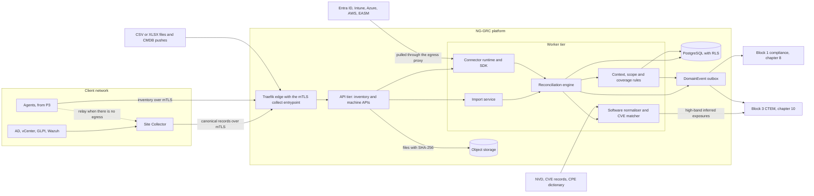

#### 9.2.2 Channel 1 — CSV/XLSX import (P1)

Slide 10 asks for a canonical template, a validation report and idempotent re-imports, ready on day one. This plan reads "day one" as the first day of each client's onboarding. Channel 1 ships in P1, before the KSA pilot (about month 9), because it needs the identity schema, reconciliation engine v1, the worker tier and object storage (§9.7). Until then, today's API-only `/data/import/assets` route is the only file channel. A file import is a connector run (ADR-INV-05). Each import runs under a file-type `Connector` of the tenant, one by default or one per mapping profile when a tenant keeps sources apart, so imported rows become source records and are matched like those of every other channel.

| Aspect | Design |
|---|---|
| Template | XLSX workbook with four sheets: instructions; Assets with drop-down lists; Software (active once the P2 software model ships); Lists pre-filled with the tenant's entities, processes and people. Each header pairs the English key with the Arabic label (`hostname \| اسم المضيف`). Arabic sheets read right to left. Default, OT and cloud variants, plus a CSV version |
| Columns | All optional, but each row needs a name or an identifier. Identity: `external_id`, `name`, `asset_type`, `hostname`, `fqdn`, `ip_addresses`, `mac_addresses`, `serial_number`, `os_name`, `os_version`, `cloud_resource_id`, `location`. Context: `owner_email`, `org_entity` (as a path), `business_processes`, criticality, C/I/A, `data_classification`, `contains_pii`. Exposure and lifecycle: `environment`, `exposure_level`, `crown_jewel`, `lifecycle_state`, `end_of_life_date`, `tags` |
| Parsing | UTF-8 with or without a byte-order mark; delimiter detection; XLSX read-only, files with macros refused; header aliases in English, Arabic and French; Arabic-Indic digits folded; Hijri-looking years flagged. Limits 20 MB and 100,000 rows; anything above a 10 MB inline limit, the one §12's ingestion contract uses, goes through §13's upload sessions (PF-21, P1). Each file is stored with its SHA-256 (X-09) |
| Dry run | An upload creates an `import_plan` run that writes nothing. The report gives each row's action (create, update with a field diff, unchanged, conflict, error) and its warnings, and downloads as a bilingual XLSX |
| Upsert | Key: `external_id`, otherwise the strongest identifier (serial number, then cloud id, FQDN, hostname). Re-importing the same file changes nothing. Modes: upsert, create-only, update-only; `full_snapshot` marks absent rows as missing |
| Rollback | Within 30 days, the run's `AssetChange` rows replay backwards: fields nobody has changed since are reverted, assets the run created and nobody has linked are deleted, and conflicts are listed. Each run's change set is hashed into the audit chain |
| Push | A client CMDB pushes files, or canonical records as gzip NDJSON, through an `ApiClient` with the `inventory:import` scope and an idempotency key (§12 E1.5a, P1). The route adopts §12's full shared ingestion contract in P2 (E2.5) |
| Wizard | Upload, map columns (saved as an `ImportMappingProfile`), review, apply, then history and rollback. `/data/import/assets` stays as a deprecated shim |

#### 9.2.3 Channel 2 — Connectors on the shared framework (P2)

**Connector framework.** This chapter owns the SDK and the runtime for both blocks (X-13, ADR-INV-06). The SDK generalises today's adapter registry, SSRF guard, redaction helper, EASM mapping engine and claim scheduler. An adapter declares:

```python
class SourceAdapter(Protocol[RecordT]):
    provider: str                   # "inventory.ad", "inventory.intune", "ctem.defectdojo", ...
    config_model: type[BaseModel]   # typed config; its JSON Schema drives the UI form
    capabilities: set[str]          # devices, people, software, network, cloud, deletions
    async def test(self, ctx) -> TestResult: ...
    def fetch(self, ctx, cursor) -> AsyncIterator[RawBatch]: ...  # paged and rate-limited
    def map(self, raw) -> RecordT: ...  # CanonicalAssetRecord here, CanonicalFinding in §10
```

- **Canonical records.** An inventory adapter maps each item to identifiers, attributes, software, owner, context and lifecycle hints, and `observed_at`. §10's adapters return `CanonicalFinding` on the same SDK. Only §10's ticketing adapters declare a write capability; inventory adapters are read-only.
- **Credentials.** The runtime resolves a credential reference. For platform-run connectors it points to a secret envelope-encrypted under the tenant's key (X-10, §13); for site-run connectors, to the site's sealed store. Credentials are write-only through the API and redacted from errors. Auth helpers cover LDAPS binds, OAuth2 client credentials with a certificate, AWS role assumption with an ExternalId, and vSphere sessions.
- **Runtime.** The RedBeat tick `connectors.dispatch_due` (§13) claims due connectors with today's optimistic claim (ADR-PLT-05) and records a `ConnectorRun` and a `JobExecution`. It then enqueues `connectors.run` on the `connectors` queue, or offers a lease to the connector's Site Collector. Per-tenant semaphores (§11) and Valkey rate limits stop one tenant from starving others. Each connector has a create policy (create, match only or review), and its first run is a simulation.
- **Placement.** Cloud APIs run on the platform workers through the egress allow-list (Smokescreen, MIT; X-07). On-prem sources run on the workers of an on-prem installation and through a Site Collector for SaaS tenants, because SaaS-run connectors refuse private, link-local and metadata targets.
- **Quality.** Each adapter ships recorded fixtures that run as contract tests in CI (X-16), plus a version probe for its source API. ADR-INV-06 estimates 1.5–2 person-weeks per connector.

| Connector | Wave | Authentication, least privilege | Data mapped | Sync | Runs in |
|---|---|---|---|---|---|
| Active Directory | 1 | LDAPS bind with a read-only account; ldap3 | Computers: objectGUID, objectSid, dNSHostName, OS, last logon, disabled flag, `managedBy`, OU. People | Incremental on uSNChanged; weekly full sweep | Site Collector (SaaS) or workers (on-prem) |
| Entra ID | 1 | OAuth2 client credentials with a certificate; `Device.Read.All`, `User.Read.All` | Devices: deviceId, trustType, onPremisesSecurityIdentifier, OS, last sign-in, registered owners. Users | Delta query | Workers |
| Intune | 1 | Same application; `DeviceManagementManagedDevices.Read.All` | azureADDeviceId, serial, MACs, OS, model, primary user, compliance state; detected apps as software (unmanaged apps only for corporate devices) | Full, with hash-based change detection | Workers |
| vCenter | 1 | Read-only role; pyVmomi | VM instance and BIOS UUIDs, guest FQDN, IPs, MACs, OS, power state, tags, folder; host serials | Full | Site Collector or workers |
| Wazuh (GPL-2.0, API only) | 2 | Read-only API user and indexer role | Agents, hardware serial, interfaces, packages, hotfixes | Indexer `wazuh-states-inventory-*` or `/syscollector/{agent_id}/*` | Site Collector or workers |
| GLPI (GPL-3.0-or-later, to verify; API only) | 2 | GLPI 11+: API v2 with OAuth2 and a read-only user. GLPI 10: legacy REST | Serial, asset tag, UUID, OS, ports, software, location, entity, technical manager | Incremental on `date_mod`; weekly full | Site Collector or workers |
| Azure | 2 | Client credentials; Reader role | Resource Graph: resource id, vmId, region, tags, subscription, MAC, IP. A public IP sets `exposure_level` to `internet_facing` | Full, paged | Workers |
| AWS | 2 | AssumeRole with an ExternalId, no stored access key; boto3 | Config or Describe: ARN, instance id, IPs, MACs, tags, region; software from SSM Inventory | Full, per account and region | Workers |
| EASM | P1 refit | Unchanged | Host and IP in one record, which ends twin assets; sets `internet_facing` | Unchanged | Workers |

Microsoft, AWS and VMware sources are proprietary services and Wazuh and GLPI are copyleft products; all are reached over their APIs and never embedded (X-01, X-14). Vendor API details in this table (Graph fields and permissions, the Wazuh 4.14 inventory interfaces, GLPI 11's API v2) come from the design paper's reading of vendor documentation (external source, to verify); each adapter pins them with contract tests. Wave 1 comes first because Microsoft and VMware dominate KSA estates and their strong keys make matching reliable from the first run; Intune also brings endpoint software. Wave 2 adapters are independent of one another, so client demand sets their order.

**Site Collector** (ADR-INV-07) is a container or OVA that the client runs in its own network; its `grc-collector` image and OVA are built and signed on §13's image pipeline (PF-17) and ship with it in P2. On-prem installations need no site, except to reach isolated segments.

| Aspect | Design |
|---|---|
| Connection | Outbound only. Authenticates with its machine certificate and long-polls the collect gateway for leased runs |
| Credentials | Local store encrypted with age, its key sealed to the host (TPM where available). Credentials are entered on the site; the platform keeps only a reference and never holds AD or vCenter passwords |
| Work | Fetches and maps on site, posts gzip NDJSON batches with batch ids, completes each run with the new cursor and counts. Reconciliation stays central |
| Shared use | Runs §10's on-prem adapters (for example an on-prem DefectDojo or Nessus) on the same runtime |
| Directory sign-in | For SaaS tenants with a private directory, answers §12's LDAP sign-in as a short, high-priority job on its open long-poll. The bind uses the user's credentials inside the mTLS channel, and nothing is stored |
| Inbound connections | Only from the client LAN, never from the internet: the agent relay (P3), a CONNECT tunnel restricted to `collect.<domain>` that does not terminate the agents' TLS, and, where §10 enables it, the hub's webhook hints |
| Operations | Reports version, heartbeat and certificate expiry, which §11's partner fleet view reads; updates itself from signed images |

**Collect gateway** (ADR-INV-10) is the machine ingress at `collect.<domain>`.

| Aspect | Design |
|---|---|
| Edge | A dedicated Traefik v3 entrypoint (MIT; X-07), replacing the design paper's Envoy-or-nginx option. In SaaS the cloud load balancer passes this host through at layer 4, so client certificates reach Traefik |
| Certificate check | Traefik verifies client certificates against the machine CA, except on the enrolment routes, which take a token. It forwards the verified certificate to the machine API and strips identity headers sent by clients |
| Machine identity | The machine API, in the API tier, checks the deny list (in the database, cached in Valkey) and reads the tenant and machine ids from the URI SAN. It hands §12's Principal resolver a machine identity with a fixed capability set: a site leases and reports only its own runs, an agent posts only its own inventory |
| Ingestion controls | Rate limits, idempotency (batch ids, sequence numbers), size and decompression caps, schema validation. Payloads go to object storage and ingest is enqueued on the workers |
| Enrolment | An administrator issues a token with an expiry and a maximum number of uses. The machine generates its key pair (in a TPM or the OS key store where available), sends a CSR over server-authenticated TLS and receives a 30-day certificate from the platform PKI (OpenBao PKI engine, MPL-2.0, §13) with the tenant and machine ids in its URI SAN. It renews after two-thirds of the lifetime |
| Revocation | Deny list plus the short certificate lifetime |

#### 9.2.4 Channel 3 — Lightweight agent (P3)

Slide 10 asks for an agent that is outbound-only, read-only and signed, and that collects software and versions for vulnerability matching. NG-GRC builds its own (ADR-INV-08):

| Aspect | Design |
|---|---|
| Form | One static Go binary per OS: Windows Server and desktop, Linux x86-64 and ARM64 (deb and rpm), macOS. No inbound port, no remote commands, no ad-hoc queries. Collectors are compiled in, and a signed policy can only switch them on or off |
| Data collected | OS; hardware (serial, SMBIOS UUID); network interfaces; cloud instance identity from the metadata service; software from Windows Uninstall keys, MSIX, dpkg, rpm, apk, snap, macOS applications, pkg receipts and Homebrew; Windows hotfixes; optional posture facts as automated evidence, later in P3 |
| Never collected | File contents, browsing data, command lines |
| Enrolment | Token and CSR through the collect gateway, as for sites; 30-day certificate bound to the tenant and agent ids; one agent is bound to one asset |
| Transport | Daily full snapshot with section-hash deltas in between; gzip JSON with a sequence number over mTLS. Offline spool in bbolt (50 MB, 14 days). Segments without internet access relay through the Site Collector, with mTLS end to end |
| Least privilege | Linux: systemd with `NoNewPrivileges`, `ProtectSystem=strict` and only `CAP_DAC_READ_SEARCH`. Windows: a virtual service account. macOS: a launchd daemon |
| Signing and updates | Authenticode; Apple Developer ID with notarisation; signed deb and rpm repositories built with nfpm; artefacts signed with cosign. Updates through TUF (go-tuf v2), with the signing keys in OpenBao or an HSM under their own purpose (X-10). Rollout rings, per-tenant version pinning, offline bundles for air-gapped sites |
| Fleet | Status, version, ring, asset, token and relay per agent; token, policy and revocation management; install guides per OS. Heartbeats update `last_seen_at` |
| osquery | Not bundled or linked (X-14). An optional mode runs an osquery the client installed itself as a separate program with a fixed read-only query pack, and reads only its JSON results |

#### 9.2.5 Property 01 — One asset view

The reconciliation engine resolves every source record to a golden asset (ADR-INV-02). It runs in batches on the workers, under a per-tenant PostgreSQL advisory lock. A partial unique index on active strong identifiers stops racing connectors from creating duplicates; a record that hits the index is resolved again and matches the asset that won. §10's finding ingest calls the same resolver, so a scanned host lands on the same golden asset as its directory record.

| Identifier | Strength | Unique within | Guards |
|---|---|---|---|
| Cloud resource id (ARN, Azure id), cloud instance id | Strong | Tenant and cloud account | Lower-cased |
| Agent id, AD objectGUID, Entra and Intune device ids, vCenter instance UUID, a source's native id | Strong | Source instance | Canonical GUID form |
| SMBIOS UUID | Strong, can be demoted | Tenant | Byte-order variants folded; placeholder values blocked |
| Serial number with manufacturer | Strong, can be demoted | Manufacturer | Placeholders blocked ("To Be Filled By O.E.M.", "Default string", "0") |
| MAC address | Medium | Tenant | Random, zero and broadcast addresses ignored |
| FQDN | Medium | Tenant | Lower-cased; stored as an IDNA A-label |
| Hostname, NetBIOS name | Weak | Tenant and domain | Lower-cased |
| IP address | Weak | Site, VPC or VNet, or public | Loopback, link-local and APIPA ignored |

A strong value seen on unrelated records, such as a cloned UUID or a bogus serial, is demoted to weak and raises an `identifier_collision` issue. Deterministic correlation keys link sources that share no common id:

| Sources | Correlation key |
|---|---|
| AD and Entra ID | `objectSid` equals the device's `onPremisesSecurityIdentifier` (hybrid join) |
| Entra ID and Intune | `deviceId` equals `azureADDeviceId` |
| vCenter, agent, GLPI | BIOS UUID equals SMBIOS UUID, byte order normalised |
| Cloud and agent | Instance id or vmId, read by the agent from the metadata service |
| Intune, GLPI, Wazuh, agent | Serial number with manufacturer |
| AD and vCenter | `dNSHostName` equals the guest FQDN of a running VM (confidence 0.9) |

The engine resolves a record in five steps:

1. **Continuity.** The same connector and source key resolve to the same asset, unless that asset was split.
2. **Strong and correlation keys.** Keys that point to one asset give a match with confidence 0.99. Keys that point to several assets raise `possible_duplicate`; the engine merges them automatically only if the tenant's policy allows it and neither asset carries manual context.
3. **Scoring.** Candidates found by FQDN, hostname, MAC or IP within the same scope are scored, as in the table below.
4. **Vetoes.** The engine never merges assets that hold different strong values of the same type, incompatible types or different cloud accounts.
5. **No match.** The engine creates an asset if the connector's create policy allows it. Otherwise it raises `unmatched_observation`, the "unknown host" signal that CTEM needs. Scanner and hub observations never create assets: §10 files them under `unresolved:<identifier>` until `asset.identifiers_changed` resolves them.

| Scoring signal | Points |
|---|---|
| Same FQDN | +45 |
| Shared MAC address | +40 |
| Same hostname | +25 |
| Same IP in the same scope, seen in the last 7 days | +15 |
| OS family matches / differs | +5 / −30 |
| Candidate last seen more than 90 days ago | −10 |
| Decision (tenant-tunable) | 70 or more: match. 40 to 69: review. Below 40: no match |

**Survivorship** is decided field by field (ADR-INV-03). Within a tier the newest value wins, and a value older than 30 days gives way to a fresher one from a lower tier. IP and MAC addresses are kept as sets. A manual edit locks the field. `field_provenance` records the source, record, rule and time behind each value, and the UI shows them as badges.

| Field group | Source precedence (tenant-tunable defaults) |
|---|---|
| Hostname, FQDN | agent > Intune > AD > Entra ID > Wazuh > GLPI > vCenter > cloud > CSV > EASM |
| Operating system | agent > Wazuh > Intune > GLPI > vCenter > AD > cloud > CSV |
| Hardware, serial | agent > Intune > GLPI > Wazuh > vCenter > CSV |
| Cloud fields | Cloud connector only |
| Business context | manual > CSV > rule > directory hint |

**Merge, split and undo** (ADR-INV-04). A merge moves identifiers, source records, software and every reference listed in the asset reference registry to the survivor, in one transaction. Link tables owned by other blocks (§8's `RiskAsset` and `ScenarioAsset`, §10's `FindingOccurrence`) are re-pointed through their owners' services, so no link ever points at a tombstone. The other asset becomes a tombstone whose `merged_into_id` points to the survivor, and an `AssetMergeEvent` records what moved so the merge can be undone. A split moves chosen source records to a new asset and records a do-not-merge pair. CI fails when a new asset reference is not registered.

**Missing, stale and retired.** A full sync stamps `missing_since` on records it did not see. Only system-created assets with no GRC links retire automatically; all others raise `retire_candidate`.

| Asset class | Stale after | Retirement candidate |
|---|---|---|
| Workstation | 30 days unseen | After 90 days |
| Server | 14 days unseen | After 60 days |
| Cloud resource | — | Reported deleted, or absent from 2 syncs |
| OT device | — | Never automatic |

**Review queue.** Each issue carries a fingerprint, so a later run does not raise it again. Issues can be resolved in bulk, their age is measured, and the resolutions are used to tune the thresholds.

#### 9.2.6 Property 02 — Business context

- **Owners** (ADR-INV-11). Hints come from AD `managedBy`, Entra registered owners, the Intune primary user, the GLPI technical manager and `Owner` tags in cloud and vCenter. Each hint resolves to a `DirectoryPerson`, a tenant-scoped directory record that never authenticates, and also to `owner_id` when that person has a login. An endpoint's primary user becomes its custodian. A hint that cannot be resolved, or that conflicts with another, raises an issue. SCIM (§12) remains the only path that creates users from a directory.
- **Context rules.** Ordered rules in a versioned JSON DSL. Conditions test the source, OU, cloud account, tags, subnet, name pattern and type. Actions set the entity, processes, owner, environment, exposure level, criticality and classification. A rule can be previewed before it is applied, and provenance names the rule behind each value. Example: `OU=Treasury` sets the Treasury entity, the tag `Application=SWIFT` links the "SWIFT payments" process, and subnet `10.40.0.0/16` sets exposure level `ot`.
- **Inherited criticality.** An asset inherits the highest criticality of its business processes, and that criticality flows on to the support assets that serve it. `criticality_effective`, the maximum of declared and inherited values, feeds §10's prioritisation and `services/scenario_priority.py`. C/I/A is inherited the same way. `crown_jewel` is set when the effective criticality is critical, or by hand.
- **Exposure context.** `exposure_level` (internet_facing, dmz, internal, isolated, ot; unset means unknown) and `environment` (production, test, development) reuse the keys of today's `OPERATIONAL_CONTEXT_WEIGHTS`, plus a new `ot` level, so §10 reads them instead of asking users. EASM discoveries and public cloud addresses set `internet_facing`.

#### 9.2.7 Property 03 — Linked to compliance and risk

Inventory supplies facts; it is not a second applicability engine. Applicability belongs to §8, whose KSA content packs declare the dimensions and conditions (X-11). Scope-fact rules derive asset `ScopeFact`s, such as the OTCC facility level per site, but never decide applicability.

| Asset fact | Derived from | Used by |
|---|---|---|
| `otcc.facility_level` | Exposure level `ot` or type `ot_device`, with the level mapped per site | NCA OTCC |
| `cscc.critical_system` | `crown_jewel` or a manual flag | NCA CSCC |
| `dcc.data_class` | `data_classification` | NCA DCC |
| `hosting`, `asset_type`, `exposure_level`, `contains_pii`, cloud region | The golden record | Pack conditions such as CCC-2:2024 cloud scope and PDPL |

- §8's engine evaluates these facts and writes `ControlApplicability` rows with `asset_id` and `basis`. Inventory materialises `AssetFrameworkScope` from them; asset pages, dynamic assessment perimeters ("assets in scope of OTCC") and §10's `CtemScope` read it.
- **Coverage facts.** Connectors report the tools they see on each asset, such as Intune management and compliance or an active Wazuh agent. A tenant maps each tool to an applied control (for example, "Endpoint monitoring" to an active Wazuh agent), and inventory writes §8's `ControlAssetCoverage` rows with source `connector`, state `protected` or `gap`, and `observed_at`. What a gap does to a requirement's status is decided by §8's signal overlay (X-12).
- **Risk.** The asset page suggests risk scenarios whose threats target the asset's type, using `Threat.affected_assets`.
- **Evidence.** Owner, freshness and classification coverage become automated evidence for ECC-2:2024 2-1 (Asset Management), written as §8 Evidence artefacts with `kind=automated`, `source_kind=connector` and a typed `valid_until` (the legacy `is_automated` flag is only a read-only mirror, §8.2.2, §14.5), and attached through §8's `EvidenceLink`. The same metrics feed §8's KRI providers.

#### 9.2.8 Property 04 — Ready for CTEM

Software is matched to vulnerabilities with an explicit confidence (ADR-INV-09):

1. **Normalise.** The name is cleaned, vendor aliases are applied, and the result resolves to a `SoftwareProduct`: a CPE 2.3 `part:vendor:product` from the NVD dictionary, plus a PURL for packages. Resolution tries curated aliases, then tenant aliases, then trigram similarity in PostgreSQL. Names that cannot be resolved stay with the tenant in a curation queue.
2. **Versions.** univers compares dpkg, rpm, semver, PyPI and Maven versions; a dotted-number fallback covers MSI and macOS.
3. **Applicability.** Three sources: NVD CVE API 2.0 `configurations`; CVE Record 5.x `affected` data from the CNA and the CISA ADP container; and, from P3, vendor CSAF/VEX advisories and OSV. CVE record data is needed because, since 15 April 2026, NIST enriches only CVEs that are in KEV, affect federal software or affect EO 14028 critical software, and marks the rest "not scheduled" (external source, to verify).
4. **Score.** Matching is event-driven and indexed by vendor and product. Confidence is the product of the four factors below. Bands: high from 0.8, medium from 0.5 to 0.8, low below 0.5.
5. **Hand-off.** Every candidate is kept as an `InferredExposure` with its reasons. The high band goes to §10 as a `FindingOccurrence` with `detection_method=inventory_inference`; the medium band is labelled "needs validation". A scanner or hub finding confirms an inference and replaces it. §10 owns EPSS, KEV and control-impact rules, and keeps inferred occurrences out of enforce-mode rules until they are confirmed (ADR-CTM-11).
6. **Scanner software.** The Nessus software-enumeration plugins 45590, 20811 and 22869 become software source records instead of being dropped.

| Confidence factor | Values |
|---|---|
| Product identity | Exact 0.95; curated alias 0.9; fuzzy 0.6–0.8; manual 1.0 |
| Version | In range with a known scheme 0.95; heuristic 0.7; missing 0.3 |
| Configuration | Single node 1.0; platform condition satisfied 0.9; unknown 0.5 |
| Backport | 0.4 for a distribution package with no distribution advisory; otherwise 1.0 |

#### 9.2.9 Key flow — a connector run through a Site Collector

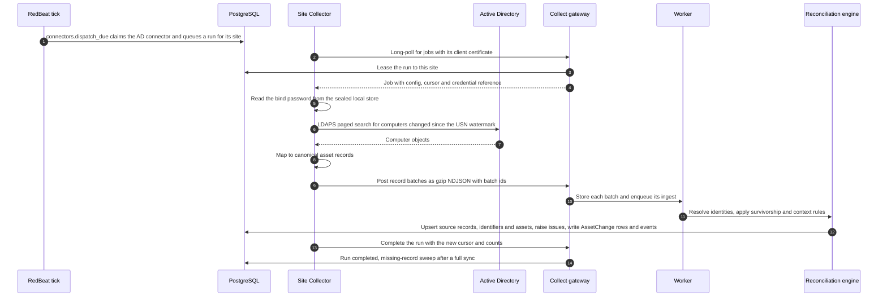

A CSV import follows the same path from the resolution step onwards, with a plan run first and an apply run on approval. A merge from the review queue runs inside the engine under the tenant lock and returns an undo link.

### 9.3 Data model changes

| Entity | New / changed | Key fields | Relations | Phase |
|---|---|---|---|---|
| `Asset` | Changed | `asset_type` as VARCHAR with a CHECK constraint, adding `ot_device` and `cloud_resource` (P0). Identity summary: `hostname`, `fqdn`, `primary_ip`, `serial_number`, `manufacturer`, `model`, `os_family`, `os_name`, `os_version`, `is_virtual`, `cloud_account_id`, `cloud_region`, `asset_subtype`. Context: `environment`, `exposure_level`, `crown_jewel`. Reconciliation: `reconciliation_state`, `merged_into_id`, `first_seen_at`, `last_seen_at`, `source_count`, `field_provenance`, `locked_fields`. Ownership: `owner_person_id`, `custodian_person_id`, `criticality_inherited`, `criticality_effective` | Tombstone to survivor; DirectoryPerson. `owner_id`, `integration_source`, `external_id` and `raw_metadata` are kept | P0, P1 |
| `BusinessProcessAsset` | New; replaces `BusinessProcess.asset_ids` | `dependency`, `source`, plus §8's link-table shape | BusinessProcess, Asset | P0 |
| `AssetDependency` | New; replaces `Asset.serves_asset_ids` | `relation` (`serves`), `source`, plus the link-table shape | Support asset to primary asset | P0 |
| `Connector` | New; replaces `ScannerConnector`; shared with §10 | `provider` (namespaced), `config`, `credential_ref`, `execution_site_id`, `create_policy`, schedule, `cursor`, `last_sync_at` claim | CollectorSite, ConnectorRun | P0 schema, P2 SDK |
| `ConnectorRun` | New; replaces `ScanJournal`; shared | `run_type` (sync, full_sync, import_plan, import_apply, rollback, simulation), status, counters, `file_sha256`, cursors, `job_execution_id`, `api_client_id` | Connector (nullable for legacy journals), JobExecution (§13), AssetChange | P0 |
| `BusinessProcess`, `OrgEntity` | Changed | Process: criticality limited to four levels, `security_objectives`, `rto_seconds`, `rpo_seconds`, `mtd_seconds`, `name_ar`. Entity: `name_ar` | — | P1 |
| `AssetIdentifier` | New | `id_type`, `scope_key`, `value_norm`, `strength`, `active`, seen dates | Asset, AssetSourceRecord; partial unique index on active strong values per tenant | P1 |
| `AssetSourceRecord` | New | `source_type`, `source_key` (unique per connector), `match_status`, `match_confidence`, `normalized`, `payload_hash`, `raw_ref`, `missing_since` | Connector, Asset | P1 |
| `AssetChange`, `AssetMergeEvent` | New | Field, before, after, source; survivor, merged asset, moved items, `reverted_at` | ConnectorRun, Asset | P1 |
| `ReconciliationIssue`, `ReconciliationPolicy` | New | Type, status, score, evidence, fingerprint; precedence, thresholds, windows, auto-merge and auto-retire switches | Assets and source record; one policy per tenant | P1; policy UI P2 |
| `ImportMappingProfile` | New | Column map, defaults, locale | Connector | P1 |
| `DirectoryPerson` | New | UPN, e-mail, names in English and Arabic, department, directory id, personal-data flag | User (optional); Asset owner and custodian | P1 |
| `AssetContextRule` | New | Priority, `dsl_version`, condition, actions, enabled | Acts on assets | P1 |
| `AssetFrameworkScope` | New read model | Framework, applicability, basis, `computed_at` | Asset, Framework; built from §8's `ControlApplicability` | P1 |
| `CollectorSite` | New | Name, status, certificate serial and expiry, version, heartbeat, `revoked_at` | Tenant, Connector | P2 |
| `SoftwareProduct`, `SoftwareAlias` | New; shared catalogue rows have no tenant | CPE `part:vendor:product`; PURL type, namespace and name; observed-name patterns | Alias to product | P2 |
| `SoftwareInstallation` | New | `version_raw`, `version_norm`, `version_scheme`, kind, `cpe23`, `purl`, `is_present`, seen dates | Asset, SoftwareProduct, AssetSourceRecord | P2 |
| `CveApplicability` | New, global | CVE, origin (NVD, CNA, ADP; later OSV, CSAF), match criteria, version bounds | SoftwareProduct | P2 |
| `InferredExposure` | New | CVE, confidence, band, reasons, status | SoftwareInstallation; §10's `FindingOccurrence` | P2 |
| `Agent`, `AgentEnrollment`, `AgentPolicy`, `AgentRelease` | New | Certificate serial, version, ring, heartbeat, `revoked_at`; token hash, expiry, maximum uses; interval and collectors; signed build digest | An agent belongs to one Asset and reports as one source record | P3 |

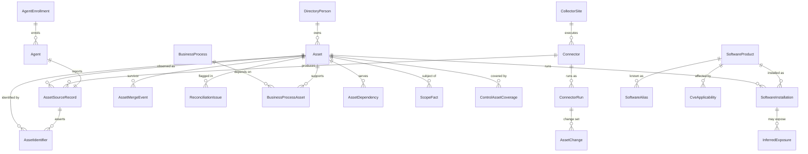

§8 owns `ScopeFact`, `ControlAssetCoverage`, `ControlApplicability.asset_id` and `EvidenceLink`, and §10 owns `FindingOccurrence`; inventory writes them through those chapters' services. §14 consolidates the model.

### 9.4 Interfaces

| Method | Path | Purpose |
|---|---|---|
| GET | `/assets` with `q`, `source`, `state`, `owner_missing`, `exposure_level`, `framework_id` | Server-side search and filters |
| GET | `/assets/{id}/sources`, `/identifiers`, `/software`, `/lineage`, `/scope`, `/context` | Provenance, identity, software, scope and GRC links of one asset |
| PATCH | `/assets/{id}` | Edit, including clearing and locking fields |
| POST | `/assets/{id}/merge`, `/assets/{id}/split`, `/asset-merges/{id}/revert` | Merge, split, undo |
| GET, POST | `/inventory/reconciliation/issues`, `/inventory/reconciliation/issues/{id}/resolve` | Review queue; bulk resolution allowed |
| GET, PUT | `/inventory/reconciliation/policy` | Tenant thresholds, precedence and windows |
| GET | `/inventory/import/template` | Bilingual template and its variants |
| POST | `/inventory/imports`, `/inventory/imports/{run_id}/commit`, `/inventory/imports/{run_id}/rollback` | Dry run (also the ApiClient push), apply, rollback |
| GET | `/inventory/imports/{run_id}/report` | Row-level report |
| CRUD | `/inventory/import-profiles` | Saved column mappings |
| POST | `/data/import/assets` | Deprecated shim over the import service |
| GET | `/connector-types` | Adapters and their JSON Schemas |
| CRUD | `/connectors`, filtered by `kind` (`inventory.*`, `ctem.*`) | Connectors of both blocks; `/vuln-import/connectors*` stays as an alias for one release |
| PUT | `/connectors/{id}/credentials` | Write-only credentials for platform-run connectors |
| POST, GET | `/connectors/{id}/test`, `/connectors/{id}/runs` | Test, run now, run history |
| CRUD | `/collector-sites`, `/agent-enrollments` | Sites (version, heartbeat, certificate expiry, run health) and enrolment tokens |
| GET, POST, PUT | `/agents`, `/agents/{id}/revoke`, `/agent-policies` | Agent fleet |
| CRUD, POST | `/inventory/context-rules`, `/inventory/scope-rules`, `.../{id}/preview` | Rules, with preview |
| GET, POST | `/inventory/software/unresolved`, `/inventory/software/aliases`, `/inventory/exposures/inferred` | Software curation and inferred exposures |
| mTLS | `collect.<domain>/collector/v1/{enroll, heartbeat, jobs, runs/{id}/records, runs/{id}/complete, renew}` | Site Collector machine API |
| mTLS | `collect.<domain>/agent/v1/{enroll, inventory, heartbeat, policy, renew, tuf}` | Agent machine API; enrolment uses a token |

**Service interfaces.** `AssetIdentityResolver.resolve()` takes a batch of records in plan or apply mode; the import service, the connector runtime, agent ingest and §10's finding ingest all call it. Every block that adds a reference to assets registers it in the asset reference registry with re-point and delete handlers. Writes to `ScopeFact`, `ControlAssetCoverage` and `EvidenceLink` go through §8's services, and inferred exposures through §10's ingest.

**Events** (X-08; catalogue in §12):
- assets: `asset.created`, `asset.updated`, `asset.identifiers_changed`, `asset.merged`, `asset.split`, `asset.stale`, `asset.retired`, `asset.context_changed`, `asset.scope_changed`, `asset.software_changed`;
- exposures: `exposure.inferred`;
- connectors, shared with §10: `connector_run.completed`, `connector_run.failed`;
- agents: `agent.enrolled`, `agent.revoked`.

Imports, connector runs and rule re-runs emit the asset events in batch form: one event per type per change set, referencing the `ConnectorRun` and its `AssetChange` rows. Per-asset events are kept for low-volume transitions such as manual edits, merges and splits. §10 consumes `asset.merged`, `asset.context_changed`, `asset.identifiers_changed` and `exposure.inferred`. §8 consumes `asset.updated`, `asset.scope_changed` and `asset.merged` for its read models; link re-pointing itself is synchronous (ADR-INV-04).

**UI changes.**
- **AssetsPage**: server-side search; columns for sources, last seen, effective criticality, exposure level and owner; import and bulk assignment; tabs for assets without an owner, stale assets and conflicts.
- **New asset page (`/assets/:id`)**: overview with provenance badges and field locks, business context, identity and sources, software, exposures (confirmed and inferred), compliance scope with reasons, risks and history. It finally calls the existing update and C/I/A API clients.
- **New pages**: import history; reconciliation inbox with side-by-side comparison; connectors with forms generated from JSON Schema, replacing the modal on `VulnerabilitiesPage`; collector sites; agents; software; rules.
- **AssetGraphPage**: editable entities and processes; dependency edges drawn on the graph.
- **Navigation and languages**: a new "Inventory" sidebar group, shown and guarded through §8 capabilities served by `GET /auth/me/capabilities`, which replace `ROUTE_ROLES` and the `Layout.tsx` role arrays; all text in English, Arabic and French, covered by the RTL Playwright suite (X-16).

### 9.5 Security, tenancy, Arabic/KSA and deployment considerations

**Tenancy and isolation.**
- The tenant comes from the user's Membership, from the connector row, or, for sites and agents, from the certificate's URI SAN; never from a payload (X-06).
- Every new tenant table is under RLS (X-05; policies counted in §13). `SoftwareProduct` and `SoftwareAlias` mix shared rows (no tenant) with tenant rows: tenants read rows where the tenant is null or their own, and only the `grc_platform` role writes shared rows. `CveApplicability` is global and read-only for tenants, and catalogue syncs are platform jobs that tenants cannot trigger (§11 removes tenants' write access to shared catalogues, TEN-03).
- Strong identifiers are unique per tenant, so matching never crosses tenants. Reconciliation also takes a per-tenant advisory lock.
- Asset reads and writes follow §11's entity scoping and owner perimeter (P1, T1.1). Quotas on assets, connectors and collector sites come from §11's licence model.

**Credentials and egress.** Platform-run credentials are envelope-encrypted under the tenant's key (X-10, §13). Site-run credentials stay in the site's sealed store. In SaaS, connectors cannot reach private, link-local or metadata addresses, which reverses today's permissive default (§13 makes the P0 change, PF-02). DNS results are pinned, redirects are not followed, and outbound hosts are allow-listed by the egress proxy (X-07).

**Ingestion and poisoning.** Every channel enforces size and decompression caps, schema validation, Valkey rate limits and idempotency keys. XLSX files with macros are refused, XML is parsed with defusedxml, and parsing runs only on the workers. An agent is bound to one asset: if it claims another asset's strong identifier, the engine raises an issue and moves nothing. A site can post records only for runs leased to it.

**Agent.** The agent is read-only by construction and uses short-lived certificates; its update keys never sit on platform hosts. An external penetration test precedes general availability.

**Audit and roles.** Automatic decisions are chained through `log_system_activity` with the run id, and each run writes one summary entry with its change-set hash to the audit trail (§12). Managing connectors, sites and agents is limited to tenant_admin and ciso through §8's capabilities.

**PDPL.** Collection is minimal. Personal fields (directory people, endpoint primary users) are flagged. Raw payloads are kept for 90 days. `DirectoryPerson` rows support export and erasure (DAT-06). KSA tenants' data stays in the Kingdom by default, in the KSA cell (principle P3 of §7.1, X-15), and raw directory data stays on the client's site.

**Arabic and KSA.**
- The template and the import report pair Arabic labels with English keys, use RTL sheets and take their messages from the i18n catalogue.
- For matching only (asset names, and the entity, process and person references in imports), the engine folds Arabic-Indic digits, normalises alef, ya and ta marbuta, removes tatweel and diacritics, and strips bidi control characters. IDNs are stored as A-labels, and Hijri-looking years are flagged.
- `DirectoryPerson`, `OrgEntity` and `BusinessProcess` carry Arabic names.
- Default scope-fact rules target OTCC, CCC-2:2024, DCC, CSCC, TCC, PDPL and ECC-2:2024. Inventory coverage is evidence for ECC-2:2024 2-1 and its classification sub-control 2-1-5 (numbering and wording to verify against the official text).
- Cloud assets carry their region, so rules can flag regulated data held outside the Kingdom.
- Schedules use the tenant's time zone (Asia/Riyadh by default) and off-peak windows.

| Concern | SaaS (KSA cell) | On-prem (compose, OVA, Helm) | MSSP |
|---|---|---|---|
| Cloud connectors | Workers, through the egress proxy from published IPs | Workers, through the client's proxy | Per client tenant |
| On-prem sources | One Site Collector per client network; private targets denied | Workers directly; a site only for isolated segments | One site per client tenant |
| Agents | `collect.<domain>` on the cell edge, or relayed by a site | The installation's own collect entrypoint | As SaaS; installer branded per tenant (signer is an open question) |
| Machine certificates | Platform PKI in OpenBao (X-10), whose seal is rooted in the cell's KMS or HSM (§13) | The installation's OpenBao PKI or the client's PKI; small installations may use a local CA at a stated lower assurance (X-10) | Platform PKI |
| Credentials | Envelope encryption under the tenant key; site-run credentials on the site | The installation's OpenBao | Partner connector templates instantiated per tenant, under the tenant's key (§11) |
| Catalogue data and agent updates | Platform jobs; TUF rings | Signed offline bundles | Shared catalogue |
| Schema | Alembic jobs (X-04) | Same Alembic path, which ends the seed drift (DAT-04) | Same |

### 9.6 Migration from today's code

| Today's code | Action |
|---|---|
| `backend/app/models/asset.py`, `org_unit.py` | Extend as in §9.3. The JSON `asset_ids` and `serves_asset_ids` lists become link tables, served through the dual-read shim for one release (X-04) |
| `backend/app/models/scanner_connector.py`, `scan_journal.py` | Replaced by `Connector` and `ConnectorRun`, shared with §10 |
| `backend/app/services/scanner_import.py` | Asset matching calls `AssetIdentityResolver` (P1). `ingest_findings` evolves under §10. Nessus software plugins become software source records |
| `backend/app/services/scanner_connectors.py`, `easm_connector.py` | `_check_target`, `_client`, `_redact` and the EASM mapping engine move to `integrations/`. EASM discovery goes through the engine with host and IP in one record; its configuration is unchanged |
| `backend/app/services/vuln_scanner_scheduler.py` | Replaced by `connectors.dispatch_due` (§13), which keeps the optimistic claim |
| `backend/app/api/v1/endpoints/data_io.py`, `frameworks.py` | The asset import becomes a shim over the import service. Parsers move to `services/tabular_import.py`; the framework import behaves as before |
| `backend/app/api/v1/endpoints/assets.py`, `asset_graph.py` | New fields and sub-resources; PATCH can clear values; invalid enums return 422 instead of 500; deletes go through the registry; process links use the join table |
| `backend/app/services/directory_auth.py`, `nvd_sync.py` | The ldap3 helpers are shared with the AD adapter and login is unchanged. The NVD sync keeps `configurations` and runs as a platform catalogue job |
| Frontend: `AssetsPage.tsx`, `AssetGraphPage.tsx`, `VulnerabilitiesPage.tsx`, `endpoints.ts`, `DataActions.tsx`, `Layout.tsx`, `App.tsx` | Extend; the connector modal moves to its own page; new pages and a capability-driven navigation group (§8) |

**Data migration.**
- **P0, inside the SQLite → PostgreSQL migration (X-04).** Business-process asset lists and `serves_asset_ids` become `BusinessProcessAsset` and `AssetDependency` rows, and dangling ids appear in the migration report. Scanner connectors become `Connector` rows that keep their ids; §13 re-encrypts their secrets. Scan journals become `ConnectorRun` rows, with the connector inferred from the journal name where possible.
- **P1, as an explicit Alembic data-migration job.**
  1. Every asset gets a `legacy` or `easm` source record.
  2. Identifiers are taken from `name`, `external_id` and `location`, but only values shaped like an IP address, hostname or FQDN; values from `location` are weak. An EASM host and its IP join one source record.
  3. A plan-mode reconciliation turns duplicates (EASM twins, CSV re-imports) into review issues, never into automatic merges.
  4. Process criticality is mapped to four levels.

The live database held about 11 assets at its last asset migration, so the data risk is low. On-prem appliances follow the same Alembic path.

**Compatibility.** `/assets` and `AssetOut` only gain fields, and now return the provenance columns. `owner_id` stays mandatory for manual creation; collected assets without an owner go to the owner queue. `/data/import/assets` keeps its response shape but becomes idempotent, a deliberate and documented change. `/vuln-import/connectors*` stays as an alias for one release. Elite gating of inventory features remains until §11's licence model decides packaging.

### 9.7 Delivery by phase

Sizes: S ≤ 2, M 2–6, L 6–12, XL > 12 person-weeks. Rows marked "—" are counted in the chapter named.

| Phase | Deliverable | Size | Depends on |
|---|---|---|---|
| P0 | Asset model corrections: reference registry with delete clean-up, PATCH can clear fields, `asset_type` as VARCHAR with CHECK, 422 on invalid values | S | Alembic baseline (§13) |
| P0 | Inventory link and connector tables in the SQLite → PostgreSQL migration: `BusinessProcessAsset`, `AssetDependency`, `Connector`, `ConnectorRun`; connector-row migration; dual-read shim | S | Migration tooling (§13); link-table shape (§8) |
| P0 | Connector-secret re-encryption (§13); SaaS denial of private targets (§13, PF-02); scanner, feed and CVE loops on the worker tier (§13) | — | — |
| P1 | Identity and source schema (`AssetIdentifier`, `AssetSourceRecord`, `AssetChange`, `AssetMergeEvent`, `ReconciliationIssue`, `ReconciliationPolicy`, `ImportMappingProfile`) and backfill | M | PostgreSQL and Alembic |
| P1 | Reconciliation engine v1: continuity, strong and correlation keys, scoped weak keys, vetoes, issues, merge and undo service | M | Identity schema |
| P1 | Scanner and EASM matching through identifiers, which ends twin assets | S | Engine v1; §10 ingest seam |
| P1 | Channel 1: tabular parser, bilingual template, dry run, idempotent upsert, history, rollback, push, legacy shim | M | Engine v1; worker tier and storage (§13); ApiClient and idempotency (§12 E1.5a); the push route adopts the full ingestion contract in P2 (§12 E2.5) |
| P1 | Asset page and editing, import wizard, owner queue, review inbox v1 | M | Channel 1 |
| P1 | Business context v1: process links, process C/I/A and BIA, inheritance, `crown_jewel`, `DirectoryPerson` (manual or CSV), context rules v1 | M | Identity schema |
| P1 | Asset `ScopeFact`s, `ControlAssetCoverage` writer, `AssetFrameworkScope` | S | §8 ScopeFact, applicability engine and ControlAssetCoverage |
| P1 | Asset entity scoping and owner perimeter (§11, T1.1) | — | — |
| P2 | Connector framework: SDK, runtime, generalised dispatcher, JSON-Schema forms, credential references, contract-test harness | M | Worker tier and `secret_box` v2 (§13) |
| P2 | Site Collector with its `grc-collector` image and OVA, collect gateway (Traefik entrypoint and machine API), enrolment, renewal, deny list | M | Framework; OpenBao PKI engine and signed image pipeline (§13, PF-17) |
| P2 | LDAP sign-in relay through the Site Collector for SaaS tenants | S | Site Collector; §12 SSO broker |
| P2 | Wave 1 connectors: AD, Entra ID, Intune, vCenter | L | Framework, Site Collector |
| P2 | Wave 2 connectors: Wazuh, GLPI, Azure, AWS | L | Wave 1 patterns |
| P2 | Reconciliation v2: scoring, merge and split UI, stale and retirement detection, policy UI, directory owners, context rules v2 | M | Wave 1 |
| P2 | Software model, normaliser, CPE dictionary sync, alias curation, Nessus software plugins | M | Identity schema |
| P2 | Applicability sync, CVE matcher, inferred-exposure hand-off | M | Software model; §10 FindingOccurrence |
| P2 | Inventory evidence for ECC-2:2024 2-1 and inventory metrics for KRIs | S | §8 evidence and KRI registry |
| P2 | CTEM adapters on the SDK and their Site Collector packaging (§10); OpenBao PKI engine, the signed image pipeline that builds the `grc-collector` image and OVA (PF-17), and `ConnectorRun` partitioning (§13); tenant fairness (§11) | — | — |
| P3 | Agent v1 for Windows, Linux and macOS: enrolment, mTLS, spool, signed packages, TUF updates | XL | Collect gateway; signing keys (§13) |
| P3 | Fleet UI and API, update rings, relay through the Site Collector | M | Agent v1 |
| P3 | osquery-assisted mode (client-installed) and Fleet connector | S | Agent v1; legal sign-off |
| P3 | Distribution- and advisory-aware matching (OSV, CSAF/VEX, OT vendors) | M | CVE matcher |
| P3 | Scale and hardening: partitioning of installation and exposure tables, load test at 100k assets and 10M installations, external penetration test of agent and ingress | M | All of the above |
| P3 | Partner fleet view and connector templates (§11) | — | — |

Subtotals (midpoints S = 1.5, M = 4, L = 9, XL = 16; approximate):
- **P0:** about 3 person-weeks. Overall coverage reaches 63% (R3 strong); R6 stays partial.
- **P1:** about 23 person-weeks. Coverage reaches 81% (R1, R2, R8 strong; 75% unless redistribution rights are cleared or the committee decides that reference mode meets R1). R6 stays partial, but channel 1 and business context are strong and the one asset view is in place for imports.
- **P2:** about 41 person-weeks. Coverage reaches 88% (R7 strong, which relies on this phase's reconciliation, exposure context and inferred exposures), or 81% if R1 stays partial (§15.3). R6 stays partial: channels 1 and 2, the one asset view and software are strong, readiness for CTEM is partial, and there is no agent yet.
- **P3:** about 29.5 person-weeks. Coverage reaches 100% (R4 and R6 strong), or 94% if R1 stays partial (§15.3); the agent completes slide 10's third channel.
- **Total:** about 96.5 person-weeks.

### 9.8 Key decisions and risks

| ADR | Decision | Rationale |
|---|---|---|
| ADR-INV-01 | Extend `assets` as the golden record, with identity and source side tables | No existing link, index or RLS policy moves; the golden record becomes derived state that can be rebuilt from source records |
| ADR-INV-02 | Deterministic-first matching: typed keys, correlation rules, additive scores with tenant thresholds and vetoes, then a review queue; no machine learning in v1 | A false merge corrupts links from risks, audits and findings; the approach is explainable to auditors and cheap at 100k assets |
| ADR-INV-03 | Field-level survivorship by precedence, freshness and manual locks, with stored provenance | Explains every value, and collectors never overwrite context set by people |
| ADR-INV-04 | Reversible tombstone merges; references re-pointed synchronously through the asset reference registry, which covers the link tables of every block (X-04) | No window in which links point at a tombstone; every merge is audited and can be undone |
| ADR-INV-05 | A file import is a connector run, with a dry run by default and rollback through change sets | One matching path and one audit model for all channels; idempotent imports; moves identity work into P1 |
| ADR-INV-06 | Build our own connector SDK in `backend/app/integrations/`, generalising today's adapters, shared with §10 | The hard part is identity mapping, not moving data; Airbyte's platform (ELv2) and Singer taps (mixed licences, no identity model) do not fit; working code is reused |
| ADR-INV-07 | An outbound-only mTLS Site Collector fetches and maps on site, keeps on-prem credentials sealed locally and relays agents without terminating TLS | Banks refuse inbound access; the platform never holds AD or vCenter passwords; raw directory data stays on site |
| ADR-INV-08 | Our own read-only Go agent in P3; osquery is not bundled, with an optional mode that runs a client-installed osquery as a separate program and reads its JSON output | Clean licence (X-14), small footprint, our own signing and update chain, read-only by construction |
| ADR-INV-09 | Software identified by CPE 2.3 plus PURL; applicability from several sources; confidence bands, with only the high band promoted to §10 and flagged as inferred | NVD enrichment has narrowed (external source, to verify) and distribution backports defeat upstream ranges; banding keeps false positives out of automation |
| ADR-INV-10 | Machines use 30-day mTLS certificates from the platform PKI plus a deny list; `ApiClient` serves system-to-system pushes | Keys never leave the device, the tenant is bound into the certificate, and no CRL infrastructure is needed |
| ADR-INV-11 | Declarative JSON-DSL context rules (manual > import > rule > directory hint, preview before applying) and `DirectoryPerson` for owners without a login | No tenant code runs in SaaS, every effect is audited, and collected assets cannot satisfy an owner that must be a user |

This chapter also applies cross-cutting decisions where the design paper differed: the collect gateway is a Traefik entrypoint (X-07); the inventory link tables and the connector tables land in P0 inside the single migration (X-04); and SQLite fallbacks are dropped (X-03).

| Risk | Mitigation |
|---|---|
| A false merge corrupts GRC links | Vetoes, conservative thresholds, review queue, reversible merges, simulated first run |
| Bad identifiers: placeholder serials, cloned UUIDs, random MACs, DHCP, NAT | Blocklists, automatic demotion, scoped IP addresses, correlation keys |
| NVD enrichment narrowed (external source, to verify) and distribution backports cause missed or false matches | CVE record CNA and ADP data, then CSAF/VEX and OSV; backport factor; inferred label; confirmation by scanners or the hub through §10 |
| Millions of installation rows | Hash-based change detection, event-driven re-matching, batch events, partitioning, load test before P3 general availability |
| The agent becomes an attack path or a supply-chain risk | Read-only design, update keys in OpenBao or an HSM, TUF, rollout rings, external penetration test |
| Licence exposure: osquery, the WiX fee, ldap3 (LGPL) | ldap3 kept unmodified, dynamically imported, replaceable and excluded from compilation; osquery never bundled or linked, used only as a separate program through its JSON output; legal review; build-time tools with alternatives; SBOM and licence gates (X-14) |
| Vendor APIs change (Graph, Wazuh, GLPI, vSphere) | Isolated adapters, version probing, recorded-fixture contract tests |
| The Site Collector is a burden for clients, and SaaS LDAP sign-in depends on it | Container or OVA, signed automatic updates, health checks; not needed on-prem; OIDC or SAML recommended for SaaS tenants |
| The review backlog grows | Bulk actions, auto-resolution policies, ageing metrics, threshold tuning |
| PDPL exposure from directory and endpoint data | Minimal collection, personal-data flags, 90-day raw retention, export and erasure, KSA hosting, raw directory data kept on site |
| P0 slips and delays the import | P0 comes first (import needs the worker tier and storage); the legacy route keeps working |

**Open questions** (carried to §16.4):
1. Are owners modelled as `DirectoryPerson`, or must every owner be a licensed user?
2. Is retirement automatic or reviewed, and how long are retired assets kept?
3. Which in-Kingdom clouds follow AWS and Azure (Google Cloud Dammam, Oracle Jeddah and Riyadh, Huawei, operator clouds)? Each is about S on the SDK.
4. Should OT monitoring connectors (Nozomi, Claroty, Dragos, Tenable OT; proprietary platforms, API only) be added for OTCC?
5. In what order does the agent cover Windows, Linux and macOS?
6. Who curates the shared software-alias catalogue, and may names observed at tenants feed it?
7. Are Hijri dates converted or rejected?
8. Who signs white-label agents, and may clients use their own PKI?
9. Do inventory features stay in a paid tier under §11's licence model?

Settled here: events use the `asset.*` names that §12 adopts; merges re-point links synchronously (ADR-INV-04); and whether inferred exposures may change a control's status is §10's decision (ADR-CTM-11: not until confirmed).

## 10. Block 3 — CTEM connection

This chapter specifies the connector that BM-01 slide 13 says "does not exist off the shelf": the path by which exposures found by client-operated tools land in GRCEye's single data model (X-01) and change asset priorities, requirement statuses, risk likelihood and remediation work. It serves R7, answers slides 11–13 and applies BM-01-D04 (connect through a findings hub, never embed scanners); it also supplies the CTEM metrics of the MSSP portfolio (R4) and a machine ingestion API (R8). Today, GRCEye imports scanner files and four pull connectors into a vulnerability register whose findings match assets by exact string, carry no exploitation signal and change nothing downstream. In the target, a DefectDojo hub or a direct source feeds one ingest service that keeps per-asset occurrences, scores them with KEV, EPSS and business context, turns rule matches into requirement signals and risk likelihood, and opens SLA-tracked tickets mirrored in Jira or ServiceNow.

### 10.1 Current state in brief

§4.6 describes the vulnerability area and §6.4 rates it: R7 is partial, at the upper end of the band. Four things are worth keeping: one ingest seam (`ParsedFinding` → `ingest_findings` in `backend/app/services/scanner_import.py`) fed by Nessus, OpenVAS and CSV parsers and by scheduled Nessus, Qualys, Tenable.io and generic EASM pulls; a database claim per connector, an SSRF guard (`_check_target`) and error redaction (`_redact`); global NVD and CWE catalogues; and risk versioning and a compliance state machine that already accept a system actor.

The gaps are the steps of the worked example:
- **Identity.** Assets match only when a host name or IP equals an asset's name, external id or location; affected assets are a JSON list (DAT-01); the dedup key collapses unmatched hosts, blocks re-detection and never auto-closes (DAT-03).
- **Signals.** KEV flags only the 30 newest catalogue entries and never reaches a finding; EPSS is absent; priority is computed on request only.
- **Chain.** No code path leads from a finding to a requirement (DAT-02); scenario impact is a suggestion by documented design; residual risk ignores implemented controls (PRD-02).
- **Mobilise and validate.** No SLA, owner, Jira or ServiceNow; webhooks never fire and API tokens are model-only (PRD-01); "validation" is a human button.
- **Hygiene.** Connector secrets sit in clear (SEC-03), private targets are reachable by default, tenants trigger global catalogue writes (TEN-03), uploads stop at 2 MB, the UI create form returns 422 (PRD-04), loops run in web workers (RUN-01), and the module is Elite-gated.

### 10.2 Target design

Six principles govern the block:
1. **The hub holds raw data; GRC holds the meaning.** DefectDojo or a direct source keeps scanner output. GRCEye keeps a normalised projection plus what only it knows: scope, business context, priority, SLA, and the effect on requirements and risks.
2. **One ingest path.** Every source produces `CanonicalFinding` records for one `FindingIngestService`, which evolves from `ingest_findings`.
3. **Event-driven.** Ingest commits a change-set and its DomainEvents in one transaction; everything downstream consumes the outbox (X-08).
4. **Explainable.** Every score, match and due date stores its inputs and the policy or rule version that produced it.
5. **One owner per state machine.** This block decides what an exposure means (priority, rule matches, SLA). Block 1 (§8) decides what happens to requirements and risks, as non-destructive overlays and versioned changes (X-12).
6. **Connected, never embedded.** Scanners, hubs, validation tools and ITSM are client-operated and reached over APIs or files. Under X-14, copyleft tools are reached only over the network or through file formats, and an LGPL library is used only when unmodified, dynamically imported, replaceable and excluded from compilation. GRC never runs an exploit.

#### 10.2.1 Components

| Component | Type | Responsibility | Extends existing code or new |
|---|---|---|---|
| CTEM connector adapters | Plugins on the §9 connector SDK, `connectors` queue | Configuration, credential reference, cursor, paging, rate limit, mapping to `CanonicalFinding` | Extends `scanner_connectors.py`, `easm_connector.py` |
| DefectDojo connector | Adapter | Incremental pull of findings and endpoints per mapped product, nightly sweep, webhook hints, capability probe, scope export | New |
| Parsers | Worker-side library | Nessus (all CVEs and ports), OpenVAS XML, CSV; new Nuclei JSONL, SARIF 2.1.0, Prowler OCSF | Extends the parsers in `scanner_import.py` |
| Push ingestion API | API | ApiClient uploads under the §12 ingestion contract, streamed to storage, processed asynchronously | New `endpoints/ctem_ingest.py` |
| FindingIngestService | Service | Normalise, resolve identity through §9, fingerprint, correlate, MERGE, reconcile lifecycle, write change-set and events | Replaces the internals of `ingest_findings`; keeps the seam |
| Intel sync | Jobs on the `catalog` queue, `grc_platform` DB role | Full KEV, daily EPSS, targeted NVD, CWE/CAPEC, optional OpenCTI | Extends `threat_feeds.py`, `threat_watch_ingest.py`, `nvd_sync.py`, `mitre_cwe_sync.py` |
| PriorityEngine | Service and consumer | Per-occurrence explainable priority and exploitability under a versioned PriorityPolicy | Replaces `compute_impact_score` (`models/vulnerability.py:91-112`) |
| ControlImpactEngine | Service and consumer | Evaluate ControlImpactRules on change-sets and nightly; keep ControlImpactMatch with its explanation; open and clear signals through §8 | New |
| Exposure-to-risk contributor | Consumer | Maintain selector-generated ScenarioFinding links, supply exploitability, mark scenarios dirty | New; feeds §8 RiskRecalculation |
| SLA and ticket service | Service and hourly sweep | SlaPolicy, RemediationTicket, SLA states, verification, escalation | New; reuses `relance_rung` (`notification_generator.py:481`) |
| ITSM adapters | Adapters | Bidirectional Jira and ServiceNow synchronisation | New |
| Validation ingester | Service | Nuclei, DefectDojo `verified` and Caldera results → ValidationResult; re-test triggers | New (P3) |
| Scope service | Service | CtemScope membership, crown jewels, coverage, exports to the hub and scanners | New |
| Rollups | Jobs | Daily CTEM metrics; CTEM metrics for partner KPI snapshots | Extends `trend_snapshot_scheduler.py`, `dashboards.py` |
| Exposure UI | SPA | "Exposure" navigation group | Replaces `VulnerabilitiesPage.tsx` |

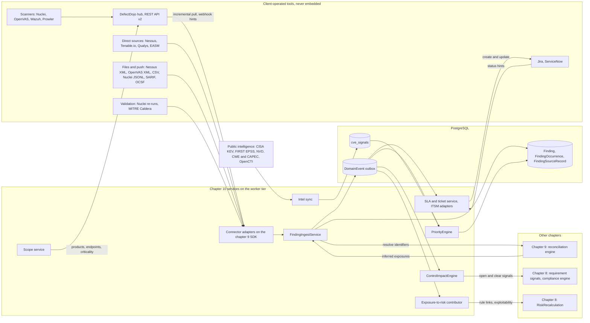

The block consumes contracts owned by other chapters without duplicating them:

| Contract | Owner | What this block does with it |
|---|---|---|
| Reconciliation engine (`AssetIdentityResolver`), AssetIdentifier, `exposure_level`, `crown_jewel`, `criticality_effective`, asset reference registry, InferredExposure | §9 | Resolves identifiers in batches; reads asset context; registers occurrences in the registry so that merges re-point them synchronously (ADR-INV-04); receives high-band inferred exposures |
| Connector, ConnectorRun, CollectorSite, SDK, Site Collector | §9 (X-13) | Ships its adapters on them |
| Requirement signal service (RequirementMapping closure, applicability, SoA) and its RequirementSignal entity, compliance engine service, AssessmentProposal, ScenarioFinding, RiskRecalculation, TenantGrcPolicy, ApprovalService, EvidenceLink, capability catalogue | §8 (X-12) | Opens and clears signals with evidence through the service; each RequirementSignal carries `control_impact_match_id`, through which its rule and occurrences are read; writes rule-sourced ScenarioFinding rows; supplies exploitability; registers its capabilities |
| KSA rule templates in ContentPacks | §8 (X-11) | Provides the rule schema and validator; the content team authors the templates |
| ApiClient, ingestion contract, event catalogue, webhooks, NotificationRules, audit trail v2 | §12 (X-08) | Registers the `ctem:ingest` scope, its event types and default notification rules |
| Membership, entity scoping, PartnerTenantLink, TenantKpiSnapshot, licence modules | §11 (X-06) | Applies entity scope to occurrences and tickets; publishes CTEM metrics for partners |
| Outbox relay, RedBeat, queues, Valkey, egress proxy, secret_box v2, StorageBackend, RLS | §13 (X-05, X-07, X-09, X-10) | Consumes |

#### 10.2.2 The five CTEM steps

Slide 11 places Scope in the GRC core and observes that none of the tools for the other steps speaks GRC, so scope and follow-up must live in the core. The table shows where each step lives in the target.

| CTEM step | What GRCEye does | Components in this chapter | Client-operated tools (licence) | Phase |
|---|---|---|---|---|
| 01 Scope | Decides which assets matter, from processes and inherited criticality; exports the scope | Scope service, CtemScope, coverage rules | DefectDojo (BSD-3-Clause) products and endpoints; scanner target lists | P2 (Tenable and Qualys tags P3) |
| 02 Discover | Ingests, never scans: hub pull, direct pulls, files, push; identity through §9; occurrence lifecycle | Adapters, parsers, push API, FindingIngestService; inferred exposures from §9 | Nuclei (MIT); ProjectDiscovery's subfinder, naabu and httpx (MIT, asset discovery through §9); OpenVAS/Greenbone (AGPL-3.0/GPL, files only); Wazuh (GPL-2.0, via hub or API); Prowler (Apache-2.0); Nessus, Qualys, Tenable.io (proprietary, client-licensed) | P2 |
| 03 Prioritise | Recomputes KEV and EPSS itself; scores each occurrence with business context | Intel sync, `cve_signals`, PriorityEngine, PriorityPolicy, CompensatingControlBinding | CISA KEV, FIRST EPSS, NVD; OpenCTI (Apache-2.0, optional) | P1 (v0), P2 |
| 04 Validate | Ingests proof of exploitability and triggers re-tests in the client's tools; never runs exploits | Validation ingester, ValidationResult, re-test orchestration | Nuclei (MIT), MITRE Caldera (Apache-2.0), DefectDojo `verified`, penetration-test reports | P3 (hub `verified` → `confirmed` in P2) |
| 05 Mobilise | Owns SLA and tickets across all sources; synchronises ITSM | SlaPolicy, RemediationTicket, ITSM adapters, escalation; notifications through §12 | Jira, ServiceNow (proprietary, client-licensed) | P2 |
| GRC link (slide 13 steps 03–04) | Requirement status and risk likelihood follow exposures | ControlImpactEngine → §8 signals; exposure-to-risk contributor → §8 RiskRecalculation | — | P2 |

#### 10.2.3 Findings hub and direct sources

DefectDojo (BSD-3-Clause) is the default hub, read over its REST API v2 (ADR-CTM-01). The pull is authoritative because DefectDojo's notification webhooks are experimental, carry a static header rather than an HMAC, and are disabled after repeated failures (external source, to verify). Four sync modes apply:
1. **Scheduled incremental pull.** The RedBeat (Apache-2.0) tick `connectors.dispatch_due` claims the connector with today's `last_sync_at` claim (§13). The adapter reads `GET /api/v2/findings/` per mapped product with `duplicate=false`, ordered by the instance's change timestamp, in pages of 500 with prefetching. The cursor keeps a 15-minute overlap, and keyed source records make re-reads harmless.
2. **Webhook hint.** A `scan_added` or `test_added` notification only enqueues a pull of the named test; its payload is never stored as data.
3. **Nightly sweep.** Active findings are re-read per product to detect deletions (`absent_since`).
4. **Optional write-back, off by default.** False positives and acceptances approved in GRC are pushed back to the hub.

A capability probe of `/api/v2/oa3/schema/` records each instance's filters and fields, and CI runs contract tests against pinned versions; every DefectDojo API detail in this chapter (filters, webhooks, roles, enrichment tiers, Jira mapping) is an external fact to verify against the pinned version.

| DefectDojo object | Lands in GRCEye as |
|---|---|
| Product type | Tenant (shared MSSP hub) or OrgEntity, claimed so that two tenants never map the same object |
| Product | HubScopeMapping to a BusinessProcess or application asset; `default_asset_id` covers findings without endpoints (SAST, SCA, cloud) |
| Engagement, test | ConnectorRun coverage unit; the test type ("Nuclei Scan") becomes the source tool |
| Finding | FindingSourceRecord → Finding and FindingOccurrence; `hash_code` and `unique_id_from_tool` kept for idempotency |
| Endpoint, endpoint status | Batch resolution by the §9 resolver (fqdn, IP, URL) plus `component_key`; per-endpoint mitigation honoured |
| `vulnerability_ids`, `cwe`, CVSS v3/v4, EPSS and KEV fields | FindingRef rows and source attributes; GRC recomputes EPSS and KEV from FIRST and CISA |
| `active`, `verified`, `false_p`, `risk_accepted`, `is_mitigated`, `out_of_scope`, `duplicate` | Lifecycle transitions (§10.2.4) |
| Jira issue mapping per finding | ExternalTicketLink in "adopt" mode, so no duplicate ticket is created |

**MSSP operation.** One DefectDojo per partner holds one product type per client. Each tenant connector uses a read-only DefectDojo account limited to its product type, mapping in GRC is default-deny, and a platform-scoped claim table stops two tenants from mapping the same hub object. Credentials for an on-prem hub stay in the Site Collector's sealed store (X-13).

**Direct sources** remain for clients without a hub, as adapters on the §9 SDK:
- Nessus files and API keep every CVE, port and exploit flag (today only the first CVE survives);
- Tenable.io moves to the vulnerability export API, which carries host, CVE, CVSS and state (today the adapter reads plugin aggregates only);
- Qualys adds Fixed detections and knowledge-base CVEs;
- OpenVAS stays file-only, because `python-gvm` is GPL-3.0 and is not linked;
- EASM discovery goes through the §9 reconciliation engine, which sets `exposure_level=internet_facing`;
- new parsers read Nuclei JSONL, SARIF 2.1.0 and Prowler OCSF;
- ProjectDiscovery's discovery tools (subfinder, naabu, httpx; MIT, external source, to verify), which BM-01 places under step 02, produce asset observations rather than findings. Their JSON Lines output is mapped to canonical asset records with the EASM adapter's field mapping, or pushed through §9's push channel (`inventory:import`), and the §9 reconciliation engine sets `exposure_level=internet_facing` for what they find from outside the client's network;
- Wazuh arrives through the hub, or through a direct API adapter in P3;
- the demo connector is limited to demo tenants.

Push ingestion (`POST /ctem/ingest/{connector_id}`) follows the §12 ingestion contract: an ApiClient with scope `ctem:ingest`, a mandatory idempotency key, gzip JSON or NDJSON up to 10 MB with larger files through upload sessions, and a 202 response carrying a ConnectorRun id.

#### 10.2.4 Finding identity, correlation and lifecycle

Under ADR-CTM-02, `Vulnerability` evolves, keeping its ids, into `Finding` (the definition), `FindingOccurrence` (finding × asset × component), `FindingSourceRecord` (one per source key) and `FindingRef` (every identifier).
- **Fingerprint.** `sha256(tenant | type | key)`, where the key is, in order: `cve:<id>` for one CVE; `cves:<sorted ids>` for several; the tool-native id (`nessus:`, `qualys:`, `nuclei:`, `prowler:`, `dd:`); otherwise the normalised title plus the first CWE. Every identifier also lands in FindingRef, so a Qualys QID carries its CVEs.
- **Occurrence key.** `asset_key` is the asset id, or `unresolved:<identifier>` when the §9 resolver cannot place the host, so the same CVE on 40 unknown hosts gives 40 occurrences. `component_key` is `tcp/443`, a URL path, `package@version` or `file:line`. Scanner and hub observations never create assets; unresolved occurrences re-match on `asset.identifiers_changed`.
- **Correlation.** A new source record attaches to an open occurrence on the same asset that shares a CVE, so a Nessus plugin and a Qualys QID for one CVE count once. The hub's own deduplication runs first.
- **Inferred exposures.** High-band software matches from the §9 CVE matcher arrive with `detection_method=inventory_inference` and a confidence. They are capped at priority band P2, enforce-mode rules ignore them, and a scanner or hub observation confirms and replaces them (ADR-CTM-11).

| State | Entered when | Authority |
|---|---|---|
| open | First seen; an acceptance expires; triage is reset | Any source |
| confirmed | Hub `verified`, analyst confirmation, or validation evidence | Hub, triage, ValidationResult |
| fixed | Hub `is_mitigated`; source state Fixed; absent from a complete run that covered the asset; verified re-test | ConnectorRun coverage |
| reopened | Seen again after fixed; the SLA keeps its original due date | Any source |
| risk_accepted | Approved SecurityException or RiskAcceptance through the four-eyes ApprovalService (ADR-COR-07); hub `risk_accepted` only if the tenant makes the hub the authority | GRC by default |
| false_positive | Triage with a justification (four-eyes for P1 and P2), or hub `false_p` | GRC or hub |

Hub `out_of_scope` findings are stored but excluded, duplicates are skipped, and an expired acceptance returns the finding to `open`, so nothing stays suppressed for ever.

#### 10.2.5 Exploitation signals and explainable priority

**`cve_signals`.** A global table holds, per CVE, the EPSS score, percentile and date, the KEV flag with its dates, required action and ransomware use, and exploit and threat-actor counts (ADR-CTM-03). Intel jobs on the `catalog` queue:
1. load the full KEV catalogue daily (today: the 30 newest entries), create stub CveEntry rows, and fetch any missing finding CVE from NVD by id;
2. load the FIRST EPSS file daily (about 300,000 CVEs, external source, to verify) by COPY and swap it in;
3. in P3, pull OpenCTI over TAXII 2.1 with `stix2` and `taxii2-client` (both BSD-3-Clause) for actor counts and KSA or sector relevance, and add Saudi CERT advisories as a regional source.

Only KEV changes and EPSS threshold crossings fan out, as a platform-scope `cve_signal.changed` event (null tenant, X-08) resolved through FindingRef. KEV stays mirrored in CveEntry for compatibility. GRC computes these signals itself because DefectDojo's own EPSS and KEV enrichment is a paid-tier feature (external source, to verify) and clients without a hub need them too; hub values remain source attributes. This is a deliberate reading of slide 13 step 02: the hub deduplicates and scores, and GRC flags KEV and EPSS.

**Priority** is computed per occurrence, because exposure and business value depend on the asset, under a versioned PriorityPolicy whose breakdown is stored with the score (ADR-CTM-04).

| Factor | Default (PriorityPolicy v1) |
|---|---|
| S severity | CVSS v4 base score, else v3.x, divided by 10; severity fallback |
| T threat | Highest of: KEV 1.0; validated exploitable 1.0; exploit maturity attacked 1.0, functional 0.8, PoC 0.6; min(1, EPSS / 0.10); OpenCTI "targets KSA or sector" 0.9 (optional) |
| L likelihood | 0.4·S + 0.6·T |
| A asset value | Crown jewel 1.0; otherwise the §9 `criticality_effective`, inherited from processes (critical 1.0 … low 0.25) |
| I impact | 0.4 + 0.6·A |
| X exposure | From the §9 `exposure_level`: internet_facing 1.0, dmz 0.9, internal 0.7, isolated 0.4, unknown 0.7; other levels are set in the policy |
| C compensating credit | min(0.5, Σ credit × effectiveness) over implemented, validated, unexpired bound controls; effectiveness from §8 |
| P and band | P = 100·L·I·X·(1 − C); P1 ≥ 70, P2 ≥ 45, P3 ≥ 20, else P4. Overrides: KEV with X ≥ 0.9 is at least P1; validated exploitable on a crown jewel is P1 |

Exploitability, the risk input, is `e = max(EPSS, 0.9·KEV, 0.95·validated, 0.6·PoC) × X × (1 − C)`; findings without a CVE use a band proxy (P1 0.3 … P4 0.01). CVE-2021-42013 on an internet-facing crown jewel gives S 0.98, T 1, L 0.99, I 1 and X 1, hence P 99, band P1 and e 0.94 (EPSS illustrative). Scores are recomputed on occurrence changes, `cve_signal.changed`, `asset.context_changed`, binding changes and policy changes; a policy change runs `simulate` first, then a bulk recompute.

#### 10.2.6 Control impact rules: exposure to requirement

Ownership is split three ways (ADR-CTM-05):
- **This block** owns ControlImpactRule (the rule language and its evaluation) and ControlImpactMatch (which occurrences satisfy a rule, with an explanation).
- **The §8 requirement signal service** expands the rule's target URN over the RequirementMapping closure and the applicability and SoA filter, and opens a RequirementSignal per affected control assessment (ADR-CNT-05). RequirementSignal is §8's entity: each signal carries `control_impact_match_id` and `source_kind=exposure_rule`; the rule, its version and the evidencing occurrences are read through the ControlImpactMatch (§8.3, §14.5), and this block never writes it directly.
- **The §8 compliance engine** applies the effective status, gap, action and automated evidence.

A rule is declarative JSON validated against a schema, with no expressions or code, so evaluation cost is bounded. Its condition families are `finding` (predicates on occurrence, finding and asset, plus a count or share of in-scope assets), `sla` (a ticket at risk or breached), `coverage` (in-scope assets not scanned within the cadence) and `validation` (a fixed P1 without a re-test). Rules target requirement URNs, which survive content revisions (X-11).

```json
{
  "key": "ksa.ecc2.2-10.kev-crown-jewel",
  "name_i18n": {"en": "Known-exploited vulnerability on an internet-facing crown jewel",
                "ar": "ثغرة معروفة الاستغلال على أصل حيوي مكشوف للإنترنت"},
  "target_urn": "urn:ngc:nca:ecc:2-2024:2-10-3",
  "when": {"occurrence.status_in": ["open", "confirmed", "reopened"], "finding.kev": true,
           "occurrence.priority_band_in": ["P1"], "asset.crown_jewel": true,
           "asset.exposure_level_in": ["internet_facing"],
           "occurrence.detection_method_not_in": ["inventory_inference"]},
  "aggregate": {"count_gte": 1},
  "effect": "non_compliant", "mode": "enforce",
  "propagate": {"relations": ["equal", "subset_of"]}
}
```

Templates ship in KSA content packs, authored by the content team (§8) with this block's validator; the team pins the exact sub-control in NCA's text, and tenants override mode and thresholds. The illustrative ECC-2:2024 set:

| Template | Condition | Target in ECC-2:2024 | Effect, default mode |
|---|---|---|---|
| 2-10 KEV | Open KEV P1 on an internet-facing crown jewel | 2-10 vulnerability-management requirement | Non-compliant, enforce after the burn-in |
| 2-10 SLA | A P1 or P2 ticket breaches its SLA | 2-10 remediation and tracking | Non-compliant, enforce |
| 2-10 coverage | Crown jewels not scanned within the cadence | 2-10 periodic assessment | Partially compliant, propose |
| 2-11 re-test | A P1 fixed with no re-test within 14 days | 2-11 penetration testing | Partially compliant, observe (from P3, with the `validation` rule family) |

Templates enforce only on framework revisions that carry the regulator's structure: `fidelity=official`, or `reference` when tenants load the official text themselves (NG-04). On the `paraphrase` revision that `ngc.legacy-library` installs, rows carry the target URNs by code but not the official meaning (seed row 2-10-3 reads "Subscribe to threat intelligence feeds and security advisories"), so templates run there in observe mode.

The same mechanism covers CCC-2:2024 (cloud findings from Prowler), OTCC (OT assets) and SAMA CSF through mappings. Downstream behaviour follows X-12:
1. **Overlay, never overwrite.** Effective status is the worse of the assessor's verdict and the signal. Assessor and auditor values are never written, and only draft, in-progress and under-review assessments are affected.
2. **Modes.** *Observe* shows a badge; *propose* creates an AssessmentProposal (ADR-COR-02); *enforce* applies the overlay.
3. **Evidence.** Each signal carries the match explanation and an automated evidence artefact linked through EvidenceLink.
4. **Clearing.** When the match clears (occurrences fixed or accepted, ticket closed), the signal clears, the gap resolves and the effective status reverts.
5. **One rule, every framework.** `equal` and `subset_of` mappings inherit the effect, for example to ISO/IEC 27002:2022 8.8 or the CSCC and CCC extensions of 2-10. `intersects` mappings get observe-only hints, so the SAMA CSF vulnerability-management control, mapped mostly `intersects` (§8.2.1), gets a hint unless an `equal` mapping is authored.
6. **Suppression.** Suppressing a match needs a time-boxed, hash-chained CISO justification.

#### 10.2.7 Exposure to risk

Exposure moves scenario likelihood, never impact, and never below the assessor's value (ADR-CTM-06). This retires today's suggested impact level (`vulnerabilities.py:192-207`) and answers the objection recorded in `TODO-KNOWN-ISSUES.md` §11.3, which was about overwriting the assessor's impact judgement.
1. **Links.** This block writes §8's ScenarioFinding rows with `source=rule`, generated from each scenario's ScenarioExposureSelector: by default, occurrences on the scenario's assets with band P2 or higher. In P3, CWE classes can be derived from the scenario's ATT&CK threats through CAPEC. Manual and incident links stay §8 APIs.
2. **Input.** Each occurrence carries its exploitability e with an explanation, and `finding.*` events mark the linked scenarios dirty.
3. **Computation (§8).** RiskRecalculation sets `probability_computed = max(assessed, map(E))` with thresholds from TenantGrcPolicy, recomputes the residual with the PRD-02 fix, writes a RiskVersion with a system origin and raises `risk.score_changed` and `risk.appetite_breached` (ADR-COR-05). Method v1 uses E = max e. This block recommends offering a v2, `E = 1 − Π(1 − e_i)` over the ten highest occurrences, because several independent exploitable paths are likelier than one (open question, §10.8).

With the default thresholds (e ≥ 0.6 → 5, ≥ 0.3 → 4, ≥ 0.1 → 3, ≥ 0.02 → 2), e 0.94 lifts an assessed likelihood of 2 to 5. When the occurrence is fixed, likelihood returns to 2 with a new version. A tenant can set its policy to propose rather than apply.

#### 10.2.8 Mobilisation: SLA and tickets

GRC owns the SLA and the ticket across every source and synchronises ITSM tools in both directions (ADR-CTM-07).

**SlaPolicy** (versioned):
- ordered rules on band, KEV, severity, crown jewel, exposure, finding type and entity, each giving `due_days`;
- `kev_mode`: `fixed_days`, `cap_at_cisa_due` or `ignore`. CISA due dates are set for US federal agencies (external source, to verify), so the KSA default is fixed days;
- `clock_start`: first seen, confirmed, or go-live for migrated rows;
- calendar: calendar days, or KSA business days with the Friday–Saturday weekend and tenant holidays, including the Hijri-dated Eids;
- the clock pauses while a finding is risk-accepted, and a band increase can only shorten `due_at`;
- illustrative defaults are 7 days for KEV on internet-facing assets, then 15, 30, 90 and 180 days for P1 to P4; tenants enter their own regulator-approved values.

**RemediationTicket** groups occurrences by finding and owning team. The owner resolves as asset owner → process owner → entity owner → tenant queue, using §9's DirectoryPerson for owners without a login. Ticket states are open, in_progress, blocked, resolved (awaiting verification), verified and closed; SLA states are on_track, at_risk, breached, paused and met. Today's automatic "Remediate:" AppliedControl becomes optional (kept on for migrated tenants) and is linked from the ticket; standing mitigations become compensating bindings.

**Jira and ServiceNow** adapters are bidirectional: Jira Cloud REST v3 and Data Center v2, and the ServiceNow Table API on `incident`, `sc_task` or Vulnerability Response items where licensed (external source, to verify). They call the REST APIs through `httpx` (BSD-3-Clause, already a dependency), with no vendor SDK.
- Outbound, the ticket reference is the idempotency key, templates are per tenant in Arabic, English or both, and host names and IPs can be redacted.
- Inbound, a webhook or business rule calls the hook endpoint, which checks a signature where the tool supports one and otherwise a path token plus an IP allow-list. The adapter then re-reads the issue, maps its status category and ignores echoes of its own updates.
- A polling fallback uses `updated >= cursor` (JQL) or `sys_updated_on > cursor`.
- An ITSM "won't do" never accepts risk: the ticket goes to `blocked` and needs a SecurityException.
- If DefectDojo already created the Jira issue, GRC adopts its key.

An hourly sweep emits `remediation_ticket.sla_at_risk` and `remediation_ticket.sla_breached`, which feed the escalation ladder, the `sla` rule family and the dashboards. A resolved ticket is verified by a later observation showing the fix, a `not_exploitable` re-test, or manual evidence from someone other than the resolver; re-detection reopens it.

#### 10.2.9 Validation

GRC never runs exploits (ADR-CTM-08, BM-01-D04). It ingests ValidationResult evidence from tools the client operates:
- **Nuclei** (MIT) JSONL through the push API or the hub. A match from a template on the tenant's validation allow-list (exploit-behaviour templates) counts as exploitable; detection and version templates only raise maturity to PoC.
- **DefectDojo `verified`** sets `confirmed`. It records analyst verification, not proof of exploitation.
- **MITRE Caldera** (Apache-2.0) results over its REST API v2. An ability tied to a CVE validates that occurrence; otherwise its ATT&CK technique validates the scenarios whose threats carry it (`Threat.mitre_ids`), with an exploitability input of 0.95.
- **Manual penetration-test evidence** for ECC 2-11.

GRC may trigger a re-test in the client's own tools: a Caldera operation, or a CI hook that re-runs the Nuclei template. Whether validation tools may ever run from the Site Collector is an open question.

#### 10.2.10 Scope and crown jewels

Scope is defined in GRC and exported, because the hub has no business context (ADR-CTM-10). A versioned CtemScope selects assets by process criticality, entity subtree, `criticality_effective`, `exposure_level` and tags, with includes, excludes, a cadence and an owner. The crown-jewel scope (`kind=crown_jewel`) selects the assets that carry the §9 `crown_jewel` flag (critical effective criticality, or set by hand), so crown jewels have one source of truth. Membership is materialised on `asset.*` events. It drives the `in_scope` priority flag, the rules' scope predicates, the coverage metric (an in-scope asset with no run inside its cadence) and the exports: DefectDojo products (`business_criticality`, `internet_accessible`, tags `grc-scope` and `grc-crown-jewel`) and endpoints, CSV or JSON target lists for scanners, and Tenable or Qualys tags in P3.

#### 10.2.11 The worked example end to end

The diagram traces slide 13 with illustrative identifiers (`bank.example` is a placeholder) and the outbox events of each step; §7.5 places the same example in the whole platform.

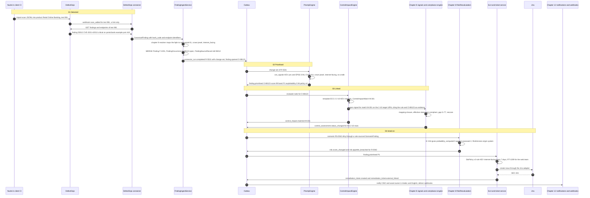

The reverse path closes the loop. When the client rescans and DefectDojo marks finding 55012 mitigated, ingest emits `finding.status_changed` for O-88123. RT-1209 is verified by observation (SLA met on day 5), M-301 and its signal clear, gap G-77 resolves, `probability_computed` returns to 2 with a new RiskVersion, and the adapter comments on SEC-431. Without a fix by day 7, `remediation_ticket.sla_breached` starts the escalation ladder and the 2-10 SLA template.

### 10.3 Data model changes

This block owns the entities below; §14 consolidates them with the rest of the model. Every tenant table carries `tenant_id NOT NULL`. ControlImpactRule is the exception: a shared-catalogue table (§14.1) whose NULL-tenant pack templates are written only by §8's installer under `grc_platform` and read by every tenant under the shared-or-own policy, next to the tenant's own rules and overrides.

| Entity | New / changed | Key fields | Relations | Phase |
|---|---|---|---|---|
| Finding (`vulnerabilities` renamed `findings`, ids kept) | Changed | `fingerprint` (unique per tenant), `finding_type`, title, `remediation_guidance`, severity, CVSS v3/v4 scores and vectors, EPSS and KEV attributes, `exploit_maturity`, aggregate status, `first/last_seen_at`, `validation_status`; legacy `impact_*` read-only | 1:N FindingRef, FindingOccurrence | P1 (KEV/EPSS columns), P2 (rename) |
| FindingOccurrence | New (replaces JSON `affected_assets`) | `finding_id`, `asset_id` (nullable), `asset_key`, `component_key`, unique (tenant, finding, asset_key, component_key), `org_entity_id`, `detection_method`, `confidence`, status, `first/last_seen_at`, `fixed_at`, `reopen_count`, `exposure_level`, `in_scope`, priority score, band, breakdown and policy version, `exploitability`, `sla_due_at`, `sla_state`, `acceptance_ref` | N:1 Finding, Asset | P0 (base link), P2 (full) |
| FindingControl | New (replaces `Vulnerability.fixed_by_controls` and `AppliedControl.vulnerability_ids`) | `finding_id`, `applied_control_id`, relation, source; §8 link-table shape | N:1 Finding, AppliedControl | P0 |
| FindingRef | New | `ref_type` (cve, cwe, ghsa, qid, nessus_plugin, nuclei_template, check), `ref_value` | N:1 Finding; joins CveSignal | P1 |
| FindingSourceRecord | New | `connector_id`, `external_key` (unique per connector), `external_hash` (DefectDojo `hash_code`), `source_status`, `absent_since`, `payload_hash`, `raw_ref` (object storage), `last_run_id` | N:1 FindingOccurrence, Connector, ConnectorRun | P2 |
| CveSignal (`cve_signals`) | New, global | `cve_id` PK, EPSS score, percentile and date, KEV flag, dates and action, `kev_ransomware`, `exploit_ref_count`, `ti_actor_count` | 1:1 CveEntry | P1 |
| CveEntry | Changed | Stub rows for KEV and finding CVEs; KEV columns kept as a mirror | 1:1 CveSignal | P1 |
| HubScopeMapping, `hub_object_claims` | New; claims are platform-scoped | `connector_id`, hub object type and id, `org_entity_id`, `business_process_id`, `default_asset_id`, `on_unresolved`; claims unique on (hub, type, id) | N:1 Connector | P2 |
| PriorityPolicy, CompensatingControlBinding | New, versioned | Weights, thresholds, overrides; binding = `applied_control_id`, selector, `max_credit`, `valid_until` | Policy version stored on each score | P2 |
| SlaPolicy | New, versioned | Ordered rules, `kev_mode`, `clock_start`, calendar, holidays | 1:N RemediationTicket | P2 |
| RemediationTicket, `ticket_occurrences` | New | `RT-n` reference, `grouping_key`, owner (user or DirectoryPerson), owning team, status, `due_at`, `sla_state`, `applied_control_id`, `verified_by` | N:M FindingOccurrence | P2 |
| ExternalTicketLink | New (shared with §8 action items) | System, `external_key`, URL, `external_status`, `sync_version`, mode (create or adopt) | N:1 RemediationTicket | P2 |
| ControlImpactRule | New, versioned | nullable `tenant_id` (null = pack template), `name_i18n` (JSONB map of display labels), condition document, `target_urn`, effect, mode, propagated relations | 1:N ControlImpactMatch | P1 (schema), P2 (engine) |
| ControlImpactMatch, `match_occurrences` | New | Rule and version, `target_urn`, scope assets, state (active, cleared, suppressed), explanation, `opened/cleared_at`, suppression justification | 1:N §8 RequirementSignal, which carries `control_impact_match_id` | P2 |
| ScenarioExposureSelector | New | `scenario_id`, asset scope, minimum band, CWE classes | Generates §8 ScenarioFinding rows (`source=rule`) | P2 |
| CtemScope, `ctem_scope_assets` | New, versioned | Selector, `kind` (standard, crown_jewel), `cadence_days`, owner; materialised membership | N:M Asset | P2 |
| ValidationResult | New | `occurrence_id`, tool, `method_ref`, outcome, `observed_at`, evidence reference and SHA-256, `attack_technique_ids` | N:1 FindingOccurrence | P3 |
| `ctem_rollups`, `finding_legacy_map` | New | Daily metrics by band, owner and scope; legacy id → finding and occurrence | — | P2 |

Written only through other chapters' services: Connector, ConnectorRun and CollectorSite (§9); RequirementSignal, `ControlAssessment.effective_status_key`, EvidenceLink and AssessmentProposal (§8); ScenarioFinding and `RiskScenario.probability_computed` (§8); TenantKpiSnapshot metrics (§11).

Physical design on PostgreSQL 16 (PostgreSQL License): FindingOccurrence and FindingSourceRecord are hash-partitioned on `tenant_id` (32 partitions) from creation, with partial indexes on open states `(tenant_id, status, band, sla_due_at)`, an index on `(tenant_id, asset_id)` and a unique key `(tenant_id, connector_id, external_key)` for source records; FindingRef is indexed on `(ref_type, ref_value)`.

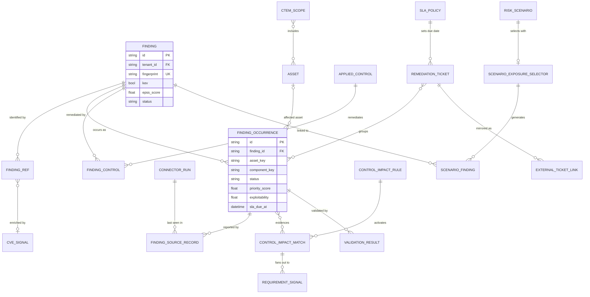

### 10.4 Interfaces

| Method | Path (under `/api/v1`) | Purpose |
|---|---|---|
| GET | `/findings`, `/findings/{id}` | Keyset list filtered by status, band, KEV, EPSS, asset, process, entity, scope, source and SLA state; full detail |
| POST | `/findings/{id}/transitions` | Confirm, false positive, risk-accept (with a SecurityException or RiskAcceptance reference), reopen |
| GET | `/finding-occurrences`, `/finding-occurrences/{id}/priority` | Occurrences by asset, ticket or scope; priority and exploitability explanation |
| POST | `/ctem/ingest/{connector_id}` | Push ingestion (scope `ctem:ingest`, idempotency key); 202 with a run id |
| POST | `/ctem/hooks/{connector_id}/{token}` | Inbound hints from DefectDojo, Jira and ServiceNow |
| GET, PUT | `/connectors/{id}/hub/objects`, `/connectors/{id}/hub/mappings` | Browse and map DefectDojo objects; connector CRUD, tests and runs are the shared §9 API |
| GET, PUT, POST | `/ctem/priority-policy`, `/ctem/sla-policy`, `…/simulate` | Versioned policies with dry runs |
| GET, POST, PATCH | `/ctem/compensating-bindings` | Compensating controls |
| GET, POST, PATCH, DELETE | `/ctem/control-impact-rules`, `…/{id}/simulate` | Tenant rules and overrides of pack templates; what-if |
| GET, POST | `/ctem/control-impact-matches`, `…/{id}/suppress` | Active matches with evidence; justified suppression |
| GET, PUT | `/ctem/scenarios/{id}/exposure-selector`, `/ctem/scenarios/{id}/exposure` | Selector; contributing occurrences and their exploitability |
| GET, POST, PATCH | `/remediation-tickets`, `…/{id}/transitions`, `…/{id}/external-links`, `…/{id}/retest` | Ticket lifecycle, ITSM links, verification |
| POST | `/ctem/validation-results` | Push exploitability evidence (P3) |
| GET, POST, PATCH | `/ctem/scopes`, `…/{id}/assets`, `…/{id}/export`, `…/{id}/push` | Scopes, export and push to the hub |
| GET | `/cve/{cve_id}`, `/ctem/intel/status` | EPSS, KEV and threat intelligence; feed freshness |
| GET | `/dashboards/ctem-exposure`, `-sla`, `-control-impact`, `-coverage` | Dashboards, exportable through `dashboard_export.py` including Arabic RTL |
| — | `/vulnerabilities/*`, `/vuln-import/*` | Deprecated façades for two releases |

Requirement signals, proposals and risk decisions are served by the §8 APIs.

**Events.** Names follow the §12 catalogue rule (`aggregate.event` in the past tense, CloudEvents envelope; X-08, ADR-ENT-07). Bulk ingest emits one run-level event that references a change-set table instead of one event per occurrence, and per-transition events only for low-volume changes; a nightly reconciliation repairs drift (ADR-CTM-09).

| Event | Producer → main consumers |
|---|---|
| `connector_run.completed` (with a change-set reference) | Ingest → PriorityEngine, ControlImpactEngine, rollups, §8 |
| `finding.opened`, `finding.status_changed`, `finding.prioritised`, `finding.validated` | Ingest, triage, PriorityEngine, validation → tickets, rules, §8 risk consumer, P1 notifications |
| `cve_signal.changed` (platform scope) | Intel sync → PriorityEngine |
| `control_impact.matched`, `control_impact.cleared` | ControlImpactEngine → notifications, webhooks, dashboards (the engine opens and clears signals by calling the §8 signal service directly in its worker transaction; §8 does not consume these events) |
| `remediation_ticket.created`, `.external_linked`, `.status_changed`, `.sla_at_risk`, `.sla_breached`, `.verified` | Tickets → ITSM adapters, escalation ladder, `sla` rules, webhooks |
| Consumed: `asset.merged`, `asset.context_changed`, `asset.identifiers_changed`, `exposure.inferred` (§9); `control_assessment.status_changed`, `risk.score_changed` (§8) | Re-score, re-match unresolved occurrences, inferred intake, dashboards; `asset.merged` serves only read models and caches, because the registry re-points occurrences in the merge transaction (ADR-INV-04) |

**UI.** A new "Exposure" group, shown and guarded through the §8 capabilities (`ctem.view` and the others in §10.5) that `GET /auth/me/capabilities` serves, holds an overview, a Findings list (asset column, KEV and EPSS badges, a band chip with a "why" breakdown, an SLA chip, bulk triage), a finding drawer (occurrences, sources, validation, tickets, matches, scenarios), a Tickets board, Connectors and runs with a DefectDojo mapping wizard, Policies and Rules with simulation and a bilingual requirement picker, and Scopes. Elsewhere, the §8 signal badge on AssessmentDetailPage links back to the match, RiskScenariosPage shows the contributors to `probability_computed`, AssetsPage and AssetGraphPage gain P1, crown-jewel and internet-facing overlays, and CvePage shows EPSS. P0 already fixes the create form's 422 with an asset picker and shows the links that today stay invisible. Every string exists in English, French and Arabic, and charts are RTL-safe.

### 10.5 Security, tenancy, Arabic/KSA and deployment considerations

**Tenancy and isolation.**
- Every tenant table of this block carries `tenant_id` and is isolated twice (X-05): by §11's TenantSession and by the §13 RLS policies; workers run under the transaction-local tenant setting. Partitioned tables carry RLS on the parent and refuse direct partition access.
- `cve_signals`, `cve_entries`, `cwe_entries` and `hub_object_claims` are platform-scoped and writable only by the `grc_platform` role; the mapping API claims hub objects through a service that runs as `grc_platform`. ControlImpactRule pack templates are shared-catalogue rows written only by §8's installer (§10.3).
- Writes to the global catalogues that every tenant reads become operator functions: §11's deployment modes take them out of tenant reach, and they run as catalogue jobs under `grc_platform` (the catalogue half of TEN-03, §6.5 item 2).
- Entity scope (X-06) applies through `org_entity_id` on occurrences and the owning entity of tickets. The §13 isolation suite covers every route of this block, including the push API and the hooks.

**Credentials and egress.**
- Connector credentials are stored with secret_box v2 under OpenBao (MPL-2.0) keys (X-10, §13; fixes SEC-03). They are write-only, never returned, and errors are redacted.
- All egress passes the Smokescreen (MIT) allow-list (X-07). The SaaS denies private, loopback and link-local targets, and private networks are reached only through the Site Collector, whose sealed store keeps on-prem source credentials (X-13). The on-prem appliance allows private targets.

**Inbound endpoints.** Each connector has a path token plus the DefectDojo static header, or an HMAC where the ITSM supports one, compared in constant time. Inbound payloads only trigger an API re-read and are size- and rate-limited. Push ingestion needs an ApiClient scoped to the connector (ADR-ENT-03).

**Parsing and storage.** Parsing runs in workers with `defusedxml` (PSF-2.0, already used), JSONL line limits and SARIF and OCSF schema checks. Uploads stream to the StorageBackend (X-09), so the 2 MB evidence cap no longer applies to scanner files. Raw artefacts are kept encrypted for 90 days, and plugin output, which can contain secrets, is stripped by default.

**Authorisation and audit.** The capabilities `ctem.view`, `ctem.triage`, `ctem.accept` (CISO), `ctem.rules.manage`, `ctem.policy.manage`, `connector.manage` and `ticket.manage` join the §8 capability catalogue (ADR-COR-06). Every automatic change runs as a system principal carrying its run, rule or policy version, and every run also writes a JobExecution record (X-16). A connector run writes one summary audit entry, while control-status, risk-score and acceptance changes get their own entries (§12 audit trail v2).

**Arabic and KSA.**
- Rule, SLA and scope names are bilingual `name_i18n` JSONB maps, and requirement text comes from content packs in official Arabic and English (X-11). CVE identifiers, requirement codes and host names are wrapped in left-to-right isolates in Arabic screens and PDFs (§8).
- Tool-generated finding titles are machine-translated through the tenant's AI configuration and labelled as such. KSA tenants' AI processing stays in the Kingdom by default, on in-region inference; an endpoint outside the Kingdom needs an explicit, audited opt-in by the tenant administrator and is refused for regulated tenants (X-18). Only definition text is translated, never occurrence data such as host names.
- Notifications use `notification_i18n.py` keys, ticket templates exist in Arabic, English or both, and the CTEM PDF goes through `pdf_arabic.py` with the bundled fonts (§8).
- The SLA calendar supports KSA business days, with the Friday–Saturday weekend and Hijri-dated holidays.
- Residency follows X-15: tenants subject to NCA, SAMA or PDPL keep findings in the KSA cell, intel downloads carry no tenant data, and an ITSM hosted outside the Kingdom receives minimised ticket content by policy.

**Deployment channels.**

| Aspect | SaaS (KSA cell) | On-prem appliance | MSSP |
|---|---|---|---|
| Cloud tools (Tenable.io, Qualys, Jira Cloud) | Workers call them through the egress proxy | Same, through the local egress proxy | Per-tenant connectors |
| On-prem tools (DefectDojo, Nessus, Wazuh, Caldera, Jira Data Center) | Through the Site Collector, which also relays hints; otherwise polling | Direct; private targets allowed | One Site Collector per client site |
| Credentials | secret_box v2; on-prem source credentials stay in the collector's sealed store | secret_box v2 with the install's key service (X-10) | Partner connector templates instantiated per tenant under the tenant's key (§11) |
| Threat intelligence | Online feeds | Online or, when air-gapped, a daily offline bundle (EPSS, KEV, NVD delta) signed with the dedicated intel-bundle key in OpenBao (X-10), not the image (cosign) key, and imported with the appliance CLI | Shared platform catalogue |
| Findings hub | Client's DefectDojo | Client's DefectDojo | One DefectDojo per partner, one product type per client, read-only account per tenant |
| Cross-tenant view | — | — | P3 partner portal reads consented TenantKpiSnapshot CTEM metrics; drill-down is an audited context switch (ADR-MSP-04) |

**Volumes and performance.**

| Item | Design point or target |
|---|---|
| Large tenant | 25,000 assets, 150,000 findings, 2 million occurrences over two years, 3 million source records; about 60 million occurrences platform-wide |
| Ingest | COPY into staging, then PostgreSQL `MERGE` in chunks of 5,000 with one commit per chunk, on the `connectors` queue; 100,000 records in under 5 minutes on one worker; a 5,000-record hub delta in under 1 minute |
| Hub paging | Pages of 500, concurrency 4, Valkey (BSD-3-Clause) token bucket, per-tenant semaphores (§11) |
| Enrichment | Daily EPSS by COPY and swap; only KEV changes and EPSS threshold crossings fan out; 10,000 occurrences re-scored in under 2 minutes |
| Read paths | Keyset pagination (max 500), dashboards on rollups, asynchronous exports; p95 under 500 ms on 2 million occurrences |
| Retention | Raw artefacts 90 days; fixed occurrences older than 24 months archived through `archiving_engine.py` |

**Third-party components.**

| Component | Licence | Mode |
|---|---|---|
| DefectDojo | BSD-3-Clause | REST API; containers only in CI contract tests |
| Nuclei and its templates | MIT | Output files, operated by the client |
| ProjectDiscovery subfinder, naabu and httpx | MIT (external source, to verify) | JSON Lines output mapped into §9's inventory, operated by the client |
| MITRE Caldera | Apache-2.0 | REST API v2, operated by the client |
| Prowler | Apache-2.0 | OCSF files or through the hub |
| Wazuh; OpenVAS/Greenbone | GPL-2.0; AGPL-3.0/GPL | Network API or files only, never linked |
| OpenCTI (optional) | Apache-2.0 Community Edition; the Enterprise Edition licence is separate and not needed (external source, to verify) | TAXII 2.1 |
| `stix2`, `taxii2-client` | BSD-3-Clause | Python libraries (P3) |
| FIRST EPSS data | FIRST usage terms, free with attribution requested (external source, to verify) | Daily file |
| CISA KEV data | CC0-1.0 or US public domain (external source, to verify) | JSON feed |
| NVD, CWE, CAPEC and ATT&CK data | Publishers' terms of use (external source, to verify) | API and files |
| Saudi CERT advisories | Publisher's terms of use (external source, to verify) | Advisory feed (P3) |
| Jira, ServiceNow, Nessus, Qualys, Tenable.io | Proprietary, licensed by the client | REST through `httpx` |

No CVSS calculator library is needed: scores come from the source or NVD, and the `cvss` package (LGPL-3.0) is not used. `python-gvm` (GPL-3.0) is not linked.

### 10.6 Migration from today's code

| File (under `backend/app/` unless stated) | Action |
|---|---|
| `models/vulnerability.py` | Becomes `models/finding.py`; the alias `Vulnerability = Finding` keeps the modules that import it (ten directly) working; `compute_impact_score` serves the legacy column only |
| `services/scanner_import.py` | Parsers move to `services/ctem/parsers/` and keep all CVEs, ports and exploit flags; `ParsedFinding` becomes the compatible `CanonicalFinding`; the internals of `ingest_findings` become `services/ctem/ingest.py` (MERGE), dropping the in-memory `_existing_dedup_keys`; `_build_asset_index` and `_match_asset` give way to the §9 resolver, which §9 already wires in P1 |
| `services/scanner_connectors.py`, `services/easm_connector.py` | Ported to SDK adapters with the same safety rails (`_check_target`, `_redact`); Tenable moves to the export API; Qualys gains Fixed detections |
| `services/vuln_scanner_scheduler.py` | Replaced in P0 by the `connectors.dispatch_due` tick (§13), keeping the `last_sync_at` claim |
| `models/scanner_connector.py`, `models/scan_journal.py` | Replaced by §9's Connector and ConnectorRun; secrets re-encrypted by §13 |
| `services/threat_feeds.py`, `services/threat_watch_ingest.py`, `services/nvd_sync.py` | Full KEV and `cve_signals`; stubs plus targeted NVD fetch; new `services/intel/epss_sync.py` |
| `api/v1/endpoints/vulnerabilities.py` (`_scenarios_for_vuln`, `set_vuln_scenarios`, `_suggested_impact_level`) | Replaced by §8's ScenarioFinding API plus this block's selectors; the impact suggestion is retired |
| `api/v1/endpoints/vuln_import.py` | Façade for two releases; upload becomes asynchronous; the Elite gate maps to a CTEM entitlement in §11's licence v2 |
| `api/v1/endpoints/webhooks.py`, `services/notification_generator.py` | CTEM event types and SLA ladder checks; the delivery engine comes from §12 |
| `frontend/src/pages/VulnerabilitiesPage.tsx`, `frontend/src/api/endpoints.ts` | Replaced by the Exposure pages; the old route redirects |
| Consumed, not changed here | `residual_risk.py:46` fix, compliance-engine extraction and the JSON-to-link ETL (§8); worker tier and importer (§13) |

**Data migration** happens in three windows.
- **P0, inside the SQLite → PostgreSQL migration (X-04).**
  1. Each `affected_assets` id becomes a base FindingOccurrence (first seen = `created_at`, last seen = `updated_at`, `detection_method=legacy`). Rows without an asset become `unresolved:<first affected system>` or `legacy:<id>`, and dangling ids go to the §8 link-migration report.
  2. `Vulnerability.fixed_by_controls` and `AppliedControl.vulnerability_ids` merge into one FindingControl edge.
  3. `vulnerability_impact_history` gets its missing `ON DELETE CASCADE`.
- **P1.** FindingRef is backfilled with every CVE, QID and plugin id of each row, then KEV, EPSS and priority v0 are computed.
- **P2, as an expand/contract migration run as an explicit job, never at boot (X-04).**
  1. `vulnerabilities` is renamed `findings` with ids kept, so the link rows written in P0 (§8's ScenarioFinding, this block's FindingControl) need no remap.
  2. The fingerprint derives from `ref_id`: a CVE gives `cve:`, `QID-n` gives `qualys:`, `EASM-` gives `easm:`, a numeric id takes its source family, otherwise the title. Duplicate fingerprints within a tenant merge into the oldest row, and `finding_legacy_map` re-points the link rows of merged duplicates.
  3. Statuses map as follows: `pending_validation` → open (triage pending); `validated` → confirmed; `in_remediation` → confirmed plus a ticket; `mitigated` and `closed` → fixed; `accepted` → risk_accepted, flagged for review because no acceptance record exists; `false_positive` is kept.
  4. Manual due dates and owners become tickets under the SLA version "legacy-manual"; `SCAN-REM-*` controls are kept and linked.
  5. The SLA clock of legacy rows starts at go-live to avoid a mass breach, and rule templates run in observe mode for a 30-day burn-in.

**Compatibility.** `/vulnerabilities` and `/vuln-import` remain façades for two releases: `affected_assets` is computed from occurrences, a status PATCH becomes a transition, and `/vuln-import/connectors*` aliases the §9 connectors API. The report builder, archiving engine, activity middleware and the `vulnerabilities` trend metric keep aliases. There is no SQLite runtime (X-03): dev and demo run the same PostgreSQL schema, partitions included.

### 10.7 Delivery by phase

Sizes use S ≤ 2, M 2–6, L 6–12 and XL > 12 person-weeks; subtotals use the midpoints S = 1.5, M = 4, L = 9 and XL = 16 and are approximate. Counted in other chapters: the worker-tier move of the scanner, feed and CVE loops, the re-encryption of connector secrets, the SaaS default-deny of private targets and the egress proxy (§13); the connector framework, Site Collector and connector-row migration (§9); RequirementSignal fan-out, the compliance engine service, the KSA rule templates and the risk and action-item hooks (§8); ApiClient, the ingestion contract, webhooks and notification rules (§12); the partner portal (§11).

| Phase | Deliverable | Size | Depends on |
|---|---|---|---|
| P0 | Hygiene on today's code: asset picker for the create form; affected assets, remediation control and scan journal shown in the UI; demo connector limited to demo tenants | S | — |
| P0 | Base FindingOccurrence and FindingControl link tables; import rules for `affected_assets`, `fixed_by_controls` and `vulnerability_ids`; impact-history cascade; ingest and `/vulnerabilities` switched to the new tables behind the dual-read shim for one release (X-04) | S | §13 PostgreSQL, Alembic baseline and importer; §8 link-table shape |
| P1 | Intel upgrade: full KEV, CveEntry stubs and targeted NVD fetch, daily EPSS into `cve_signals`, FindingRef backfill, KEV and EPSS on findings and the CVE page | M | §13 worker tier |
| P1 | Priority at ingest v0 on the legacy model, with an explanation endpoint | S | Intel upgrade; §9 business context v1 (falls back to today's business value) |
| P1 | ControlImpactRule schema and validator, shared with the content team for template authoring | S | §8 URN scheme |
| P2 | Finding, FindingOccurrence, FindingSourceRecord and FindingRef schema; Alembic migration; legacy data migration; façades | L | §13 Alembic and RLS; §8 link ETL |
| P2 | FindingIngestService: COPY and MERGE, fingerprint, correlation, lifecycle reconciliation, change-sets, events | L | Schema; §9 reconciliation engine; §13 outbox |
| P2 | SDK port of the adapters; Tenable export API; Qualys Fixed; Nessus all CVEs and ports | M | §9 connector framework |
| P2 | DefectDojo connector: pull, sweep, hints, mapping UI, status mapping, capability probe, contract tests | M | Ingest service, adapters |
| P2 | Push ingestion API with Nuclei JSONL, SARIF and Prowler OCSF parsers | M | §12 ApiClient and ingestion contract; §13 storage |
| P2 | Adapters runnable on the Site Collector; daily offline intel bundle signed with the intel-bundle key | S | §9 Site Collector; §13 OpenBao intel-bundle key (X-10) |
| P2 | Inferred-exposure intake | S | §9 CVE matcher |
| P2 | PriorityPolicy (versioned, simulate) and compensating bindings | M | Ingest service; §8 control effectiveness |
| P2 | ControlImpactEngine: evaluation, matches, signal hand-off, simulate | M | §8 signal service, compliance engine, KSA templates |
| P2 | Exposure-to-risk contributor: selectors, rule links, exploitability | S | §8 RiskRecalculation |
| P2 | SlaPolicy, RemediationTicket, SLA sweep and escalation | M | Ingest service |
| P2 | Jira connector, bidirectional | M | Tickets |
| P2 | ServiceNow connector, bidirectional | M | Tickets |
| P2 | CtemScope v1: crown jewels, coverage, DefectDojo and CSV/JSON exports | M | DefectDojo connector; §9 context fields |
| P2 | Exposure UI in Arabic, English and French | L | P2 back ends |
| P2 | CTEM dashboards v1 with rollups and exports | M | Ingest service, tickets, rules |
| P3 | Validation: ValidationResult, Nuclei allow-list, Caldera adapter, re-test orchestration, `validation` rule family | M | Ingest service, tickets |
| P3 | OpenCTI TAXII 2.1 and Saudi CERT enrichment; CAPEC-derived scenario selectors | M | Intel upgrade |
| P3 | Scope push to Tenable and Qualys tags; direct Wazuh API adapter | S | CtemScope |
| P3 | MSSP CTEM metrics in partner KPI snapshots; shared-hub onboarding | M | §11 Partner, PartnerTenantLink, partner portal |
| P3 | Scale hardening: MERGE tuning at platform scale, 1-million-occurrence performance gate, archiving of fixed occurrences | M | Ingest service |

| Phase | Subtotal (approx.) | R7 at phase end | Overall coverage at phase end |
|---|---|---|---|
| P0 Foundations and safety | 3 person-weeks | Partial | 63% (R3 strong) |
| P1 KSA core | 7 person-weeks | Partial, with KEV and EPSS on findings | 81% (R1, R2, R8 strong) |
| P2 Connect | 71.5 person-weeks | Strong: the worked example runs end to end | 88% (R7 strong) |
| P3 Scale | 17.5 person-weeks | Strong; validation (step 04) complete | 100% (R4, R6 strong) |

The coverage column assumes that R1 becomes strong in P1; unless redistribution rights are cleared or the committee decides that reference mode meets R1, the figures are 75%, 81% and 94% at the ends of P1, P2 and P3 (§15.3).

The block totals about 99 person-weeks. P0 and P1 are pulled forward on purpose: they need no hub, close security defects early and put KEV and EPSS on findings. P2 carries the hub-based chain and is the critical path; its start depends on the §8 signal and risk services and the §9 reconciliation engine being frozen at the end of P1.

### 10.8 Key decisions and risks

| ID | Decision | Rationale |
|---|---|---|
| ADR-CTM-01 | DefectDojo is the default hub, read by authoritative incremental API pull with webhooks as hints; direct sources are kept | Meets D04 with hundreds of parsers under BSD-3-Clause; experimental webhooks cannot be the system of record |
| ADR-CTM-02 | Vulnerability evolves into Finding, FindingOccurrence, FindingSourceRecord and FindingRef, keeping ids | Per-asset lifecycle, SLA and identity need an occurrence; kept ids spare §8's link ETL a remap |
| ADR-CTM-03 | A global `cve_signals` table recomputed daily from FIRST and CISA | Works with or without a hub; narrow and bulk-replaceable |
| ADR-CTM-04 | Priority and exploitability are explainable, per occurrence and versioned | Auditors must see why a finding is P1; impact and exposure depend on the asset |
| ADR-CTM-05 | This block owns rules and matches; requirement effects go through §8's signals as a non-destructive overlay | One owner per state machine; assessor judgement preserved; URN targets reach every mapped framework |
| ADR-CTM-06 | Exposure moves likelihood only, never below the assessor's baseline; §8 computes | Delivers "risk updated automatically" with versions and reversibility |
| ADR-CTM-07 | GRC owns RemediationTicket and SlaPolicy, syncs Jira and ServiceNow both ways and adopts hub-created issues | SLA must span hub and direct sources and ServiceNow |
| ADR-CTM-08 | Validation means ingesting evidence; GRC never executes exploits | D04 and the client's legal authorisation |
| ADR-CTM-09 | Bulk ingest emits run-level events with change-sets, plus per-transition events and a nightly reconciliation | One event per occurrence would flood the outbox |
| ADR-CTM-10 | Scope and crown jewels are defined in GRC and exported to the hub and scanners | Slide 11 puts Scope in the GRC core; hubs have no business context |
| ADR-CTM-11 | Inferred exposures enter as occurrences capped at priority band P2 and excluded from enforce rules until confirmed | Delivers slide 10 point 04 without false non-compliance |

Related decisions in other chapters: ADR-CNT-05 and ADR-CNT-06 (URN mappings, suggestion-first propagation with signal overlay), ADR-COR-02, ADR-COR-04 and ADR-COR-05 (proposals, link tables, computed residual), ADR-INV-04, ADR-INV-06, ADR-INV-07 and ADR-INV-09 (merges, SDK, Site Collector, banded inference), ADR-ENT-03 and ADR-ENT-07 (ApiClient, CloudEvents), ADR-PLT-05 (worker tier) and ADR-MSP-04 (partner snapshots).

| Risk | Mitigation |
|---|---|
| DefectDojo API drift (filters, EPSS, KEV and CVSS v4 fields, experimental webhooks) | Capability probe; CI contract tests against pinned versions; the pull stays authoritative |
| Weak asset identity produces wrong requirement or risk effects | Enforce rules require strong identifier matches; unresolved queue; 30-day observe burn-in |
| Mass downgrades and ticket floods at go-live | Simulate endpoints, SLA clock from go-live, grouping, per-run caps, staged enforce |
| Auditors contest automated non-compliance | Explanation and evidence on each signal, assessor values kept, justified suppression, hash-chained trail |
| Governance objection to automatic risk change | Propose mode, baseline floor, a RiskVersion on every move |
| ITSM synchronisation loops | Idempotency keys, version checks, echo filter, API re-read on every hint |
| Scale at about 60 million occurrences | Partitioning from creation, MERGE staging, rollups, 1-million-occurrence gate |
| SSRF or credential leak in multi-tenant connectors | Egress allow-list, default deny, Site Collector sealed store, envelope encryption |
| Cross-chapter contract drift (§8, §9, §12) on a P2 critical path | Versioned service contracts and event schemas frozen at the end of P1, with integration tests per contract |
| Terms of external data (EPSS, KEV, NVD, OpenCTI) | Legal check before redistributing them in offline bundles |

Open questions for §16.4:
1. **Default modes.** X-12 settles the overlay mechanism; should KEV templates default to enforce after the burn-in, as this block recommends?
2. **Scenario aggregation.** Maximum (method v1) or noisy-OR over the top ten occurrences (v2)?
3. **Hub operation.** DefectDojo open source per client, a shared instance per MSSP, or DefectDojo Pro?
4. **Ticket authority.** GRC-native tickets, or adoption of DefectDojo-created Jira issues by default; and which ServiceNow table?
5. **SLA defaults.** Do NCA or SAMA expect specific remediation windows?
6. **Acceptance authority.** Is risk acceptance authoritative in GRC or in the hub?
7. **Validation under D04.** May validation tools ever run from the Site Collector?
8. **Packaging.** Is CTEM a paid module, given that the deck counts paid features against a product?
9. **Data terms.** Do EPSS, KEV and NVD terms allow redistribution in offline bundles, and may ticket content leave the Kingdom?

## 11. Multi-entity, MSSP and white-label

This chapter designs the tenancy, partner, branding and licensing layers that serve R4 (many clients on one platform, strict separation) and R5 (rebrand, keep our code, resell as SaaS or through MSSPs); it also gives chapter 12 the memberships and verified domains that SSO, SCIM and ApiClients bind to (R8). It answers BM-01's R4 and R5 scoring rows, the deck's "multi-tenancy weak" and "branding paid" limits and the "MSSP multi-tenancy" and "white-label and commercial licensing" items of its still-to-build list (slides 14–15), and the "full commercial freedom" of Path C (slide 16). Today GRCEye separates tenants with per-query predicates over one tenant per identity, has no partner tier, ships a hard-coded brand and issues plan-only licences that cannot police resale. The target enforces the tenant boundary twice, gives each person one identity with memberships in many tenants, adds a consented, audited partner layer with an MSSP console and entity scoping, and turns brand, domain and licence into runtime data, so that one image set serves direct SaaS, partner-branded SaaS, MSSP-hosted and on-prem resale.

### 11.1 Current state in brief

GRCEye is a shared-schema multi-tenant SaaS (§5.3). `get_tenant_id` reads the tenant from the user's database row on 477 of 582 routes. Handlers add the predicate themselves; about 65 call sites in 14 files read `user.tenant_id` directly. There is no ORM-wide filter, no RLS and no isolation test (TEN-01). The fit-gap confirmed two findings that §6.5 treats as immediate safety items:
- three code paths that let one tenant read metadata or controls of another tenant's custom frameworks (§6.5 item 1);
- deployment-wide administrative functions, including writes to catalogues that every tenant reads, reachable by tenant-level roles rather than by a platform operator (§6.2, §6.5 item 2, TEN-03).

Each user belongs to one tenant, and e-mail is globally unique, so MSSP analysts and external auditors need one account per client. There is no partner tier, membership, tenant switcher or consolidated view (TEN-02). OrgEntity and BusinessProcess are perimeters, not access boundaries, and the risk API omits the entity fields (§4.2, PRD-04). `Tenant.is_active` is not enforced, and offboarding is a script.

The branding hooks (`logo_url`, `settings.branding`, `white_label`) have no consumer. The brand is hard-coded in 321 frontend and 82 backend occurrences, and in the palette, PDF theme, e-mail layout, TOTP issuer and AI persona. The gateway drops the original `Host`, so custom domains cannot work (§6.2 R5, PKG-03). Licences are plan-only (§5.5, PKG-02):
- revocation is not enforced;
- the vendor activation endpoint is missing;
- one activation row serves a whole install;
- the signing key sits on the internet-facing SaaS host; moving it off that host is a week-1 safety item (PF-02, §6.5 item 8).

Quotas and trial expiry are not enforced. R4 is partial. R5 is strong on the deck's licence-only bar (as BM-01 rated Probo), but runtime white-label is missing (§6.1).

### 11.2 Target design

**Principles.**
1. **The tenant is the hard boundary.** It is enforced in the ORM and in PostgreSQL, and both layers fail closed (X-05). An OrgEntity is a soft boundary, enforced in the application (X-06).
2. **One identity, many memberships.** Authorisation uses the membership in the tenant being acted on, never token claims.
3. **Partners see consented numbers, not raw data.** Drill-down is an audited switch into the tenant.
4. **Every cross-tenant action is recorded twice:** in the actor's chain and in the client's chain.
5. **Brand, domain and licence are runtime data.** They are resolved from the host first, then from the context. No resale model needs a rebuild.
6. **One server-side entitlement chain:** plan → partner ceiling → tenant override → licence or allocation.

| Component | Type | Responsibility | Extends / new |
|---|---|---|---|
| TenantContext resolver | FastAPI (MIT) dependency and contextvar | Principal (§12) plus validated `X-Tenant-Id` → tenant, membership, roles, org scope, partner, cell; status, link, grant and IdP/MFA checks; 60 s Valkey cache | Extends `dependencies/auth.py` (`get_tenant_id` becomes a wrapper) and `services/authz.py` |
| TenantSession | SQLAlchemy (MIT) events in `core/tenancy.py` | Loader criteria (strict or shared-readable), flush guard, tenant setting for the RLS layer of §13, engine per cell, `TenantTask` base class | Extends `core/database.py`; new `core/tenancy.py` |
| Membership service | Service and API | Memberships, invitations, roles, expiry, org scope, accepted IdPs, VerifiedDomain proofs | New; reuses `users.py` and the access-governance patterns |
| Entity scope | ORM mixin and closure table | `EntityScoped` read criteria and write checks from the membership's org scope | Extends `services/perimeter.py`, `models/org_unit.py` |
| Partner service | Service and API | Partners, partner staff, PartnerTenantLink consent, delegated memberships, JIT and support AccessGrants | New |
| Platform console | API and SPA | Partners, tenant lifecycle, cells, lockbox, licences v2 | Extends `admin.py`, `SuperAdminPage.tsx` |
| Partner (MSSP) console | API and SPA shell | Portfolio, provisioning, staff, rollouts, fleet view, reports, audit, licence pool, branding | New `PartnerLayout` and `/partner` routes |
| Lifecycle workers | Celery (BSD-3-Clause) tasks on the §13 worker tier | Provisioning, suspension, export, offboarding, tenant moves | New; replaces `scripts/cleanup_expired_test_tenants.py` |
| KPI snapshot job | Celery, one run per tenant | `TenantKpiSnapshot` computed inside each tenant from a governed metric catalogue | Reuses the `dashboard.py` and `dashboards.py` aggregations |
| Fairness and quotas | Valkey (BSD-3-Clause) semaphores; entitlement resolver | Per-tenant task semaphores, dedicated tenant queues, limit classes for the §12 limiter, `require_quota` | Extends `dependencies/features.py`, `models/subscription.py` |
| Brand service | Backend module | BrandingProfile inheritance, host resolution, BrandContext for e-mail, PDF, TOTP, AI persona and links; router list for the edge | New `core/brand.py` |
| SPA brand runtime | React (MIT) provider | CSS variables, favicon and title, i18n brand variables, tenant switcher, acting-for banner | Extends `main.tsx`, `Layout.tsx`, `tailwind.config.js`, `i18n/index.ts`, `api/client.ts` |
| Custom-domain routing | Dynamic routers for the Traefik v3 (MIT) edge of §13; on Kubernetes (Apache-2.0) cells, certificates issued by cert-manager (Apache-2.0), to verify (§13) | One router and one ACME certificate per verified, active domain; original `Host` forwarded | New router provider; the edge itself is §13 (X-07) |
| Licence client and entitlement chain | Middleware and resolver | v2 verification by `kid`, CRL, ceilings per deployment mode, verdict cached in Valkey | Extends `license_middleware.py`, `license.py`, `subscription.py` |
| Licence v2 issuance | Functions of the Licence Authority, which runs on a separate, isolated host, not on the internet-facing SaaS host (§13, X-10) | v2 payloads, pools, allocations, signed CRL, offline challenge-response | Extends `licensing.py`, `license_server.py` |
| Usage metering | Daily Celery job | Fills `TenantUsageSnapshot` (tenant_id, snapshot_date, metric_key, value) per tenant and metric; partner statements | New job; adds metrics to the §13 table |

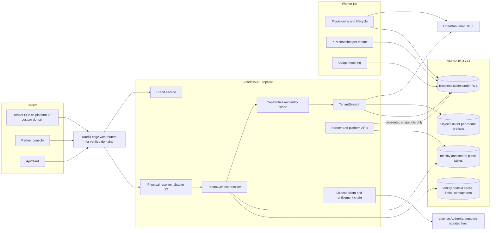

#### 11.2.1 Identity, memberships and tenant context

The hierarchy is Platform → Partner (MSSP, reseller, distributor or audit firm) → Tenant → OrgEntity → BusinessProcess → Asset. The Principal of §12 (browser session, ApiClient, system task, token holder or mTLS machine) is resolved first. Tenancy then maps it to these records:

| Record | Role in tenancy |
|---|---|
| User | One identity per region; `users.tenant_id` becomes a nullable `default_tenant_id`; e-mail unique within the region |
| Membership | User × tenant with roles, excluded and custom roles, org scope, status, expiry, accepted IdPs and MFA requirement. Kinds: `direct`, `partner_delegated`, `platform_support` (opened only by an AccessGrant), `system` (batch actors and ApiClient service users, ADR-ENT-03) |
| PartnerMembership | Partner staff roles inside their own partner |
| PlatformRoleAssignment | Operator staff; no tenant data access except through a tenant-approved AccessGrant (lockbox, X-06) |
| CollectorSite | Bound to one tenant by its certificate (X-13) |

**Context resolution.** On tenant routes, the tenant comes from `X-Tenant-Id`. Without the header, the default tenant applies, or else the user's only membership. Each request checks that:
- the membership is active and unexpired, and the tenant is `active`;
- for a delegated membership, the link is active and the roles stay within the link's ceiling;
- for JIT and support access, an approved AccessGrant window is open;
- the session meets the membership's IdP and MFA policy. If it does not, the answer is 401 `step_up_required`.

The resulting `TenantContext` (tenant, membership, roles, org scope, partner, cell) lives in a contextvar and is cached in Valkey for 60 s. Changes to a membership, link or grant invalidate the cache through pub/sub, so a revocation takes effect at once. Partner routes resolve a PartnerContext from the caller's PartnerMembership instead. Users with one membership send no header and see no change.

**Authorisation.** `require_roles` and the §8 capability layer (ADR-COR-06) evaluate two context fields:
- `ctx.roles`, still computed by `get_effective_roles` from the membership, groups, custom roles and delegations;
- `ctx.org_scope`.

The `tenant_admin` auto-pass becomes a membership role. `super_admin` loses its auto-pass on tenant routes and in `require_feature`.

**Identity providers.** An IdentityProvider belongs to a tenant, a partner or the platform (§12). Two tenancy rules bound it:
- It provisions users just in time only on domains its owner has proved through a VerifiedDomain (DNS TXT).
- A login through tenant A's IdP opens tenant B only if B's membership accepts that IdP.

These rules replace today's refusal of cross-tenant e-mails in `sso.py`, without letting any IdP take over a global identity.

#### 11.2.2 Isolation beyond row-level security

X-05 enforces the row boundary twice, and the two layers have different owners.

**Application layer (this chapter).** `core/tenancy.py` adds a `TenantScoped` mixin in two forms: `strict`, and `shared_readable` for built-in frameworks, threats, matrices, scales and feeds.
- A `do_orm_execute` hook adds loader criteria on the context tenant.
- A `before_flush` hook stamps `tenant_id` and rejects foreign or changed values.
- The 32 sessions opened outside a request move to `tenant_session(tid)` or `system_session()`.
- A Celery `TenantTask` fails closed without a context.

**Database layer (chapter 13).** It covers:
- the RLS policies and the DB roles;
- the `tenant_id` backfill on about 30 tables;
- the two-tenant isolation suite: a crawler and an OpenAPI fuzzer, run in two-key mode.

The suite must include a partner analyst delegated into one tenant only, and entity-scoped users.

**The partner portfolio** is the only runtime read across tenants. It reads `TenantKpiSnapshot` under one extra policy, keyed on a transaction-local partner setting and limited to links that grant `kpi_sharing`. §13 registers this as its own policy class. Identity and control-plane tables (users, memberships, partners, links, grants) are outside tenant RLS; the resolver reads them through the `grc_auth` role (X-05).

Isolation also covers resources that rows do not:

| Resource | Measure | Delivered in |
|---|---|---|
| Secrets and files | Per-tenant DEK wrapped by the OpenBao (MPL-2.0) KEK; AAD binds tenant and purpose; files encrypted in the app from P2 (PF-32); crypto-shred at offboarding | §13 (X-10) |
| Objects | Keys under `t/<tenant_id>/`; partner assets under `p/<partner_id>/`; own bucket for a dedicated cell; presigned URLs only after an authorisation check, valid for at most 60 s | §13 (X-09); partner prefix here |
| Valkey | Keys namespaced `t:<tenant>:`; context cache invalidated by pub/sub | §13; cache here |
| Worker capacity | Semaphores `sem:<queue>:<tenant>` (for example 2 connector runs and 1 report at a time) with backoff; dedicated `q.<queue>.t.<tenant>` queues by contract; per-tenant fan-out of scheduled work | Here (T2.1), on the §13 worker tier |
| API capacity | Buckets per tenant, user and ApiClient, sized from entitlements | §12 limiter (ADR-ENT-09); sizing here |
| Storage | Per-tenant storage quota from TenantUsageSnapshot | Here (T2.4) |
| AI | Per-tenant AI switch and daily token budget (§13.2.15), capped by the monthly AI-token limit of the entitlement chain; KSA tenants use in-region inference by default, and an endpoint outside the Kingdom needs an explicit, audited opt-in by the tenant administrator and is refused for regulated tenants | X-18; budget ceiling from the entitlement chain |
| Database time | `statement_timeout` per DB role | §13 |

**Leak fixes (immediate).** The three cross-tenant read paths of §6.5 item 1 are closed as immediate safety items, each with a regression test (T0.1). The work starts now under the GRCEye team's ownership, does not wait for committee decisions and closes by gate G1 (§15.5). The code-level details are in the internal evidence pack, which GRCEye engineering holds outside the repository.

#### 11.2.3 Deployment modes

`DEPLOYMENT_MODE` ∈ {`saas`, `msp_hosted`, `appliance`} decides who may call deployment-wide functions (ADR-MSP-10). It is independent of the §13 configuration profile.
- In `saas` and `msp_hosted`, these functions belong to the deployment's `platform_operator`.
- On appliances, they belong to an `appliance_operator`, which defaults to the sole tenant's admin so that today's on-prem experience is kept.

On the live SaaS, restricting these functions is an immediate safety item (§6.5 item 2); the deployment modes and operator roles below are its P0 follow-up.

| Function | SaaS and MSSP-hosted | Appliance |
|---|---|---|
| Datastore configuration and test | Removed from tenant reach as an immediate safety item and hardened; later replaced by the console CLI (§13, X-03) | `appliance_operator`, then the console CLI |
| Licence activation | `platform_operator` | `appliance_operator` |
| Self-test | Split into a tenant check and a platform check | Both |
| CVE sync, ATT&CK import | Catalogue jobs under the platform DB role, plus content packs (§8) | Operator imports a pack |
| Self-registration | Switch per deployment and per partner | Off |
| Private targets (LDAP, scanners) | Denied; reached through a Site Collector (X-13) | Allowed |

#### 11.2.4 Regions and cells

**Regions** are hard partitions. Each has its own control plane (users, memberships, partners, placements), its own cells and its own key service, so a partner in two regions holds two accounts (ADR-MSP-07). KSA is the first region (X-15), and the shared KSA cell (§13) is the default placement.

**Dedicated database cells** are offered by contract in P3. Each is a separate PostgreSQL (PostgreSQL License) cluster, bucket and key mount, with the same schema and RLS.
- The tenant's `cell_id` selects them in TenantSession.
- A projection of the users and memberships that touch the tenant is replicated into the cell through DomainEvents, so foreign keys stay local.
- `data_residency` is fixed at creation.
- A move between cells of one region is a verified export and import (row counts, checksums, chain heads, file hashes), recorded as a TenantPlacement.

**The 11 existing tenants** move to the new stack in P0 (§13). The committee decides whether they land in the KSA cell or in a separate region partition, which would need its own control plane (NG-08, §16.1).

#### 11.2.5 Entity scoping inside a tenant

An OrgEntity is a soft boundary inside a tenant (ADR-MSP-05).
- **Scope.** A membership is scoped to a set of OrgEntities, with or without their descendants; an empty set means the whole tenant. The scope is expanded once per request through `OrgEntityClosure` into `ctx.org_scope`, which the §8 capability `entity` scope also uses.
- **Reads.** The `EntityScoped` mixin adds `org_entity_id IS NULL OR org_entity_id IN scope`.
  - Children inherit their parent's scope: evidence through its assessment, findings through their audit, treatments through their risk, occurrences through their asset.
  - Whether scoped users see tenant-wide records is a tenant setting per entity type.
- **Writes** stay inside the scope. A single-entity scope becomes the default value.
- **Coverage.**
  - Today `org_entity_id` exists on assets, assessments, control applicability, policies and risks; audits carry a JSON `org_entity_ids` list, which becomes AuditScope rows (§14.4), so audit reads are scoped through AuditScope rather than the column filter. The column is added to RiskScenario, AppliedControl, Incident, Vendor, ActionItem and Finding (§10).
  - The owner perimeter of `perimeter.py` is kept and extended to assets.
  - Chapter 8 returns the risk API's scope fields (PRD-04); this chapter moves the filtering to the server.
- **Not RLS.** Visibility derives from parents, and RLS with parent joins would be slow and fragile. Legally separate subsidiaries become separate tenants.

#### 11.2.6 Partner layer and MSSP console

**Partner.** A partner is an MSSP, a reseller, a distributor or an audit firm (X-06), optionally under a parent partner (two levels). It has:
- staff, through PartnerMemberships, with MFA mandatory and an optional IP allow-list;
- a brand profile;
- licence pools;
- from P2, its own IdPs and ApiClients (§12).

**Consent.** A PartnerTenantLink is the tenant's consent record. It holds:
- permissions: `delegated_admin`, `kpi_sharing`, `content_management`, `connector_management`, `reporting`, `api_access`, `audit_sharing`;
- a role ceiling;
- an access mode, standing or JIT;
- who consented, and when.

The tenant admin narrows or revokes the link at any time under Partner access, and revocation ends delegated sessions at once. For a tenant provisioned by its partner, the first tenant admin confirms the link at first sign-in. Partner staff act through `partner_delegated` memberships within the ceiling. Under JIT access, each session needs a tenant-approved AccessGrant with a window, a reason and a ticket reference.

| Console function | Behaviour | Link permission |
|---|---|---|
| Portfolio | One row per linked tenant: framework scores, open critical risks, KEV exposures, overdue actions, connector health, usage. Reads only `TenantKpiSnapshot`: numbers from a versioned metric catalogue, computed hourly inside each tenant, with no record names, people or free text | `kpi_sharing` |
| Drill-down | Switches the active tenant through the analyst's delegated membership; every switch and action is chained twice | `delegated_admin` |
| Provisioning | Template → pool allocation → idempotent ProvisioningRun → branded invitations | Partner role |
| Staff | Assigns staff to tenants within each link's ceiling, standing or JIT | `delegated_admin` |
| Content rollout | Schedules adoption of new ContentPack versions on canary tenants, then in batches. Each adoption goes through the tenant's diff (X-11) and never overwrites tenant forks | `content_management` |
| Fleet view | Site Collector versions, heartbeats, certificate expiry and ConnectorRun health from the §9 fleet API; staged upgrades by tenant batch; partner connector templates instantiated per tenant | `connector_management` |
| Reports | Each section is built inside its tenant, then composed into a partner-branded PDF or XLSX | `reporting` |
| Audit | The partner chain with the matching tenant entries; tenants granting `audit_sharing` also feed the partner's SOC stream (§12) | Partner role; `audit_sharing` |
| Licence pool and usage | Allocations to tenants, consumption, monthly statements | Partner role |
| Branding and AI defaults | Partner BrandingProfile, and a default AI provider configuration that linked tenants inherit (X-18) | Partner role |

**Two chains.** Each partner action on a tenant writes two entries:
- one in the partner's chain (PartnerAuditLog, in the §12 trail format);
- a mirrored one in the tenant's chain, with origin `partner`.

Until PartnerAuditLog arrives with T3.1 (P3), MSSP-lite (T2.6, P2) writes the actor-side entry to the platform chain, so partner actions are recorded twice from the first partner pilot. Both entries carry the same request id, and the tenant sees them in its access-transparency view. Platform support sessions are mirrored the same way, with origin `platform_support`.

The audited context switch runs as follows:

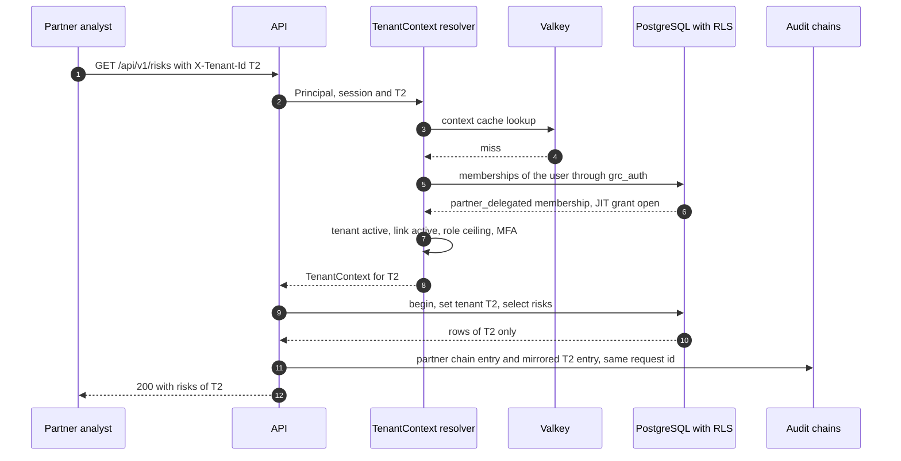

**Provisioning from a template:**
1. `POST /partner/tenants` takes a template, a plan and a region. It reserves the pool allocation and inserts the tenant (status `provisioning`), its link and a ProvisioningRun with a DomainEvent, then answers 202.
2. A lifecycle worker claims the run, has the key service create and wrap the tenant DEK (§13), and records the placement.
3. Inside the tenant context, the worker installs the template's content-pack versions (§8 installer), then the role seeds, matrix and scales, org skeleton, connector templates and brand.
4. The worker creates memberships for the tenant admin and the assigned staff, and sets the tenant `active`. It emits `tenant.provisioned` and sends branded invitations.

Steps are idempotent, so a failed run resumes. Platform templates use the same flow from P1.

#### 11.2.7 Tenant lifecycle

From P0, the status is checked at sign-in and on every request; today `is_active` is ignored. The platform chain records every transition.

| Transition | Behaviour |
|---|---|
| Create → `provisioning` → `active` | From the platform console (P1) or the partner console (P3), always through a template and a ProvisioningRun |
| `active` ⇄ `suspended` | Sign-in and API calls refused with 403 `tenant_suspended`; scheduled work paused; data kept |
| Export (on request and at offboarding) | Whole-tenant bundle: JSON Lines per entity, files, audit chain with proofs, signed manifest |
| `offboarding` → `deleted` | Export; contractual retention window; deletion of the rows (or of the dedicated cell) and of the object prefix; destruction of the DEK. Destroying the DEK crypto-shreds the secrets and, once PF-32 encrypts objects (P2), the files and exports left in storage or backups; before P2 the object prefix is deleted and the deletion certificate states when object backups expire. Rows in shared-cell backups age out under §13's retention. A signed deletion certificate states what was shredded and when each kind of backup expires |

#### 11.2.8 Runtime white-label

**Profiles.** A BrandingProfile exists at platform, partner and tenant scope. Each field inherits Platform → Partner → Tenant unless it is set. The fields are:
- the product name in en, ar and fr, held as the `product_name_i18n` JSONB map, like every bilingual display label (§14.1);
- logos, with dark and RTL variants;
- theme seeds and font;
- login options and e-mail mode;
- PDF theme per language and `show_powered_by`;
- TOTP issuer, AI persona and support links.

Publishing a draft emits `branding.published`, which invalidates caches. Branding beyond the logo needs the `white_label` entitlement, and the platform reviews each partner profile before its first publication. Before login, `GET /public/branding` resolves the forwarded `Host` through CustomDomain. After login, the active tenant's effective profile applies.

**Theme.** Today `tailwind.config.js` remaps eight hue families (blue, indigo, sky, cyan, teal, violet, purple, fuchsia) onto one brand blue. They become `rgb(var(--brand-<step>) / <alpha-value>)`, which the installed Tailwind CSS 3.4 (MIT) supports, so classes such as `bg-blue-600` follow the brand at runtime with no markup change.
- The server derives the 11-step scale from one or two seed colours and rejects palettes below WCAG AA contrast (4.5:1).
- Severity colours stay fixed, so risk meaning never changes with a brand.
- Fonts come from a bundled list: Geist, IBM Plex Sans Arabic and Noto Sans Arabic, all OFL-1.1. §8 bundles the Arabic fonts.
- Logos are PNG or WebP only, re-encoded by Pillow (MIT-CMU, already a dependency) and served same-origin, so CSP keeps `img-src 'self'`. No HTML, CSS, JavaScript or SVG is accepted.

**Brand tokens (P1)** turn about 400 hard-coded strings into data. A CI guard then rejects brand literals outside the platform default profile.

| Surface | Today | Target |
|---|---|---|
| en/fr/ar catalogues and knowledge base | 282 occurrences | `{{product}}` via a codemod, filled by i18next (MIT) `interpolation.defaultVariables` (version 25 is installed) |
| SPA code | 39 occurrences in 23 files; branded `index.html` | `useBrand()` hook; neutral `index.html` |
| E-mail | Brand in `templates/email/base.html`; one global sender | BrandContext name, logo, links and sender mode |
| PDF | Colours and footer in `report_generator.py`; `pdf_arabic.py`, `tabular_pdf.py` | PDF theme per language from BrandContext, with Arabic fonts (R3) |
| TOTP | Fixed issuer in `mfa.py` | Profile issuer, ASCII only; existing authenticator entries keep the old label until re-enrolment |
| AI persona | Brand name in `ai_prompts.py` | Persona name from BrandContext |
| Links | Platform host | The tenant's verified domain |

**E-mail and trust center.** By default the platform relay sends with the brand's display name. A partner or tenant may instead use either:
- a verified sender domain, with DKIM, SPF and DMARC checked first;
- its own SMTP relay, with its credentials under its DEK and its traffic through the egress allow-list (X-07).

The §12 notification router consumes the BrandContext. The trust center gets a branded public page on the tenant's domain.

**Custom domains (X-07):**
1. A tenant or partner adds a domain and gets a DNS TXT token. A job checks the token with dnspython (ISC, already a transitive dependency) and re-checks it periodically. Arabic IDNs are stored in punycode.
2. Binding the verified domain to a published profile creates an active CustomDomain.
3. At an internal endpoint, the brand service lists one dynamic Traefik router per active domain. Each router has a `Host` rule and an ACME certificate, and reaches the SPA and API services only, never the marketing site. Edges load the list in one of two ways:
   - single-node and compose edges use Traefik's HTTP provider and its ACME resolver;
   - Kubernetes cells render the list into Traefik routers, and cert-manager issues one certificate per domain, because Traefik's own ACME store is per instance (external source, to verify, as §13 notes).

   §13 owns the edge; the cert-manager check stays open in §16.4. The ACME endpoints are on the egress allow-list.
4. The edge forwards the original `Host`, with HSTS. Session cookies are host-only, so sessions never cross brands (§12).
5. A domain whose proof disappears is suspended, and its router is withdrawn.

These routers replace the design paper's Caddy (Apache-2.0) on-demand TLS, an option X-07 rejected.

#### 11.2.9 Licence v2 and entitlements

| Element | Design |
|---|---|
| Payload v2 | `kid`, licensee, `deployment_mode`, `install_binding`; plan (now including `elite`); modules (grc, inventory, ctem, ai); limits (tenants, billable seats, assets, connectors, collector sites, AI tokens per month); `pool_id`, `expires_at`, `grace_days`. v1 keys still verify as plan-only licences |
| Issuer | The Licence Authority only, which runs on a separate, isolated host, not on the internet-facing SaaS host, with its Ed25519 key in OpenBao transit (X-10, §13); it also signs the revocation list (CRL) |
| Client | Verifies by `kid`; honours stored expiry and revoked licence ids; caches the verdict in Valkey, not per worker; receives the CRL by phone-home or file import; a stale CRL only warns until `grace_days` expire |
| Offline activation | Request file (install hash, licence id, nonce) → response signed for that install, with the current CRL; rebinds capped (three a year in the design paper) |
| Pools | A partner allocates pool limits to tenants: accounting on platform SaaS, enforced locally on an MSSP-hosted deployment |
| Entitlement chain | Tier → partner ceiling → tenant `custom_limits` → licence or allocation, in `subscription.py`; `require_quota(...)` at create time, so quotas, subscription status and trial expiry are enforced server-side for the first time (PKG-03); `Tenant.features` becomes a read-only projection |
| Seats | A billable seat is an active membership with a write role; viewers, executives and external auditors are free up to a set number |
| Metering | The daily usage metering job fills TenantUsageSnapshot (tenant_id, snapshot_date, metric_key, value) from database counts, AI tokens, storage bytes and Valkey counters; hashed monthly partner statements; billing awaits a committee decision (§16.1) |

#### 11.2.10 Resale models

| | Direct SaaS | Partner-branded SaaS | MSSP-hosted | On-prem |
|---|---|---|---|---|
| Operator | Platform | Platform | Partner, as `platform_operator` of its deployment | Customer, or a partner on its behalf |
| Brand | Platform profile | Partner profile and custom domain | Partner profile | Brand bundle (JSON and assets) imported at install; no rebuild |
| Tenancy | Shared KSA cell; dedicated database cell by contract | Same, with tenants linked to the partner | The partner's multi-tenant deployment | One tenant, more if licensed |
| Licence | Subscription entitlements | Partner pool (accounting) | Pool licence with local ceilings | Licence v2, offline activation, CRL import |
| Metering | TenantUsageSnapshot | Partner statement | Signed local usage report | Optional report |
| Updates | Continuous | Continuous | Signed bundles | Signed bundles or OVA |
| Support access | Lockbox AccessGrant | Partner first, then platform through a grant | Partner | Customer-approved session |

All four run the same image set. Nuitka (Apache-2.0) compiles first-party code only; LGPL libraries are used only when unmodified, dynamically imported, replaceable and excluded from compilation, and copyleft tools only over the network or through file formats (§13, X-14).

### 11.3 Data model changes

| Entity | New / changed | Key fields | Relations | Phase |
|---|---|---|---|---|
| User | Changed | `tenant_id` → nullable `default_tenant_id`; `is_system`; `role`/`roles` mirror the default membership for one release; e-mail unique per region | Membership, PartnerMembership, PlatformRoleAssignment | P0 |
| Membership | New | user_id, tenant_id, kind (direct, partner_delegated, platform_support, system; `system` binds batch actors and ApiClient service users), roles, excluded_roles, status, expires_at, mfa_required; UQ(user_id, tenant_id). Custom roles, org scope (with `include_descendants`) and accepted IdPs are association tables (MembershipCustomRole, MembershipScope, MembershipIdentityProvider), not JSON id lists (X-04) | User, Tenant, OrgEntity, IdentityProvider (§12), PartnerTenantLink | P0; scope P1; link P2 |
| PlatformRoleAssignment | New | user_id, role, expires_at | User | P0 |
| Tenant | Changed | status (provisioning, active, suspended, offboarding, deleted), partner_id, cell_id, immutable data_residency, branding_profile_id, regulated. `is_active`, `logo_url`, `settings.branding` and `domain` deprecated | Partner, Cell, BrandingProfile | P0 status; P1 cell, brand; P2 partner |
| OrgEntityClosure | New | tenant_id, ancestor_id, descendant_id, depth | OrgEntity | P1 |
| RiskScenario, AppliedControl, Incident, Vendor, ActionItem, Finding (§10) | Changed | nullable `org_entity_id` | OrgEntity | P1 |
| VerifiedDomain | New | owner (tenant or partner), name in punycode, TXT token, status, verified_at | IdentityProvider (§12), CustomDomain | P1 |
| Cell | New | region, kind (shared, dedicated), database, bucket and key references | Tenant | P1 |
| TenantTemplate, ProvisioningRun | New | owner (platform or partner), plan, content-pack versions, role seeds, matrix, scales, org skeleton, connector templates, brand; run steps, status, idempotency key | Tenant, ContentPackVersion (§8) | P1 platform; P3 partner |
| TenantUsageSnapshot | New (§13 table) | tenant_id, snapshot_date, metric_key, value; the usage metering job adds seats, assets and connectors to §13's storage, AI-token and row-count metrics | Tenant | P0 (§13); metering P2 |
| Partner | New | type (mssp, reseller, distributor, audit_firm), parent_partner_id, region, legal names en/ar, cr_number, support_mode | PartnerMembership, PartnerTenantLink, BrandingProfile, LicensePool | P2 |
| PartnerMembership | New | user_id, partner_id, partner_roles, mfa_required, ip_allowlist | User, Partner | P2 |
| PartnerTenantLink | New | permissions (delegated_admin, kpi_sharing, content_management, connector_management, reporting, api_access, audit_sharing), max_roles, access_mode (standing, jit), consented_by, consented_at, revoked_at | Partner, Tenant, Membership | P2 |
| AccessGrant | New | kind (partner_jit, platform_support, break_glass), membership_id, window, reason, ticket_ref, requested_by, approved_by, status | Membership | P2 |
| ActivityLog | Changed | origins `partner` and `platform_support`; partner_id; correlation id | PartnerAuditLog | P2 |
| IssuedLicense | Changed | kid; then deployment_mode, modules, limits, install_binding, pool_id, grace_days | LicensePool | P0 kid; P2 |
| RevocationList | New | serial, revoked licence ids, issued_at, signature | IssuedLicense | P2 |
| TenantKpiSnapshot | New | tenant_id, metric_key (catalogue), value, as_of | Tenant | P3 |
| PartnerAuditLog | New | partner chain entries in the §12 trail format, correlated with the mirrored tenant entries | Partner, ActivityLog | P3 |
| ContentRollout | New | partner_id, pack version, batch, per-tenant status | Partner, ContentPackVersion (§8) | P3 |
| BrandingProfile | New | scope (platform, partner, tenant), parent_profile_id, product_name_i18n (JSONB map keyed en, ar, fr), logos, theme seeds and derived scale, font, login options, e-mail mode, PDF theme per language, show_powered_by, totp_issuer, ai_persona_name, status (draft, in_review, published), version | Partner, Tenant, CustomDomain | P1 platform default; P3 |
| CustomDomain, EmailSenderDomain | New | verified domain, profile, purpose (app, trust center), router and certificate status; DKIM, SPF and DMARC status, sender mode, relay credential reference | VerifiedDomain, BrandingProfile | P3 |
| LicensePool, LicenseAllocation | New | partner, backing licence, limits; tenant, allocated limits, consumption | Partner, Tenant | P3 |
| TenantPlacement | New | tenant_id, source and target cell, move status, verification report | Cell, Tenant | P3 |

The per-tenant DEK record (TenantDataKey) and the `tenant_id` backfill belong to §13. The consolidated model is in §14.

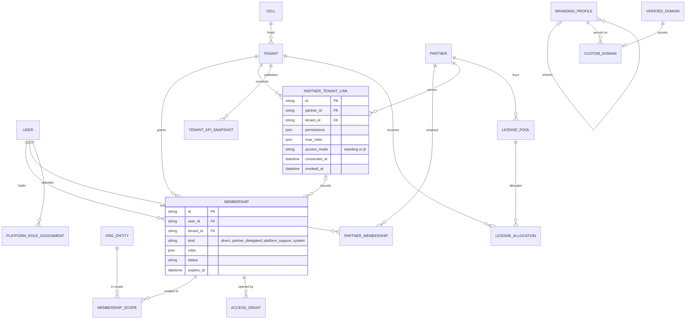

### 11.4 Interfaces

All paths are under `/api/v1`, except the Licence Authority's, which are under `/authority/v1` on its own host. Discovery (`POST /auth/discover`), SSO, SCIM and ApiClients are in §12.

| Method and path | Purpose |
|---|---|
| `GET /auth/memberships`; `GET /auth/me` (adds active tenant, memberships, partner and platform roles) | Context for the SPA and the tenant switcher |
| `GET, POST /tenants/current/members`; `PATCH, DELETE /tenants/current/members/{mid}`; `PUT /tenants/current/members/{mid}/scope` | Invitations of global identities, roles, expiry, entity scope |
| `GET, POST /tenants/current/domains`; `POST /tenants/current/domains/{id}/verify` | VerifiedDomain proofs, used by SSO JIT and custom domains |
| `GET, PATCH /tenants/current/partner-links/{pid}`; `POST /tenants/current/access-grants/{id}/approve` (and `/deny`); `GET /tenants/current/access-transparency` | Consent, JIT and lockbox approval, transparency view |
| `GET /tenants/current/usage`; `POST /tenants/current/export` | Usage; whole-tenant export |
| `GET /public/branding`; `GET /branding/effective`; `GET, PUT /tenants/current/branding`; `POST /tenants/current/branding/publish` (and `/assets`) | Brand before and after login; tenant profile (`white_label` entitlement) |
| `GET /internal/edge/routers` | Router list for the edge; internal network only |
| `GET /partner/portfolio`; `GET, POST /partner/tenants`; `POST /partner/tenants/{tid}/suspend` (also `/resume`, `/offboard`) | Portfolio and lifecycle |
| `GET, POST /partner/templates`, `/partner/staff`; `POST /partner/staff/{uid}/assignments`; `POST /partner/tenants/{tid}/access-requests` | Templates, delegated memberships, JIT requests |
| `GET, POST /partner/content-rollouts`; `GET /partner/fleet`; `POST /partner/reports`; `GET /partner/audit` | Rollouts, fleet view, aggregated reports, partner chain |
| `GET, PUT /partner/branding`; `GET, POST /partner/domains`, `/partner/email-domains` | Partner brand, web domains, sender domains |
| `GET /partner/licence-pool`; `POST /partner/licence-pool/allocations`; `GET /partner/usage` | Pool, allocations, statements |
| `GET, POST /platform/partners`, `/platform/tenants`, `/platform/cells`; `POST /platform/tenants/{tid}/move`; `POST /platform/access-grants` | Platform console, tenant moves, lockbox requests |
| `POST /platform/self-test`; `/platform/catalogues/*` | Deployment-wide functions moved out of tenant reach |
| Licence Authority (§13.4; on a separate, isolated host, prefix `/authority/v1`): from P0, `POST /authority/v1/licenses`, `POST /authority/v1/licenses/{lid}/revoke`, `POST /authority/v1/activations` (online) and `POST /authority/v1/licenses/verify`; from P2, `GET /authority/v1/crl` and `POST /authority/v1/activation-responses` (offline request file → signed response) | v2 issuance, revocation, CRL, online and offline activation |
| Licence client: `GET /license/status`; `POST /license/activate`, `/license/activation-request`, `/license/activation-response`, `/license/crl` | Appliance and MSSP-hosted activation |

**Events.** These DomainEvents use the CloudEvents envelope and the governed catalogue (X-08):
- `tenant.provisioned`, `tenant.suspended`, `tenant.resumed`, `tenant.offboarding_started`, `tenant.deleted`;
- `membership.created`, `membership.changed`, `membership.revoked`, which also invalidate the context cache;
- `partner_link.consented`, `partner_link.changed`, `partner_link.revoked`;
- `access_grant.requested`, `access_grant.approved`, `access_grant.denied`, `access_grant.expired`;
- `branding.published`, `domain.verified`, `domain.suspended`;
- `licence.status_changed`, `licence.allocation_changed`, `quota.threshold_reached`.

Partner-scope events carry a NULL tenant and fan out to the linked tenants that must react. Context switches and partner actions are audit-trail entries (`audit_trail.*`, §12), not DomainEvents.

**UI changes:**
- **Layout:** a tenant switcher with `/t/<slug>/…` deep links; an amber "Acting for Partner X in Tenant Y" banner; the brand's logo and name; a scope chip for entity-scoped users; entity pickers on forms.
- **Company admin:** Members, Partner access, Access transparency, Usage, Domains.
- **Settings:** a Branding tab in the existing `organization` slot, gated by `white_label`.
- **New `PartnerLayout`:** Portfolio, Tenants, Provision, Templates, Staff, Rollouts, Fleet, Reports, Audit, Branding, Licence pool.
- **Super-admin:** Partners, Tenant lifecycle, Cells, Licences v2, Access grants.
- **Login:** the brand comes from the host, and IdP discovery runs on the e-mail (§12).
- **Languages:** every new screen is in en, fr and ar, with RTL.

### 11.5 Security, tenancy, Arabic/KSA and deployment considerations

**Security.**
- **Partner staff:** mandatory MFA, optional IP allow-lists, role ceilings, JIT windows and immediate revocation.
- **Platform staff** have no standing tenant access. Support uses tenant-approved AccessGrants. Break-glass needs two platform approvers, is time-boxed and is shown to the tenant at once.
- **Brand abuse.** Names of regulators and banks (for example NCA, SAMA, SDAIA) are refused. Partner profiles are reviewed, assets are raster only, and domains must be verified.
- **Denials** on partner and platform paths are logged (§12); today 402 and 403 responses are not.
- **Offboarding** issues a signed export manifest and a deletion certificate.
- **Forwarded headers** are trusted only from the edge (§13).

**Arabic and KSA.**
- **Residency.** A KSA tenant's data, keys, backups, logs and e-mail relay stay in the Kingdom. Its AI processing stays there by default, on an in-region endpoint rather than the hosted relay; an AI endpoint outside the Kingdom is possible only after an explicit, audited opt-in by the tenant administrator, and is refused for regulated tenants (X-18, §13.2.15). Whether the Licence Authority must also stay there is open.
- **Partner staff abroad** are blocked or logged according to tenant policy, under PDPL cross-border transfer rules (external source, to verify).
- **Regulated tenants** (SAMA-regulated, government) get JIT-only partner access, lockbox support, and a dedicated cell or on-prem. This is meant to meet NCA ECC third-party and cloud controls, CCC and SAMA outsourcing expectations (external source, to verify). The R1 owner (§8) maps it to specific controls.
- **Arabic.**
  - Brand labels are `*_i18n` JSONB maps in ar, en and fr, with RTL logo variants and Arabic fonts in web, PDF and e-mail.
  - The TOTP issuer stays ASCII.
  - Arabic IDNs are stored in punycode and shown in Arabic.
  - Partner records carry Arabic and English legal names and the commercial registration number.

**SaaS and on-prem.** All deployments share one code base; `DEPLOYMENT_MODE` changes only guards and defaults.

| Concern | Platform SaaS | MSSP-hosted | On-prem appliance |
|---|---|---|---|
| Row isolation | TenantSession and RLS | Same | Same, on PostgreSQL (X-03) |
| Key root for tenant DEKs | OpenBao on the cell's KMS or HSM | Partner's OpenBao or HSM | Customer HSM or OpenBao; a TPM-sealed local key at a stated lower assurance (X-10) |
| Deployment-wide functions | `platform_operator` | Partner as `platform_operator` | `appliance_operator` |
| Private targets | Through a Site Collector only | Through a Site Collector only | Allowed |
| Brand source | Profiles and custom domains | Partner profile | Brand bundle |
| Licence verdict | Subscription entitlements | Pool licence, local ceilings | Licence v2, offline activation, CRL import |

### 11.6 Migration from today's code

| File or area | Action |
|---|---|
| `dependencies/auth.py` | Add `get_tenant_context`. `get_tenant_id` keeps its signature and returns `ctx.tenant_id`, so the 477 routes that use it are unchanged. `require_roles` reads `ctx.roles` |
| `services/authz.py`, `services/perimeter.py`, `dependencies/features.py`, `models/subscription.py` | Tenant from the context; membership roles; org scope; asset perimeter; entitlement chain and `require_quota`; super-admin bypass removed |
| `core/database.py`, new `core/tenancy.py`, `core/shared_state.py` | Session events, engine registry per cell, explicit tenant and system sessions, context cache and invalidation |
| The ~65 direct `user.tenant_id` reads (14 files) and the 32 out-of-request sessions (21 files) | Move to the context or to explicit sessions; an AST lint in the §13 CI gate then bans the pattern |
| `models/user.py`, `models/tenant.py`, `endpoints/auth.py`, `users.py`, `sso.py`, `services/directory_auth.py` | Memberships; membership-aware login, invitations and provisioning; registration switch |
| `endpoints/tenants.py` | Security settings, branding and features are written only through their dedicated, validated routes, and entitlements come only from the chain. Branding and domain routes are added |
| The three cross-tenant read paths (§6.5 item 1) and the notification producers | Read paths closed by T0.1 with regression tests; notification recipients resolved through memberships. The files involved are listed in the internal evidence pack |
| The modules of the deployment-wide functions (§11.2.3; listed in the internal evidence pack) | Mode guards; datastore routes retired with the §13 console CLI |
| `core/activity_middleware.py`, `services/activity_chain.py` | Entries attributed to the context tenant; `partner` and `platform_support` origins; partner chain, built with §12's audit context and trail v2 |
| `licensing.py`, `license_middleware.py`, `license_server.py`, `license_phone_home.py`, `license_client.py`, licence routes in `admin.py` | `kid`, v2 payload, CRL, revocation honoured; issuance moves to the Licence Authority (§13) |
| `email_service.py`, `templates/email/*`, `report_generator.py`, `pdf_arabic.py`, `tabular_pdf.py`, `mfa.py`, `ai_prompts.py`, `trust_center.py` | BrandContext replaces brand literals and colours |
| Frontend: `api/client.ts`, `store/auth.ts`, `Layout.tsx`, `AuditorLayout.tsx`, `AuthLayout.tsx`, `LoginPage.tsx`, `SettingsPage.tsx`, `SuperAdminPage.tsx`, `tailwind.config.js`, `index.css`, `i18n/index.ts`, `index.html` | `X-Tenant-Id`, memberships, switcher, palette as CSS variables, `{{product}}` tokens, neutral shell |
| `gateway.js` | Retired with the Traefik edge (§13); this chapter adds the custom-domain routers |
| `scripts/cleanup_expired_test_tenants.py` | Replaced by the lifecycle workers |

**Data migration.**
1. **Memberships.** One membership per user, copying roles, exclusions, custom roles, `is_active` and `expires_at`, with `default_tenant_id = tenant_id`. E-mails are already unique, so the mapping is 1:1.
2. **Platform and special accounts.**
   - The super-admins of the `platform` tenant seeded by `startup.py` become PlatformRoleAssignments.
   - The per-tenant system actors are marked `is_system`.
   - External auditors keep direct memberships, which can later be attached to an audit-firm Partner.
3. **No automatic identity merge.** About 80 foreign keys reference `users.id` (79 declarations in today's models), so merging a person's accounts across tenants is a later, operator-assisted step.
4. **Tenant fields.** `is_active` becomes `status`; `logo_url` and `settings.branding` become a draft tenant BrandingProfile; `Tenant.domain` becomes an unverified VerifiedDomain.
5. **Licences.** The activation row becomes a v2 activation with scope `deployment`. v1 keys keep verifying.
6. **Verification.** The isolation suite runs on the migrated snapshot before cut-over.

Steps 1 to 4 run inside the §13 SQLite (public domain) → PostgreSQL importer, with the `tenant_id` backfill and the re-encryption of secrets (§13, §14.4 M1). They run as explicit jobs (X-04), are rehearsed on read-only snapshots, and never touch the live database.

**Compatibility.**
- Single-membership users need no header and keep their URLs.
- Tokens keep a `tenant_id` claim that nothing authorises with, as today.
- `/auth/me` keeps `role` and `roles`, taken from the active membership.
- On appliances, `appliance_operator` defaults to the sole tenant's admin.
- Moved global routes answer 403 with a pointer for one release.
- v1 licence keys keep verifying (§13).

### 11.7 Delivery by phase

IDs follow the design paper (T = tenancy). §13 counts:
- T0.5 (RLS), T0.6 (isolation suite), T0.7 (`secret_box` v2) and T0.9 (SBOM and licence policy);
- the Licence Authority split and the build fixes of T0.8.

T2.2 is split: prefixes and encryption go to §13's StorageBackend, and storage quotas go to T2.4 here.

| Phase | Deliverable | Size | Depends on |
|---|---|---|---|
| P0 | T0.1 Fix the three cross-tenant framework leaks, with regression tests: an immediate safety item (§6.5 item 1) that starts now under the GRCEye team's ownership and closes by gate G1 | S | — |
| P0 | T0.2 Deployment modes; deployment-wide functions behind operator guards, following their immediate restriction (§6.5 item 2); datastore test hardened; registration switch; `Tenant.status` enforced; tenant-settings writes limited to their dedicated routes | S | — |
| P0 | T0.3 TenantContext resolver and TenantSession (loader criteria, flush guard, engine per cell); ~65 direct reads and 32 out-of-request sessions migrated; `TenantTask` | M | §13 worker tier and Alembic baseline; lands with the §12 Principal resolver |
| P0 | T0.4 Membership and PlatformRoleAssignment; user migration; membership-based `require_roles`, `require_feature`, authz, notification recipients, users API | M | §13 PostgreSQL migration |
| P0 | T0.8a Licence client hardening: revocation and stored expiry honoured, `kid`-aware verification | S | §13 Licence Authority |
| P1 | T1.1 Entity scoping: membership scope, closure table, `org_entity_id` on six more models, ORM criteria, pickers, server-side filtering | L | T0.3, T0.4; §8 capability core and risk API fields |
| P1 | T1.2 Tenant lifecycle in the platform console: create, suspend, resume, whole-tenant export, crypto-shred offboarding (secrets from P1, files once PF-32 lands in P2), platform templates | M | T0.4; §13 key service and StorageBackend |
| P1 | T1.3 Placement registry: Cell, `cell_id`, immutable residency, engine, bucket and key resolution per cell, region-partitioned control plane | S | §13 KSA cell |
| P1 | T1.4 Brand tokenisation: BrandContext with the platform default profile, catalogue codemod, `useBrand()`, backend tokens (e-mail, PDF, TOTP, AI persona), CI brand guard | M | §8 catalogue and Arabic work |
| P1 | T1.5 Entitlement chain and server-side quotas (`require_quota`) | S | T0.4 |
| P1 | T1.6 Members UI (global invitations, roles, scopes, expiry), VerifiedDomain service, access-transparency view | M | T0.4 |
| P2 | T2.1 Fairness: per-tenant semaphores, dedicated tenant queues, entitlement-sized limit classes per tenant and ApiClient | M | §13 worker tier and Valkey; §12 limiter and ApiClient; §9 and §10 connectors |
| P2 | T2.3 Licence v2: modules, limits, signed CRL, offline challenge-response, appliance ceilings | M | T0.8a; §13 Licence Authority |
| P2 | T2.4 Usage metering, storage quotas, usage exports | S | T1.5 |
| P2 | T2.5 Platform support lockbox (AccessGrant) and break-glass | S | T0.4 |
| P2 | T2.6 MSSP-lite: Partner, PartnerMembership, PartnerTenantLink, delegated memberships, JIT grants, tenant switcher; actor-side entries in the platform chain until T3.1 | M | T0.4, T1.6 |
| P3 | T3.1 Partner portal: portfolio from KPI snapshots, provisioning from partner templates, staff assignments, partner chain mirrored to tenants | L | T2.6, T1.2; §12 audit trail v2; §13 outbox |
| P3 | T3.2 Partner rollouts: ContentPack adoption by canary and batch; fleet view over the §9 fleet API | M | T3.1; §8 ContentPack; §9 Site Collector |
| P3 | T3.3 Aggregated, partner-branded reporting, built per tenant context | M | T3.1, T3.4 |
| P3 | T3.4 Runtime white-label: partner and tenant profiles, CSS-variable theming, login page, PDF themes, sender domains, branded trust center | L | T1.4 |
| P3 | T3.5 Custom domains: DNS verification, dynamic Traefik routers, ACME certificates | M | T1.6, T3.4; §13 edge |
| P3 | T3.6 MSSP licence pools, allocations, partner statements | M | T2.3, T2.4 |
| P3 | T3.7 Dedicated database cells and tenant move tooling | L | T1.3; §13 RLS |
| P3 | T3.8 MSSP-hosted deployment profile: `msp_hosted` mode, local pool ceilings, signed usage report | S | T3.6; §13 deployment chart |

Approximate subtotals at the midpoints (S = 1.5, M = 4, L = 9 person-weeks):

| Phase | Subtotal | Requirement coverage at phase end (all blocks) | This chapter's requirements |
|---|---|---|---|
| P0 | ≈ 12.5 person-weeks | 63% | R4 partial; R5 strong (licence-only bar) |
| P1 | ≈ 24 person-weeks | 81% | R4 partial; R5 strong |
| P2 | ≈ 15 person-weeks | 88% | R4 partial: MSSP-lite lets partner pilots start, but it is not yet the MSSP layer the deck asks for; R5 strong |
| P3 | ≈ 44.5 person-weeks | 100% | R4 strong (partner portal, dedicated cells); R5 strong, with runtime white-label |

The chapter total is about 96 person-weeks. The coverage column assumes that R1 becomes strong in P1; unless redistribution rights are cleared or the committee decides that reference mode meets R1, the figures are 75%, 81% and 94% at the ends of P1, P2 and P3 (§15.3).

### 11.8 Key decisions and risks

| ADR | Decision | Rationale |
|---|---|---|
| ADR-MSP-01 | One identity per person and region, with Memberships (user × tenant × roles × org scope); `users.tenant_id` becomes a nullable default (X-06) | One MFA, session and audit identity for MSSP analysts and external auditors; today's data maps 1:1 |
| ADR-MSP-02 | The tenant context comes from a validated `X-Tenant-Id` header, checked against membership, link, grant and auth policy; 60 s cache with pub/sub invalidation | Never trusts token claims; supports several tabs on several clients; unchanged for single-tenant users |
| ADR-MSP-03 | Two-layer isolation: TenantSession here, RLS with dedicated roles in §13 (X-05, ADR-PLT-03) | Each layer catches the other's misses, as two-key tests prove |
| ADR-MSP-04 | Partners read only consented TenantKpiSnapshot rows; drill-down is an audited context switch; two chains | No runtime path reads raw data across tenants, and clients see what partners did |
| ADR-MSP-05 | Entity scoping in the application layer, from the membership scope and a closure table, not in RLS | A soft boundary whose visibility derives from parents; separate legal entities become tenants |
| ADR-MSP-06 | Per-tenant envelope keys under an OpenBao KEK, files encrypted in the app from P2, crypto-shred at offboarding (X-10; delivered in §13) | Bounded blast radius and provable deletion of secrets and files |
| ADR-MSP-07 | Regions are hard partitions with their own control plane; a shared KSA cell by default; dedicated database cells by contract (X-15) | Residency per deployment at low operating cost |
| ADR-MSP-08 | Runtime white-label: profile inheritance, host-first resolution, CSS-variable palette, i18next brand variables, raster-only assets, verified domains as dynamic Traefik routers with ACME certificates (X-07) | No rebuild per partner; CSP-safe; one BrandContext for every channel |
| ADR-MSP-09 | Licence v2 (kid, modules, limits, pools, install binding), signed CRL and offline challenge-response, issued only by the Licence Authority, which runs on a separate, isolated host, not on the internet-facing SaaS host (X-10) | Closes the revocation and activation gaps, polices resale and works air-gapped |
| ADR-MSP-10 | `DEPLOYMENT_MODE` gates deployment-wide functions behind platform or appliance operators | Removes tenant reach into shared state and keeps the appliance experience |
| ADR-MSP-11 | Licence allow-list, CycloneDX SBOM and notices as a release gate (X-14; delivered in §13): permissive dependencies by default, LGPL only when unmodified, dynamically imported, replaceable and excluded from compilation, and copyleft tools only over the network or through file formats | R5's "keep our code" must hold at every build |

| Risk | Mitigation |
|---|---|
| The authorisation refactor regresses across 582 routes | `get_tenant_id` keeps its signature; golden role tests; single-membership path unchanged; rollout per router behind a flag; §8 capability shadow mode |
| Background code runs without a tenant context | `TenantTask` is mandatory and fails closed; worker cases in the §13 isolation suite |
| MSSP insider or over-reach | Role ceilings, JIT windows, MFA, IP allow-lists, instant revocation, mirrored chain entries, transparency view |
| Identity takeover through a tenant or partner IdP | JIT only on VerifiedDomains; IdP acceptance per membership; identity keyed on IdP and subject (§12) |
| Phishing through white-label | Platform review of partner profiles, reserved names, verified domains, no HTML or SVG |
| Certificate issuance fails or hits CA rate limits as custom domains grow | cert-manager on Kubernetes cells (to verify, §13); staged onboarding of domains; certificate expiry on the fleet and platform dashboards |
| Air-gapped sites bricked by licence checks | Grace days, a stale CRL only warns, signed renewal files |
| Crypto-shred is assumed to cover everything | The deletion certificate states what the DEK covers and when shared-cell backups expire; tenants needing full key separation take a dedicated cell or on-prem |
| Residency breach through the AI relay, e-mail or foreign support | KSA defaults (X-18), with an audited tenant-administrator opt-in for any AI endpoint outside the Kingdom, refused for regulated tenants; in-region relay, lockbox, access logging, policy for partner staff abroad |
| "Keep our code" rests on undocumented chain of title | A proprietary LICENSE/EULA and an IP assignment for the proprietary code (IP holder to be confirmed, NG-10; X-14); legal work outside this estimate |

**Questions for the committee (§16.1, §16.4):**
1. Partner hierarchy depth (the design allows two levels).
2. Standing or JIT partner access by default, and whether JIT is mandatory for regulated tenants.
3. The commercial metric (tenants, seats or assets) and which seats are free.
4. The KSA key root, and whether the Licence Authority must run in the Kingdom.
5. Which tenants need a dedicated cell, or should go on-prem.
6. Whether a partner IdP may sign staff into client tenants.
7. White-label depth: hiding "Powered by", renaming the product in regulator-facing PDFs.
8. BYOK or HYOK for banks.
9. Who invoices: platform or partner.
10. Whether partner staff abroad are blocked or logged.
11. Placement of the 11 existing tenants.
12. Whether a corporate group needs a consolidated view across subsidiary tenants (for example a `group` partner type).

## 12. Enterprise base: API, SSO, audit trail and events

This chapter designs R8, the enterprise base ("API, SSO and audit trail included"), and the machine side that R6 and R7 depend on: credentials for the connectors, hubs and CMDBs that push data into the core, and the outbound events behind CTEM's "mobilise" step. It answers BM-01's R8 line, the "key features paid" limit of the open-source route on slides 14–15 (SSO, audit trail and API among them), and slides 10 and 13, where collected assets and findings must reach the core and step 04 must reach people and ticketing tools. Today GRCEye has a broad but undocumented REST surface that only a person's token can call, LDAP-only directory login, and a hash-chained audit trail that can lose entries and has no key, export or SIEM feed. The target resolves one Principal per request, keeps browser sessions in `__Host-` cookies, federates through OIDC, SAML, LDAP and SCIM, publishes a curated, versioned API for scoped ApiClients, commits each audit entry with its change before signing and anchoring it, and drives webhooks, chat and notifications from one event catalogue.

### 12.1 Current state in brief

R8 is partial; federated SSO and machine credentials decide it (§6.2).

- **API.** 581 HTTP routes and one WebSocket on 63 routers, but no published spec, versioning or idempotency (§5.6).
- **Machine access.** `ApiToken` is model-only, so integrations sign in as a person with an HS256 access JWT (PRD-01).
- **Identity.** LDAP bind is the only directory login: LDAPS skips certificate validation, the bind password is stored in clear, and the SPA's directory form cannot finish MFA. OIDC, SAML and SCIM are absent. TOTP cannot be made mandatory and has no recovery codes (§5.2, SEC-03, SEC-04).
- **Sessions.** Tokens live in `localStorage` without a CSP and travel in SSE and WebSocket URLs; concurrent refreshes race; logout is client-only and a password change revokes nothing (SEC-01). Rate limits key on a proxy-derived address, per worker without Redis (SEC-02).
- **Audit trail.** The per-tenant SHA-256 chain, verification, chained seals, login journal and sensitive-read logging are a real base. But entries are written after the response and dropped on a 5-second timeout; only successful Bearer writes are logged, without field diffs; denials and most jobs go unrecorded; and the chain is keyless, with 529 of 726 production rows unchained. Verification is Elite-gated and API-only, the trail page was removed in `bc8421f`, and nothing exports or streams the trail (§5.4, SEC-05).
- **Events.** Webhooks are configured in `Tenant.settings` against 20 event names, but only an unsigned `test.ping` is sent; there is no Teams or Slack, and queued e-mail is dropped in the SaaS (§5.6).

### 12.2 Target design

Principles:
1. **One Principal per request**, resolved before the tenant context (§11) and capabilities (§8). Audit attribution comes from the Principal, never from client-supplied hints.
2. **Browsers never hold tokens.**
3. **An audit entry commits with the change it records.** Keys held outside the database and external anchors prove integrity.
4. **A small, stable, documented API** rather than 582 undocumented routes.
5. **One event catalogue** feeds every outbound channel (X-08).

| Component | Type (licence) | Responsibility | Extends / new |
|---|---|---|---|
| Principal resolver | FastAPI (MIT) dependency | Cookie session, bearer JWT, ApiClient, mTLS machine, system task or token holder → Principal | Extends `dependencies/auth.py`; signatures kept |
| Session and MFA service | Service; PyJWT, pyotp, argon2-cffi (MIT, existing); py_webauthn (BSD-3-Clause, P2) | `__Host-` sessions, CSRF, timeouts, step-up, server logout, refresh-reuse detection, MFA policy, recovery codes, passkeys | Extends `auth.py`, `mfa.py`, `user_session.py` |
| SSO broker | Authlib (BSD-3-Clause); python3-saml and xmlsec (MIT), pysaml2 (Apache-2.0) as fallback; ldap3 (LGPL-3.0, existing, kept unmodified and outside compilation per X-14) | OIDC relying party, SAML SP and LDAP per IdentityProvider; discovery, JIT, claim mapping, MFA trust | Generalises `sso.py`, `directory_auth.py` |
| SCIM 2.0 server | scim2-models (Apache-2.0) | Users → User + Membership; Groups → Team Groups | New; reuses the `users.py` creation path and `models/group.py` |
| ApiClient and OAuth2 server | Routes and service | Clients, secrets, scopes, client credentials, revocation, JWKS | **Replaces** `ApiToken` |
| Limits and idempotency | Valkey (BSD-3-Clause); limits (MIT, existing via slowapi, MIT) | GCRA buckets per IP, account, user, client and tenant; idempotency store | Extends `rate_limit.py`, `shared_state.py` |
| API contract kit and portal | Spectral, oasdiff (Apache-2.0); Schemathesis, Redoc, openapi-python-client, openapi-typescript (MIT) | Stability markers, Problem Details, cursors, deprecation headers, spec export, CI gates, SDKs | Extends `main.py`, `pagination.py` |
| Audit context middleware | Pure ASGI | Request id, Principal, tenant, client IP, route template, origin, outcome; denials | **Replaces** `ActivityLogMiddleware`; keeps its helpers |
| Audit writer | SQLAlchemy (MIT) `after_flush` listener | Redacted field diffs and semantic entries as pending rows in the business transaction | New |
| Chainer and checkpointer | Celery tasks (BSD-3-Clause); rfc8785 (Apache-2.0); rfc3161-client (Apache-2.0, to verify) | Hash v2, signed checkpoints, anchors, signed seals, exports, SIEM streams | Extends `activity_chain.py`, `audit_retention.py` |
| Event catalogue | Library `app/events/` | CloudEvents envelope, JSON Schemas, `emit()` into the outbox | New |
| Webhook dispatcher | Celery tasks | Fan-out, HMAC signing, retries, dead letters, replay | **Replaces** the `settings.webhooks` store |
| Notification router | Celery tasks | Rules → in-app, e-mail, Teams, Slack | Extends `notification_generator.py`, `email_service.py` |

The block runs on the platform of §13: the Traefik edge (MIT) and the nginx-based `grc-web` (BSD-2-Clause), PostgreSQL (PostgreSQL Licence) with RLS (X-03, X-05), Valkey, the worker tier with its outbox relay, OpenBao (MPL-2.0), `StorageBackend` and the Smokescreen egress proxy (MIT) (X-07, X-09, X-10). External tools (hubs, scanners, CMDBs, IdPs, ITSM) integrate only through these APIs, events and file formats, never embedded (X-01). The vendor services it talks to (Entra ID, ADFS, Okta, Teams, Slack, Jira, ServiceNow, SIEM products such as Splunk, QRadar, ArcSight and Sentinel, and time-stamping authorities) are licensed by the customer or provider and reached over the network only. CloudEvents and Standard Webhooks are specifications, implemented with the standard library.

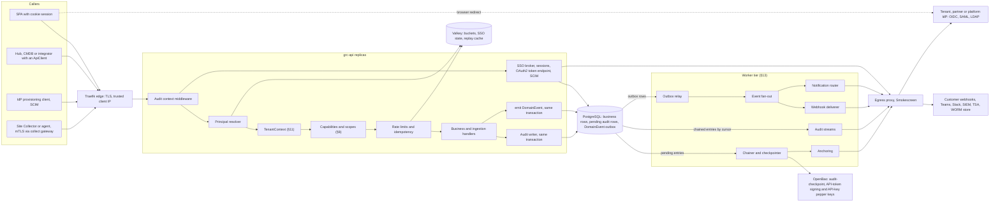

#### 12.2.1 Principals and the request pipeline

| Principal kind | Authenticated by | Tenant comes from | Audit actor |
|---|---|---|---|
| Browser session | `__Host-grc_sid` cookie plus CSRF token | `X-Tenant-Id`, validated against the Membership (§11) | User, session |
| Bearer user (non-browser) | JWT v2 access token | `X-Tenant-Id` or the default Membership | User, session |
| ApiClient | API key or OAuth2 access token | The owning tenant; a partner client sends `X-Tenant-Id`, checked against PartnerTenantLink `api_access` | ApiClient, service user |
| Machine | Short-lived certificate from the platform PKI, terminated at the collect gateway (§9, X-13) | Certificate URI SAN | CollectorSite or Agent |
| System task | TenantTask envelope (§13) | Validated task argument | System actor, job id |
| Token holder | Hashed single-purpose token (vendor portal, evidence link, password reset) | The token's record | `external_token` or self-service |

Each request runs one pipeline. The audit-context middleware opens the request record (request id, route template, client IP from §13's trusted `client_ip()`). The Principal resolver identifies the caller, TenantContext (X-06) validates the tenant against the Membership, partner link or AccessGrant, capabilities and scopes (§8) authorise, and rate limits and idempotency apply before the handler. Per-IP and per-account buckets on the sign-in routes apply before any Principal exists.

`get_current_user` and `get_tenant_id` keep their signatures and become wrappers over the Principal and TenantContext, so existing handlers do not change; an ApiClient resolves to its service User and `system` Membership. Platform staff act inside a tenant only through a tenant-approved AccessGrant and partner staff through a delegated Membership; the grant or link id is part of the audit actor, and the action is mirrored in the partner or platform chain (§11).

#### 12.2.2 Browser sessions: the API as same-origin BFF

The SPA, served by `grc-web`, and the API share an origin behind the edge, so the API acts as its own backend-for-frontend: no separate BFF process, and no token reaches JavaScript (ADR-ENT-02).

| Control | Target behaviour |
|---|---|
| Session cookie | Password, MFA and SSO sign-in issue `__Host-grc_sid`, an opaque 256-bit handle (`HttpOnly`, `Secure`, `SameSite=Lax`, `Path=/`). Only its SHA-256 is stored; the handle rotates on every privilege change |
| CSRF | Unsafe methods echo the `__Host-grc_csrf` cookie in `X-CSRF-Token` and pass an `Origin` check |
| Timeouts | Idle 30 min and absolute 12 h by default; tenants may tighten both |
| Step-up | IdP and policy changes, ApiClient issuance, audit exports and MFA resets need authentication within the last 10 min, otherwise 401 `step_up_required`; OIDC IdPs are re-asked with `max_age` |
| Logout and revocation | Logout deletes the server session. Password change, MFA reset, membership removal and SCIM deactivation revoke all of the user's sessions |
| Realtime | SSE and WebSocket use §13's 30-second single-use tickets, which carry the tenant context, with an `Origin` check |
| CSP | `grc-web` serves `default-src 'self'; script-src 'self'; frame-ancestors 'none'; object-src 'none'`, report-only for two weeks (reports to §13's `/csp-reports`), then enforced |

Bearer tokens remain for non-browser clients. JWT v2 adds `iss`, `aud` and `kid` and is signed with the API-token signing key, a dedicated Ed25519 key (X-10) that the KeyService (OpenBao, §13) rotates; the public keys are published as JWKS, and HS256 tokens are still accepted for one release. A refresh token reused within 30 seconds gets 409, so concurrent tabs do not trip the alarm; later reuse revokes the session and emits `auth.refresh_reuse_detected`. Until cookie mode ships, `client.ts` gets a single-flight refresh.

#### 12.2.3 Federated SSO and provisioning

An **IdentityProvider** row describes one connection, owned by a tenant, a partner or the platform, with protocol `oidc`, `saml` or `ldap`; today's per-tenant LDAP settings become one such row. The broker is embedded in the API rather than delegated to Keycloak (Apache-2.0) (ADR-ENT-01). It reaches IdP endpoints through the egress proxy, and activating an IdP adds its hosts to the allow-list.

OIDC sign-in, the main path for Entra ID:
1. The login page asks for the e-mail first. `POST /auth/discover` maps the domain through §11's VerifiedDomain to an active IdP and returns its Arabic and English display names from `name_i18n`. An unknown domain gets the password form, so the answer reveals no tenant.
2. `GET /auth/sso/{idp_id}/start` keeps state, nonce, PKCE verifier and return path in Valkey for 10 minutes, binds them to the browser with a short-lived pre-authentication cookie, and redirects with PKCE S256 and, when policy requires MFA, `acr_values`.
3. The callback consumes the state once, exchanges the code and validates `iss` (RFC 9207), `aud`, `nonce`, `exp` and the signature against the IdP's JWKS.
4. It finds the ExternalIdentity by (IdP, subject), keyed on `tid` and `oid` for Entra ID and never on the mutable e-mail claim. Only for a verified domain may it create the user and a Membership just in time; an account is never linked by e-mail alone.
5. `map_claims()` generalises `map_groups_to_role` and keeps its safety rules. It derives roles, OrgEntity scope and partner roles (app roles rather than group ids on Entra ID) using today's `highest` strategy or `union`. A change is chained as `rights_change`.
6. When `amr` or `acr` proves MFA from an IdP the tenant trusts for it, the local TOTP step is skipped; otherwise it runs.
7. The API creates the UserSession (`auth_method=oidc`, deadlines), writes the LoginEvent and a pending `auth.login_succeeded` entry, and answers 303 with the session and CSRF cookies.

**SAML 2.0** (python3-saml) requires signed assertions, checks audience and `InResponseTo`, keeps a replay cache, allows at most 2 minutes of clock skew, refuses SHA-1, supports certificate rollover with `idp.certificate_expiring` alerts, and disables IdP-initiated login; its pre-authentication cookie is `SameSite=None`, because the assertion arrives by cross-site POST. **LDAP** uses `CERT_REQUIRED` with a CA bundle, StartTLS and an encrypted bind password. On-prem installs bind to LDAP directly. SaaS tenants reach a private LDAP/AD directory only through the Site Collector's sign-in relay (X-13), which §9 delivers in P2; before P2, SaaS tenants sign in with OIDC or SAML. On a verified custom domain (§11) the callback and ACS URLs are issued on that host, and because `__Host-` cookies are host-bound, sessions are never shared across hosts.

**SCIM 2.0** (`/scim/v2`, ADR-ENT-10) maps a User to a User plus a Membership in the calling tenant and a Group to a Team Group; `active=false` suspends the Membership and revokes its sessions. The SCIM client is an ApiClient with `scim:provision`, and it edits a profile only when the user's home IdP is its own, so tenant A cannot rename an analyst it shares with tenant B. Partner IdPs map groups to PartnerMembership roles, and tenant access remains a delegated Membership whose MembershipIdentityProvider association must include the partner IdP (§11). Platform staff sign in through a platform IdP with mandatory MFA.

#### 12.2.4 MFA and authentication policy

`/tenants/current/security` gains required MFA (`all`, `privileged` or `none`), session limits, SSO enforcement per verified domain with alerted break-glass administrators, and the API-key policy. MFA seeds are encrypted under the tenant key (§13 re-encrypts the existing ones), recovery codes are Argon2-hashed, an MFA reset needs a second approver through §8's ApprovalService, the TOTP issuer comes from §11's BrandContext instead of a hard-coded name, and `must_change_password` is enforced on the server. Passkeys (WebAuthn) follow in P2.

#### 12.2.5 ApiClient and machine access

An **ApiClient** (ADR-ENT-03) replaces the unused `ApiToken`. It belongs to a tenant, or to a partner whose PartnerTenantLink grants `api_access`, and acts as a non-interactive service User with a `system` Membership. Its effective rights are its scopes intersected with its creator's current capabilities, evaluated on every request, so a client never exceeds the person who created it. Scopes are `domain:action` strings that each block registers:
- ingestion and proposals: `ctem:ingest`, `inventory:import`, `evidence:ingest`, `graph:coverage:write`, `proposal:create`;
- reads: `assets:read`, `findings:read`, `risks:read`, `compliance:read`, `audit_trail:read`;
- operations: `audit_trail:export`, `webhooks:manage`, `scim:provision`.

No scope grants identity administration, and none writes compliance verdicts: machine input reaches compliance only as proposals (§8, X-12).

| Credential or control | Rule |
|---|---|
| API key | `grc_<env>_` + key id + 256-bit secret + CRC32, so secret scanners recognise it. Stored only as HMAC-SHA256 under the API-key HMAC pepper, a dedicated KeyService key (X-10); shown once; 90 days by default, one year at most; two active at a time for rotation |
| OAuth2 client credentials | RFC 6749 §4.4, issuing 15-minute RFC 9068 access tokens; `private_key_jwt` (RFC 7523) in P2; revocation per RFC 7009; metadata per RFC 8414 |
| Controls | IP allow-lists, expiry reminders, step-up and optional four-eyes approval (§8 ApprovalService) for write scopes, usage per route, revocation effective within 60 s |
| Rate limits (ADR-ENT-09) | Valkey GCRA buckets per IP, account, user, ApiClient and tenant: 600 requests/min per client with a burst of 100, under a tenant ceiling from §11's entitlements; IETF `RateLimit` header fields (Internet-Draft) and `Retry-After` |
| Idempotency | `Idempotency-Key` mandatory on ingestion and ApiClient creation; IdempotencyRecord kept 24 h (72 h for ingestion); a replay returns the stored result, a different body 422, a concurrent use 409 |

Keying the buckets on `request.state.principal` ends slowapi's fallback to a proxy-derived address; §13 makes Valkey mandatory, so limits are no longer per worker.

**Ingestion contract.** §9's `/inventory/imports` and §10's `POST /ctem/ingest/{connector_id}` share one contract: gzip JSON or NDJSON up to 10 MB, with larger payloads through §13's upload sessions; a mandatory idempotency key; 202 with a run id and `/operations/{id}`, backed by the ConnectorRun and JobExecution, with per-record errors; and one summary audit entry per run. In a typical push the client obtains a token for `ctem:ingest`; the API checks the ApiClientSecret, client status and IP allow-list; the POST passes the client and tenant buckets, records the IdempotencyRecord, queues the ConnectorRun with the payload's object key and a pending audit entry, and answers 202; a retry with the same key and body returns the same run. mTLS machine identities are trusted only when they arrive through §9's collect gateway.

#### 12.2.6 The API as a product

| Aspect | Rule (ADR-ENT-08) |
|---|---|
| Stability tiers | Each operation carries `x-stability`: `stable`, `beta` or `internal`. Stable v1 (P1) has about 60–90 operations: assets; findings, compliance status and risks (read-only); evidence ingest; audit-trail read and export; webhooks; `api-clients/me`; SCIM. Internal SPA routes stay out of the published spec, and no scope maps to them |
| Conventions (Spectral-linted) | RFC 9457 Problem Details with a stable `code` and a localised `detail`; keyset pagination (`limit`, `cursor`, `next_cursor`) with `updated_since` and `sort`; RFC 3339 UTC timestamps; `ETag` and `If-Match` on updates; 202 plus `/operations/{id}` for long work; `X-Tenant-Id` and `Accept-Language` headers |
| Versioning | Major version in the URI; additive changes only within it, checked by oasdiff in CI; a breaking change ships as `/api/v2/<resource>` beside v1 for at least 12 months; retirement announced with `Deprecation` (RFC 9745) and `Sunset` (RFC 8594) |
| Spec | OpenAPI 3.1 exported at build time, with `bearerJWT`, `apiKey` and `oauth2` schemes and the event payloads as `webhooks`; production profiles serve no runtime docs; Schemathesis fuzzes the stable surface in CI |
| Portal and SDKs | Static Redoc portal on a subdomain in SaaS and at `/developers` on-prem; generated Python and TypeScript SDKs with helpers for tokens, retries, idempotency, cursors and webhook signatures, plus the offline `grc-audit-verify` |

The full internal surface keeps working for the SPA, but only the stable and beta operations are a contract, because only they are linted, diffed and fuzzed. The build also exports the full internal spec, unpublished, to drive §13's two-tenant isolation crawler.

#### 12.2.7 Audit trail v2

| Event class | Today | Target |
|---|---|---|
| Authenticated mutations | 2xx Bearer writes, path only | Field diffs, verb, route template, request id |
| Denials and failed mutations | None | `access.denied` and failure outcomes, rate-limited |
| Sensitive reads | Path whitelist | Route metadata `x-audit-read`, de-duplicated in Valkey |
| Sign-in, MFA, SSO, logout | Unchained journal | Chained `auth.*` entries; the platform chain when the tenant is unknown |
| Background jobs | 3 callers | Every TenantTask, with system actor and job id; bulk work summarised |
| Token actors (vendor portal, evidence link, reset) | None | `external_token` or self-service actor |

**Write path** (ADR-ENT-04).
1. A pure-ASGI audit-context middleware replaces `ActivityLogMiddleware` and keeps its helpers. It carries the request id, the Principal, the tenant from TenantContext (never a token claim), the client IP, the route template and an origin derived from the Principal.
2. An `after_flush` listener on `Audited` models turns attribute history into redacted field diffs, and `audit.annotate()` sets the verb. Entries are pending rows in the same transaction as the change, so a rolled-back change leaves no entry and a committed change cannot lose its entry.
3. In bulk mode a connector run writes one summary entry; control-status, risk-score and acceptance changes still get their own.
4. Denials and failed mutations are written in a short separate transaction; a miss is logged and counted as a metric (X-16).
5. One chainer per tenant, woken by `NOTIFY`, locks the tenant's chain head in the database, assigns `seq` and the v2 hash in the order rows become visible, and marks them chained. The database lock is the correctness guarantee; a Valkey lock only avoids duplicate effort (X-07). This ends today's insert-retry race and the unchained fallback.

**Integrity** (ADR-ENT-05).
- **Hash v2** is SHA-256 over the RFC 8785 canonical JSON of every security field: actor, ApiClient, session, origin, IP, outcome, request id, route, millisecond time, details and changes. v1 rows keep `compute_entry_hash` and still verify.
- **Checkpoints.** Every 5 minutes or 10,000 entries, and at each seal, the chainer signs a checkpoint over a `seq` range: its head hash, an RFC 6962 Merkle root and the previous checkpoint. OpenBao transit signs it with an Ed25519 key reserved for audit checkpoints (X-10); the key never reaches an application host.
- **Anchoring** (P2). An hourly root over new checkpoints gets an RFC 3161 time-stamp and a WORM copy (X-09); each tenant gets inclusion proofs, and its SIEM stream carries its checkpoints.
- **Immutability.** `grc_app` may only insert and read the trail. Chain columns are set, and sealed ranges purged, only through two SECURITY DEFINER functions owned by the non-login object owner `grc_owner` and still under forced RLS (X-05). The purge function refuses any range without a signed seal, and a trigger rejects every other change: any update beyond the chain columns of pending rows, and any delete outside the purge function.
- **Verification.** A job walks seals, checkpoints, entries and anchors, nightly and on demand from the trail page; a failure emits `audit_trail.verification_failed`.

**Retention, export and SIEM.**
- Seals are signed. Optional scheduled retention archives a signed bundle before purging; legal hold blocks purges, and regulated tenants need four-eyes approval through §8's ApprovalService. The 365-day floor stays.
- Exports need step-up and are themselves logged: CSV in UTF-8 with a BOM (so Arabic opens correctly in Excel), JSONL, or a signed bundle with proofs and an Arabic and English report that `grc-audit-verify` checks offline.
- An **AuditStream** reads chained entries by `seq` cursor, never from the outbox (ADR-ENT-06, X-08), so delivery is ordered, gap-detectable and replayable. Destinations are syslog over TLS (RFC 5425) in CEF, LEEF or JSON for QRadar, ArcSight and Sentinel; HTTPS with HMAC, including a Splunk HEC preset; and S3. A lag above 15 minutes raises an event. In P2 an MSSP SOC stream covers tenants whose partner link grants `audit_sharing` (§11).
- Today's `AUDIT_READERS` (CISO, compliance manager, auditor and risk manager, plus administrators) keep access, now expressed as capabilities (§8), and all of them get the restored trail page.

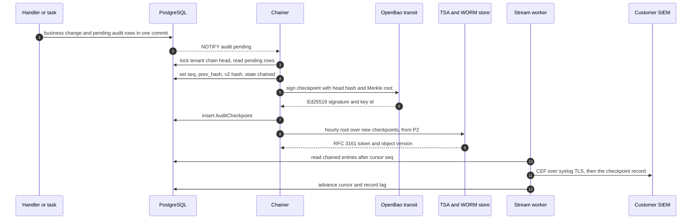

#### 12.2.8 Domain events, webhooks and notification channels

§13 owns the DomainEvent table and the outbox relay; this chapter owns the envelope, the catalogue and the consumers (X-08).

- **Envelope** (ADR-ENT-07). CloudEvents 1.0 in structured JSON: `id` (UUIDv7), `source`, `type`, `subject`, `time`, `dataschema`, plus the extensions `tenantid` (null for platform-scope events, which fan out per tenant), `actortype`, `actorid`, `aggregateversion` and `traceparent`. `data` carries ids, changed fields, `{en, ar}` labels and links, never secrets. Bulk ingest emits one batch event per run that references its change-set rather than one event per record.
- **Naming.** `[module.]aggregate.event` in the past tense. The trail uses `audit_trail.*`, because `audit.*` already names audit engagements. Other blocks' names are adopted and harmonised where they differ: `asset.*` and `connector_run.completed` (§9); `finding.*`, `remediation_ticket.*`, `control_impact.*` and the platform-scope `cve_signal.changed` (§10); `control_assessment.status_changed`, `requirement_signal.opened`, `requirement_signal.cleared`, `risk.score_changed`, `content_pack.version_installed` and `content_pack.version_applied` (§8); `tenant.provisioned` and `branding.published` (§11). This chapter adds `api_client.*`, `idp.certificate_expiring`, `session.revoked`, `auth.refresh_reuse_detected`, `audit_trail.*` and `webhook.endpoint_disabled`.
- **Catalogue.** `app/events/catalog.py` holds a JSON Schema per type and version; CI rejects unregistered types and non-additive changes. Today's 20 webhook names become aliases.

| Webhook aspect | Rule |
|---|---|
| Fan-out | Each event is matched against WebhookEndpoint filters (type, severity, OrgEntity); each match creates one WebhookDelivery |
| Delivery | Through the egress proxy; no redirects, 10 s timeout, 256 KB cap |
| Signing | Standard Webhooks headers `webhook-id`, `webhook-timestamp`, `webhook-signature: v1,<HMAC-SHA256>`, computed with the standard library; both signatures sent during secret rotation |
| Retries and dead letters | 8 attempts over about 48 h with backoff and jitter, honouring `Retry-After`; then a replayable dead letter |
| Auto-disable | A 410, or 3 days of failures, disables the endpoint, emits `webhook.endpoint_disabled` and notifies its administrators |
| Volume and order | Digests batch high-volume `finding.*` events; `aggregateversion` lets receivers discard out-of-order deliveries |

Jira and ServiceNow remain CTEM adapters that consume the same events (§10).

**Notification channels** (ADR-ENT-11). A NotificationRule maps event types and a minimum severity to recipients, channels and quiet hours; the default quiet hours are the Friday–Saturday weekend in `Asia/Riyadh`, and seeded rules reproduce today's behaviour. In-app notifications reuse `create_notification`; e-mails become retried tasks on the worker tier, which ends today's dropped `.delay()` mail. Teams uses Workflows webhooks with Adaptive Cards rendered `rtl` for Arabic, since Microsoft is retiring the classic Office 365 connectors (date to be confirmed; external source, to verify); Slack uses Block Kit. Both are WebhookEndpoint kinds on the same retry and dead-letter engine, with encrypted URLs and payloads that default to `minimal`.

In the worked example (§7.5), step 04's notifications to the CISO and the asset owner and any customer webhooks travel through these channels, and each automatic change in steps 02–04 lands in the trail under the system actor with its connector-run id.

### 12.3 Data model changes

The consolidated model is in §14; this table lists only the entities this chapter owns. Global User identity and Membership belong to §11, SigningKey and the DomainEvent table to §13.

| Entity | New / changed | Key fields | Relations | Phase |
|---|---|---|---|---|
| IdentityProvider | New | owner (tenant, partner or platform), protocol (`oidc`, `saml`, `ldap`), `name_i18n` (JSONB map of display names), status, non-secret config, `secret_ref` (envelope-encrypted), `group_role_map`, `scope_map`, `mfa_trust`, `enforce_sso` | VerifiedDomain N:M; Membership through the MembershipIdentityProvider association (§11) | P1 |
| ExternalIdentity | New | `idp_id` + `subject` (unique), `user_id`, `provisioned_by` (JIT, SCIM, legacy), `scim_external_id` | User, IdentityProvider | P1 |
| UserSession | Changed | `refresh_jti` and reuse state (P0); `handle_hash` (unique), `client_kind`, `auth_method`, `idp_id`, `amr`, `auth_time`, idle and absolute deadlines (P1) | User, IdentityProvider | P0–P1 |
| MfaDevice; MfaRecoveryCode | Changed; new | `secret_enc`, `kind`; `code_hash`, `used_at` | User | P1 |
| LoginEvent | Changed | `idp_id`, `entry_id` of the mirrored trail entry | ActivityLog | P0 |
| User | Changed | `keycloak_id` deprecated in favour of ExternalIdentity | ExternalIdentity | P1 |
| ApiClient | New, replaces ApiToken | owner (tenant or partner), `service_user_id`, `scopes`, `allowed_cidrs`, `rate_class`, `status`, `expires_at`, `approved_by` | User, Membership, ConnectorRun | P1 |
| ApiClientSecret | New | `key_id` (unique), `secret_hmac` or `public_jwk`, `expires_at`, `revoked_at` | ApiClient | P1 |
| IdempotencyRecord | New | tenant + principal + key (unique), body fingerprint, `response_ref`, `expires_at` | — | P1 |
| ActivityLog | Changed | `ingest_id`, `actor_type`, `api_client_id`, `session_id`, `request_id`, `route`, `outcome`, `changes`, `hash_version`, `chain_state` | ApiClient; AuditCheckpoint by `seq` range | P0 |
| AuditCheckpoint | New | `from_seq`, `to_seq`, `head_hash`, `merkle_root`, previous checkpoint, `signature`, `signing_key_id` | Tenant; SigningKey (§13) | P1 |
| AuditAnchor | New | kind (TSA, WORM), `tree_root`, `receipt`, proofs | AuditCheckpoint N:M | P2 |
| AuditLogSeal | Changed | `signature`, `archive_object_key` | Tenant | P1 |
| AuditStream; AuditExport | New | kind, format, endpoint, `credential_ref`, `cursor_seq`, `residency_ack`; filters, `object_key`, `sha256`, `signature` | Tenant or Partner | P1 |
| WebhookEndpoint | New, replaces `settings.webhooks` | kind (`webhook`, `teams`, `slack`), `url_enc`, secrets, `event_types`, filters, payload mode, language, status, `legacy_id` | WebhookDelivery, NotificationRule | P1 |
| WebhookDelivery | New | `endpoint_id`, `domain_event_id`, `attempt`, `status`, `next_attempt_at`, `response_status` | DomainEvent | P1 |
| NotificationRule; Notification | New; changed | `event_pattern`, minimum severity, recipients, channels, quiet hours; `domain_event_id`, `email_status` | WebhookEndpoint (chat channel); DomainEvent | P1 |
| DomainEvent (envelope) | Envelope and catalogue defined here; table in §13 | `type`, nullable `tenant_id`, `subject`, `aggregate_version`, actor, `data`, `traceparent` | WebhookDelivery, Notification | P0 |

### 12.4 Interfaces

All paths are under `/api/v1`; partner and platform variants mirror them (§11).

| Method | Path | Purpose |
|---|---|---|
| POST | `/auth/discover` | E-mail domain → IdP, without revealing a tenant |
| GET, POST | `/auth/sso/{idp_id}/start`, `/auth/sso/oidc/callback`, `/auth/sso/saml/acs`, `/auth/sso/saml/{idp_id}/metadata` | Federation |
| POST | `/auth/sso/ldap/login` (alias `/sso/ldap/login`) | Hardened LDAP |
| POST, GET | `/auth/login`, `/auth/mfa-login`, `/auth/step-up`, `/auth/logout`, `/auth/logout-all`, `/auth/session` | Sessions, MFA, recovery codes |
| GET, DELETE, POST | `/users/{id}/sessions`, `/users/{id}/mfa/reset` | Administrator session control; four-eyes MFA reset |
| CRUD, POST | `/identity-providers`, `/identity-providers/{id}/test`, `/identity-providers/{id}/activate` | IdP configuration |
| GET, PATCH | `/tenants/current/security` | Authentication policy |
| SCIM | `/scim/v2/Users`, `/Groups`, `/ServiceProviderConfig`, `/ResourceTypes`, `/Schemas` | Provisioning |
| CRUD, POST, GET | `/api-clients`, `/api-clients/{id}/secrets`, `/api-clients/{id}/usage`, `/api-clients/me` | Machine credentials |
| POST, GET | `/oauth/token`, `/oauth/revoke`; at the root `/.well-known/jwks.json`, `/.well-known/oauth-authorization-server` | RFC 6749, 7009, 8414 |
| GET | `/operations/{id}` | Status of 202 work |
| GET, POST | `/activity-log`, `/activity-log/{entry_id}`, `/activity-log/verifications`, `…/checkpoints`, `…/anchors`, `…/exports`, `…/streams` | Trail, integrity, export, SIEM |
| Existing | `/activity-log/retention`, `…/retention/seal`, `…/seals`, `…/login-events`, `…/access/{type}/{id}`, `…/verify` | Kept; seals signed; `/verify` wraps the verification job |
| GET | `/events/catalog`, `/events/schemas/{type}/{version}` | Event catalogue |
| CRUD, POST, GET | `/webhooks`, `/webhooks/{id}/test`, `…/{id}/rotate-secret`, `…/{id}/replay`, `…/{id}/deliveries` | Webhooks and chat channels; `/webhooks/events` stays as an alias of the catalogue |
| CRUD | `/notification-rules` | Notification routing |

**Events.** Emitted: `api_client.*`, `idp.certificate_expiring`, `session.revoked`, `auth.refresh_reuse_detected`, `audit_trail.*` (including `audit_trail.verification_failed` and stream lag) and `webhook.endpoint_disabled`. Consumed: every catalogued type, through webhook fan-out and NotificationRules.

**UI changes.**
- **Login:** e-mail first, SSO buttons in Arabic and English, an LDAP form that completes MFA, recovery codes and step-up prompts.
- **Settings → Security:** sessions with "sign out everywhere", MFA and recovery codes.
- **Admin → Identity:** IdP wizard with test, SP metadata, mapping preview and certificate expiry; SCIM; authentication policy.
- **Admin → Integrations:** ApiClients with a one-time secret; webhooks with delivery log and replay, replacing `WebhooksPage.tsx`; Teams, Slack and notification rules; SIEM streams.
- **Audit trail page**, restoring what `bc8421f` removed, for every audit reader: activity with field diffs, integrity, sign-ins, retention and exports.
- **Client:** `client.ts` and `store/auth.ts` move to cookie mode, and sign-out calls the API. New pages are capability-gated (§8) rather than listed in hand-synchronised role maps.
- **Developer portal** linked from the Integrations page.

### 12.5 Security, tenancy, Arabic/KSA and deployment considerations

**Security and tenancy.**
- **Isolation (X-05).** Every new tenant-owned table gets §13's RLS policy and joins the isolation suite. Lookups that run before the tenant is known (discovery, ExternalIdentity, sessions, MFA, API-key verification) go through the `grc_auth` role; partner-owned IdPs, clients and streams follow §11's partner scoping.
- **Secrets.** IdP client secrets and SAML keys, LDAP bind passwords, webhook and chat URLs and secrets, SIEM credentials and MFA seeds use `secret_box` v2 under the tenant key (§13, X-10) and are write-only in the API.
- **Blast radius.** API keys are scoped, IP-limited and expiring and can never administer identity; OAuth2 tokens live 15 minutes; browser sessions are `HttpOnly`; the scope intersection caps every client at its creator.
- **Takeover.** Identity is keyed on (IdP, subject); JIT runs only on verified domains; accounts are never linked by e-mail; SAML runs strict; a tenant accepts only the IdPs its memberships allow.
- **Outbound.** Webhook, chat, SIEM, TSA and IdP traffic goes through the egress proxy; in SaaS private ranges are denied and redirects are not followed. Changing a destination needs step-up and is audited.
- **Edge.** Cookie sessions need HTTPS in every channel, which §13's TLS-by-default on-prem profile provides. Where the marketing site shares the application host, as on grceye.com today, the edge must not forward the session cookies to marketing routes, or the application moves to its own host (§13).
- **Audit.** Database grants keep the trail append-only; purges need a signed seal, plus four-eyes approval for regulated tenants; denial logging is rate-limited; AI invocations are recorded as semantic entries (X-18).
- **PDPL.** Identifiers are minimal and diffs redacted. Erasure (DAT-06) pseudonymises the user profile and never rewrites the chain.
- **ECC-2:2024** (external source, to verify). 2-2-3-2 requires MFA for remote and privileged access; all SaaS access is remote, so the SaaS default is `all` and the on-prem minimum `privileged`. 2-12-3-3 (SIEM) is met by AuditStreams, and 2-12-3-5 (retention of at least 12 months) by the 365-day floor.

**Arabic and KSA.**
- IdP display names (`name_i18n`), login, error and step-up pages are bilingual; Problem Details keep `code` stable and localise `detail`; Arabic names from IdPs and SCIM are stored unchanged.
- Trail labels use the existing `activity_log.actions.*` keys; CSV carries a BOM; CEF and LEEF are UTF-8 escaped; reports render through `pdf_arabic.py` with the fonts that §8 bundles; Hijri dates are display-only. Teams cards use `rtl`, and e-mails already set `dir="rtl"`.
- Residency (X-15) uses §11's `Tenant.data_residency` (immutable) plus `Tenant.regulated`. For a tenant whose `data_residency` is KSA, webhook, chat, SIEM and TSA endpoints outside the Kingdom are cross-border transfers; if `Tenant.regulated` is set, the tenant must record a transfer basis or is limited to in-Kingdom endpoints. Chat payloads default to `minimal`.
- Entra ID and AD/ADFS are certified first; expiry reminders follow the Sunday–Thursday working week.

| Concern | SaaS / MSSP-hosted | On-prem |
|---|---|---|
| IdPs and SCIM | Self-service; public SP metadata and SCIM endpoint | Customer AD/ADFS/Entra ID and direct LDAP; SCIM needs inbound reachability from the IdP or Entra's provisioning agent |
| LDAP | A private directory only through the Site Collector's sign-in relay, from P2 (§9); OIDC or SAML before then | Direct, with certificate validation |
| Checkpoint key and anchoring | OpenBao transit under a KMS or HSM root; TSA and WORM | Local or TPM-sealed key at a stated lower assurance, or the customer's OpenBao or HSM; never a vendor-held key (X-10); anchoring optional |
| Webhooks, chat and SIEM | Egress proxy; private targets denied | Private targets allowed; local syslog |
| Portal and SDKs | Hosted portal on a subdomain | `/developers` in `grc-web`; offline bundle |
| Sessions and TLS | Traefik with ACME; each verified custom domain has its own sessions | TLS by default, self-signed until the customer installs a certificate |

### 12.6 Migration from today's code

Backend paths are relative to `backend/app/`, frontend files to `frontend/src/`.

| File or artefact | Action |
|---|---|
| `api/v1/dependencies/auth.py` | Principal resolver: `HTTPBearer(auto_error=False)` plus cookie, ApiClient and machine branches; function signatures kept |
| `core/security.py`, `endpoints/auth.py`, `endpoints/mfa.py`, `models/user_session.py` | JWT v2, cookies, refresh-reuse detection, server logout and logout-all, revocation on password change, `must_change_password`, MFA policy and recovery codes, `client_ip()` |
| `endpoints/sso.py`, `services/directory_auth.py` | Become `services/sso/{oidc,saml,ldap,mapping}.py`; `/sso/ldap/*` aliased |
| `models/ai_access.py` (ApiToken), `api/endpoints.ts:201-216` | Replaced by `models/api_client.py`, `endpoints/api_clients.py`, `endpoints/oauth.py`; the 404 wrappers re-pointed |
| `core/activity_middleware.py` | Becomes `core/audit_context.py` and `services/audit_writer.py`, keeping redaction, entity resolution and the read whitelist |
| `services/activity_chain.py`, `services/audit_retention.py`, `endpoints/activity_log.py` | Chainer, hash v2, checkpoints, verification job, exports, streams; `log_system_activity` stays as a wrapper |
| `endpoints/webhooks.py`, `endpoints/tenants.py`, `services/notification_generator.py`, `services/email_service.py` | Tables, dispatcher, rules, Teams and Slack, e-mail tasks; `webhooks` leaves the tenant-settings whitelist |
| `core/rate_limit.py`, `main.py`, `core/pagination.py`, `core/config.py` | GCRA on the Principal, Problem Details, spec export, cursors; `KEYCLOAK_*` removed, Keycloak (Apache-2.0) kept only as the CI test IdP |
| `client.ts`, `store/auth.ts`, `LoginPage.tsx`, `SettingsPage.tsx`, `WebhooksPage.tsx`, `CompanyAdminPage.tsx`, `App.tsx`, `Layout.tsx` | Single-flight refresh and server logout (P0); cookie mode, discovery, Identity and Integrations pages, audit-trail page (P1) |

The client migration is contained: the axios (MIT) client and its interceptor, four raw `fetch` call sites that add a Bearer header (AI and contract-analysis streaming, the document viewer), and the five SSE and WebSocket channels that put the token in the URL.

**Data migration.** Each step is an Alembic (MIT) revision run as an explicit job (X-04) and rehearsed inside §13's SQLite-to-PostgreSQL import.
1. `api_tokens`: assert zero rows (the seed has none), then drop the table; any rows found become disabled ApiClients flagged for rotation.
2. `settings.ldap` becomes an `ldap` IdentityProvider with its bind password encrypted; on-prem `LDAP_*` values become the sole tenant's IdP.
3. Directory users without a password get a `legacy` ExternalIdentity, completed at their next sign-in; the per-tenant system actors are excluded.
4. `settings.webhooks` become **paused** WebhookEndpoints, because nothing was ever delivered.
5. `activity_logs` gains its new columns; `chain_state` is `chained` (v1) or `legacy_unchained`. After the import verifies every chain to the same head hash (§13), a signed genesis checkpoint per tenant seals that head.
6. Session, journal and MFA columns are added; §13 re-encrypts the TOTP seeds; NotificationRules are seeded to reproduce today's behaviour.

**Compatibility.** Personal bearer JWTs keep working for 12 months, which keeps `backend/tests/acceptance.py` running; HS256 signatures are accepted for one release. Existing paths keep working with additive fields only, and the legacy webhook names and `/sso/ldap/*` remain as aliases. The SPA runs in dual mode behind a flag until every call site has moved; §13 keeps `?token=` URLs for one release with deprecation headers.

### 12.7 Delivery by phase

| Phase | Deliverable | Size | Depends on |
|---|---|---|---|
| P0 | E0.1 Live fixes: SPA calls server logout; single-flight refresh with 30 s grace and reuse detection; LDAP-form MFA; LDAPS certificate validation and StartTLS; trusted client IP in the journal and limits; `must_change_password` enforced; password change revokes sessions | S | §13 edge proxy headers |
| P0 | E0.2 Principal resolver, pure-ASGI audit context, JWT v2 claims | M | §11 TenantContext and Membership; §13 OpenBao |
| P0 | E0.3 Transactional audit writer, chainer, hash v2, denial and failure logging, TenantTask audit, chained sign-in entries | M | §13 PostgreSQL, Alembic, worker tier |
| P0 | E0.4 DomainEvent envelope, catalogue, `emit()`, naming rules | S | §13 outbox relay |
| P1 | E1.1 Cookie sessions (API as BFF), CSRF, timeouts, step-up, CSP enforcement | M | §13 `grc-web` and realtime tickets |
| P1 | E1.2 OIDC SSO: IdentityProvider, discovery, JIT, `map_claims()`, MFA trust, AR/EN administration | M | §11 VerifiedDomain and Membership |
| P1 | E1.3 SAML 2.0 SP; ADFS and Entra ID certified | M | E1.2 |
| P1 | E1.4 MFA policy, recovery codes, four-eyes reset, branded issuer | S | §11 BrandContext; §8 ApprovalService |
| P1 | E1.5a ApiClient (API keys, client credentials, scopes), principal rate limits, idempotency | M | §8 capabilities; §13 Valkey |
| P1 | E1.5b API product: stable v1 conventions, versioning and deprecation, OpenAPI 3.1 export, CI gates, portal, Python and TypeScript SDKs | M | E1.5a |
| P1 | E1.6 Audit-trail page, field diffs, signed checkpoints, verification, signed seals, exports, offline verifier | M | E0.3; §13 OpenBao and storage |
| P1 | E1.7 SIEM streams: syslog-TLS (CEF, LEEF, JSON), HTTPS with Splunk HEC preset, S3; lag alerts | M | E0.3; §13 egress proxy |
| P1 | E1.8 Webhooks (HMAC, retries, dead letters, replay, digests), Teams, Slack, notification rules | M | E0.4; §13 outbox relay and egress |
| P2 | E2.1 SCIM 2.0 Users and Groups for Entra ID and Okta | M | E1.2; §11 Membership |
| P2 | E2.2 External anchoring (RFC 3161, WORM) and inclusion proofs | S | E1.6 |
| P2 | E2.3 Partner IdPs, partner ApiClients across linked tenants, MSSP SOC stream | M | §11 MSSP-lite and PartnerTenantLink |
| P2 | E2.4 Passkeys, `private_key_jwt`, OIDC back-channel logout | S | E1.4, E1.5a |
| P2 | E2.5 Ingestion contract on the CTEM and inventory push routes; wider stable surface; more SDK languages | S | §9 import channel; §10 push API |
| P3 | E3.1 Customer-held checkpoint keys (BYOK, HSM) | S | §13 HSM root of trust |
| P3 | E3.2 Teams Graph bot for approvals, event export to a customer message bus, API usage analytics | S | E1.8; §11 metering |

Subtotals, approximate, at the midpoints S = 1.5, M = 4, L = 9 and XL = 16 person-weeks:
- **P0:** about 11 person-weeks. Coverage at the end of P0 is 63%; R8 stays partial, but the live session defects are closed and no audit entry can be lost.
- **P1:** about 33.5 person-weeks. Coverage reaches 81%, with R8 strong alongside R1 and R2: SSO, machine credentials, a documented API and a signed, exportable, streamable trail.
- **P2:** about 12.5 person-weeks. Coverage reaches 88% as R7 becomes strong; this chapter supplies its push contract and outbound events.
- **P3:** about 3 person-weeks. Coverage reaches 100% as R4 and R6 become strong.

Items counted elsewhere: the DomainEvent table, outbox relay, realtime tickets, Valkey, the Traefik edge, OpenBao and the re-encryption of stored secrets (§13); TenantContext, Membership, VerifiedDomain, brand tokens and quotas (§11); capabilities and ApprovalService (§8); the push routes themselves (§9, §10); the Site Collector's LDAP sign-in relay for SaaS tenants (§9, P2).

Debt closed (§5.8): SEC-01 (E0.1, E1.1); SEC-02 (E1.5a, on §13's Valkey); SEC-04's identity items (E0.1, E1.2–E1.4; tenant suspension and registration are §11's); SEC-05 (E0.3, E1.6, E1.7); PRD-01 (E1.5a, E1.8). SEC-03 is closed by §13's re-encryption, which this chapter's new secrets use from the start.

### 12.8 Key decisions and risks

| ADR | Decision | Rationale |
|---|---|---|
| ADR-ENT-01 | Embedded SSO broker: Authlib for OIDC, python3-saml for SAML (pysaml2 as fallback), hardened ldap3; Keycloak only as the CI test IdP | One user store, session model and trail; AR/EN self-service tied to Membership and VerifiedDomain; no JVM on the appliance; realm-per-tenant Keycloak is expected to strain at about 1,000 tenants (to verify) |
| ADR-ENT-02 | Opaque `__Host-` cookie sessions issued by the API as a same-origin BFF; bearer JWTs only for non-browser clients | Instant revocation and idle timeouts, no token in JavaScript; costs CSRF protection and a client migration |
| ADR-ENT-03 | ApiClient = service User + `system` Membership + scopes ∩ creator; API key or OAuth2 client credentials | No handler changes; an exact audit actor; a client never exceeds its creator |
| ADR-ENT-04 | Audit rows written in the business transaction; asynchronous single-writer chainer per tenant | Nothing lost and nothing serialised; seconds of monitored lag |
| ADR-ENT-05 | Ed25519-signed checkpoints in OpenBao plus external anchors, not a per-entry HMAC | Verifiable with a public key; the key stays off app hosts; rewrites are detected; unanchored on-prem has a stated lower assurance |
| ADR-ENT-06 | SIEM streams read the chain by `seq` cursor, not the outbox | Ordered, complete and replayable, without doubling writes (X-08) |
| ADR-ENT-07 | CloudEvents 1.0 envelope and Standard Webhooks HMAC signing | Interoperable; receivers verify with stock libraries; standard library only |
| ADR-ENT-08 | Curated stable API, URI major versions, RFC 9745/8594 deprecation, spec exported at build time | Only a tested surface is a contract; internal routes stay free to change |
| ADR-ENT-09 | Valkey GCRA limits keyed on the Principal and tenant | Per-client and per-tenant fairness for connectors and MSSP use; reuses `limits` |
| ADR-ENT-10 | SCIM 2.0 on scim2-models; Groups map to Team Groups | Reuses `models/group.py`; touches only the calling tenant |
| ADR-ENT-11 | Notifications as event consumers; Teams and Slack as webhook kinds | One retry and dead-letter engine; existing templates kept |

| Risk | Mitigation |
|---|---|
| SAML signature flaws or IdP misconfiguration | Strict mode, signed assertions, replay cache, negative tests against Keycloak and ADFS, fallback library, penetration test before GA |
| Account takeover through an unverified e-mail claim | (IdP, subject) and Entra `tid`/`oid` keys; JIT on verified domains only; IdP acceptance per membership |
| Cookie migration breaks SSE, AI streaming or downloads | Dual mode behind a flag; Playwright (Apache-2.0) flows in Arabic and English on every channel |
| Audit volume from diffs, reads and ingestion | Bulk summaries, redaction caps, read de-duplication, §13 partitioning, signed archives |
| Chainer lag during ingestion bursts | Batches of 1,000, per-tenant locks, lag metric and alert |
| Webhook or SIEM endpoints used for SSRF or data exfiltration | Egress allow-list, size caps, residency check, step-up and audit on change |
| Leaked machine credentials | Expiry and reminders, scannable prefix, IP allow-lists, revocation within 60 s |
| Ed25519 not accepted under NCA cryptographic standards | SigningKey records the algorithm per purpose (§13), so checkpoints can move to another algorithm such as ECDSA P-384 without a format change |
| An ApiClient stops working when its creator leaves, because the intersection empties | Warn before removing a creator with active clients; an administrator reassigns ownership |

**Questions for the committee** (§16.1, §16.4):
1. Packaging: should SSO, the trail, verification and exports be in the base product, with SIEM streams, anchoring and SCIM in higher tiers? Recommended: yes.
2. Which IdPs are certified first? Proposed: Entra ID and ADFS, then Okta.
3. Which time-stamping authority anchors the chain (preferably KSA-accredited), and do the NCA cryptographic standards accept Ed25519 or require ECDSA P-384?
4. May regulated tenants use webhook, chat and SIEM endpoints outside KSA with a recorded transfer basis, or are they blocked?
5. Defaults: MFA for every SaaS user, and a 15- or 30-minute idle timeout?
6. May banks ever purge audit data, or only archive it under legal hold, and does SAMA expect retention beyond 12 months?
7. Which domains and SDK languages belong in stable v1, and is PowerShell needed?
8. Does any government customer require Nafath sign-in?
9. Has `/api/v1/openapi.json` been publicly reachable in production (profile unverified, §5.7)?

## 13. Platform foundations and deployment

This chapter specifies the platform that every NG-GRC block runs on: database and migrations, tenant isolation in the database, runtime and worker tier, files, keys, observability, backup and disaster recovery, build and release, packaging and the KSA SaaS cell. It enables R4 (strict separation), R5 (protected packaging and commercial freedom) and R8 (an enterprise base). It installs §8's bundled Arabic fonts in every image, which keeps R3 strong in every channel, and implements AI residency (X-18). On BM-01 it answers slides 14–16: the licence and support limits of the open-source route, the integration burden of five products on five upgrade cycles, and Path C's single data model with full commercial freedom. Today GRCEye runs on one PM2 host with a SQLite file, twelve scheduler loops inside each web worker, optional Redis, partly unencrypted secrets and four packaging channels, of which only one builds. The target is one signed, Nuitka-protected image set on PostgreSQL only, with database-enforced tenant isolation, stateless API replicas behind Traefik, a Celery and Valkey worker tier, OpenBao-held keys and tested in-Kingdom backups, deployed the same way in the KSA SaaS cell, by MSSPs and on-prem.

### 13.1 Current state in brief

§3.2–3.4 and §5.7 describe today's platform:
- **Topology.** One host run by PM2 (AGPL-3.0; external source, to verify) behind `gateway.js`, two uvicorn workers, no HA.
- **Data.** One SQLite file for all 11 tenants, `create_all()` at every start, no Alembic revision and 40 SQLite-only ALTER scripts; PostgreSQL starts without frameworks (DAT-04, DAT-05).
- **Isolation.** Application predicates only; about 30 child tables reach their tenant only through a parent; no RLS or isolation test (TEN-01).
- **Background work.** Twelve loops in each web worker behind DB claims or host-local lock files; eight Celery `.delay()` calls dropped in SaaS (RUN-01).
- **Shared state.** Redis is optional, so revocation, limits, realtime and the AI quota live in each worker (RUN-02, SEC-02).
- **Secrets.** Second factors and integration credentials are stored in clear. The licence-signing key sits on the internet-facing SaaS host, and a snapshot of production data (classification to confirm; treat as PDPL-relevant until confirmed) and a credential are tracked in git (SEC-03, SEC-07, PKG-02).
- **Operations.** There is no logging configuration, metrics, real health probe, scheduled backup or PITR, and CI cannot pass (RUN-03, RUN-04).
- **Packaging.** Only the PM2 channel works, and Arabic PDF fonts ship only in the OVA (PKG-01, I18N-01).

Worth keeping: the schedulers' DB claims, the audit-chain hash, the SHA-256 file ledger, the connector SSRF guard, Ed25519 licensing, the appliance hardening and the client-seed builder's safety assertions. This chapter resolves items 3, 4 and 7–10 of §6.5.

### 13.2 Target design

Six principles apply: one image set for every channel; a stateless API; PostgreSQL only, with the tenant boundary enforced twice; fail-safe defaults; KSA tenants' data, telemetry, keys and AI processing kept in the Kingdom by default, with an AI endpoint outside the Kingdom possible only after an explicit, audited opt-in by the tenant administrator (X-18); and permissive dependencies, with LGPL libraries only when unmodified, dynamically imported, replaceable and excluded from compilation, and copyleft tools reached only over the network or through file formats (X-14).

| Component | Type (licence) | Responsibility | Extends existing code or new |
|---|---|---|---|
| Edge | Traefik v3 (MIT) | TLS, routing, WebSocket and SSE, body limits, headers, trusted client IP, verified custom domains, the machine mTLS entrypoint on `collect.<domain>` | Replaces `gateway.js` |
| `grc-web` | nginx-unprivileged image; nginx (BSD-2-Clause) | SPA with CSP, HSTS, `noindex`, runtime `config.json`, bilingual 503 page | Extends `Dockerfile.frontend.onprem` |
| `grc-api` | FastAPI (MIT), uvicorn (BSD-3-Clause) | REST, SSE and WebSocket; no loops and no DDL at start-up | Refactors `main.py` |
| Migrations | Alembic (MIT); `grc migrate` job | Baseline, RLS revision, expand/contract, drift check | Extends `backend/alembic/` |
| Legacy importer | `grc migrate from-sqlite` | Verified SQLite → PostgreSQL migration; hosts §8's link transform | New; reuses `make_client_seed_db.py` checks and `file_integrity.py` |
| Database isolation | PostgreSQL RLS and roles; PgBouncer (ISC) | Second enforcement of the tenant boundary beneath §11's TenantSession | New Alembic revision; per-role engines in `core/database.py` |
| Workers | Celery 5 (BSD-3-Clause) | Queues, TenantTask envelope, idempotency, retries, JobExecution | Extends `workers/celery_app.py` |
| Scheduler | Celery beat with RedBeat (Apache-2.0), two replicas | Leader-elected ticks | New |
| Outbox relay | Celery task with `LISTEN/NOTIFY` | Publishes DomainEvent rows with `SKIP LOCKED` | New |
| Shared state | Valkey 8 (BSD-3-Clause) | Broker; revocation, limits, locks, pub/sub, tickets, AI budgets | Extends `shared_state.py`, `rate_limit.py`, `ai_quota.py` |
| Egress proxy | Smokescreen (MIT) | Allow-listed outbound HTTP(S) | New |
| Storage | `core/storage.py`; aiobotocore (Apache-2.0); SeaweedFS (Apache-2.0) for on-prem HA | Streaming I/O with SHA-256, tenant-prefixed keys, legal hold | Extends `file_integrity.py`, `stored_file_version.py` |
| Keys | `core/kms.py`; hvac (Apache-2.0); OpenBao (MPL-2.0) | KeyProvider, `secret_box` v2, Signer, PKI | Extends `secret_box.py`, `licensing.py` |
| Licence authority | Same image, isolated deployment | Mint, revoke, activate and verify licences through transit signing | Moves minting out of `admin.py` and `license_server.py` |
| Telemetry | structlog (MIT or Apache-2.0); OpenTelemetry, prometheus-client, OTel Collector, VictoriaMetrics, VictoriaLogs, Jaeger, Perses (Apache-2.0); GlitchTip (MIT) | Logs, traces, metrics, probes | New `core/observability.py`; reworks `system.py` |
| Backups | CloudNativePG (Apache-2.0) or managed PITR; pgBackRest (MIT); restic (BSD-2-Clause) | WAL archiving, base backups, restore drills | Replaces `backup_db.py` |
| AI gateway (editor addition) | `ai_provider.py`; vLLM (Apache-2.0) or Ollama (MIT) as in-region server | Endpoint resolution per tenant, budgets, audit | Extends `ai_provider.py`, `tenant_ai_config.py` |
| Delivery | Dockerfile, Helm (Apache-2.0), compose; Packer (BUSL-1.1, build-only, **flag**); Harbor, Argo CD, cosign (Apache-2.0) | One signed image set; CI/CD | Replaces the Dockerfiles under `infrastructure/docker/`, the PM2 files and `ci.yml` |

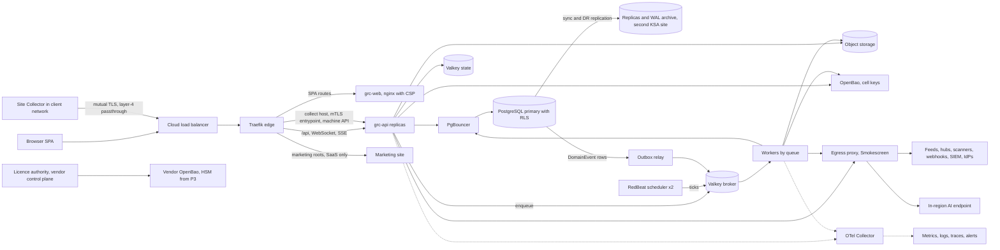

#### 13.2.1 PostgreSQL only and the Alembic baseline

PostgreSQL 16 (PostgreSQL License) is the minimum and the only system of record in every channel (X-03, ADR-PLT-01). CI also tests the newest major version. Databases use UTF-8 with ICU collations, so Arabic sorts correctly, and enable `pg_trgm` and `pg_stat_statements`. Dev and demo run PostgreSQL through compose, and SQLite (public domain) remains only as an import format. Oracle and SQL Server support is withdrawn, subject to the committee checking existing commitments (§16.1). A customer who mandates another engine gets PostgreSQL inside the appliance plus a reporting export.

Before the baseline, the following portability fixes land:
- `func.strftime` (`dashboard.py:220`) becomes Python bucketing.
- The five `LIKE`-on-JSON lookups become §8's link tables or JSONB containment.
- The 35 `SAEnum` columns get `native_enum=False, create_constraint=True`, giving VARCHAR columns with CHECK constraints (§14.1); SQLAlchemy 2.0 omits the CHECK by default.
- JSON becomes JSONB, and timestamps become timezone-aware UTC.
- The index `ix_scenario_tenant_ref` is declared in the model.
- `create_all` and the SQLite pragmas leave the runtime.

The Alembic baseline is cut once from the corrected models (X-04, ADR-PLT-02):
- **Order.** §8's association tables (ADR-COR-04) and content schema enter the models first, with the JSON link columns marked deprecated; `0002_rls` is generated from the classification registry (13.2.2).
- **Execution.** Migrations run as an explicit job (`grc migrate up`, a Helm pre-upgrade hook or the appliance console), never at start-up; readiness fails while the schema lags. CI runs `upgrade head`, `alembic check` and a round trip.
- **Compatibility.** Each release runs on schema N and N−1; contract steps follow a release later (the JSON columns go in P3, §8). From G2, columns change only through Alembic.

In P2, pg_partman (PostgreSQL License) partitions this chapter's append-mostly tables monthly: activity logs, DomainEvent, JobExecution and ConnectorRun (PF-28). Finding occurrences use §10's hash partitions on `tenant_id`. Policies sit on the partitioned parents, and application roles have no grants on individual partitions. PostgreSQL requires every unique key on a partitioned table to include the partition key, so three planned keys need a resolution before PF-28: the activity log's `(tenant_id, seq)`, `DomainEvent.dedup_key` and `JobExecution.idempotency_key`. PF-28 either picks a partition key that these keys can include, or enforces uniqueness per partition and leaves global uniqueness to the single writer, checked by verification; this is recorded as an open question in §16.4.

#### 13.2.2 Tenant isolation in the database

X-05 enforces the tenant boundary twice (ADR-PLT-03, ADR-MSP-03).
- **Application layer (§11).** TenantContext and TenantSession apply the ORM auto-filter and a flush guard. §11 specifies and counts this layer.
- **Database layer (this chapter).** Row-level security, the database roles, the `tenant_id` backfill and the isolation suite.

Every table declares an RLS class in its model metadata, and CI fails on an unclassified table.

| Class | Tables | `grc_app` in a tenant context | Other roles |
|---|---|---|---|
| Tenant | Today's tenant tables except `users`, plus about 30 backfilled child and per-user tables | Reads and writes own rows only | `grc_platform` reads the scheduling columns of due-work tables |
| Shared catalogue | The 5 tables whose NULL `tenant_id` marks a built-in row (frameworks, threats, risk matrices, compliance scales, regulatory feeds) and their children | Reads built-in (NULL) and own rows; writes own rows | `grc_platform` writes built-in rows through §8's installer |
| Global | The CVE, CWE, mandatory-document and translation-cache catalogues, plus §10's `cve_signals` | Reads | `grc_platform` writes |
| Operational | DomainEvent, JobExecution | Inserts and reads own rows | `grc_platform` relays, reads all and writes platform-scope rows |
| Identity | Users, credentials, sessions, MFA devices, Memberships, external identities (X-06) | No grants on credential tables | `grc_auth` only, because sign-in happens before the tenant is known |
| Partner (§11) | TenantKpiSnapshot, partner-owned configuration | Inserts own TenantKpiSnapshot rows (§11's per-tenant KPI job); reads the partner-owned configuration its tenant inherits (BrandingProfile, AI endpoint) through an active PartnerTenantLink; nothing else | Partner context through `app.partner_id` |

Today's counts do not map one-to-one onto these classes (Appendix B). `users`, `mfa_devices`, `password_reset_tokens`, `user_sessions` and `login_events` are Identity tables. `ai_access_requests` and `ai_usage_quotas` become Tenant tables with a NOT NULL `tenant_id`, and `api_tokens` is dropped (§12.6). `tenants` is a control-plane table read through `grc_auth` (§11.2.2), and the licence tables move to the authority database or to `grc_platform`. IdentityProvider, VerifiedDomain and ApiClientSecret, which §12.5 reads before the tenant is known, get `grc_auth` read policies.

**Policy.** `tenant_id = current_setting('app.tenant_id', true)` applies to `USING` and `WITH CHECK`, with `FORCE ROW LEVEL SECURITY`. The session's `after_begin` hook and the TenantTask envelope set it per transaction, so PgBouncer runs in transaction pooling mode without carrying a tenant across transactions. A transaction without a context sees no rows and cannot write; a metric counts such transactions. Dispatch ticks run as `grc_platform`, limited to the scheduling columns of due-work tables, and the work itself runs per tenant as `grc_app`.

**Backfill.** About 30 child and per-user tables (control assessments, audit findings, vendor contracts …) receive an indexed `tenant_id` with a foreign key during the import (13.6); children of shared catalogues get a nullable one. §8's composite tenant foreign keys make cross-tenant edges impossible.

**Roles.** X-05 defines four runtime roles, `grc_app`, `grc_auth`, `grc_platform` and `grc_readonly`; one administrative role, `grc_migrator`; and the non-login owner `grc_owner`, which holds the audit-chain SECURITY DEFINER functions. No runtime role bypasses RLS, and identity tables are protected by `grc_auth`. Each role also has its own `statement_timeout` (short for `grc_auth` and `grc_app`, longer for `grc_platform` jobs and `grc_readonly` reports), set in the RLS revision (PF-08); this is the per-role database-time limit that §11.2.2 assigns to this chapter.

| Role | Used by | Privileges |
|---|---|---|
| `grc_app` | API and tenant tasks | DML under forced RLS |
| `grc_auth` | Identity service and sign-in path (§12) | Identity tables only |
| `grc_platform` | Catalogue jobs, outbox relay, dispatch ticks | Global and operational tables; scheduling columns of tenant tables |
| `grc_readonly` | Reporting replica (P2) | `SELECT` under RLS |
| `grc_migrator` | Migration job and importer only | DDL and `BYPASSRLS`; never used by a running service |
| `grc_owner` | Nobody at runtime (NOLOGIN) | Owns all objects, and the SECURITY DEFINER functions that §12's audit chainer calls, still under forced RLS |

**Isolation suite.** A two-tenant crawler and an OpenAPI fuzzer call every route with tenant A's credentials and tenant B's identifiers, once with ORM criteria only and once with RLS only, so each layer is proven on its own. An AST lint and the classification test complete the suite, and the CI gate is zero leaks (TEN-01).

#### 13.2.3 Runtime: edge, web and API

**Edge.** Traefik v3 is the edge in every channel (X-07, ADR-PLT-06).
- **Traffic.** TLS 1.2+ with HSTS; forwarded headers trusted only from the load balancer; a request id; WebSockets and unbuffered SSE; body limits from one settings map.
- **Gateway rules.** `gateway.js` rules become routers or `grc-web` rules: marketing roots and SEO files (SaaS only), the `/_next/image` refusal, SPA deep links, `noindex` except on `/docs`.
- **Machines.** A dedicated Traefik entrypoint on `collect.<domain>` verifies machine client certificates against the machine CA and forwards the verified identity to §9's machine API in the API tier, stripping identity headers sent by clients. The cloud load balancer passes that host through at layer 4, so the certificates reach Traefik. There is no separate collect-gateway process; enrolment routes take a token instead (§9).
- **Custom domains.** Verified domains (§11) become dynamic routers, replacing the tenancy design's Caddy (Apache-2.0) edge (X-07). Kubernetes cells add a cert-manager (Apache-2.0) certificate per domain, because Traefik's own ACME store is per instance (external source, to verify); single nodes use Traefik's ACME resolver.
- **Cookies.** The application gets its own host name in the KSA cell, so §12's session cookies never reach marketing routes; until then the edge strips cookies there.
- **On-prem.** TLS by default, self-signed until the customer installs a certificate.

**grc-web.** An nginx-unprivileged image serves the SPA with HSTS, `noindex`, a runtime `config.json`, and bilingual 503 and maintenance pages. Its CSP starts in report-only mode, reporting to `/api/v1/csp-reports`; enforcement is §12's. Production builds drop `/cheat`.

**grc-api.** Stateless replicas run one uvicorn process per pod, or 2–4 workers on compose and OVA. `--proxy-headers` trusts only the edge network. One `client_ip()` helper replaces today's ad-hoc client-address readers, which derive the address inconsistently (SEC-02; locations in the evidence pack, Appendix C.2). Start-up only initialises telemetry and checks the schema revision.

#### 13.2.4 Worker tier and the twelve loops

All background work runs on Celery 5, with Valkey as the broker and RedBeat as the scheduler (X-07, ADR-PLT-05).
- **Scheduling.** Two beat replicas compete for a Valkey lock. The leader emits ticks, and tick tasks fan work out per tenant.
- **Correctness.** The existing DB claims remain the correctness guarantee. Leader election and Valkey locks only remove duplicate effort.
- **Queues.** `default`, `connectors`, `reports`, `ai` (low concurrency, long-running, with heartbeats), `notify`, `events`, `catalog` and `maintenance`. §11 adds per-tenant fairness (T2.1).

Each worker process keeps one persistent event loop and asyncpg (Apache-2.0) pool instead of today's `asyncio.run` with module-level engines. A week-2 spike validates this bridge; if it fails at G2, the tier moves to Procrastinate (MIT; transactional enqueue on PostgreSQL) and Valkey keeps only its state role. Every task travels in a TenantTask envelope (validated tenant id, principal, trace context, idempotency key), inside which §11's TenantContext binds the session. Each run writes a JobExecution row, stuck runs are recovered from their heartbeat, and runs that change tenant data write through the system actor into the audit trail (§12). The 8 `.delay()` calls become DomainEvents written in the business transaction, beat entries pointing at the three empty task modules are deleted, and the AI `BackgroundTasks` in `compliance.py` become §8's AnalysisRun task on the `ai` queue (counted in §8).

| # | Loop today | Today: cadence and guard | Target task, cadence and queue | Guard kept or added |
|---|---|---|---|---|
| 1 | Threat feeds (`threat_scheduler`) | 24 h; lock file | `feeds.fetch` daily as `grc_platform`, then per-tenant `feeds.ingest`; catalog | Valkey lock replaces the file; unique keys kept |
| 2 | Scheduled reports (`report_scheduler`) | 5 min; `next_run_at` claim | `reports.dispatch_due` every 60 s, then `reports.generate`; reports | `next_run_at` claim |
| 3 | CVE and CWE sync (`nvd_sync`) | 6 h; exclusive lock file | `catalog.nvd_sync` every 6 h and CWE every 30 days, as `grc_platform`; catalog | Valkey lock; §10 adds full KEV and EPSS |
| 4 | Scanner connectors (`vuln_scanner_scheduler`) | Hourly poll, per-connector interval; `last_sync_at` claim | `connectors.dispatch_due` every 60 s, then `connectors.run`; connectors | `last_sync_at` claim; ConnectorRun journal (§9) |
| 5 | Audit recurrence | Hourly; `recurrence_spawned_at` claim | `audits.spawn_recurrences` hourly; default | Claim |
| 6 | Archiving rules (`archiving_engine`) | 5 min; `next_run_at` claim | `archiving.run_due` every 5 min; maintenance | Claim and archive-record uniqueness |
| 7 | File retention | Hourly; row claim | `files.retention` hourly through StorageBackend; maintenance | Claim; legal hold honoured |
| 8 | Risk snapshots | Hourly; unique insert | `snapshots.risk` hourly; maintenance | Unique constraint |
| 9 | Trend snapshots | Hourly; unique insert | `snapshots.trend` hourly; maintenance | Unique constraint |
| 10 | Licence phone-home | 12 h; none | `licence.phone_home` every 12 h, on-prem only; default | Idempotent call |
| 11 | Notification sweep | 6 h; lock file | `notify.sweep` every 6 h, fanned out per tenant; e-mails as retried `notify.send` tasks; notify | Valkey lock; de-duplication kept |
| 12 | Machine translation (`translation_worker`) | 60–300 s; lock held for the process lifetime | `translate.batch` every 60–300 s; ai | Valkey lock and global AI semaphore; in-region endpoint (13.2.15) |

#### 13.2.5 Shared state, realtime and the outbox

**Valkey.** Valkey (BSD-3-Clause) replaces Redis, whose releases from 7.4 on are not permissively licensed (RSALv2/SSPLv1, with AGPL-3.0 added in Redis 8; X-14; external source, to verify).
- **Mandatory.** Required in the `saas` and `onprem` profiles: readiness fails without it, token refresh fails closed, and revocation checks fall back to the session table. Valkey holds no system-of-record data.
- **Topology.** SaaS runs two instances, `broker` and `state`, with AOF, `noeviction`, Sentinel and per-service ACLs; every state key has a TTL. On-prem runs one.
- **Rate limits.** Keyed on the authenticated user or the trusted client IP (SEC-02); §12 adds per-client and per-tenant buckets (ADR-ENT-09).
- **Realtime.** Chat and notifications fan out over Valkey channels, so any replica serves any socket, and 30-second single-use tickets replace the tokens that today's SPA puts in WebSocket and SSE URLs (SEC-01; call sites in the evidence pack, Appendix C.2).

**Outbox.** This chapter owns the DomainEvent table and its relay; §12 owns the envelope, the catalogue and `emit()` (X-08). Producers insert events in the business transaction. The relay, on the `events` queue and woken by `LISTEN/NOTIFY`, claims rows with `FOR UPDATE SKIP LOCKED`, hands them to consumers and stamps `published_at`; `dedup_key` is unique and `traceparent` continues the trace. The relay and §12's chainer hold their LISTEN connections directly to PostgreSQL, not through PgBouncer, whose transaction pooling does not support LISTEN (external source, to verify); both also poll every few seconds, so a missed notification only adds lag. Behind PgBouncer, asyncpg runs with its statement cache off unless PgBouncer 1.21+ `max_prepared_statements` is set. Platform-scope events fan out per tenant, bulk ingest emits change-set events (§10), and SIEM streams read the audit chain, not the outbox (ADR-ENT-06).

#### 13.2.6 Egress

All outbound HTTP(S) traffic leaves through Smokescreen (MIT), and NetworkPolicies deny any other egress.
- **Platform roles** use fixed allow-lists: feeds (NVD, CISA KEV, FIRST EPSS, MITRE), the cell's AI endpoints, and the vendor's licence and content services.
- **Tenant-configured destinations** (connector targets, webhooks, SIEM streams, IdPs) run public-only. Private, loopback and link-local ranges are denied, and redirects are not followed. This replaces today's defaults, which allow private targets. Private networks are reached through the Site Collector (§9).
- **SMTP** goes to an in-region relay.
- **On-prem**, feeds are off by default and private targets are allowed.

#### 13.2.7 Files: StorageBackend

StorageBackend has `fs` and `s3` implementations (X-09, ADR-PLT-07):

| Deployment | Backend |
|---|---|
| SaaS | An in-Kingdom S3-compatible service, or SeaweedFS on VMs if the provider has none |
| Single node | `fs` |
| On-prem HA | The customer's S3, or bundled SeaweedFS (Apache-2.0) |

MinIO (AGPL-3.0) is not bundled and is supported only as a customer endpoint. Its vendor also withdrew community binaries in 2025 (external source, to verify).

- **Keys and names.** Object keys (`t/{tenant_id}/{entity_type}/{entity_id}/{file_version_id}`) hold only IDs; Arabic file names stay in the database and are sent with RFC 6266 encoding.
- **Uploads** stream while the SHA-256 is computed and abort once past the route's cap; multipart sessions follow in P1.
- **Ledger.** StoredFileVersion gains backend, key, size, type and ETag; the unused `s3_key` columns hold the object key.
- **Retention and downloads.** Versioning is on, only the retention job deletes, `legal_hold` is honoured and Object Lock is used where available. Downloads pass an authorised, integrity-checked endpoint; presigned URLs live at most 60 seconds.
- **Encryption (P2).** Objects are encrypted in the application with the tenant's TenantDataKey, so destroying it crypto-shreds the files, backups included. The nightly usage metering job records storage use in TenantUsageSnapshot, which feeds §11's quotas.

#### 13.2.8 Keys, secrets and the licence authority

OpenBao (MPL-2.0) is the key service in every channel, reached through `core/kms.py` with hvac (Apache-2.0) (X-10, ADR-PLT-08). HashiCorp Vault, under BUSL-1.1 since version 1.15 (external source, to verify), is not bundled, though on-prem customers may plug in their own.

**Hierarchy.** A root of trust (cloud KMS or HSM in SaaS; Shamir custodians, a TPM or the customer's HSM on-prem) unseals OpenBao, which holds a never-exported KEK. The KEK wraps one TenantDataKey per tenant, and fields are AES-256-GCM with tenant, table, column and row as additional authenticated data.

**`secret_box` v2** writes `v2.{key_version}.{nonce}.{ct}`, still reads v1 and caches unwrapped keys for at most five minutes; a background job re-encrypts old values. In P0 it covers TOTP seeds, LDAP bind and webhook secrets, scanner and connector credentials and the bring-your-own AI key (SEC-03); on-prem source credentials stay in the Site Collector's sealed store (§9). Destroying a tenant's TenantDataKey crypto-shreds its secrets for §11's offboarding. The single deployment secret is split: tokens move to rotated Ed25519 keys (§12) and the secret-box key gives way to the KEK. Production secrets never sit in env files: Kubernetes receives them through the External Secrets Operator (Apache-2.0), and compose and OVA read root-only files in `/run/secrets`, optionally TPM-sealed with `systemd-creds` (systemd, LGPL-2.1+).

X-10 gives each purpose its own key: licence, content packs, intel bundles, images, audit checkpoints, API-token signing (JWT and JWKS), API-key HMAC pepper, machine certificates and agent updates. Signing keys are registered in SigningKey with a `kid` and sign domain-separated payloads.

| Purpose | Key | Held in | Used by |
|---|---|---|---|
| Field and object encryption | KEK wrapping one TenantDataKey per tenant | Cell OpenBao | `secret_box` v2; object encryption from P2 |
| API-token signing (JWT and JWKS) | Ed25519, rotated; public keys published as JWKS (§12) | Cell OpenBao | `grc-api` |
| API-key HMAC pepper | HMAC-SHA256 key; API keys are stored only as HMACs (§12) | Cell OpenBao | `grc-api` |
| Audit checkpoints | Ed25519 per installation (§12) | Cell OpenBao; on-prem may use a local or TPM-sealed key at a stated lower assurance | Audit chainer |
| Machine certificates | Intermediate CA, 30-day certificates (§9, X-13) | Cell OpenBao PKI engine (P2) | Machine API enrolment and renewal; the Traefik collect entrypoint verifies them (§9) |
| Licences | Ed25519, existing key imported as non-exportable | Vendor OpenBao, HSM-backed from P3 | Licence authority |
| Content packs | Ed25519 (§8) | Vendor OpenBao | Content CI |
| Intel bundles | Ed25519 (§10) | Vendor OpenBao | Offline intel-bundle build (P2) |
| Images and offline upgrade bundles | cosign key | Vendor OpenBao | Release pipeline |
| Agent updates | TUF roles (§9) | Vendor HSM (P3) | Agent release |

**Licence authority.** Minting leaves the internet-facing SaaS host for a deployment of the same image on a separate, isolated host in the vendor control plane (X-10, §6.5 item 8), proposed to run in the Kingdom (open question Q-50, §16.4; §11.8 question 4). The existing Ed25519 key is imported into OpenBao transit as non-exportable and every plaintext copy is destroyed; the public key does not change, so installed licences keep verifying, and a `kid` enables rotation. Only the authority may call transit signing; staff use SSO and MFA, and long-term licences need a second approver. It mints, revokes and verifies licences and adds the online activation that clients already call (PKG-02). Licence model v2 belongs to §11 (ADR-MSP-09).

#### 13.2.9 Observability

Observability follows X-16 and ADR-PLT-09.
- **Logs.** structlog JSON with request, trace, tenant, user, route, status, duration and job fields. Secrets are redacted. SQL echo moves to a `DB_ECHO` setting that production refuses.
- **Traces.** OpenTelemetry instruments the web framework, the ORM, the HTTP client, Celery and Valkey, and propagates through Celery headers and the DomainEvent `traceparent`. 10% of traces are sampled; error traces are always kept.
- **Metrics** (internal port): RED per route, queue depth and age, last success per job, outbox lag, connector outcomes, AI usage per tenant, unchained audit entries, transactions without tenant context, backup age, replication lag, certificate and licence expiry.
- **Probes.** `/livez`, `/readyz` (schema revision, Valkey, storage, key service) and `/startupz`; `/api/health` replaces the static `/health` that today's SPA probe cannot reach.
- **Backends.** In-region OTel Collector, VictoriaMetrics, VictoriaLogs, Jaeger, Perses and GlitchTip, which accepts the existing `sentry_sdk` (MIT) client. Grafana, Loki and Tempo (AGPL-3.0, **flag**) are never distributed. On-prem adds OTLP and syslog export to the customer's SIEM.
- **SaaS SLOs.** 99.9% availability; p95 reads under 500 ms; each job succeeds within twice its interval; outbox lag under 60 s; backups under 26 h old; a restore drill within 35 days.

#### 13.2.10 Backup and disaster recovery

| | SaaS KSA cell | On-prem single node | On-prem Kubernetes |
|---|---|---|---|
| Database | CloudNativePG synchronous replica; WAL archived every 60 s and daily base backups to the second in-Kingdom site, or the provider's managed PITR. barman-cloud is GPL-3.0 and runs as a separate process (SaaS only, **flag**) | pgBackRest WAL archiving and daily backups to a volume, NAS or S3 | CloudNativePG or the customer's tooling |
| Objects | Versioning and replication to the DR site | restic to the customer's target, checked against the SHA-256 ledger | Customer replication |
| Keys | Hourly encrypted OpenBao snapshots; recovery keys held by custodians | Inside the encrypted backup set | Customer |
| RPO / RTO | Zone loss: ≈ 0 / ≤ 15 min. Site loss: ≤ 5 min / ≤ 4 h | ≤ 15 min / ≤ 4 h | Per customer |

Restores are rehearsed, not assumed.
- **Monthly.** The SaaS cell restores into a scratch cluster and runs `grc backup verify`, which checks the schema revision, row counts, and the audit chains and object hashes of sampled tenants. The result is recorded as a RestoreDrill with the measured RPO and RTO.
- **Quarterly.** The cell fails over to the DR site.
- **On-prem.** Customers run the same verify command.

Runbooks are bilingual. These targets replace the figures in earlier customer-facing documents, including the one-hour RPO, which today's platform does not meet (§5.7; the full comparison is in the evidence pack, Appendix C.2). They need the committee's confirmation (RUN-03).

#### 13.2.11 CI/CD and supply chain

| Stage | Tools (licence) | Gate |
|---|---|---|
| Static checks | ruff, mypy, ESLint, gitleaks (MIT); `tsc --noEmit`; Trivy config scan, kubeconform (Apache-2.0) | No new findings |
| Backend | pytest (MIT); testcontainers (Apache-2.0) with PostgreSQL 16 and the newest major, Valkey and moto (Apache-2.0) | Self-tests ported to pytest; `alembic check`; full suite run as `grc_app` under forced RLS |
| Isolation | Two-tenant crawler, OpenAPI fuzzer, classification test | Zero leaks; every table classified |
| Importer | The stale release seed, synthetic drifted databases and an anonymised snapshot | Green verification report |
| Frontend | vitest (MIT); Playwright (Apache-2.0) in `en` and `ar` with RTL checks; axe-core (MPL-2.0, dev only) | Smoke tests pass in both languages |
| Security | Bandit, pip-audit, OSV-Scanner (Apache-2.0); Semgrep CE (LGPL-2.1, CI only, **flag**); Trivy image scan; ZAP baseline (Apache-2.0) from P1 | No critical or high finding without a waiver |
| SBOM and licences | cyclonedx-py, cyclonedx-npm, Syft (Apache-2.0); licence allow-list; notices bundle | AGPL, GPL, SSPL and BUSL denied at runtime; LGPL only when unmodified, dynamically imported, replaceable and excluded from compilation (X-14) |
| Release | cosign signatures; Harbor in-region registry; Argo CD to staging with manual promotion; `acceptance.py` after each deploy | Signed images; smoke test of the compiled build |

- **Sequencing.** CI precedes the large refactors (X-16): G1 requires it to be green on PostgreSQL.
- **Data.** Production data never enters CI. Rehearsals use production snapshots only in KSA staging, under production controls.
- **Supply chain.** The gates make R5 provable at each release (ADR-MSP-11):
  - LGPL `ldap3` and `python-bidi` stay unmodified, dynamically imported, replaceable and outside the Nuitka compilation;
  - `certifi` (MPL-2.0) is used unmodified;
  - a notices bundle ships;
  - the eight intuitem YAML files are removed from every artefact (X-14).

#### 13.2.12 Packaging and code protection

Three images serve every channel (ADR-PLT-10): `grc-backend` (roles `api`, `worker`, `beat`, `migrate`, `cli` and `licence-authority`), `grc-web` and, from P2, `grc-collector` (§9); the collector image and its OVA join this release pipeline when the Site Collector ships, inside §9's P2 Site Collector deliverable.

**Build.** A uv lock (Apache-2.0 or MIT) with hashes restores `cryptography`. Images run as non-root on a read-only filesystem and pin third-party images by digest; no Bitnami images or charts are used, because their free catalogue changed in 2025 (external source, to verify). The backend image installs §8's bundled Arabic fonts (Amiri and Noto, OFL-1.1) through `PDF_FONT_DIR`, the shaping libraries, tesseract's Arabic data (Apache-2.0) and poppler-utils (GPL-2.0+, separate process, source offer), so Arabic PDFs and OCR work in every channel (I18N-01).

**Protection.** Nuitka (Apache-2.0) compiles first-party code only, as `25-protect-app.sh` already does; CI fails if `app/*.py` sources ship and smoke-tests the compiled build. PyArmor (commercial) and the source-shipping network ISO are retired. Licence enforcement is in every image, SaaS cells hold a vendor-issued licence, and signatures verify offline with cosign.

**Delivery formats:**
- **Helm chart `ng-grc`**, with profiles `saas`, `mssp` and `onprem-k8s`.
- **Compose**, with profiles `core`, `openbao`, `ai`, `collector` and `observability`.
- **OVA** on Ubuntu 24.04 (mixed licences, with a source offer for its GPL packages), running the same compose stack on Docker Engine (Apache-2.0) and keeping today's hardening and console. It is built with Packer. `grc upgrade --bundle` installs a signed offline bundle, backs up first and can roll back.

#### 13.2.13 Fail-safe configuration profiles

`DEPLOYMENT_PROFILE` is `saas`, `onprem` or `dev`, and `ENVIRONMENT` defaults to `production` (ADR-PLT-12). Start-up refuses unsafe combinations, which settles §6.5 item 10 whatever production runs today. The profile sets the security defaults, and §11's deployment mode (ADR-MSP-10) gates the global functions. Start-up also refuses invalid pairings of profile and mode.

| Setting | `saas` | `onprem` | `dev` |
|---|---|---|---|
| API docs, `DEBUG`, `DB_ECHO` | Refused | Off by default | Allowed |
| HSTS and CSP | On | On with TLS | Report-only |
| Valkey | Required | Required | Optional |
| Private network targets | Denied; use the Site Collector | Allowed | Allowed |
| Outbound feeds | Through the egress proxy | Off by default | Off |
| AI endpoint | Approved in-region endpoints by default; others only under 13.2.15's residency rules (audited opt-in by the tenant administrator); `-cloud` models refused | Customer endpoint or bring-your-own | Any |
| Secrets source | OpenBao | `/run/secrets` files | Local env file |
| Deployment modes allowed (§11) | `saas`, `msp_hosted` | `appliance` | Any |

Other configuration changes:
- About 30 `os.getenv` kill switches move into Settings as `JOBS__{name}__ENABLED`.
- 16 dead settings are deleted.
- `grc doctor` extends `check_prod_readiness.py`.
- Runtime datastore configuration leaves the API for `grc db configure` on the console (TEN-03).

#### 13.2.14 The KSA SaaS cell

A cell is a complete stack in one region. Regions are hard partitions, and §11's placement record pins each tenant to a cell with an immutable `Tenant.data_residency` (X-15, ADR-PLT-11).

- **Provider.** Cell 1 runs on a CST-licensed cloud service provider that attests NCA CCC compliance at the classification its tenants need; candidates include SCCC, STC and the in-Kingdom regions of Google Cloud (Dammam) and Oracle Cloud (Jeddah, Riyadh) (external source, to verify). Managed Kubernetes, PostgreSQL, S3 and KMS are used where offered; otherwise RKE2 (Apache-2.0), CloudNativePG, SeaweedFS and OpenBao run on VMs.
- **Network.** Only the load balancer is public, NetworkPolicies deny by default, egress passes Smokescreen, administrators use an MFA bastion, and DR runs at a second in-Kingdom site.
- **High availability.** Stateless tiers run at least two replicas across zones; PostgreSQL keeps a synchronous replica in another zone and an asynchronous one at the DR site; Valkey and OpenBao run three nodes each.

| Capacity and sizing (assumptions to confirm) | Launch (P0 exit) | Scale target (P3) |
|---|---|---|
| Tenants / users / concurrent users | 200 / 5 k / 500 | 1,000 / 50 k / 5 k |
| API sustained / peak | 300 / 1 k rps | 1.5 k / 5 k rps |
| Assets / open finding occurrences | 1 M / 5 M | 10 M / 100 M |
| Connector runs per day / ingest burst | 10 k / 1 k findings/s | 200 k / 5 k findings/s |
| Objects / activity-log rows | 5 TB / 200 M | 100 TB / 2 B |
| Largest tenant | 100 k assets, 1 M occurrences | 200 k assets, 5 M occurrences |
| Edge, web and API | 2 edge, 2 web, 3–6 API pods | Horizontal autoscaling |
| Workers | 2–4 per queue | Queue-depth autoscaling with KEDA (Apache-2.0) from P2 |
| PostgreSQL | 8 vCPU / 32 GB primary with synchronous and DR replicas | Reporting replica and partitions (P2); dedicated database cells by contract (P3) |
| Valkey and OpenBao | 3 nodes each | 3 nodes each |

Today's 934 requests/s on two workers (§5.7) suggests three API pods suffice at launch; PostgreSQL is the scaling limit, hence partitioning, a reporting replica and KEDA in P2. Maintenance windows fall on Friday or Saturday nights, and SLA calendars follow the Sunday–Thursday week.

#### 13.2.15 AI service and residency (editor addition)

*This subsection is an editor addition implementing X-18. It is not part of the platform design paper.*

| Concern | Today (§4.8, §5.6) | Target | Deliverable |
|---|---|---|---|
| Default endpoint | `gpt-oss:120b-cloud` is relayed to a hosted service, so prompts leave the deployment | The KSA cell's default is an in-region endpoint: a self-hosted open-weight model served by vLLM (Apache-2.0) on in-Kingdom GPU capacity, or an in-Kingdom provider. The `saas` profile refuses `-cloud` models | PF-25 (M) |
| Tenant and partner configuration | `TenantAIConfig` has a read path only; no API or UI writes it; several call sites ignore it; a client can name any model on the shared daemon | API and a Settings tab for tenant admins; AIEndpoint rows owned by the platform or a partner (§11) list the approved endpoints and models; every call site resolves through `ai_provider.py` | PF-24 (M); partner-owned endpoints from P2 |
| Keys | v1 ciphertext keyed from the deployment secret | `secret_box` v2 under the tenant's TenantDataKey; only the last four characters are shown | PF-24 |
| Switch and budget | Per-user daily quota, held per process | Per-tenant on/off switch and daily token budget with per-user sub-limits, counted in Valkey and metered into TenantUsageSnapshot | PF-26 (S) |
| Egress and audit | Direct calls; the vendor web search cannot be switched off | All calls pass the egress proxy's AI allow-list. Each call writes an audit entry with task, model, endpoint, token counts and outcome, without the prompt. The web search becomes a per-tenant switch | PF-26 |
| Arabic quality | Prompt-enforced and unchecked | §8's output-language guard and per-model Arabic certification, B1-12 and B1-36 (ADR-COR-10): a model serves Arabic tasks only once certified | Counted in §8 |

**Resolution order.** Configuration resolves in the layers `ai_provider.py` already uses:
1. the cell default;
2. the partner's endpoint (from P2, when §11's Partner lands);
3. the tenant's choice, either an approved endpoint or its own host, which must pass the egress allow-list.

**Residency.** Each AIEndpoint records its `data_residency` in the same vocabulary as `Tenant.data_residency` (§11). For a tenant whose `data_residency` is KSA, an endpoint outside the Kingdom needs an explicit, audited opt-in by the tenant administrator; for a regulated tenant (`Tenant.regulated`), it is refused.

**Model.** The product's current default model family has open weights (Apache-2.0, external source, to verify). The cell can therefore serve it in-region without rewriting prompts, once it passes §8's Arabic certification.

**Concurrency.** Batch AI work uses the low-concurrency `ai` queue. Interactive streams leave from the API through the same proxy. A Valkey semaphore caps concurrent calls per endpoint.

**On-prem and MSSPs.** On-prem installs use the customer's endpoint or the compose `ai` profile with Ollama; air-gapped sites run with AI off or a local model. An MSSP may register its own in-region endpoint for its tenants.

**Timing.** The three deliverables land in P1, because they need P0's keys, Valkey and egress proxy, and the in-region endpoint needs the live KSA cell. Partner-owned endpoints and partner AI defaults are enabled when §11's Partner lands (T2.6, P2); the `owner_type` column exists from P1.

#### 13.2.16 Key flow: a tenant-scoped request

The sequence shows both isolation layers on an ordinary read. A scheduled connector run follows the same pattern:
1. a beat tick;
2. the `last_sync_at` claim;
3. a `connectors.run` task in a TenantTask envelope;
4. a pull through the egress proxy;
5. one transaction that ingests the findings, closes the ConnectorRun and writes the DomainEvents.

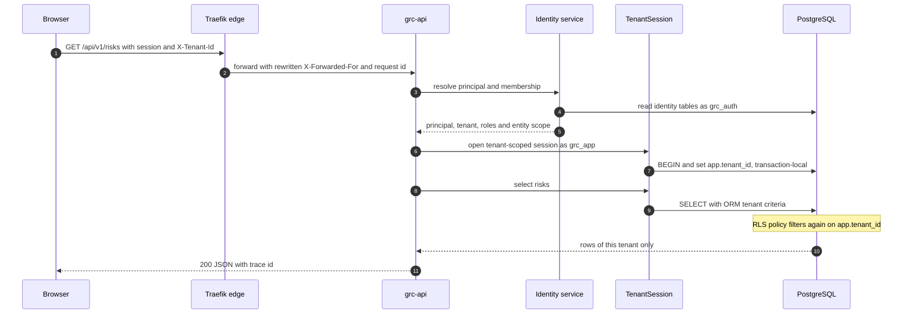

### 13.3 Data model changes

The consolidated model is in §14, and names follow X-17. This table lists only the entities this chapter owns. Other chapters own these related entities:
- placement and residency (Cell, TenantPlacement, `Tenant.data_residency` and `Tenant.regulated`): §11;
- ContentPack and ContentPackVersion: §8;
- the DomainEvent envelope: §12.

| Entity | New or changed | Key fields | Relations | Phase |
|---|---|---|---|---|
| About 30 child and per-user tables (control assessments, audit findings, vendor contracts …) | Changed | Backfilled `tenant_id` with FK and index; nullable on shared-catalogue children | Tenant; RLS | P0 |
| StoredFileVersion | Changed | Adds `storage_backend`, `object_key` (UK), `size_bytes`, `content_type`, `etag`; FK on `tenant_id`; `legal_hold` enforced | Polymorphic file parent | P0 |
| Evidence and five other file parents | Changed | `s3_key` holds the object key; `file_path` kept for legacy rows | StoredFileVersion | P0 |
| TenantDataKey | New | `tenant_id`, `version`, `wrapped_dek`, `kek_ref`, `state` | Tenant | P0 |
| SigningKey | New | `kid` (UK), `purpose`, `algorithm`, `kms_ref`, `public_key`, `status` | IssuedLicense; ContentPackVersion (§8); AuditCheckpoint (§12) | P0 |
| IssuedLicense (authority database) | Changed | Adds `signing_key_id` | SigningKey | P0 |
| PlatformInstallation | New | `installation_id` (UK), `cell_id`, `profile`, `platform_version`, `schema_revision` | LicenseActivation, RestoreDrill, installed ContentPackVersions | P0 |
| DomainEvent (table and relay) | New | `tenant_id` (NULL for platform scope), `type`, `subject`, `data` (CloudEvents names, ADR-ENT-07), `dedup_key` (UK), `aggregate_version`, actor type and id, `traceparent`, `published_at` | Consumers and WebhookDelivery (§12) | P0 |
| JobExecution | New | `job_name`, nullable `tenant_id`, `idempotency_key` (UK), `status`, `attempt`, `heartbeat_at`, `error` | ConnectorRun (§9) | P0 |
| RestoreDrill | New | `installation_id`, `rpo_seconds`, `rto_seconds`, `result`, report object key | PlatformInstallation | P0 |
| TenantUsageSnapshot | New | `tenant_id`, `snapshot_date`, `metric_key`, `value`; one row per tenant, date and metric (storage bytes, AI tokens, row counts …) | Tenant; filled by the usage metering job; read by §11's quotas and partner statements | P0 |
| AIEndpoint | New | `owner_type` (platform or partner), `owner_id`, `base_url`, `dialect`, `models`, `region`, `data_residency` (the vocabulary of `Tenant.data_residency`) | TenantAIConfig | P1 |
| TenantAIConfig | Changed | Adds `endpoint_id`, v2 key ciphertext, `daily_token_budget`, `web_search_enabled` | Tenant; AIEndpoint | P1 |

### 13.4 Interfaces

| Method | Path | Purpose |
|---|---|---|
| GET | `/livez`, `/readyz`, `/startupz`, `/metrics` (internal port) | Probes and metrics |
| GET | `/api/health` | Status for the load balancer and the SPA; `/health` stays as an alias for one release |
| POST | `/api/v1/realtime/tickets` | 30-second single-use ticket for WebSocket and SSE |
| GET, WS | `/api/v1/realtime/stream?ticket=`; `/api/v1/support/tickets/{id}/chat/ws?ticket=` | Channels fanned out through Valkey |
| POST | `/api/v1/csp-reports` | CSP violation reports; rate-limited |
| GET | `/api/v1/files/{version_id}/content` | Authorised, integrity-checked download |
| POST | `/api/v1/files/upload-sessions` | Multipart uploads (P1) |
| GET | `/api/v1/platform/status`, `/api/v1/platform/jobs`; `/api/v1/jobs` | Platform view for platform administrators; job runs of the caller's tenant for tenant administrators |
| POST | `/api/v1/platform/keys/rotate` | Key rotation and re-wrapping, with four-eyes approval |
| GET, PUT, POST | `/api/v1/tenants/current/ai-config`, `…/ai-config/test` | Tenant AI settings and connection test (P1) |
| GET, POST | `/api/v1/platform/ai-endpoints`; the partner variant under §11's partner prefix | Approved AI endpoints (P1; the partner variant from P2) |
| POST | `/authority/v1/licenses`, `…/{lid}/revoke`, `/authority/v1/activations`, `/authority/v1/licenses/verify`; from P2 `GET /authority/v1/crl` and `POST /authority/v1/activation-responses` (§11.2.9) | Licence authority, including the missing online activation |
| Removed | The runtime datastore-configuration routes (TEN-03; listed in the evidence pack, Appendix C.2) | Replaced by `grc db configure` on the console |

**CLI.** `grc migrate` (`up`, `check`, `from-sqlite`), `grc keys`, `grc backup` (`run`, `verify`), `grc doctor`, `grc upgrade` (`--bundle`, `--from-legacy`), `grc support-bundle` and `grc db configure`. §8 adds `grc content`.

**Events** registered in §12's catalogue:
- `maintenance_window.scheduled`: platform scope, fanned out per tenant;
- `job_execution.failed`: tenant-scoped when the job is;
- `signing_key.rotated`;
- `restore_drill.completed`;
- `ai_budget.exhausted`: tenant-scoped.

**UI changes.**
- **SPA:** ticket-based realtime, the `/api/health` probe, runtime configuration, bilingual 503 and maintenance pages, no inline scripts, no `/cheat` in production.
- **Super-admin:** a Platform tab for status, jobs, keys, backups, drills, the licence and AI endpoints.
- **Tenant admin:** a Job runs view and an AI settings tab.
- **Appliance console:** bundle upgrade, backup and restore, TLS certificate upload, key-provider setup and an Arabic menu.

### 13.5 Security, tenancy, Arabic/KSA and deployment considerations

- **Database.** TenantSession and RLS run on separate roles; a request without a tenant context sees no rows; identity tables are reachable only through `grc_auth`; the fuzzer and classification test run on every merge.
- **Objects.** Tenant-prefixed keys, storage credentials held only by the application, presigned URLs of at most 60 seconds, and prefix deletion plus key destruction at offboarding.
- **Tasks and operators.** Each task carries a validated tenant id and platform tasks run as `grc_platform`; operator actions chain into the platform tenant's trail, and staff reach tenant data only through §11's AccessGrants.
- **Edge and egress.** TLS 1.2+, HSTS, CSP, body limits, the real client IP and redacted logs; private ranges denied in SaaS.
- **Residency and assurance.** In a KSA cell the database, objects, backups, telemetry and keys stay in the Kingdom, DR site included, and so does AI processing by default: an AI endpoint outside the Kingdom is possible only after an explicit, audited opt-in by the tenant administrator (13.2.15). The licence authority also runs there if Q-50 confirms it. The provider holds a CST licence and complies with NCA CCC; SAMA-regulated tenants receive an assurance pack (SBOMs, drill records and a CCC self-assessment kept in NG-GRC).
- **Arabic and time.** Fonts in every image, ICU collation, ID-only object keys and RFC 6266 file names; UTC storage with `Asia/Riyadh` as the tenant default; bilingual runbooks, status page and console.

| Concern | SaaS or MSSP-hosted (Helm) | On-prem compose or OVA | On-prem Kubernetes |
|---|---|---|---|
| PostgreSQL and Valkey | HA with synchronous replica; Sentinel | Single node | CloudNativePG or the customer's own |
| Objects and keys | KSA S3-compatible store; OpenBao HA | `fs` or SeaweedFS; OpenBao, or a local key provider for install-local purposes (X-10) | Customer S3; customer OpenBao, Vault or HSM |
| Edge and TLS | Traefik with cert-manager | Traefik, self-signed until the customer installs a certificate | Cluster gateway or the chart's Traefik |
| Updates | GitOps with expand/contract | Signed offline bundle with rollback | `helm upgrade` |
| Telemetry and egress | In-region stack; egress proxy | `/metrics`, OTLP and syslog; feeds off by default | Customer's own |
| AI | In-region endpoint (13.2.15) | Customer endpoint or bundled Ollama; can be off | Customer endpoint |

### 13.6 Migration from today's code

| File or artefact | Action |
|---|---|
| `main.py`, `core/database.py`, `core/config.py` | Remove `create_all`, the loops and seeding; add per-role engines, tenancy events, JSONB, profiles and `secrets_dir`; fold the `os.getenv` flags into Settings; default to production |
| `core/db_config.py`, `endpoints/database_config.py` | Replace with the console CLI, which also removes their import cycle |
| `backend/alembic/` | Add the baseline and RLS revisions |
| The 40 `migrate_*.py` scripts, the shared migration helper, `deploy_elite_pack.py`, the `appliance_cli.py` migrate list | Retire; keep only as the importer's drift map |
| `grc_seed.db`, `make_client_seed_db.py`, `frameworks/loader.py`, `seed_mandatory_docs.py` | Replaced by §8's content-pack service; the seed stays as a test fixture |
| `workers/celery_app.py`, `workers/tasks/*`, the 12 `start_*` loops | Loop bodies become tasks; lock files become Valkey locks; claims are kept |
| `shared_state.py`, `rate_limit.py`, `ai_quota.py`, `endpoints/support.py` | Valkey mandatory; limits keyed on the user; pub/sub and tickets |
| `file_integrity.py`, `stored_file_version.py`, `file_retention.py` and the 13 modules that use `UPLOADS_DIR` | Move to StorageBackend |
| `secret_box.py`, `licensing.py`, licence minting in `admin.py`, `license_server.py` | Envelope v2 and Signer; minting moves to the licence authority |
| `security_middleware.py`, `auth.py` and `activity_middleware.py` (client-address readers), `endpoints/system.py` | Profile-driven headers, one `client_ip()` helper, readiness checks |
| `ai_provider.py`, `models/tenant_ai_config.py` | Endpoint registry, v2 keys, budgets and audit (13.2.15) |
| `gateway.js`, PM2 files, `next.config.js` rewrites, `infrastructure/docker/*`, composes, `build_client_release.sh`, `build ova/`, `ci.yml` | Replace with Traefik, one Dockerfile per image, `deploy/compose`, `charts/ng-grc`, the release pipeline and an OVA that runs compose |
| `pdf_arabic.py`, `client.ts`, `Layout.tsx`, `SupportPage.tsx`, `SuperAdminPage.tsx`, `ServiceDownPage.tsx` | Font directory, health probe, tickets, runtime configuration |
| The tracked configuration file, the production-data snapshot and the developer notes named in SEC-07 and §6.5 item 4 | Untrack, sanitise and rotate in week 1 (PF-01); rewrite git history after cutover, once approved (Q-53) |

**Importer.** `grc migrate from-sqlite` runs as `grc_migrator` against a database already at the baseline. The `ngc.legacy-library` pack is installed before the JSON-link transform, because the new link rows reference built-in requirement rows by URN or id. The cutover proceeds only when every check below passes.

| Step | Action | Check |
|---|---|---|
| 1. Snapshot | Read a snapshot taken with SQLite's online backup API, never the live file (CLAUDE.md forbids in-place mutation); map drift with the retired ALTER scripts | Source schema fingerprint recorded |
| 2. Copy | Copy tables in foreign-key order with type coercion: enums, JSONB, UTC timestamps (naive values read as UTC), booleans | Row counts per table and per tenant |
| 3. Tenancy | Backfill `tenant_id` on child and per-user tables; run §11.6 steps 1–4 (one Membership per user, the PlatformRoleAssignments, the `is_system` flags and the tenant fields); move orphans and duplicates to `_migration_quarantine` | Quarantine report; no foreign-key violation; every user has exactly one Membership |
| 4. Content | Install §8's `ngc.legacy-library` pack with built-in UUIDs unchanged; tenant clones migrate as data | Every framework reference resolves |
| 5. Links | Run §8's transform of the JSON id lists (43 fields) into 36 association tables (X-04, §14.4) | Dangling-id report |
| 6. Files | Copy uploads to tenant-prefixed object keys; quarantine unreferenced files instead of deleting them | Every SHA-256 matches |
| 7. Secrets | Re-encrypt clear-text and v1 secrets as v2 under each tenant's TenantDataKey, with the old deployment secret supplied through the secret store | Decrypt round trip |
| 8. Verify | Compare checksums of unchanged columns; verify every audit chain to the same head hash; run `acceptance.py` | Signed go/no-go report |

**SaaS cutover** (11 tenants, about 19 MB):
1. Run two rehearsals in the KSA staging cell, under production controls.
2. Announce a weekend window in Arabic and English, and set the PM2 stack read-only.
3. Take the final snapshot, import it and verify.
4. Switch the load balancer.
5. Keep the PM2 host read-only for 14 days as the rollback, then archive it encrypted.

The 11 tenants move to the new stack either way. Whether they go to the KSA cell or to a cell in their current region is the committee's decision (X-15, §16.1); the importer and runbook do not change. On-prem SQLite installs use `grc upgrade --from-legacy`, which keeps the old volume as the rollback.

**Compatibility.**
- `/api/v1` paths are unchanged.
- `/health` and `?token=` URLs keep working for one release, with deprecation headers.
- v1 secrets stay readable.
- The licence public key is unchanged.
- Old variable names keep working, with a warning.
- §8's dual-read shim covers the JSON links for one release.

### 13.7 Delivery by phase

P0 is the platform share of X-02's "Foundations and safety" phase. Sizes follow the effort-ownership rules: items owned by other chapters are referenced here, not counted. Midpoints are S = 1.5, M = 4 and L = 9 person-weeks. PF-01 and PF-02 are this chapter's share of §6.5's immediate safety items: they start now, under the GRCEye team's ownership, and do not wait for committee decisions (NG-03 informs the committee but does not gate them).

| Phase | # | Deliverable | Size | Depends on |
|---|---|---|---|---|
| P0 | PF-01 | Repository hygiene: untrack the snapshot and configuration file, sanitise the tracked developer notes, rotate exposed credentials and confirm that no seeded default account remains active, gitleaks gate; history rewrite planned after cutover | S | — |
| P0 | PF-02 | Live-system safety fixes: scheduled, encrypted, off-host backups of today's host; interim v1 encryption of clear-text secrets after a snapshot; licence-signing key moved off the internet-facing SaaS host; production profile verified; SaaS default-deny of private targets | S | — |
| P0 | PF-03 | Reproducible build: uv lock with hashes, `cryptography` restored, `jose` removed from the Nuitka build, dead dependencies dropped, ESLint configuration, `tsc` in the frontend build | S | — |
| P0 | PF-04 | CI v1 and supply-chain gates: PostgreSQL integration tests, self-tests in pytest, SBOM, licence policy, notices, intuitem removal, Trivy, signing | M | PF-03 |
| P0 | PF-05 | Fail-safe configuration profiles, production default, start-up validation, `secrets_dir`, `DB_ECHO`, job switches in Settings, `grc doctor` | M | — |
| P0 | PF-06 | Observability foundation: logs, traces, metrics, probes, JobExecution, SLO alerts, in-region stack | M | PF-05 |
| P0 | PF-07 | PostgreSQL portability fixes, Alembic baseline, `grc migrate` job, drift check; `create_all` and the ALTER scripts retired | M | PF-04; §8 link-table models |
| P0 | PF-08 | RLS: classification registry, `tenant_id` backfill on about 30 tables, policies, FORCE RLS, database roles with per-role `statement_timeout`, PgBouncer | L | PF-07; §11 TenantContext and Membership |
| P0 | PF-09 | Isolation suite: two-tenant crawler, OpenAPI fuzzer, two-key mode, AST lint, CI gate | M | PF-08 |
| P0 | PF-10 | Worker tier: async bridge, queues, RedBeat, the 12 loops, `.delay()` calls, `ai` queue, outbox relay | L | PF-07, PF-11; §12 event envelope |
| P0 | PF-11 | Valkey mandatory: broker and state instances, revocation, limits, locks, realtime pub/sub and tickets | M | PF-05 |
| P0 | PF-12 | Egress proxy with fixed allow-lists and public-only mode | S | PF-05 |
| P0 | PF-13 | StorageBackend, streaming uploads, tenant-prefixed keys, StoredFileVersion extension | M | PF-07 |
| P0 | PF-14 | Keys: OpenBao, KeyProvider and Signer, `secret_box` v2, TenantDataKey, SigningKey, re-encryption of stored secrets, secret split | L | PF-07; §11 Membership |
| P0 | PF-15 | Isolated licence authority: key import, `kid`, revoke and online activation | M | PF-14; §11 licence payload |
| P0 | PF-16 | Traefik edge and `grc-web` with report-only CSP, trusted proxy headers, `client_ip()`, WebSocket and SSE | M | PF-11 |
| P0 | PF-17 | Packaging: Nuitka-protected image set, Helm, compose, signed bundle, OVA; fonts and OCR installed in images | L | PF-04, PF-16; §8 bundled fonts |
| P0 | PF-18 | Backup and DR: PITR to the second KSA site, pgBackRest on-prem, object replication, key snapshots, drill automation, bilingual runbooks | M | PF-17 |
| P0 | PF-19 | SQLite → PostgreSQL importer with verification and two rehearsals | L | PF-08, PF-13, PF-14; §8 `ngc.legacy-library` pack and link transform |
| P0 | PF-20 | KSA cell build-out, cutover of the 11 tenants, first DR drill, PM2 host retired | L | PF-17 to PF-19; cloud procurement; committee placement decision |
| P1 | PF-21 | Multipart upload sessions | S | PF-13 |
| P1 | PF-22 | ZAP baseline DAST in CI | S | PF-04, PF-16 |
| P1 | PF-23 | Bilingual status page | S | PF-06 |
| P1 | PF-24 | AI provider configuration API and UI for tenants, AIEndpoint registry with platform-owned endpoints, v2 keys (editor addition) | M | PF-14 |
| P1 | PF-25 | KSA in-region inference endpoint; `saas` profile refuses `-cloud` models (editor addition) | M | PF-12, PF-20; §8 Arabic certification |
| P1 | PF-26 | Per-tenant AI switch and token budget in Valkey; AI-call audit and metering (editor addition) | S | PF-11; §12 audit writer |
| P2 | PF-27 | OpenBao PKI engine for machine certificates, deny list, on-prem local CA | M | PF-14; §9 enrolment |
| P2 | PF-28 | Monthly partitioning of activity logs, DomainEvent, JobExecution and ConnectorRun. PostgreSQL requires every unique key on a partitioned table to include the partition key, so the activity log's `(tenant_id, seq)`, `DomainEvent.dedup_key` and `JobExecution.idempotency_key` need a resolution first (open question in §16.4) | M | PF-07 |
| P2 | PF-29 | KEDA queue-based autoscaling | S | PF-20 |
| P2 | PF-30 | Reporting read replica under RLS | S | PF-18 |
| P2 | PF-31 | Full site-failover exercise | M | PF-18, PF-20 |
| P2 | PF-32 | Per-tenant application-side object encryption, with re-encryption of existing objects | M | PF-13, PF-14 |
| P3 | PF-33 | HSM root of trust for the OpenBao seal and vendor signing keys | M | PF-14 |
| P3 | PF-34 | Agent-update signing keys and service | S | PF-33; §9 agent |
| P3 | PF-35 | Repeatable cell provisioning, dedicated database cells and the MSSP partner-hosted Helm profile | M | PF-20; §11 placement registry |

**Subtotals (approximate, at midpoints):**
- **P0:** about 100 person-weeks (4 S, 10 M, 6 L).
- **P1:** about 14 person-weeks, of which 9.5 are the editor-added AI service.
- **P2:** about 19 person-weeks.
- **P3:** about 9.5 person-weeks.

| End of | Coverage | Turns strong | This chapter's part |
|---|---|---|---|
| Today | 4.5/8 (56%) | R5 already strong (licence-only bar) | — |
| P0 | 5/8 (63%) | R3 | §8's bundled fonts installed in every image (PF-17) |
| P1 | 6.5/8 (81%) | R1, R2, R8 | Valkey, keys, outbox and edge beneath §12's R8 work |
| P2 | 7/8 (88%) | R7 | Worker tier, egress and partitioning beneath §10's ingest |
| P3 | 8/8 (100%) | R4, R6 | R4: database isolation (P0), object encryption (P2), dedicated cells (P3). R6: PKI (P2) and agent-update signing (P3) |

R5 stays strong throughout, and the supply-chain gates keep it provable at each release. The coverage column assumes that R1 becomes strong in P1; unless redistribution rights are cleared or the committee decides that reference mode meets R1, the figures are 75%, 81% and 94% at the ends of P1, P2 and P3 (§15.3).

**Gates and sequencing.** P0 takes 18–20 weeks. Its platform share (about 100 person-weeks) needs about six engineers of the §15.4 team: the two platform/SRE engineers, the security and test-automation engineer and about three backend engineers, plus 10–15% contingency. The critical path is PF-03 → PF-04 → PF-07 → (PF-08, PF-10, PF-13, PF-14) → PF-19 → PF-20.

| Gate | Week | Exit criteria |
|---|---|---|
| G1 | 3 | PF-01 and PF-02 closed; CI green on PostgreSQL; profiles and structured logging in place |
| G2 | 7 | Alembic baseline merged; async bridge validated, or Procrastinate chosen; storage and key interfaces merged |
| G3 | 12 | RLS enforced in staging; loops out of the web tier; first import rehearsal passed |
| G4 | 16–18 | KSA cell live; 11 tenants cut over; DR drill passed |
| G5 | 20 | Helm, compose and OVA built from the same signed images |

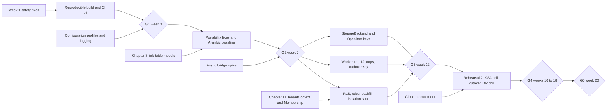

P1 runs in parallel:
- **From week 0:** KSA content authoring, import design, Arabic UI fixes and identity work.
- **From G1:** new frontend code follows the CSP rules.
- **From G2:** new work uses only Alembic for columns, tasks for background work, repositories for data access and StorageBackend for files.

### 13.8 Key decisions and risks

| ADR | Decision | Rationale |
|---|---|---|
| ADR-PLT-01 | PostgreSQL is the only system of record; SQLite is an import format; Oracle and SQL Server are withdrawn (X-03) | RLS, JSONB and transactional DDL with one test matrix; Oracle DDL fails on 42 of 84 tables |
| ADR-PLT-02 | Re-baseline Alembic from the corrected models; migrations run as explicit expand/contract jobs (X-04) | Already a dependency, verifiable, and CI blocks drift |
| ADR-PLT-03 | Double isolation: TenantSession plus RLS on a transaction-local setting with dedicated roles (X-05) | Schema-per-tenant multiplies migrations by up to 1,000; RLS alone gives poor errors |
| ADR-PLT-04 | Signed ContentPacks replace the seed database, delivered by §8 (X-11, ADR-CNT-04, ADR-CNT-08) | Engine-neutral, updatable offline, verifiable, with stable UUIDs |
| ADR-PLT-05 | Celery on Valkey with a RedBeat-elected beat; DB claims remain the correctness guarantee; Procrastinate is the fallback at G2 (X-07) | Already a dependency and widely known; the async bridge is proven by a spike |
| ADR-PLT-06 | Traefik v3 and the nginx-based `grc-web` replace `gateway.js` and the proposed Caddy edge (X-07) | WebSockets, ACME, one configuration model for Kubernetes and compose, MIT licence |
| ADR-PLT-07 | Pluggable storage (`fs` or S3-compatible); SeaweedFS for on-prem HA; MinIO not bundled (X-09) | No AGPL code with an uncertain supply in artefacts |
| ADR-PLT-08 | OpenBao, envelope encryption v2 and an isolated licence authority (X-10) | Permissive licence, one tool in every channel, Ed25519 transit and PKI |
| ADR-PLT-09 | structlog, OpenTelemetry and Prometheus with permissive backends; AGPL tools never shipped (X-16) | Failures become visible without licence exposure |
| ADR-PLT-10 | One Nuitka-compiled, licence-enforced image set everywhere; the OVA runs compose (X-14) | SaaS runs what customers receive; PyArmor costs end; the compiled-build smoke test is a CI gate |
| ADR-PLT-11 | Cell-based KSA SaaS on a CST-licensed provider with PITR and an in-Kingdom DR site (X-15) | Residency guaranteed per deployment rather than per row |
| ADR-PLT-12 | Fail-safe configuration profiles with production as the default | Unsafe settings are refused at start-up instead of discovered in production |

| Risk | Mitigation |
|---|---|
| RLS breaks hidden paths (middleware sessions, background writers) | Full suite under forced RLS, missing-context metric, enforcement in staging one table group at a time |
| RLS cost with asyncpg and PgBouncer | Transaction-local settings, indexes leading with `tenant_id`, benchmark before cutover |
| SQLite data faults (orphans left while foreign keys were off, duplicates) | Quarantine with a report; two rehearsals on real snapshots |
| The Celery async bridge is unstable with asyncpg | Week-2 spike; Procrastinate fallback decided at G2 |
| Cutover of a live system that runs from a git working copy | Change freeze, rehearsals, read-only rollback host for 14 days |
| The licence key leaks before it moves | Moved off the internet-facing SaaS host in week 1 (PF-02); imported rather than regenerated, so existing installs keep verifying |
| The committee places the 11 tenants outside KSA | A second, non-KSA cell in P0 (about one more M); same importer and runbook |
| The cloud provider lacks managed services | CloudNativePG, SeaweedFS and OpenBao on VMs under RKE2 |
| In-Kingdom GPU capacity or Arabic quality falls short for AI | An in-Kingdom provider as fallback; §8's per-model certification; per-tenant AI switch |
| P0 (about 100 person-weeks here) competes with P1 | Gates G1–G5; P1 adopts the new conventions from G2 |
| Nuitka build fragility | First-party code only; smoke test of the compiled build in CI |
| Personal data leaks into telemetry | Redaction, in-region stack, synthetic data in CI |

**Open questions for §16.4:**
1. What runs in production today (PM2 processes, `ENVIRONMENT`, Redis), and where is the host located?
2. Which on-prem installations exist, and on which releases?
3. Which cloud provider and data classification apply, and does the SaaS itself need CST registration?
4. Can the committee confirm the capacity figures, 99.9% availability and the RPO/RTO targets?
5. Does any contract still require Oracle or SQL Server?
6. Do the NCA cryptographic standards accept Ed25519, AES-GCM and HKDF, and must SaaS keys live in an HSM?
7. Does PDPL allow operations staff outside KSA to access production?
8. Should the repository move to a company organisation with CI runners in KSA, and who approves rewriting the git history that holds production data (classification to confirm; treat as PDPL-relevant until confirmed)?
9. What level of code protection do MSSP partners need?
10. How does PF-28 keep the activity log's `(tenant_id, seq)`, `DomainEvent.dedup_key` and `JobExecution.idempotency_key` unique under monthly partitions: a partition key that these keys can include, or uniqueness per partition enforced by the single writer and checked by verification?

## 14. Target data model

Chapters 8 to 13 each specify the data model of their own block. This chapter consolidates those pieces into one schema, checks that they fit together, and records the naming decisions required by X-17. It adds no deliverable and no effort: every entity is specified, sized and delivered in its owner chapter, and this chapter refers to that chapter. The current model is described in §5.1, and its debts are DAT-01 to DAT-06 and TEN-01 (§5.8).

The target is GRCEye's existing schema, extended in place rather than replaced by a new database (X-01). Today's 113 tables keep their keys and almost all of their foreign keys. The blocks add about 155 tables and change about 60 existing ones, besides the `tenant_id` backfill of §14.4; the catalogue in §14.2 lists them all. Three changes account for most of this work:
- **One graph.** The JSON lists that link rows today become typed association tables: 43 JSON id-list fields → 36 association tables. This happens once, inside the SQLite → PostgreSQL import, with a dual-read shim for one release (X-04, DAT-01).
- **One control model.** Requirements become a node tree, addressed by URN, with immutable revisions. ControlImplementation links each requirement to the applied controls that meet it, and those controls carry tests, asset coverage and evidence links. Automated signals overlay human verdicts and never overwrite them (X-11, X-12, DAT-02).
- **Inventory and exposure as first-class entities.** A reconciled golden asset carries its identifiers and installed software, and a finding has one occurrence per affected asset. The BM-01 chain, asset → finding → requirement → risk → ticket, then runs entirely on foreign keys (§7.5, DAT-03).

| Requirement | Where it lands in the model | Owner |
|---|---|---|
| R1 KSA content | Framework revisions; the FrameworkControl node tree with URNs; ControlTranslation text kinds; SourceDocument; MappingSet and RequirementMapping; ApplicabilityDimension and ScopeFact | §8 |
| R2 Full GRC lifecycle | ControlImplementation, ControlTest, Evidence and EvidenceLink, AssessmentProposal, association tables, stored residual risk, KRIs, ApprovalRecord, attestation campaigns, VendorAssessment | §8 |
| R3 Arabic and RTL | Official Arabic text with authority and source page; `*_i18n` label maps; Arabic-normalised search columns | §8 |
| R4 Multi-entity and MSSP | Membership, Partner, PartnerTenantLink, AccessGrant, OrgEntityClosure, Cell; the RLS classes | §11, §13 |
| R5 White-label and resale | BrandingProfile, VerifiedDomain, CustomDomain; licence v2 entities | §11 |
| R6 Inventory collection | AssetIdentifier, AssetSourceRecord, reconciliation entities, DirectoryPerson, SoftwareInstallation, Connector, CollectorSite, Agent | §9 |
| R7 CTEM connection | Finding, FindingOccurrence, CveSignal, ControlImpactRule and ControlImpactMatch, RequirementSignal, ScenarioFinding, RemediationTicket, SlaPolicy | §10, §8 |
| R8 Enterprise base | IdentityProvider, ExternalIdentity, ApiClient, ActivityLog v2 with checkpoints, DomainEvent, WebhookEndpoint | §12, §13 |

### 14.1 Modelling conventions

These conventions apply to every table, whichever block owns it. The review of the Alembic baseline (PF-07) checks every model against them.

**PostgreSQL only.** The model targets PostgreSQL 16 and later (PostgreSQL License) and uses its features directly: row-level security, JSONB, `MERGE`, declarative partitioning, `pg_trgm` and ICU collations (X-03, ADR-PLT-01). No portability layer is kept for Oracle, SQL Server or SQLite; SQLite (public domain) survives only as the format the importer reads. The following type fixes land before the baseline (§13):
- the 35 `SAEnum` columns become VARCHAR columns with CHECK constraints;
- JSON columns become JSONB;
- every timestamp becomes timezone-aware UTC;
- the 76 date columns that hold ISO strings today become typed dates or timestamps, converted by the import. This chapter extends §13's timestamp rule to them; values that do not parse are reported.

Dates are stored in the Gregorian calendar; Hijri is a display option only (§8).

**Keys.** Every table keeps the UUID primary key of today's `Base` mixin. Identifiers are preserved through every migration step for built-in frameworks, vulnerabilities that become findings, evidence, connectors and users. As a result, foreign keys, audit-chain entries and the exports customers already hold stay valid.
- Event ids are UUIDv7, which sorts by time (§12).
- Human-readable references, such as `RT-n` ticket numbers and scenario `ref_id`s, are separate columns that are unique per tenant. They are never keys.
- On partitioned tables, the primary key includes the partition key, for example `(tenant_id, id)`.
- Keys could move from `varchar(36)` to the native `uuid` type. The baseline review decides this. The change would require the importer to prove first that every legacy id parses as a UUID.

**Tenant column and RLS classes.** Every table declares one of six classes, and CI fails on any table without one (X-05, ADR-PLT-03).

| Class | Tenant column and policy | Examples |
|---|---|---|
| Tenant | `tenant_id NOT NULL`; rows visible only when `tenant_id` matches the transaction-local tenant setting | Today's tenant tables except `users`, about 30 child and per-user tables that get the column by backfill, and every new tenant-owned table |
| Shared catalogue | Nullable `tenant_id`; rows with NULL are readable by every tenant and written only by `grc_platform` | Frameworks with their nodes, texts and mappings; threats; matrices; scales; software products; impact-rule templates |
| Global | No tenant column and no RLS; only `grc_platform` writes | CVE and CWE catalogues, CveSignal, CveApplicability, hub object claims |
| Operational | Nullable tenant; NULL marks a platform-scope row | DomainEvent, JobExecution |
| Identity | Outside tenant RLS; reached only through the `grc_auth` role | Users, sessions, MFA devices, memberships, external identities |
| Partner | Readable under a partner setting, only for links that grant it | TenantKpiSnapshot, partner-owned configuration |

The following rules follow from these classes:
- `tenant_id` is the leading column of every index on a tenant table.
- Child tables carry their own denormalised `tenant_id`, so RLS policies never join to a parent table.
- Tenant-owned parent tables expose `UNIQUE (tenant_id, id)`, and association rows reference them through composite foreign keys. A cross-tenant edge therefore cannot be stored, even if a handler forgets its filter (ADR-COR-04).
- Links to shared-catalogue rows are plain foreign keys, and the service checks that the row is visible to the tenant.
- Children of shared-catalogue tables use the same nullable `tenant_id` column as their parents (§14.5).
- `Framework.is_builtin` defaults to False. This chapter also proposes a CHECK constraint that keeps it equal to `tenant_id IS NULL`, added once the import confirms that no row breaks it.

Isolation is enforced twice: by an app-layer TenantSession (ORM auto-filter and flush guard) and by PostgreSQL row-level security on a transaction-local tenant setting, through the policies above (X-05). The database roles are the runtime `grc_app`, `grc_auth`, `grc_platform` and `grc_readonly`; the administrative `grc_migrator`, which runs only migrations and the import; and the non-login owner `grc_owner`, which holds the audit-chain SECURITY DEFINER functions. No runtime role bypasses RLS, and isolation tests gate CI. Entity scope inside a tenant is a nullable `org_entity_id` column. The application filters on it through `OrgEntityClosure`; RLS does not (X-06, ADR-MSP-05).

**Requirement identity.** Every node of a regulator's document carries a URN of the form `urn:ngc:<publisher>:<family>:<edition>:<code>`, for example `urn:ngc:nca:ecc:2-2024:2-10-3-1`. Framework editions have URNs of their own, and legacy rows use `urn:ngc:legacy:<short_name>:<version>:<code>` (ADR-CNT-01, ADR-CNT-03).
- **Content revisions** keep every URN, for example when official text replaces a paraphrase.
- **New editions** get new URNs. An edition-transition mapping set links each new URN to the old one.

References to requirements come in two kinds:
- **References that must outlive revisions** use the URN. These are RequirementMapping, the targets of ControlImpactRule, ControlImpactMatch and RequirementSignal, the tenant's framework selection and the rule templates in packs.
- **References that point at one revision** use the id of that revision's row. These are ControlAssessment, ControlImplementation, ControlApplicability, AuditFinding, PolicyRequirement and EvidenceLink.

When a tenant adopts a new revision, the adoption job re-points the live references of the second kind by URN through the framework reference registry. Completed assessments and closed audits stay on the revision they assessed.

**Relations.** Every relation between rows is either a foreign key or a typed association table (X-04, ADR-COR-04). JSON holds documents only: configuration, payloads, explanations, provenance, rule conditions, label maps and external identifiers such as ATT&CK or CWE ids. It never holds the ids of other rows.

All association tables share one shape:
- columns for the tenant, the two foreign keys, a relation, a source, the author and the time;
- one row per tenant, per pair of ends and per relation;
- deletes that cascade to the link row only, never to the other end.

When one row must point at one of several entity types, the model uses an exclusive arc: one nullable, typed foreign key per target type, plus a CHECK constraint that exactly one is set (ADR-COR-03). Polymorphic `(entity_type, entity_id)` pairs remain only on records that must outlive their subject, or that serve as caches: ActivityLog, archive records, the version and history tables, StoredFileVersion, ApprovalRecord, the machine-translation cache and notification payloads.

Two registries make merges and deletes safe:
- the asset reference registry (ADR-INV-04), through which an asset merge re-points every registered link synchronously, in the merge transaction; `asset.merged` events serve only read models and caches;
- the framework reference registry (§8).

A CI test over the SQLAlchemy (MIT) metadata rejects any new column that references `assets` or `framework_controls` without registered re-point and delete handlers.

**Immutable and versioned records.** Framework revisions and ContentPackVersions are insert-only (ADR-CNT-03). A new revision adds rows and moves the `is_current` flag. Superseded rows stay as long as anything references them. Only tenant forks are edited in place, and today's `framework_control_versions` snapshots keep their history.

Rule and policy records that drive automatic outcomes are versioned: PriorityPolicy, SlaPolicy, ControlImpactRule, CtemScope and the context-rule DSL. Every derived value stores the version that produced it (ADR-CTM-04). BrandingProfile is also versioned, through its draft, review and publish workflow (§11).

History is never rewritten. This covers RiskVersion, ControlAssessmentEvent, AssetChange, AssetMergeEvent, PolicyVersion and ActivityLog; a revert is recorded as a new fact, such as `reverted_at` or a rollback run, and erases nothing. The `grc_app` role may only insert trail rows, and the chain columns are set only through SECURITY DEFINER functions (ADR-ENT-04).

Where history matters, tombstones and lifecycle states replace hard deletes:
- a merged asset keeps `merged_into_id`;
- an implementation is retired;
- a framework revision is superseded or withdrawn;
- links and grants are revoked through `revoked_at`.

**Provenance and audit columns.** Tables do not gain generic `created_by` or `updated_by` columns. Authorship and field-level diffs live in audit trail v2, which is written in the same transaction as the change (ADR-ENT-04). Domain tables carry provenance only where behaviour depends on it:
- `source` on every association row (manual, import, connector, rule, ai or legacy_json);
- `status_source`, `status_set_by_id` and `status_set_at` on verdicts, alongside the overlaid `effective_status_key`;
- `field_provenance` and `locked_fields` on assets;
- `provenance` and `confidence` on mappings;
- `text_kind`, authority and source page on requirement texts;
- method version and inputs on computed values: residual risk, priority and exploitability.

Every row written by a machine names its origin: a connector run, a rule and its version, a model and prompt task, or a mapping. Every automatic change can therefore be explained and reversed (X-12).

Aggregates that emit events or accept `If-Match` updates carry an integer version column. It feeds the CloudEvents `aggregateversion` extension and the ETag (§12). This requirement is derived from §12's API conventions and should be confirmed at the baseline review.

**Bilingual data.** Bilingual values are stored in one of three ways:
- **Regulatory texts** are ControlTranslation rows, each with its kind, authority and source page (ADR-CNT-02).
- **Display labels shown in several languages**, whether a pack, the platform, a partner or a tenant administrator writes them, are `*_i18n` JSONB maps keyed `en`, `ar` and `fr`. Examples are rule names, dimension values, identity-provider buttons and product names. Today's scale levels already store their labels per language inside JSON (`compliance_scale.py:28-42`).
- **Names of business records**, such as entities, processes and people, stay single columns. An optional `name_ar` is added where Arabic search matters: OrgEntity, BusinessProcess and DirectoryPerson.

Searchable Arabic columns get generated, normalised columns and trigram indexes (ADR-COR-11). Domain names are stored in punycode. Object keys contain only ids, and file names stay in the database.

**Partitioning.** Tables expected to reach tens of millions of rows are partitioned. RLS policies sit on the partitioned parent, and application roles have no grants on individual partitions (§13).

| Tables | Method | From | Owner | Design point |
|---|---|---|---|---|
| FindingOccurrence, FindingSourceRecord | Hash on `tenant_id`, 32 partitions | Creation (the base occurrence table lands in P0) | §10 | A large tenant: 2 M occurrences and 3 M source records; about 60 M occurrences platform-wide |
| ActivityLog, DomainEvent, JobExecution, ConnectorRun | Monthly ranges managed by pg_partman (PostgreSQL License) | P2 (PF-28) | §13 | 200 M trail rows at launch, 2 B at P3 scale |
| SoftwareInstallation, InferredExposure | Chosen after the P3 load test | P3 | §9 | 10 M installations in the load test |

PostgreSQL requires every unique or primary key on a partitioned table to include the partition key (PostgreSQL documentation, limitations of declarative partitioning). If PF-28 partitions by month, three planned keys break this rule:
- the trail's `(tenant_id, seq)`;
- `DomainEvent.dedup_key`;
- `JobExecution.idempotency_key`.

PF-28 must either choose a partition key that these keys can include, or enforce uniqueness per partition and leave global uniqueness to the single writer, which verification then checks. This is recorded for §16.4.

**Schema evolution.** The Alembic (MIT) baseline is cut from the corrected models. It still includes the deprecated JSON columns, which are marked as deprecated (X-04, ADR-PLT-02). After that:
- changes follow expand and contract, so every release runs on both schema N and schema N−1;
- migrations, schema and data alike, run as explicit jobs, rehearsed on read-only snapshots and never at boot;
- deprecated columns stay readable through the dual-read shim for one release, then are dropped in P3.

### 14.2 Entity catalogue by domain

**How to read the tables.**
- **Status:** New, Changed, Replaces (the table it replaces is named), Deprecated or Unchanged.
- **Owner:** the chapter that specifies the entity and counts its effort.
- **Phase:** when the entity first lands; later steps follow a semicolon.
- **Asterisk (\*):** an association table that X-04 requires but no design paper named. This chapter names it, and its delivery belongs to §8's link transform (B1-14).

| Domain | New | Changed | Replaced or retired |
|---|---|---|---|
| Tenancy and identity | 27 | 7 | `api_tokens`; JSON identity lists |
| Content and compliance | 18 | 10 | `mapped_controls`; `selected_framework_ids` |
| Controls, evidence and risk | 41 | 21 | `vendor_risks`, `risk_assessments` and the JSON link columns |
| Inventory | 24 | 3 | `scanner_connectors`, `scan_journals` |
| Exposure (CTEM) | 23 | 4 | `affected_assets`, `fixed_by_controls`; `vulnerabilities` renamed |
| Integration, events and audit | 9 | 3 | `settings.webhooks` |
| Platform and security | 12, two of them transient | 10 | `secret_box` v1 values |
| **Total** | **154** | **58** | |

**Tenancy and identity.** A global User identity, scoped per region, reaches tenants only through Memberships. Partners, consent links and access grants add the MSSP layer. Identity tables sit outside tenant RLS, behind the `grc_auth` role (X-06, ADR-MSP-01, ADR-ENT-03).

| Entity | Status | Owner | Key fields | Key relations | Phase |
|---|---|---|---|---|---|
| Tenant | Changed | §11 | `status` (provisioning, active, suspended, offboarding, deleted), `partner_id`, `cell_id`, immutable `data_residency`, `regulated`, `branding_profile_id`; `is_active`, `logo_url`, `settings.branding` and `domain` deprecated | Partner, Cell, BrandingProfile | P0 status; P1 cell and brand; P2 partner |
| User | Changed | §11 | `tenant_id` becomes nullable `default_tenant_id`; `is_system`; e-mail unique per region; `role` and `roles` mirror the default membership for one release; `keycloak_id` deprecated (§12) | Membership, PartnerMembership, PlatformRoleAssignment, ExternalIdentity | P0 |
| Membership | New | §11 | `user_id`, `tenant_id`, `kind` (direct, partner_delegated, platform_support, system), `roles`, `excluded_roles`, `status`, `expires_at`, `mfa_required`; unique per user and tenant | User, Tenant, PartnerTenantLink, AccessGrant | P0 |
| MembershipCustomRole\*, MembershipScope, MembershipIdentityProvider\* | New; replace JSON lists | §11 | Membership plus custom role; plus `org_entity_id` and `include_descendants`; plus accepted IdP | CustomRole, OrgEntity, IdentityProvider | P0; P1; P1 |
| PlatformRoleAssignment | New | §11 | `user_id`, `role`, `expires_at`; no tenant access without an AccessGrant | User | P0 |
| OrgEntityClosure | New | §11 | `tenant_id`, `ancestor_id`, `descendant_id`, `depth` | OrgEntity | P1 |
| Partner | New | §11 | `type` (mssp, reseller, distributor, audit_firm), `parent_partner_id`, `region`, legal names in Arabic and English, `cr_number`, `support_mode` | PartnerMembership, PartnerTenantLink, BrandingProfile, LicensePool | P2 |
| PartnerMembership | New | §11 | `user_id`, `partner_id`, `partner_roles`, `mfa_required`, `ip_allowlist` | User, Partner | P2 |
| PartnerTenantLink | New | §11 | `permissions` (delegated_admin, kpi_sharing, content_management, connector_management, reporting, api_access, audit_sharing), `max_roles`, `access_mode` (standing, jit), `consented_by`, `consented_at`, `revoked_at` | Partner, Tenant, Membership | P2 |
| AccessGrant | New | §11 | `kind` (partner_jit, platform_support, break_glass), `membership_id`, window, reason, `ticket_ref`, `approved_by`, status | Membership | P2 |
| Cell; TenantPlacement | New | §11 | region, kind (shared, dedicated), database, bucket and key references; source and target cell, move status, verification report | Tenant | P1; P3 |
| TenantTemplate, ProvisioningRun | New | §11 | plan, pack versions, role seeds, matrix, scales, org skeleton, connector templates, brand; steps, status, idempotency key | Tenant, ContentPackVersion | P1 platform; P3 partner |
| BrandingProfile | New | §11 | scope (platform, partner, tenant), `parent_profile_id`, `product_name_i18n`, logos, theme seeds, font, e-mail mode, PDF theme per language, `show_powered_by`, `totp_issuer`, `ai_persona_name`, status, version | Partner, Tenant, CustomDomain | P1 platform default; P3 |
| VerifiedDomain; CustomDomain; EmailSenderDomain | New | §11 | punycode name, owner, TXT token, status; router and certificate status; DKIM, SPF and DMARC status, sender mode | IdentityProvider, BrandingProfile | P1; P3; P3 |
| TenantKpiSnapshot | New | §11 | `tenant_id`, `metric_key`, `value`, `as_of`; partner RLS class | Tenant | P3 |
| PartnerAuditLog; ContentRollout | New | §11 | partner-chain entries in the trail format, mirrored into the tenant's trail; pack version, batch, status per tenant | Partner, ActivityLog, ContentPackVersion | P3 |
| IdentityProvider | New | §12 | owner (tenant, partner or platform), `protocol` (oidc, saml, ldap), `name_i18n`, non-secret config, `secret_ref`, `group_role_map`, `scope_map`, `mfa_trust`, `enforce_sso` | VerifiedDomain, ExternalIdentity, MembershipIdentityProvider | P1 |
| ExternalIdentity | New | §12 | `idp_id` and `subject` (unique together), `user_id`, `provisioned_by` (jit, scim, legacy), `scim_external_id` | User, IdentityProvider | P1 |
| UserSession | Changed | §12 | `refresh_jti` and reuse state; `handle_hash` (unique), `client_kind`, `auth_method`, `idp_id`, `amr`, `auth_time`, idle and absolute deadlines | User | P0; P1 |
| MfaDevice; MfaRecoveryCode | Changed; new | §12 | `secret_enc` as v2 ciphertext, `kind`; `code_hash`, `used_at` | User | P0 re-encryption (§13); P1 |
| LoginEvent | Changed | §12 | `idp_id`, `entry_id` of the mirrored trail entry | ActivityLog | P0 |
| ApiClient; ApiClientSecret | New; replace ApiToken | §12 | owner (tenant or partner), `service_user_id`, `scopes`, `allowed_cidrs`, `rate_class`, status, `expires_at`, `approved_by`; `key_id` (unique), `secret_hmac` or `public_jwk`, `expires_at`, `revoked_at` | Service User with a `system` Membership; ConnectorRun | P1 |
| CustomRole | Changed | §8 | `capabilities` | MembershipCustomRole | P0 |
| Group | Changed | §8 transform, §12 SCIM | `member_ids` becomes GroupMember\* rows | User; SCIM Groups | P0; P2 SCIM |

**Content and compliance.** Built-in content is shared-catalogue data that only the pack installer writes. Tenant adoptions, mappings, scope facts and assessments are tenant data (ADR-CNT-01 to ADR-CNT-07, ADR-COR-02).

| Entity | Status | Owner | Key fields | Key relations | Phase |
|---|---|---|---|---|---|
| ContentPack, ContentPackVersion | New | §8 | key (the first pack is `ngc.legacy-library`), publisher, channel; version, manifest, `signature`, `signing_key_id`, `checksum_sha256`, status, `min_platform_version`, `requires` | Framework, MappingSet, SigningKey | P0 |
| PackInstallation | New | §8 | `pack_version_id`, `installation_id`, `installed_at`, `installed_by`, `previous_version_id`, result | ContentPackVersion, PlatformInstallation | P0 |
| SourceDocument | New | §8 | publisher, title, edition, language, URL, SHA-256, `published_at`, `published_hijri`, `licence_basis` | ControlTranslation, MappingSet | P0 |
| Framework | Changed | §8 | `urn`, `family_key`, `edition`, `revision`, `pack_version_id`, `lifecycle` (current, superseded, withdrawn), `fidelity` (official, paraphrase, reference), `authoritative_lang`, `supersedes_urn`, `effective_from`, `transition_until`, `is_current`; `is_builtin` defaults to False | FrameworkControl, ContentPackVersion, ComplianceAssessment | P0 |
| FrameworkControl (requirement node) | Changed | §8 | `urn` (unique per revision), `node_type`, `parent_id`, `depth`, `is_assessable`, `applicability_condition`, `content_hash`, nullable `tenant_id`; unique per framework and code; `mapped_controls` read-only, then dropped | Parent node, ControlTranslation, ControlImplementation, ControlAssessment | P0 |
| ControlTranslation | Changed | §8 | `text_kind` (official, official_translation, platform_label, platform_translation, human, ai), `is_authoritative`, `objective`, `source_document_id`, `page_ref`, `pack_version_id`, nullable `tenant_id`, normalised search column | FrameworkControl, SourceDocument | P0 |
| ControlRequirement, FrameworkControlVersion | Changed (tenant column only); open point | §8 | sub-requirement text and level; snapshots of fork edits taken before each change; both gain a nullable `tenant_id` | FrameworkControl | P0 backfill |
| EvidenceExpectation | New | §8 | requirement, code, kind, `freshness_days`, `automatable` (ctem, inventory, idp), `template_key`, `title_i18n` | FrameworkControl | P0; filled P1 |
| MappingSet, RequirementMapping | New; replace `mapped_controls` | §8 | kind (crosswalk, extension, edition_transition) and framework URNs; `source_urn`, `target_urn`, `relationship` (equal, subset_of, superset_of, intersects, not_related, related), `rationale`, `confidence`, `provenance`, `status`, nullable `tenant_id` | FrameworkControl by URN | P0 schema and legacy rows; P1 sets |
| RequirementMappingClosure | New, derived | §8 | `source_urn`, `target_urn`, `derived_relationship`, `hops`, `via_urn`, `min_confidence` | RequirementMapping | P1 |
| ApplicabilityDimension; ScopeFact | New | §8 | framework URN, key, `values_i18n`; subject (tenant, OrgEntity, BusinessProcess or Asset), dimension, value, justification, `review_date`, source | Framework; OrgEntity, BusinessProcess, Asset | P1 |
| ControlApplicability | Changed | §8 | adds `asset_id` and `basis` (rule, manual) | FrameworkControl, OrgEntity, BusinessProcess, Asset | P1 |
| TenantContentAdoption | New | §8 | `tenant_id`, pack, `adopted_version_id`, `pending_version_id`, status, policy, `diff_summary` | Tenant, ContentPackVersion | P1 |
| TenantFrameworkSelection\* | New; replaces `Tenant.selected_framework_ids` | §8 | `tenant_id`, framework edition URN, adopted revision | Tenant, Framework | P0 |
| ComplianceAssessment; AssessmentAsset\* | Changed; new | §8 | pinned framework revision; `in_scope_assets` becomes link rows | Framework, ControlAssessment, Asset | P0 |
| ControlAssessment | Changed | §8 | `status_key` (the verdict), `status_source`, `status_set_by_id`, `status_set_at`, `pinned_until`, `effective_status_key`, `open_signal_count`, `pending_proposals`, `requires_review`, `carried_over_from_id`, `is_rollup`; backfilled `tenant_id` | ComplianceAssessment, FrameworkControl, RequirementSignal, AssessmentProposal, EvidenceLink | P0; effective status P1 |
| ControlAssessmentEvent | New | §8 | from level, to level, source, actor, reason, event id | ControlAssessment | P0 |
| AnalysisRun | New | §8 | status, language, model, `heartbeat_at`, counts | ComplianceAssessment, AssessmentProposal | P0 |
| AssessmentProposal | New; absorbs the content design's AssessmentSuggestion | §8 | source (ai_document, control_rollup, auditor_verdict, mapping_propagation, edition_carry_over, content_update, exposure_rule), `source_ref_id`, `proposed_status_key`, direction, confidence, rationale key and parameters, citations, provenance, state, `decided_by_id`, `mapping_id` | ControlAssessment, AnalysisRun, RequirementMapping | P0 |
| RequirementSignal | New | §8 | `source_kind` (exposure_rule, evidence_expiry, control_test), `control_impact_match_id`, `evidence_id`, `control_test_run_id`, `target_urn`, `via_mapping_id`, effect, mode, `opened_at`, `cleared_at` | ControlAssessment, ControlImpactMatch, Evidence | P1 evidence expiry; P2 CTEM and tests |
| ComplianceGap, ActionItem | Changed | §8 | backfilled `tenant_id`; on ActionItem, writable `finding_id` plus `recommendation_id`, `risk_treatment_id` and source | AuditFinding, AuditRecommendation, ExternalTicketLink | P0; ticket sync P2 |
| TenantGrcPolicy | New | §8 | residual mode, apply mode per proposal source, limits on signal modes, single-approver mode, language, calendar, work week, currency | Tenant | P1 |

**Controls, evidence and risk.** ControlImplementation bridges the requirement world and the measure world (ADR-COR-01). Evidence becomes a tenant artefact (ADR-COR-03), and every former JSON list becomes an association table (ADR-COR-04). The policy, audit, incident and third-party tables appear here because their links move in the same transform.

| Entity | Status | Owner | Key fields | Key relations | Phase |
|---|---|---|---|---|---|
| AppliedControl | Changed | §8 | `effectiveness_score`, `effectiveness_inputs`, `effectiveness_method`, `effectiveness_at`; nullable `org_entity_id` (§11); JSON lists deprecated | ControlImplementation, ControlAssetCoverage, ControlTest, ScenarioControl, RiskControl, FindingControl | P0 links; P1 |
| ControlImplementation | New; replaces `framework_control_ids` and `reference_control_id` | §8 | `applied_control_id`, `framework_control_id`, coverage (full, partial, supporting), contribution, entity and process scope, state (proposed, active, retired), source | AppliedControl, FrameworkControl | P0 |
| ControlAssetCoverage | New | §8 | `applied_control_id`, `asset_id`, state (protected, gap, unknown), source (manual, connector), `observed_at` | AppliedControl, Asset | P0; written by connectors from P2 |
| ControlTest, ControlTestRun | New | §8 | kind, method, frequency, `connector_id`, `pass_criteria`, `next_due_at`; result, score, `executed_by_id`, `connector_run_id`, `reviewed_by_id`, `executed_at` | AppliedControl, Connector, ConnectorRun, EvidenceLink | P1 |
| ControlEvaluation | Unchanged | §8 | design evaluation, an input to effectiveness v2 | AppliedControl | — |
| Evidence | Changed | §8; storage §13 | `kind` (file, record, link, automated) and `source_kind` as the source of truth, `connector_run_id`, object key in `s3_key`, `file_sha256`, typed `valid_from` and `valid_until`, `review_status`, `reviewed_by_id`, `legal_hold`; `is_automated` and `source_integration` stay as read-only mirrors for one release; `control_assessment_id` becomes nullable, then is dropped | EvidenceLink, StoredFileVersion | P0 storage; P1 |
| EvidenceLink | New | §8 | `evidence_id`; exactly one target among control assessment, requirement, applied control, test run, audit finding, policy version, vendor assessment or risk; reason (primary, mapped, carried_over, automated); `mapping_id`; state | Evidence and its targets | P0 schema (the import writes one link per existing evidence row); P1 service and UI |
| RiskAsset, RiskControl, RiskRequirement | New; replace `Risk.linked_assets`, `AppliedControl.risk_ids`, `Risk.linked_controls` | §8 | link-table shape; RiskRequirement keeps codes it cannot resolve as `legacy_ref` | Risk, Asset, AppliedControl, FrameworkControl | P0 |
| ScenarioAsset, ScenarioThreat, ScenarioFinding, ScenarioIncident, ScenarioControl | New; replace the five RiskScenario lists and `AppliedControl.risk_scenario_ids` | §8; §10 writes rule links | link-table shape; ScenarioFinding with `source=rule` comes from exposure selectors | RiskScenario, Asset, Threat, Finding, Incident, AppliedControl | P0 |
| Risk | Changed | §8 | `residual_computed_likelihood`, `residual_computed_impact`, `effective_residual_score`, `residual_mode_used`, `residual_inputs`, `residual_method_version` | RiskScenario, link tables, KriRiskLink, RiskQuantificationRun | P1 |
| RiskScenario | Changed | §8 | `org_entity_id`; `probability_computed` and `exposure_inputs` | Risk, scenario link tables, ScenarioExposureSelector | P1; P2 |
| RiskVersion | Changed | §8 | `change_origin` (user, system, import), `event_ids` | Risk | P1 |
| RiskTreatment; TreatmentScenario\* | Changed; new | §8 | `linked_scenario_ids` becomes link rows | Risk, RiskScenario | P0 |
| Kri, KriMeasurement, KriRiskLink; RiskQuantificationRun | New | §8 | provider key and parameters, direction, thresholds, owner; value, band, `measured_at`; currency (SAR by default), iterations, seed, inputs, results | Risk, RiskScenario | P1 |
| RiskAcceptance, SecurityException | Changed | §8 | reject and revoke; JSON targets become RiskAcceptanceTarget, ExceptionTarget (exclusive arc) and ExceptionControl\* | Risk, RiskScenario, AppliedControl, Finding | P0 links; P1 |
| ApprovalRecord | New | §8 | `subject_type`, `subject_id`, `step_no`, `decided_by_id`, decision, reason; an append-only decision record | Any approvable subject | P1 |
| Policy, PolicyVersion, PolicyAttestation; AttestationCampaign, PolicyRequirement, CampaignPolicy | Changed; new | §8 | workflow state, submitter, content hash, `published_at`; campaign, decline reason, version hash, IP address; audience, due date, status | ApprovalRecord, FrameworkControl | P0 PolicyRequirement; P1 |
| Audit, AuditFinding, AuditRecommendation, AuditorAssignment; AuditScope\*, AssignmentDocument\* | Changed; new | §8 | backfilled `tenant_id` on children; the audit scope lists and the auditor's reference documents become link rows | Asset, BusinessProcess, OrgEntity, ActionItem, uploaded documents | P0 |
| Incident; IncidentAsset\*, IncidentRisk\*, IncidentControl\*, IncidentVendor\*, IncidentFinding\* | Changed; new | §8; scope §11 | `org_entity_id`; the five JSON lists become link rows | Asset, Risk, AppliedControl, Vendor, Finding | P0 links; P1 scope |
| Threat; ThreatAsset\*, ThreatFinding\* | Changed (shared catalogue); new | §8 | link rows carry the asset's tenant; `affected_assets` (asset types) and `mitre_ids` stay JSONB | Asset, Finding | P0 |
| GovernanceGroup, GovernanceCommittee; GovernanceMember\*, CommitteeLink\* | Changed; new | §8 | member, policy and document lists become link rows | User, Policy, GovernanceDocument | P0 |
| Vendor, VendorAssessment, QuestionnaireTemplate; VendorAsset, VendorProcess, VendorRiskLink, VendorControl | Changed, activated, new; new | §8 | `next_assessment_due`, `risk_score_100`, `risk_score_legacy`, offboarding fields; template version, kind (prescreen, periodic, offboarding), status, score, AI provenance | Asset, BusinessProcess, Risk, AppliedControl | P1 |
| VendorRisk, RiskAssessment | Deprecated | §8 | VendorRisk becomes a Risk plus a VendorRiskLink; RiskAssessment is model-only today | — | Dropped P3 |

**Inventory.** The `assets` table stays the golden record (ADR-INV-01). Identity, sources and software live in side tables, and only the reconciliation engine writes them. Connector and ConnectorRun are shared with the exposure block, and CollectorSite and Agent carry the machine identities of X-13 (ADR-INV-05, ADR-INV-06, ADR-INV-10).

| Entity | Status | Owner | Key fields | Key relations | Phase |
|---|---|---|---|---|---|
| Asset | Changed | §9 | `asset_type` as VARCHAR with CHECK, adding `ot_device` and `cloud_resource`; identity summary (`hostname`, `fqdn`, `primary_ip`, `serial_number`, OS and cloud fields); context (`environment`, `exposure_level`, `crown_jewel`); reconciliation (`reconciliation_state`, `merged_into_id`, first and last seen, `source_count`, `field_provenance`, `locked_fields`); `owner_person_id`, `custodian_person_id`, `criticality_inherited`, `criticality_effective` | OrgEntity, BusinessProcessAsset, DirectoryPerson; every asset link through the registry | P0 type fix; P1 |
| AssetIdentifier | New | §9 | `id_type`, `scope_key`, `value_norm`, `strength`, `active`, seen dates; partial unique index on active strong values per tenant | Asset, AssetSourceRecord | P1 |
| AssetSourceRecord | New | §9 | `source_type`, `source_key` (unique per connector), `match_status`, `match_confidence`, `normalized`, `payload_hash`, `raw_ref`, `missing_since` | Connector, Asset | P1 |
| AssetChange; AssetMergeEvent | New | §9 | field, before, after, source; survivor, merged asset, moved items, `reverted_at` | ConnectorRun, Asset | P1 |
| ReconciliationIssue; ReconciliationPolicy | New | §9 | type, status, score, evidence, fingerprint; precedence, thresholds, windows, auto-merge and auto-retire switches | Asset, AssetSourceRecord | P1 |
| ImportMappingProfile | New | §9 | column map, defaults, locale | Connector | P1 |
| DirectoryPerson | New | §9 | UPN, e-mail, names in Arabic and English, department, directory id, personal-data flag | User (optional); Asset owner and custodian; RemediationTicket owner | P1 |
| AssetContextRule | New | §9 | priority, `dsl_version`, condition, actions, enabled | Asset | P1 |
| AssetFrameworkScope | New read model | §9 | framework, applicability, basis, `computed_at` | Asset, Framework; built from ControlApplicability | P1 |
| OrgEntity; BusinessProcess | Changed | §9 | `name_ar`; process criticality on four levels, `security_objectives`, `rto_seconds`, `rpo_seconds`, `mtd_seconds`, `name_ar` | Asset, BusinessProcessAsset | P1 |
| BusinessProcessAsset; AssetDependency | New; replace `BusinessProcess.asset_ids` and `Asset.serves_asset_ids` | §9 | link-table shape; `dependency`; `relation` (serves) | BusinessProcess, Asset | P0 |
| Connector | New; replaces ScannerConnector; shared with §10 | §9 | `provider` (namespaced `inventory.*` or `ctem.*`), `config`, `credential_ref`, `execution_site_id`, `create_policy`, schedule, `cursor`, `last_sync_at` claim | CollectorSite, ConnectorRun, AssetSourceRecord, FindingSourceRecord, HubScopeMapping | P0 schema; P2 SDK |
| ConnectorRun | New; replaces ScanJournal; shared | §9 | `run_type` (sync, full_sync, import_plan, import_apply, rollback, simulation), status, counters, `file_sha256`, cursors, `job_execution_id`, `api_client_id` | Connector, JobExecution, ApiClient, AssetChange | P0 |
| CollectorSite | New | §9 | name, status, certificate serial and expiry, version, heartbeat, `revoked_at` | Tenant, Connector | P2 |
| SoftwareProduct, SoftwareAlias | New; shared catalogue | §9 | CPE `part:vendor:product`; PURL type, namespace and name; observed-name patterns | SoftwareInstallation, CveApplicability | P2 |
| SoftwareInstallation | New | §9 | `version_raw`, `version_norm`, `version_scheme`, kind, `cpe23`, `purl`, `is_present`, seen dates | Asset, SoftwareProduct, AssetSourceRecord | P2 |
| CveApplicability | New; global | §9 | CVE, origin (NVD, CNA, ADP; later OSV and CSAF), match criteria, version bounds | SoftwareProduct | P2 |
| InferredExposure | New | §9 | CVE, confidence, band, reasons, status | SoftwareInstallation, FindingOccurrence | P2 |
| Agent, AgentEnrollment, AgentPolicy, AgentRelease | New | §9 | certificate serial, version, ring, heartbeat, `revoked_at`; token hash, expiry, maximum uses; interval and collectors; signed build digest | Asset, AssetSourceRecord | P3 |

**Exposure (CTEM).** Finding keeps the ids of today's vulnerabilities, and per-asset state moves to FindingOccurrence (ADR-CTM-02). Effects on requirements and risks are written only through §8's services (ADR-CTM-05, ADR-CTM-06).

| Entity | Status | Owner | Key fields | Key relations | Phase |
|---|---|---|---|---|---|
| Finding | Changed: `vulnerabilities` renamed `findings`, ids kept | §10 | `fingerprint` (unique per tenant), `finding_type`, title, `remediation_guidance`, severity, CVSS v3 and v4 scores and vectors, EPSS and KEV attributes, `exploit_maturity`, aggregate status, first and last seen, `validation_status`; legacy `impact_*` read-only | FindingRef, FindingOccurrence, ScenarioFinding, FindingControl | P1 KEV and EPSS columns; P2 rename |
| FindingOccurrence | New; replaces `affected_assets` | §10 | `asset_id` (nullable), `asset_key`, `component_key`, unique per tenant, finding, asset key and component; `org_entity_id`, `detection_method`, `confidence`, status, seen dates, `fixed_at`, `reopen_count`, `exposure_level`, `in_scope`, priority score, band, breakdown and policy version, `exploitability`, `sla_due_at`, `sla_state`, `acceptance_ref` | Finding, Asset, FindingSourceRecord, RemediationTicket, ControlImpactMatch | P0 base; P2 full |
| FindingControl | New; replaces `fixed_by_controls` and `AppliedControl.vulnerability_ids` | §10 | link-table shape | Finding, AppliedControl | P0 |
| FindingRef | New | §10 | `ref_type` (cve, cwe, ghsa, qid, nessus_plugin, nuclei_template, check), `ref_value`; indexed on both | Finding, CveSignal | P1 |
| FindingSourceRecord | New | §10 | `connector_id`, `external_key` (unique per connector), `external_hash`, `source_status`, `absent_since`, `payload_hash`, `raw_ref`, `last_run_id` | FindingOccurrence, Connector, ConnectorRun | P2 |
| CveSignal; CveEntry | New, global; changed | §10 | EPSS score, percentile and date, KEV flag, dates and required action, `kev_ransomware`, `exploit_ref_count`, `ti_actor_count`; stub rows and a KEV mirror | FindingRef | P1 |
| CveAnnotation; CveAnnotationAsset\* | Changed; new | §10 | tenant triage; `linked_asset_ids` becomes link rows | Asset | P0 |
| HubScopeMapping; `hub_object_claims` | New; claims are global | §10 | hub object type and id, `org_entity_id`, `business_process_id`, `default_asset_id`, `on_unresolved`; claims unique per hub, type and id | Connector | P2 |
| PriorityPolicy; CompensatingControlBinding | New, versioned | §10 | weights, thresholds, overrides; `applied_control_id`, selector, `max_credit`, `valid_until` | FindingOccurrence, AppliedControl | P2 |
| SlaPolicy | New, versioned | §10 | ordered rules, `kev_mode`, `clock_start`, calendar, holidays | RemediationTicket | P2 |
| RemediationTicket; `ticket_occurrences` | New | §10 | `ref` (RT-n), `grouping_key`, owner (User or DirectoryPerson), team, status, `due_at`, `sla_state`, `applied_control_id`, `verified_by` | FindingOccurrence, SlaPolicy, ExternalTicketLink | P2 |
| ExternalTicketLink | New; shared with ActionItem | §10 | system, `external_key`, URL, `external_status`, `sync_version`, mode (create, adopt) | RemediationTicket, ActionItem | P2 |
| ControlImpactRule | New, versioned | §10 | nullable `tenant_id` (NULL for pack templates), `name_i18n`, condition document, `target_urn`, effect, mode, propagated relations | ControlImpactMatch; FrameworkControl by URN | P1 schema; P2 engine |
| ControlImpactMatch; `match_occurrences` | New | §10 | rule and version, `target_urn`, scope assets, state (active, cleared, suppressed), explanation, opened and cleared times, suppression justification | RequirementSignal, FindingOccurrence | P2 |
| ScenarioExposureSelector | New | §10 | `scenario_id`, asset scope, minimum band, CWE classes | RiskScenario; generates ScenarioFinding | P2 |
| CtemScope; `ctem_scope_assets` | New, versioned | §10 | selector, kind (standard, crown_jewel), `cadence_days`, owner; materialised members | Asset | P2 |
| ValidationResult | New | §10 | `occurrence_id`, tool, `method_ref`, outcome, `observed_at`, evidence reference and SHA-256, `attack_technique_ids` | FindingOccurrence | P3 |
| `ctem_rollups`; `finding_legacy_map` | New | §10 | daily metrics by band, owner and scope; legacy id mapped to finding and occurrence | — | P2 |
| VulnerabilityImpactHistory | Kept read-only | §10 | `ON DELETE CASCADE` added; `linked_scenario_ids` stays as a snapshot | Finding | P0 |

**Integration, events and audit.** These tables hold the outbox, the audit trail and its integrity proofs, and delivery to external systems. SIEM streams read the chained ActivityLog by cursor, not DomainEvent (X-08, ADR-ENT-06).

| Entity | Status | Owner | Key fields | Key relations | Phase |
|---|---|---|---|---|---|
| DomainEvent | New | §13 table and relay; §12 envelope | `id` (UUIDv7), nullable `tenant_id` (NULL for platform scope), `type`, `subject`, `aggregate_version`, actor, `data` (a batch event references its ConnectorRun change set), `dedup_key` (unique), `traceparent`, `published_at`; operational class | WebhookDelivery, Notification | P0 |
| WebhookEndpoint | New; replaces `settings.webhooks` | §12 | kind (webhook, teams, slack), `url_enc`, secrets, `event_types`, filters, payload mode, language, status, `legacy_id` | WebhookDelivery, NotificationRule | P1 |
| WebhookDelivery | New | §12 | `endpoint_id`, `domain_event_id`, attempt, status, `next_attempt_at`, `response_status` | DomainEvent | P1 |
| NotificationRule; Notification | New; changed | §12 | event pattern, minimum severity, recipients, channels, quiet hours; `domain_event_id`, `email_status` | WebhookEndpoint, DomainEvent | P1 |
| ActivityLog | Changed | §12; origins §11 | `ingest_id`, `seq`, `actor_type`, `api_client_id`, `session_id`, `request_id`, `route`, `outcome`, `changes`, `hash_version`, `chain_state`; origins `partner` and `platform_support`; insert-only for `grc_app` | ApiClient, AuditCheckpoint | P0; origins P2 |
| AuditCheckpoint; AuditAnchor | New | §12 | `from_seq`, `to_seq`, `head_hash`, `merkle_root`, previous checkpoint, signature, `signing_key_id`; kind (TSA, WORM), `tree_root`, receipt, proofs | SigningKey, ActivityLog | P1; P2 |
| AuditLogSeal | Changed | §12 | signature, `archive_object_key` | Tenant | P1 |
| AuditStream; AuditExport | New | §12 | kind, format, endpoint, `credential_ref`, `cursor_seq`, `residency_ack`; filters, object key, SHA-256, signature | Tenant or Partner | P1 |
| IdempotencyRecord | New | §12 | tenant, principal and key (unique together), body fingerprint, `response_ref`, `expires_at` | ConnectorRun | P1 |

**Platform and security.** This domain holds keys (X-10), files (X-09), jobs, installations, usage, AI endpoints (X-18) and licences. The licence payload belongs to §11, and the keys and the licence authority to §13.

| Entity | Status | Owner | Key fields | Key relations | Phase |
|---|---|---|---|---|---|
| TenantDataKey | New | §13 | `tenant_id`, `version`, `wrapped_dek`, `kek_ref`, `state`; destroyed at offboarding | Tenant; every v2 ciphertext | P0 |
| SigningKey | New | §13 | `kid` (unique); `purpose`, one key per X-10 purpose: licence, content packs, intel bundles, images, audit checkpoints, API-token signing (JWT and JWKS), API-key HMAC pepper, machine certificates and agent updates; `algorithm`, `kms_ref`, `public_key`, status | IssuedLicense, ContentPackVersion, AuditCheckpoint | P0 |
| StoredFileVersion | Changed | §13 | `storage_backend`, `object_key` (unique), `size_bytes`, `content_type`, `etag`, foreign key on `tenant_id`, `legal_hold` enforced | Polymorphic file parent (an append-only ledger) | P0 |
| Evidence and five other file parents | Changed | §13 | `s3_key` holds the object key for every backend; `file_path` kept for legacy rows | StoredFileVersion | P0 |
| PlatformInstallation | New | §13 | `installation_id` (unique), `cell_id`, `profile`, `platform_version`, `schema_revision` | PackInstallation, LicenseActivation, RestoreDrill | P0 |
| JobExecution | New | §13 | `job_name`, nullable `tenant_id`, `idempotency_key` (unique), status, attempt, `heartbeat_at`, error; operational class | ConnectorRun | P0 |
| RestoreDrill | New | §13 | `installation_id`, `rpo_seconds`, `rto_seconds`, result, object key of the report | PlatformInstallation | P0 |
| TenantUsageSnapshot | New; absorbs §11's UsageMeter | §13; metrics added by §11 | `tenant_id`, `snapshot_date`, `metric_key`, `value` (storage, AI tokens, row counts, seats, assets, connectors); filled by the usage metering job | Tenant; quotas and partner statements | P0; metering P2 |
| AIEndpoint; TenantAIConfig | New; changed | §13 | owner (platform or partner), `base_url`, `dialect`, `models`, `region`, `data_residency`; `endpoint_id`, v2 key ciphertext, `daily_token_budget`, `web_search_enabled` | Tenant, Partner | P1 |
| IssuedLicense, LicenseActivation | Changed | §13 key; §11 payload | `kid` and `signing_key_id`; `deployment_mode`, `modules`, `limits`, `install_binding`, `pool_id`, `grace_days` | SigningKey, LicensePool, PlatformInstallation | P0; P2 |
| RevocationList | New | §11 | serial, revoked licence ids, `issued_at`, signature | IssuedLicense | P2 |
| LicensePool; LicenseAllocation | New | §11 | partner, backing licence, limits; tenant, allocated limits, consumption | Partner, Tenant | P3 |
| Subscription | Changed | §11 | entitlement chain: tier, then partner ceiling, then tenant `custom_limits`, then licence | Tenant | P1 |
| `_migration_quarantine`; `link_migration_report` | New, transient | §13; §8 | rows and dangling ids set aside by the import, with reasons; a reconciliation screen reads them | — | P0 |

### 14.3 The core target chain

The diagram shows the 34 entities that carry the BM-01 chain, from tenant and asset to requirement, risk and ticket. Association tables with no attributes of their own are drawn as labelled many-to-many lines. Those whose attributes matter to the chain are drawn as entities: ScenarioFinding, ControlImplementation, EvidenceLink and RequirementMapping. Most `tenant_id` columns and all audit columns are omitted.

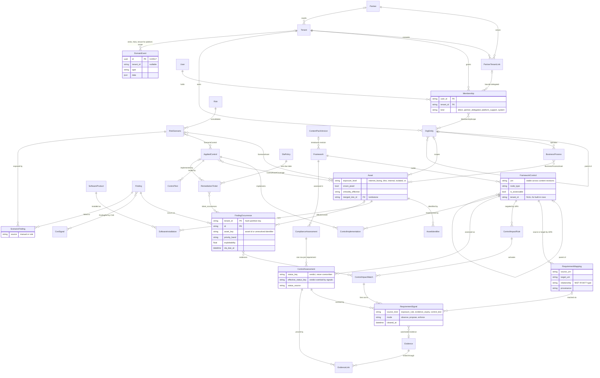

The worked example of §7.5 maps onto the diagram as follows:
1. **Detected.** The connector's record resolves through AssetIdentifier to the golden Asset. The ingest service then upserts the Finding and its FindingOccurrence on that asset.
2. **Prioritised.** FindingRef joins the CVE to CveSignal, which holds the KEV listing and the EPSS score. The PriorityPolicy combines these with the asset's `exposure_level`, `crown_jewel` and `criticality_effective`. The occurrence stores its band, its exploitability and the policy version.
3. **Linked.** A ControlImpactRule that targets ECC-2:2024 2-10 by URN produces a ControlImpactMatch citing the occurrence. §8's signal service expands the target over RequirementMapping and opens one RequirementSignal per affected ControlAssessment, with an automated Evidence row. `effective_status_key` turns non-compliant, and `status_key` keeps the assessor's verdict.
4. **Acted on.** A ScenarioFinding sourced from the rule feeds the scenario's computed probability, and the Risk records a new RiskVersion. A RemediationTicket groups the occurrence under the SlaPolicy rule that sets its due date. Every step writes its DomainEvents in the same transaction as the change.

Two kinds of edge in the chain are URN references rather than foreign keys: mapping ends and rule targets. The services resolve both through indexed URN columns, and the edges survive content revisions. Every other edge is a foreign key or an association table. Identity details, packaging, keys and the audit trail are omitted from the diagram; §14.2 lists them.

### 14.4 Migration map from today's model

The migration runs in three kinds of window. Each runs as an explicit job, rehearsed on read-only snapshots and never at boot (X-04):
- **P0, one-time import.** §13's importer, `grc migrate from-sqlite` (PF-19), copies a snapshot into a PostgreSQL database that is already at the baseline. Each block contributes its transforms to the import.
- **P1 and P2, data jobs.** Changes that need new services run as Alembic data jobs: the asset identity backfill, adoption of official content packs, and the renaming of vulnerabilities to findings.
- **P3, contract.** The deprecated columns, shims and façades are dropped.

```mermaid
flowchart LR
  snap["Read-only SQLite snapshot"] --> copy
  subgraph p0["P0 one-time import, run as grc_migrator"]
    copy["Copy rows and convert types"] --> ten["Backfill tenant_id on about 30 tables and create memberships"]
    ten --> pack["ngc.legacy-library pack adopts built-ins in place, URNs added"]
    pack --> links["43 JSON id-list fields → 36 association tables"]
    links --> files["Uploads to tenant-prefixed object keys"]
    files --> keys["Secrets re-encrypted under tenant data keys"]
    keys --> verify["Verify counts, checksums, chains, hashes, sign go or no-go"]
  end
  verify --> p1["P1 jobs: asset identity backfill, official packs adopted by URN"]
  p1 --> p2["P2 job: vulnerabilities renamed findings, fingerprints, tickets"]
  p2 --> p3["P3 contract: JSON columns, mapped_controls and facades dropped"]
```

The order inside the import matters for three reasons:
- Composite tenant foreign keys need `tenant_id` on both ends, so the backfill must run before the link transform.
- Several links resolve codes against requirements: `mapped_controls`, `Risk.linked_controls` and `Policy.linked_controls`. The legacy library pack must therefore give built-in rows their URNs before the link transform runs. §8's migration list and §13's importer (§13.6, step 4 Content before step 5 Links) both run in this order.
- Verification comes last. It checks row counts per table and per tenant, checksums of unchanged columns, foreign keys, audit-chain head hashes and file SHA-256 values.

**JSON soft links to association tables.** Every id-list field of today's model maps to a target below: 43 JSON id-list fields → 36 association tables (X-04). Eight further JSON fields stay JSONB because they hold no row ids. All of these moves run in P0, inside the import.

| Today: holder and field | Target | Owner | Note |
|---|---|---|---|
| RiskScenario `asset_ids`, `threat_ids`, `vulnerability_ids`, `linked_incident_ids` | ScenarioAsset, ScenarioThreat, ScenarioFinding, ScenarioIncident | §8 | Only incident ids are validated today |
| RiskScenario `applied_control_ids` and AppliedControl `risk_scenario_ids` | ScenarioControl | §8 | The two sides drift apart today and merge into one edge |
| AppliedControl `framework_control_ids` and `reference_control_id` | ControlImplementation (`active`, `legacy_json`) | §8 | Read only by the CSV export today (DAT-02) |
| AppliedControl `risk_ids`; Risk `linked_assets` | RiskControl; RiskAsset | §8 | Neither is shown in the UI today |
| Risk `linked_controls` (control codes) | RiskRequirement | §8 | Codes are resolved case-insensitively against the selected frameworks; misses are kept as `legacy_ref` and reported |
| AppliedControl `evidence_ids` | EvidenceLink with an applied-control target | §8 | — |
| AppliedControl `vulnerability_ids` and Vulnerability `fixed_by_controls` | FindingControl | §10 | One edge from two sides |
| Vulnerability `affected_assets` | FindingOccurrence (`detection_method=legacy`) | §10 | Rows with no asset get the key `unresolved:<system>` or `legacy:<id>` |
| RiskTreatment `linked_scenario_ids` | TreatmentScenario\* | §8 | — |
| RiskAcceptance `risk_ids` and `risk_scenario_ids`; SecurityException `related_entity_ids` | RiskAcceptanceTarget; ExceptionTarget (exclusive arc) | §8 | `related_entity_ids` is polymorphic by exception type today |
| SecurityException `compensating_control_ids` | ExceptionControl\* | §8 | — |
| Policy `linked_controls` (ids or codes) | PolicyRequirement | §8 | Removes a JSON-to-text lookup that the code itself flags as failing on PostgreSQL |
| ComplianceAssessment `in_scope_assets` | AssessmentAsset\* | §8 | Feeds the dynamic perimeters of §9 |
| Audit `process_ids`, `org_entity_ids`, `asset_ids`; AuditorAssignment `reference_document_ids` | AuditScope\* (exclusive arc); AssignmentDocument\* | §8 | — |
| Incident `affected_asset_ids`, `linked_risks`, `linked_controls`, `linked_vendors`, `linked_vulnerabilities` | IncidentAsset\*, IncidentRisk\*, IncidentControl\*, IncidentVendor\*, IncidentFinding\* | §8 | `linked_controls` names no target table today; ids are resolved against applied controls and the rest are reported |
| Threat `linked_asset_ids`, `linked_vulnerability_ids` | ThreatAsset\*, ThreatFinding\* | §8 | Link rows take the asset's tenant; built-in threats are plain foreign keys |
| CveAnnotation `linked_asset_ids` | CveAnnotationAsset\* | §10 | — |
| BusinessProcess `asset_ids` | BusinessProcessAsset | §9 | Takes the union with `assets.business_process_id`; today the two can disagree (§5.1) |
| Asset `serves_asset_ids` | AssetDependency (`relation=serves`) | §9 | — |
| User `custom_role_ids` | MembershipCustomRole\* | §11 | Moves with the user's single membership |
| Group, GovernanceGroup and GovernanceCommittee `member_ids` | GroupMember\*, GovernanceMember\* | §8; SCIM groups in §12 | Ends the scan of every group on each authorisation check |
| GovernanceCommittee `linked_policy_ids`, `linked_document_ids` | CommitteeLink\* (exclusive arc) | §8 | — |
| Tenant `selected_framework_ids` | TenantFrameworkSelection\* | §8 | Keyed by framework edition URN, so selections survive revisions |
| FrameworkControl `mapped_controls` (code pairs) | RequirementMapping (`related`, `legacy_import`) | §8 | Resolved case-insensitively; unresolved pairs go to a review report |
| Stay JSONB: Threat `affected_assets` (asset types) and `mitre_ids`; CveEntry `cwe_ids`; CweEntry `capec_ids`; RegulatoryUpdate's three free-text lists; VulnerabilityImpactHistory `linked_scenario_ids` (a snapshot) | — | — | CVE lookups use JSONB containment instead of today's `LIKE` on JSON text |

**Structural migrations.**

| # | From (today) | To (target) | Phase and window | Owner |
|---|---|---|---|---|
| M1 | `users.tenant_id` NOT NULL; one tenant per account | Nullable `default_tenant_id` and one Membership per user (roles, exclusions, custom roles, expiry); platform super-admins become PlatformRoleAssignments; per-tenant system actors are marked `is_system`. Accounts are not merged: about 80 foreign keys reference `users.id` | P0 import; scopes and accepted IdPs P1; delegated memberships P2 | §11 T0.4, T1.1, T2.6 |
| M2 | About 30 child and per-user tables without `tenant_id`, scoped through a parent | Backfilled `tenant_id`, NOT NULL, with a foreign key and an index (nullable on shared-catalogue children); orphans left by unenforced SQLite foreign keys go to quarantine | P0 import, step 3 | §13 PF-08, PF-19 |
| M3 | Scalar string references without a foreign key, such as `Risk.risk_matrix_id`, `Framework.cloned_from_framework_id` and `ComplianceGap.action_item_id` | Foreign keys declared in the baseline, after the import's orphan check | P0 | §13 PF-07 (proposed here) |
| M4 | Flat `framework_controls`; no URNs; `mapped_controls` | `ngc.legacy-library` adopts built-ins in place with their UUIDs: legacy URNs, `node_type=control`, `is_assessable`, `fidelity=paraphrase`; `nca-ecc-2024` receives its target URNs. Official packs then add new immutable revisions, such as ECC-2:2024's 32 grouping nodes and 92 sub-controls, and adoption re-points live references by URN. Legacy SAMA CSF is withdrawn and ECC-1 is superseded | P0 legacy pack; P1 official revisions; P3 `mapped_controls` dropped | §8 B1-04, B1-18, B1-23, B1-50 |
| M5 | `vulnerabilities` with JSON assets and controls and a string `ref_id` | Base FindingOccurrence and FindingControl rows (P0). FindingRef backfill, KEV, EPSS and priority v0 (P1). In P2: rename to `findings` with ids kept, fingerprints, duplicate merge through `finding_legacy_map`, status mapping, tickets under a "legacy-manual" SLA version, SLA clocks starting at go-live, and observe-mode rules for 30 days | P0; P1; P2 job | §10 |
| M6 | Evidence tied to one control assessment, with validity as strings | Each row keeps its id and gains one EvidenceLink; validity becomes typed dates; duplicates are flagged by tenant and SHA-256, not merged | P0 import; P1 service and UI | §8 B1-27 |
| M7 | Assessment rows created only by registration or AI; AI re-runs delete rows | `status_source` set to `ai_legacy` or `human_legacy`; missing rows backfilled as not started, without re-scoring; stuck runs become failed AnalysisRuns; published policies without approval marked `legacy_unrecorded` | P0 | §8 B1-15 |
| M8 | TOTP seeds, LDAP bind passwords, webhook secrets, scanner credentials and the bring-your-own AI key in clear text or under `secret_box` v1 | `secret_box` v2 under each tenant's TenantDataKey, with the tenant, table, column and row as authenticated data; v1 values remain readable and are re-encrypted by a background job. LDAP secrets move to IdentityProvider and webhook secrets to WebhookEndpoint in P1. On-prem source credentials of SaaS tenants move to the Site Collector's sealed store in P2 | Interim v1 encryption on today's host first (PF-02); P0 import; P1; P2 | §13 PF-02, PF-14, PF-19; §12; §9 |
| M9 | Upload tree on local disk with absolute paths | Tenant-prefixed object keys behind StorageBackend (X-09); the SHA-256 ledger is kept and extended; unreferenced files are quarantined, never deleted; per-tenant object encryption follows | P0 import; P2 (PF-32) | §13 PF-13, PF-19 |
| M10 | ScannerConnector and ScanJournal | Connector (ids kept) and ConnectorRun (connector inferred from the journal name) | P0 | §9 |
| M11 | Assets with no identity keys | One `legacy` or `easm` source record per asset; identifiers from `name`, `external_id` and `location` (location values are weak); plan-mode reconciliation turns duplicates into review issues, never automatic merges | P1 data job | §9 |
| M12 | Tenant `is_active`, `logo_url`, `settings.branding`, `domain`, `settings.ldap`, `settings.webhooks` | `status`, `cell_id` and immutable `data_residency`, set from the committee's placement decision (X-15); a draft BrandingProfile; an unverified VerifiedDomain; an LDAP IdentityProvider; paused WebhookEndpoints | P0 status and placement; P1 the rest | §11; §12 |
| M13 | Keyless audit chain with unchained entries | New columns; `chain_state` set to `chained` or `legacy_unchained`; chains verified to the same head hash at cutover; a signed genesis checkpoint per tenant once checkpoints ship | P0; P1 | §12 E0.3, E1.6 |
| M14 | `api_tokens` (model only); VendorRisk; ambiguous vendor scores | Table dropped once it is confirmed empty (any rows found become disabled ApiClients flagged for rotation); VendorRisk becomes a Risk plus a VendorRiskLink; `risk_score_legacy` kept with a reassessment flag | P1 | §12; §8 |
| M15 | Deprecated JSON columns, `mapped_controls`, dual-read shims, `/vulnerabilities` façades, the `Vulnerability` alias | Dropped | P3 | §8 B1-50; §10 |

**Safeguards and compatibility.**
- **Reports instead of silent loss.** Dangling and cross-tenant ids go to the link-migration report, and orphans and duplicates go to the quarantine. A reconciliation screen reads both.
- **Nothing is merged automatically.** This applies to user accounts, assets and evidence copies alike.
- **Dual reads for one release.** For one release, responses still carry the JSON arrays, computed from the link tables and marked with `Deprecation` and `Sunset` headers. A write to an array field replaces the corresponding links.
- **Façades for two releases.** `/vulnerabilities` and `/vuln-import` survive as façades for two releases. On-prem SQLite installations follow the same path through `grc upgrade --from-legacy`.

### 14.5 Naming conflicts resolved between papers

The seven designs were written in parallel. Their names were reconciled using four rules:
- **Baseline names first.** The names listed in X-17 win.
- **The owner chapter names its own entities.** Other chapters adopt those names: CTEM adopted ScenarioFinding, AssessmentProposal and RequirementSignal, for example.
- **Standard vocabularies.** Event attributes follow CloudEvents, and mapping relationships follow NIST IR 8477.
- **One column per concept.** Wherever an RLS policy or a mixin keys on a column, a single name is used.

The table also records three choices settled with the names: the phase of EvidenceLink, how asset merges propagate, and the prefix of the risk register in §16.3.

| Concept | Names in the papers | Chosen | Basis |
|---|---|---|---|
| Proposal to change a verdict | AssessmentSuggestion (content); AssessmentProposal (core) | AssessmentProposal, with sources `mapping_propagation` and `edition_carry_over` | X-17; §8 |
| Machine-verified downgrade | An auto-applied proposal with `status_source=exposure_rule` (core); a RequirementSignal overlay (content, CTEM) | A RequirementSignal overlay on `effective_status_key`; `exposure_rule` survives only as a proposal source in propose mode | X-12; ADR-COR-02 as amended in §8 |
| What a signal references | `finding_id` and `rule_id` (content); a ControlImpactMatch (CTEM) | `control_impact_match_id` plus `source_kind` | §8, ADR-CTM-05 |
| Asset exposure attribute | `network_zone` (CTEM); `exposure_level` (inventory) | `exposure_level` on Asset, copied to FindingOccurrence | Owner §9 |
| Partial-overlap relationship | `intersects_with` (CTEM rule); `intersects` (content) | `intersects` | Owner §8 |
| Tenant column on shared-catalogue rows and their children | `owner_tenant_id` (content); nullable `tenant_id` (platform, tenancy mixin) | Nullable `tenant_id`; no `owner_tenant_id` column | One column for the RLS generator and the `shared_readable` mixin |
| Database role for catalogue writes | `grc_catalogue` (tenancy); `grc_platform` (platform) | `grc_platform` | X-05 |
| Database role for the audit chainer | `grc_audit` (enterprise) | No separate role: SECURITY DEFINER functions owned by the non-login `grc_owner` | X-05 roles; §12, §13 |
| Per-tenant data-encryption key (DEK) record | TenantKey (tenancy); TenantDataKey (platform) | TenantDataKey | Owner §13 |
| Tenant placement | `placement_id` plus TenantPlacement (tenancy); `cell_id` (platform) | `Tenant.cell_id` and Cell; TenantPlacement records only moves | §11 |
| Residency attribute | `residency_class` (tenancy, enterprise, AIEndpoint); `data_residency` (platform) | `Tenant.data_residency` (immutable) plus `Tenant.regulated`; AIEndpoint uses the same vocabulary | §11 |
| Daily usage | UsageMeter (tenancy); TenantUsageSnapshot (platform) | One table, TenantUsageSnapshot (`tenant_id`, `snapshot_date`, `metric_key`, `value`); "usage metering" is the job that fills it | One store for quotas and statements |
| First content pack | `legacy-builtin` (platform); `ngc.legacy-library` (content) | `ngc.legacy-library` | Owner §8 |
| Pack signature columns | `key_id` and `signature` (content); `signing_key_id` and `checksum_sha256` (platform) | `signing_key_id` (a foreign key to SigningKey), `signature` and `checksum_sha256` | X-10 key registry |
| Evidence object key | `storage_key` (core); `s3_key` (platform) | The existing `s3_key` column, holding the object key for any backend | Owner §13; no new column |
| Automated-evidence flags | `is_automated` and `source_integration` (today, content, CTEM, inventory); `kind` and `source_kind` (core) | `kind=automated` and `source_kind` are the source of truth; `is_automated` and `source_integration` remain read-only mirrors for one release | One source of truth |
| EvidenceLink phase | P1 (content and core papers); one link per evidence row written by the import (core migration) | Schema in P0, filled by the import with one link per existing evidence row; service and UI in P1 | X-04: links move once, inside the import |
| DomainEvent columns | `event_type` and `payload` (platform); `type` and `data` (enterprise) | `type` and `data` | CloudEvents attribute names (ADR-ENT-07) |
| Run-completed event | `connector.run_completed` (CTEM); `connector_run.completed` (core, inventory) | `connector_run.completed` | §12.2.8 catalogue |
| Content events | `content.pack_version_installed` and `content.adopted` (content); `content_pack.version_applied` (core) | `content_pack.version_installed` (platform scope) and `content_pack.version_applied` (tenant) | §12.2.8 catalogue |
| Asset events; trail events | `inventory.asset.context_changed` (CTEM); `audit.*` for the trail | `asset.*`; `audit_trail.*`, because `audit.*` means audit engagements | X-08; §12.2.8 catalogue |
| Verdict and signal events | `requirement.status_changed` (content); `control_assessment.status_changed` (core) | `control_assessment.status_changed`, carrying the verdict and the effective status; `requirement_signal.opened` and `requirement_signal.cleared` | §12.2.8 catalogue; owner §8 |
| Exposure events | `ctem.*` shorthand (enterprise); `finding.*`, `remediation_ticket.*`, `control_impact.*` and `cve_signal.changed` (CTEM) | `finding.*`, `remediation_ticket.*`, `control_impact.*` and `cve_signal.changed` (platform scope) | §12.2.8 catalogue; owner §10 |
| Asset merge propagation | `asset.merged` events re-point link rows and occurrences (core, CTEM); the merge transaction re-points them through the registry (inventory) | Links re-pointed synchronously, in the merge transaction, through the asset reference registry (ADR-INV-04); `asset.merged` events serve only read models and caches | Owner §9 |
| Membership lists | JSON `org_scope_ids`, `custom_role_ids`, `accepted_idp_ids` (tenancy) | Association tables, not JSON lists: MembershipScope (the membership org scope), MembershipCustomRole and MembershipIdentityProvider | X-04; §11 |
| Machine credential; connector records; finding | ApiToken; ScannerConnector and ScanJournal; Vulnerability | ApiClient and ApiClientSecret; Connector and ConnectorRun (`inventory.*`, `ctem.*`); Finding, with the alias `Vulnerability = Finding` for two releases | X-17 |
| Bilingual labels | `name_en` and `name_ar` (CTEM rules); names in en and ar (IdPs); `product_name {en, ar, fr}` (branding); `title_i18n` (content) | `*_i18n` JSONB maps for display labels, such as `name_i18n`, `product_name_i18n` and `title_i18n`; `name_ar` columns only on the names of business records | §14.1 |
| Four kinds of scope | ScopeFact (§8), AssetFrameworkScope (§9), CtemScope (§10), MembershipScope (§11) | All four kept, with distinct meanings: applicability facts, per-asset applicability read model, exposure-management perimeter, user visibility | Clarification only |
| Content distribution records | PackInstallation (content); installations of pack versions (platform); ContentRollout (tenancy); TenantContentAdoption (content) | PackInstallation records a pack version installed on a PlatformInstallation; a ContentRollout batch writes TenantContentAdoption rows | Clarification only |
| Risk register IDs in §16.3 | `R-nn` (the §16.3 draft) | `RK-nn` | Avoids confusion with the requirement IDs R1–R8 |

**Open points for §16.4.**
- **Pre-baseline decisions** (PF-07): whether keys move to the native `uuid` type; whether `assets.business_process_id` survives beside BusinessProcessAsset as a mirror of the primary process; and what becomes of `control_requirements` once packs express sub-requirements as nodes.
- **Partitioning.** PF-28 must fix the conflict between monthly partitions and the planned unique keys described in §14.1.
- **ScopeFact.** This chapter recommends an exclusive arc (OrgEntity, BusinessProcess or Asset, with all three NULL meaning the whole tenant) instead of a `(subject_type, subject_id)` pair. The arc would let asset merges and deletes follow the asset registry like every other link. §8 should confirm.
