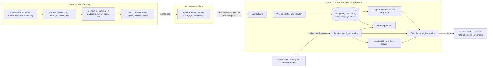
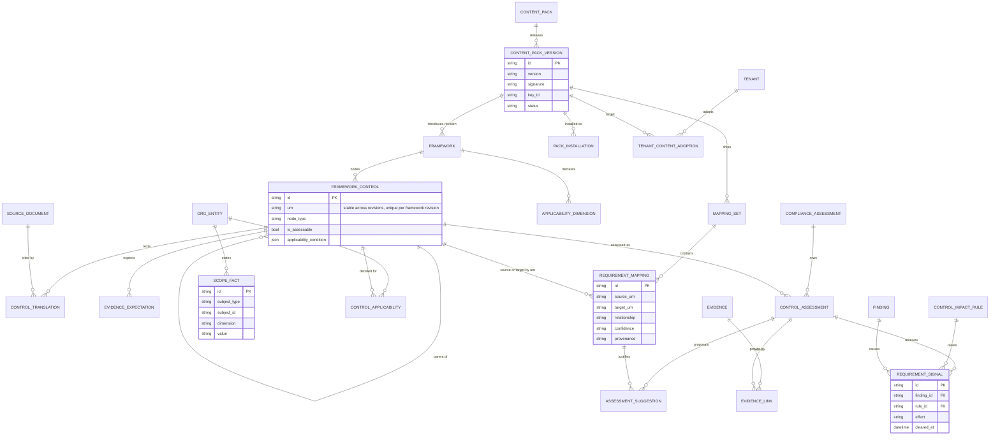
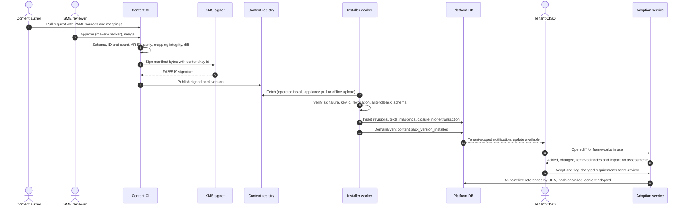
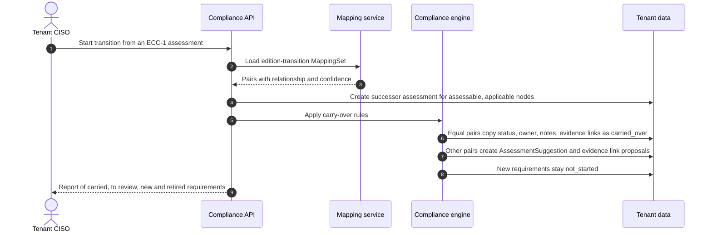
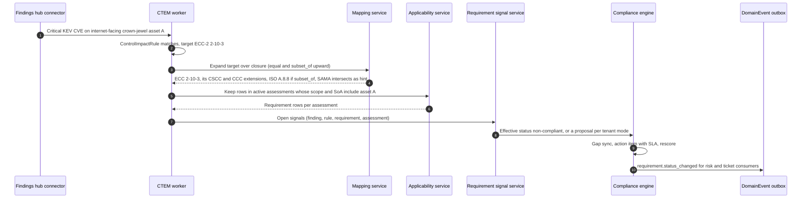

# NG-GRC Block 1: KSA regulatory content and cross-mapping (target design)

Requirement served: **R1**, complete KSA content (ECC-2, CCC-2, DCC, CSCC, OTCC, TCC, SAMA CSF, PDPL), cross-mapped.
Starting point: GRCEye (`C:\Users\k.rmila\Desktop\GRC`), read-only. Date: 2026-10-16. Status: proposal for the technical committee.
Paths are relative to the repo. "Seed" means `release/seed/grc_seed.db`, queried read-only from a copy.

---

## 1. Current state in one page

**What exists and works**
- **Catalogue model.** `frameworks` → `framework_controls` → `control_requirements` (`backend/app/models/framework.py:37-169`). Built-in rows (`is_builtin`, `tenant_id NULL`) are shared read-only by all tenants (`frameworks.py:531-534`). Tenants fork them by clone or import, with lineage and an upstream diff/sync (`frameworks.py:1184`, `:2874-3100`). The model already has `parent_id`, but none of the 3,799 seed rows uses it.
- **Text.** `control_translations` holds one text per (control, language) with a `source` label, and is writable only on tenant forks (`frameworks.py:2784-2806`). `content_translations` is the machine-translation cache filled by `services/translation_worker.py`.
- **Applicability.** `control_applicability` records an org-wide decision or one scoped to an OrgEntity or BusinessProcess (`models/control_applicability.py:25-60`). Assessments never read it. Mandatory controls refuse N/A (`compliance.py:2989-3004`, `frameworks.py:2653-2657`).
- **Crosswalk.** `mapped_controls` is a JSON list of code pairs (`framework.py:95-97`). The seed holds 199 one-way ISO27001→SOC2/NIST-CSF pairs. The crosswalk view resolves them case-insensitively (`frameworks.py:1016-1027`), but evidence propagation matches exact case and copies files (`compliance.py:3775-3869`), so it matches nothing in the shipped data. `backend/scripts/seed_framework_crosswalks.py:63` uses ISO27001 as a hub for PCI DSS, SWIFT and DORA.
- **Reusable machinery.**
  - Ed25519 signing and verification over the exact payload bytes (`core/licensing.py:64-109`).
  - An outbound client authenticated by the licence (`services/license_client.py`).
  - The compliance state machine: `_rescore` :990, `_sync_gap_for_control` :1045, `sync_action_items` :1112, `_apply_action_closure` :4523 (all in `compliance.py`).
  - Scales with Arabic labels (`models/compliance_scale.py:28-42`).
  - The OrgEntity/BusinessProcess tree (`models/org_unit.py:21-61`).
  - The hash-chained activity log (`services/activity_chain.py:80`, `:190`).
  - The regulatory-watch approve chain (`regulatory.py:1251-1331`).
  - Evidence fields that nothing writes yet: `is_automated`, `source_integration`, `raw_data`, `valid_until` (`models/compliance.py:169-223`).

**What is missing (R1 = partial, 0 of 8 frameworks at official granularity; CISO Assistant has 4 of 8)**
- **NCA ECC-2:2024.** NCA's structure is reproduced: 4 domains, 28 subdomains, 108 main-control IDs, with the official per-subdomain counts. The statements are not: they are English paraphrases, only about 1 in 5 matches NCA's text, and the 92 sub-controls are absent. All 108 rows are flagged mandatory, so N/A is refused even on 4-2, which NCA conditions on cloud use (`add_gcc_frameworks.py:741-777`).
- **SAMA CSF.** 57 rows with no source in the repo and non-official 1.x–3.x numbering instead of SAMA's 3.1–3.4.
- **`ksa-ecc` (ECC-1:2018).** 30 non-official subdomain headings.
- **Absent everywhere:** CCC (any edition), DCC, CSCC, OTCC, TCC and PDPL. PDPL appears only as a prompt string (`services/ai_prompts.py:748`).
- **No Arabic.** The seed contains 0 Arabic characters, and there is no human Arabic text on any built-in.
- **No KSA mappings, and no mapping semantics** (no relationship type, provenance or confidence).
- **No hierarchy, edition lineage or conditional applicability.** There is also no SoA.
- **No content pipeline.**
  - Content arrives through hand-run `sqlite3` scripts (`add_gcc_frameworks.py:11`).
  - 72 of the 77 built-ins have no source file in the repo.
  - The YAML loader has no caller (`backend/app/frameworks/loader.py:20`).
  - The stale seed is copied only at first boot (`build ova/scripts/firstboot.sh:103-105`, `infrastructure/docker/entrypoint.backend.sh:8-11`). Its builder drops translations (`make_client_seed_db.py:46-53`).
  - There is no content-update command (`appliance_cli.py:707-756`).
  - PostgreSQL boots with zero frameworks (`TODO-KNOWN-ISSUES.md:99-106`).
- **No path from an exposure to a requirement** (data-model report §10.3).

---

## 2. Target design

### 2.1 Principles
1. **One identity per regulator requirement.** A stable URN identifies each requirement. *Editions* (ECC-1 → ECC-2) and *content revisions* (paraphrase → official text) are explicit, separate concepts.
2. **Official text is data with provenance.** Paraphrases, translations and platform guidance are labelled as such. The authoritative language is set per framework: Arabic for NCA and SDAIA; for SAMA, whatever the source register confirms.
3. **Content is signed data, never code.** It reaches SaaS and on-prem through the same engine-neutral installer.
4. **Mappings carry semantics.** Anything that changes a compliance status is conservative, explainable and reversible.
5. **Extend before adding.** Extend `framework_controls`, `control_translations`, `control_applicability` and the compliance engine. Every existing foreign key (ControlAssessment, ComplianceGap, ControlApplicability, AuditFinding, Policy links) keeps working.

### 2.2 Components

| # | Component | Type | Responsibility | Extends / new |
|---|---|---|---|---|
| C1 | Content repository | Vendor git repo | YAML sources per framework edition (both languages), mapping sets, evidence templates, source-document register, impact-rule templates; maker-checker pull requests | New. Absorbs `add_gcc_frameworks.py`, `add_ot_auto_frameworks.py`, `scripts/seed_*`, `frameworks/*.yaml` |
| C2 | Content CI and compiler | CI pipeline + Python CLI | Pydantic-schema validation, ID/count/parity tests, diff against the last published version, compile to JSON, request signature, publish | New. Reuses the parsers in `frameworks.py:1816-1980` |
| C3 | Content signer | KMS/HSM key + client | Ed25519 signature over the manifest bytes; key id, rotation, revocation list | Extends `core/licensing.py` (exact-bytes sign/verify moved to `core/signing.py`) |
| C4 | Content registry | Vendor control-plane service + object storage | Stores signed versions, channels (stable/preview) and revocations; checks entitlement on download | New. Sits next to the licence authority (`endpoints/license_server.py`) |
| C5 | Pack verifier and installer | Worker job + `appliance-api content` CLI | Verify, stage, insert framework revisions, texts, mappings and closure in one transaction; emit events | New. Replaces `frameworks/loader.py`, `make_client_seed_db.py` and the SQLite scripts |
| C6 | Content update client | Service | On-prem pull over outbound HTTPS with licence authentication; air-gapped upload | Extends `services/license_client.py` |
| C7 | Adoption service | Service + API | Per-tenant diff, adopt/defer, re-point live references by URN, re-review flags, edition transitions | Extends upstream diff/sync (`frameworks.py:2853-3100`) |
| C8 | Requirement catalogue API | API | Hierarchy tree, texts with provenance, revision-aware visibility helper | Extends `frameworks.py`, `requirements.py` |
| C9 | Mapping service | Service + API | RequirementMapping CRUD (tenant rows), closure materialisation, propagation rules, coverage | New. Replaces the `mapped_controls` readers |
| C10 | Applicability and SoA service | Service + API | Dimensions, scope facts with OrgEntity inheritance, derived applicability, overrides, SoA and bilingual export | Extends `control_applicability.py`, `report_generator.py` |
| C11 | Compliance engine service | Service | Gap/action/score state machine callable by workers; effective status = verdict overlaid with signals | Refactors `compliance.py:927-1193`, `:2937`, `:4523` |
| C12 | Evidence link service | Service | Many-to-many links between evidence and control assessments; reuse suggestions | Replaces the file-copy propagation at `compliance.py:3775-3869` |
| C13 | Requirement signal service | Service | CTEM fan-out from a ControlImpactRule's target URN to the tenant's requirement rows; open and clear signals | New. Consumes the CTEM block |
| C14 | Content UI | React | Catalogue badges, tree and bilingual viewer, diff/adopt, crosswalk, SoA, platform console | Extends `FrameworksPage.tsx`, `EditFrameworkPage.tsx`, `RequirementsPage.tsx`, `AssessmentDetailPage.tsx` |

### 2.3 Component and flow diagram



### 2.4 Data model

**Requirement identity and hierarchy (extends `framework_controls`).** Every node of a regulator document is a `framework_controls` row with a `node_type`: domain, subdomain, control, subcontrol, or chapter/article/paragraph for laws. It also carries `parent_id` (already present), `depth`, and an `is_assessable` flag. Grouping nodes (domains, subdomains, definition articles) are not assessable; their status is a roll-up. Each node carries a stable `urn`:
- requirement: `urn:ngc:<publisher>:<family>:<edition>:<code>`, e.g. `urn:ngc:nca:ecc:2-2024:2-10-3-1`;
- framework edition: e.g. `urn:ngc:nca:ecc:2-2024`;
- legacy rows: `urn:ngc:legacy:<short_name>:<version>:<code>`.

A *content revision* (for example the official text replacing the paraphrase) keeps every URN. A new *edition* (ECC-1:2018 → ECC-2:2024) has new URNs, linked by an edition-transition mapping set. Packs install each framework revision as new immutable rows. `Framework.is_current` marks the revision used for new assessments, and existing assessments stay on their revision until the tenant adopts the new one (ADR C-03).

Example compiled pack node (illustrative; texts are placeholders, not NCA wording):
```json
{"urn": "urn:ngc:nca:ecc:2-2024:2-10-3-1", "code": "2-10-3-1", "node_type": "subcontrol",
 "parent": "urn:ngc:nca:ecc:2-2024:2-10-3", "assessable": true, "mandatory": true, "applicability": null,
 "texts": {"ar": {"kind": "official", "authoritative": true, "statement": "<NCA Arabic text>", "source": "nca-ecc2-ar", "page": "<n>"},
           "en": {"kind": "official_translation", "statement": "<NCA English text>", "source": "nca-ecc2-en", "page": "<n>"}},
 "guidance": {"kind": "platform", "en": "...", "ar": "..."},
 "evidence": [{"code": "EV-VM-REMEDIATION", "kind": "record", "automatable": "ctem", "freshness_days": 30}]}
```

**Texts.** `control_translations` becomes the requirement-text store. Each row is typed by `text_kind`: `official`, `official_translation`, `platform_label`, `platform_translation`, `human` or `ai`. It is marked authoritative or not and cites a source document and page.
- NCA main controls have no titles, so the display title is a `platform_label` and the statement holds the official text.
- The installer mirrors the English text into `framework_controls.title/description`, so existing readers keep working.
- `source_documents` records each source's **licence basis**.
- Platform guidance uses `*_i18n` JSON, as the scale labels already do.
- `evidence_expectations` generalises the ISO-only `mandatory_documents` to every requirement, and records whether the evidence can be automated (`ctem`, `inventory`, `idp`).

**Applicability.**
- Packs declare `applicability_dimensions` per framework.
- Nodes carry conditions over those dimensions.
- `scope_facts` holds the tenant's answers on a subject: tenant, OrgEntity, BusinessProcess or Asset.
- `control_applicability` remains the manual override.

**Mappings** use NIST IR 8477 set-theory relationships (equal, subset_of, superset_of, intersects, not_related), plus `related` for unqualified legacy rows.
- `rationale` is syntactic, semantic or functional.
- `provenance` is one of `regulator_stated`, `publisher_official`, `expert_authored`, `ai_suggested_reviewed`, `tenant_authored` or `legacy_import`.
- Each mapping also carries a confidence.
- Mappings reference URNs, not row ids, so they survive content revisions (ADR C-05). The closure table materialises direct and two-hop (via the hub) relations.

**Signals overlay verdicts.** CTEM signals *overlay* the human or AI verdict through `effective_status_key` instead of overwriting it.

| Entity | Change | Key fields | Relations |
|---|---|---|---|
| Framework | changed | urn, family_key, edition, revision, pack_version_id, lifecycle, fidelity, authoritative_lang, supersedes_urn, effective_from, transition_until, is_current; `is_builtin` default becomes False | nodes; ContentPackVersion |
| FrameworkControl | changed | urn (UQ per framework), node_type, depth, is_assessable, applicability_condition, content_hash, owner_tenant_id; UQ (framework_id, control_id) | parent; texts; mappings by URN |
| ControlTranslation | changed | text_kind, is_authoritative, objective, source_document_id, page_ref, owner_tenant_id | FrameworkControl; SourceDocument |
| SourceDocument | new | publisher, title, edition, lang, url, sha256, published_at, published_hijri, licence_basis | texts, mapping sets |
| EvidenceExpectation | new | requirement_id, code, kind, freshness_days, automatable, template_key, title_i18n | FrameworkControl |
| ContentPack / ContentPackVersion | new | key, publisher, channel / version, manifest, signature, key_id, status, min_platform_version, requires | frameworks, mapping sets |
| PackInstallation | new | pack_version_id, installed_at, installed_by, previous_version_id, result | ContentPackVersion |
| TenantContentAdoption | new | tenant_id, pack_id, adopted_version_id, pending_version_id, status, policy, diff_summary | Tenant, ContentPackVersion |
| MappingSet / RequirementMapping | new (replaces `mapped_controls`) | kind, source/target framework URN / source_urn, target_urn, relationship, rationale, confidence, provenance, status, tenant_id | FrameworkControl by URN |
| RequirementMappingClosure | new | source_urn, target_urn, derived_relationship, hops, via_urn, min_confidence | mappings |
| ApplicabilityDimension / ScopeFact | new | framework_urn, key, values_i18n / subject_type, subject_id, dimension, value, justification, review_date | OrgEntity, BusinessProcess, Asset |
| ControlApplicability | changed | + asset_id, basis | unchanged FKs |
| EvidenceLink | new | evidence_id, control_assessment_id, reason (primary, mapped, carried_over, automated), mapping_id, accepted | Evidence, ControlAssessment |
| AssessmentSuggestion | new | control_assessment_id, proposed_status_key, reason, mapping_id, source_assessment_id, decided_by/at | ControlAssessment |
| RequirementSignal | new | tenant_id, control_assessment_id, finding_id, rule_id, effect, opened_at, cleared_at | ControlAssessment, Finding, ControlImpactRule |
| ControlAssessment | changed | effective_status_key, open_signal_count, requires_review, carried_over_from_id, is_rollup | signals, links |



### 2.5 Key flows

**Flow A: author, sign, install, adopt.** SaaS and on-prem share this flow; only the fetch step differs.



**Flow B: edition transition, ECC-1:2018 to ECC-2:2024.**



The CTEM fan-out flow (Flow C) is in §2.7.

### 2.6 Cross-mapping strategy and propagation

**Mapping sets to author (P1)**
1. **NCA family (provenance `regulator_stated`).** CCC, DCC, CSCC, OTCC and TCC state the ECC controls they extend. Each extension control includes its ECC base by reference, so it is `superset_of` that base, with `kind=extension`. An ECC failure therefore propagates to every extension.
2. **SAMA CSF ↔ ECC-2:2024 (`expert_authored`).** Mostly `intersects`, with `equal` where the texts align. SAMA-regulated entities answer to both.
3. **PDPL (and its Implementing Regulation) ↔ DCC and ECC** data-protection, cryptography and incident subdomains (2-7, 2-8, 2-13). PDPL obligations are mostly `intersects`; the security-of-processing articles map to DCC.
4. **KSA → hub.** The hub is ISO/IEC 27001:2022 Annex A, the 93 ISO/IEC 27002:2022 control IDs. The existing `ISO27001` rows and `seed_framework_crosswalks.py` already use it, and `iso-27002` (93 rows) maps 1:1 `equal` onto it.
5. **Hub → NIST CSF 2.0.** Re-qualify the 63 legacy pairs and reuse NIST-published informative references where they exist.
6. **Edition and legacy transitions:** `ksa-ecc` → ECC-2, and legacy `sama-csf` (1.x numbering) → official 3.1–3.4.

The other existing frameworks are reached through the hub as each one is mapped to it, prioritised by KSA demand (§4, P2). Legacy pairs become `related` rows (`legacy_import`, low confidence). They are used only for evidence suggestions until someone re-qualifies them.

**Propagation rules (A relative to B; "up" means from A to B)**

| Relationship | Evidence reuse | "Compliant" propagates | "Non-compliant" or CTEM signal propagates |
|---|---|---|---|
| equal | link proposed (auto-accepted if the tenant enables it) | both ways (suggestion; automatic only by tenant policy and at high confidence) | both ways |
| subset_of (A ⊂ B) | proposed | B → A only | A → B only |
| superset_of (A ⊃ B) | proposed | A → B only | B → A only |
| intersects, related | proposed, flagged for review | none (review hint) | "at risk" hint only |
| inferred two-hop (via hub) | suggestion only | never | never |

Evidence is linked, never copied (`evidence_links`). This replaces `compliance.py:3775-3869` and removes its case bug, because resolution goes through URNs.

### 2.7 CTEM: one rule, every mapped framework (example ECC-2:2024 2-10)

The CTEM block owns `Finding` and `ControlImpactRule`. This block defines how rules target requirements:
- A rule names a **requirement URN**, for example `urn:ngc:nca:ecc:2-2024:2-10-3`, the minimum-requirements control of subdomain 2-10. The content team pins the exact sub-control from NCA's text.
- Alternatively, a tenant-defined rule targets an AppliedControl, which reaches requirements through ControlImplementation.
- Platform rule templates ship in KSA packs.



Subdomain 2-10 then rolls up as non-compliant, which is the deck's step 03.
- **Evidence trail.** An automated `Evidence` row (`is_automated`, `source_integration="ctem"`, `raw_data`) is linked to every affected row.
- **Clearing.** When the hub reports the finding closed and verified, the signal clears. The effective status reverts to the human verdict and `_sync_gap_for_control` resolves the gap.
- **Reach without rule changes.** Adding a new framework pack mapped to ECC-2 2-10-3, or to the hub, extends the rule's reach with no rule edit.
- **Illustrative targets** for the content team to confirm: CSCC and CCC extensions of 2-10; ISO/IEC 27002:2022 8.8 "Management of technical vulnerabilities"; NIST CSF 2.0 ID.RA-01; PCI DSS 4.0 6.3.3; SAMA CSF vulnerability management (3.3.17 is believed to be the number; to be verified).

### 2.8 Applicability and SoA per OrgEntity

**Dimensions.** Packs declare the dimensions; the official texts define the values, which content authoring confirms.

| Framework | Dimension | Typical subject |
|---|---|---|
| ECC-2:2024 | `ecc.uses_cloud` (conditions 4-2) | tenant, OrgEntity |
| CCC-2:2024 | `ccc.role` ∈ {csp, cst}, plus any CCC level | OrgEntity |
| DCC | `dcc.data_class` ∈ {top_secret, secret, restricted} | OrgEntity, BusinessProcess, Asset |
| CSCC | `cscc.critical_system` | Asset |
| OTCC | `otcc.facility_level` | OrgEntity (site), Asset |
| TCC | `tcc.telework_enabled` | OrgEntity |
| SAMA CSF | `sama.member_organisation` | tenant |
| PDPL | `pdpl.role` (controller/processor), `pdpl.sensitive_data`, `pdpl.cross_border_transfer` | BusinessProcess (processing activity) |

**Effective facts** are inherited down the OrgEntity tree: the closest ancestor wins. An asset inherits from its OrgEntity unless it states its own facts.

**Applicability** is decided in order:
1. A condition that is false gives *not applicable by rule*, with the condition as the rationale. No manual justification is required.
2. Otherwise a manual override from `control_applicability` applies. N/A stays forbidden on unconditionally mandatory nodes, which keeps today's rule.
3. Otherwise the requirement is applicable.

This fixes the 4-2 defect. Assessments consume the result: registration (`auth.py:622-652`), AI analysis and scoring skip non-assessable and non-applicable nodes. For each (OrgEntity, framework revision) the SoA lists: requirement, derived applicability, override and justification, effective status, implementing AppliedControls (through ControlImplementation, from the controls block), evidence count and owner. It exports to PDF and XLSX in AR or EN through `report_generator.py` and `pdf_arabic.py`. Approval stores the export as a `GovernanceDocument` version (`models/governance.py:42`) with SHA-256.

### 2.9 Content plan for the eight KSA frameworks

Only the ECC-2 counts are verified against NCA's PDF. Every other size is an estimate, to be locked in `structure.lock` during authoring.

| Framework | Official sources | Structure | Size (est.) | Effort |
|---|---|---|---|---|
| NCA ECC-2:2024 | NCA PDF in AR (binding) and EN | 4 domains / 28 subdomains / 108 main / 92 sub (verified) | 232 nodes | 3 pw |
| NCA CCC-2:2024 | NCA AR and EN | ECC extension; provider and tenant control sets | 150–250 | 3–4 pw |
| NCA DCC | NCA AR and EN | ECC extension, tiered by data classification | 60–100 | 2 pw |
| NCA CSCC | NCA AR and EN | ECC extension for critical systems | 100–150 | 2 pw |
| NCA OTCC | NCA AR and EN | ECC extension for OT, by facility level | 150–250 | 3 pw |
| NCA TCC | NCA AR and EN | ECC extension for telework | 40–80 | 1 pw |
| SAMA CSF | SAMA CSF document and SAMA Rulebook; check whether an official AR version exists (if not, EN is authoritative) | domains 3.1–3.4, subdomains, control considerations; maturity levels shipped as a built-in `ComplianceScale` | 200–300 | 3 pw |
| SDAIA PDPL | Official Arabic law, Implementing Regulation and Transfer Regulation; SDAIA English translations | chapters, articles, paragraphs; obligations as assessable nodes | 150–250 | 3–4 pw (legal SME) |

**Totals.** Full content (official AR and EN text, hierarchy, applicability, evidence expectations, guidance) is about 20–23 person-weeks (XL). Mapping sets add 8–10 pw (L). A minimal variant with official text and structure only is about 11–13 pw. The adversarial judge's 5–6 pw estimate for the six absent frameworks excludes applicability and evidence work.

**Copyright and reuse checks.**
- Counsel must decide whether the official-documents exclusion of the Saudi copyright law covers NCA, SAMA and SDAIA publications, or whether their website terms govern. Request written permission from NCA and SAMA.
- Record the result per `SourceDocument.licence_basis`. Without a cleared basis, the pack ships in *reference mode*: IDs, labels and deep links, with the customer loading the text as a tenant-scoped copy.
- Do not import CISO Assistant (intuitem) libraries, which come from an AGPL repository.
- Do not import SCF mappings: SCF's licence limits derivative works (to verify).
- ISO is used as IDs plus labels only. NIST material is public domain.

**Team and workflow.**
- *Team:* a content lead, two KSA SMEs (assessor profile, plus legal for PDPL), an Arabic legal-technical linguist (0.5) and a content engineer.
- *Workflow:*
  1. Source and licence basis.
  2. Structure extraction, assisted by `pypdf` (already a dependency) on authoring machines only.
  3. Verbatim official AR and EN text.
  4. SME annotation.
  5. Mappings with a second-SME review.
  6. Pull request and CI.
  7. Staging install with a carry-over simulation.
  8. Sign and publish.
  9. Errata as patch versions.
- *AI drafts.* A new `ai_prompts` task may draft mappings and PDPL obligations, using the Arabic-aware quote verification in `ai_chunking.py`. Drafts are published only after review.

**QA gates in CI**
- ID grammar per framework.
- Count locks per level and per subdomain (ECC-2 per-subdomain counts are known: 1-4:2, 1-7:1, 1-9:6, 1-10:5, 2-1:6, 2-7:3, and so on).
- Hierarchy integrity (parents present, no cycles, depth consistent with the ID).
- AR/EN pairing on every assessable node.
- Script checks: Arabic text contains Arabic script; English contains none.
- List-item parity on "at least" lists.
- Mapping referential integrity and contradiction checks (A equal B together with A subset_of B).
- Coverage report against the hub.
- Diff report against the previous version.
- Carry-over simulation.
- Signature tamper test.
- RTL render snapshots of IDs inside Arabic text.

### 2.10 APIs (`/api/v1`)

| Method and path | Purpose |
|---|---|
| GET `/content-packs` | Packs, installed and available versions, signature status (platform operator, appliance admin) |
| GET `/content-packs/{key}/versions/{v}` | Manifest, release notes, frameworks, counts |
| POST `/content-packs/upload` | Air-gapped upload: verify only, return the manifest |
| POST `/content-packs/{key}/versions/{v}/install` | Asynchronous install (202 + job) |
| POST `/content-packs/sync` | Pull from the update channel (on-prem) |
| GET `/content-packs/jobs/{id}` | Install job status |
| POST `/content-packs/{key}/versions/{v}/revoke` | Registry revocation (vendor) |
| GET `/content-updates` | Pending updates for the tenant |
| GET `/content-updates/{id}/diff` | Node, text, mapping and applicability diff, plus the impact on assessments |
| POST `/content-updates/{id}/adopt` · `/defer` | Adopt, with re-review flags, or defer |
| GET `/frameworks/{id}/tree` | Hierarchy with roll-up status for an assessment (`?assessment_id`) |
| GET `/frameworks/{id}/controls/{cid}/texts` | All texts with kind, authority and source document/page |
| GET `/requirements/{urn}/mappings` | Direct and inferred mappings with relationship, provenance and confidence |
| POST `/mappings` · PATCH/DELETE `/mappings/{id}` | Tenant-authored mappings |
| GET `/frameworks/{a}/coverage?target={b}` | Coverage of framework B obtained from A's assessment, by relationship |
| POST `/compliance/assessments/{id}/transition` | Successor assessment for a new edition, with carry-over |
| GET `/compliance/assessments/{id}/suggestions` · POST `/suggestions/decide` | Review propagated and carried-over proposals in bulk |
| GET `/control-assessments/{id}/evidence-links` · POST `/evidence/{id}/links` | Evidence reuse |
| GET/PUT `/applicability/facts` | Scope facts per subject |
| GET `/applicability/dimensions?framework_id=` | Dimension vocabulary |
| GET `/soa?framework_id=&org_entity_id=` · GET `/soa/export?format=pdf\|xlsx&lang=ar` | SoA |
| GET `/requirements/{urn}/impact-targets` | Preview of a rule target's fan-out for this tenant |

The existing `GET /frameworks/{id}/controls` keeps returning assessable nodes. The crosswalk route returns the legacy `mapped_to` shape computed from RequirementMapping, plus the new typed `mappings`.

### 2.11 UI changes
- **FrameworksPage.**
  - Catalogue grouped by publisher.
  - Badges: *Official text, Arabic binding* / *Paraphrase* / edition / *Update available*.
  - The crosswalk panel (`FrameworksPage.tsx:179-189`) shows relationship symbols (=, ⊂, ⊃, ∩), confidence and provenance.
- **Requirement viewer.**
  - Tree from domain down to sub-control, with roll-up status.
  - Side-by-side AR (RTL) and EN panels, with text-kind badges that extend `AutoTranslatedBadge.tsx`.
- **Content updates page.**
  - Pending updates.
  - AR and EN text diff using jsdiff (`diff` npm, BSD-3-Clause, new).
  - Impact summary, then adopt or defer.
- **Platform content console.**
  - Packs, jobs, keys, revocations and bundle upload.
- **Applicability and SoA page.**
  - Fact questionnaire per OrgEntity.
  - Derived and overridden applicability.
  - Export and approval.
- **AssessmentDetailPage.**
  - Suggestions panel.
  - Signal badges and evidence-link badges.
  - Edition-transition wizard.

### 2.12 Security and tenant isolation
- **Built-in content is read-only to tenants.** Only the installer, running as a platform principal, writes rows with NULL tenant. Tenant mappings, facts and overrides carry `tenant_id`.
  - For B3's RLS, denormalise a nullable `owner_tenant_id` onto `framework_controls`, `control_translations` and `requirement_mappings`. The read policy is then `owner_tenant_id IS NULL OR = app.tenant_id`.
  - A single revision-aware visibility helper replaces the 18 inline `Framework.is_builtin == True` clauses found in 10 files.
  - `Framework.is_builtin` defaults to False, closing a latent publication leak.
- **Pack hardening.**
  - Signature mandatory, with key id, revocation list and anti-rollback (downgrade only by operator override).
  - Strict Pydantic validation (Pydantic is already a dependency) with length limits matching the columns.
  - JSON only on appliances; YAML stays in the authoring repo.
  - Zip-slip and size guards.
  - Insert-only installs: superseded revisions are kept while referenced, never deleted, unlike `add_ot_auto_frameworks.py:431-432`.
- **Keys.**
  - A dedicated content-signing key in KMS/HSM, separate from the licence key.
  - Domain separation: the signed manifest carries `typ: "ngc-content-pack"`, so a licence signature can never validate as a pack.
  - Signing happens only in vendor CI. If the platform block picks a key service, choose OpenBao (MPL-2.0) or an HSM, not HashiCorp Vault (BSL).
- **Notifications.** The platform-wide `notify_framework_new/updated` broadcast (`workers/tasks/notifications.py:419-492`) is replaced by tenant-scoped "update available" notices.
- **Audit.** Installs, adoptions, overrides, mapping edits and signals are written to the hash chain through `chain_and_add`/`log_system_activity` and emitted as DomainEvents.

### 2.13 Arabic and KSA considerations
- **Display order.**
  - Arabic UI: official Arabic first.
  - English UI: NCA's official English, labelled "official translation; Arabic prevails".
  - `translation_sources.py` skips any field that already has official text, which removes the KSA share of the roughly 10.9k-pair MT backlog.
- **Bidi.** Hyphenated IDs ("2-10-3") reorder inside RTL text. Wrap them in LTR isolates: `<bdi dir="ltr">` in React, U+2066…U+2069 before `python-bidi` in PDFs.
- **Search.** Arabic search over a normalised column (tashkeel and tatweel removed, alef/hamza and taa marbuta folded), reusing the normalisation in `ai_chunking.py:366-387`.
- **Dates.** Hijri and Gregorian publication dates on `SourceDocument`.
- **AI.** AI assessment uses official text in the document's language and cites URNs.
- **Dependencies on the R3 block.** The SoA PDF depends on a bundled Arabic font, and the XLSX export needs an RTL sheet view.
- **Regulatory watch.** Add NCA, SAMA and SDAIA sources to `regulatory.py:62-87` (manual kind where no feed exists). A regulator publication opens a content backlog item and links to the pack version that answers it.

### 2.14 SaaS and on-prem
- **SaaS.** The deployment is a registry consumer like any appliance. Operators install once; new revisions are new rows, then `is_current` flips in a short transaction. Each tenant adopts on its own schedule. Adoption policy: patch versions auto-adopt, minor versions auto-adopt after 30 days unless deferred, major versions are manual. Content carries no tenant data; tenant facts and mappings stay in the KSA-hosted tenant store.
- **On-prem.**
  - The image ships bundled packs, not a seed DB. First boot runs `appliance-api migrate` (Alembic, B3), then `content install --bundled`. This works on PostgreSQL and fixes "zero frameworks".
  - Updates arrive through `content sync`, an outbound HTTPS pull authenticated by the licence key with entitlements carried in the licence payload, or through offline upload for air-gapped sites. Both go through the same verifier.
- **MSSP (P3).** Partner-scoped packs and mapping sets, and a partner mirror for customer sites.

---

## 3. Migration path from today's code

| File | Action |
|---|---|
| `backend/app/models/framework.py` | Extend: Framework and FrameworkControl columns (§2.4), unique constraints after a duplicate check, `is_builtin` default False |
| `backend/app/models/control_translation.py`, `control_applicability.py`, `compliance.py` | Extend, as listed in the entity table |
| New models: `content_pack.py`, `requirement_mapping.py`, `applicability.py`, `source_document.py`, `evidence_expectation.py`, `evidence_link.py`, `requirement_signal.py` | New, created through Alembic revisions (B3) |
| `backend/app/api/v1/endpoints/compliance.py` | Refactor: extract `services/compliance_engine.py` (:927-1193, :2937, :4523). Replace the copy propagation (:3775-3869) with EvidenceLink. Apply effective status, assessable filters and derived N/A in scoring, AI analysis and the mandatory guard (:2989-3004) |
| `backend/app/api/v1/endpoints/frameworks.py` | Refactor: visibility helper, `/tree`, `/texts`, crosswalk reads mappings. The import gains `title_ar/description_ar/title_en`, `node_type` and relationship-typed crosswalk columns (tenant frameworks) |
| `auth.py:622-652`, `dashboard.py:385`, `audit_grids.py:646-700`, `requirements.py`, `data_io.py`, `report_generator.py` | Refactor: assessable nodes only; read mappings instead of `mapped_controls` |
| `core/licensing.py`, `services/license_client.py`, `appliance_cli.py` | Extend: `core/signing.py` key ring; content pull; `content list/verify/install/sync/export` |
| `services/translation_sources.py`, `regulatory.py:62-87`, `workers/tasks/notifications.py:419-492` | Extend / extend / replace |
| `backend/app/frameworks/loader.py`, `make_client_seed_db.py`, `release/seed/grc_seed.db`, `backend/add_*_frameworks.py`, `scripts/seed_tn_legal_frameworks.py`, `seed_framework_crosswalks.py`, `seed_control_translations_fr.py`, `backfill_control_domain.py`, `backfill_framework_source_type.py` | Replace: converted once into content-repo sources by an exporter, then archived |

**Data migration (ordered)**
1. **Schema.** An Alembic revision adds nullable columns and the new tables.
2. **Legacy library pack.** Export every built-in from the live DB (77 in the seed; the live DB reportedly holds more) into the pack `ngc.legacy-library@1.0.0`:
   - `fidelity=paraphrase`; URNs `urn:ngc:legacy:…`;
   - except `nca-ecc-2024`, which receives its target URNs `urn:ngc:nca:ecc:2-2024:<code>` so the official revision carries assessments by URN;
   - `node_type=control`, `is_assessable=true`;
   - French human titles become `text_kind=human`.

   Installing it adopts the existing rows in place: pack ids are backfilled with no row churn.
3. **Mappings.** Convert `mapped_controls` to `related` RequirementMapping rows (`legacy_import`), resolved case-insensitively. Unresolved pairs go to a review report. The JSON column stays as a read projection for one release, then is dropped.
4. **ECC-2 official.** `ksa.nca.ecc@2.0.0` (major) adds 32 grouping nodes and 92 sub-controls and replaces the statements. On adoption, ControlAssessments move by URN, and rows whose `content_hash` changed get `requires_review`.
5. **SAMA CSF.** Install official SAMA CSF as a new revision with new identities. Carry over from legacy `sama-csf` through the transition set, as suggestions only. Legacy `sama-csf` becomes `withdrawn`.
6. **ECC-1.** `ksa-ecc` becomes `superseded`, with `supersedes_urn` pointing to it from ECC-2. Its transition set works at subdomain level (`intersects`), so carry-over is suggestion-only.
7. **Adoption re-pointing.** Adoption uses a registry of every reference to `framework_controls` (FKs and JSON columns), enforced by a test over SQLAlchemy metadata. Live objects are re-pointed. Completed assessments and closed audits stay on the revision they assessed.

**Backward compatibility.**
- Existing FKs stay valid, because old revision rows are kept while referenced.
- The flat controls endpoint and the crosswalk `mapped_to` shape are preserved.
- Tenant forks keep upstream-diff/sync, which now follows the source's current revision by URN.
- `Tenant.selected_framework_ids` resolves through URNs.

---

## 4. Phasing

| Phase | Deliverable | Effort | Depends on |
|---|---|---|---|
| P0 | Content schema additions as Alembic revisions | M | B3 Alembic baseline |
| P0 | Pack format, `core/signing.py`, content key in KMS, verifier | M | B7 KMS/HSM |
| P0 | Engine-neutral installer (worker), appliance `content` commands, bundled-pack first boot | M | B3, B4 |
| P0 | Legacy library export; retire the seed DB and SQLite content scripts (PostgreSQL gets frameworks) | M | the three items above |
| P0 | Content repository and CI (validation, parity, diff, sign, publish) | M | B6 object storage |
| P0 | Redistribution-rights clearance for NCA, SAMA and SDAIA (long lead) | S | legal |
| P0 | Visibility helper, `is_builtin` default, tenant-scoped content notifications | S | none |
| P1 | Hierarchy and bilingual text through APIs and the engine (tree, texts, roll-up, assessable scoring, registration) | M | P0 schema |
| P1 | Wave 1 content: ECC-2:2024 official, SAMA CSF rebuilt with its maturity scale, PDPL with its regulations | L | content CI, rights |
| P1 | Wave 2 content: CCC-2:2024, DCC, CSCC, OTCC, TCC | L | wave 1 conventions |
| P1 | Mapping service, closure, crosswalk UI and the six mapping sets (§2.6) | L | waves 1–2 |
| P1 | EvidenceLink and AssessmentSuggestion (replace copy propagation) | M | mapping service |
| P1 | Applicability engine, scope facts, derived N/A, SoA and bilingual export | M | hierarchy; R3 font |
| P1 | Adoption flow (diff, adopt/defer, re-point) and transition wizard | M | hierarchy, mappings |
| P1 | Compliance engine extracted as a worker-callable service | M | B4 |
| P1 | KSA regulatory-watch sources linked to the content backlog | S | none |
| P2 | RequirementSignal fan-out with automated evidence | M | CTEM block (Finding, ControlImpactRule), mappings, SoA |
| P2 | KSA impact-rule templates in packs (2-10, 2-12, 2-13, …) | S | signal fan-out |
| P2 | Hub expansion: PCI DSS 4.0, SWIFT CSP, CIS v8, SP 800-53, ISO 27701, ISO 22301, IEC 62443 | L | mapping service |
| P2 | AI-assisted mapping and obligation drafts (reviewed only) | S | `ai_prompts` |
| P3 | Partner (MSSP) packs and mapping sets, partner entitlements and mirror | M | tenancy block (Partner, Membership), licensing |
| P3 | Official rebuilds of the GCC catalogues; optional official ECC-1:2018 | L | demand |
| P3 | Delta packs for bandwidth-limited appliances | S | installer |

**Expected R1 rating:** partial after P0 (infrastructure only); strong after P1 if rights are cleared, otherwise partial in reference mode; strong after P2 and P3.

---

## 5. Architecture decisions

**C-01: Extend `framework_controls` as a typed node tree.**
- *Context.* The regulator hierarchy exists today only in free text, and every compliance FK points to `framework_controls`.
- *Options.* A new requirement-node table (CISO Assistant style); one table per level; extending the existing table.
- *Rationale.* Extension keeps ControlAssessment, gaps, applicability, findings and policies valid with no data move.
- *Consequences.* Every count and score must filter on `is_assessable`. Roll-up nodes need computed status.

**C-02: Official bilingual text as typed text rows with provenance.**
- *Context.* NCA's Arabic is binding. Built-in rows are shared, and `control_translations` already exists.
- *Options.* `title_ar`/`title_en` columns; JSON on the row; typed rows.
- *Rationale.* Typed rows carry kind, authority and source page per language and reuse the existing overlay. English is mirrored into the base columns for compatibility.
- *Consequences.* One text resolver for UI, PDF and AI. The authoritative language is set per framework.

**C-03: Immutable framework revisions with stable URNs and per-tenant adoption.**
- *Context.* An audit must reference the exact text that was assessed, and SaaS tenants cannot all switch at once.
- *Options.* Update in place with history; per-tenant copies; immutable revisions.
- *Rationale.* Immutable revisions preserve audit truth and allow deferral, and they reuse the fork diff/sync logic.
- *Consequences.* A revision-aware visibility helper; an adoption job that re-points references through a registry; more rows (negligible volume).

**C-04: Signed JSON packs authored as YAML in a reviewed repo, reusing the Ed25519 primitives with a separate KMS key.**
- *Options.* SQLite seed and scripts (today); Alembic data migrations; OSCAL catalogs; intuitem YAML; signed bundles.
- *Rationale.* Engine-neutral, versioned and verifiable offline, with one path for SaaS and on-prem. Signing the exact manifest bytes plus per-file SHA-256 needs no canonicalisation library.
- *Consequences.* A new content CI and registry. OSCAL export can be added later as an output format.

**C-05: RequirementMapping keyed by URN, with NIST IR 8477 relationships, provenance and confidence.**
- *Hub.* ISO/IEC 27001:2022 Annex A, with NIST CSF 2.0 as a secondary hub.
- *Options.* Keep the JSON pairs; SCF as hub (licence); NIST CSF as the primary hub; a platform-owned common control catalogue.
- *Rationale.* The ISO hub matches the existing tooling and KSA ISMS practice. IDs carry no copyright exposure. NIST's public mappings complete the hub.
- *Consequences.* Each framework reaches the others only once it is mapped to the hub, which is a content workload.

**C-06: Suggestion-first propagation.**
- *Rules.* Evidence is linked, not copied. Status propagates only along set semantics (§2.6); automatic application requires an opt-in tenant policy. CTEM signals overlay verdicts instead of overwriting them.
- *Rationale.* Regulator-grade explainability, and no repeat of the AI-rerun data loss.
- *Consequences.* Review queues; effective status computed at write time.

**C-07: Applicability = content-declared conditions + tenant scope facts (inherited down the OrgEntity tree) + explicit overrides.**
- *Options.* Manual N/A only (today); per-assessment flags; tags.
- *Rationale.* It encodes NCA's conditional and tiered applicability once, in content, and yields a per-entity SoA.
- *Consequences.* Facts become controlled data with review dates.

**C-08: Retire the seed DB and hand-run scripts through a one-time legacy library pack labelled `paraphrase`.**
- *Rationale.* Honest labelling, one delivery path, and PostgreSQL support.
- *Consequences.* Content provenance has to be documented for the 72 frameworks with no source file.

---

## 6. Risks and open questions

| Risk | Mitigation |
|---|---|
| Redistribution rights for NCA, SAMA or SDAIA texts are refused or unclear | Legal opinion and written requests started in P0; reference-mode packs with tenant-loaded text as fallback |
| Arabic PDF extraction errors (ligatures, ordering, diacritics) | Verbatim capture from digital sources, double extraction, linguist proofreading, parity tests |
| A wrong mapping produces false compliance | Set semantics, conservative propagation, provenance and confidence shown, SME second review, inferred links never change status |
| Adoption disrupts audits in progress | Pinning and deferral; historical objects stay on their revision; re-review flags; pre-adoption snapshot |
| Revision-aware queries leak or duplicate catalogue rows | One visibility helper, RLS, a reference-registry test |
| Content effort underestimated (XL) | Waves (ECC-2, SAMA, PDPL first), count locks, a minimal-variant fallback |
| NCA revises a framework (e.g. CCC) | Regulatory watch opens backlog items; patch/minor service level; edition sets |
| Content-signing key compromised | KMS/HSM, key ids, rotation, signed revocation list, separate from the licence key |
| Bidi defects in IDs inside Arabic text | Isolation in UI and PDF, plus snapshot tests |

**Open questions for the committee**
1. Are NCA, SAMA and SDAIA texts redistributable in a commercial SaaS and on-prem product, and who requests permission?
2. Which editions are clients audited on today (ECC-1 still? CCC-1:2020 or CCC-2:2024)? Do production tenants hold ECC-1 or SAMA assessments that must be carried over?
3. Confirm ISO 27001:2022 Annex A as the hub, rather than NIST CSF 2.0 or a platform common-control catalogue.
4. Is status propagation ever automatic (equal mappings at high confidence), or always suggestion-only?
5. Content team: in-house KSA SMEs or a partner consultancy? Who is the named reviewer of record?
6. Are KSA packs a licensed add-on (an entitlement in the licence) or included?
7. Must assessments match NCA's reporting granularity and templates (sub-control-level verdicts)?
8. PDPL scope: articles and obligations only, or also a ROPA/DPIA privacy module (an R2 extension)?
9. May MSSP partners publish their own packs (P3)?

---

## 7. Challenges to baseline
1. **B13 phasing.** Engine-neutral content delivery (installer plus legacy library pack) must land in **P0**, not P1. B3's move to PostgreSQL is blocked while built-in frameworks exist only in SQLite (`TODO-KNOWN-ISSUES.md:99-106`). The R1 content itself stays in P1.
2. **B10 vocabulary.**
   - Add MappingSet, SourceDocument, EvidenceExpectation, ApplicabilityDimension, ScopeFact, EvidenceLink, AssessmentSuggestion, RequirementSignal, PackInstallation and TenantContentAdoption.
   - RequirementMapping and ControlImpactRule should reference requirement **URNs**, which stay stable across content revisions, not `framework_controls` row ids.
3. **B7.** There are three signing purposes: licence, audit checkpoint and content. Each needs its own key and domain-separated payloads. Content signing runs in vendor CI. The SaaS becomes a pack consumer and holds no signing key.
4. **B11.** "Official Arabic alongside English" depends on redistribution rights, so reference mode is needed as a fallback. SAMA CSF may be authoritative in English, so the model sets the authoritative language per framework instead of assuming Arabic.
5. **B3 RLS.** Built-in content child tables have no `tenant_id`. Denormalise a nullable `owner_tenant_id` so RLS policies stay simple.
6. **B5.** The outbox must support platform-scope events (NULL tenant, such as `content.pack_version_installed`) that fan out to tenant-scoped notifications.
