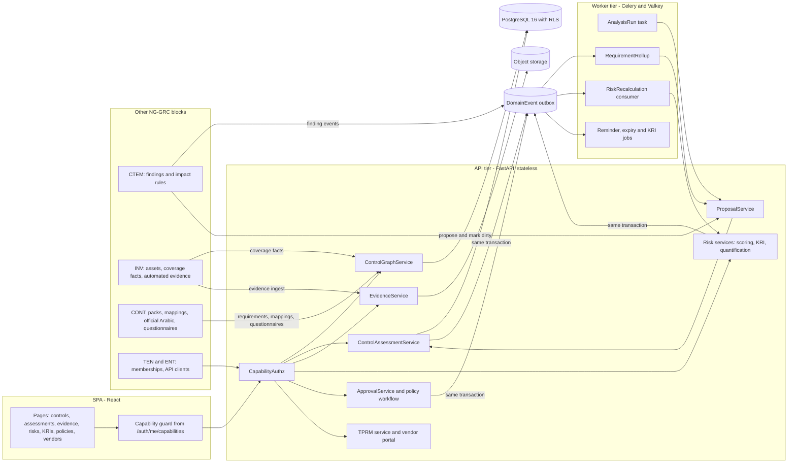
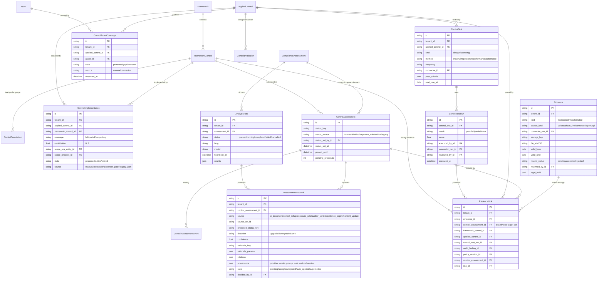
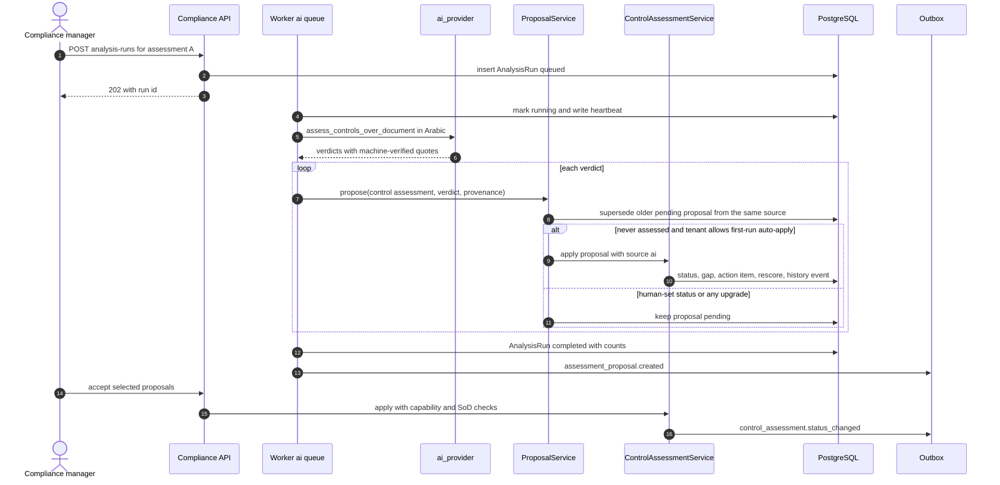
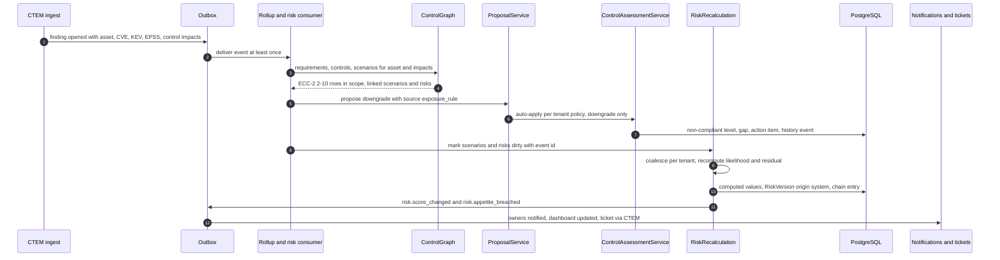
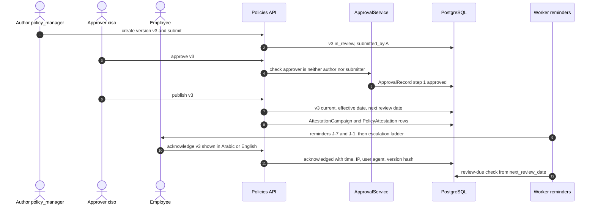

# NG-GRC Block 1: GRC core completion and Arabic-native quality

Path C design. Serves **R2** (full GRC lifecycle) and **R3** (native Arabic and RTL). Date 2026-10-16. Baseline: GRCEye `main` @ 98020b3, reviewed read-only. All paths are repo-relative.

The other blocks are named by function:
- **PLAT**: platform foundations (PostgreSQL, Alembic, RLS, worker tier, outbox, object storage).
- **TEN**: tenancy and MSSP (Partner, Membership).
- **CONT**: KSA content (ContentPack, RequirementMapping, official Arabic text).
- **INV**: inventory collector.
- **CTEM**: Finding, ControlImpactRule, SlaPolicy, RemediationTicket.
- **ENT**: ApiClient, SSO, webhooks, audit trail.

---

## 1. Current state in one page

GRCEye already has modules, persistence and screens for all six R2 areas, and its Arabic interface is complete. The verified gaps are in UI wiring, data integrity, workflow rules and packaging. No module is missing outright. Both R2 and R3 are judged **partial**.

**What works and will be reused**
- **Compliance state machine** (verdict, gap, action item, closure, rescore): `compliance.py:2937` `update_control_assessment`, `:1045`, `:1112`, `:990` and `:4523`. Alongside it: scales, applicability and per-language requirement text (`models/control_translation.py`).
- **Applied-control register**, wired end to end: validation, history, obsolescence and effectiveness evaluation (`applied_controls.py`, `control_evaluation.py`).
- **Risk backend**:
  - matrix scoring (`services/risk_scoring.py:77-142`);
  - versions, lifecycle and diff (`risk_versioning.py`, `risks.py:602-683`);
  - scenario priority;
  - treatment versions;
  - appetite alerts;
  - Monte Carlo (`risks.py:966-1054`).
- **Audit lifecycle**, end to end, with enforced SoD on report approval (`audits.py:1446-1471`).
- **Authorization**: 13 roles, effective roles (`services/authz.py:15-70`), owner perimeter (`services/perimeter.py`) and admin auto-pass (`dependencies/auth.py:113-136`).
- **Arabic**:
  - 100 % of UI keys translated;
  - an RTL layer (`index.css:355-566`);
  - localised API errors, notifications and e-mails;
  - an AI LANGUAGE block (`ai_prompts.py:1083-1085`);
  - PDF shaping (`pdf_arabic.py`), with all 107 labels in each language.

**Verified gaps this block closes**

| Area | Gap | Evidence |
|---|---|---|
| Control model | Two disconnected "control" worlds. The only bridge is a JSON list that nothing reads, and there is no asset↔control edge. | `models/applied_control.py:74-82` |
| Graph | About 50 JSON id-list soft links: half are unvalidated, reverse lookups use LIKE, and deletes leave dangling ids. | `risks.py:943`; `assets.py:796-842` |
| Assessments | An AI re-run deletes and recreates control-assessment rows together with their evidence. Rows exist only after registration or an AI run. The APIs are CISO-only although the SPA admits 9 roles. | `compliance.py:2645-2747`; `auth.py:622-652`; `App.tsx:127` |
| Evidence | Each evidence row belongs to exactly one control assessment. Validity and automation fields are never written. Cross-framework copying matches 0 of 199 shipped pairs. | `models/compliance.py:192-199`; `compliance.py:3792-3803` |
| Risk | No edit, status, close or residual UI. The treatment form returns 422. The residual suggestion is never stored and ignores `implemented` controls. There is no recalculation, no KRIs and no stored quantification. | `endpoints.ts:419-424`; `risk_treatment.py:247-254`; `residual_risk.py:46` |
| Policies | Status is a free PATCH. Version approval is a stamp with no SoD. Acknowledgement has no UI, and there are no reminders. | `policies.py:341-342,475,605-613,716-723` |
| Audit | `ActionItem.finding_id` is never written, so the progress roll-up and the report's action-plan section stay empty. | `action_item.py:73-75`; `audits.py:742-764` |
| TPRM | Vendors are an island with no edit UI. The prescreen is dropped at save. `VendorAssessment` and `VendorRisk` are model-only. The reassessment task file is empty. | `vendors.py:528-540,925-926`; `workers/tasks/vendor_assessments.py` (0 bytes) |
| R3 | Packaging, language and RTL gaps; see the list below this table. | `pdf_arabic.py:37-44`; `pyproject.toml:8-41`; `ai_locale.py:541`; `DashboardPage.tsx:866-876` |

The R3 gaps in detail:
- **PDF fonts**: Arabic fonts are found only at Linux system paths, and only the OVA installs one.
- **Packaging**: the shaping libraries are missing from `pyproject.toml`.
- **AI output**: the language of AI answers is never checked.
- **Content**: no official Arabic regulatory text ships.
- **RTL**: the RTL layer is a set of CSS overrides with uncovered classes; there is no Arabic web font and charts are not mirrored.
- **Search**: Arabic letter variants are not folded.
- **UI text**: a few badges show raw English enum values.

---

## 2. Target design

### 2.1 Principles
1. **One graph.** Every cross-entity relationship is a typed, tenant-checked row with real foreign keys, and the JSON id lists are retired.
2. **Machines propose; people or an explicit tenant policy decide.** Nothing deletes status, evidence or notes that a person entered. Every automatic change carries its provenance and can be reversed.
3. **State machines live in services, not in route handlers.** Workers, connectors and the CTEM block then call the same code as the UI, without a user JWT.
4. **One authorization truth.** The SPA derives what it shows from the capabilities the API enforces.
5. **Arabic is a release gate.** Fonts, RTL rendering, AI answer language and report parity are tested in CI on every build.

### 2.2 Components

| Component | Type | Responsibility | Extends / new |
|---|---|---|---|
| ControlGraphService | service | CRUD and traversal of every link (asset, control, requirement, risk, scenario, finding, policy, vendor); traceability read model; lookups for CTEM and INV | new `services/control_graph.py`; reuses `core/security_utils.py:226-262` tenant guards |
| ControlAssessmentService | service | The single state machine for requirement verdicts (status, gap sync, actions, rescore, history), callable without a JWT | refactor of the 5 `compliance.py` functions above |
| ProposalService | service | Create, supersede, apply and reject `AssessmentProposal` rows according to `TenantGrcPolicy` | new |
| AnalysisRun task | worker task | AI document analysis that writes proposals, with a heartbeat and restart recovery, on a dedicated `ai` queue | refactor of `compliance.py:2505`; reuses `ai_chunking.assess_controls_over_document` |
| RequirementRollup | worker task | Requirement proposals derived from implementations, tests, coverage, evidence freshness and auditor verdicts | new |
| ControlEffectiveness | service | Effectiveness v2 (design evaluation × operating tests × asset coverage), stored with its inputs | extends the `residual_risk.py` method and `control_evaluation.py` |
| ControlTest engine | service + API | Manual and automated test procedures and their runs | new; automated runs come through B9 connectors |
| EvidenceService | service + API | Evidence artefacts, links, review, validity, versions, object keys and an ingest API for machines | extends `file_integrity.py`, `file_retention.py` and the `public_upload.py` token pattern |
| RiskRecalculation | service + consumer | Coalesced recomputation of exposure likelihood, residual and severity, with versions and events | extends `residual_risk.py`, `scenario_priority.py`, `risk_scoring.py`, `risk_versioning.py` |
| KRI and quantification | service + API | KRI definitions and measurements; Monte Carlo runs stored in SAR | new; extends `risks.py:966-1054` |
| ApprovalService | service | Declarative maker-checker steps, SoD rules and approval records | generalises `audits.py:1446-1471` |
| Policy workflow and attestation | service + API | Version lifecycle, approval, publication, review cycle, campaigns and an inbox | extends `policies.py` |
| TPRM graph | service + API | Vendor links, questionnaire templates, assessments, scheduling, offboarding and a hardened portal | extends `vendors.py`, `contract_collab.py` |
| Reminder jobs | worker tasks | Evidence expiry, policy review, attestation, vendor reassessment and KRI due dates | move the `notification_generator.py` checks to beat tasks; reuse its escalation ladder and i18n |
| CapabilityAuthz | dependency | Capability catalogue, role defaults, scopes (`own`, `entity`, `assigned`) and a shadow mode | extends `authz.py`, `dependencies/auth.py`, `perimeter.py` |
| SPA capability layer | frontend | Guards, navigation and buttons driven by `/auth/me/capabilities` | replaces `ROUTE_ROLES` (`App.tsx:120-162`) and the nav role arrays (`Layout.tsx:56-144`) |
| Arabic PDF kit | library + CI | Bundled fonts, shaping and report-parity tests | extends `pdf_arabic.py`, `report_generator.py`, `excel_export.py` |
| AI language guard and eval | library + CI | Output-script check with one retry; evaluation set per task and model | extends `ai_locale.py`, `ai_provider.py`, `ai_structured.py` |
| Arabic search | SQL + service | Normalisation function, tsvector and trigram indexes, and a Python mirror of the same rules | new; mirrors `ai_chunking.normalize_ws` (`:378-387`) |
| RTL quality kit | frontend + CI | Playwright snapshots, a logical-class ratchet, chart mirroring and an Arabic web font | new; `@playwright/test` is already a devDependency |

### 2.3 Component and flow view

### 2.4 Data model

**Shape shared by every link table.**
- Columns: `id`, `tenant_id`, the two FKs, `relation`, `source` (one of manual, import, connector, rule, ai, legacy_json), `created_by_id`, `created_at`.
- A unique constraint on (tenant, left, right, relation).
- A composite FK `(tenant_id, x_id) → x(tenant_id, id)` to every tenant-owned parent (parents gain `UNIQUE (tenant_id, id)`), so a cross-tenant edge cannot be stored.
- `ON DELETE CASCADE` on the link row only: deleting an asset removes its edges, never the risk.
- FKs to `framework_controls` (shared built-ins have no tenant) are plain FKs plus a visibility check in the service.

**Link tables (all new).** They replace the JSON columns named in brackets:
- `RiskAsset` [`Risk.linked_assets`]
- `RiskControl` [`AppliedControl.risk_ids`]
- `RiskRequirement` [`Risk.linked_controls`, which holds codes]
- `ScenarioAsset`, `ScenarioThreat`, `ScenarioFinding`, `ScenarioIncident` [the `RiskScenario` lists]
- `ScenarioControl` [replaces both `RiskScenario.applied_control_ids` and `AppliedControl.risk_scenario_ids`, which today drift apart]
- `PolicyRequirement` [`Policy.linked_controls`]
- `VendorAsset`, `VendorProcess`, `VendorRiskLink`, `VendorControl` (new edges)
- `RiskAcceptanceTarget`, `ExceptionTarget` [`risk_ids`, `related_entity_ids`]
- `KriRiskLink`, `CampaignPolicy` (new)

The vulnerability↔control JSON pair belongs to CTEM's Finding model, which this block's graph references.

```mermaid
erDiagram
  Risk ||--o{ RiskAsset : "affects"
  Asset ||--o{ RiskAsset : "at risk"
  Risk ||--o{ RiskControl : "mitigated by"
  AppliedControl ||--o{ RiskControl : mitigates
  Risk ||--o{ RiskRequirement : "relates to"
  FrameworkControl ||--o{ RiskRequirement : "relates to"
  Risk ||--o{ RiskScenario : consolidates
  RiskScenario ||--o{ ScenarioAsset : targets
  RiskScenario ||--o{ ScenarioThreat : "caused by"
  RiskScenario ||--o{ ScenarioFinding : "exploits"
  Finding ||--o{ ScenarioFinding : "evidences"
  RiskScenario ||--o{ ScenarioControl : "reduced by"
  Kri ||--o{ KriMeasurement : measured
  Kri ||--o{ KriRiskLink : indicates
  Risk ||--o{ KriRiskLink : "watched by"
  Risk ||--o{ RiskQuantificationRun : quantified
  Policy ||--o{ PolicyVersion : versions
  Policy ||--o{ PolicyRequirement : covers
  PolicyVersion ||--o{ ApprovalRecord : "approved through"
  AttestationCampaign ||--o{ PolicyAttestation : generates
  PolicyVersion ||--o{ PolicyAttestation : acknowledged
  Vendor ||--o{ VendorAsset : "provides or hosts"
  Vendor ||--o{ VendorProcess : supports
  Vendor ||--o{ VendorRiskLink : "source of"
  Risk ||--o{ VendorRiskLink : "third-party risk"
  Vendor ||--o{ VendorControl : operates
  QuestionnaireTemplate ||--o{ VendorAssessment : instantiates
  Vendor ||--o{ VendorAssessment : assessed
  AuditFinding ||--o{ ActionItem : "remediated by"
  AuditRecommendation ||--o{ ActionItem : "planned as"
  Risk {
    float residual_likelihood "assessed, unchanged"
    float residual_computed_likelihood
    float residual_computed_impact
    float effective_residual_score
    string residual_mode_used "assessed/computed/conservative"
    json residual_inputs
    string residual_method_version
  }
  RiskScenario {
    string org_entity_id FK
    int current_probability "assessed"
    int probability_computed "exposure-driven"
    json exposure_inputs
  }
  RiskAsset {
    string id PK
    string tenant_id FK
    string risk_id FK
    string asset_id FK
    string relation
    string source
  }
  Kri {
    string id PK
    string tenant_id FK
    string provider_key "manual or registered metric"
    json provider_params
    string direction
    json thresholds
    string owner_id FK
  }
  KriMeasurement {
    string id PK
    string kri_id FK
    float value
    string band "green/amber/red"
    datetime measured_at
  }
  RiskQuantificationRun {
    string id PK
    string risk_id FK
    string scenario_id FK
    string currency "SAR default"
    int iterations
    int seed
    json inputs
    json results "ALE, P50, P90, P95"
  }
  ApprovalRecord {
    string id PK
    string tenant_id FK
    string subject_type
    string subject_id
    int step_no
    string decided_by_id FK
    string decision
  }
  AttestationCampaign {
    string id PK
    string tenant_id FK
    json audience "roles, groups, entities"
    date due_date
    string status
  }
  VendorAssessment {
    string id PK
    string vendor_id FK
    string template_version_id FK
    string kind "prescreen/periodic/offboarding"
    string status
    float score_100
    json ai_summary_provenance
  }
```

**Changed entities** (the fields above, plus):
- `Evidence.control_assessment_id` becomes nullable, then is dropped in the contract phase.
- `AppliedControl` gains `effectiveness_score`, `effectiveness_inputs`, `effectiveness_method` and `effectiveness_at`.
- `RiskVersion` gains `change_origin` (user, system, import) and `event_ids`.
- `PolicyVersion` gains `workflow_state`, `submitted_by_id`, `content_sha256` and `published_at`.
- `PolicyAttestation` gains `campaign_id`, `declined_reason` and `version_sha256`, and finally fills its existing `ip_address` field.
- `ActionItem` gains a writable `finding_id`, plus `recommendation_id`, `risk_treatment_id` and `source`.
- `Vendor` gains `next_assessment_due`, `risk_score_100` and offboarding fields.
- `CustomRole` gains `capabilities`.
- `ControlTranslation` gains `text_status` (official, reviewed or tenant) and `source_ref`, which points to the ContentPackVersion.

**New entities:** `TenantGrcPolicy`, a typed table rather than `Tenant.settings`, which every user can read. It holds:
- residual mode and apply mode per proposal source;
- single-approver mode;
- default language, calendar and work week (Sunday to Thursday for KSA);
- currency.

**Deprecated:**
- `VendorRisk`, folded into the register as `Risk` plus `VendorRiskLink`;
- `RiskAssessment`, which is model-only;
- every JSON link column above, kept read-only for one release.

### 2.5 Key flows

**AI analysis becomes proposals (no deletion).**

Merge rules:
1. Control-assessment rows are never deleted. They are created when the assessment is created and retired only when the content pack removes the requirement.
2. A human decision pins the status: proposals from the same source cannot auto-apply until new evidence arrives or `pinned_until` expires.
3. An upgrade to a compliant level needs a person, and four-eyes review of upgrades is optional per tenant. The one exception is the tenant opt-in first-run auto-apply on never-assessed rows, which reproduces today's behaviour; those rows stay flagged `status_source=ai` until a person confirms them.
4. Machine-verified downgrades auto-apply by default: an exposure rule, a failed automated test, or the expiry of a requirement's only evidence.
5. Evidence is never detached by an analysis.
6. AI rationale text is stored with its `lang`. Rule-based rationales are stored as i18n keys with parameters and rendered in the reader's language.

**An exposure or failed test drives a requirement and the risk** (the BM-01 slide-13 example). The CTEM block emits the events and calls the service API. This block owns the reactions.

Recalculation rules (method `v1`, stored on every result):
- **Exposure-driven likelihood.** `probability_computed = max(assessed, map(E_max))`, where E_max is the highest exploitability score that CTEM supplies for the scenario's open finding occurrences (KEV, EPSS, CVSS, internet exposure). The band thresholds are set in `TenantGrcPolicy`.
- **Computed residual.** `inherent × (1 − effectiveness × coverage)`, using the existing method with the `COUNTS_AS_ACTIVE` bug fixed so that `implemented` controls count.
- **Effective residual.** Chosen by `residual_mode`; the default is conservative, `max(assessed, computed)`.
- **Batching and idempotence.** Dirty ids are coalesced in Valkey and recomputed in batches every 30–60 s. A recomputation is idempotent and writes a version only when a value actually changes.
- **Asset merges.** `asset.merged` events from INV re-point the link rows to the surviving asset.

**Policy approval with SoD, then attestation.**

### 2.6 APIs (prefix `/api/v1`)

| Area | Routes |
|---|---|
| Control model | `GET\|POST\|PATCH\|DELETE /control-implementations`; `POST /control-implementations/suggest` (RequirementMapping from CONT, plus AI); `GET\|PUT /applied-controls/{id}/assets`; `GET /applied-controls/{id}/effectiveness`; `GET\|POST\|PATCH /control-tests`; `GET\|POST /control-tests/{id}/runs`; `GET /graph/neighbourhood?type=&id=&depth=` |
| Assessments | `POST /compliance/assessments` (now creates its rows); `POST /compliance/assessments/{id}/analysis-runs` (202; legacy `/analyze` kept as an alias); `GET /compliance/analysis-runs/{id}`; `GET /compliance/assessments/{id}/proposals`; `POST /compliance/proposals/{id}/accept\|reject`; `POST /compliance/proposals/bulk-decide`; `GET /compliance/control-assessments/{id}/history` |
| Evidence | `POST\|GET /evidence`; `GET\|PATCH /evidence/{id}`; `POST\|DELETE /evidence/{id}/links`; `POST /evidence/{id}/review\|supersede`; `GET /evidence/expiring`; `POST /evidence/ingest` (ApiClient scope `evidence:ingest`). The old control-assessment evidence route stays as a wrapper |
| Links | `GET\|PUT /risks/{id}/assets\|controls\|requirements`, `/risk-scenarios/{id}/assets\|threats\|findings\|controls\|incidents`, `/policies/{id}/requirements`, `/vendors/{id}/assets\|processes\|risks\|controls` |
| Risk | `POST /risks/{id}/transitions`; `GET /risks/{id}/residual`; `POST /risks/recalculate`; `GET\|POST\|PATCH /kris`; `GET\|POST /kris/{id}/measurements`; `GET\|POST /risks/{id}/quantification-runs`; `POST /security/acceptances/{id}/reject\|revoke`; `POST /security/exceptions/{id}/revoke`; `GET\|PUT /tenants/current/grc-policy` |
| Workflows | `POST /policies/{id}/versions/{vid}/submit\|approve\|reject`; `POST /policies/{id}/publish\|retire`; `GET\|POST /attestation-campaigns`; `GET /me/attestations`; `POST /me/attestations/{id}/acknowledge\|decline`; `POST /compliance/action-plan` (+`finding_id`, `recommendation_id`); `GET\|POST /questionnaire-templates`; `POST /vendors/{id}/assessments\|offboard`; `GET\|POST /vendor-portal/{token}/assessment` |
| Authorization and Arabic | `GET /auth/me/capabilities`; `GET /capabilities`; `PUT /custom-roles/{id}` (capabilities); `GET /frameworks/{id}/controls?text=official\|machine\|both`; `GET /search?q=` (normalised Arabic); `?lang=ar&layout=bilingual` on reports |

**DomainEvents.**
- *Emitted* (through the outbox): `control_assessment.status_changed`, `assessment_proposal.created`, `control.effectiveness_changed`, `control_test.completed`, `evidence.expiring`, `evidence.expired`, `risk.score_changed`, `risk.appetite_breached`, `kri.threshold_breached`, `policy.published`, `attestation.overdue`, `vendor.assessment_due` and `action_item.*`.
- *Consumed*: `finding.*` (CTEM), `asset.updated` and `asset.merged` (INV), `connector_run.completed` (B9) and `content_pack.version_applied` (CONT).

### 2.7 UI changes

- **AppliedControlsPage**: new tabs for requirements (mapping with suggestions), assets and coverage, tests and runs, evidence, and effectiveness with its inputs.
- **AssessmentDetailPage**: a proposal inbox (diff, citations, provenance, bulk decisions), a provenance chip and a history timeline. It also shows official Arabic text with a side-by-side toggle. The Results tab is always enabled (`AssessmentDetailPage.tsx:1593-1599`).
- **New pages**:
  - an Evidence Library (validity, review, expiry, links);
  - KRIs;
  - My attestations, with a header badge;
  - `RiskQuantificationPage` gets a route, with SAR as the default currency.
- **RisksPage**:
  - an edit drawer for scope, owner, links, and residual (assessed, computed and effective);
  - versions, lifecycle and diff views;
  - transitions with a reason, and delete;
  - colours from the tenant matrix instead of the hard-coded 5×5 (`RisksPage.tsx:61-79`).
- **Other risk screens**:
  - Scenarios gain edit, delete, finding and incident pickers, and the exposure-driven probability.
  - Treatment requires a rationale for every option and gets PATCH updates.
  - Exceptions gain links, reject and revoke.
- **Policies**: workflow actions, approval history, SoD messages, a campaign wizard and a review-due list.
- **Audits**: "create action" from a finding or a recommendation.
- **Vendors**:
  - edit and delete;
  - a detail view with link, assessment, contract (upload and expiry) and offboarding tabs;
  - the reassessment due date.
- **Navigation, routes and buttons** come from capabilities.
- **Settings** gains tenant language, calendar, GRC policy, single-approver mode and work week.

### 2.8 Security and tenant isolation

- **RLS on every new table.** Each one has `tenant_id` and a PLAT RLS policy; built-in rows (`tenant_id` NULL) are readable. Composite tenant FKs make a cross-tenant edge impossible even if a handler forgets its filter.
- **Capabilities.**
  - Names follow `domain.object.action`. Scopes are `any`, `entity` (the Membership's OrgEntity subtree), `own` (owner or assignee, generalising `perimeter.py`) and `assigned` (auditors, vendor portal).
  - `require_capability` returns a context that produces list filters and record checks.
  - A CI test rejects any route that declares no capability and is not explicitly public.
  - A shadow mode logs every difference from `require_roles` before enforcement starts.
  - The `assigned` scope closes the auditor leaks in archives, campaign listings, file versions and comments.
- **SoD** binds `tenant_admin` too, as audit-report approval already does. Single-approver mode is an explicit, logged setting that is printed on reports.
- **Machine principals** (ApiClient) get only the scopes `evidence:ingest`, `graph:coverage:write` and `proposal:create`, never a capability to write verdicts.
- **AI output is untrusted.** Quotes are verified (`ai_chunking.py:366-413`) and delimiters are kept. An AI proposal never overwrites a human-set status, and it never auto-applies an upgrade outside the first-run opt-in.
- **Portals.** Tokens are hashed, revocable and expire within 30 days by default; submissions need an OTP and are rate-limited in Valkey. External actors are recorded in the trail. This fixes `contract_collab.py:96-105,242-251` and `public_upload.py:318,397-402`.
- **Evidence storage.** Objects live under per-tenant prefixes with their SHA-256 ledger, are served through short-lived URLs, and support legal hold. Malware scanning is optional through an external clamd (GPL, reached over the network only).
- **Trail and personal data.** Every decision, auto-application, recalculation and approval is written to `activity_chain` with its event ids. Attestation IP and user-agent data fall under a retention rule (PDPL).

### 2.9 Arabic and KSA

- **Official text first.** CONT loads official Arabic into `ControlTranslation` with `text_status=official`. When the UI is in Arabic the official text is shown with a "النص الرسمي" badge, and the English text is shown as a reference. Machine translation remains a fallback with the existing `AutoTranslatedBadge`. Assessments, the SoA and reports offer a side-by-side AR/EN view.
- **Fonts in every package**:
  - Amiri and Noto Sans Arabic (both SIL OFL-1.1) ship under `backend/app/assets/fonts/` and are registered by package path before the system paths (`pdf_arabic.py:37-44`).
  - `arabic-reshaper` (MIT) and `python-bidi` (LGPL-3.0, unmodified, kept outside Nuitka/PyArmor compilation) are added to `pyproject.toml`.
  - A readiness probe reports `pdf_arabic: ok`, and the existing selftests run in CI as pytest.
  - Noto Sans Arabic woff2 also becomes the SPA font for `:lang(ar)`.
- **Report parity.**
  - Every PDF generator renders in Arabic.
  - A CI test compares the label tables by AST, renders each report in Arabic, and asserts there are no U+25A0 boxes and that the Arabic text can be extracted (`pypdf`, BSD-3, test-only).
  - New bilingual reports: the SoA, KSA compliance with official text, attestation, vendor assessment and KRIs.
  - XLSX exports set `rightToLeft` for Arabic.
- **RTL regression**:
  - Playwright `toHaveScreenshot` covers 20 key pages × {en, ar} × {1440, 390 px}, on a seeded tenant with bundled fonts;
  - a ratchet script fails CI when the count of physical Tailwind classes grows (about 500 today), so code migrates to `ms-/me-/ps-/pe-/start-/end-`;
  - recharts axes are mirrored in RTL;
  - the raw enum badges (`DashboardPage.tsx:866-876`, `RiskScenariosPage.tsx:545-551`) and `dda.subtitle` (`g7_exports.ts:342`) are fixed.
- **AI language guard.**
  - Each answer must be at least 60 % Arabic letters once code, identifiers and quotes are excluded. The check reuses `ai_locale.guess_language` (`:541`) and the check in `content_translation.py:149-162`.
  - A failed check gets one retry; a second failure is delivered with a `language_mismatch` flag and counted in a metric. Streams buffer their first 300 letters for the same check.
  - The eval set in `backend/tests/ai_eval/ar/` holds 15–30 cases for each of the 19 tasks. Automatic metrics cover script ratio, JSON validity, enum preservation and use of the NCA glossary from CONT; an Arabic-speaking reviewer scores a sample.
  - The eval runs nightly per model: the SaaS default, and an on-prem candidate such as `qwen2.5:14b`. A task is enabled in Arabic for a model only above agreed thresholds.
- **Search**:
  - An IMMUTABLE SQL function `grc_ar_normalize` folds Arabic text: it removes tashkeel and tatweel; maps أ, إ, آ and ٱ to ا, ى to ي and ة to ه; and maps Arabic-Indic digits to Latin.
  - Indexes: generated `to_tsvector('simple', …)` columns plus `pg_trgm` GIN indexes; both are PostgreSQL built-ins.
  - A Python mirror of the same rules normalises queries, with parity tests between the two.
  - Snowball `arabic` stemming will be evaluated later.
- **Calendar and locale.**
  - Hijri (Umm al-Qura) is an optional display, through `Intl` `-u-ca-islamic-umalqura` in the SPA and `hijridate` (MIT) in PDFs. Dates are stored as Gregorian UTC.
  - Due dates follow the tenant work week (Sunday to Thursday), and the currency is SAR.
  - The tenant default language becomes editable (`settings.locale` exists but has no UI).
- **Regulatory fit.** The policy workflow and attestation campaigns produce the evidence the ECC policy domain expects. Clause references come from CONT.

### 2.10 SaaS versus on-prem

- **Same code and schema.** On-prem also runs PostgreSQL 16, MinIO, Valkey and the worker. Fonts ship in the package and search runs in PostgreSQL, so nothing depends on the host OS.
- **Content-pack updates** arrive online in SaaS and as signed bundles on-prem (CONT). In both cases they create `content_update` proposals.
- **AI.**
  - Arabic is certified per model, so on-prem may enable fewer Arabic tasks.
  - The vendor-analysis web lookup (`vendors.py:391-425`) is off on-prem and a tenant setting in SaaS.
  - KSA SaaS tenants use an in-country model, because proposals carry document quotes.
- **Residency.** KSA evidence objects stay in the KSA-region bucket.
- **Packaging.** Treatment plans, appetite, control effectiveness and scenario versioning are Elite today, and therefore off for the default on-prem tenant. They should become core (Q4).

---

## 3. Migration path from today's code

### 3.1 Files to extend, refactor or replace

- **`backend/app/api/v1/endpoints/compliance.py`**
  - Extract `services/control_assessment_service.py`, `assessment_analysis.py` and `evidence_service.py`.
  - Replace the deletion block (`:2640-2697`) with proposals.
  - Move the analysis from `BackgroundTasks` (`:2894`) to the worker.
  - Give `create_assessment` (`:1648`) a shared `instantiate_control_rows()`, also used by `auth.py:622-652`, framework selection (`auth.py:743-870`) and `appliance_cli.py`.
  - Replace copy propagation (`:3775-3869`) with link suggestions.
- **Models.**
  - `models/compliance.py` gains provenance columns and decoupled evidence.
  - New files: `control_implementation.py`, `control_test.py`, `control_coverage.py`, `assessment_proposal.py`, `analysis_run.py`, `evidence_link.py`, `kri.py`, `risk_quantification.py`, `policy_workflow.py`, `questionnaire.py`, `grc_links.py`, `tenant_grc_policy.py`.
- **Risk.**
  - `services/residual_risk.py`: fix `:46`, then fold it into `services/risk_recalc.py`.
  - `risk_versioning.py` records the change origin.
  - `risks.py`: `RiskCreate.status` (`:123-141`), plus scope fields and `target_over_appetite` in responses (`:168-231`).
  - `risk_scenarios.py`: `linked_incident_ids` (`:33-45`).
  - `security_exceptions.py`: reject and revoke.
- **Policy and TPRM.**
  - `policies.py` gains actions and refuses status changes through PATCH.
  - `vendors.py`, `models/vendor.py` and `contract_collab.py` change.
  - `workers/tasks/vendor_assessments.py` (empty today) gets the reassessment task.
  - The `notification_generator.py` checks become beat tasks, with new checks for policy review, attestations, evidence, vendors and KRIs.
- **Authorization.** `services/authz.py`, `dependencies/auth.py` and `perimeter.py` change, and `core/capabilities.py` is new. On the frontend, `App.tsx`, `Layout.tsx`, `store/auth.ts` and `EntitlementsContext.tsx` change.
- **Arabic.**
  - `pdf_arabic.py`, `report_generator.py` and `excel_export.py`;
  - `pyproject.toml`, `requirements.txt` and the three Dockerfiles;
  - `build ova/scripts/25-protect-app.sh`, `ci.yml`;
  - `ai_locale.py`, `ai_provider.py` and `ai_structured.py`;
  - `frontend/src/index.css` and `public/fonts`;
  - 9 existing pages, plus 3 new ones.

### 3.2 Data migration of existing records

The JSON-to-link transform is a step of PLAT's SQLite→PostgreSQL ETL. It is first run in dry-run mode on a **read-only snapshot** of production, never on the live `backend/grc_dev.db`. The report is reviewed, and the transform is applied at cutover. On-prem SQLite installs follow the same ETL.

1. **JSON id lists → link rows.**
   - Rows are kept only when the target exists in the same tenant and are de-duplicated.
   - Dangling and cross-tenant ids go to a `link_migration_report` that a reconciliation screen can read.
   - Each one-sided pair is merged into a single edge (scenario↔control, and control↔vulnerability for CTEM).
2. **`AppliedControl.framework_control_ids` and `reference_control_id` → `ControlImplementation`** with `state=active` and `source=legacy_json`.
3. **`Risk.linked_controls` codes → `RiskRequirement`**, resolved case-insensitively against the tenant's selected frameworks. Codes that do not resolve are kept as `legacy_ref` text and reported.
4. **Evidence.**
   - Each existing evidence row keeps its id and gets one `EvidenceLink` to its old control assessment.
   - String validity values become typed dates.
   - Duplicate copies are flagged through (tenant, sha256) without destructive merging.
5. **Control assessments.**
   - Existing rows get `status_source` `ai_legacy` (when `ai_confidence` is set) or `human_legacy`, so scores do not move.
   - Assessments with no rows are backfilled with NOT_STARTED rows. `_rescore` leaves unscoreable assessments untouched, so their scores stay as they are.
6. **Analysis runs.** Rows stuck in `ai_analysis_status=running` become failed AnalysisRun records.
7. **Policies.** Published policies without an approval record are marked `approval=legacy_unrecorded`.
8. **Vendors.**
   - The old `risk_score` is kept as `risk_score_legacy` and flagged for reassessment, because its scale (1–10, 1–25 or 1–40) is ambiguous.
   - VendorRisk rows (0 in the seed) become Risk rows plus links.

### 3.3 Backward compatibility

- **Expand, migrate, contract**:
  - for one release, responses still carry the JSON arrays, computed from the link tables, with `Deprecation` and `Sunset` headers;
  - writes to an array field become link replacements (PUT semantics);
  - the columns are dropped in P3.
- **`/analyze` keeps working.** It returns 202 with a run id. The behavioural change, from replace to propose, is announced in the release notes, and first-run auto-apply preserves today's experience for new assessments.
- **`require_roles` stays** as a shim over capabilities. The default matrix reproduces today's access except for the documented fixes: `compliance_manager` gets assessment write, `control_owner` gets `own`, and the auditor leaks are closed.
- **Policy status PATCH**: the `policy_workflow_enforced` flag is on for new tenants and is switched on for existing tenants after notice.

---

## 4. Phasing

**Critical path for R6/R7: D4 → D5 → D8 → D10 → D21/D22.**
- D4 (links, implementation and coverage schema) and D5 (persistence and services without a JWT) must land with PLAT's re-baseline so the data is migrated once.
- CTEM and INV then build on stable contracts in P2.

**KSA readiness** depends on D1–D3, D5, D7, D9 and D13–D17.

| ID | Phase | Deliverable | Effort | Depends on |
|---|---|---|---|---|
| D1 | P0 | R2 UI wiring of existing APIs: risk edit, status, residual and delete; scenario edit; treatment rationale; vendor edit and contracts; attestation acknowledgement; action from a finding | M | none |
| D2 | P0 | Backend fixes: `RiskCreate.status`, response scope fields, `linked_incident_ids`, prescreen kept, writable `finding_id`, `COUNTS_AS_ACTIVE`, acceptance reject | S | none |
| D3 | P0 | Bundled Arabic fonts, shaping libraries in pyproject, i18n selftests in CI | S | PLAT CI |
| D4 | P0 | Link tables, ControlImplementation, ControlAssetCoverage, ETL transform and report, dual-read shim | L | PLAT PostgreSQL, Alembic, RLS, ETL |
| D5 | P0 | Row instantiation and backfill, ControlAssessmentService, AnalysisRun, proposals, history | M | PLAT worker and outbox |
| D6 | P0 | Capability core, shadow mode, route-coverage test | M | TEN Membership |
| D7 | P1 | Proposal inbox, apply policies, auditor verdicts as proposals | M | D5, D6 |
| D8 | P1 | Control tests, effectiveness v2, requirement roll-up, control tabs | L | D4, D5 |
| D9 | P1 | Evidence links, review, validity, expiry, library, crosswalk suggestions | M | D4, PLAT storage, CONT mappings |
| D10 | P1 | Risk recalculation on internal events, stored residuals, re-score on matrix change | M | D4, D8 |
| D11 | P1 | KRIs; stored quantification runs | M | D10 |
| D12 | P1 | Completion of acceptances and exceptions | S | D4 |
| D13 | P1 | ApprovalService, policy workflow, review reminders | M | D6, PLAT scheduler |
| D14 | P1 | Attestation campaigns, inbox and reports | M | D13 |
| D15 | P1 | TPRM graph, questionnaires, assessments, portal, scheduler, offboarding | L | D4, D6, CONT |
| D16 | P1 | Capability rollout, SPA guards, auditor isolation fixes | M | D6 |
| D17 | P1 | Official Arabic display, bilingual SoA and KSA reports, parity tests | M | CONT, D3 |
| D18 | P1 | AI language guard and Arabic evaluation | M | CI model access |
| D19 | P1 | RTL kit: snapshots, class ratchet, charts, font, enum fixes | M | PLAT CI |
| D20 | P1 | Arabic search normalisation and indexes | S | PLAT PostgreSQL |
| D21 | P2 | CTEM hooks: exposure likelihood, impact-rule proposals, asset merges | M | CTEM, INV, D10 |
| D22 | P2 | Evidence ingest and connector-backed tests | M | B9, ENT, D8, D9 |
| D23 | P2 | KRI providers on findings and inventory | S | CTEM, INV, D11 |
| D24 | P2 | Action-item external ticket sync | S | CTEM |
| D25 | P3 | MSSP portfolio views | M | TEN |
| D26 | P3 | Drop the JSON columns and shims | S | D4 plus one release |
| D27 | P3 | Hijri, approval chains, bilingual tenant fields, zero physical CSS classes | M | D13, D19 |

Estimated effort at mid-points: P0 ≈ 26 person-weeks, P1 ≈ 63, P2 ≈ 12, P3 ≈ 9.
- The shortest path to an R2 "strong" rating takes about 35 person-weeks: D1, D2, D5, D6, D7, D9, D13 and D14, a lighter D15, and the compliance routes of D16.
  - This is more than the judge's 3–4 person-month estimate, because it includes the structural fixes (proposals and capabilities) rather than UI patches alone.
- **Phase moves**: D1–D3 move into P0 because they need no re-foundation work and they are exactly what keeps R2 and R3 at "partial" (see section 7).

---

## 5. Architecture decisions

Each ADR follows the same order: decision, context, options, rationale, consequences.

**ADR-01: Bridge the two control worlds rather than merge them.**
- *Decision:* add `ControlImplementation` (many-to-many), `ControlAssetCoverage` and `ControlTest`.
- *Context:* the only link is an unread JSON list (`applied_control.py:75`).
- *Options:* one merged table; CISO Assistant-style reference controls; a bridge.
- *Rationale:* one EDR control satisfies ECC, SAMA and ISO lines; built-in requirements stay read-only content; every screen survives.
- *Consequences:* the roll-up is new code, and tenants map their controls with help from suggestions.

**ADR-02: Proposals, never delete-and-recreate.**
- *Decision:* `AssessmentProposal` with an apply policy per source:
  - AI output is reviewed (first-run auto-apply optional);
  - machine-verified downgrades auto-apply;
  - upgrades need a person;
  - human decisions pin the status.
- *Context:* AI re-runs destroy human work (`compliance.py:2645-2747`), but BM-01 needs automatic non-compliance.
- *Options:* a warning before replacing; AI writes only to empty rows; proposals.
- *Rationale:* proposals keep human work and still allow automation.
- *Consequences:* a review workload, absorbed by bulk actions, and full provenance.

**ADR-03: Evidence is a tenant artefact with exclusive-arc links.**
- *Decision:* `EvidenceLink` has nullable typed FKs and a CHECK that exactly one is set.
- *Context:* evidence is tied to one row, and reuse means copying.
- *Options:* a polymorphic (type, id) pair; one join table per target; an exclusive arc.
- *Rationale:* real FKs and cascades in a single table.
- *Consequences:* one column migration per new target type.

**ADR-04: Typed link tables with composite tenant FKs.**
- *Decision:* about 18 tables, introduced by expand, migrate and contract.
- *Context:* about 50 JSON soft links and LIKE lookups, and a JSON cast that fails on PostgreSQL (`policies.py:412-415`).
- *Options:* validated JSON; a generic polymorphic link table; typed tables.
- *Rationale:* integrity, indexed reverse queries, RLS, and no cross-tenant edges.
- *Consequences:* an ETL transform and one release of dual reads.

**ADR-05: Store both assessed and computed residual.**
- *Decision:* the assessor's value is untouched and the computed value is stored with its inputs. The effective value follows `residual_mode`, which defaults to `max(assessed, computed)`.
- *Context:* the rule "suggestion, not overwrite" (`residual_risk.py:9-14`) against BM-01's "updated automatically".
- *Options:* overwrite; suggest only; store both.
- *Rationale:* this honours both principles and can be explained to auditors.
- *Consequences:* recalculation is coalesced in the worker, with hysteresis and digests.

**ADR-06: Capabilities on top of the 13 roles.**
- *Decision:* an in-code catalogue with role defaults, custom-role grants and scopes.
- *Context:* the SPA's role lists and the backend checks have drifted apart, and compliance is CISO-only.
- *Options:* keep syncing by hand; OPA or Casbin (Apache-2.0); in-code capabilities.
- *Rationale:* no policy language or extra service is needed.
- *Consequences:* every route declares a capability, a shadow mode runs first, and the SPA map is generated from the backend.

**ADR-07: One approval and SoD service.**
- *Decision:* a light `ApprovalService` generalising `audits.py:1446-1471`.
- *Context:* only audit reports enforce SoD today.
- *Options:* ad hoc rules per module; a BPMN engine (Flowable, Apache-2.0 but heavy; Camunda 8, not open source); a shared service.
- *Rationale:* the rules are simple but must be consistent, including for admins.
- *Consequences:* a single approval history, and no visual designer.

**ADR-08: TPRM inside the core graph.**
- *Decision:*
  - vendors are linked to assets, processes, risks and controls;
  - questionnaires become versioned templates shipped by CONT;
  - `VendorAssessment` is activated;
  - `VendorRisk` is folded into the register.
- *Context:* vendors are an island in the data model.
- *Options:* a separate vertical; integration into the graph.
- *Rationale:* R7 needs vendor-hosted assets, and the register needs third-party risk.
- *Consequences:* KSA questionnaires depend on CONT.

**ADR-09: Arabic PDF kit.**
- *Decision:*
  - bundle Amiri and Noto Sans Arabic (OFL-1.1);
  - keep `arabic-reshaper` (MIT) and `python-bidi` (LGPL-3.0, unmodified);
  - add parity tests.
- *Context:* fonts exist only at OS paths, which only the OVA provides.
- *Options:* per-image fonts; headless-Chromium HTML-to-PDF (BSD); PyICU with ICU for bidi.
- *Rationale:* the smallest change, since every generator already uses `pdf_arabic`.
- *Consequences:* LGPL handling (section 7).

**ADR-10: Arabic AI quality gate.**
- *Decision:*
  - an output-script check with one retry and a stream-prefix guard;
  - a per-model evaluation that certifies each task;
  - rationales stored as i18n keys.
- *Context:* AI output is never checked.
- *Options:* the prompt alone; translating English output; check and certify.
- *Rationale:* failures become measurable, and on-prem models can be gated.
- *Consequences:* CI needs access to a model and has to pay for evaluation runs.

**ADR-11: Arabic search in PostgreSQL.**
- *Decision:* a normalisation function, a `simple` tsvector and `pg_trgm`.
- *Context:* 16 `ilike` filters with no letter folding.
- *Options:* OpenSearch (Apache-2.0); Meilisearch (MIT); Elasticsearch (ELv2, SSPL or AGPL); PostgreSQL.
- *Rationale:* no extra service per install, and RLS still applies.
- *Consequences:* ranking is limited to PostgreSQL's.

**ADR-12: KRIs through a provider registry.**
- *Decision:* a KRI value is either entered manually or computed by a registered provider with a parameter schema.
- *Context:* there are no KRIs today.
- *Options:* user SQL; external BI; a registry.
- *Rationale:* user SQL is an injection risk and can get around RLS; BI has no thresholds or links.
- *Consequences:* every new metric is code; CTEM and INV add providers in P2.

---

## 6. Risks and open questions

| Risk | Mitigation |
|---|---|
| The link migration drops or mislinks references | Dry run on a snapshot; dangling-id report and reconciliation UI; JSON kept read-only for one release |
| Users read "AI no longer updates status" as a regression | First-run auto-apply, a proposal inbox with bulk accept, release notes |
| A CTEM import of 10,000 findings triggers a recalculation storm | Coalesced dirty sets, batch windows, idempotent consumers, rate limits |
| Automatic risk increases cause alert fatigue | Hysteresis, digests, tenant-selectable residual mode |
| The capability migration grants or removes access by mistake | Default matrix equal to today's access, shadow-mode diff logs, a role×capability test matrix |
| Small tenants block on SoD | Explicit single-approver mode, logged and shown on reports |
| python-bidi (LGPL) in compiled appliances | Keep it an unmodified separate package with notices; PyICU as the fallback |
| Arabic quality of on-prem models is poor | Per-model certification gates Arabic AI tasks |
| Official Arabic texts are late or cannot be licensed | Graceful fallback to reviewed or machine text with badges |
| The block's breadth overruns | The R2/R3 minimum path is protected first (D1–D3, D5–D7, D9, D13, D14) |

**Open questions for the committee**
1. Which residual mode should KSA tenants get by default, and will client risk committees accept automatic increases?
2. Should "auto-apply downgrades, people approve upgrades" be the default for exposure-driven requirement status?
3. Must reads within a tenant be scoped by OrgEntity (subsidiaries of a group), or are separate tenants enough?
4. Should treatment plans, appetite, control effectiveness and scenario versioning move from Elite to core?
5. Is single-approver mode acceptable for small tenants?
6. Which official Arabic editions will be licensed, and should Arabic be the default display for KSA frameworks? (Shared with CONT.)
7. Is LGPL python-bidi acceptable, or must it be replaced?
8. Which AI models will be certified for Arabic, with what thresholds, and who reviews?
9. Is Hijri display mandatory for government clients?
10. Should `ActionItem` and CTEM's `RemediationTicket` share one ticket-sync model?
11. Who supplies the default KSA KRI library?
12. Do vendor attestations need legally binding KSA e-signature?

---

## 7. Challenges to the baseline

1. **B2 (licences).** "No copyleft code linked" would forbid `python-bidi` (LGPL-3.0), which R3's Arabic PDFs need, as well as `ldap3`. Proposal: allow LGPL for unmodified, dynamically imported packages that can be replaced and are excluded from Nuitka/PyArmor compilation, shipped with notices. Otherwise, budget about 2 person-weeks for a PyICU/ICU replacement.
2. **B13 (phase content).** P0 should not be platform-only. D1–D3 are small, independent of the re-foundation, and are exactly what keeps R2 and R3 at "partial". Deferring them to P1 saves nothing and leaves the scorecard unchanged for a whole phase.
3. **B3 (migration sequencing; refinement).** The JSON-to-link transform should run once, inside the SQLite→PostgreSQL ETL. The Alembic baseline should be generated after the link tables are added to the models, with the JSON columns marked deprecated. This avoids writing Alembic data migrations against SQLite.
4. **B4 (refinement).** AI analysis jobs can last hours: up to 60 calls of 240 s each (`AI_MAX_CALLS_PER_JOB`, `AI_ANALYSIS_TIMEOUT_S`). The worker tier needs a dedicated `ai` queue with low concurrency, long visibility timeouts and heartbeats. Otherwise they will starve reminders and recalculation.
