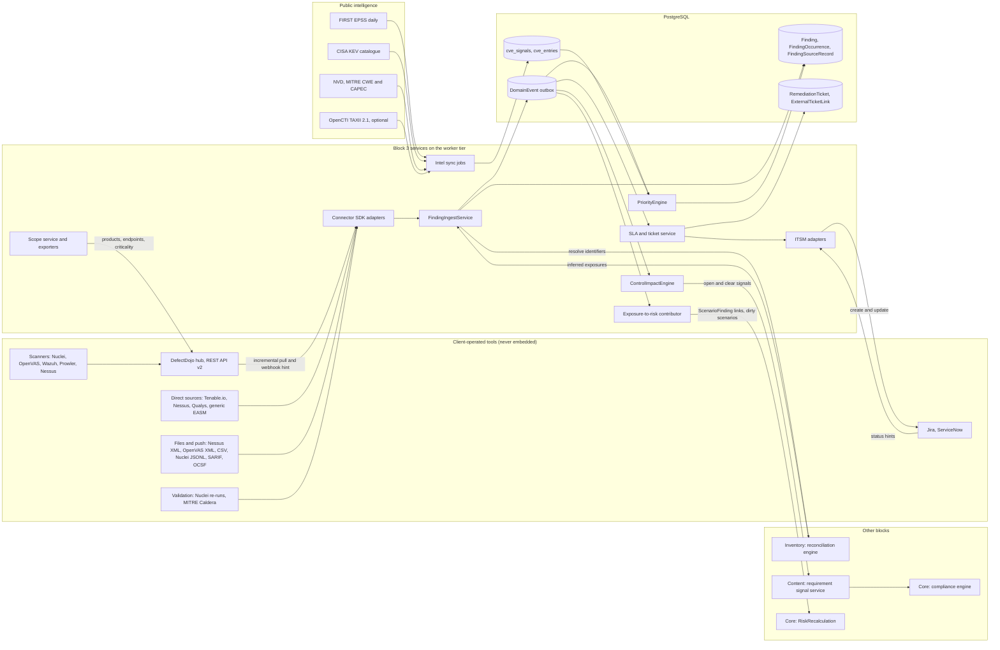
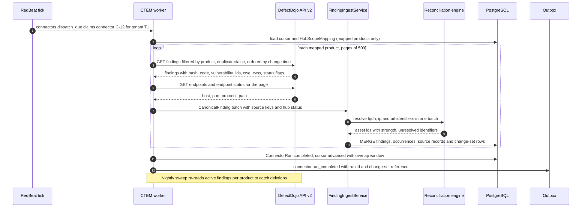
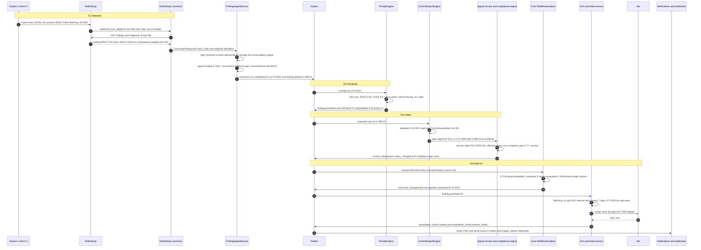
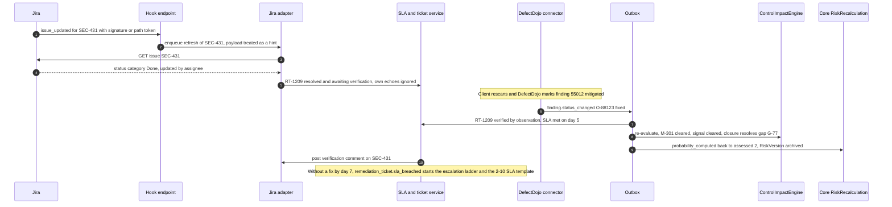

# NG-GRC Block 3: CTEM connection (R7), target architecture

> Lead architect, Block 3 · 2026-10-16 · basis: GRCEye `main@98020b3` (read-only), judge verdict R7 = partial, BM-01 slides 11–13, BM-01-D04.
> "Exists" means present in code today, with evidence. Everything else is proposed. The design is aligned with the sibling designs in this folder:
> - **core:** RiskRecalculation, ScenarioFinding, AssessmentProposal, TenantGrcPolicy;
> - **content:** requirement URNs, RequirementMapping with NIST IR 8477 relations, RequirementSignal;
> - **inventory:** reconciliation engine, AssetIdentifier, `network_zone`, inferred exposures;
> - **platform:** outbox relay, RedBeat, egress proxy, KMS.

## 1. Current state in one page

GRCEye has the skeleton of a CTEM connector. It lacks identity, exploitation signals and the automatic chain downstream of a finding.

| Exists and worth keeping | Evidence |
|---|---|
| One ingest seam for files and API pulls: `ParsedFinding` → `ingest_findings` (asset match, dedup, `ScanJournal`, auto "Remediate:" `AppliedControl`) | `backend/app/services/scanner_import.py:93-103, 482-584` |
| Parsers for Nessus XML, OpenVAS XML and CSV. Pulls from Nessus, Qualys, Tenable.io (plugin-level only), and a generic EASM connector that discovers assets | `scanner_import.py:163-377`; `scanner_connectors.py:193-522`; `easm_connector.py:732-787` |
| Per-connector schedule with an optimistic DB claim; `_check_target` SSRF guard; `_redact` | `vuln_scanner_scheduler.py:99-146`; `scanner_connectors.py:66-111, 540-546` |
| Global NVD catalogue with KEV columns; CWE catalogue with `capec_ids`; tenant CVE triage | `models/cve_entry.py:14-56`; `models/cwe_entry.py:48` |
| Manual vulnerability→scenario links with a *suggested* impact; scenario L/I copied to the risk on edit | `vulnerabilities.py:192-253, 659-708`; `risk_scenarios.py:517-534` |
| Compliance state machine that runs without a user; residual suggestion; risk versioning (`actor=None` allowed); appetite checks; escalation ladder; hash-chained `log_system_activity` | `endpoints/compliance.py:990, 1045, 1112, 4523`; `residual_risk.py:49-124`; `risk_versioning.py:47-59`; `notification_generator.py:481, 723`; `activity_chain.py:190` |

**Missing or broken**
- **Sources:** no findings hub (D04), no Nuclei, SARIF, Prowler or Wazuh input. No push API or machine credential (`ApiToken` is model-only, `models/ai_access.py:71-90`).
- **Identity:**
  - Assets match only on exact string equality with `Asset.name`, `external_id` or `location` (`scanner_import.py:384-409`), and the links are a JSON `affected_assets` list.
  - The dedup key `(ref_id or title, asset)` for the whole register is loaded into memory (`:412-434`). As a result, unmatched hosts collapse into one row, closed findings block re-detection, nothing auto-closes, and there is no fingerprint or first/last seen.
  - Nessus keeps only the first CVE (`:197-205`). Tenable.io maps no host, CVE or CVSS (`scanner_connectors.py:193-210`).
- **Exploitation signals:**
  - KEV covers only the 30 newest entries, and only for CVEs already in the catalogue. It never reaches findings (`threat_feeds.py:251-256`; `threat_watch_ingest.py:34-64`).
  - There is no EPSS.
  - Priority is computed only on demand (`vulnerabilities.py:539-610`).
- **GRC chain:**
  - Compliance never reads findings or applied controls. ECC-2:2024 2-10 is four paraphrased rows, `2-10-1…4`, that nothing can move.
  - Risk impact is "suggestion only" by documented design (`TODO-KNOWN-ISSUES.md:550-565`).
  - The residual suggestion ignores `implemented` controls (`residual_risk.py:46`).
- **Mobilise and validate:**
  - There is no SLA, owner or ETA, and no Jira or ServiceNow.
  - Webhooks never fire (`webhooks.py:32-41`).
  - "Validation" is only a human gate on manual entries (`vulnerabilities.py:515-537`).
- **Hygiene:**
  - Secrets are stored in clear (`models/scanner_connector.py:25-26`).
  - Private targets are allowed by default (`scanner_connectors.py:66-78`), and uploads are capped at 2 MB (`config.py:111`).
  - The UI create form returns a 422, and links are invisible in the UI.
  - Every route is Elite-gated (`vuln_import.py:30`).

## 2. Target design

### 2.1 Principles
1. **The hub holds raw data; GRC holds the meaning.** DefectDojo or a direct source keeps raw scanner output. GRCEye keeps a normalised projection plus what only it knows: scope, business context, priority, SLA, and the effects on controls and risks.
2. **One ingest path.** Every source produces `CanonicalFinding` records for one `FindingIngestService`, which evolves from `ingest_findings`.
3. **Event-driven.** Ingest commits a change-set and a DomainEvent. Everything downstream consumes the outbox (B5).
4. **Explainable.** Every score and match stores its inputs and the policy or rule version that produced it.
5. **Clear ownership.**
   - CTEM decides *what an exposure means* (priority, exploitability, rule matches, SLA).
   - The core and content blocks decide *what happens to requirements and risks*, through their services.
   - Effects are non-destructive, versioned and hash-chained under the system actor.
6. **No embedded scanners (D04) and no linked copyleft code (B2).**

### 2.2 Components and cross-block contracts

| Component (CTEM-owned) | Type | Responsibility | Extends / new |
|---|---|---|---|
| CTEM connector adapters | Worker plugins on the shared B9 SDK | Config, credential reference, cursor, paging, rate limit, mapping to `CanonicalFinding` | Extends `scanner_connectors.py`, `easm_connector.py` |
| DefectDojo connector | Adapter | Pull products, tests, findings and endpoints; webhook hint; scope export | New |
| Parsers | Library | Nessus, OpenVAS, CSV; plus new Nuclei JSONL, SARIF 2.1.0, Prowler OCSF | Extends `scanner_import.py` |
| Push ingestion API | API | ApiClient-authenticated uploads, streamed to object storage, processed asynchronously | New `endpoints/ctem_ingest.py` |
| FindingIngestService | Service | Normalise, resolve identity, fingerprint, correlate, MERGE, reconcile lifecycle, write change-set and events | Replaces the internals of `ingest_findings`; keeps the seam |
| Intel sync | Worker jobs (`catalog` queue) | Full KEV, daily EPSS, targeted NVD, CWE/CAPEC, optional TAXII | Extends `threat_feeds.py`, `threat_watch_ingest.py`, `nvd_sync.py`, `mitre_cwe_sync.py` |
| PriorityEngine | Service | Explainable per-occurrence priority and exploitability | Replaces `compute_impact_score` (`models/vulnerability.py:91-112`) |
| ControlImpactEngine | Service | Evaluate ControlImpactRules on change-sets and nightly; keep ControlImpactMatch with its evidence; open and clear signals through the content block | New |
| Exposure-to-risk contributor | Consumer | Maintain selector-based ScenarioFinding links; supply exploitability; mark scenarios dirty | New (feeds core's RiskRecalculation) |
| SLA and ticket service + ITSM adapters | Service and adapters | SlaPolicy, RemediationTicket, SLA sweep; bidirectional Jira and ServiceNow sync | New (reuses `relance_rung`) |
| Validation ingester | Service | Nuclei, DefectDojo `verified` and Caldera results → ValidationResult; re-test triggers | New |
| Scope service | Service | CtemScope membership, crown jewels, coverage, exports | New |
| CTEM rollups, notifications | Jobs and consumers | Daily metrics; `finding.*`/`remediation_ticket.*` notifications (AR/EN/FR) and webhooks | Extends `trend_snapshot_scheduler.py`, `notification_generator.py`, `webhooks.py` |
| CTEM UI | SPA | "Exposure" nav group | Replaces `VulnerabilitiesPage.tsx` |

| Contract | Owner | CTEM consumes / provides |
|---|---|---|
| Reconciliation engine, `AssetIdentifier`, `network_zone`, `environment`, `criticality_effective`, InferredExposure | Inventory | Consumes batch identity resolution, asset context and `asset.merged` / `asset.context_changed`. Receives high-confidence inferred exposures as occurrences |
| Connector, ConnectorRun, CollectorSite, SDK | Inventory + platform (B9) | Consumes |
| RequirementMapping (URNs, NIST IR 8477 relations), Requirement signal service, RequirementSignal | Content | Calls `open/clear signal(rule, target URN, finding, occurrences)`. KSA rule templates ship in content packs |
| Compliance engine / ControlAssessmentService, ProposalService, AssessmentProposal | Core / content | Applies effective status, gaps, actions and proposals |
| ScenarioFinding, RiskRecalculation, TenantGrcPolicy | Core | CTEM writes `source=rule` links and supplies exploitability. Core recomputes likelihood and residual, archives versions and raises appetite alerts |
| DomainEvent relay, RedBeat, JobExecution, egress proxy, `core/kms.py`, storage | Platform | Consumes |
| ApiClient, Membership | Tenancy | Push API and hook authentication; MSSP console |

### 2.3 Component and flow diagram



### 2.4 Data model

| Entity | Change | Key fields | Relations |
|---|---|---|---|
| Finding | Changed: `vulnerabilities` renamed to `findings`, ids kept | `fingerprint` (UQ per tenant), `finding_type`, title, `remediation_guidance`, severity, `cvss_v3/v4_score` and vectors, `epss_score/percentile/date`, `kev`, `kev_added_at`, `kev_due_date`, `exploit_maturity`, aggregate `status`, `first/last_seen_at`, `validation_status`; legacy `impact_*` read-only | 1:N FindingRef, FindingOccurrence |
| FindingRef | New | `ref_type` (cve, cwe, ghsa, qid, nessus_plugin, nuclei_template, check), `ref_value`; index `(ref_type, ref_value)` | Joins CveSignal |
| FindingOccurrence | New (replaces JSON `affected_assets`) | `asset_id` (nullable), `asset_key`, `component_key`, UQ `(tenant, finding, asset_key, component_key)`; `org_entity_id` (copied from the asset, for entity scoping); `detection_method` (hub, scanner, push, inventory_inference, manual), `confidence`; status, `first/last_seen_at`, `fixed_at`, `reopen_count`, `network_zone`, `in_scope`, `priority_score/band/breakdown/policy_version`, `exploitability`, `sla_due_at`, `sla_state`, `acceptance_ref` | N:1 Asset |
| FindingSourceRecord | New (analogue of AssetSourceRecord) | `connector_id`, `external_key` (UQ per connector), `external_hash` (DefectDojo `hash_code`), `source_status`, `absent_since`, `payload_hash`, `raw_ref` (object storage), `last_run_id` | N:1 Occurrence, ConnectorRun |
| CveSignal (`cve_signals`) | New, global | `cve_id` PK, EPSS score/percentile/date, KEV flag, dates and action, `kev_ransomware`, `exploit_ref_count`, `ti_actor_count` | 1:1 CveEntry (KEV columns kept there for compatibility) |
| HubScopeMapping | New | `connector_id`, `hub_object_type/id`, `org_entity_id`, `business_process_id`, `default_asset_id`, `on_unresolved`; platform table `hub_object_claims` UQ `(hub, type, id)` | N:1 Connector |
| PriorityPolicy, SlaPolicy, CompensatingControlBinding | New, versioned | Weights and thresholds; SLA rules, `kev_mode`, `clock_start`, `calendar`; binding = `applied_control_id`, selector, `max_credit`, `valid_until` | — |
| RemediationTicket, ExternalTicketLink | New | `RT-n`, `grouping_key`, owner, status, `due_at`, `sla_state`, `applied_control_id`, `verified_by`; link = system, `external_key`, url, `external_status`, `sync_version` | N:M Occurrence |
| ControlImpactRule | New | `tenant_id` (null = content-pack template), `name_en/ar`, condition DSL, `target_urn`, effect, mode, `propagate_relations`, version | 1:N ControlImpactMatch |
| ControlImpactMatch | New | rule and version, `target_urn`, scope assets, state (active/cleared/suppressed), explanation, `opened/cleared_at`, suppression justification; evidencing occurrences (join table) | 1:N RequirementSignal |
| ValidationResult | New | `occurrence_id`, tool, `method_ref`, outcome, `observed_at`, evidence and SHA-256, `attack_technique_ids` | — |
| CtemScope | New | Selector (process criticality, entity subtree, `criticality_effective`, zone, tags), `kind` (standard or crown_jewel), `cadence_days`, owner; materialised `ctem_scope_assets` | N:M Asset |
| ScenarioExposureSelector | New | `scenario_id`, asset scope, minimum band, CWE classes | Generates ScenarioFinding rows (`source=rule`) |
| Written through other blocks' services | — | Connector/ConnectorRun (B9); RequirementSignal and `ControlAssessment.effective_status_key` (content); AssessmentProposal (core); ScenarioFinding, `RiskScenario.probability_computed/exposure_inputs` (core); automated Evidence fields (`models/compliance.py:192-199`) | — |

```mermaid
erDiagram
    FINDING ||--o{ FINDING_REF : "identified by"
    FINDING ||--o{ FINDING_OCCURRENCE : "occurs as"
    ASSET |o--o{ FINDING_OCCURRENCE : "affected asset"
    ASSET ||--o{ ASSET_IDENTIFIER : "identity keys"
    FINDING_OCCURRENCE ||--o{ FINDING_SOURCE_RECORD : "reported by"
    CONNECTOR ||--o{ FINDING_SOURCE_RECORD : "produced"
    CONNECTOR ||--o{ CONNECTOR_RUN : "runs"
    CONNECTOR ||--o{ HUB_SCOPE_MAPPING : "maps hub objects"
    FINDING_REF }o--o| CVE_SIGNAL : "enriched by"
    CVE_SIGNAL |o--o| CVE_ENTRY : "same CVE"
    FINDING_OCCURRENCE ||--o{ VALIDATION_RESULT : "validated by"
    REMEDIATION_TICKET ||--|{ TICKET_OCCURRENCE : "groups"
    FINDING_OCCURRENCE ||--o{ TICKET_OCCURRENCE : "remediated in"
    SLA_POLICY ||--o{ REMEDIATION_TICKET : "sets due date"
    REMEDIATION_TICKET ||--o{ EXTERNAL_TICKET_LINK : "mirrored as"
    APPLIED_CONTROL |o--o{ REMEDIATION_TICKET : "implemented by"
    APPLIED_CONTROL ||--o{ COMPENSATING_BINDING : "compensates"
    CONTROL_IMPACT_RULE ||--o{ CONTROL_IMPACT_MATCH : "activates"
    CONTROL_IMPACT_MATCH ||--|{ MATCH_OCCURRENCE : "evidenced by"
    FINDING_OCCURRENCE ||--o{ MATCH_OCCURRENCE : "cited in"
    CONTROL_IMPACT_MATCH ||--o{ REQUIREMENT_SIGNAL : "fans out to"
    REQUIREMENT_MAPPING }o--o{ REQUIREMENT_SIGNAL : "expands target"
    CONTROL_ASSESSMENT ||--o{ REQUIREMENT_SIGNAL : "receives"
    REQUIREMENT_SIGNAL |o--o| COMPLIANCE_GAP : "opens"
    REQUIREMENT_SIGNAL |o--o| EVIDENCE : "automated evidence"
    RISK_SCENARIO ||--o| SCENARIO_EXPOSURE_SELECTOR : "selects with"
    RISK_SCENARIO ||--o{ SCENARIO_FINDING : "exposed by"
    FINDING ||--o{ SCENARIO_FINDING : "linked to"
    CTEM_SCOPE ||--o{ CTEM_SCOPE_ASSET : "includes"
    ASSET ||--o{ CTEM_SCOPE_ASSET : "member of"
    FINDING {
        string id PK
        string tenant_id FK
        string fingerprint UK
        string finding_type
        float cvss_v4_score
        float epss_score
        bool kev
        string exploit_maturity
        string status
    }
    FINDING_OCCURRENCE {
        string id PK
        string finding_id FK
        string asset_id FK
        string asset_key "unique with finding and component"
        string component_key
        string detection_method
        string status
        float priority_score
        float exploitability
        datetime sla_due_at
    }
    FINDING_SOURCE_RECORD {
        string id PK
        string connector_id FK
        string external_key "unique per connector"
        string external_hash
        datetime absent_since
    }
    CONTROL_IMPACT_MATCH {
        string id PK
        string rule_id FK
        string target_urn
        string state
        datetime opened_at
    }
    REMEDIATION_TICKET {
        string id PK
        string ref UK
        string owner_id FK
        string status
        datetime due_at
        string sla_state
    }
```



### 2.5 Finding identity, correlation and lifecycle

- **Fingerprint (the finding definition, independent of asset).** `sha256(tenant | type | key)`. The key is chosen in order:
  1. `cve:<id>` for a single CVE.
  2. `cves:<sorted ids>` for several CVEs.
  3. The tool-native id (`nessus:`, `qualys:`, `nuclei:`, `prowler:`, `dd:`).
  4. Otherwise the normalised title plus the first CWE.

  Every identifier also lands in FindingRef, so Qualys QIDs carry their KB CVEs and Nessus keeps all of its CVEs.
- **Occurrence key.** `asset_key` is the asset id, or `unresolved:<identifier>` when the reconciliation engine cannot resolve it. The same CVE on 40 unknown hosts therefore makes 40 occurrences. `component_key` is `tcp/443`, a URL path, `package@version` or `file:line`.
- **Correlation.** If an open occurrence on the same asset already shares a CVE, the new source record attaches to it (`correlated=true`). A Nessus plugin and a Qualys QID for the same CVE therefore count once. The hub's own dedup runs first.
- **Inferred exposures.** High-band exposures from the inventory block's CVE matcher arrive as occurrences with `detection_method=inventory_inference` and a confidence.
  - Their band is capped at P2, and enforce-mode rules ignore them.
  - A scanner or hub observation confirms and replaces them.

| State | Entered when | Authority |
|---|---|---|
| open | First seen, an acceptance expires, or triage is reset | Any source |
| confirmed | Hub `verified`, analyst confirmation, or validation evidence | Hub, triage, ValidationResult |
| fixed | Hub `is_mitigated`; source state Fixed; absent from a complete run that covered the asset; verified re-test | ConnectorRun coverage |
| reopened | Seen again after fixed; the SLA keeps its original due date | Any source |
| risk_accepted | An approved SecurityException/RiskAcceptance (four-eyes); hub `risk_accepted` only if the tenant chooses the hub as authority | GRC by default |
| false_positive | Triage with a justification (four-eyes for P1/P2), or hub `false_p` | GRC or hub |

Hub `out_of_scope` findings are stored but excluded, and duplicates are skipped. When an acceptance expires, the finding returns to `open`, so nothing is suppressed for ever.

### 2.6 Findings hub: DefectDojo connector (BSD-3-Clause, REST API v2)

| DefectDojo object | GRC landing |
|---|---|
| Product type | Tenant (shared MSSP hub) or OrgEntity, claimed in `hub_object_claims` so that two tenants never map the same object |
| Product | BusinessProcess or application asset (HubScopeMapping); `default_asset_id` covers findings without endpoints (SAST, SCA, cloud) |
| Engagement, test | ConnectorRun coverage unit; the test type ("Nuclei Scan") becomes the source tool |
| Finding | FindingSourceRecord → Finding + occurrence; `hash_code` and `unique_id_from_tool` kept for idempotency |
| Endpoint, endpoint status | Batch resolution by the reconciliation engine (fqdn, ip, url) plus `component_key`; per-endpoint mitigation honoured |
| `vulnerability_ids`, `cwe`, `cvssv3/cvssv4`, `epss_score/percentile`, `known_exploited`, `kev_date` | FindingRef and source attributes. Hub EPSS/KEV enrichment is a Pro feature, so GRC recomputes from FIRST and CISA |
| `active`, `verified`, `false_p`, `risk_accepted`, `is_mitigated`, `out_of_scope`, `duplicate` | Lifecycle (§2.5) |
| JIRA issue mappings (`jira_key` per finding, exposed through the v2 API) | ExternalTicketLink "adopt" mode, which avoids duplicate tickets. The exact endpoint is checked by the capability probe |

**Sync modes.**
1. **Scheduled incremental pull (authoritative).** The platform's RedBeat tick `connectors.dispatch_due` claims the connector. The adapter then calls `GET /api/v2/findings/` per mapped product (`test__engagement__product` or `__prod_type`), with `duplicate=false`.
   - Results are ordered by the change timestamp the instance exposes (`last_status_update`/`updated` filters exist), in pages of 500, with `prefetch` to avoid N+1 requests.
   - The cursor keeps a 15-minute overlap. Keyed source records make re-reads harmless.
   - `test` probes `/api/v2/oa3/schema/` to record the instance's capabilities.
2. **Webhook hint.** DefectDojo's experimental notification webhooks (`scan_added`, `scan_added_empty`, `test_added`…) carry test and finding ids.
   - The hook checks the static `header_name/header_value` (there is no HMAC) and enqueues a pull of that test.
   - The payload is never stored as data.
3. **Nightly sweep.** Active findings are re-read per product, keyset by id, to detect deletions (`absent_since`).
4. **Optional write-back (off by default).** False positives and acceptances approved in GRC are pushed back to the hub.

**MSSP.** Run one DefectDojo per partner, with one product type per client. Each tenant connector uses a DefectDojo *Reader* account limited to its product type, and mapping in GRC is default-deny. Credentials for an on-prem hub stay in the Site Collector's sealed store (inventory design).

**Direct sources** remain for clients without a hub:
- **Nessus (file and API):** all CVEs, ports and `exploit_available`; run coverage = the hosts scanned.
- **Tenable.io:** moves to the vulnerability *export* API (asset hostname/ipv4/fqdn, CVEs, CVSS, solution, OPEN/REOPENED/FIXED, `since` cursor).
- **Qualys:** adds Fixed detections and KB CVEs.
- **OpenVAS:** stays file-only (`python-gvm` is GPL-3.0 and is not linked).
- **EASM:** kept; its discovery goes through the reconciliation engine, which sets `network_zone=internet_facing`.
- **Nuclei JSONL, SARIF and Prowler OCSF:** new parsers.
- **Wazuh:** through the hub, or a P3 API adapter.
- **demo:** limited to demo tenants.

### 2.7 Prioritisation (CTEM step 03)

The score is computed per occurrence, because business impact and exposure depend on the asset. It uses a versioned PriorityPolicy and stores its breakdown.

| Factor | Default |
|---|---|
| S severity | CVSS v4 base score, else v3.x, divided by 10 (severity fallback) |
| T threat | Highest of: KEV 1.0; validated exploitable 1.0; maturity attacked 1.0 / functional 0.8 / PoC 0.6; `min(1, EPSS/0.10)`; OpenCTI "targets KSA or sector" 0.9 (optional) |
| L likelihood | 0.4·S + 0.6·T |
| A asset value | Crown jewel (CtemScope) 1.0; otherwise the inventory block's `criticality_effective`, which is inherited from processes (critical 1.0 … low 0.25) |
| I impact | 0.4 + 0.6·A |
| X exposure | From `network_zone`: internet-facing 1.0, DMZ 0.9, internal 0.7, isolated 0.4, unknown 0.7. The keys come from `OPERATIONAL_CONTEXT_WEIGHTS` and are now set by the inventory block rather than by users |
| C compensating | `min(0.5, Σ credit × effectiveness)` over implemented, validated, unexpired bound controls; effectiveness from the core block's control effectiveness (today's 1.0/0.5/0.1, `residual_risk.py:43`) |
| P, band | P = 100·L·I·X·(1−C). P1 ≥ 70, P2 ≥ 45, P3 ≥ 20, else P4. Overrides: KEV with X ≥ 0.9 → at least P1; validated exploitable on a crown jewel → P1 |

**Exploitability** for risk is `e = max(EPSS, 0.9·KEV, 0.95·validated, 0.6·PoC) × X × (1 − C)`. Findings without a CVE use a band proxy (P1 0.3 … P4 0.01).

Example: CVE-2021-42013 on an internet-facing crown jewel gives S 0.98, T 1, L 0.99, I 1, X 1 → **P 99, band P1, e 0.94** (EPSS illustrative).

Recomputation is triggered by occurrence changes, `cve_signal.changed`, `asset.context_changed`, binding changes, and policy changes (bulk, after `simulate`).

### 2.8 Control impact rules (exposure → requirement)

**Division of labour.**
- **CTEM** owns ControlImpactRule (the DSL and its evaluation) and ControlImpactMatch (which occurrences satisfy a rule, with an explanation).
- **The content block's Requirement signal service** expands the rule's target URN over the RequirementMapping closure and the applicability/SoA filter. It opens RequirementSignal rows per affected control assessment.
- **The compliance engine** applies the effective status, gap, action and automated evidence.

A rule is declarative JSON validated against a schema, with no expressions or code. There are four condition families:
- `finding`: predicates on occurrence, finding and asset, plus a count or share of in-scope assets.
- `sla`: a ticket is at risk or breached.
- `coverage`: in-scope assets have not been scanned within the cadence.
- `validation`: a fixed P1 has no re-test.

```json
{
  "key": "ksa.ecc2.2-10.kev-crown-jewel",
  "name": {"en": "Known-exploited vulnerability on an internet-facing crown jewel",
           "ar": "ثغرة معروفة الاستغلال على أصل حيوي مكشوف للإنترنت"},
  "target_urn": "urn:ngc:nca:ecc:2-2024:2-10-3",
  "when": {"occurrence.status_in": ["open", "confirmed", "reopened"], "finding.kev": true,
           "occurrence.priority_band_in": ["P1"], "scope.crown_jewel": true,
           "asset.network_zone_in": ["internet_facing"],
           "occurrence.detection_method_not_in": ["inventory_inference"]},
  "aggregate": {"count_gte": 1},
  "effect": "non_compliant", "mode": "enforce",
  "propagate": {"relations": ["equal", "subset_of"]}
}
```

Rules target **requirement URNs**, which stay stable across content revisions. The content team pins the exact sub-control in NCA's text. Templates ship in KSA content packs, and tenants can override mode and thresholds. The illustrative templates below would be co-authored with the content team:

| Template | Condition | Target (ECC-2:2024) | Effect, default mode |
|---|---|---|---|
| 2-10 KEV | Open KEV P1 on an internet-facing crown jewel | 2-10 vulnerability-management requirements (today's paraphrased seed row 2-10-2) | Non-compliant, enforce |
| 2-10 SLA | A P1/P2 ticket breaches its SLA | 2-10 remediation and tracking (seed rows 2-10-2, 2-10-4) | Non-compliant, enforce |
| 2-10 coverage | Crown jewels not scanned within the cadence | 2-10 periodic assessment (seed row 2-10-1) | Partially compliant, propose |
| 2-11 re-test | P1 fixed with no re-test within 14 days | 2-11 penetration testing and re-test (seed row 2-11-4) | Partially compliant, observe |

**What CTEM requires of the downstream** (the content design's overlay satisfies it):
1. **Overlay, not overwrite.** Effective status = worse(assessor verdict, signal). Assessor and auditor values are never written. Only draft, in-progress and under-review assessments are affected.
2. **Modes.**
   - *observe* gives a badge;
   - *propose* creates an AssessmentProposal (core's ProposalService);
   - *enforce* applies the overlay.
3. **Evidence.** Each signal carries the match explanation and an automated Evidence row (`is_automated`, `source_integration=ctem`, `raw_data`).
4. **Clearing.** When the match clears (occurrences fixed or accepted, ticket closed), the signal clears, `_apply_action_closure` resolves the gap, and the effective status reverts.
5. **One rule, every framework.** `equal` and `subset_of` relations inherit the effect, for example to ISO/IEC 27002:2022 8.8 or the SAMA CSF vulnerability-management control. `intersects_with` relations get observe-only hints.
6. **Suppression.** Suppressing a match needs a time-boxed, hash-chained CISO justification.

### 2.9 Exposure → risk (CTEM contribution to core's RiskRecalculation)

Exposure moves **likelihood**, never impact, which stays the assessor's judgement. This retires today's "suggested impact level" (`vulnerabilities.py:192-207`).
1. **Links.** CTEM writes the core block's `ScenarioFinding` rows with `source=rule`, generated from each scenario's ScenarioExposureSelector. By default the selector picks occurrences on the scenario's assets with band ≥ P2. CWE classes can be derived from the scenario's ATT&CK threats through CAPEC↔CWE (`cwe_entries.capec_ids`) in P3. Manual and incident links stay core APIs.
2. **Input.** Each occurrence carries `exploitability` *e* with its explanation (§2.7). `finding.*` events mark linked scenarios dirty.
3. **Computation (core).** `probability_computed = max(assessed, map(E))`, with thresholds in `TenantGrcPolicy`. Core then runs residual (with the `COUNTS_AS_ACTIVE` fix, core D2), versions, `risk.score_changed` and `risk.appetite_breached`.
   - Core's method v1 uses E = max *e*.
   - CTEM recommends offering `E = 1 − Π(1 − e_i)` over the top 10 occurrences as method v2. Several independent exploitable paths are likelier than one, and EPSS-weighted inputs keep many medium findings from saturating E.
4. **Example.** e 0.94 maps to 5 on a 5-level scale (default thresholds ≥0.6→5, ≥0.3→4, ≥0.1→3, ≥0.02→2), against an assessed 2. When the occurrence is fixed, the likelihood steps back to 2, versioned.

### 2.10 Mobilisation (CTEM step 05)

**SlaPolicy.**
- **Rules:** ordered rules on band, KEV, severity, crown jewel, zone, type and entity, each giving `due_days`.
- **`kev_mode`:** one of `fixed_days`, `cap_at_cisa_due` or `ignore`. CISA due dates target US agencies, so the KSA default is fixed days.
- **`clock_start`:** first seen, confirmed, or go-live for migrated rows.
- **Calendar:** calendar days, or KSA business days (Friday–Saturday weekend plus tenant holidays, including the Hijri-dated Eids).
- **Pause:** the clock stops while a finding is risk-accepted.
- **Defaults:** illustrative values are KEV internet-facing 7 days, P1 15, P2 30, P3 90, P4 180. Tenants enter their NCA-approved values.
- **Tightening only:** a band increase can only shorten `due_at`.

**RemediationTicket.**
- **Grouping:** by default, finding × owning team.
- **Owner:** asset owner → process owner → entity owner → the tenant queue. EASM-created assets are ownerless today (`easm_connector.py:732-787`).
- **States:** open, in_progress, blocked, resolved (awaiting verification), verified, closed.
- **SLA states:** on_track, at_risk, breached, paused, met.
- **AppliedControl link:** the auto "Remediate:" AppliedControl becomes optional (on for migrated tenants) and is linked from the ticket. Standing mitigations become compensating bindings.

**Jira (Cloud v3, Data Center v2) and ServiceNow (Table API: incident, sc_task, or Vulnerability Response items where licensed)** are both bidirectional:
- **Outbound.** The ticket ref is the idempotency key. Templates are per tenant, in AR and/or EN, with optional hostname/IP redaction.
- **Inbound.** A webhook or business rule calls the hook endpoint. It checks a signature where one is supported, otherwise a path token plus an IP allowlist. The adapter re-reads the issue through the API and maps the status category. Echoes of GRC's own updates are ignored.
- **Polling fallback.** JQL `updated >= cursor` for Jira; `sys_updated_on > cursor` for ServiceNow.
- **No acceptance from the ITSM.** "Won't do" never accepts a risk. The ticket goes to `blocked` and needs a SecurityException.
- **Adopt mode.** If DefectDojo already created the Jira issue, GRC links that key.

**SLA events.** An hourly sweep emits `remediation_ticket.sla_at_risk` and `remediation_ticket.sla_breached`. These feed the escalation ladder (`relance_rung`), the `sla` rules and the dashboards.

### 2.11 Validation (CTEM step 04)

GRC never runs exploits (D04). It ingests ValidationResult evidence from tools the client operates:
- **Nuclei.** JSONL arrives through the push API or the hub. A match from a template on the tenant's *validation allow-list* (exploit-behaviour templates) counts as exploitable. Detection and version templates only raise maturity to PoC.
- **DefectDojo `verified`.** This sets `confirmed`: verified by an analyst, which is not proof of exploitation.
- **MITRE Caldera (REST API v2).** Host × ability results resolve to assets.
  - An ability tied to a CVE validates that occurrence.
  - Otherwise the ATT&CK technique validates the scenarios whose threats carry it (`Threat.mitre_ids`), giving an exploitability input of 0.95.
- **Manual penetration-test evidence** (ECC 2-11).

**Re-test on fix.**
- A resolved ticket moves to `awaiting_verification`.
- It is verified by any of:
  - a later observation that shows it fixed;
  - a `not_exploitable` re-test, which GRC can trigger as a Caldera operation or a CI hook that re-runs the Nuclei template;
  - manual evidence from someone other than the resolver.
- If the finding is detected again, the ticket reopens.

### 2.12 Scope (CTEM step 01)

**CtemScope** (versioned).
- **Selector:** process criticality, entity subtrees, `criticality_effective`, `network_zone` and tags, with includes and excludes. It also carries a cadence and an owner.
- **Crown jewels:** a scope of `kind=crown_jewel`. By default it holds assets whose effective criticality is critical, inherited from critical processes, plus any assets listed by hand.
- **Membership:** materialised on `asset.*` events.
- **Uses:**
  - the `in_scope` priority flag;
  - the rules' scope predicates;
  - coverage (an in-scope asset with no run inside the cadence);
  - exports:
    - DefectDojo products (`business_criticality`, `internet_accessible`, tags `grc-scope`/`grc-crown-jewel`) and endpoints;
    - CSV/JSON target lists for scanners;
    - Tenable/Qualys tags (P3).

### 2.13 Threat-intel enrichment

1. Sync the full KEV catalogue daily, not just 30 entries. Create stub CveEntry rows, and fetch from NVD by `cveId` any finding CVE that is missing.
2. Load FIRST EPSS daily into `cve_signals`.
3. Optional: pull from OpenCTI over TAXII 2.1 (`stix2`, `taxii2-client`). Vulnerability objects with `targets`/`uses` relations give `ti_actor_count` and KSA/sector relevance, and items still feed the tenant threat watch.
4. Add Saudi CERT advisories as a regional source.

`cve_signal.changed` is a platform-scope event (no tenant) that fans out through FindingRef.

### 2.14 Dashboards

There are four new keys in `dashboards.py`. Each is exportable through `dashboard_export.py`, including AR RTL.
- **`ctem-exposure`:** P1/P2, KEV and EPSS ≥ 10% by process, entity and scope; unresolved assets.
- **`ctem-sla`:** on track, at risk and breached; % closed within SLA by band and owner; MTTR; ageing.
- **`ctem-control-impact`:** active matches and signals per framework, mapped ones included.
- **`ctem-coverage`:** scope scanned within cadence; source freshness; ConnectorRun health.

Headline series extend `trend_snapshots`, and breakdowns go into a `ctem_rollups` table.

### 2.15 Key flows

**A. DefectDojo incremental sync**



**B. The deck's worked example, end to end** (illustrative values; `bank.example` is a placeholder)



**C. Ticket sync, fix, verification and SLA**



| Outbox event | Producer → main consumers |
|---|---|
| `connector.run_completed` (shared B9 name; the core design writes `connector_run.completed`, to be harmonised) | Ingest → PriorityEngine, ControlImpactEngine, rollups |
| `finding.opened/status_changed/prioritised/validated` | Ingest, triage, PriorityEngine, validation → tickets, rules, core risk hooks, P1 notifications |
| `cve_signal.changed` (platform scope) | Intel sync → PriorityEngine |
| `control_impact.matched/cleared` | ControlImpactEngine → signal service, notifications, webhooks |
| `remediation_ticket.created/external_linked/status_changed/sla_at_risk/sla_breached/verified` | Tickets → ITSM adapters, escalation ladder, `sla` rules, webhooks |
| Consumed: `asset.merged`, `asset.context_changed`, `exposure.inferred` (inventory); `control_assessment.status_changed`, `risk.score_changed` (core) | → re-point occurrences, re-score, inferred intake, dashboards |

### 2.16 APIs (under `/api/v1`)

| Method and path | Purpose |
|---|---|
| `GET /findings`, `GET /findings/{id}` | Keyset list (status, band, kev, epss_gte, asset, process, entity, scope, source, sla_state); full detail |
| `POST /findings/{id}/transitions` | Confirm, false positive, risk-accept (with a SecurityException ref), reopen |
| `GET /finding-occurrences`, `GET /finding-occurrences/{id}/priority` | Occurrences by asset, ticket or scope; priority and exploitability explanation |
| `/vulnerabilities/*`, `/vuln-import/*` | Deprecated façades for two releases; upload becomes asynchronous |
| `GET/POST /connectors?kind=ctem.*`, `PATCH/DELETE /connectors/{id}` | Connector CRUD (shared B9 API) |
| `POST /connectors/{id}/test`, `POST /connectors/{id}/runs`, `GET /connectors/{id}/runs` | Capability probe, run now, history |
| `GET /connectors/{id}/hub/objects`, `PUT /connectors/{id}/hub/mappings` | Browse and map DefectDojo objects |
| `POST /ctem/ingest/{connector_id}` | Push ingestion (ApiClient scope `ctem:ingest`), returns 202 with a run id |
| `POST /ctem/hooks/{connector_id}/{token}` | Inbound hints from DefectDojo, Jira and ServiceNow |
| `GET/PUT /ctem/priority-policy`, `/ctem/sla-policy` (+ `POST …/simulate`) | Versioned policies with dry runs |
| `GET/POST/PATCH /ctem/compensating-bindings` | Compensating controls |
| `GET/POST/PATCH/DELETE /ctem/control-impact-rules`, `POST …/{id}/simulate` | Rules (tenant overrides of pack templates) and what-if |
| `GET /ctem/control-impact-matches`, `POST …/{id}/suppress` | Active matches with evidence; justified suppression |
| `GET/PUT /ctem/scenarios/{id}/exposure-selector`, `GET /ctem/scenarios/{id}/exposure` | Selector; contributing occurrences and their exploitability |
| `GET/POST /remediation-tickets`, `PATCH /remediation-tickets/{id}`, `POST …/{id}/transitions`, `POST …/{id}/external-links`, `POST …/{id}/retest` | Ticket lifecycle, ITSM link, verification |
| `POST /ctem/validation-results` | Push exploitability evidence |
| `GET/POST/PATCH /ctem/scopes`, `GET …/{id}/assets`, `GET …/{id}/export`, `POST …/{id}/push` | Scope, export and push to the hub |
| `GET /cve/{cve_id}` (extended), `GET /ctem/intel/status` | EPSS, KEV and TI; feed freshness |
| `GET /dashboards/ctem-exposure` (and `-sla`, `-control-impact`, `-coverage`) | Dashboards |

Requirement signals, proposals and risk decisions are served by the content and core APIs.

### 2.17 UI changes
- **New "Exposure" group** in `Layout.tsx` (`NAV_GROUPS`, `ROUTE_ROLES`). It has:
  - an overview dashboard;
  - **Findings**: asset column, KEV/EPSS badges, band chip with a "why" waterfall, SLA chip, bulk triage;
  - a **finding drawer**: occurrences, sources, validation, tickets, matches, scenarios;
  - a **Tickets** board;
  - **Connectors and runs**: a DefectDojo mapping wizard and run history;
  - **Policies** with simulation;
  - a **Rules** view: templates and tenant overrides, with a bilingual requirement picker and simulation;
  - **Scopes**.
- **Elsewhere:**
  - The signal badge on AssessmentDetailPage and RequirementsPage comes from the content block, and links back to the CTEM match.
  - RiskScenariosPage shows contributors to `probability_computed`.
  - AssetsPage and AssetGraphPage get P1/crown-jewel/internet-facing overlays.
  - The CVE page shows EPSS.
- **Fixes:** the create 422 (an asset picker is added) and the invisible links.
- **Languages:** every string is in en/fr/ar, and charts are RTL-safe.

### 2.18 Security and tenant isolation
- **RLS and tenant context.**
  - Every CTEM table has `tenant_id NOT NULL` and RLS (B3).
  - Workers run with the transaction-local tenant context (platform `core/tenancy.py`).
  - Global intel jobs use the platform role, which can write only `cve_signals`, `cve_entries` and `cwe_entries`.
  - Tenant users lose today's ability to trigger global catalogue writes (`POST /cve/sync`, `/threats/import-mitre`).
- **Credentials and egress.**
  - Credentials use envelope encryption v2 (`core/kms.py`, B7) and are never returned; errors are redacted (`_redact`).
  - All egress passes the platform egress proxy's allow-list. SaaS denies private, loopback and link-local targets.
  - Private networks are reached only through a Site Collector, whose sealed store holds the on-prem credentials. The on-prem appliance allows private targets.
- **Inbound endpoints.**
  - Each connector has a path token plus the static DefectDojo header, or an HMAC where the ITSM supports one. Comparison is constant-time.
  - Inbound payloads only *trigger* an API re-read, with size and rate limits.
  - Push ingestion needs an ApiClient with per-connector scopes.
- **Parsing and storage.**
  - Parsing runs in workers: `defusedxml`, JSONL line limits, SARIF/OCSF schema checks.
  - Uploads stream to object storage, so the 2 MB evidence cap stays separate.
  - Raw artefacts are kept encrypted for 90 days, and plugin output, which may contain secrets, is stripped by default.
- **MSSP.**
  - Hub mapping is default-deny.
  - `hub_object_claims` blocks double mapping.
  - Hub accounts are Reader-only per product type.
  - Cross-tenant isolation tests run in CI.
- **Authorisation.**
  - New capabilities: `ctem.view`, `ctem.triage`, `ctem.accept` (CISO), `ctem.rules.manage`, `ctem.policy.manage`, `connector.manage`, `ticket.manage`.
  - Ticket owners are covered by the perimeter rule (`services/perimeter.py`).
  - False positives and acceptances on P1/P2 need four-eyes approval.
- **Audit.** Every automatic change goes through `log_system_activity` (system actor) with its run, rule or policy version. The rule DSL is expression-free, so query cost is bounded.

### 2.19 Arabic and KSA
- **Bilingual content.** Rule, SLA and scope names are bilingual. Requirement text comes from the content packs in official Arabic and English.
- **Machine translation is labelled.** Tool-generated finding titles are machine-translated (`translation_worker.py`) and labelled (`AutoTranslatedBadge`).
- **Notifications, tickets and reports.** New keys go into `notification_i18n.py`. Ticket templates are in AR, EN or both. A CTEM PDF is produced through `pdf_arabic.py`.
- **KSA business-day SLA calendar.** It uses a Friday–Saturday weekend and Hijri-dated holidays.
- **Rule templates.** They cover ECC-2:2024 2-10 and 2-11, CCC-2:2024 (cloud findings), OTCC (OT assets) and SAMA CSF. Their reach comes through RequirementMapping.
- **Residency.** Tenants subject to NCA, SAMA or PDPL keep findings in the KSA region. Intel downloads carry no tenant data. Jira or ServiceNow hosted outside KSA gets minimised ticket content by policy.

### 2.20 SaaS, on-prem and MSSP
- **SaaS.** Workers in the KSA region call cloud tools directly. On-prem DefectDojo, Nessus, Wazuh, Caldera and Jira DC run through the Site Collector, which also relays hints; otherwise polling covers them.
- **On-prem.** The same code runs locally, and private targets are allowed. Intel comes online or as a signed offline bundle (EPSS, KEV, NVD delta) imported with the appliance CLI. The kill switches stay.
- **MSSP.** One DefectDojo per partner, one product type per client, and restricted per-tenant connectors. In P3, a partner console offers read-only cross-tenant views through Memberships.

### 2.21 Volumes and performance
- **Design point.** A large tenant has 25k assets, 150k Findings, 2M occurrences (two years of history) and 3M source records. The platform holds about 60M occurrences.
- **Storage.** Occurrences and source records are hash-partitioned on `tenant_id` (32 partitions). Partial indexes on open states cover `(tenant, status, band, sla_due_at)`. Other indexes are `(tenant, asset_id)`, FindingRef `(ref_type, ref_value)`, and source records UQ `(tenant, connector, external_key)`.
- **Ingest.** Ingest does a COPY into staging, then a PostgreSQL 16 `MERGE` in chunks of 5k with one commit per chunk, on the `connectors` queue. This replaces loading every dedup key into memory. Targets:
  - 100k records in under 5 minutes on one worker;
  - a hub delta of 5k in under 1 minute;
  - paging at 500 with concurrency 4 and a Valkey token bucket.
- **Enrichment.** The daily EPSS file (~300k CVEs) is loaded by COPY and swapped in. Only KEV changes and EPSS threshold crossings fan out through FindingRef. The target is to re-score 10k occurrences in under 2 minutes.
- **Rules and risk.** Rules run incrementally on change-sets, with a nightly reconciliation per tenant. Risk recalculation is coalesced by core.
- **Read paths.** APIs use keyset pagination (max 500), dashboards read rollups, and exports run asynchronously. The p95 target is under 500 ms on 2M occurrences.
- **Retention and testing.** Raw artefacts are kept 90 days. Fixed occurrences older than 24 months are archived (`archiving_engine.py`). A CI performance gate runs a synthetic 1M-occurrence load.

### 2.22 Third-party components and licences

| Component | Licence | Mode |
|---|---|---|
| DefectDojo (hub) | BSD-3-Clause | REST API; containers only in CI contract tests |
| Nuclei and templates | MIT | Output files, operated by the client |
| MITRE Caldera | Apache-2.0 | REST API v2, operated by the client |
| Prowler | Apache-2.0 | OCSF files or via the hub |
| Wazuh; OpenVAS/Greenbone | GPL-2.0; AGPL/GPL | Network API or files only, never linked |
| OpenCTI (optional) | Apache-2.0 Community (the EE licence is separate and not needed) | TAXII 2.1 / GraphQL |
| `stix2`, `taxii2-client` | BSD-3-Clause | Python libraries (P3) |
| FIRST EPSS data | FIRST usage agreement (free; attribution requested) | Daily file or API |
| CISA KEV data | CC0-1.0 / US public domain (to confirm) | JSON |
| Jira, ServiceNow | Proprietary, licensed by the client | REST via `httpx` (existing); no SDK |

No CVSS calculator library is needed: scores come from the source or NVD, and the `cvss` package is LGPL-3.0.

## 3. Migration path from today's code

### 3.1 Code

| File | Action |
|---|---|
| `models/vulnerability.py` | Becomes `models/finding.py`. The alias `Vulnerability = Finding` keeps the ~40 modules that reference it working (10 import it directly). `compute_impact_score` stays for the legacy column only |
| `services/scanner_import.py` | Parsers move to `services/ctem/parsers/` (all CVEs, ports, exploit flags). `ParsedFinding` becomes the compatible `CanonicalFinding`. The internals of `ingest_findings` become `services/ctem/ingest.py` (MERGE; the in-memory `_existing_dedup_keys` is dropped; `_build_asset_index`/`_match_asset` give way to the reconciliation engine) |
| `services/scanner_connectors.py`, `easm_connector.py` | Ported to SDK adapters with the same safety rails. Tenable moves to the export API; Qualys gains Fixed |
| `services/vuln_scanner_scheduler.py` | Replaced by the platform's `connectors.dispatch_due` tick (same `last_sync_at` claim) |
| `models/scan_journal.py`, `models/scanner_connector.py` | Replaced by ConnectorRun and Connector; secrets are re-encrypted with envelope v2 |
| `threat_feeds.py`, `threat_watch_ingest.py`, `nvd_sync.py` | Full KEV and `cve_signals`; stub creation plus targeted NVD fetch; new `services/intel/epss_sync.py` |
| `vulnerabilities.py` (`_scenarios_for_vuln`, `set_vuln_scenarios`, `_suggested_impact_level`) | Replaced by core's ScenarioFinding API plus CTEM's selector; the suggestion is retired |
| `webhooks.py`, `notification_generator.py` | Add CTEM event types and SLA ladder checks (the dispatcher comes from the platform) |
| `VulnerabilitiesPage.tsx`, `api/endpoints.ts` | Replaced by the Exposure pages; the old route redirects |
| Consumed from other blocks, not changed by CTEM | `residual_risk.py:46` fix and risk propagation (core D2, D10); `compliance.py` state machine extraction (core/content); JSON-link ETL to link tables (core D4) |

### 3.2 Data
1. **Findings.** Each `vulnerabilities` row becomes a Finding with the same id. Keeping the ids lets core's link ETL turn `RiskScenario.vulnerability_ids`, incident and threat lists into link rows without remapping.
   - The fingerprint is derived from `ref_id`: CVE → `cve:`, `QID-n` → qualys, `EASM-` → easm, a numeric id → its `source` family, else the title.
   - Duplicate fingerprints within a tenant merge into the oldest row. `finding_legacy_map(legacy_id → finding_id, occurrence_id)` is shared with core's ETL.
2. **Occurrences.** Each `affected_assets` id becomes one occurrence (first seen = `created_at`, last seen = `updated_at`, `detection_method=legacy`). Rows with no asset become `unresolved:<affected_systems[0]>` or `legacy:<id>`.
3. **Status mapping.**
   - `pending_validation` → open (triage pending)
   - `validated` → confirmed
   - `in_remediation` → confirmed, plus a ticket
   - `mitigated` and `closed` → fixed
   - `accepted` → risk_accepted, flagged for review because no acceptance record exists
   - `false_positive` → false_positive
4. **Tickets.** Manual due dates and owners become tickets under the SLA version "legacy-manual". `SCAN-REM-*` controls are kept and linked. `AppliedControl.vulnerability_ids` and the API-only `fixed_by_controls` merge into one control↔finding edge.
5. **Connectors.** ScanJournal becomes ConnectorRun; the connector is inferred from the `"<name> (connector sync"` prefix.
6. **Backfill and burn-in.** A KEV/EPSS backfill runs, then prioritisation. For legacy rows the SLA clock starts at go-live, avoiding a mass breach. Templates run in *observe* for a 30-day burn-in.
7. **Impact history.** `vulnerability_impact_history` is kept read-only, with the missing ON DELETE CASCADE added.

**Backward compatibility.**
- `/vulnerabilities` and `/vuln-import` survive as façades for two releases: `affected_assets` is computed from occurrences, and a status PATCH becomes a transition.
- The report builder, archiving engine, activity middleware and the `trend_snapshots` metric `vulnerabilities` keep aliases.
- Elite flags map to the new CTEM entitlements.
- SQLite demo installs run the same schema, without partitions.

## 4. Phasing

| Phase | Deliverable | Effort | Depends on |
|---|---|---|---|
| P0 | Hygiene on today's code: encrypt scanner secrets, SaaS default-deny private targets, fix the create 422, show assets/remediation/journal, impact-history cascade, demo gating | S | — |
| P0 | Move scanner, feed and CVE loops to the worker tier (`connectors.dispatch_due`, `catalog` jobs) | S | Platform worker tier and RedBeat |
| P1 | Intel upgrade: full KEV, stubs + targeted NVD, daily EPSS (`cve_signals`), FindingRef backfill, KEV/EPSS in the UI | M | P0 worker tier |
| P1 | Priority at ingest v0 on the legacy model, with an explanation endpoint | S | Intel upgrade |
| P1 | ControlImpactRule DSL schema and validator, shared with the content team for template authoring | S | Content: URN scheme |
| P2 | Finding/Occurrence/SourceRecord/Ref schema, Alembic migration, data migration, façades | L | Platform (Alembic, PostgreSQL, RLS); core link ETL |
| P2 | FindingIngestService (MERGE, fingerprint, correlation, lifecycle, change-sets, events) | L | Schema; inventory reconciliation engine; platform outbox |
| P2 | SDK port of the adapters; Tenable export; Qualys Fixed; Nessus all CVEs | M | Inventory/platform connector SDK |
| P2 | DefectDojo connector (pull, sweep, hints, mapping UI, status map) | M | Ingest service, adapters |
| P2 | Push API + Nuclei, SARIF and OCSF parsers, streaming uploads | M | Tenancy ApiClient; platform storage |
| P2 | Site Collector execution; signed offline intel bundle | S | Inventory Site Collector; platform signing |
| P2 | Inferred-exposure intake (`detection_method=inventory_inference`) | S | Inventory CVE matcher |
| P2 | PriorityPolicy (versioned, simulate) + compensating bindings | M | Ingest service |
| P2 | ControlImpactEngine: evaluation, matches, signal hand-off, simulate | M | Content signal service and templates; core compliance engine |
| P2 | Exposure-to-risk contributor: selectors, ScenarioFinding rule links, exploitability | S | Core RiskRecalculation (D10, D21) |
| P2 | SlaPolicy + RemediationTicket + SLA sweep | M | Ingest service |
| P2 | Jira connector, bidirectional | M | Tickets |
| P2 | ServiceNow connector, bidirectional | M | Tickets |
| P2 | CtemScope v1 (crown jewels, coverage, exports) | M | DefectDojo connector; inventory `criticality_effective` |
| P2 | CTEM UI in AR/EN/FR | L | P2 back ends |
| P2 | CTEM dashboards v1 + rollups | M | Ingest service, tickets, rules |
| P3 | Validation: ValidationResult, Nuclei allow-list, Caldera adapter, re-test orchestration, 2-11 template | M | Ingest service, tickets |
| P3 | OpenCTI TAXII enrichment + CAPEC-derived selectors | M | Intel upgrade |
| P3 | Scope push to Tenable/Qualys tags; direct Wazuh adapter | S | CtemScope |
| P3 | MSSP CTEM console + shared-hub onboarding | M | Tenancy (Partner, Membership) |
| P3 | Scale hardening (partitions, MERGE tuning, 1M perf gate, archiving) | M | Ingest service |

The order of magnitude is about 100 person-weeks: roughly 3 in P0, 8 in P1, 72 in P2 and 18 in P3. The P0 and P1 items are pulled forward on purpose. They need no hub, close security defects early, and put KEV and EPSS on findings.

## 5. Architecture decisions

**ADR-C1. DefectDojo is the default hub, integrated by authoritative API pull, with webhooks as hints; direct sources are kept.**
- *Context:* D04 asks for a hub, and DefectDojo has hundreds of parsers. Its webhooks are experimental, have no HMAC, and get disabled after failures.
- *Options:* embed DefectDojo; build our own hub; rely on webhooks only.
- *Consequences:* we maintain a capability probe and contract tests across DefectDojo versions.

**ADR-C2. Vulnerability evolves into Finding + FindingOccurrence + FindingSourceRecord, keeping ids.**
- *Options:* keep JSON `affected_assets`; add a parallel `exposures` table; mirror DefectDojo's model.
- *Rationale:* per-asset lifecycle, SLA and identity need an occurrence entity, and keeping ids lets core's link ETL run without a remap.
- *Consequences:* a large migration plus two releases of façades.

**ADR-C3. A global `cve_signals` table, recomputed from FIRST and CISA.**
- *Options:* about 300k stub CveEntry rows; per-tenant copies; trusting the hub's Pro-only enrichment.
- *Rationale:* a narrow, bulk-replaceable table works with or without a hub.
- *Consequences:* KEV is mirrored into CveEntry for compatibility.

**ADR-C4. Priority and exploitability are explainable, per occurrence and versioned.**
- *Options:* CVSS only; an SSVC tree only; machine learning, which cannot be explained to an auditor.
- *Consequences:* policy changes go through simulation and bulk recompute. The override table keeps SSVC-style hard rules.

**ADR-C5. CTEM owns rules and matches; requirement effects go through the content block's signals as a non-destructive overlay.**
- *Options:* CTEM writes `ControlAssessment` directly; a separate technical score only.
- *Rationale:* one owner per state machine. The overlay preserves assessor and auditor judgement and is reversible on clearing. URN targets survive content revisions.
- *Consequences:* the core and content designs must converge on the downgrade mechanism (open question 1).

**ADR-C6. Exposure moves scenario likelihood, never impact, and never below the assessor's baseline. Core computes; CTEM supplies exploitability and links.**
- *Options:* keep the suggestion only (fails "risk updated automatically"); CTEM writes risks itself.
- *Consequences:* the documented "suggestion only" stance (`TODO-KNOWN-ISSUES.md` §11.3) is reversed, subject to tenant policy.

**ADR-C7. GRC owns RemediationTicket and SlaPolicy and syncs bidirectionally with Jira and ServiceNow; it adopts hub-created issues.**
- *Options:* DefectDojo's own Jira integration, which has no ServiceNow and no SLA across direct sources; one-way webhooks.
- *Consequences:* two adapters to maintain, plus loop prevention.

**ADR-C8. Validation means ingesting evidence; GRC never executes exploits.**
- *Option rejected:* running Nuclei or Caldera from the collector (D04, plus the client's legal authorisation).
- *Allowed:* GRC may trigger re-tests through the client's own tools.

**ADR-C9. Batch change-sets plus per-transition events, with nightly reconciliation.**
- *Option rejected:* one event per occurrence, which floods the outbox on 100k-row imports.

**ADR-C10. Scope (including crown jewels) is defined in GRC from processes and inherited criticality, and exported to the hub and scanners.**
- *Rationale:* slide 11 places Scope in the GRC core, and the hub has no business context.

**ADR-C11. Inferred exposures from the inventory block enter as occurrences, capped at P2 and excluded from enforce rules until a scanner or hub confirms them.**
- *Rationale:* this gives slide 10 point 04 (software matched to vulnerabilities) without false non-compliance.

## 6. Risks and open questions

| Risk | Mitigation |
|---|---|
| DefectDojo API drift (filters, EPSS/KEV/CVSSv4 fields, experimental webhooks) | Probe `/api/v2/oa3/schema/`; CI contract tests against pinned versions; pull stays authoritative |
| Weak asset identity produces wrong effects | Rules require strong identifier matches; an unresolved queue; a 30-day observe burn-in |
| Mass downgrades and ticket floods at go-live | Simulate endpoints, SLA clock from go-live, grouping, per-run caps, staged enforce |
| Auditors contest automated non-compliance | Explanation and evidence on each signal, assessor values kept, justified suppression, hash-chained trail |
| Governance objection to automatic risk change | Propose mode, baseline floor, RiskVersion on every move |
| ITSM sync loops | Idempotency keys, version checks, echo filter, API re-read on every hint |
| Scale (60M occurrences) | Partitioning, MERGE staging, rollups, a 1M perf gate before GA |
| Terms of external data (EPSS, KEV, NVD, OpenCTI) | Legal check before redistributing in offline bundles |
| SSRF or credential leak in multi-tenant connectors | Egress allow-list, default deny, Site Collector sealed store, envelope encryption |
| Cross-block contract drift (core, content, inventory) | Versioned service contracts and shared event schemas, with integration tests per contract |

**Open questions for the committee**
1. **Compliance downgrade mechanism and default.** Core's ProposalService auto-applies machine-verified downgrades with `status_source=exposure_rule`. Content uses a RequirementSignal overlay and is suggestion-first. CTEM works with either through rule modes, and recommends the overlay with *enforce* for KEV templates.
2. **Scenario aggregation.** Max (core v1) or noisy-OR top-k (CTEM's recommended v2)?
3. **Hub operation.** DefectDojo OSS per client, a shared MSSP instance, or DefectDojo Pro?
4. **Ticket authority.** GRC-native, or adopted from DefectDojo→Jira? Which ServiceNow table?
5. **SLA defaults.** Are there KSA windows that NCA or SAMA expect as defaults?
6. **Acceptance authority.** Is risk acceptance authoritative in GRC or in the hub?
7. **Validation under D04.** Is running validation tools from the Site Collector ever acceptable?
8. **Packaging.** Is CTEM a paid module? The Elite gate affects the deck's "paid feature" reading.
9. **Data terms.** Do EPSS, KEV and NVD terms allow redistribution in offline bundles? May ticket content leave KSA?
10. **Event names.** Harmonise the run-completed event name across the blocks (`connector.run_completed` vs `connector_run.completed`).

## 7. Challenges to baseline

1. **B5 granularity.** One DomainEvent per occurrence would make the outbox the bottleneck for 100k-row imports. The baseline should allow *batch events with change-set tables* for bulk ingest, keeping per-entity events for low-volume transitions. It should also allow platform-scope events such as `cve_signal.changed` (the content design raised the same point).
2. **B3 exceptions.** Partitioned tables need RLS on the parents and must refuse direct partition access. Platform-scoped tables (`hub_object_claims`, `cve_signals`) must be listed as exempt from tenant RLS and writable only by platform roles.
3. **B10 vocabulary.** Add the CTEM-owned names FindingSourceRecord, FindingRef, CveSignal, ControlImpactMatch, ValidationResult, CtemScope, HubScopeMapping, PriorityPolicy, CompensatingControlBinding and ScenarioExposureSelector. Adopt the sibling names RequirementSignal (content), and ScenarioFinding and AssessmentProposal (core), instead of CTEM equivalents.
4. **B13 sequencing.** Small CTEM fixes and KEV/EPSS enrichment are pulled into P0/P1. This is justified because they need no hub and close security defects early. The hub-based chain stays in P2.
