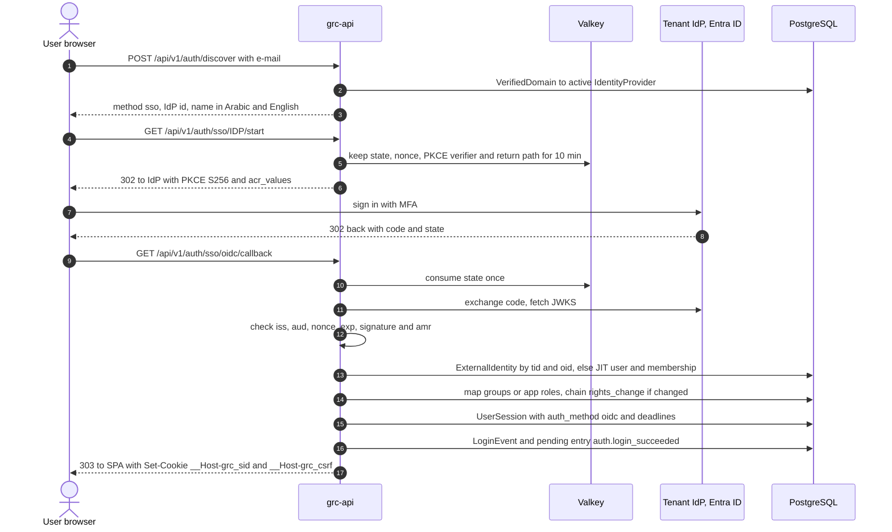
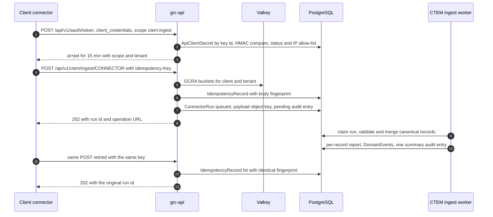
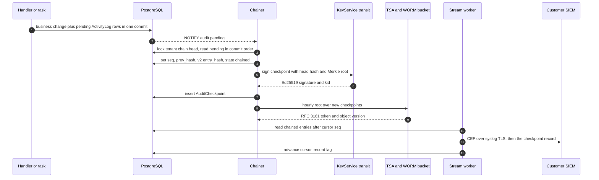
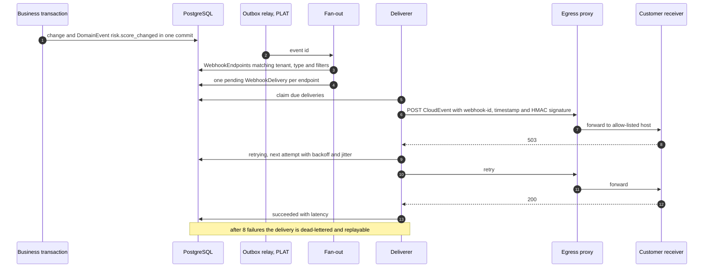

# NG-GRC block design: Enterprise base — API, SSO, audit trail and integration events (R8)

**Scope.** This block covers:
- the public API as a product, including machine credentials;
- federated SSO and provisioning;
- session and token hardening;
- the audit trail;
- domain events, webhooks and notification channels.

It serves R8. It also provides the machine side of R6 and R7, and partner identities for R4.

**Evidence.** The judge verdict, the phase-1 reports, and code at `main` @ 98020b3 (read-only, 2026-10-16).

**Other blocks.** PLAT (platform), TEN (tenancy and MSSP), CORE (GRC core and capabilities), CONT (content), INV (inventory) and CTEM. Every new component states its licence.

---

## 1. Current state in one page

**R8 is partial** ("LDAP-only SSO; no API keys"). The REST surface is broad. The rating is decided by the missing federated SSO and machine credentials.

| Pillar | Exists (evidence) | Missing or defective |
|---|---|---|
| REST API | 581 HTTP + 1 WebSocket routes on 63 routers (`api/v1/router.py:71-143`). OpenAPI is hidden only in production (`main.py:156-164`). Errors are localised | No published spec (`TODO-KNOWN-ISSUES.md:108-112`). No versioning. Only 2 routes use the shared pagination. No idempotency |
| Machine credentials | `ApiToken` table with no routes (`models/ai_access.py:71-90`). SPA wrappers return 404 (`endpoints.ts:201-216`) | Only a person's HS256 `type=access` JWT authenticates (`dependencies/auth.py:35-56`). No scopes, no per-client limits (`rate_limit.py:54`) |
| SSO | LDAP bind (`directory_auth.py:431-504`). Group→role map re-applied at login and chained (`sso.py:206-337`). MFA challenge (`sso.py:352-360`) | No OIDC, SAML or SCIM. Keycloak keys are dead config (`config.py:45-49`). LDAPS does not validate certificates (`directory_auth.py:441-446`). Bind password stored in clear (`tenants.py:414-423`). The SPA's SSO form ignores `mfa_required` (`LoginPage.tsx:73-87`) |
| MFA | TOTP second step (`auth.py:346-358`) | Cannot be made mandatory. No recovery codes. Seed stored in clear (`mfa_device.py:18`) |
| Sessions | `sid` revocation (`dependencies/auth.py:96-108`). Rotating refresh tokens (`auth.py:896-946`) | Tokens in `localStorage` with no CSP (`store/auth.ts:157-176`). Refresh race (`client.ts:204-221`). Logout is client-only (`Layout.tsx:903`). Tokens in SSE/WS URLs (`support.py:260-299`). No proxy headers (`backend/ecosystem.config.js:6`). The login journal trusts a client-supplied IP (`auth.py:101-106`) |
| Audit trail | Per-tenant SHA-256 chain (`activity_chain.py:48-116`). Verify. Chained seals with a 365-day floor (`audit_retention.py`). Login journal. Read logging (`activity_middleware.py:232-309`). System actor | **Write path:** entries written after the response and dropped on a 5 s timeout (`activity_middleware.py:724-758`); only 2xx Bearer requests logged; tenant taken from the JWT; proxy IP recorded (`:670-747`). **Content:** no field diffs, all 726 rows path-only (TODO §3.1); denials and schedulers unlogged (§3.2-3.4). **Integrity:** keyless chain; 529 rows unchained. **Access:** verify is Elite and API-only (`activity_log.py:345,621`); no export, no SIEM |
| Events | 20 webhook names in `Tenant.settings` (`webhooks.py:16-40`). In-app and e-mail notifications (`notification_generator.py:264-463`) | Nothing dispatched except an unsigned `test.ping` (`webhooks.py:126-156`). No Teams or Slack. `.delay()` mail dropped in SaaS |

Production mode is disputed (CLAUDE.md vs TODO §17); the design does not depend on it. The block reuses:
- the effective-role resolver;
- `map_groups_to_role` safety rules;
- session revocation;
- the chain hash and seals;
- the read whitelist;
- `create_notification`;
- `validate_outbound_url`;
- `secret_box`.

---

## 2. Target design

### 2.1 Principles
1. **One Principal per request.** A Principal is resolved for every request, before TEN's TenantContext and CORE's capabilities apply. It can be:
   - a browser session;
   - a bearer token;
   - an ApiClient;
   - a system task;
   - a token holder;
   - an INV machine.

   Audit attribution comes from the Principal, never from client hints.
2. **Browsers never hold tokens.**
3. **Audit entries commit with the change.** Keys held outside the database and external anchors prove integrity.
4. **A small, stable, documented API** instead of 582 undocumented routes.
5. **One event catalogue** feeds every outbound channel.

### 2.2 Components

| Component | Type (licence) | Responsibility | Extends / new |
|---|---|---|---|
| Principal resolver | Dependency | Cookie, JWT, ApiClient or INV mTLS identity → Principal for TenantContext | Extends `dependencies/auth.py`; signatures kept |
| Session and MFA service | Service; pyotp; py_webauthn (BSD-3-Clause, P2) | `__Host-` cookie sessions, CSRF, timeouts, step-up, logout, refresh reuse detection, MFA policy, recovery codes, passkeys | Extends `auth.py`, `mfa.py`, `user_session.py` |
| SSO broker | Authlib (BSD-3-Clause); python3-saml + xmlsec (MIT); ldap3 (LGPL-3.0, existing) | OIDC RP, SAML SP and LDAP per IdentityProvider; discovery, JIT, claim mapping, MFA trust | Generalises `sso.py`, `directory_auth.py` |
| SCIM 2.0 | scim2-models (Apache-2.0) | Users → User + Membership; Groups → Team Groups | New; reuses `users.py:182-264`, `models/group.py` |
| ApiClient + OAuth2 | Routes | Clients, secrets, scopes, client credentials, revocation | **Replaces** `ApiToken` |
| Limits + idempotency | Valkey; limits (MIT, already present) | GCRA buckets per IP, account, user, client and tenant; idempotency store | Extends `rate_limit.py`, `shared_state.py` |
| API contract kit and portal | Spectral, oasdiff (Apache-2.0); Schemathesis, Redoc, openapi-python-client, openapi-typescript (MIT) | Stability markers, Problem Details, cursors, deprecation headers, spec export, CI gates, SDKs | Extends `main.py`, `pagination.py` |
| Audit context middleware | Pure ASGI | Request id, Principal, client IP, route, origin, outcome; denials | **Replaces** `ActivityLogMiddleware`; keeps its helpers |
| Audit writer | SQLAlchemy listener | Field diffs and semantic entries as pending rows in the business transaction | New |
| Chainer | Celery; rfc8785 (Apache-2.0); rfc3161-client (Apache-2.0, to verify) | Hash v2, signed checkpoints, anchors, signed seals, exports, SIEM streams | Extends `activity_chain.py`, `audit_retention.py` |
| Event catalogue | Library | CloudEvents envelope, schemas, `emit()` into PLAT's outbox | New `app/events/` |
| Webhook dispatcher | Celery | Fan-out, HMAC signing, retries, dead letters, replay | **Replaces** `webhooks.py` storage |
| Notification router | Celery | Rules → in-app, e-mail, Teams, Slack | Extends `notification_generator.py`, `email_service.py` |

### 2.3 Component and flow view

```mermaid
flowchart LR
  subgraph Callers
    SPA["SPA, cookie session"]
    INT["Integrator or CMDB, ApiClient"]
    SCIMC["IdP provisioning, SCIM client"]
    MACH["Site Collector or agent, mTLS via INV gateway"]
  end
  IDP["Tenant, partner or platform IdP: OIDC, SAML, LDAP"]
  EDGE["Edge, PLAT: TLS, trusted client IP, CSP"]
  subgraph API["grc-api replicas"]
    ACX["Audit context middleware"]
    PRN["Principal resolver"]
    TCX["TenantContext, TEN"]
    CAP["Capabilities and scopes, CORE"]
    LIM["Rate limits and idempotency"]
    AUTH["SSO broker, session service, OAuth2 token endpoint, SCIM"]
    HND["Business handlers and ingestion routes"]
    AWR["Audit writer, same transaction"]
    EMT["emit DomainEvent, same transaction"]
  end
  PG[("PostgreSQL: business rows, pending audit rows, outbox")]
  VK[("Valkey: session cache, buckets, replay cache")]
  KMS["KeyService and OpenBao, PLAT"]
  subgraph WRK["Worker tier, PLAT"]
    CHN["Chainer and checkpointer"]
    ANC["Anchoring"]
    STR["Audit streams"]
    FAN["Event fan-out"]
    WHD["Webhook deliverer"]
    NTR["Notification router"]
  end
  EGR["Egress proxy, PLAT"]
  EXT["Customer webhooks, Teams, Slack, SIEM, TSA, WORM bucket"]
  SPA --> EDGE
  INT --> EDGE
  SCIMC --> EDGE
  MACH --> EDGE
  SPA -.->|"browser redirect"| IDP
  EDGE --> ACX --> PRN --> TCX --> CAP --> LIM --> HND
  ACX --> AUTH
  AUTH --> IDP
  PRN --> VK
  LIM --> VK
  AUTH --> PG
  HND --> AWR --> PG
  HND --> EMT --> PG
  PG -->|"pending entries"| CHN
  CHN --> KMS
  CHN --> ANC
  CHN --> STR
  PG -->|"outbox relay, PLAT"| FAN
  FAN --> WHD
  FAN --> NTR
  WHD --> EGR
  NTR --> EGR
  STR --> EGR
  ANC --> EGR
  EGR --> EXT
```

### 2.4 Identity, sessions and SSO

**Browser sessions.** The SPA and the API share an origin, so the API acts as its own BFF.
- **Cookie.** Login, MFA and SSO issue `__Host-grc_sid`, an opaque 256-bit handle set `HttpOnly; Secure; SameSite=Lax`.
  - Only its SHA-256 is stored.
  - The handle rotates on every privilege change.
- **CSRF.** Unsafe methods must echo `__Host-grc_csrf` in `X-CSRF-Token` and come from the same origin.
- **Timeouts.** Idle 30 min and absolute 12 h by default; tenants may tighten both.
- **Step-up.** IdP and policy changes, ApiClient issuance, audit exports and MFA resets need authentication within the last 10 min. Otherwise the API returns 401 `step_up_required`.
- **Logout** deletes the session on the server. Password change, MFA reset, membership removal and SCIM deactivation revoke every session of the user; today a password change revokes none (`auth.py:954-970`).
- **Realtime.** SSE and WebSocket use PLAT's 30-second tickets with an `Origin` check.
- **CSP.** `grc-web` serves `default-src 'self'; script-src 'self'; frame-ancestors 'none'; object-src 'none'`. It runs report-only for two weeks before enforcement.

**Bearer tokens** (machines and non-browser clients).
- **JWT v2** adds `iss`, `aud` and `kid`, with EdDSA signing from a KeyService-rotated key and a published JWKS. HS256 is still accepted for one release.
- **Refresh reuse.** Reuse within 30 s returns 409. Later reuse revokes the session and emits `auth.refresh_reuse_detected`. `client.ts` gets single-flight refresh.
- **Client IP.** PLAT's trusted `client_ip()` replaces `auth.py:101-106`.

**IdentityProvider.** One row per connection, owned by a tenant, a partner or the platform. The protocol is `oidc`, `saml` or `ldap`, so today's LDAP overlay becomes a row.
- **Discovery.** `POST /auth/discover` maps the e-mail domain through TEN's VerifiedDomain. Unknown domains get the password form, so no tenant is revealed.
- **OIDC** (Authlib):
  - PKCE S256, with state and nonce kept in Valkey;
  - the RFC 9207 `iss` check;
  - `acr_values` and `max_age` for MFA and step-up.

  On Entra ID, identity is keyed on `tid`+`oid`, never on the mutable e-mail claim ("nOAuth"), and app roles are used instead of group ids.
- **SAML SP** (python3-saml):
  - signed assertions required;
  - audience and `InResponseTo` checks;
  - a replay cache and at most 2 min of skew;
  - no SHA-1;
  - certificate rollover;
  - IdP-initiated login off.
- **LDAP:** `CERT_REQUIRED` with a CA bundle, StartTLS, and an encrypted bind password. In SaaS, private directories are reached only through INV's Site Collector.

**JIT and mapping.**
- **ExternalIdentity** binds (IdP, subject) to a global User and replaces `keycloak_id` and the null-password heuristic.
- **JIT** runs only for verified domains. An account is never linked by e-mail alone.
- **`map_claims()`** extends `map_groups_to_role` (`directory_auth.py:203-244`) to return roles, OrgEntity scope and partner roles.
  - The strategy is `highest` (as today) or `union`.
  - Its safety rules stay.
  - Every change is chained as `rights_change`.
- **MFA trust** comes from OIDC `amr`/`acr` or SAML `AuthnContextClassRef`. Without that proof, the local TOTP step runs.

**Policy and MFA.** `/tenants/current/security` (`tenants.py:205-251`) gains:
- required MFA, set to `all`, `privileged` or `none`;
- session limits;
- SSO enforcement per domain, with alerted break-glass admins;
- the API-key policy.

MFA gains encrypted seeds, Argon2-hashed recovery codes, a four-eyes reset and a branded issuer (`mfa.py:27`). `must_change_password` is enforced.

**SCIM 2.0** (`/scim/v2`).
- Users map to a User plus a Membership in the calling tenant.
- Groups map to Team Groups.
- `active=false` suspends the membership and revokes its sessions.
- The client is an ApiClient with `scim:provision`. It edits profiles only when the user's home IdP is its own, so tenant A cannot rename an analyst it shares with tenant B.

**Partners and platform.** Partner IdPs map groups to PartnerMembership roles. Tenant access stays a delegated Membership where `accepted_idp_ids` allows it (TEN). Platform staff use a platform IdP with mandatory MFA and reach tenant data only through an AccessGrant.

### 2.5 The API as a product

**Tiers.** Each route carries `x-stability`: `stable`, `beta` or `internal`.
- **Stable v1 (P1)**, about 60–90 operations:
  - assets;
  - findings (read-only);
  - compliance status (read-only);
  - risks (read-only);
  - evidence ingest;
  - audit-trail read and export;
  - webhooks;
  - `api-clients/me`;
  - SCIM.
- **Internal** SPA routes are left out of the published spec, and no scope maps to them.

**Conventions** (linted by Spectral):
- **Errors.** RFC 9457 Problem Details, with a stable `code` and a localised `detail`.
- **Lists.** Keyset pagination (`limit`, `cursor`, `next_cursor`), `updated_since` and `sort`.
- **Values.** RFC 3339 UTC timestamps; `ETag`/`If-Match` on updates.
- **Long-running work.** 202, then `/operations/{id}`.
- **Headers.** `X-Tenant-Id` (TEN) and `Accept-Language`.

**Versioning.**
- The major version is in the URI. Changes within a major version are additive only, which oasdiff checks in CI.
- A breaking change ships as `/api/v2/<resource>` and runs alongside v1 for at least 12 months.
- Retirement is announced with `Deprecation` (RFC 9745) and `Sunset` (RFC 8594).

**Spec and SDKs.**
- The OpenAPI 3.1 spec is exported at build time, with the `bearerJWT`, `apiKey` and `oauth2` schemes and the event payloads as `webhooks`.
- It is published on a static Redoc portal: a subdomain in SaaS, `/developers` on-prem.
- The Python and TypeScript SDKs carry helpers for tokens, retries, idempotency, cursors and webhook signatures, plus the offline `grc-audit-verify`.
- Schemathesis fuzzes the stable surface.

**ApiClient (replaces ApiToken).**
- **Owner.** A tenant, or a partner whose link grants `api_access`.
- **Identity.** It acts as a non-interactive service User with a `system` Membership, so handlers work unchanged.
- **Rights** = scope capabilities ∩ the creator's capabilities.
- **Scopes** are `domain:action` strings that each block registers:
  - ingestion and proposals: `ctem:ingest`, `inventory:import`, `evidence:ingest`, `graph:coverage:write`, `proposal:create`;
  - reads: `assets:read`, `findings:read`, `risks:read`, `compliance:read`, `audit_trail:read`;
  - operations: `audit_trail:export`, `webhooks:manage`, `scim:provision`.

  Identity administration is never grantable.
- **API keys:**
  - format `grc_<env>_` + key id + 256-bit secret + CRC32, so secret scanners can detect them;
  - stored only as HMAC-SHA256 under a KeyService pepper;
  - shown once;
  - valid 90 days by default, one year at most;
  - two active at a time for rotation.
- **OAuth2 client credentials** (RFC 6749 §4.4) issue 15-minute RFC 9068 JWTs. `private_key_jwt` (RFC 7523) comes in P2. Revocation follows RFC 7009.
- **Controls:**
  - IP allow-lists;
  - expiry reminders;
  - step-up, plus optional four-eyes approval (CORE ApprovalService) for write scopes;
  - usage per route;
  - revocation within 60 s.

**Limits and idempotency.**
- **Rate limits.** Valkey GCRA buckets: 600 requests/min per client, burst 100, under a tenant ceiling from TEN.
  - They return IETF `RateLimit` headers and `Retry-After`.
  - `request.state.principal` ends slowapi's IP fallback (`rate_limit.py:18-23`).
- **Idempotency.** `Idempotency-Key` is required on ingestion and on ApiClient creates.
  - Records are kept 24 h, or 72 h for ingestion.
  - A replay returns the stored result. A different body returns 422; concurrent use returns 409.

**Ingestion contract.** INV owns `/inventory/imports` and the mTLS machine APIs. CTEM owns `POST /ctem/ingest/{connector_id}`. Both share one contract:
- gzip JSON or NDJSON up to 10 MB; anything larger goes through PLAT upload sessions;
- a mandatory idempotency key;
- 202, then Operation and ConnectorRun status with per-record errors;
- one summary audit entry per run.

mTLS identities are trusted only from INV's collect gateway.

### 2.6 Audit trail

| Event class | Today | Target |
|---|---|---|
| Authenticated mutations | 2xx, path only | Field diffs, verb, route template, request id |
| Denials, failed mutations | None | `access.denied` and failure outcomes, rate-limited |
| Sensitive reads | Path whitelist | Route metadata `x-audit-read`, Valkey dedup |
| Sign-in, MFA, SSO, logout | Unchained journal | Chained `auth.*` entries; platform chain if the tenant is unknown |
| Background jobs | 3 callers | Every TenantTask, with system actor and job id; bulk work summarised |
| Token actors (vendor portal, evidence link, reset) | None | `external_token` or self-service actor |

**Write path.**
1. **Audit context.** A pure-ASGI middleware replaces `ActivityLogMiddleware`. It carries:
   - the request id and the Principal;
   - the TenantContext, not the JWT claim;
   - `client_ip()` and the route template;
   - an origin derived from the Principal.
2. **Audit writer.** A SQLAlchemy `after_flush` listener on `Audited` models, the hook TODO §3.1 prescribes.
   - It turns attribute history into redacted diffs.
   - `audit.annotate()` sets the verb.
   - Entries are **pending rows in the same transaction** as the change.
3. **Bulk mode.** A connector run writes one summary entry. Control-status, risk-score and acceptance changes still get their own entries.
4. **Denials and failures** use a short separate transaction. Misses are recorded in the log and as a metric.
5. **Chainer.** One Celery writer per tenant, woken by NOTIFY and locked in Valkey.
   - It assigns `seq` and the v2 hash in commit order.
   - This ends the 8-retry race and the unchained fallback.

**Integrity.**
- **Hash v2.** SHA-256 over the RFC 8785 canonical JSON of every security field: actor, ApiClient, session, origin, IP, outcome, request id, route, millisecond time, details and changes. v1 rows keep `compute_entry_hash`.
- **Signed checkpoints** are written every 5 minutes or 10,000 entries, and at each seal.
  - Each covers a `seq` range, its head hash, an RFC 6962 Merkle root and the previous checkpoint.
  - The signature is Ed25519 through the KeyService (`purpose=audit_checkpoint`, a PLAT SigningKey). The key never reaches an app host.
- **Anchoring (P2).**
  - An hourly root over new checkpoints gets an RFC 3161 timestamp and a WORM copy.
  - Each tenant gets inclusion proofs.
  - Each tenant's SIEM receives its checkpoints.
- **Immutability.**
  - `grc_app` may only INSERT.
  - A `grc_audit` role (requested from PLAT) may update only the chain columns of pending rows; a trigger blocks every other write.
  - Purges go through a SECURITY DEFINER function that requires a signed seal.
- **Verification** is a job covering seals, checkpoints, entries and anchors. A nightly run emits `audit_trail.verification_failed`.

**Retention.**
- Seals are signed.
- Optional scheduled retention archives a signed bundle before it purges.
- Legal hold blocks purges, and regulated tenants need four-eyes approval.
- The 365-day floor meets ECC-2:2024 2-12-3-5 ("at least 12 months").

**Export and SIEM.**
- **Exports** need step-up and are themselves logged. Formats:
  - CSV in UTF-8 with a BOM, so Arabic opens correctly in Excel;
  - JSONL;
  - a signed bundle with proofs and an EN/AR report.
- **AuditStream** reads the **chained log by `seq` cursor**, so delivery is ordered, gap-detectable and replayable. Destinations:
  - syslog-TLS (RFC 5425) in CEF, LEEF or JSON, for QRadar, ArcSight and Sentinel;
  - HTTPS with HMAC, with a Splunk HEC preset;
  - S3.

  A lag over 15 minutes raises an event. An MSSP SOC stream covers tenants that grant `audit_sharing` (P2).
- **Readers** remain `AUDIT_READERS` (`activity_log.py:122`), and all of them now get the page.
- **Recommendation.** Trail, verification and exports belong in the base product. SIEM, anchoring and SCIM can be higher tiers.

### 2.7 Domain events, webhooks and notification channels

**Envelope.** PLAT owns the DomainEvent table and the relay; this block owns the semantics.
- **Format.** CloudEvents 1.0 in structured JSON: `id` (UUIDv7), `source`, `type`, `subject`, `time`, `dataschema`.
- **Extensions.**
  - `tenantid`, which is null for platform-scope events; those fan out to each tenant.
  - `actortype` and `actorid`.
  - `aggregateversion` and `traceparent`.
- **`data`** holds ids, changed fields, `{en, ar}` labels and links, never secrets.

**Naming.** Types follow `[module.]aggregate.event` in the past tense.
- Other blocks' names are adopted as they are: `ctem.*`, `asset.*`, `risk.score_changed`.
- The trail uses `audit_trail.*`, because `audit.*` already means audit engagements.
- `content_pack.version_installed` and `content_pack.version_applied` reconcile the CONT and CORE names.

**Catalogue.**
- `app/events/catalog.py` holds a JSON Schema per version. CI rejects unregistered types and non-additive changes.
- The 20 legacy names become aliases.
- This block adds `api_client.*`, `idp.certificate_expiring`, `session.revoked`, `auth.refresh_reuse_detected`, `audit_trail.*` and `webhook.endpoint_disabled`.

**Webhooks.**
- **Fan-out.** Events are matched against WebhookEndpoint filters (type, severity, OrgEntity). Each match gets one WebhookDelivery.
- **Delivery** goes through PLAT's egress proxy: no redirects, a 10 s timeout, a 256 KB cap.
- **Signing.** Standard Webhooks headers (`webhook-id`, `webhook-timestamp`, `webhook-signature: v1,<HMAC-SHA256>`), computed with the stdlib `hmac`. During rotation both signatures are sent.
- **Retries.** 8 attempts over about 48 h, with backoff and jitter, honouring `Retry-After`. After that the delivery becomes a replayable **dead letter**.
- **Auto-disable.** A 410 response, or 3 days of failures, disables the endpoint and notifies its admins.
- **High volume.** Digests batch `ctem.*` events, and `aggregateversion` handles out-of-order delivery.
- **Ticketing.** Jira and ServiceNow stay CTEM adapters on the same events.

**Notification channels.**
- **Rules.** A NotificationRule maps event types and a minimum severity to recipients, channels and quiet hours. The default quiet hours are the Friday–Saturday weekend in `Asia/Riyadh`.
- **In-app and e-mail.** In-app reuses `create_notification`. E-mail becomes retried tasks. Seeded rules reproduce today's behaviour.
- **Teams.** Workflows webhooks with Adaptive Cards, using `rtl` for Arabic. Microsoft is retiring the classic Office 365 connectors; the date is to be confirmed.
- **Slack.** Block Kit messages.
- **Shared engine.** Teams and Slack are WebhookEndpoint kinds on the same retry engine. URLs are encrypted, and payloads default to `minimal`.

### 2.8 Data model

| Entity | Change | Key fields | Relations |
|---|---|---|---|
| IdentityProvider | new | owner, protocol, names en/ar, status, config, secret_ref, group_role_map, scope_map, mfa_trust, enforce_sso | VerifiedDomain N:M; Membership.accepted_idp_ids (TEN) |
| ExternalIdentity | new | idp_id + subject (UQ), user_id, provisioned_by, scim_external_id | User |
| UserSession | changed | handle_hash, client_kind, auth_method, idp_id, amr, auth_time, deadlines, refresh_jti | User |
| MfaDevice; MfaRecoveryCode | changed; new | secret_enc, kind; code_hash, used_at | User |
| LoginEvent; User | changed | idp_id, entry_id; `keycloak_id` deprecated | ActivityLog |
| ApiClient | new (replaces ApiToken) | owner, service_user_id, scopes, allowed_cidrs, rate_class, status, expires_at, approved_by | User, Membership, ConnectorRun |
| ApiClientSecret | new | key_id (UQ), secret_hmac or public_jwk, expires_at, revoked_at | ApiClient |
| IdempotencyRecord | new | tenant + principal + key (UQ), fingerprint, response_ref, expires_at | — |
| ActivityLog | changed | ingest_id, actor_type, api_client_id, session_id, request_id, route, outcome, changes, hash_version, chain_state | ApiClient |
| AuditCheckpoint; AuditAnchor | new | seq range, head_hash, merkle_root, signature, signing_key_id; kind, tree_root, receipt, proofs | SigningKey (PLAT) |
| AuditLogSeal | changed | signature, archive_object_key | Tenant |
| AuditStream; AuditExport | new | kind, format, endpoint, credential_ref, cursor_seq, residency_ack; filters, object_key, sha256, signature | Tenant or Partner |
| WebhookEndpoint | new (replaces `settings.webhooks`) | kind (webhook, teams, slack), url_enc, secrets, event_types, filters, mode, language, status, legacy_id | WebhookDelivery |
| WebhookDelivery | new (B10) | endpoint_id, domain_event_id, attempt, status, next_attempt_at, response_status | DomainEvent |
| NotificationRule; Notification | new; changed | event_pattern, recipients, channels, quiet_hours; domain_event_id, email_status | WebhookEndpoint |
| DomainEvent | PLAT table | type, tenant_id (nullable), subject, aggregate_version, actor, data | WebhookDelivery |

```mermaid
erDiagram
  TENANT ||--o{ IDENTITY_PROVIDER : "owns"
  PARTNER ||--o{ IDENTITY_PROVIDER : "owns"
  IDENTITY_PROVIDER }o--o{ VERIFIED_DOMAIN : "serves"
  USER ||--o{ MEMBERSHIP : "holds"
  TENANT ||--o{ MEMBERSHIP : "grants"
  USER ||--o{ EXTERNAL_IDENTITY : "linked by"
  IDENTITY_PROVIDER ||--o{ EXTERNAL_IDENTITY : "asserts"
  USER ||--o{ USER_SESSION : "opens"
  USER ||--o{ MFA_RECOVERY_CODE : "holds"
  TENANT ||--o{ API_CLIENT : "owns"
  PARTNER ||--o{ API_CLIENT : "owns"
  API_CLIENT ||--|| USER : "acts as service user"
  API_CLIENT ||--o{ API_CLIENT_SECRET : "authenticates with"
  API_CLIENT ||--o{ CONNECTOR_RUN : "pushes"
  API_CLIENT ||--o{ IDEMPOTENCY_RECORD : "replays"
  TENANT ||--o{ ACTIVITY_LOG : "chains"
  USER ||--o{ ACTIVITY_LOG : "acts in"
  LOGIN_EVENT |o--o| ACTIVITY_LOG : "mirrored as"
  TENANT ||--o{ AUDIT_CHECKPOINT : "signs"
  SIGNING_KEY ||--o{ AUDIT_CHECKPOINT : "signs with"
  AUDIT_ANCHOR }o--o{ AUDIT_CHECKPOINT : "anchors"
  TENANT ||--o{ AUDIT_LOG_SEAL : "seals"
  TENANT ||--o{ AUDIT_STREAM : "streams"
  TENANT ||--o{ AUDIT_EXPORT : "exports"
  TENANT ||--o{ DOMAIN_EVENT : "emits"
  TENANT ||--o{ WEBHOOK_ENDPOINT : "subscribes"
  WEBHOOK_ENDPOINT ||--o{ WEBHOOK_DELIVERY : "receives"
  DOMAIN_EVENT ||--o{ WEBHOOK_DELIVERY : "delivered as"
  TENANT ||--o{ NOTIFICATION_RULE : "routes"
  NOTIFICATION_RULE }o--o| WEBHOOK_ENDPOINT : "chat channel"
  DOMAIN_EVENT ||--o{ NOTIFICATION : "notifies"
  IDENTITY_PROVIDER {
    string id PK
    string owner_type "tenant, partner or platform"
    string protocol "oidc, saml or ldap"
    json config "non-secret settings"
    string secret_ref "envelope-encrypted"
    json group_role_map
    string mfa_trust
  }
  EXTERNAL_IDENTITY {
    string id PK
    string idp_id FK
    string subject "unique with idp_id"
    string user_id FK
    string provisioned_by
  }
  USER_SESSION {
    string id PK
    string user_id FK
    string handle_hash UK
    string auth_method
    datetime idle_deadline
    datetime absolute_deadline
    datetime revoked_at
  }
  API_CLIENT {
    string id PK
    string tenant_id FK
    string service_user_id FK
    json scopes
    json allowed_cidrs
    string status
    datetime expires_at
  }
  API_CLIENT_SECRET {
    string id PK
    string api_client_id FK
    string key_id UK
    string secret_hmac
    datetime expires_at
  }
  ACTIVITY_LOG {
    string id PK
    string tenant_id FK
    bigint ingest_id
    int seq "unique with tenant_id"
    string actor_type
    string outcome
    json changes
    int hash_version
    string chain_state
    string entry_hash
  }
  AUDIT_CHECKPOINT {
    string id PK
    string tenant_id FK
    int from_seq
    int to_seq
    string merkle_root
    string signature
    string signing_key_id FK
  }
  WEBHOOK_ENDPOINT {
    string id PK
    string tenant_id FK
    string kind "webhook, teams or slack"
    text url_enc
    json event_types
    string status
  }
  WEBHOOK_DELIVERY {
    string id PK
    string endpoint_id FK
    string domain_event_id FK
    int attempt
    string status
    datetime next_attempt_at
  }
  DOMAIN_EVENT {
    string id PK
    string tenant_id "null for platform scope"
    string type
    json data
    datetime published_at
  }
```

### 2.9 Key flows

**OIDC sign-in with discovery, JIT, MFA trust and a cookie session**

**ApiClient token and idempotent push ingestion (CTEM route, shared contract)**

**Audit entry from transaction to signature, anchor and SIEM**

**DomainEvent to signed webhook with retry and dead letter**

### 2.10 APIs

All paths are under `/api/v1`. Partner and platform variants mirror these routes (see TEN).

| Method | Path | Purpose |
|---|---|---|
| POST | `/auth/discover` | Domain → IdP (shared with TEN) |
| GET, POST | `/auth/sso/{idp_id}/start`, `/auth/sso/oidc/callback`, `/auth/sso/saml/acs`, `/auth/sso/saml/{idp_id}/metadata` | Federation |
| POST | `/auth/sso/ldap/login` (alias `/sso/ldap/login`) | Hardened LDAP |
| POST, GET | `/auth/login`, `/auth/mfa-login`, `/auth/step-up`, `/auth/logout`, `/auth/logout-all`, `GET /auth/session` | Sessions, recovery codes |
| GET, DELETE, POST | `/users/{id}/sessions`, `/users/{id}/mfa/reset` | Admin session control, four-eyes reset |
| CRUD, POST | `/identity-providers`, `/{id}/test`, `/{id}/activate` | IdP configuration |
| GET, PATCH | `/tenants/current/security` | Authentication policy |
| SCIM | `/scim/v2/{Users,Groups,ServiceProviderConfig,ResourceTypes,Schemas}` | Provisioning |
| CRUD, POST, GET | `/api-clients`, `/{id}/secrets`, `/{id}/usage`, `/api-clients/me` | Machine credentials |
| POST, GET | `/oauth/token`, `/oauth/revoke`; root `/.well-known/jwks.json`, `/.well-known/oauth-authorization-server` | RFC 6749, 7009, 8414 |
| GET | `/operations/{id}` | Asynchronous status |
| GET, POST | `/activity-log`, `/{entry_id}`, `/verifications`, `/checkpoints`, `/anchors`, `/exports`, `/streams` | Trail, integrity, export, SIEM |
| existing | `/activity-log/retention`, `/retention/seal`, `/seals`, `/login-events`, `/access/{type}/{id}` | Kept; seals signed |
| GET | `/events/catalog`, `/events/schemas/{type}/{version}` | Event catalogue |
| CRUD, POST, GET | `/webhooks`, `/{id}/test`, `/{id}/rotate-secret`, `/{id}/replay`, `/{id}/deliveries` | Webhooks |
| CRUD | `/notification-rules` | Routing |

### 2.11 UI changes
- **Login:**
  - the e-mail address comes first;
  - SSO buttons in Arabic and English;
  - an LDAP form that handles MFA;
  - recovery codes and step-up.
- **Settings → Security:** sessions with "sign out everywhere", MFA and recovery codes.
- **Admin → Identity:** an IdP wizard with test, metadata, mapping preview and certificate expiry; SCIM; policy.
- **Admin → Integrations:**
  - ApiClients with a one-time secret;
  - webhooks with a delivery log and replay, replacing `WebhooksPage.tsx`;
  - Teams, Slack and notification rules;
  - SIEM streams.
- **Audit trail page**, restoring the page removed in `bc8421f`, for every `AUDIT_READERS` role:
  - activity with field diffs;
  - integrity;
  - sign-ins;
  - retention;
  - exports.
- **Client.** `client.ts` and `store/auth.ts` move to cookie mode, and logout calls the API.
- **Developer portal.**

### 2.12 Security and tenant isolation
- **Isolation.** New tenant tables get PLAT RLS. Identity lookups use PLAT's `grc_auth` role, because they run before the tenant is known.
- **Secrets.** Every credential uses `secret_box` v2 with a tenant key and is never returned.
- **Blast radius.**
  - Keys are scoped, IP-limited and expiring, and can never administer identity.
  - OAuth tokens live 15 min.
  - Sessions are httpOnly.
- **Takeover.** Identity is keyed on (IdP, subject). JIT runs only on verified domains, accounts are never linked by e-mail, and SAML is strict.
- **Outbound.** Traffic goes through the egress proxy, private ranges are denied in SaaS, and redirects are not followed.
- **Audit.**
  - Grants are append-only.
  - Checkpoints are signed and anchored.
  - Purges need a seal, plus four-eyes approval for regulated tenants.
  - Platform staff get access only through an AccessGrant.
  - Denial logging is rate-limited.
- **PDPL.** Identifiers are minimal and diffs are redacted. Erasure pseudonymises the profile but never rewrites the chain.
- **ECC-2:2024.** The design supports 2-2-3-2 (MFA for remote and privileged access), 2-12-3-3 (SIEM) and 2-12-3-5 (retention). In SaaS all access is remote, so MFA defaults to `all`; on-prem the minimum is `privileged`.

### 2.13 Arabic and KSA considerations
- **Bilingual surfaces.** IdP names, login and error pages are in Arabic and English. `detail` is localised and `code` is not. Arabic names from IdPs and SCIM are stored unchanged.
- **Audit output.**
  - Labels use the existing `activity_log.actions.*` keys.
  - CSV includes a BOM, and CEF/LEEF are UTF-8 escaped.
  - Reports are rendered with `pdf_arabic.py`.
  - Hijri dates are display-only.
- **Rendering.** Teams cards use `rtl`, and e-mails already use `dir="rtl"`.
- **Residency.** Webhook, chat, SIEM and TSA endpoints outside KSA count as cross-border transfers.
  - Regulated tenants (TEN `residency_class`) must record a transfer basis, or are limited to endpoints in KSA.
  - Chat payloads default to `minimal`.
- **IdP certification.** Entra ID and AD/ADFS are certified first. Reminders follow the Sunday–Thursday working week.

### 2.14 SaaS versus on-prem

| Concern | SaaS / MSSP-hosted | On-prem |
|---|---|---|
| IdPs and SCIM | Self-service; public SP metadata and SCIM | Customer AD/ADFS/Entra and direct LDAP. SCIM needs inbound access or Entra's agent |
| Checkpoint key and anchoring | OpenBao transit with a KMS/HSM root; TSA and WORM | Local or TPM key at a stated lower assurance, or the customer's HSM (PLAT C3). Never a vendor-held key |
| Webhooks and SIEM | Egress proxy; private targets denied | Private targets allowed; local syslog |
| Portal and SDKs | Hosted | `/developers` in `grc-web`; offline bundle |

---

## 3. Migration path from today's code

### 3.1 Files

| File | Action |
|---|---|
| `dependencies/auth.py` | Principal resolver: `HTTPBearer(auto_error=False)` plus the cookie. Function signatures kept |
| `core/security.py`, `endpoints/auth.py`, `endpoints/mfa.py` | JWT v2, cookies, refresh reuse detection, logout, revocation, `must_change_password`, MFA policy, `client_ip()` |
| `endpoints/sso.py`, `services/directory_auth.py` | Become `services/sso/{oidc,saml,ldap,mapping}.py`; `/sso/ldap/*` aliased |
| `models/ai_access.py` (ApiToken), `endpoints.ts:201-216` | Replaced by `models/api_client.py`, `endpoints/api_clients.py`, `endpoints/oauth.py` |
| `core/activity_middleware.py` | Becomes `core/audit_context.py` + `services/audit_writer.py`, keeping its helpers |
| `activity_chain.py`, `audit_retention.py`, `activity_log.py` | Chainer, hash v2, checkpoints, jobs, exports, streams. `log_system_activity` stays as a wrapper |
| `webhooks.py`, `tenants.py`, `notification_generator.py`, `email_service.py` | Tables, dispatcher, rules, Teams/Slack, e-mail tasks. `webhooks` leaves the settings whitelist |
| `rate_limit.py`, `main.py`, `pagination.py`, `config.py` | GCRA, Problem Details, spec export, cursors. KEYCLOAK_* removed; Keycloak kept only as the CI test IdP |
| `client.ts`, `store/auth.ts`, `LoginPage.tsx`, `SettingsPage.tsx`, `WebhooksPage.tsx`, `App.tsx` | Cookie mode, discovery, new pages |

### 3.2 Data migration
All steps are Alembic revisions, rehearsed with PLAT's importer.
1. **`api_tokens`.** Assert zero rows (the seed has none), then drop the table. Any rows found become disabled clients flagged for rotation.
2. **LDAP settings.** `settings.ldap` becomes an `ldap` IdentityProvider with the password encrypted. On-prem, `LDAP_*` values become the sole tenant's IdP.
3. **Directory users.** Users without a password get a `legacy` ExternalIdentity, completed at their next login. **The `system+…@grceye.local` actors are excluded.**
4. **Webhooks.** `settings.webhooks` become **paused** WebhookEndpoints, because nothing was ever delivered.
5. **Audit log.** `activity_logs` gains its new columns; `chain_state` is set to `chained` (v1) or `legacy_unchained`. A signed genesis checkpoint per tenant seals the current head.
6. **Other tables.** Session, journal and MFA columns are added; PLAT re-encrypts the TOTP seeds; NotificationRules are seeded to match today's behaviour.

### 3.3 Backward compatibility
- Personal bearer JWTs keep working for 12 months, which keeps `backend/tests/acceptance.py` working.
- Existing paths keep working, with additive fields only.
- The SPA runs in dual mode until every raw `fetch` call has moved.

---

## 4. Phasing

| Phase | ID | Deliverable | Effort | Depends on |
|---|---|---|---|---|
| P0 | E0.1 | Live fixes: server logout, refresh race, LDAP-form MFA, LDAPS validation, `client_ip()`, `must_change_password` | S | PLAT proxy headers |
| P0 | E0.2 | Principal resolver, audit context, JWT v2 claims | M | TEN T0.3/T0.4; PLAT KeyService |
| P0 | E0.3 | Transactional audit writer, chainer, hash v2, denial and TenantTask logging | M | PLAT PostgreSQL, workers, `grc_audit` |
| P0 | E0.4 | Event envelope, catalogue, `emit()` | S | PLAT outbox relay |
| P1 | E1.1 | Cookie sessions, CSRF, step-up, CSP, realtime tickets | M | PLAT `grc-web` |
| P1 | E1.2 | OIDC SSO with discovery, JIT, `map_claims()`, MFA trust, AR/EN admin | M | TEN VerifiedDomain, Membership |
| P1 | E1.3 | SAML 2.0 SP; ADFS and Entra certified | M | E1.2 |
| P1 | E1.4 | MFA policy, recovery codes, four-eyes reset | S | TEN BrandContext; CORE ApprovalService |
| P1 | E1.5 | ApiClient, limits, idempotency, stable spec, portal, SDKs | M | CORE CapabilityAuthz; PLAT Valkey |
| P1 | E1.6 | Audit trail page, field diffs, signed checkpoints, verification, exports | M | E0.3; PLAT SigningKey |
| P1 | E1.7 | SIEM streams (syslog-TLS, HTTPS, S3) | M | E0.3; PLAT egress |
| P1 | E1.8 | Webhooks, Teams, Slack, notification rules | M | E0.4; PLAT outbox |
| P2 | E2.1 | SCIM 2.0 | M | E1.2; TEN |
| P2 | E2.2 | External anchoring, inclusion proofs | S | E1.6 |
| P2 | E2.3 | Partner IdP, partner ApiClients, MSSP SOC stream | M | TEN T2.6 |
| P2 | E2.4 | Passkeys, `private_key_jwt`, back-channel logout | S | E1.4, E1.5 |
| P2 | E2.5 | Ingestion contract on CTEM/INV push routes; wider stable surface | S | CTEM push API; INV Channel 1 |
| P3 | E3.1 | Customer-held checkpoint keys (BYOK/HSM) | S | PLAT HSM |
| P3 | E3.2 | Teams Graph bot, event export to a customer bus, API analytics | S | E1.8; TEN metering |

**Effort.** About 14 person-weeks in P0, 38 in P1, 18 in P2 and 6 in P3. **R8 is strong at the end of P1.**

---

## 5. Architecture decisions

| ADR | Decision | Options considered | Rationale and consequences |
|---|---|---|---|
| E01 | Embedded SSO broker: Authlib + python3-saml (pysaml2, Apache-2.0, fallback) | Keycloak broker; hosted IdP | One user store and one trail; AR/EN self-service; no JVM on the appliance; realm-per-tenant strains at 1,000 tenants. We own the SAML hardening; Keycloak becomes the CI test IdP |
| E02 | Opaque `__Host-` cookie sessions issued by the API | localStorage; in-memory token plus refresh cookie; separate BFF | Same origin gives instant revocation and idle timeouts, and no token reaches JavaScript. Needs CSRF protection and migration of raw `fetch` calls |
| E03 | ApiClient = service User + Membership + scopes ∩ creator; API key or client credentials | Personal tokens; separate machine authz | No handler changes; a precise audit actor; never more rights than the creator |
| E04 | Audit rows written in the business transaction; asynchronous single-writer chainer | Post-response middleware; chain lock per transaction | Nothing lost, nothing serialised; seconds of monitored lag |
| E05 | Signed checkpoints plus external anchors | HMAC on every entry | Verifiable with a public key; the key stays in KMS; rewrites are detected. Unanchored on-prem has a stated lower assurance |
| E06 | SIEM reads the chain by cursor | Stream from the outbox | Ordered, complete, replayable, no doubled writes (C1) |
| E07 | CloudEvents 1.0 + Standard Webhooks HMAC | Proprietary formats | Interoperable; stock receiver libraries; stdlib only |
| E08 | Curated stable API, URI majors, RFC 9745/8594, spec exported at build | Publish all 582 routes | Only a tested surface is a contract |
| E09 | Valkey GCRA keyed on the principal | slowapi only | Per-client and per-tenant limits; reuses `limits` |
| E10 | SCIM on scim2-models; Groups → Team Groups | Directory sync job | Reuses `models/group.py`; touches only the calling tenant |
| E11 | Notifications as event consumers; chat as webhook kinds | A sender per channel | One retry and dead-letter engine; templates kept |

---

## 6. Risks and open questions

| Risk | Mitigation |
|---|---|
| SAML signature flaws or misconfiguration | Strict mode, signed assertions, replay cache, negative tests against Keycloak/ADFS, fallback library, pen test before GA |
| Takeover through an unverified e-mail claim | (IdP, subject) and Entra `tid`/`oid`; JIT on verified domains only |
| Cookie migration breaks SSE, AI streaming or downloads | Dual mode behind a flag; Playwright flows in AR and EN |
| Audit volume from diffs, reads and ingestion | Bulk summaries, redaction caps, dedup, PLAT partitioning, signed archives |
| Chainer lag during ingestion bursts | Batches of 1,000, per-tenant locks, lag alerts |
| Webhook or SIEM endpoints used for SSRF or exfiltration | Egress proxy, size caps, residency check, step-up and audit on change |
| Leaked machine credentials | Expiry, reminders, scannable prefix, IP allow-lists, one-click revocation |

**Open questions for the committee:**
1. Should SSO, verification and exports be in the base product? Recommended: yes, with SIEM, anchoring and SCIM in higher tiers.
2. Which IdPs are certified first? Proposed: Entra ID and ADFS, then Okta.
3. Which TSA should anchor the chain, preferably KSA-accredited? Do the NCA cryptographic standards accept Ed25519, or require ECDSA P-384?
4. Can non-KSA webhook, chat and SIEM endpoints be used with a recorded transfer basis, or are they blocked for regulated tenants?
5. What are the defaults: MFA for every SaaS user? A 15- or 30-minute idle timeout?
6. May banks ever purge audit data, or only archive it under legal hold? Does SAMA expect retention beyond 12 months?
7. Which domains and SDK languages belong in stable v1? Is PowerShell needed?
8. Which edge? PLAT proposes Traefik, TEN proposes Caddy, and INV adds a collect gateway. This block needs only trusted forwarded headers, WebSocket upgrades, unbuffered SSE and CSP.
9. Does any government customer require Nafath sign-in?
10. What mode does production run in today, and has `/api/v1/openapi.json` been publicly exposed?

---

## 7. Challenges to baseline
- **C1 (B5).** The outbox suits webhooks, notifications and automation, but not the SIEM export of the trail.
  - That export must be complete, ordered and gap-detectable. Copying every entry into DomainEvent would double the writes, so streams read the chain by cursor.
  - The outbox must also carry platform-scope events with a NULL tenant, as CONT notes.
- **C2 (B13).** Move E0.1–E0.3 into **P0**, not P1.
  - They fix live defects: client-only logout, the refresh race, the LDAP-form MFA bypass, unvalidated LDAPS, and audit entries lost on timeout.
  - The Principal refactor must land with TEN's membership refactor, so that authorisation migrates once.
- **C3 (B7).** This block agrees with PLAT C3.
  - Single-node on-prem installs may sign checkpoints with a local or TPM key, at a stated lower assurance.
  - The vendor must never hold a customer's checkpoint key; external anchoring restores assurance.
- **C4 (B10).** B10 lists WebhookDelivery but no subscription entity. This block adds:
  - WebhookEndpoint, ExternalIdentity, ApiClientSecret;
  - AuditCheckpoint, AuditAnchor, AuditStream, AuditExport;
  - IdempotencyRecord, NotificationRule.

  Trail events use `audit_trail.*`, because `audit.*` names audit engagements.
