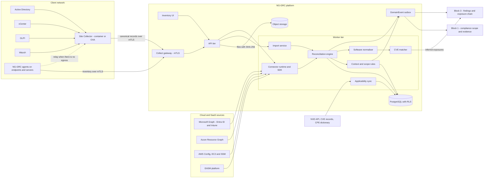
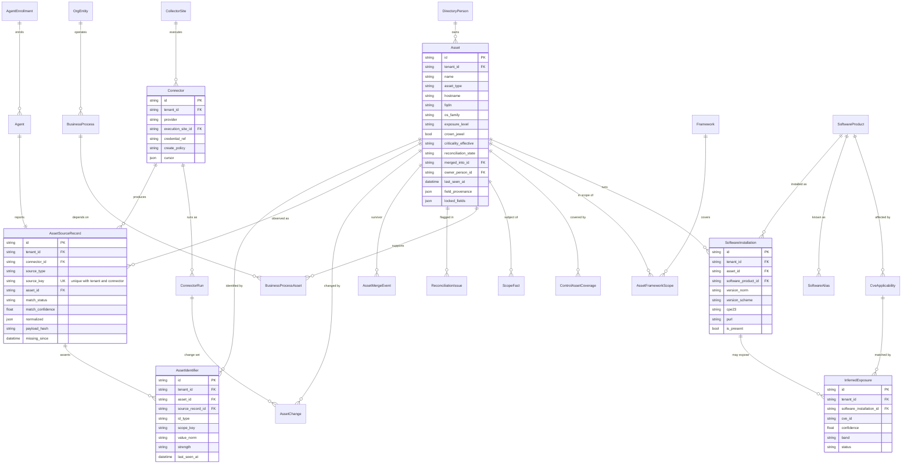
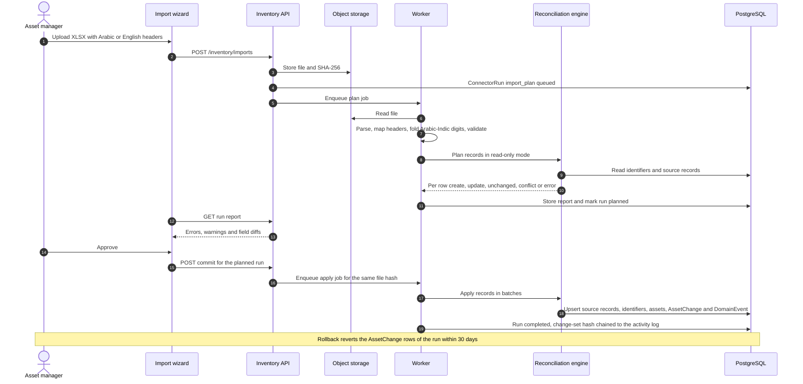
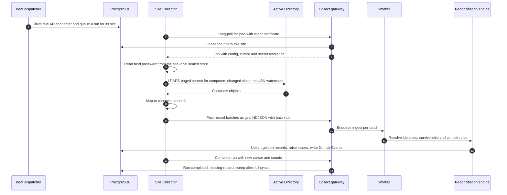
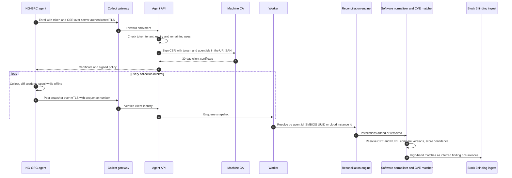
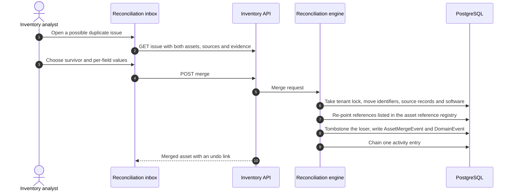

# NG-GRC Block 2: Inventory collector, target design

| | |
|---|---|
| Requirement | R6: built-in inventory collection (CSV/XLSX import, connectors, lightweight agent) |
| Inputs | BM-01 brief (slides 9–10, decisions BM-01-D04 and D05), W1 as-is reports, judge verdict (R6 partial) |
| Repository | `C:\Users\k.rmila\Desktop\GRC`. Paths below are relative to it; the review was read-only. |
| Status | Draft for the technical committee, 2026-10-16 |

## 1. Current state in one page

GRCEye stores business context well but collects almost no inventory. The judge rated R6 **partial, at the low end**. Without the narrow EASM discovery, the rating would be *missing*.

**What exists and is worth keeping**

| Area | What exists | Evidence |
|---|---|---|
| Asset record | 34-column `Asset`: owner (mandatory on create), criticality, C/I/A, RTO/RPO/MTD, PII flags, class, lifecycle, status, process and entity links. Only EASM fills its provenance fields, and the API does not return them. | `backend/app/models/asset.py:98-189` |
| Business context | `OrgEntity` tree, `BusinessProcess` and cartography, reused across GRC modules | `backend/app/models/org_unit.py:21-61`, `backend/app/api/v1/endpoints/asset_graph.py:379-518` |
| Links to GRC objects | Scenario links, asset-scoped assessments and coverage by asset, all stored as JSON id lists | `backend/app/models/risk_scenario.py:55`, `backend/app/api/v1/endpoints/compliance.py:737-750` |
| Import | CSV or XML, 7 fields. Bad values are coerced, no owner is set, rows are only ever inserted, files are capped at 2 MB, and there is no UI. | `backend/app/api/v1/endpoints/data_io.py:280-304,772-784` |
| Reusable parser | Reads UTF-8 with a BOM, sniffs the delimiter, reads XLSX, supports a dry run and upsert | `backend/app/api/v1/endpoints/frameworks.py:1859-1900,1983-2021` |
| Connectors | Adapter registry, SSRF check, secret redaction, a scheduler that claims runs in the database, `ScanJournal` | `backend/app/services/scanner_connectors.py:52-111,514-543`, `backend/app/services/vuln_scanner_scheduler.py:99-150` |
| Discovery | EASM creates assets with no owner, at most 1,000 per run | `backend/app/services/easm_connector.py:723-787` |
| Plumbing | Hash-chained audit with a system actor, an AES-GCM helper, tenant guards | `backend/app/services/activity_chain.py:190-229`, `backend/app/core/secret_box.py`, `backend/app/core/security_utils.py:243` |

**What is missing (confirmed by the judge)**

- **Agent and machine credential.** There is no agent. `ApiToken` exists only as a model (`backend/app/models/ai_access.py:71-90`), and the token client returns 404 (`frontend/src/api/endpoints.ts:201-216`).
- **Connectors.** None of the seven exists. AD/LDAP is used only for login (`backend/app/services/directory_auth.py:1-12`), and `boto3` is never imported.
- **One asset view.**
  - No identity keys, no unique constraint and no merge.
  - Matching is an exact string comparison (`backend/app/services/scanner_import.py:384-409`).
  - EASM can create one asset for a host's name and another for its IP (`easm_connector.py:756-783`).
- **Software.**
  - No software or CPE model.
  - The NVD import drops the `configurations` data (`backend/app/services/nvd_sync.py:173-206`).
  - The scanner import drops Nessus software plugins 45590, 20811 and 22869 (`scanner_import.py:196-198`).
- **Context on collected assets.**
  - Collected assets get no business context.
  - The UI can only list and create assets; the `update` and CIA client calls are never used (`frontend/src/api/endpoints.ts:2910-2915`).
  - Applicability cannot be set per asset (`backend/app/models/control_applicability.py:25-60`).
- **Platform debts.**
  - Schedulers run inside the web workers.
  - Schema changes are SQLite ALTER scripts, and the seed lacks 14 asset columns.
  - Connector secrets are stored in clear text (`backend/app/models/scanner_connector.py:7-8`).
  - Connectors may reach private addresses (`backend/app/core/config.py:74`).

## 2. Target design

### 2.1 Design rules

1. Every channel produces an `AssetSourceRecord`. Only the reconciliation engine writes the golden `Asset`.
2. Deterministic keys come before scores. Anything ambiguous goes to a person, and every merge can be undone.
3. Collectors never overwrite business context set by people or rules: field locks and provenance protect it.
4. Collection is read-only and outbound-only. Secrets for on-prem systems stay in the client network.
5. A software-to-CVE match is *inferred* and carries a confidence. It is never shown as confirmed.

### 2.2 Components

| # | Component | Type | Responsibility | Extends / new |
|---|---|---|---|---|
| C1 | Asset golden record | model | Identity summary, exposure context, provenance, locks | extends `backend/app/models/asset.py` |
| C2 | Identity and source store | models | Identifiers, source records, change sets, merges, issues, policy | new `backend/app/models/asset_identity.py` |
| C3 | Identifier normaliser | service | Normalise MAC, IP, FQDN, serial and UUID; block placeholder values | new `backend/app/services/inventory/normalize.py` |
| C4 | Reconciliation engine | worker | Match records (exposed to Block 3 as `AssetIdentityResolver`), apply survivorship, merge and split, raise issues | new `services/inventory/reconciliation.py`; replaces `scanner_import._build_asset_index` and `_match_asset` |
| C5 | Asset reference registry | service | Every column that holds an asset id, for merge and delete | new `services/inventory/asset_refs.py` |
| C6 | Stale detector | job | Missing and ageing assets, retirement, alerts | new; follows the `notification_generator.check_asset_eol` pattern |
| C7 | Context rules | service | Set entity, process, owner and exposure level from rules | new `services/inventory/context_rules.py` |
| C8 | Inheritance | service | Effective criticality and C/I/A from processes | new |
| C9 | Scope and coverage facts | service | Write asset `ScopeFact` and `ControlAssetCoverage` rows (Block 1 entities); keep the `AssetFrameworkScope` read model | new; feeds `compliance.py:737-750` |
| C10 | Tabular parser | library | Read CSV, XLSX and XML | new `services/tabular_import.py`, extracted from `frameworks.py:1859-1900` |
| C11 | Import service | service | Template, plan, apply, rollback, shim | new; `data_io.py:772-784` becomes the shim |
| C12 | Connector SDK | library | Config schema, credentials, cursor, paging, mapping | new, in the empty `backend/app/integrations/` package; generalises `scanner_connectors.py` and `easm_connector.py` |
| C13 | Connector runtime | worker | Celery tasks driven by the platform's Beat + RedBeat leader; run claims | replaces the `vuln_scanner_scheduler.py` loop and keeps its claims |
| C14 | Inventory connectors | adapters | AD, Entra ID, Intune, vCenter, Wazuh, GLPI, Azure, AWS, EASM | new; AD reuses the `directory_auth.py` helpers |
| C15 | Site Collector | deployable | Run connectors on-prem, hold their secrets, relay agents | new; the platform's `grc-collector` image |
| C16 | Collect gateway | edge + API | mTLS ingress for sites and agents | new: Envoy or nginx, plus machine API routers |
| C17 | Machine CA | service | Short-lived certificates and a deny list | new; issues through the platform PKI (`core/kms.py`, OpenBao PKI engine, MPL-2.0); keys in KMS/HSM (B7) |
| C18 | Agent | Go binary | Read-only collection, buffering, signed updates | new repository `agent/` |
| C19 | Fleet service | API + UI | Agents, tokens, policies, update rings | new |
| C20 | Software normaliser | service | Product identity (CPE and PURL) and version scheme | new `services/inventory/software.py` |
| C21 | Applicability sync | job | NVD configurations, CPE dictionary, CVE records | extends `services/nvd_sync.py` |
| C22 | CVE matcher | worker | Inferred exposures with a confidence | new `services/inventory/cve_matcher.py` |
| C23 | Inventory UI | frontend | Import wizard, asset page, review inbox, connectors, agents, rules | extends `AssetsPage.tsx` and `AssetGraphPage.tsx`; new pages |

### 2.3 Component and flow diagram



### 2.4 Data model

**Changed entities**

- **`Asset`** gains:
  - *identity summary:* `hostname`, `fqdn`, `primary_ip`, `serial_number`, `manufacturer`, `model`, `os_family`, `os_name`, `os_version`, `is_virtual`, `cloud_account_id`, `cloud_region`, `asset_subtype`;
  - *exposure context:* `environment`, `exposure_level` (internet_facing, dmz, internal, isolated, ot), `exposure_source` and `crown_jewel`, which are the fields Block 3 reads. The environment and exposure values use the keys of `OPERATIONAL_CONTEXT_WEIGHTS` (`backend/app/models/vulnerability.py:44-52`), so Block 3 no longer needs to ask users;
  - *reconciliation:* `reconciliation_state`, `merged_into_id`, `first_seen_at`, `last_seen_at`, `source_count`, `field_provenance`, `locked_fields`;
  - *ownership and criticality:* `owner_person_id`, `custodian_person_id`, `criticality_inherited`, `criticality_effective`.

  `asset_type` becomes a VARCHAR with a CHECK constraint (not a native enum), with new values `ot_device` and `cloud_resource`. `owner_id`, `integration_source`, `external_id` and `raw_metadata` stay for compatibility.
- **`BusinessProcess`:**
  - criticality limited to four levels;
  - adds `security_objectives`, `rto_seconds`, `rpo_seconds`, `mtd_seconds` and an optional `name_ar`;
  - its JSON `asset_ids` is replaced by `BusinessProcessAsset`.
- **`OrgEntity`:** optional `name_ar`.
- **`ControlApplicability`**: nullable `asset_id` and `basis`, which the Block 1 content design already plans.

**New entities** (tenant-scoped unless marked global)

| Entity | Key fields | Relations / constraints |
|---|---|---|
| `AssetIdentifier` | type, normalised value, scope, strength, active, seen dates | Asset and source record. Active strong values are unique per tenant. |
| `AssetSourceRecord` | source type and key, match status and confidence, canonical JSON, payload hash, `missing_since` | Connector and Asset. Unique per connector and key. |
| `AssetChange`, `AssetMergeEvent` | before and after values per field; moved items and `reverted_at` | Run and Asset; survivor and merged asset |
| `ReconciliationIssue`, `ReconciliationPolicy` | type, status, score, evidence, fingerprint; precedence, thresholds, windows | Assets and source record; one policy per tenant |
| `DirectoryPerson` | UPN, email, names in English and Arabic, department, directory id | Linked to a User when the person can log in |
| `BusinessProcessAsset` | dependency, source | Process and Asset |
| `AssetContextRule`, `AssetFrameworkScope` | priority, JSON DSL condition, actions; read-model rows with framework, applicability and basis | Rules act on assets. Scope rows are materialised from Block 1's applicability results. |
| `SoftwareProduct`, `SoftwareAlias`, `SoftwareInstallation` | CPE `part:vendor:product` and PURL; mapping from observed names; version, scheme, kind, `cpe23`, `purl`, `is_present` | Shared catalogue rows have no tenant. An installation belongs to an Asset. |
| `CveApplicability` (global), `InferredExposure` | CVE, origin, criteria, version bounds; confidence, band, status | Exposure to installation and to Block 3's `FindingOccurrence` |
| `Connector`, `ConnectorRun`, `ImportMappingProfile` | provider, config, credential reference, site, cursor, create policy; run type, status, counters, file hash; column map | Shared with Block 3. Replace `scanner_connectors` and `scan_journals`. |
| `CollectorSite`, `Agent`, `AgentEnrollment`, `AgentPolicy`, `AgentRelease` | certificate, version, heartbeat; token hash and uses; interval and ring; signed build | An Agent belongs to one Asset |



### 2.5 One asset view: the reconciliation engine

**Identifier types**

| Type | Strength | Unique within | Guards |
|---|---|---|---|
| Cloud resource ID (ARN, Azure ID), cloud instance ID | strong | tenant and account | lower-case |
| Agent ID, AD objectGUID, Entra and Intune device IDs, vCenter instance UUID, the source's native ID | strong | source instance | canonical GUID |
| SMBIOS UUID | strong* | tenant | byte-order variants folded; placeholders blocked |
| Serial number with manufacturer | strong* | manufacturer | placeholders blocked ("To Be Filled By O.E.M.", "Default string", "0") |
| MAC address | medium | tenant | random, zero and broadcast addresses ignored |
| FQDN | medium | tenant | lower-case, IDNA A-label |
| Hostname, NetBIOS name | weak | tenant and domain | |
| IP address | weak | site, VPC/VNet or public | loopback, link-local and APIPA ignored |

\* A strong value seen on unrelated records (cloned UUIDs, bogus serials) is demoted to weak and raises an `identifier_collision` issue. A partial unique index on active strong values stops duplicates when connectors race.

**Cross-source correlation keys**

| Sources | Key |
|---|---|
| AD and Entra ID | `objectSid` equals the device's `onPremisesSecurityIdentifier` (hybrid join; the field needs `$select`) |
| Entra ID and Intune | `deviceId` equals `azureADDeviceId` |
| vCenter, agent, GLPI | BIOS UUID equals SMBIOS UUID, with byte order normalised |
| Cloud and agent | Instance ID or vmId, read by the agent from the metadata service |
| Intune, GLPI, Wazuh, agent | Serial number with manufacturer |
| AD and vCenter | `dNSHostName` equals the guest FQDN of a running VM (confidence 0.9) |

**Resolution order**

1. **Continuity.** The same connector and source key resolve to the same asset unless it was split.
2. **Strong keys.**
   - Keys that point to one asset give a match with confidence 0.99.
   - Keys that point to several assets raise `possible_duplicate`.
   - The engine merges them automatically only if the tenant's policy allows it and neither asset carries manual context.
3. **Scoring.** Candidates are looked up by FQDN, hostname, MAC or IP within the same scope, then scored:
   - FQDN +45, MAC +40, hostname +25;
   - IP in the same scope seen in the last 7 days +15;
   - OS family match +5, mismatch −30;
   - last seen more than 90 days ago −10.

   A score of 70 or more is a match. From 40 to 69 the record goes to review. Below 40 there is no match.
4. **Vetoes.** The engine never merges assets that have different strong values of the same type, incompatible types, or different cloud accounts.
5. **No match.** The engine creates a new asset if the connector's create policy allows it. Otherwise it raises `unmatched_observation`, the "unknown host" signal that CTEM needs. Scanner and hub observations never create assets: Block 3 files them under `unresolved:<identifier>` until `asset.identifiers_changed` resolves them.

The engine runs in batches on the workers, under a per-tenant PostgreSQL advisory lock. If an insert hits the unique index, the record is resolved again and matches the asset that won.

**Field-level survivorship** (tenant-tunable defaults)

| Field | Source precedence |
|---|---|
| Hostname, FQDN | agent > Intune > AD > Entra ID > Wazuh > GLPI > vCenter > cloud > CSV > EASM |
| OS | agent > Wazuh > Intune > GLPI > vCenter > AD > cloud > CSV |
| Hardware, serial | agent > Intune > GLPI > Wazuh > vCenter > CSV |
| Cloud fields | cloud connector only |
| Business context | manual > CSV > rule > directory hint |

- Within a tier, the newest value wins. A value older than 30 days gives way to a fresher one from a lower tier.
- IP and MAC addresses are kept as sets.
- A manual edit locks the field.
- `field_provenance` records the source, record, rule and time behind each value; the UI shows them as badges.

**Merge, split and retirement**

- **Merge.** Moves identifiers, source records, software and every reference in the registry (C5) to the survivor. The registry today covers ten JSON lists and `asset_valuation_history`.
  - The other asset becomes a tombstone whose `merged_into_id` points to the survivor.
  - `AssetMergeEvent` records each merge, so it can be undone.
- **Split.** Moves the chosen source records to a new asset and records a do-not-merge pair.
- **Missing and stale.** A full sync stamps `missing_since` on records it did not see. Default windows:
  - workstations: stale after 30 days, retirement candidate after 90;
  - servers: stale after 14 days, retirement candidate after 60;
  - cloud resources: a candidate once reported deleted or absent from 2 syncs;
  - OT devices: never retired automatically.
- **Retirement.** Only system-created assets without GRC links retire automatically. All others raise `retire_candidate`.
- **Review queue.** Each issue carries a fingerprint, so a later run does not raise it again. Issues can be resolved in bulk, and the resolutions are used to tune thresholds.

### 2.6 Business context enrichment

- **Owners.** Hints come from:
  - AD `managedBy` and Entra registered owners;
  - the Intune primary user and the GLPI technical manager;
  - `Owner` tags in the cloud or vCenter.

  Each hint resolves to a `DirectoryPerson`, and also to `owner_id` when that person has a login. An endpoint's primary user becomes its custodian. A hint that cannot be resolved, or that conflicts with another, raises an issue.
- **Context rules.** Rules are ordered and written in a declarative JSON DSL.
  - Conditions can test the source, OU, cloud account, tags, subnet, name pattern and type.
  - Actions can set the entity, processes, owner, environment, exposure level, criticality and classification.
  - Each rule can be previewed before it is applied, and the provenance records which rule set a value.
  - Example: `OU=Treasury` sets the Treasury entity, the tag `Application=SWIFT` links the "SWIFT payments" process, and a subnet `10.40.0.0/16` sets exposure level `ot`.
- **Inherited criticality.**
  - An asset inherits the highest criticality of its business processes.
  - That criticality flows on through `serves_asset_ids` to the support assets.
  - `criticality_effective` is the maximum of the declared and inherited values. It feeds Block 3 prioritisation and `backend/app/services/scenario_priority.py`.
  - C/I/A is inherited the same way.
  - `crown_jewel` is set when the effective criticality is critical, or by hand.
- **Compliance scope.** Inventory supplies facts; it is not a second applicability engine. Applicability belongs to Block 1: its KSA packs declare the dimensions and conditions, and its engine decides. The facts inventory supplies are:

  | Asset `ScopeFact` or predicate | Derived from | Used by |
  |---|---|---|
  | `otcc.facility_level` | Exposure level `ot` or type `ot_device`, with the level mapped per site | NCA OTCC |
  | `cscc.critical_system` | `crown_jewel` or a manual flag | NCA CSCC |
  | `dcc.data_class` | `data_classification` | NCA DCC |
  | `hosting`, `asset_type`, `exposure_level`, `contains_pii` | The golden record | Pack conditions such as CCC-2:2024 cloud scope and PDPL |

  Block 1 evaluates these facts and writes `ControlApplicability` rows with `asset_id` and `basis`. Inventory builds `AssetFrameworkScope` from those results. Asset pages, dynamic assessment perimeters ("assets in scope of OTCC") and Block 3's `CtemScope` all read from it.
- **Coverage facts.** Connectors report the tools they see on each asset, such as Intune management and compliance, or an active Wazuh agent. A tenant maps each tool to an applied control; for example, "Endpoint monitoring" maps to an active Wazuh agent. Inventory then writes Block 1's `ControlAssetCoverage` rows, with source `connector`, state `protected` or `gap`, and `observed_at`.
- **Risk scenarios.** The asset page suggests scenarios whose threats target the asset's type, using `Threat.affected_assets` (`backend/app/models/threat.py:101`).
- **Evidence.** Owner, freshness and classification coverage become automated evidence for ECC-2:2024 2-1 (Asset Management). This uses the `Evidence.is_automated` and `valid_until` fields, which nothing writes today (`backend/app/models/compliance.py:193-199`). The same metrics feed Block 1's KRI providers.

### 2.7 Channel 1: CSV/XLSX import

- **Template.** An XLSX workbook with four sheets: instructions, Assets (with drop-down lists), Software (optional, active once the P2 software model ships), and Lists pre-filled with the tenant's entities, processes and people.
  - Each header shows the English key and the Arabic label (`hostname | اسم المضيف`).
  - Arabic sheets read right to left.
  - Default, OT and cloud variants exist, plus a CSV version.
- **Columns.** All are optional, but each row needs a name or an identifier.
  - Identity: `external_id`, `name`, `asset_type`, `hostname`, `fqdn`, `ip_addresses`, `mac_addresses`, `serial_number`, `os_name`, `os_version`, `cloud_resource_id`, `location`.
  - Business context: `owner_email`, `org_entity` (as a path), `business_processes`, `criticality`, C/I/A, `data_classification`, `contains_pii`.
  - Exposure and lifecycle: `environment`, `exposure_level`, `crown_jewel`, `lifecycle_state`, `end_of_life_date`, `tags`.
- **Parsing (C10).**
  - Files are read as UTF-8 with or without a byte-order mark, and the delimiter is detected.
  - XLSX files are read-only, and files with macros are refused.
  - Header aliases are recognised in English, Arabic and French.
  - Arabic-Indic digits are converted. Years that look Hijri are flagged.
  - Limits are 20 MB and 100,000 rows. Each file is stored with its SHA-256.
- **Dry run first.** An upload creates an `import_plan` run that writes nothing. Its report gives each row's action (create, update with a field diff, unchanged, conflict, error) and any warnings, and downloads as a bilingual XLSX. A client CMDB can push files through an `ApiClient` with the `inventory:import` scope.
- **Idempotent upsert.** Each row is keyed by `external_id`, or by its strongest identifier: serial number, then cloud ID, then FQDN, then hostname. Re-importing the same file changes nothing. Modes are upsert, create-only and update-only. `full_snapshot` marks absent rows as missing.
- **Rollback.** Within 30 days, a run's `AssetChange` rows can be replayed backwards:
  - fields nobody has changed since are reverted;
  - assets the run created are deleted if still unlinked;
  - conflicts are listed for the user.

  Each run is hashed into the audit chain.
- **Wizard.** Upload, map columns (saved as an `ImportMappingProfile`), review, apply, then history and rollback. `/data/import/assets` stays as a deprecated shim.

### 2.8 Channel 2: connectors on the shared framework

```python
class InventorySource(Protocol):
    provider: str                     # "ad", "entra", "intune", ...
    config_model: type[BaseModel]     # typed config; its JSON Schema drives the UI form
    capabilities: set[str]            # devices, people, software, network, cloud, deletions
    async def test(self, ctx) -> TestResult: ...
    def fetch(self, ctx, cursor) -> AsyncIterator[RawBatch]: ...   # paged and rate-limited
    def map(self, raw) -> CanonicalAssetRecord: ...                # identifiers, attributes, software, hints
```

`map` returns canonical records: identifiers, attributes, software, owner hints, context hints, lifecycle hints and `observed_at`. Each connector has a create policy (create, match only or review), and its first run is a simulation.

| Connector | Authentication (least privilege) | Data mapped | Sync | Runs in | Wave |
|---|---|---|---|---|---|
| AD | LDAPS bind with a read-only account; ldap3 (LGPL-3.0, already used) | Computers: objectGUID, objectSid, dNSHostName, OS, last logon, disabled, `managedBy`, OU. People. | Incremental on uSNChanged; weekly full sweep | Site Collector or workers | 1 |
| Entra ID | OAuth2 client credentials with a certificate; `Device.Read.All`, `User.Read.All` | Devices: deviceId, trustType, onPremisesSecurityIdentifier, OS, last sign-in, owners. Users. | Delta query | Workers | 1 |
| Intune | Same app; `DeviceManagementManagedDevices.Read.All` | azureADDeviceId, serial, MACs, OS, model, primary user, compliance. Detected apps become software (unmanaged apps only for corporate devices). | Full, with hash change detection | Workers | 1 |
| vCenter | Read-only role; pyVmomi (Apache-2.0) | VM instance and BIOS UUIDs, guest FQDN, IPs, MACs, OS, power state, tags, folder; host serials | Full | Site Collector or workers | 1 |
| Wazuh | Read-only API user and indexer role | Agents, hardware serial, interfaces, packages, hotfixes | Indexer `wazuh-states-inventory-*`, or `/syscollector/{agent_id}/*` (Wazuh 4.14 documents both) | Site Collector or workers | 2 |
| GLPI | GLPI 11+: API v2, OAuth2 password grant, read-only user. GLPI 10: legacy REST. | Serial, asset tag, UUID, OS, ports, software, location, entity, technical manager | Incremental on `date_mod`; weekly full | Site Collector or workers | 2 |
| Azure | Client credentials; Reader role | Resource Graph: resource ID, vmId, region, tags, subscription, MAC and IP. A public IP sets `exposure_level` to `internet_facing`. | Full, paged with `$skipToken` | Workers | 2 |
| AWS | AssumeRole with an ExternalId (no stored client key); boto3 (Apache-2.0) | Config or Describe: ARN, instance ID, IPs, MACs, tags, region. Software from SSM Inventory. | Full, per account and region | Workers | 2 |
| EASM | Unchanged | Host and IP in one record, so no more twin assets; sets `exposure_level` to `internet_facing` | Unchanged | Workers | P1 refit |

**Build order.**
- **Wave 1 (P2a):** the framework, the Site Collector, then AD, Entra ID, Intune and vCenter. Microsoft and VMware dominate KSA estates, and their strong keys (objectSid, deviceId, BIOS UUID) make matching reliable from day one. Intune also adds endpoint software.
- **Wave 2 (P2b):** Wazuh, GLPI, Azure and AWS. They are independent of each other, so client demand can set the order.

**Execution.**
- Cloud APIs run on the platform workers, through a host allow-list.
- On-prem sources run on the workers for on-prem installs, and through a Site Collector for SaaS tenants.
- Connectors run in SaaS refuse private and link-local targets.
- Rate limits are held in Valkey.

### 2.9 Channel 3: lightweight agent (P3)

- **Form.**
  - One static Go binary per OS: Windows Server and desktop, Linux x86-64 and ARM64 (deb and rpm), and macOS.
  - No inbound port, no remote commands, no ad-hoc queries.
  - Collectors are compiled in; a signed policy can only switch them on or off.
- **Data collected.**
  - OS, hardware (serial, SMBIOS UUID), network interfaces, and the cloud instance identity from IMDS.
  - Software from Windows Uninstall keys, MSIX, dpkg, rpm, apk, snap, macOS applications, pkg receipts and Homebrew.
  - Windows hotfixes.
  - Optional posture facts as automated evidence (P3b).
  - Never collected: file contents, browsing data, command lines.
- **Enrolment.**
  - An admin issues an `AgentEnrollment` token with an expiry and a maximum number of uses.
  - The agent generates its key pair (in the TPM or the OS key store where available).
  - It sends a CSR over server-authenticated TLS.
  - It receives a 30-day certificate whose URI SAN carries the tenant and agent IDs, renewed when two-thirds of its life has passed.
  - All later calls use mTLS to `collect.<domain>`. Revocation is a deny list plus the short certificate lifetime.
- **Transport.**
  - A daily full snapshot, with section-hash deltas in between.
  - Payloads are gzipped JSON carrying a sequence number.
  - Offline, the agent buffers to a bbolt spool (MIT; 50 MB, 14 days).
  - Segments without internet access go through the Site Collector's CONNECT relay; mTLS stays end to end.
- **Least privilege.**
  - Linux: systemd with `NoNewPrivileges`, `ProtectSystem=strict` and only `CAP_DAC_READ_SEARCH`.
  - Windows: a virtual service account.
  - macOS: a launchd daemon.
- **Signing and updates.**
  - Packages are signed with Authenticode, Apple Developer ID with notarisation, and signed deb/rpm repositories built with nfpm (MIT).
  - Artefacts are signed with cosign (Apache-2.0).
  - Updates use TUF via go-tuf v2 (Apache-2.0), with keys in an HSM.
  - Updates roll out in rings, tenants can pin a version, and air-gapped sites get offline bundles.
- **Fleet.**
  - Shows each agent's status, version, ring, asset, token and relay.
  - Manages tokens, policies and revocation, and provides install guides per OS.
  - Heartbeats update `last_seen_at`.
- **osquery.** Not bundled (see ADR-INV-08). An optional mode calls an osquery the client installed, as a separate program with a fixed read-only query pack.

### 2.10 Ready for CTEM: software to CVE

1. **Normalise.** Clean the name, apply vendor aliases, then resolve to a `SoftwareProduct`: a CPE 2.3 `part:vendor:product` from the NVD dictionary, plus a PURL for packages.
   - Resolution tries curated aliases, then tenant aliases, then trigram similarity (`pg_trgm`, or rapidfuzz on SQLite).
   - Names that cannot be resolved stay with the tenant and go to a curation queue.
2. **Versions.** univers compares dpkg, rpm, semver, PyPI and Maven versions. A dotted-number fallback covers MSI and macOS.
3. **Applicability.** Three sources:
   - NVD CVE API 2.0 `configurations`;
   - CVE Record 5.x `affected` data from the CNA and the CISA ADP container;
   - from P3, vendor CSAF/VEX advisories and OSV.

   Since 15 April 2026, NIST enriches only CVEs that are in KEV, affect federal software, or affect EO 14028 critical software, and marks the rest "not scheduled". That is why CVE Record data is needed.
4. **Score.** Matching is event-driven and indexed by vendor and product. Confidence is the product of four factors:

   | Factor | Values |
   |---|---|
   | Product identity | exact 0.95, curated alias 0.9, fuzzy 0.6–0.8, manual 1.0 |
   | Version | in range with known scheme 0.95, heuristic 0.7, missing 0.3 |
   | Configuration | single node 1.0, platform satisfied 0.9, unknown 0.5 |
   | Backport | 0.4 for distro packages with no distro advisory |

   Bands: high is 0.8 or more, medium is 0.5 up to 0.8, and low is below 0.5.
5. **Hand-off.**
   - Every candidate is kept as an `InferredExposure` with its reasons.
   - The high band goes to Block 3 as a `FindingOccurrence` with `detection_method='inventory_inference'`.
   - The medium band is labelled "needs validation".
   - A scanner or hub finding confirms an inference and replaces it.
   - Block 3 owns EPSS, KEV and `ControlImpactRule`.
6. **Scanner software.** Nessus plugins 45590, 20811 and 22869 become software source records.

### 2.11 Key flows

**CSV/XLSX import: dry run, then apply**



**Connector run through a Site Collector (AD)**



**Agent enrolment, inventory and CVE inference**



**Merge from the review queue**



### 2.12 APIs

| Method and path | Purpose |
|---|---|
| `GET /assets` with `q`, `source`, `state`, `owner_missing`, `exposure_level` or `framework_id` | Search and filter on the server |
| `GET /assets/{id}/sources`, `/identifiers`, `/software`, `/lineage`, `/scope`, `/context` | One asset's provenance, identity, software, scope and GRC links |
| `PATCH /assets/{id}`, `POST /assets/{id}/merge`, `POST /assets/{id}/split`, `POST /asset-merges/{id}/revert` | Edit (including clearing and locking fields), merge, split, undo |
| `GET /inventory/reconciliation/issues`, `POST .../issues/{id}/resolve`, `GET` and `PUT /inventory/reconciliation/policy` | Review queue (bulk resolution allowed) and the tenant policy |
| `GET /inventory/import/template`, `POST /inventory/imports`, `GET .../{run_id}/report`, `POST .../{run_id}/commit`, `POST .../{run_id}/rollback` | Template, dry run, report, apply, rollback |
| CRUD `/inventory/import-profiles`; `POST /data/import/assets` | Saved mappings; the legacy route, kept as a deprecated shim |
| `GET /connector-types`, CRUD `/connectors`, `PUT /connectors/{id}/credentials`, `POST /connectors/{id}/test`, `POST /connectors/{id}/runs` | Connectors, shared with Block 3. Credentials are write-only. `/vuln-import/connectors*` stays as an alias. |
| CRUD `/collector-sites`, `/agent-enrollments`; `GET /agents`; `POST /agents/{id}/revoke`; `PUT /agent-policies` | Collector sites and the agent fleet |
| CRUD `/inventory/context-rules` and `/inventory/scope-rules`; `POST .../{id}/preview` | Rules, with preview |
| `GET /inventory/software/unresolved`, `POST /inventory/software/aliases`, `GET /inventory/exposures/inferred` | Software curation and inferred exposures |
| mTLS on the `collect.` host: `/collector/v1/{enroll, heartbeat, jobs, runs/{id}/records, runs/{id}/complete, renew}` and `/agent/v1/{enroll, inventory, heartbeat, policy, renew, tuf}` | Machine APIs. Agents enrol with a token. |

**Domain events:**
- assets: `asset.created`, `asset.updated`, `asset.identifiers_changed`, `asset.merged`, `asset.split`, `asset.stale`, `asset.retired`, `asset.context_changed`, `asset.scope_changed`, `asset.software_changed`;
- exposures: `exposure.inferred`;
- connectors: `connector_run.completed`, `connector_run.failed`;
- agents: `agent.enrolled`, `agent.revoked`.

When `asset.identifiers_changed` fires, Block 3 re-runs matching for findings that matched no asset.

### 2.13 UI changes

- **AssetsPage.** Server-side search; columns for sources, last seen, effective criticality, exposure level and owner; import and bulk assignment; tabs for assets with no owner, stale assets and conflicts.
- **New `/assets/:id` page.**
  - Tabs: overview (provenance badges and field locks), business context, identity and sources, software, exposures (confirmed and inferred), compliance scope with reasons, risks, history.
  - It finally calls the existing `update` and CIA clients.
- **New pages.**
  - Import history.
  - Reconciliation inbox, with side-by-side comparison.
  - Connectors: forms generated from JSON Schema, replacing the modal on `VulnerabilitiesPage`.
  - Collector sites, agents, software and rules.
- **AssetGraphPage.** Editable entities and processes, and `serves_asset_ids` edges drawn on the graph.
- **Navigation and languages.** A new "Inventory" sidebar group, role-gated in both `Layout.tsx` and the `ROUTE_ROLES` map in `App.tsx`. All text in English, Arabic and French, with RTL layout checked.

### 2.14 Security and tenant isolation

- **Tenant identity.** The tenant is taken from the user's Membership, from the connector, or, for sites and agents, from the certificate's URI SAN, never from the payload. The gateway strips any identity headers sent by the client.
- **RLS.**
  - RLS (B3) covers every new table.
  - Shared catalogues are readable by all tenants but written only by platform jobs.
  - Tenants can no longer trigger global syncs; today `POST /cve/sync` can.
  - Strong identifiers are unique per tenant, so matching never crosses tenants.
- **Credentials.**
  - Platform-run connectors store credentials with envelope encryption (B7).
  - Site-run connectors keep theirs in a sealed store on the site.
  - Credentials are write-only and redacted from errors, and each connector documents the least privilege it needs.
- **SSRF.** Connectors running in SaaS cannot reach private or metadata addresses; this reverses the default at `config.py:74`. DNS results are pinned, redirects are not followed, and outbound hosts are allow-listed.
- **Ingestion.**
  - Caps on upload size and decompressed size.
  - Schema validation.
  - Rate limits in Valkey and idempotency keys.
  - XLSX files with macros are refused, and XML is parsed with defusedxml.
  - All parsing happens on the workers.
- **Inventory poisoning.** An agent is bound to one asset. If it claims another asset's strong identifier, the engine raises an issue and moves nothing.
- **Agent.** Read-only, signed with keys held in an HSM, uses short-lived certificates, and gets a penetration test before general availability.
- **Audit and roles.** Automatic decisions are chained through `log_system_activity` with the run ID. Perimeter scoping (`services/perimeter.py`) is extended to assets. Managing connectors, sites and agents requires the CISO or tenant_admin role.
- **PDPL.** Collect the minimum, flag personal fields, keep raw payloads for 90 days, and support export and erasure.

### 2.15 Arabic and KSA

- **Bilingual import.** Template and report pair Arabic labels with English keys, use RTL sheets, and take their messages from the i18n catalogue.
- **Matching keys.**
  - Arabic-Indic digits are converted to Western digits.
  - For matching only, the engine normalises alef, ya and ta marbuta and removes tatweel and diacritics.
  - Bidi control characters are stripped.
  - IDNs are stored as A-labels.
  - Hijri-looking years are flagged.
- **Regulation.**
  - Default scope rules target OTCC, CCC-2:2024, DCC, CSCC, TCC, PDPL and ECC-2:2024.
  - Inventory coverage is evidence for ECC-2:2024 2-1 ("an accurate and updated inventory of assets") and for 2-1-5 (classification).
- **Residency.**
  - Cloud assets carry their region, so rules can flag regulated data stored outside KSA.
  - SaaS is hosted in KSA.
  - Raw directory data stays on the client's site.
- **Scheduling.** Schedules use the tenant's time zone (Asia/Riyadh by default) and off-peak hours.

### 2.16 SaaS, on-prem and MSSP

| Concern | SaaS (KSA region) | On-prem appliance | MSSP |
|---|---|---|---|
| Cloud connectors | Workers, from published egress IPs | Workers, via the client's proxy | Per tenant |
| On-prem sources | One Site Collector per client network | Workers directly; a site only for isolated segments | One site per client tenant |
| Agents | `collect.<domain>`, or relayed by the site | Local gateway | Installer branded per tenant (code signer is an open question) |
| Catalogue data and updates | Platform jobs; TUF rings | Signed offline bundles | Shared |
| Machine CA | Platform CA, keys in KMS/HSM | Local CA or the client's PKI | Platform CA |
| Schema | Alembic | Alembic, which ends seed drift | Same |

### 2.17 New third-party components

| Component | Use | Licence | Note |
|---|---|---|---|
| openpyxl, httpx, defusedxml | XLSX, HTTP, XML | MIT, BSD-3-Clause, PSF-2.0 | Already in use |
| ldap3 | AD connector | LGPL-3.0 | Already in use, unmodified; recorded for legal |
| boto3/botocore, pyVmomi | AWS, vCenter | Apache-2.0 | boto3 declared but unused today; pyVmomi new |
| univers | Version ranges | Apache-2.0 AND BSD-3-Clause AND MIT | New |
| packageurl-python, rapidfuzz | PURL, fuzzy match | MIT | New |
| pg_trgm | Trigram index | PostgreSQL Licence | Contrib extension |
| Go, gopsutil, bbolt, go-tuf v2 | Agent | BSD-3-Clause, BSD-3-Clause, MIT, Apache-2.0 | New |
| cosign, nfpm | Signing, packaging | Apache-2.0, MIT | Build time only |
| WiX Toolset | MSI | MS-RL; binaries carry an Open Source Maintenance Fee for revenue-generating users | Build time only; check terms or pick another tool |
| Envoy or nginx; age | mTLS gateway; secret store | Apache-2.0 or BSD-2-Clause; BSD-3-Clause | New |
| osquery | Optional, installed by the client | `Apache-2.0 OR GPL-2.0-only`; the Linux build statically links libdpkg (GPL-2.0-or-later) | Not bundled |
| Fleet | Optional connector | MIT core; `ee/` under a commercial licence | API only |
| NVD and CPE data, CVE List, CISA Vulnrichment | Data | Public, with the NVD notice; CVE Program terms; Vulnrichment terms to confirm | Data, not code |

## 3. Migration path from today's code

| File | Action |
|---|---|
| `backend/app/models/asset.py`, `org_unit.py`, `control_applicability.py` | Extend as in §2.4. The JSON `asset_ids` stays in sync for one release. |
| `backend/app/models/scanner_connector.py`, `scan_journal.py` | Replaced by `Connector` and `ConnectorRun`, shared with Block 3. Existing rows migrated. |
| `backend/app/services/scanner_import.py` | Matching calls `AssetIdentityResolver.resolve()`. `ingest_findings` stays (Block 3). Nessus software plugins are kept. |
| `backend/app/services/easm_connector.py`, `scanner_connectors.py` | The mapping engine and the `_check_target`, `_client` and `_redact` helpers move to `integrations/`. Discovery goes through the engine. The EASM config is unchanged. |
| `backend/app/services/vuln_scanner_scheduler.py` | Replaced by the dispatcher, which keeps the optimistic claim |
| `backend/app/api/v1/endpoints/data_io.py`, `frameworks.py` | The asset import becomes a shim. Parsers move to `services/tabular_import.py`; the framework import behaves as before. |
| `backend/app/api/v1/endpoints/assets.py`, `asset_graph.py` | New fields. PATCH can clear values. Invalid enums return 422. Delete goes through `asset_refs`. Perimeter scoping applies. Process links use the join table. |
| `backend/app/services/directory_auth.py`, `nvd_sync.py` | The ldap3 helpers are shared; login is unchanged. `configurations` are kept. Syncs become platform jobs. |
| Frontend | `AssetsPage.tsx`, `AssetGraphPage.tsx`, the connector UI (`VulnerabilitiesPage.tsx:1397-1570`, moved to its own page), `endpoints.ts`, `DataActions.tsx`, `Layout.tsx`, `App.tsx` |

**Data migration** (an Alembic revision, not ALTER scripts):
1. Every asset gets a `legacy` or `easm` source record.
2. Identifiers are taken from `name`, `external_id` and `location`, but only values shaped like an IP, hostname or FQDN. Values from `location` are marked weak. The EASM host and IP join one record.
3. A plan-mode reconciliation turns duplicates (EASM twins, CSV re-imports) into issues, never into automatic merges.
4. Process criticality is mapped to four levels, and process asset links are copied into `BusinessProcessAsset`.
5. Connectors keep their IDs and have their secrets re-encrypted. Journals become runs with no connector.
6. Dangling IDs in the ten JSON lists are reported.

Production has about 11 assets (`backend/scripts/migrate_add_asset_status.py:23-25`), so the risk is low. On-prem appliances follow the same Alembic path.

**Backward compatibility**
- `/assets` and `AssetOut` only gain fields.
- `owner_id` stays mandatory for manual creation. Collected assets without an owner go to the owner queue.
- `/vuln-import/connectors*` stays as an alias for one release.
- `/data/import/assets` keeps its response shape but becomes idempotent. This change is deliberate and documented.
- Provenance columns and Elite flags stay until packaging is decided.

## 4. Phasing

Per BM-01-D05: CSV import and connectors first, then the agent. Two baseline items move earlier: identity and reconciliation v1 go to P1, because idempotent import depends on them, and the reference registry goes to P0.

| Phase | Deliverable | Effort | Depends on |
|---|---|---|---|
| P0 | Reference registry; delete clean-up; PATCH can clear fields; enums as VARCHAR; 422 errors; perimeter scoping on assets | S | Alembic baseline |
| P0 | Encrypt connector secrets; block private targets in SaaS | S | B7 (shared with Block 3) |
| P1 | Identity and source schema with backfill | M | PostgreSQL and Alembic |
| P1 | Reconciliation v1: continuity, strong keys, correlation keys, scoped weak keys, issues | M | Identity schema |
| P1 | Scanner and EASM matching via identifiers (fixes twins) | S | Reconciliation v1; Block 3 |
| P1 | Channel 1: parser, bilingual template, dry run, upsert, history, rollback, shim | M | Reconciliation v1; B4; B6 |
| P1 | Asset page and edit, import wizard, owner queue, inbox v1 | M | Channel 1 |
| P1 | Business context v1: process links, process CIA and BIA, inheritance, `DirectoryPerson`, rules v1 | M | Identity schema |
| P1 | Asset scope and coverage facts; the `AssetFrameworkScope` read model | S | Block 1 `ScopeFact`, applicability engine and `ControlAssetCoverage` |
| P2 | Connector framework, SDK, dispatcher; scanner connector migration | M | B4, B7; shared with Block 3 |
| P2 | Site Collector, collect gateway, machine CA | M | Framework; HSM |
| P2 | Wave 1: AD, Entra ID, Intune, vCenter | L | Framework, Site Collector |
| P2 | Wave 2: Wazuh, GLPI, Azure, AWS | L | Wave 1 |
| P2 | Reconciliation v2: scoring, merge UI, stale detection, policy UI, directory owners, rules v2 | M | Wave 1 |
| P2 | Software model, normaliser, CPE dictionary, Nessus software | M | Identity schema |
| P2 | Applicability sync, matcher, inferred-exposure hand-off | M | Software model; Block 3 `FindingOccurrence` |
| P2 | Inventory evidence for ECC-2:2024 2-1 | S | Block 1 |
| P3 | Agent v1 (Windows, Linux, macOS) with signing, TUF, buffering | XL | Gateway, CA, HSM |
| P3 | Fleet UI and API, update rings, relay | M | Agent v1 |
| P3 | osquery-assisted mode and Fleet connector | S | Agent v1; legal sign-off |
| P3 | Distro- and advisory-aware matching (OSV, CSAF/VEX, OT vendors) | M | Matcher |
| P3 | Scale: partitioning, load test (100k assets, 10M installations), penetration test | M | All |

## 5. Architecture decisions

**ADR-INV-01: extend `assets` as the golden record.**
- *Context:* ten JSON lists, the cartography and eight pickers already point at `assets`.
- *Options:* a new canonical table; a view computed on read; extend with side tables.
- *Decision:* extend with side tables.
- *Rationale:* no link has to be re-pointed, and the existing indexes and RLS keep working.
- *Consequences:* the golden record becomes derived state, rebuilt from source records by an admin job, and every write must carry provenance.

**ADR-INV-02: deterministic-first matching with a review queue.**
- *Context:* a false merge corrupts the links from risks, audits and findings; a missed one leaves duplicates.
- *Options:* rules only; probabilistic linkage (Splink, MIT); machine learning; a commercial MDM.
- *Decision:* typed keys, correlation rules and additive scores with tenant thresholds, plus a review queue. No machine learning in v1.
- *Rationale:* auditors can follow it, it is cheap at 100k assets, and strong keys resolve most cases.
- *Consequences:* the inbox needs staffing, and thresholds are tuned from the outcomes.

**ADR-INV-03: survivorship field by field.**
- *Options:* last writer wins; one source wins per record; per field.
- *Decision:* per field, by precedence, freshness and manual locks, with provenance stored.
- *Rationale:* standard CMDB practice, and it can explain every value.
- *Consequences:* a provenance JSON on each asset and a policy editor.

**ADR-INV-04: reversible merge tombstones.**
- *Context:* asset IDs live in JSON lists that have no foreign keys.
- *Options:* hard delete; tombstone and redirect; wait for join tables.
- *Decision:* tombstone and redirect, with references re-pointed through the registry.
- *Rationale:* it works before join tables exist, and every merge can be audited and undone.
- *Consequences:* a CI check makes sure every new asset link is added to the registry. The same transaction re-points Block 1's link tables and Block 3's occurrences through their services; `asset.merged` then informs caches and read models.

**ADR-INV-05: a file import is a connector run.**
- *Options:* separate import code, as today; one pipeline.
- *Decision:* one pipeline, with a dry run by default and rollback through change sets.
- *Rationale:* the same matching everywhere, one audit model, and idempotent imports.
- *Consequences:* identity and reconciliation v1 move to P1.

**ADR-INV-06: build our own connector SDK.**
- *Options:* Airbyte (platform source-available under ELv2); Singer or Meltano taps (mixed licences, no identity model); our own.
- *Decision:* our own SDK in `backend/app/integrations/`, generalising the existing adapters, SSRF guard, EASM mapper and claim scheduler.
- *Rationale:* the hard part is identity mapping, not moving data; the licences stay clean; code is reused.
- *Consequences:* about 1.5–2 person-weeks per connector, plus contract tests against recorded fixtures.

**ADR-INV-07: the Site Collector maps at the edge.**
- *Options:* inbound access to client systems (banks refuse it); a VPN; an outbound collector.
- *Decision:* an outbound-only mTLS collector that fetches and maps on site, keeps secrets sealed with age, and relays agents without terminating their TLS.
- *Rationale:* data minimisation, and the platform never holds AD or vCenter passwords.
- *Consequences:* the client runs the site; on-prem platforms need none.

**ADR-INV-08: our own Go agent, with osquery not bundled.**
- *Context:* osquery's own code is `Apache-2.0 OR GPL-2.0-only`, but its Linux build statically links GPL-2.0-or-later libdpkg and other copyleft libraries such as librpm. Bundling it would break B2.
- *Options:* bundle osquery; stock osquery plus a Fleet-style server; connectors only; our own agent.
- *Decision:* our own agent in P3, connectors from P2, and an optional mode that calls an osquery the client installed.
- *Rationale:* a clean licence, a small footprint, our own signing chain, and read-only by construction.
- *Consequences:* a software reader per OS, which is most of the XL effort.

**ADR-INV-09: CPE plus PURL, applicability from several sources, banded inference.**
- *Context:* NVD has enriched only a subset of CVEs since April 2026, and distro backports defeat upstream version ranges.
- *Options:* NVD CPE only; no inference; several sources with a confidence.
- *Decision:* several sources with confidence bands. Only the high band is promoted, and it stays flagged as inferred.
- *Rationale:* coverage without flooding the automation.
- *Consequences:* the shared catalogue needs curation, and Block 3 must handle `inventory_inference`.

**ADR-INV-10: short-lived mTLS certificates for machines.**
- *Options:* bearer API keys; long-lived certificates; short-lived certificates with a deny list; step-ca (Apache-2.0).
- *Decision:* issue certificates through the platform PKI (`core/kms.py` with the OpenBao PKI engine), with keys in KMS/HSM, a 30-day lifetime and a deny list. `ApiClient` stays for system-to-system APIs.
- *Rationale:* keys never leave the device, the tenant is bound to the certificate, and no CRL infrastructure is needed.
- *Consequences:* TLS passthrough to a `collect.` ingress, an on-prem CA variant, and an option to use the client's PKI.

**ADR-INV-11: declarative context rules and `DirectoryPerson`.**
- *Options:* hard-coded mappings; scripted rules; a JSON DSL.
- *Decision:* a JSON DSL, with precedence manual > import > rule > directory hint, and a preview before a rule is applied.
- *Rationale:* no tenant code runs in a multi-tenant SaaS, and every effect is audited.
- *Consequences:* the DSL needs versioning, and rules re-run when assets or rules change.

## 6. Risks, mitigations and open questions

| Risk | Mitigation |
|---|---|
| A false merge corrupts GRC links | Vetoes, conservative thresholds, review queue, reversible merges, simulated first run |
| Bad identifiers (placeholder serials, cloned UUIDs, random MACs, DHCP, NAT) | Blocklists, automatic demotion, scoped IPs, correlation keys |
| NVD enrichment cut (April 2026) | CVE Record CNA and ADP data, then CSAF/VEX and OSV; the findings hub detects; matches stay labelled as inferred |
| Distro backports cause false positives | Backport factor, distro-aware sources in P3, scanner findings through Block 3 |
| Millions of installation rows | Hash-based change detection, event-driven re-matching, partitioning, a load test before P3 general availability |
| The agent as an attack path or supply-chain risk | Read-only design, HSM keys, TUF, rollout rings, penetration test |
| Licences: osquery, the WiX fee, ldap3 (LGPL) | No bundling; legal review; build-time tools with alternatives |
| Vendor APIs change (Graph, Wazuh, GLPI, vSphere) | Isolated adapters, version probing, recorded-fixture tests |
| The Site Collector is a burden for clients | Container or OVA, automatic updates, health checks; not needed on-prem |
| The review backlog grows | Bulk actions, auto-resolution policies, ageing metrics, threshold tuning |
| PDPL exposure | Minimal collection, flags on personal data, 90-day raw retention, export and erasure, KSA hosting |
| P0 slips | Import needs the worker tier: P0 comes first, and the legacy route stays working |

**Open questions for the committee**
1. Are owners modelled as `DirectoryPerson`, or must every owner be a licensed user?
2. Should retirement be automatic or reviewed, and how long are retired assets kept?
3. Which KSA clouds come after AWS and Azure (Google Cloud Dammam, Oracle Jeddah/Riyadh, Huawei, operator clouds)? Each is about S on the SDK.
4. Should OT monitoring connectors (Nozomi, Claroty, Dragos, Tenable OT) be added for OTCC?
5. In what order should the agent cover Windows, Linux and macOS?
6. Who curates the shared software-alias catalogue, and may names observed at tenants feed it?
7. May inferred exposures change a control's status? (Block 3 decides.)
8. Should Hijri dates be converted or rejected?
9. Who signs white-label agents, and may clients use their own PKI?
10. Do inventory features stay Elite-gated?
11. Which event naming convention applies? Block 1 consumes `asset.updated` and `asset.merged`, while Block 3 subscribes to `inventory.asset.context_changed`. The platform event registry should settle on one; this design uses `asset.*`.
12. Should merges re-point links synchronously, as this design does, or on the `asset.merged` event, as the Block 1 design describes? Synchronous re-pointing avoids a window in which links point at a tombstone.

## 7. Challenges to the baseline

1. **B10 "SoftwareProduct (CPE)".** CPE alone is not enough. Since 15 April 2026, NVD enriches only KEV, federal and EO 14028 CVEs, and distro backports break upstream version ranges. The model needs CPE and PURL, and applicability from NVD, CNA and ADP, CSAF/VEX and OSV.
2. **B2 and osquery.** The dual licence covers osquery's own code, but its Linux build statically links GPL-2.0-or-later libdpkg. Bundling it would break B2, so osquery can only be a separate program the client installs.
3. **B7, extended.** For SaaS, credentials for on-prem sources should stay in the Site Collector's sealed store rather than in the platform database, even with envelope encryption.
4. **B8 and B10.** People who are not users have no entity. `DirectoryPerson` fills that gap, because collected assets cannot satisfy an `owner_id` that must point to a User.
5. **B13.**
   - Identity and reconciliation v1 move to P1, with CSV import.
   - The reference registry moves to P0.
   - Software lands in P2 with the connectors that supply it, not in P3 with the agent.
6. **B9, refined.** The Site Collector relays agents without terminating their TLS. Mapping happens on site; reconciliation stays central.
7. **B3, detail.**
   - Catalogue tables that mix shared and tenant rows need the read policy `tenant_id IS NULL OR tenant_id = current_setting(...)`, with writes reserved to the platform.
   - Reconciliation also needs a per-tenant advisory lock.
