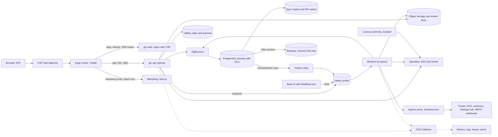
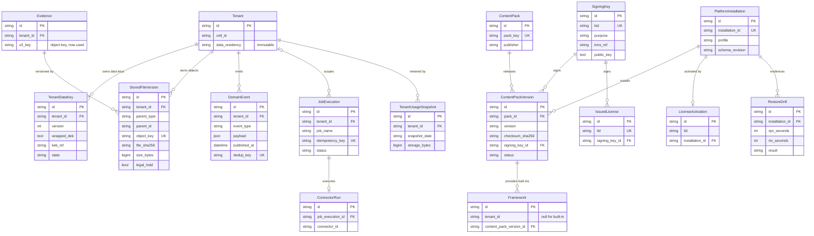
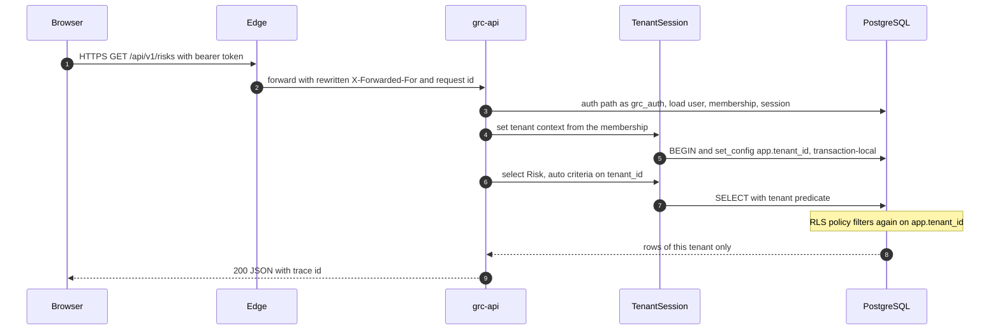
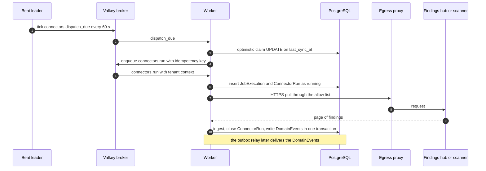
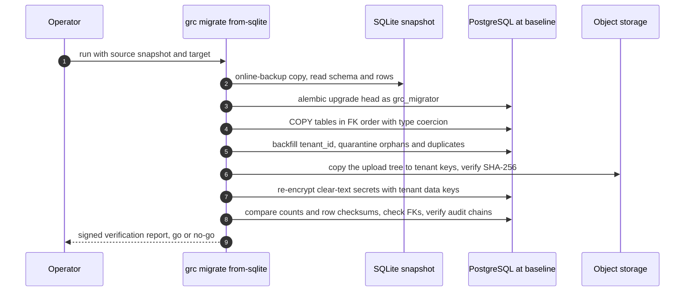
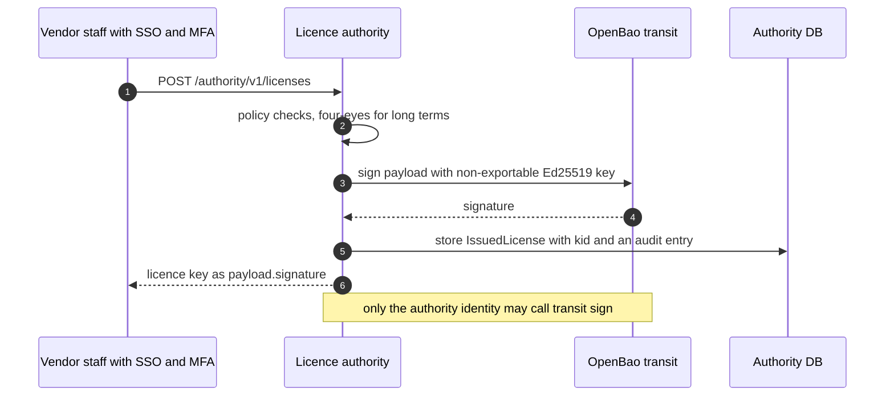

# NG-GRC block design: Platform foundations, deployment and operations

**Scope.** This block is the P0 re-foundation that every other block depends on. It also enables three requirements: R4 (strict separation), R5 (protected packaging and commercial freedom) and R8 (an enterprise base).

**Evidence.** The phase-1 reports, `w4/asis-platform.md`, and the code at commit `98020b3`, re-checked read-only on 2026-10-16.

**Licences.** Every new third-party component lists its licence. **Flag** marks components that are copyleft, source-available, or whose distribution has changed.

---

## 1. Current state in one page

| Area | Today (evidence) | Gap |
|---|---|---|
| Topology | PM2 runs on one host. `gateway.js` (port 4000) serves `frontend/dist`, proxies `/api` to uvicorn (2 workers) and sends everything else to Next.js on port 3000. TLS terminates on an external LB (`gateway.js:149-204`). | No HA, no WebSocket upgrade, no body limit, no CSP. The gateway appends to a client-supplied `X-Forwarded-For` (`gateway.js:91-96`). |
| Data | One SQLite file (WAL, FKs off) holds 113 tables for 11 tenants. Every worker runs `create_all()` (`main.py:50-53`). Alembic has no revisions. Schema changes come from 40 SQLite-only ALTER scripts run by 3 orchestrators. The release seed is 60 tables and 141 columns behind the models. | No PITR, no replicas, no schema version. PostgreSQL boots with zero frameworks, and Oracle DDL fails. |
| Isolation | Each query adds a `tenant_id` predicate (`dependencies/auth.py:202-215`). 25 child tables are scoped only through their parent. RLS is a docstring claim (`models/tenant.py:3`). | No global filter, no RLS, no isolation tests. |
| Background | Every web worker runs 12 asyncio loops (`main.py:74-98`), guarded by DB claims or `/tmp` lock files. Celery has 3 empty task modules and no worker in SaaS, so 8 `.delay()` calls are dropped. Tasks call `asyncio.run` with module-level engines (`workers/tasks/reports.py`). | No worker tier and no job visibility. The locks are local to each host. |
| Shared state | Without Redis, `shared_state.py` falls back to process memory. WebSocket and SSE channels and the AI quota live in each process (`support.py:25-95`). SaaS has no Redis. | Workers disagree on state, so the app cannot scale out. |
| Files | Uploads go to local disk (29 `UPLOADS_DIR` references in 13 files). Each has a SHA-256 and a `StoredFileVersion` ledger entry. The `s3_key` columns are unused. Uploads are buffered in memory. | No object storage, streaming or quotas. |
| Secrets | `secret_box` (AES-GCM, key derived from `SECRET_KEY`) protects only 2 values. TOTP seeds, LDAP and webhook secrets, and scanner keys are stored in clear. The licence-signing key sits in the SaaS env file (`admin.py:888-912`). `backend/env` is tracked in git. | No KMS, no envelope encryption, no key rotation. |
| Observability | No logging configuration. SQL echo is tied to `DEBUG` (`database.py:30`). No metrics or traces. The static `/health` endpoint is routed to the SPA. | Failures are invisible. |
| Backup/DR | `backup_db.py` covers the DB only and is never scheduled. There is no PITR. The SLA promises RPO ≤ 1 h. | The SLA is at risk. |
| CI | `ci.yml` cannot pass: it has no tests, no ESLint config and a broken Docker context. The 20 self-test scripts run by hand. | No quality gates, no SBOM. |
| Packaging | Four delivery channels: PM2, a PyArmor Docker image, a Nuitka OVA/ISO and dev composes. `requirements.txt` lacks `cryptography`. The OVA migration gate fails. The Docker image runs no migrations. The ISO ships source. | Only the PM2 channel works. |
| Config and edge | `ENVIRONMENT` defaults to `development` (`config.py:24`). About 30 kill switches can be set only through the environment. IP-keyed rate limits may share one global bucket behind the gateway (team note at `public_contact.py:45-60`; whether they do depends on the load balancer). The logged login IP is the first `X-Forwarded-For` entry (`auth.py:101-106`). Any tenant admin can reach `/system/database` and licence activation. | Defaults fail open. |

**Worth keeping:**
- the DB claim patterns (`report_scheduler.py:371-381`, `vuln_scanner_scheduler.py:134-145`);
- the backend-stable audit-chain hash (`activity_chain.py:33-63`);
- the file-integrity ledger;
- the connector runtime with its SSRF guard;
- Ed25519 licensing;
- the appliance hardening;
- the safety assertions in `make_client_seed_db.py`.

**Disputed:** whether production runs in production mode. CLAUDE.md and `TODO-KNOWN-ISSUES.md:930-962` disagree. The design fails safe either way.

---

## 2. Target design

### 2.1 Principles
- **One image set** serves every delivery channel.
- **Stateless API.** All background work runs in workers.
- **PostgreSQL only**, with tenant isolation enforced in both the app and the database.
- **Fail-safe defaults.** Production settings are the default, and unsafe configurations are refused.
- **In-Kingdom by default.** KSA cells keep data, backups, telemetry, AI and keys in the Kingdom.
- **Permissive licences only.** Copyleft or source-available tools run only as unmodified internal services.

### 2.2 Components

| Component | Type (licence) | Responsibility | Extends / new |
|---|---|---|---|
| Edge | Traefik v3 (MIT) | TLS, routing table, WebSocket and SSE, body limits, headers, client IP | Replaces `gateway.js` |
| `grc-web` | nginx-unprivileged (BSD-2-Clause) | SPA with CSP, HSTS, `noindex`, runtime `config.json` | Extends `Dockerfile.frontend.onprem` |
| `grc-api` | FastAPI/uvicorn | REST, SSE and WebSocket; no loops | Refactors `main.py` |
| Tenant context | `core/tenancy.py` | Transaction-local `app.tenant_id`, ORM auto-filter, flush guard | New; hooks `get_tenant_id` |
| Migrations | Alembic (MIT), `grc migrate`, pre-upgrade Job | Baseline, RLS, expand/contract, drift check | Extends `backend/alembic/` |
| Legacy importer | `grc migrate from-sqlite` | Verified SQLite → PostgreSQL migration | New; reuses `make_client_seed_db.py` and `file_integrity` |
| Content packs | Library, CLI and API | Install and export signed ContentPacks | Generalises `frameworks/loader.py` |
| Workers | Celery 5 (BSD-3-Clause) | Queues `default`, `connectors`, `reports`, `ai`, `notify`, `events`, `catalog`, `maintenance`; tenant context; idempotency; retries | Extends `workers/celery_app.py` |
| Scheduler | Beat + RedBeat (Apache-2.0) ×2 | Leader elected via a Valkey lock; emits ticks | New |
| Outbox relay | Celery + `LISTEN/NOTIFY` | Publishes DomainEvent (B5) rows with `SKIP LOCKED` | New |
| Shared state | Valkey 8 (BSD-3-Clause) | Broker, revocation, limits, locks, pub/sub, tickets, AI quota | Extends `shared_state.py`, `rate_limit.py` |
| Storage | `core/storage.py` (fs or S3 via aiobotocore, Apache-2.0) | Streaming I/O with SHA-256, tenant keys, legal hold | Extends `file_integrity.py`, `stored_file_version.py` |
| Keys | `core/kms.py` (hvac, Apache-2.0) + OpenBao (MPL-2.0) | KeyProvider, envelope encryption v2, Signer, PKI | Extends `secret_box.py`, `licensing.py` |
| Licence authority | Same image, isolated deployment | Mint, revoke, activate and verify licences via transit | Moves `admin.py:888-1001`, `license_server.py` |
| Telemetry | structlog, OpenTelemetry, prometheus-client (MIT/Apache-2.0); Collector, VictoriaMetrics, VictoriaLogs, Jaeger, Perses (Apache-2.0); GlitchTip (MIT) | Logs, traces, metrics, probes, JobExecution; in-region stack | New `core/observability.py`; reworks `system.py` |
| Backups | CloudNativePG (Apache-2.0) or managed PITR; pgBackRest (MIT); restic (BSD-2-Clause) | WAL archiving, backups, restore drills | Replaces `backup_db.py` |
| Egress proxy | Smokescreen (MIT) | Allow-listed outbound traffic | New |
| Delivery | Dockerfile, Helm, compose; Packer (BUSL-1.1, build only, **flag**); GitHub Actions, Harbor, Argo CD (Apache-2.0) | One signed image set; CI/CD | Replaces 4 Dockerfiles, PM2 files, `ci.yml` |

### 2.3 Component and flow view

### 2.4 Database

**Engine.**
- PostgreSQL 16 is the minimum. CI also tests the newest GA major.
- UTF-8 encoding with ICU collations, so Arabic sorts correctly.
- Extensions: `pg_trgm` and `pg_stat_statements` (PostgreSQL License).
- Oracle and SQL Server are dropped (ADR-P01).

**Roles.**

| Role | Used by | Privileges |
|---|---|---|
| `grc_migrator` | Migration Job and importer | DDL, `BYPASSRLS` |
| `grc_app` | API and tenant tasks | Subject to forced RLS |
| `grc_auth` | Login path | Identity tables only |
| `grc_platform` | Catalogue jobs | Global tables, through per-role policies |
| `grc_readonly` | Reporting replica | Subject to RLS |
| `grc_owner` | — | Owns the objects; unused at runtime |

**RLS.** Every table gets a class, and CI fails if one is unclassified.

| Class | Tables | Rule |
|---|---|---|
| Tenant | The 64 tables with a `tenant_id`, plus the 25 child tables that get one by backfill | Own tenant only |
| Shared catalogue | The 10 tables with a nullable `tenant_id`, and their children | Read built-in or own rows; write own rows |
| Global | 8 catalogues | No RLS; only `grc_platform` writes |
| Identity | Users, sessions, MFA, Membership | Reached via `grc_auth`, because login happens before a tenant is known |

The policy is `USING (tenant_id = current_setting('app.tenant_id', true))`; when no tenant is set, the query returns nothing.

Four places set the tenant:
- `get_tenant_id`, on the open transaction;
- an `after_begin` hook, which re-applies it to later transactions;
- task wrappers;
- the activity middleware.

The setting is transaction-local, so PgBouncer (ISC) can run in transaction pooling mode.

**App layer.**
- A `TenantScoped` mixin adds `with_loader_criteria` through `do_orm_execute`.
- `before_flush` rejects writes to another tenant's rows.
- New code goes through `app/repositories/`.

**Portability fixes before the baseline.**
- `dashboard.py:220`: replace `func.strftime` with Python bucketing, the pattern already used at `governance.py:1050`.
- Replace the 5 LIKE-on-JSON lookups with link tables (data-model block) or JSONB containment.
- Set `native_enum=False` on the 35 `SAEnum` columns.
- Store JSON as JSONB through a variant type.
- Make every timestamp timezone-aware UTC.
- Declare the index `ix_scenario_tenant_ref` in the model.
- Remove `create_all` and the SQLite pragmas from the runtime.
- Give each Celery worker process one persistent event loop. The current pattern of `asyncio.run` with a module-level engine breaks asyncpg pools.

**Alembic.**
- `0001_baseline` is autogenerated, then reviewed.
- `0002_rls` is generated from the classification registry.
- CI runs `upgrade head`, `alembic check` and a round trip.
- Migrations run as a Job or via `grc migrate up`, never at app boot. Readiness fails while the schema lags.
- Every release must run on schema N and N-1 (expand/contract).

**ContentPacks.**
- **Format.** A pack is a signed archive containing:
  - `manifest.json`: key, semver, minimum platform version, languages, terms and a per-file SHA-256;
  - JSON Lines data;
  - a detached Ed25519 signature.
- **Install.** An idempotent upsert keyed on stable UUIDs, recorded in ContentPackVersion. It never touches tenant clones.
- **First pack.** `legacy-builtin` is exported read-only from production and keeps the built-in UUIDs, so tenant references stay valid.
- **KSA packs** come from the content block.
- **The seed DB** is retired and kept as a test fixture.

**Growth (P2/P3).** pg_partman (PostgreSQL License) will manage monthly partitions for the high-volume tables: findings, activity logs, events, jobs and connector runs.

### 2.5 Runtime

**API.**
- One uvicorn process per pod, scaled by an HPA. Compose and OVA use 2–4 workers instead.
- Start uvicorn with `--proxy-headers` and `--forwarded-allow-ips=<edge CIDR>`.
- Startup only starts telemetry and checks the schema revision.
- AI `BackgroundTasks` (`compliance.py:2475,2894`) move to the `ai` queue, with heartbeats so stuck runs are recovered.

**Edge.**
- Traefik is the edge in every channel.
- `gateway.js` rules become Traefik routers or `grc-web` rules: marketing roots, SEO files, the `/_next/image` refusal, SPA deep links, and `noindex` everywhere except `/docs`.
- WebSockets work natively, and SSE is not buffered. Body limits come from one settings map.
- One `client_ip()` helper replaces the ad-hoc lookups in `auth.py:101-106` and `activity_middleware.py:747`.
- On-prem installs get TLS by default instead of plain HTTP on port 80.

**From loops to tasks.**
- Beat emits ticks. Tick tasks fan out work, using the existing DB claims.
- The claims stay the correctness guarantee. The leader lock and the Valkey locks only remove duplicate effort.

| Loop today | Task and cadence | Queue | Guard |
|---|---|---|---|
| Threat feeds | `feeds.fetch` daily, then per-tenant `feeds.ingest` | catalog | Valkey lock replaces `flock`; UNIQUE key kept |
| Reports | `reports.dispatch_due` every 60 s | reports | `next_run_at` claim kept |
| NVD/CWE | `catalog.nvd_sync` every 6 h; CWE every 30 days | catalog | Valkey lock replaces `O_EXCL`; runs as `grc_platform` |
| Scanner connectors | `connectors.dispatch_due` every 60 s, then `connectors.run` | connectors | `last_sync_at` claim kept; ConnectorRun recorded |
| Audit recurrence, archiving | Hourly; every 5 minutes | default, maintenance | Claims kept |
| File retention | Hourly | maintenance | Claim kept; honours legal hold |
| Risk and trend snapshots | Hourly | maintenance | UNIQUE claims kept |
| Licence phone-home | Every 12 h | default | Idempotent; on-prem only |
| Notification sweep | Every 6 h, fanned out per tenant; e-mails sent as retried tasks | notify | Valkey lock; de-duplication kept |
| Translation | Every 60–300 s | ai | Valkey lock and a global AI semaphore |

**Other changes.**
- `.delay()` calls become DomainEvents written in the business transaction.
- Beat entries that point to empty modules are removed.
- Every run writes a JobExecution row.
- Runs that change tenant data also call `log_system_activity`.
- Per-tenant semaphores keep tenants from starving each other.

**Valkey.**
- SaaS runs two separate instances, both with AOF, `noeviction`, Sentinel and per-service ACLs:
  - `broker`, for Celery and RedBeat;
  - `state`, for revocation, limits, locks, tickets, pub/sub and the AI quota. Every key has a TTL.
- On-prem uses one instance.
- Valkey is mandatory in production:
  - readiness fails without it;
  - token refresh fails closed;
  - per-request checks fall back to DB session revocation.

**Realtime.**
- Chat and notifications fan out over Valkey channels.
- 30-second single-use tickets replace the `?token=` URLs (`Layout.tsx:269`, `SupportPage.tsx:198,465`, `SuperAdminPage.tsx:1871,2364`).

### 2.6 Object storage

**Backends.** `StorageBackend` has two implementations, `fs` and `s3`.

**Keys and names.**
- Keys follow `t/{tenant_id}/{entity_type}/{entity_id}/{file_version_id}`.
- File names, often in Arabic, stay in the DB, and downloads send them with RFC 6266 encoding.

**Uploads.**
- Uploads stream to storage while the SHA-256 is computed, and abort as soon as they exceed the cap.
- Large files use multipart sessions (P1).

**Ledger.**
- StoredFileVersion stays the ledger and gains backend, key, size, type and ETag fields.
- The existing `s3_key` columns hold the object key.

**Retention.**
- Versioning is on.
- Only the retention job deletes, and it honours `legal_hold`.
- Object Lock is used where the store supports it.

**Where each backend runs.**

| Deployment | Backend |
|---|---|
| SaaS | An in-Kingdom S3-compatible service, or SeaweedFS (Apache-2.0) |
| On-prem, single node | `fs` |
| On-prem, HA | The customer's S3, or SeaweedFS |

MinIO is supported only as a customer-provided endpoint (see C1).

**Quotas.** A nightly TenantUsageSnapshot feeds the per-tenant quotas.

### 2.7 Secrets and keys

**Key hierarchy.**
1. Root of trust: a CSP KMS or HSM; on-prem, Shamir custodians, a TPM or the customer's HSM.
2. OpenBao seal.
3. KEK, which is never exported.
4. One TenantDataKey (DEK) per tenant, stored wrapped by the KEK.
5. AES-256-GCM field ciphertext, with tenant, table, column and row ID as additional authenticated data.

**`secret_box` v2.**
- Writes `v2.{key_version}.{nonce}.{ct}` and still reads v1.
- A background job re-encrypts old values.
- Unwrapped DEKs are cached for at most 5 minutes.
- In P0 it re-encrypts:
  - TOTP seeds (`mfa_device.py:18`);
  - LDAP and webhook secrets;
  - scanner credentials (`scanner_connector.py:25-26`);
  - the bring-your-own AI key.
- Destroying a tenant's DEK crypto-shreds all of its secrets.

**Deployment secrets** never sit in production env files.
- Kubernetes: OpenBao, delivered through the External Secrets Operator (Apache-2.0).
- Compose and OVA: root-only files in `/run/secrets`, read through `secrets_dir`; optionally TPM-sealed with `systemd-creds`.
- `SECRET_KEY` is split into a JWT key and a secret-box key.

| Option | Licence | Verdict |
|---|---|---|
| OpenBao | MPL-2.0 | **Chosen**: Ed25519 transit with BYOK, PKI, KV; one tool everywhere |
| HashiCorp Vault ≥ 1.15 | BUSL-1.1 (**flag**) | Not bundled; customers can plug in their own |
| CSP KMS | Service terms | SaaS root of trust; Ed25519 support varies |
| PKCS#11 HSM | Vendor | P3 root of trust |

**Licence signing.**
- The current Ed25519 key is imported as a non-exportable transit key inside the isolated licence authority, and every plaintext copy is destroyed.
- The public key does not change. A `kid` field is added so the key can be rotated later.
- Only the authority may call `transit/sign`.
- Content packs, audit checkpoints and images each use their own key, registered in SigningKey.

### 2.8 Observability

**Logs.**
- structlog JSON with request, trace, tenant, user, route, status, duration and job fields.
- Secrets are redacted.
- SQL echo moves to a separate `DB_ECHO` setting, which production refuses.

**Traces.**
- OpenTelemetry covers FastAPI, SQLAlchemy, httpx, Celery and Valkey.
- Trace context passes through Celery headers and the DomainEvent `traceparent` field.
- 10 % of traces are sampled; error traces are always kept.

**Metrics**, on an internal port:
- RED metrics per route;
- queue depth and age;
- each job's last success;
- outbox lag and connector outcomes;
- AI usage per tenant;
- unchained audit entries and missing RLS contexts;
- backup age and replication lag;
- certificate and licence expiry.

**Probes.**
- `/livez`.
- `/readyz`, which checks the schema revision, Valkey, storage and the KMS.
- `/startupz`.
- `/api/health`, which the SPA probe uses. This fixes `client.ts:29-44` and `ServiceDownPage.tsx:22`.

**SaaS SLOs.**
- 99.9 % availability.
- p95 read latency under 500 ms.
- Every job succeeds within twice its interval.
- Outbox lag under 60 s.
- Backups less than 26 h old; the last drill less than 35 days ago.

**On-prem.**
- The same endpoints, plus OTLP and syslog export to the customer's SIEM.
- Grafana, Loki and Tempo are AGPL-3.0 (**flag**) and are never distributed.

### 2.9 Backup and DR

| | SaaS KSA cell | On-prem single node | On-prem Kubernetes |
|---|---|---|---|
| Database | CNPG sync replica, WAL archive (60 s) and daily base backups to a second in-Kingdom site, or managed PITR. barman-cloud is GPL-3.0 and runs as a separate process (**flag**; SaaS only) | pgBackRest WAL and daily backups to a volume, NAS or S3 | CNPG or the customer's tooling |
| Objects | Versioning and replication to the DR site | restic to the customer's target, verified against the SHA-256 ledger | Customer replication |
| Keys | Hourly encrypted OpenBao snapshots; custodians hold the recovery keys | Inside the encrypted backup set | Customer |
| RPO / RTO | Zone loss: ≈ 0 / ≤ 15 min. Site loss: ≤ 5 min / ≤ 4 h | ≤ 15 min / ≤ 4 h | Per customer |

Valkey holds no system-of-record data.

**Drills.**
- **Monthly (SaaS).** Restore into a scratch cluster and run `grc backup verify`, which checks the schema revision, row counts, and the audit chains and object hashes of sampled tenants. The result is recorded as a RestoreDrill with the measured RPO and RTO.
- **Quarterly (SaaS).** Fail over to the DR site.
- **On-prem.** Customers run `grc backup verify`.

Runbooks are in Arabic and English.

### 2.10 CI/CD

| Stage | Tools (licence) | Gate |
|---|---|---|
| Static checks | ruff, mypy, ESLint, gitleaks (MIT); `tsc --noEmit`; Trivy config, kubeconform (Apache-2.0) | No new findings |
| Backend | pytest (MIT); testcontainers (Apache-2.0) with PostgreSQL 16 and the newest major, Valkey and moto (Apache-2.0) | Self-tests ported to pytest; `alembic check`; full suite run as `grc_app` under forced RLS |
| Isolation | OpenAPI fuzzer: every route is called with tenant A's token against tenant B's IDs | Zero leaks; every table classified |
| Importer | The stale `grc_seed.db`, synthetic drifted databases and an anonymised snapshot | Green verification report |
| Frontend | vitest (MIT); Playwright (Apache-2.0) in `en` and `ar` with RTL checks; axe-core (MPL-2.0, dev only) | Smoke tests pass in both languages |
| Security | Bandit, pip-audit, OSV-Scanner (Apache-2.0); Semgrep CE (LGPL-2.1, CI only, **flag**); Trivy image scan | No critical or high finding without a waiver |
| SBOM and licences | cyclonedx-py, cyclonedx-npm, Syft (Apache-2.0); licence policy | AGPL, GPL, SSPL and BUSL dependencies denied at runtime |
| Release | cosign (Apache-2.0); Harbor in-region; Argo CD to staging, manual promotion; `acceptance.py` after each deploy; ZAP (Apache-2.0) from P1 | Signed images; smoke tests pass |

Production data never enters CI.

### 2.11 Packaging and code protection

**Images.**
- `grc-backend` serves every backend role: `api`, `worker`, `beat`, `migrate`, `cli` and `licence-authority`.
- `grc-web` serves the SPA, and `grc-collector` covers B9.
- Third-party images are pinned by digest. No Bitnami images or charts are used, because their free catalogue changed in 2025 (**flag**).

**Build.**
- A uv lock (Apache-2.0/MIT) with hashes, which also restores `cryptography`.
- Bundled Arabic fonts (Amiri and Noto, OFL-1.1) through a `PDF_FONT_DIR` setting, replacing `pdf_arabic.py:38-43`.
- tesseract `ara` (Apache-2.0) and poppler-utils (GPL-2.0+, separate process, source offer).
- Images run as non-root with a read-only filesystem.

**Protection.**
- Nuitka (Apache-2.0) compiles only the first-party code, an approach `25-protect-app.sh` already uses. LGPL libraries stay replaceable.
- CI fails if `app/*.py` sources ship.
- PyArmor and the ISO that ships source code are retired.
- Licence enforcement is built into every image, and SaaS cells hold a vendor-issued licence.
- Signatures are verified offline with cosign.

**Delivery formats.**
- **Helm `ng-grc`** with the profiles `saas`, `mssp` and `onprem-k8s`.
- **Compose** with the profiles `core`, `openbao`, `ai`, `collector` and `observability`.
- **OVA** built on Ubuntu 24.04 with Docker Engine (Apache-2.0) and the same compose stack, keeping the current hardening and console. `grc upgrade --bundle` backs up first and can roll back.

### 2.12 Configuration profiles

`DEPLOYMENT_PROFILE` is one of `saas`, `onprem` or `dev`. `ENVIRONMENT` now defaults to `production`.

| Setting | saas | onprem | dev |
|---|---|---|---|
| Docs, `DEBUG`, `DB_ECHO` | Refused | Off | Allowed |
| HSTS / CSP | On | On with TLS | Report-only |
| Valkey | Required | Required | Optional |
| Private targets | Denied (use the Site Collector) | Allowed | Allowed |
| Outbound feeds | Through the egress proxy | Off by default | Off |
| AI endpoint | In-region only; `-cloud` refused | Customer or bring-your-own | Any |
| Secrets | OpenBao | `/run/secrets` | `.env.local` |

Other configuration changes:
- The `os.getenv` flags move into Settings as `JOBS__{name}__ENABLED`.
- 16 dead settings are deleted.
- `grc doctor` extends `check_prod_readiness.py`.
- `/system/database*` moves to the appliance console.
- The self-test and licence activation become platform-admin only.

### 2.13 SaaS reference deployment and capacity

**Cells.**
- A cell is a complete stack in one KSA region.
- Each tenant is pinned to a cell through `cell_id` and an immutable `data_residency`.

**Cloud provider.**
- Cell 1 runs on a CST-licensed CSP that attests NCA CCC compliance at the classification its tenants require.
- Candidates include SCCC and STC, and the in-Kingdom regions of Google Cloud (Dammam) and Oracle Cloud (Jeddah/Riyadh).
- Managed Kubernetes, PostgreSQL, S3 and KMS are used where available. Otherwise RKE2 (Apache-2.0), CNPG, SeaweedFS and OpenBao run on VMs.

**Network.**
- Only the load balancer is public.
- NetworkPolicies deny by default.
- All egress goes through Smokescreen.
- Admins use an MFA bastion.
- The DR site is a second in-Kingdom site.

| Capacity (assumptions to confirm) | Launch (P0 exit) | Scale target (P3) |
|---|---|---|
| Tenants / users / concurrent | 200 / 5 k / 500 | 1,000 / 50 k / 5 k |
| API sustained / peak | 300 / 1 k rps | 1.5 k / 5 k rps |
| Assets / open finding occurrences | 1 M / 5 M | 10 M / 100 M |
| Connector runs per day / ingest burst | 10 k / 1 k findings/s | 200 k / 5 k findings/s |
| Objects / activity-log rows | 5 TB / 200 M | 100 TB / 2 B |
| Largest tenant | 100 k assets, 1 M occurrences | 200 k assets, 5 M occurrences |

**Launch sizing.**
- Edge and web: 2 replicas each.
- API: 3–6 pods.
- Workers by queue: 2–4 each.
- PostgreSQL: an 8 vCPU / 32 GB primary, a synchronous replica and a DR replica.
- Valkey and OpenBao: 3 nodes each.

Today's measurement of 934 rps on two workers (`TODO-KNOWN-ISSUES.md:291-304`) suggests three API pods are enough at launch. PostgreSQL is the scaling limit, which is why partitioning and read replicas follow in P2/P3. Maintenance windows fall on Friday or Saturday nights.

### 2.14 Data model changes

| Entity | Change | Key fields | Relations |
|---|---|---|---|
| Tenant | Changed | `cell_id`, immutable `data_residency` | Root of all tenant data |
| 25 child tables (`control_assessments`, `audit_findings`, `vendor_contracts` …) | Changed | Backfilled `tenant_id` with an FK and index; nullable for children of shared catalogues | RLS |
| StoredFileVersion | Changed | Adds `storage_backend`, `object_key` (UK), `size_bytes`, `content_type`, `etag`; adds an FK on `tenant_id` | Polymorphic parent |
| Evidence and 5 other file parents | Changed | `s3_key` holds the object key; `file_path` is kept for legacy rows | StoredFileVersion |
| TenantDataKey | New | `tenant_id`, `version`, `wrapped_dek`, `kek_ref`, `state` | Tenant |
| SigningKey | New | `kid` (UK), `purpose`, `algorithm`, `kms_ref`, `public_key` | ContentPackVersion, IssuedLicense |
| ContentPack / ContentPackVersion | New (shared with the content block) | `pack_key`, `version`, `manifest`, `checksum_sha256`, `signing_key_id`, `status` | Content rows via `content_pack_version_id` |
| PlatformInstallation | New | `installation_id`, `cell_id`, `profile`, `platform_version`, `schema_revision` | LicenseActivation, RestoreDrill |
| DomainEvent | New (B5; this block owns the table and relay) | `tenant_id`, `event_type`, aggregate, `payload`, `published_at`, `dedup_key` (UK), `traceparent` | Consumers |
| JobExecution | New | `job_name`, nullable `tenant_id`, `idempotency_key` (UK), `status`, `attempt`, `error` | ConnectorRun (B9) |
| RestoreDrill, TenantUsageSnapshot | New | Measured RPO/RTO and result; daily usage per tenant | PlatformInstallation; Tenant |
| IssuedLicense | Changed | Adds `signing_key_id` | SigningKey |

### 2.15 Key flows

**Tenant-scoped request with double isolation**

**Scheduled connector run: beat tick, DB claim, outbox**

**Legacy SQLite to PostgreSQL migration**

**Licence minting through the isolated authority**

### 2.16 APIs

| Method | Path | Purpose |
|---|---|---|
| GET | `/livez`, `/readyz`, `/startupz`, `/metrics` (internal port) | Probes and metrics |
| GET | `/api/health` | Status for the LB and the SPA; `/health` stays as an alias for one release |
| POST | `/api/v1/realtime/tickets` | 30-second ticket for WebSocket and SSE |
| GET, WS | `/api/v1/realtime/stream?ticket=`; `/api/v1/support/tickets/{id}/chat/ws?ticket=` | Channels fanned out via Valkey |
| POST | `/api/v1/csp-reports` | CSP violation reports; rate-limited |
| GET | `/api/v1/files/{version_id}/content` | Authorised, integrity-checked download |
| POST | `/api/v1/files/upload-sessions` | Multipart uploads (P1) |
| GET | `/api/v1/platform/status`, `/api/v1/platform/jobs`; `/api/v1/jobs` | Platform view for the platform admin; tenant job view for the tenant admin |
| GET, POST | `/api/v1/platform/content-packs[/{key}/versions/{v}/install]` | List, upload and install packs |
| POST | `/api/v1/platform/keys/rotate` | Key rotation and re-wrapping (four-eyes) |
| POST | `/authority/v1/licenses`, `…/{lid}/revoke`, `/activations`, `/licenses/verify` | Licence authority; adds the missing online activation |
| Removed | `/api/v1/system/database*` | Replaced by `grc db configure` on the console |

**CLI:** `grc migrate`, `grc content`, `grc keys`, `grc backup`, `grc doctor`, `grc upgrade`, `grc support-bundle`.

### 2.17 UI changes
- **SPA:**
  - realtime tickets and the `/api/health` probe;
  - runtime `config.json`;
  - bilingual 503 and maintenance pages;
  - no inline scripts;
  - `/cheat` removed from production builds.
- **Super-admin:** a Platform tab for status, jobs, packs, keys, backups and the licence.
- **Tenant admin:** a Job runs view.
- **Appliance console:**
  - bundle upgrade;
  - backup and restore;
  - TLS certificate upload;
  - key-provider setup;
  - an Arabic menu.

### 2.18 Security and tenant isolation
- **Database:**
  - TenantSession and RLS run on separate DB roles. A request without a tenant context sees no rows.
  - Identity tables are reachable only through `grc_auth`.
  - The fuzzer and the classification test run in CI.
- **Objects:**
  - Keys are prefixed by tenant, and only the app holds storage credentials.
  - Presigned URLs live at most 60 s and are issued only after authorisation.
  - Offboarding deletes the tenant's prefix and destroys its DEK.
- **Tasks:**
  - Each task carries a validated `tenant_id`.
  - Platform tasks run as `grc_platform`.
- **Egress:**
  - In SaaS, private ranges are denied, replacing the permissive `*_ALLOW_PRIVATE_TARGETS` defaults.
  - Private targets are reached only through the Site Collector (B9).
- **Edge:**
  - TLS 1.2+ with HSTS.
  - CSP `default-src 'self'; object-src 'none'; frame-ancestors 'none'`, report-only for two weeks before enforcement.
  - Body limits, the real client IP, and redacted logs.
- **Supply chain:** pinned digests, signatures, SBOMs and licence gates.
- **Operator actions:** recorded in the platform tenant's hash chain.

### 2.19 Arabic and KSA
- **Residency:**
  - DB, objects, backups, telemetry, AI and keys stay in the Kingdom, including at the DR site.
  - No production data goes to SaaS tools hosted outside KSA.
- **Assurance:**
  - The CSP holds a CST licence and complies with NCA CCC.
  - SAMA-regulated tenants get an assurance pack: SBOMs, drill records, and a CCC self-assessment kept in NG-GRC itself.
- **Arabic data:**
  - Bundled Arabic fonts and ICU collation.
  - PostgreSQL's Arabic text search is still to be verified.
  - Object keys contain only IDs, and Arabic file names use RFC 6266 encoding.
- **Time:**
  - Stored in UTC, with tenants defaulting to `Asia/Riyadh`.
  - The Sunday–Thursday week shapes maintenance windows and SLA calendars.
- **Bilingual operations:** runbooks, the status page and the console are in Arabic and English.

### 2.20 SaaS versus on-prem

| Concern | SaaS / MSSP-hosted (Helm) | On-prem compose / OVA | On-prem Kubernetes |
|---|---|---|---|
| PostgreSQL / Valkey | HA / Sentinel | Single node | CNPG or the customer's own |
| Objects / keys | KSA S3 / OpenBao HA | `fs` / local KeyProvider or OpenBao | Customer S3 / customer OpenBao, Vault or HSM |
| Edge and TLS | Traefik with cert-manager (Apache-2.0) | Traefik, self-signed until the customer installs a certificate | Cluster gateway |
| Updates | GitOps, expand/contract | Signed offline bundle with rollback | `helm upgrade` |
| Telemetry / egress | In-region stack / egress proxy | `/metrics`, OTLP, syslog / feeds off | Customer's own |

---

## 3. Migration path from today's code

### 3.1 Files to extend, refactor or replace

| File or artefact | Action |
|---|---|
| `main.py`, `database.py`, `config.py` | Remove `create_all`, the loops and seeding. Add per-role engines, tenancy events, JSONB, profiles and `secrets_dir`. Fold the `os.getenv` flags into Settings. Default to production. |
| `db_config.py`, `database_config.py` | Replace with the console CLI, which also removes the import cycle. |
| `backend/alembic/` | Add the baseline and RLS revisions. |
| The 40 `migrate_*.py`, `_stb_migrate_common.py`, `deploy_elite_pack.py`, the `appliance_cli` migrate list | Retire. Keep them only as the importer's drift map. |
| `grc_seed.db`, `make_client_seed_db.py`, `frameworks/loader.py`, `seed_mandatory_docs.py` | Replace with the content pack service. Keep the seed as a test fixture. |
| `celery_app.py`, `workers/tasks/*`, the 12 `start_*` loops | Turn loop bodies into tasks. Replace lock files with Valkey locks. Keep the claims. |
| `shared_state.py`, `rate_limit.py`, `ai_quota.py`, `support.py` | Make Valkey mandatory. Set `request.state.user` so limits key on the user. Add pub/sub and tickets. |
| `file_integrity.py`, `stored_file_version.py`, `file_retention.py` and the 13 `UPLOADS_DIR` modules | Move to `StorageBackend`. |
| `secret_box.py`, `licensing.py`, `admin.py:888-1001`, `license_server.py` | Add envelope v2 and the Signer, and move minting to the licence authority. |
| `security_middleware.py`, `auth.py:101-106`, `activity_middleware.py:747`, `system.py` | Profile-driven headers, one `client_ip()` helper, readiness checks. |
| `gateway.js`, PM2 files, `next.config.js` rewrites, `infrastructure/docker/*`, composes, `build_client_release.sh`, `build ova/`, `ci.yml` | Replace with Traefik, one Dockerfile, `deploy/compose`, `charts/ng-grc`, the release pipeline, and an OVA that runs compose. |
| `pdf_arabic.py`, `client.ts`, `Layout.tsx`, `SupportPage.tsx`, `SuperAdminPage.tsx`, `ServiceDownPage.tsx` | Font directory, health probe, tickets, runtime config. |
| `backend/env`, the tracked `.bak` | Delete and rotate now. Rewrite git history after cutover. |

### 3.2 Data migration

**SaaS cutover** (11 tenants, about 19 MB):
1. Take a read-only snapshot through the SQLite backup API and copy the uploads. CLAUDE.md forbids mutating the database in place.
2. Run two rehearsals in KSA staging.
3. Hold a weekend window, announced in Arabic and English, with the PM2 stack read-only.
4. Take the final snapshot, import it and verify.
5. Switch the load balancer to the new cell.
6. Keep the PM2 host read-only for 14 days as the rollback, then archive it, encrypted, in KSA.

**Verification.** The cutover proceeds only if:
- row counts match per table and per tenant, and every quarantined row is listed;
- checksums of unchanged columns match;
- there are no foreign-key violations;
- every audit chain verifies to the same head hash (`_canonical_ts` already normalises timestamps, and naive values are treated as UTC);
- every file matches its SHA-256;
- `acceptance.py` passes.

**Transformations.**
- **Tenant IDs:** backfill `tenant_id` on child tables.
- **Types:** convert enums, JSONB, UTC timestamps and booleans.
- **Orphans and duplicates:** moved to `_migration_quarantine`.
- **Secrets:** clear-text and v1 secrets are re-encrypted as v2. This needs the old `SECRET_KEY`.
- **Files:** paths become object keys, and unreferenced files are quarantined, never deleted.
- **Frameworks:** built-in rows come from `legacy-builtin` with their UUIDs unchanged; tenant clones migrate as data.

**On-prem SQLite installs.** The upgrade bundle runs the same importer (`grc upgrade --from-legacy`) and keeps the old volume as the rollback.

### 3.3 Backward compatibility
- `/api/v1` paths do not change.
- `/health` and `?token=` keep working for one release, with deprecation headers.
- v1 secrets remain readable.
- The licence public key does not change.
- Old variable names still work, with a warning.

---

## 4. Phasing

### 4.1 P0 deliverables

| # | P0 deliverable | Effort | Depends on |
|---|---|---|---|
| 1 | Repository hygiene, key rotation, gitleaks | S | — |
| 2 | uv lock, `cryptography`, ESLint config, `tsc` in the build | S | — |
| 3 | CI v1: PostgreSQL tests, SBOM, Trivy, licence policy, signing | M | 2 |
| 4 | Configuration profiles; global endpoints removed from tenant roles | M | — |
| 5 | Observability foundation and JobExecution | M | 4 |
| 6 | PostgreSQL portability, Alembic baseline, `grc migrate` | M | 3 |
| 7 | Child `tenant_id`, TenantSession, RLS, isolation fuzzer | L | 6; tenancy block (identity, Membership) |
| 8 | ContentPack mechanism and `legacy-builtin` | M | 6; content block (pack schema) |
| 9 | Worker tier, RedBeat, the 12 loops, `.delay()`, AI jobs, outbox relay | L | 6; integration block (DomainEvent) |
| 10 | Valkey made mandatory: revocation, limits, realtime | M | 4 |
| 11 | Storage abstraction and streaming uploads | M | 6 |
| 12 | OpenBao, envelope v2, re-encryption, key split | L | 6; identity and connector blocks |
| 13 | Licence authority and key import | M | 12; commercial block (licence payload) |
| 14 | Traefik edge, `grc-web` with CSP, proxy headers | M | 10 |
| 15 | Nuitka image set, Helm, compose, bundle, OVA | L | 3, 14 |
| 16 | PITR, pgBackRest, replication, drills, runbooks | M | 15 |
| 17 | SQLite importer with two rehearsals | L | 7, 8, 11, 12 |
| 18 | KSA cell, cutover of 11 tenants, first DR drill | L | 15–17; CSP procurement |

**Effort and staffing.**
- About 90 person-weeks, or about 110 with contingency.
- 18–20 weeks with 4 platform engineers, one SRE and one test engineer.
- Critical path: 2 → 3 → 6 → (7, 9, 11, 12) → 17 → 18.

### 4.2 Gates and parallel work

| Gate | Week | Exit criteria |
|---|---|---|
| G1 | 3 | CI green on PostgreSQL; profiles; logging |
| G2 | 7 | Alembic baseline; Celery bridge validated; storage and key interfaces merged |
| G3 | 12 | RLS enforced in staging; loops out of the web tier; first rehearsal passed |
| G4 | 16–18 | KSA cell live; cutover done; DR drill passed |
| G5 | 20 | Compose, Helm and OVA built from the same images |

**Parallel with P1.**
- From week 0: KSA content authoring (data only), CSV/XLSX import design, Arabic UI fixes, and identity work (OIDC/SAML, ApiClient).
- From G1: new frontend code follows the CSP rules.
- From G2, new work must use the new mechanisms:
  - columns only through Alembic;
  - background work only as tasks;
  - data access only through repositories;
  - files only through `StorageBackend`.

### 4.3 Platform items in later phases

| Phase | Items |
|---|---|
| P1 | Published OpenAPI and versioning policy (S); multipart uploads (S); ZAP (S); SIEM/syslog export (S, R8 block); CSP enforcement (S); tenant export and crypto-shred offboarding (M, tenancy block); quota enforcement (S, commercial block); status page (S) |
| P2 | OpenBao PKI for Site Collector mTLS (M, connector block); partitioning (M, CTEM block); KEDA (Apache-2.0) autoscaling (S); site-failover exercise (M); reporting replica (S) |
| P3 | Multi-cell federation and MSSP-hosted profile (L, tenancy block); custom domains with ACME (M, white-label block); HSM root of trust (M); per-tenant evidence encryption (M); agent update signing (S, agent block) |

---

## 5. Architecture decisions

**ADR-P01. PostgreSQL is the only system of record; Oracle and SQL Server are dropped.**
- *Context:* Oracle DDL fails on 42 of 84 tables, and PostgreSQL boots with no frameworks.
- *Options:* keep four dialects; PostgreSQL plus a SQLite runtime; PostgreSQL only.
- *Decision:* PostgreSQL only, with SQLite as an import format.
- *Rationale:* RLS, JSONB, transactional DDL, and one test matrix.
- *Consequences:* customers who mandate Oracle (as STB did) get PostgreSQL managed inside the appliance, plus a reporting export.

**ADR-P02. Re-baseline Alembic; migrations run as an explicit expand/contract step.**
- *Context:* 40 manual scripts, drift in both directions, no version table.
- *Options:* keep the scripts; adopt another tool; Alembic.
- *Decision:* Alembic. It is already a dependency, and its output can be verified.
- *Consequences:* CI blocks drift between models and migrations.

**ADR-P03. Double isolation: TenantSession plus RLS on a transaction-local setting with dedicated roles.**
- *Options:* application filter only; schema per tenant; RLS only; both.
- *Decision:* both.
- *Rationale:* schema-per-tenant multiplies migrations by up to 1,000, and RLS alone gives poor error messages.
- *Consequences:* a backfill on 25 tables, and a separate role for identity tables.

**ADR-P04. Signed ContentPacks replace the seed database.**
- *Options:* seed dumps; SQL scripts; signed packs.
- *Decision:* signed packs.
- *Rationale:* engine-neutral, updatable offline, verifiable provenance, and stable UUIDs.

**ADR-P05. Celery on Valkey with a RedBeat-elected beat; DB claims remain the correctness guarantee.**
- *Options:* Celery; Procrastinate (MIT, asyncio queue on PostgreSQL); arq.
- *Decision:* Celery with a per-process event loop. It is already a dependency and well known.
- *Consequences:* the async bridge must pass a week-2 spike (see C4).

**ADR-P06. Traefik and the nginx-based `grc-web` replace `gateway.js`.**
- *Options:* fix `gateway.js`; nginx; Envoy Gateway; Traefik.
- *Decision:* Traefik.
- *Rationale:* WebSockets, ACME for custom domains, and one configuration model for Kubernetes and compose, under the MIT licence.

**ADR-P07. Pluggable storage (`fs` or S3-compatible); MinIO is not bundled.** See C1.

**ADR-P08. OpenBao, envelope encryption v2 and an isolated licence authority.**
- *Options:* Vault (BUSL); a CSP KMS only; OpenBao.
- *Decision:* OpenBao.
- *Rationale:* permissive licence, one tool in every channel, and Ed25519 transit with BYOK.

**ADR-P09. structlog, OpenTelemetry and Prometheus, with permissive backends.** AGPL tools are kept internal and never shipped.

**ADR-P10. One Nuitka-compiled, licence-enforced image set everywhere; the OVA runs compose.**
- *Rationale:* SaaS runs exactly what customers receive, and the PyArmor cost goes away.
- *Consequences:* a smoke test of the compiled build becomes a CI gate.

**ADR-P11. Cell-based KSA SaaS on a CST-licensed CSP, with PITR and an in-Kingdom DR site.**
- *Rationale:* residency is guaranteed per deployment rather than per row.

**ADR-P12. Fail-safe configuration profiles.**
- *Context:* `development` was the default, and kill switches bypassed the settings files.
- *Decision:* `production` by default, profiles, and validation at start-up.

---

## 6. Risks and open questions

| Risk | Mitigation |
|---|---|
| RLS breaks hidden paths (middleware sessions, background writers) | Run the full suite under forced RLS, track a metric for missing tenant context, and enforce in staging first, one table group at a time |
| SQLite data faults (orphans left while FKs were off, duplicates) | Quarantine them with a report; two rehearsals |
| The Celery async bridge is unstable with asyncpg | Week-2 spike; Procrastinate as the fallback at G2 |
| Cutover of a live system that runs from a git working copy | Change freeze, rehearsals, a read-only rollback host |
| The licence key leaks before it moves | Isolate it in week 1. Import it rather than regenerate it, so existing installs keep verifying |
| The CSP lacks managed services | Run CNPG, SeaweedFS and OpenBao on VMs |
| P0 (about 110 person-weeks) competes with P1 | Gates G1–G5; P1 adopts the new conventions from G2 |
| Nuitka build fragility (the earlier `jose` failure) | Compile only first-party code; smoke-test in CI |
| Personal data leaks into telemetry | Redaction, an in-region stack, synthetic data in CI |

**Open questions**
1. What runs in production today (PM2 processes, `ENVIRONMENT`, Redis), and where is the host located?
2. Which on-prem installations exist, and on which releases?
3. Which CSP and data classification apply, and does our SaaS itself need CST registration?
4. Can the committee confirm the capacity figures, 99.9 % availability and the RPO/RTO targets?
5. Does any contract still require Oracle or SQL Server?
6. Do the NCA cryptographic standards accept Ed25519, AES-GCM and HKDF? Must SaaS keys live in an HSM?
7. Does PDPL allow operations staff outside KSA to access production?
8. Should the repository move from a personal GitHub account to a company organisation, who owns the IP, and should CI runners sit in KSA?
9. Who approves rewriting the git history that contains client data?
10. What level of code protection do MSSP partners need?

---

## 7. Challenges to baseline

- **C1 (B6, MinIO on-prem).**
  - *Issue.* The MinIO community server is AGPL-3.0. In 2025 the vendor removed the community admin console and stopped publishing community binaries and images (to verify). Bundling it would put AGPL code with an uncertain supply into every artefact.
  - *Proposal.* Use `fs` on single nodes, and the customer's own S3 or SeaweedFS (Apache-2.0) for HA. MinIO stays supported only as a customer-provided endpoint.
- **C2 (B3, SQLite for demo and dev).**
  - *Issue.* RLS and JSONB cannot be tested on SQLite, and keeping a second dialect brings back the drift.
  - *Proposal.* Drop the SQLite runtime. Dev and demo run on PostgreSQL through compose (`setup.ps1` installs it), and SQLite remains only an import format.
- **C3 (B7, signing keys only in a KMS or HSM).**
  - *Issue.* Single-node on-prem sites often have neither.
  - *Proposal.* Accept a local or TPM-sealed key for per-install keys (for example audit checkpoints), at a documented and lower assurance level. Vendor keys always stay in OpenBao or an HSM.
- **C4 (B4, Celery; conditional).**
  - *Issue.* Celery is synchronous, the codebase uses asyncio, and today's bridge between them is wrong for asyncpg.
  - *Proposal.* Keep Celery with a per-process event loop. If the spike fails at G2, switch to Procrastinate (MIT; asyncio and transactional enqueue on PostgreSQL) and keep Valkey for state only.
- **C5 (B3 with B8, RLS on identity tables).**
  - *Issue.* Once users become global through Membership, a tenant setting cannot protect the identity tables.
  - *Proposal.* Protect them with the `grc_auth` role plus application checks. This needs agreement with the tenancy block.
