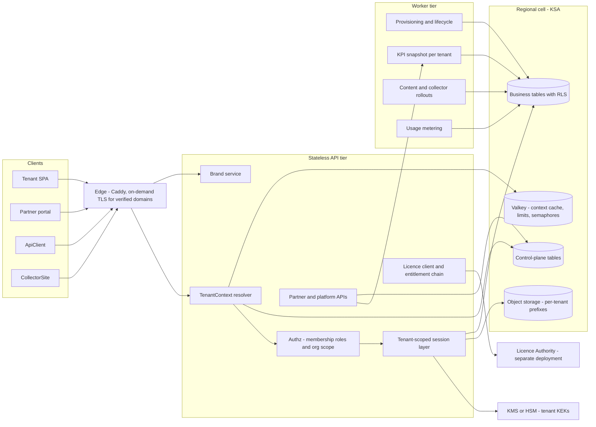
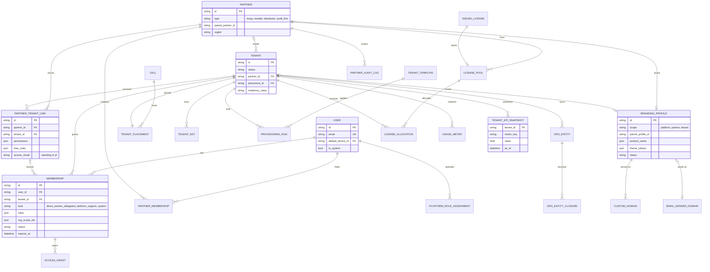
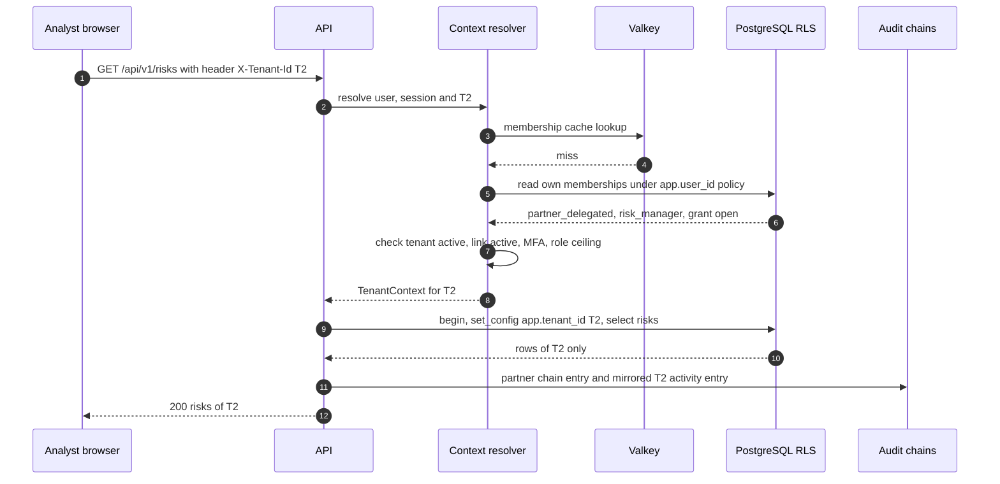
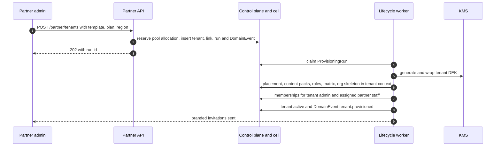
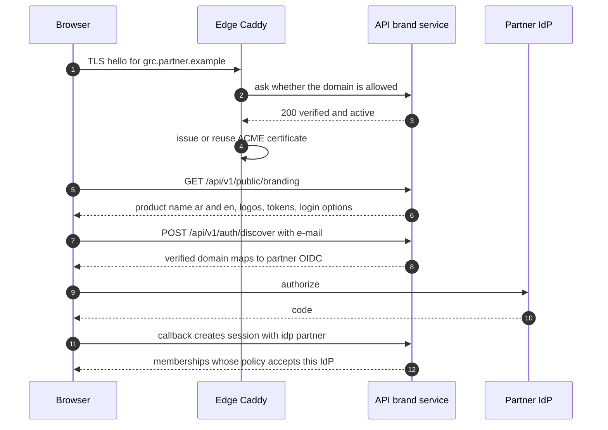
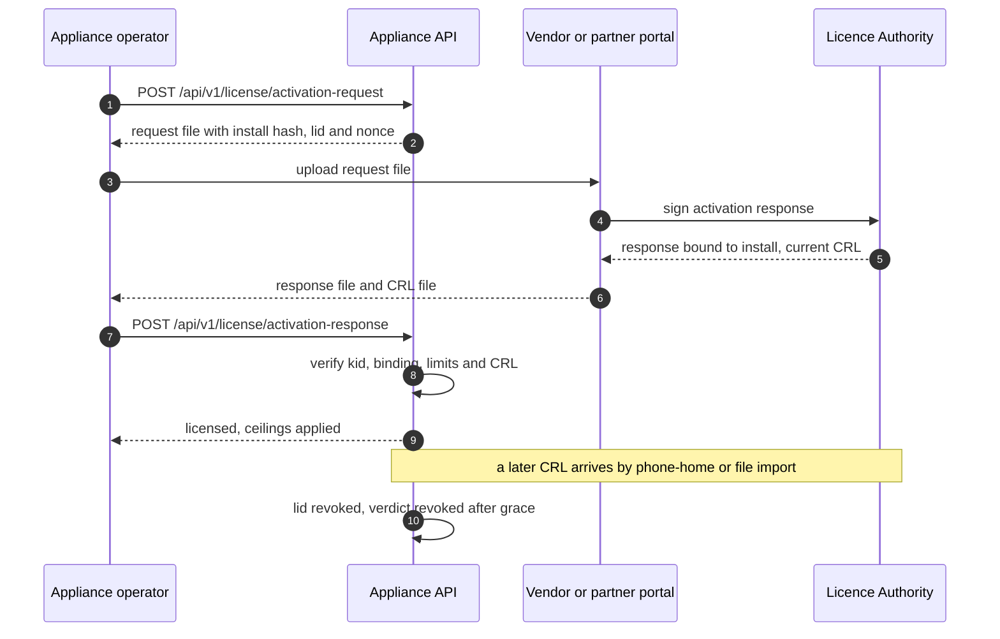

# NG-GRC block design: Multi-entity, MSSP and white-label (R4, R5)

**Scope:** tenancy, the partner layer, isolation, entity scoping, runtime white-label, commercial licensing, dependency policy and resale models.

**Requirements:**
- R4: many clients, strict separation.
- R5: rebrand, keep our code, resell as SaaS or through MSSPs.

**Baseline and repo:** baseline B1–B14. GRCEye `main` @ 98020b3, read-only. All paths are repo-relative.

---

## 1. Current state in one page

GRCEye is a working multi-tenant SaaS on one shared schema, but separation is enforced only in application code. There is no partner tier, no runtime branding, and the licensing pipeline is incomplete.

Judge ratings:
- **R4: partial.**
- **R5: strong** on the deck's licence-only bar; partial if runtime white-label is required.

| Area | Exists | Evidence | Gap |
|---|---|---|---|
| Tenant resolution | `get_tenant_id` from the DB user row (477 of 582 routes) | `dependencies/auth.py:202-215` | One tenant per user. About 70 direct `user.tenant_id` reads in 14 files (e.g. `features.py:53,68`, `authz.py:35-60`) |
| Isolation | Per-query predicates; children scoped through their parent | `core/database.py:67-91` | No ORM filter, no RLS (`tenant.py:3` only claims it), no tests. 3 framework leaks: `auth.py:622-649`, `audits.py:471-488,578-583`, `workers/tasks/notifications.py:418-492` |
| Identity | `users.tenant_id` NOT NULL; unique e-mail | `models/user.py:51-54`; `sso.py:228-240` | One account per client for every auditor or analyst |
| Roles | Effective roles (groups, custom, delegations); admin auto-pass | `services/authz.py:15-70`; `dependencies/auth.py:113-136` | Auto-pass is per user, not per tenant |
| Inside a tenant | OrgEntity/BusinessProcess FKs; owner write perimeter | `models/org_unit.py:21-61`; `services/perimeter.py` | No user-to-entity binding. Reads tenant-wide. Risk scope fields not returned (`risks.py:209-231`) |
| Operator console | Users, packs, subscriptions, licences | `admin.py:140-1001` | No tenant create/suspend/offboard. `is_active` unenforced |
| Global functions | DB config, licence, self-test, CVE sync, ATT&CK import, all callable by tenant roles | `database_config.py:34,116-160`; `license.py:146-229`; `system.py:48-52`; `cve.py:278-297`; `threats.py:811` | Tenants change platform state. The DB test reuses the stored password against any host |
| Keys | `secret_box` (AES-GCM from SECRET_KEY) | `core/secret_box.py:35-87` | One deployment key. TOTP, LDAP, webhook and scanner secrets in plaintext |
| Branding | `logo_url`, `settings.branding`, `white_label` stored | `tenant.py:16`; `tenants.py:14-17`; `subscription.py:83,97,111` | Unused. Brand hard-coded: 321 frontend + 82 backend strings, PDF (`report_generator.py:61-73,190`), e-mail (`base.html:49,64`), TOTP (`mfa.py:27`), palette (`tailwind.config.js:14-37`). Gateway drops `Host` (`gateway.js:88-96`) |
| Licensing | Ed25519 issuance, offline activation, middleware | `licensing.py:64-109`; `admin.py:888-1001` | Revocation ignored (`license_middleware.py:109-114`). No `/licenses/activate`. Plan-only payload. One global row (`license.py:213-214`). Signing key on the SaaS host |
| Supply chain | No linked copyleft; LGPL ldap3/bidi; MPL certifi | platform-ops §10 | No SBOM, no notices, no gate. Intuitem YAMLs in images. No LICENSE |

**Missing:**
- **Partner layer:** a partner tier, memberships, tenant switching and MSSP portfolio views.
- **Isolation and operations:** a database isolation layer; per-tenant keys, quotas and fairness; a tenant lifecycle; entity-based access.
- **Branding:** runtime branding and custom domains.
- **Licensing and supply chain:** licence limits, pools, revocation, offline activation, and an SBOM gate.

---

## 2. Target design

### 2.1 Principles

1. **The tenant is the hard boundary.** The ORM layer and PostgreSQL RLS both enforce it, and both fail closed. An OrgEntity is a soft boundary, enforced in the application only.
2. **One global identity, many memberships.** Authorisation always uses the membership in the tenant being acted on, never JWT claims.
3. **Partners read consented KPI snapshots, never raw data across tenants.** Drill-down is an audited context switch.
4. **Each cross-tenant action is recorded twice:** in the partner's chain and in the client's chain.
5. **The brand is data,** resolved first by host, then by context.
6. **One entitlement chain,** enforced server-side: plan → partner ceiling → tenant override → licence ceiling.

### 2.2 Components

| Component | Type | Responsibility | Extends / new |
|---|---|---|---|
| TenantContext resolver | Dependency + contextvar | Principal + `X-Tenant-Id` → `{tenant, membership, roles, org_scope, partner, placement}`. Checks status, link, JIT window and IdP/MFA policy | Extends `dependencies/auth.py` (`get_tenant_id` becomes a wrapper) and `services/authz.py` |
| Tenant-scoped session layer | SQLAlchemy events | Loader criteria; tenant stamping on flush; `set_config('app.tenant_id',…,true)` per transaction; engine chosen per placement | Extends `core/database.py`; new `core/tenancy.py` |
| RLS policy pack | Alembic revision | Policies, FORCE RLS; roles `grc_app`, `grc_catalogue`, `grc_migrator` | New |
| Isolation test suite | pytest crawler | Two tenants + one partner; canaries; foreign-id probes on every route; two-key mode | New `backend/tests/isolation/` |
| Membership & partner service | Service + API | Memberships, invitations, partner staff, PartnerTenantLink consent, JIT AccessGrants | New; reuses `access_governance` patterns |
| Platform console | API + SPA | Partners, tenant lifecycle, cells, support lockbox | Extends `admin.py`, `SuperAdminPage.tsx` |
| Partner (MSSP) console | API + SPA shell | Portfolio, provisioning, staff, rollouts, fleet, reports, audit, licence pool | New |
| Lifecycle workers | Celery | Provisioning, suspension, export, crypto-shred offboarding | New; replaces `scripts/cleanup_expired_test_tenants.py` |
| KPI snapshot job | Celery, per tenant | `TenantKpiSnapshot`, computed inside the tenant context | Reuses the `dashboard.py`/`dashboards.py` aggregations |
| Key service | Library + KMS adapter | Per-tenant DEKs under a KMS/HSM KEK; AAD-bound; file encryption | Extends `core/secret_box.py` |
| Quota & fairness | Valkey + Celery routing | Rate limits per tenant, user and ApiClient; task semaphores per tenant; quotas | Extends `shared_state.py`, `rate_limit.py`, `features.py` |
| Brand service | Backend module | BrandingProfile inheritance; BrandContext for e-mail, PDF, TOTP, AI persona, links | New `core/brand.py` |
| Edge | Reverse proxy | On-demand TLS for verified domains; forwards the original Host; CSP/HSTS | Replaces `gateway.js` (its routes are kept) with **Caddy (Apache-2.0)** |
| SPA brand runtime | React provider | CSS variables, favicon/title, i18n brand variables, tenant switcher | Extends `main.tsx`, `Layout.tsx`, `tailwind.config.js`, `i18n/index.ts`, `api/client.ts` |
| Licence Authority | Separate service | v2 licences, pools, allocations, signed CRL, activation | Extracts `licensing.py`, `admin.py:888-1001`, `license_server.py`; key in an HSM or **OpenBao Transit (MPL-2.0)** |
| Licence client + entitlement chain | Middleware + resolver | v2 verification, CRL, ceilings per deployment mode | Extends `license_middleware.py`, `license.py`, `subscription.py` |
| Usage metering | Daily job | `UsageMeter` per tenant; partner statements | New |
| Supply-chain gate | CI | CycloneDX SBOM, licence policy, notices, brand-string guard | New |

### 2.3 Tenancy, identity and context

**Hierarchy (B8):** Platform → Partner (MSSP, reseller, distributor or audit firm) → Tenant → OrgEntity → BusinessProcess → Asset.

**Principals:**
- **`User`:** a global identity. `users.tenant_id` becomes a nullable `default_tenant_id`.
- **`PlatformRoleAssignment`:** operator staff, with **no tenant data access** except through a tenant-approved `AccessGrant` (lockbox).
- **`PartnerMembership`:** partner staff roles.
- **`Membership`:** user × tenant, with roles and an org scope. Kinds: `direct`, `partner_delegated`, `platform_support`, `system`.
- **`ApiClient` (R8):** bound to a tenant, or to a partner whose link grants `api_access`.
- **`CollectorSite` (B9):** bound to one tenant by its mTLS certificate.

**Context resolution.** The tenant comes from `X-Tenant-Id`. If the header is absent, the user's default tenant is used; if there is none, the user's only membership.

Each request checks:
- the membership is active and has not expired;
- the tenant is active;
- the link and its role ceiling, for delegated memberships;
- the grant window, for JIT access;
- the auth policy (accepted IdPs, MFA). If it is not met, the response is 401 `step_up_required`.

The resolved context is cached in Valkey for 60 s and invalidated through pub/sub. Session revocation stays DB-backed.

Existing users each have one membership and send no header, so nothing changes for them.

**Authorisation.** `require_roles` evaluates `ctx.roles`, still computed by `get_effective_roles`. The `tenant_admin` auto-pass becomes a membership role. `super_admin` loses its auto-pass on tenant routes.

**IdPs (R8).** An IdP belongs to a tenant or to a partner, under two rules:
- It may provision users just in time only for domains its owner has verified (`VerifiedDomain`, checked by DNS TXT).
- A login through tenant A's IdP opens tenant B only if B's membership accepts that IdP.

Together these replace the refusal at `sso.py:228-240`, and no tenant's IdP can take over a global identity.

### 2.4 Data model changes

| Entity | Change | Key fields |
|---|---|---|
| Partner | new | type, parent_partner_id, region, legal names en/ar, cr_number, support_mode |
| PartnerMembership | new | user_id, partner_id, partner_roles, mfa_required, ip_allowlist |
| PartnerTenantLink | new | partner_id, tenant_id, permissions (delegated_admin, kpi_sharing, content_management, connector_management, reporting, api_access), max_roles, access_mode (standing, jit), consented_by/at, revoked_at |
| Membership | new | user_id, tenant_id, kind, roles, excluded_roles, custom_role_ids, org_scope_ids, include_descendants, status, expires_at, accepted_idp_ids, mfa_required; UQ(user_id, tenant_id) |
| AccessGrant / PlatformRoleAssignment | new | membership_id, window, reason, ticket_ref, approved_by / user_id, role, expires_at |
| User | changed | `tenant_id` → nullable `default_tenant_id`; `is_system`; role/roles kept as deprecated mirrors for one release |
| Tenant | changed | status (provisioning, active, suspended, offboarding, deleted), partner_id, placement_id, branding_profile_id, residency_class, regulated; `logo_url`, `settings.branding` and `domain` deprecated |
| OrgEntityClosure | new | ancestor_id, descendant_id, depth |
| Business tables | changed | `org_entity_id` added to RiskScenario, AppliedControl, Vulnerability/Finding, Incident, Vendor, ActionItem; `tenant_id` denormalised onto 25 child and 6 per-user tables (data-model §7.2) |
| Cell, TenantPlacement, TenantKey | new | region, kind, db_ref, bucket, kms_key_ref; key version, wrapped_dek, status |
| TenantTemplate, ProvisioningRun | new | plan, content-pack versions, role seeds, matrix, scales, org skeleton, connectors; run steps |
| BrandingProfile | new | scope, parent_profile_id, product_name {en, ar, fr}, logos, theme tokens, fonts, login, e-mail mode, PDF theme, show_powered_by, totp_issuer, ai_persona_name, status, version |
| CustomDomain, EmailSenderDomain, VerifiedDomain | new | name, owner, verification token, TLS or DKIM/SPF/DMARC status |
| IssuedLicense (changed); LicensePool, LicenseAllocation, RevocationList (new) | — | kid, deployment_mode, modules, limits, pool_id, install_binding; pool limits and consumption; CRL serial, revoked lids, signature |
| UsageMeter, TenantKpiSnapshot, PartnerAuditLog, ContentRollout | new | daily counts; metric/value/as_of; hash-chained partner actions; per-tenant rollout status |
| ActivityLog | changed | origins `partner` and `platform_support` |

### 2.5 Isolation architecture

**(a) Application layer.** A `TenantScoped` mixin in `core/tenancy.py` comes in two forms, `strict` and `shared_readable`; the latter covers built-in frameworks, threats, matrices, scales and feeds.
- A `do_orm_execute` hook adds `with_loader_criteria(tenant_id == ctx)`. Shared-readable tables also accept `tenant_id IS NULL`.
- A `before_flush` hook stamps `tenant_id` and rejects foreign or changed values.
- The 32 sessions opened outside a request (21 files) move to `tenant_session(tid)` or `system_session()`.
- A Celery `TenantTask` fails closed when no tenant context is set.

**(b) PostgreSQL RLS (B3):**
- **Business tables:** `ENABLE` + `FORCE ROW LEVEL SECURITY`, with `USING/WITH CHECK (tenant_id = current_setting('app.tenant_id', true))`. An unset setting matches no row.
- **Shared rows:** readable when `tenant_id IS NULL`, writable only by `grc_catalogue` (content packs, CVE/KEV sync).
- **Control-plane tables** use `app.user_id`. Memberships and users are visible as own rows or within the current tenant. `tenant_kpi_snapshots` is also visible under `app.partner_id` for linked tenants that grant `kpi_sharing`.
- **Settings scope:** values are transaction-local, set in `after_begin`, so they are safe behind PgBouncer.
- **Roles:**
  - Only `grc_migrator` bypasses RLS. Platform staff reach tenant data only through an AccessGrant.
  - Each role has its own `statement_timeout`.
- **Child tables:** `tenant_id` is denormalised onto them, because EXISTS policies are slow and fragile.

**(c) Per-tenant keys (B7):**
- `secret_box` v2 wraps a DEK per tenant under a KMS/HSM KEK, stored as `v2.<version>.<nonce>.<ct>`.
- The AAD binds tenant and purpose, so a ciphertext copied into another tenant fails to decrypt.
- v1 values are re-encrypted lazily.
- P0 encrypts the TOTP, LDAP-bind, webhook and scanner secrets.
- Files are encrypted in the app (chunked AES-GCM) before upload; their SHA-256 is still taken over the plaintext.
- Offboarding crypto-shreds the DEK, which covers secrets, files and exports. Rows in a shared cell are deleted instead. Tenants that need key separation for all their data get a dedicated cell or on-prem.

**(d) Object storage (B6):**
- **Prefixes:** `t/<tenant_id>/<domain>/<yyyy>/<uuid>` for tenants and `p/<partner_id>/` for partners. A dedicated cell gets its own bucket.
- **Relative keys** replace the absolute vendor-contract paths.
- **Presigned URLs** are issued only after a tenant check and expire within 5 minutes.
- **Quotas:** storage is capped per tenant.

**(e) Queues, quotas and noisy neighbours (B4):**
- Queues are split by class (interactive, connectors, reports, ai, notifications), and the scheduler fans out per tenant.
- Heavy tasks take a Valkey semaphore `sem:<queue>:<tenant>` (for example 2 connector runs and 1 report) or are re-queued with backoff. A dedicated tenant gets `q.<queue>.t.<tenant>`.
- Rate limits are token buckets per tenant, user and ApiClient, sized from entitlements. Forwarded headers are trusted from the edge only.
- Each tenant has its own AI budget, replacing the per-worker cap. Cache keys are namespaced `t:<tenant>:`.

**(f) Placement and KSA region:**
- **Regions are hard partitions:** each has its own control plane, cells and identities.
- **The shared KSA cell** is the default placement.
- **A dedicated database cell** (P3, on contract) uses the same schema. A user/membership projection is replicated into it through DomainEvents, so foreign keys stay local.
- **The 11 existing tenants** stay in a legacy cell in their current region.

**(g) Deployment-wide functions** are gated by `DEPLOYMENT_MODE` ∈ {`saas`, `msp_hosted`, `appliance`}:

| Function | SaaS / MSSP-hosted | Appliance |
|---|---|---|
| `/system/database*` | `platform_operator`; stored password only for the stored host | `appliance_operator` (default: sole tenant's admin) |
| `/license/activate*` | platform_operator | appliance_operator |
| `/system/self-test` | split into a tenant check and a platform check | both |
| `/cve/sync`, `/threats/import-mitre` | catalogue worker, content packs | operator imports a pack |
| `/auth/register` | switch per deployment and per partner | off |
| Private targets (LDAP, scanners) | denied; reach them through a CollectorSite | allowed |

**(h) Leak fixes (P0, each with a regression test):**
- registration accepts built-in frameworks only;
- `framework_id` on audits and in the auditor portal uses the `frameworks.py:236-252` visibility helper;
- notifications about a tenant-owned framework go only to that tenant's users.

**(i) Isolation test suite:**
- **Fixtures:** two tenants, a partner analyst delegated into tenant A only, and entity-scoped users. Every `TenantScoped` model is seeded in both tenants with canary values.
- **Route crawler** (driven by OpenAPI):
  - path-id routes are called with the other tenant's ids and must return 404 or 403;
  - lists and exports are scanned for the other tenant's canaries;
  - write bodies receive foreign ids.
- **Workers** are run under the wrong tenant.
- **Two-key mode:** the suite must pass with ORM criteria only and with RLS only.
- **CI gate:**
  - every route is either tested or annotated `@platform_route` or `@public_route`;
  - an AST lint, which generalises phase-1 `tenant_scan.py`, bans `user.tenant_id` and raw SQL on tenant tables.

### 2.6 Entity scoping inside a tenant

- **Scope source.** `Membership.org_scope_ids` (null means the whole tenant) plus `include_descendants`. It is resolved once per request through `OrgEntityClosure`.
- **Reads.** The `EntityScoped` mixin adds `org_entity_id IS NULL OR org_entity_id IN scope` to ORM reads.
  - Children inherit their parent's scope: evidence through its assessment, findings through their audit, treatments through their risk, occurrences through their asset.
  - Whether NULL (tenant-wide) records are visible is a tenant setting per entity type.
- **Writes** must stay inside the scope. If the scope has a single entity, it is the default.
- **Owner perimeter.** The rule in `perimeter.py` stays as it is, extended to assets.
- **Application layer only, not RLS.** The boundary is soft (B8) and visibility is derived from parents. Legally separate subsidiaries should be separate tenants.
- **Risk API fix.** `risks.py:209-231` must return the scope fields, and filtering moves to the server.

### 2.7 MSSP console

- **Portfolio.** One row per linked tenant: framework scores, open critical risks, KEV exposures, overdue actions, connector health and usage.
  - It reads **only** `TenantKpiSnapshot` rows for links with `kpi_sharing`. These are numbers only, computed hourly inside each tenant.
  - Drill-down switches context through the analyst's delegated membership.
- **Provisioning.** A template (plan, content packs, roles, matrix, scales, org skeleton, connectors, branding) feeds a pool allocation, then an idempotent `ProvisioningRun`, then `tenant.provisioned` and branded invites.
- **Delegated administration.** Staff are assigned within the link's `max_roles`, with standing or JIT access. The tenant approves or revokes them under **Partner access**.
- **Content rollout.** ContentPack versions roll out to canaries or in batches. Each is applied and logged per tenant, and tenant forks are never overwritten (reusing the upstream diff in `frameworks.py`).
- **Fleet** (links with `connector_management`).
  - CollectorSite version, heartbeat and certificate expiry; ConnectorRun health; staged upgrades.
  - Partner connector templates are instantiated per tenant, with credentials under the tenant's DEK.
- **Reports** (links with `reporting`). Each section is built inside its tenant, then composed into a partner-branded PDF/XLSX.
- **Audit.** `PartnerAuditLog` reuses `activity_chain`. Each action is mirrored into the tenant's ActivityLog (origin `partner`) and shown in its transparency view.

### 2.8 Runtime white-label

- **Profiles.** `BrandingProfile` fields inherit Platform → Partner → Tenant. Publishing a draft emits `branding.published`, which invalidates the cache. Before login, `GET /public/branding` resolves the forwarded Host through CustomDomain to a profile.
- **Theme.**
  - The brand hues in `tailwind.config.js:14-37` become `rgb(var(--brand-600) / <alpha-value>)` (supported by Tailwind 3.4), so existing classes such as `bg-blue-600` are themed at runtime.
  - The server derives an 11-step scale from one or two seed colours and rejects any palette below WCAG AA (4.5:1).
  - Severity colours stay fixed.
  - Fonts come from a vetted, bundled OFL-1.1 list: Geist, IBM Plex Sans Arabic, Noto Sans Arabic.
- **Assets.** Only PNG or WebP, re-encoded by Pillow (already a dependency) and served same-origin, so CSP keeps `img-src 'self'`. No custom HTML, CSS or JS.
- **Frontend tokens.**
  - A codemod turns "GRC Eye" into `{{product}}` in the en/fr/ar catalogues and the KB; i18next `interpolation.defaultVariables` supplies the brand name.
  - The 39 occurrences in code move to `useBrand()`.
  - `index.html` becomes neutral.
- **Backend tokens.** A `BrandContext` feeds the e-mail templates and the theme in `report_generator.py` (replacing `:61-73` and `:190`). It also feeds the TOTP issuer in `mfa.py` (ASCII), the AI persona in `ai_prompts.py`, and link building on the verified domain.
- **Brand guard.** CI rejects brand literals outside the platform default.
- **E-mail.**
  - The default is the platform relay with the brand's display name.
  - Alternatively, a verified sender domain (DKIM/SPF/DMARC checked first), or a customer SMTP relay whose credentials sit under the DEK.
- **PDF and trust center.** PDF themes are per language, with Arabic fonts (R3). The trust center gets a branded public page.
- **Custom domains.** Ownership is proved by a DNS TXT record. Caddy's on-demand TLS `ask` hook approves only verified, active domains. HSTS is on, and sessions are never shared across hosts.

### 2.9 Commercial licensing

- **Payload v2:**
  - `kid`, licensee, `deployment_mode`, `install_binding`;
  - plan (now including `elite`);
  - modules: grc, inventory, ctem, ai;
  - limits: tenants, billable_seats, assets, connectors, collector_sites, ai_tokens_month;
  - `pool_id`, `expires_at`, `grace_days`.

  v1 keys still verify, as plan-only licences.
- **Licence Authority.** A separate deployment in KSA, with the Ed25519 key in an HSM or OpenBao Transit. It is the only issuer, is reached over mTLS, and hosts the missing `/licenses/activate`.
- **Revocation.** A signed CRL arrives by phone-home or file import. The middleware rejects revoked lids and honours the stored expiry, caching its verdict in Valkey. A stale CRL only warns until `grace_days` expire.
- **Offline activation.** The appliance's request file (install hash, lid, nonce) receives a signed response bound to that install. At most 3 rebinds a year.
- **MSSP pools.** The partner allocates pool limits to tenants. On platform SaaS this is accounting; on an MSSP-hosted deployment the pool licence enforces the ceilings locally.
- **Entitlement chain** (`subscription.py`):
  - the order is tier → partner ceiling → tenant `custom_limits` → licence or allocation;
  - `require_quota(...)` runs at create time;
  - a billable seat is an active membership with a write role, and viewers, executives and external auditors are free up to N.
- **Metering.** `UsageMeter` records DB counts, AI tokens and Valkey counters. Partners get hashed monthly statements. Billing waits for the committee.

### 2.10 Dependency licence policy and SBOM

- **Allowed in linked code:**
  - MIT, BSD-2/3, Apache-2.0, ISC, 0BSD, PSF, Zlib and Unlicense.
  - OFL for fonts.
  - MPL-2.0 only unmodified. Stop rewriting `certifi/core.py` and use `SSL_CERT_FILE` instead.
  - LGPL only as replaceable modules. Exclude ldap3 and python-bidi from Nuitka and ship them as site-packages.
- **Denied in linked code:**
  - GPL, AGPL, SSPL, BSL, RSAL and Commons Clause.
  - Copyleft tools may only run as separate processes, with a source offer (poppler).
  - Redis 7.4+ is replaced by **Valkey (BSD-3)**.
- **SBOM on every build** (CycloneDX):
  - cyclonedx-py and cyclonedx-npm (Apache-2.0);
  - Syft for images and Grype or OSV-Scanner for vulnerabilities (Apache-2.0);
  - ScanCode Toolkit for licence evidence (Apache-2.0).
- **Release gate:**
  - the policy check fails the build;
  - a notices bundle is served at `/about/licenses`;
  - ContentPacks carry a content SBOM;
  - the intuitem YAMLs are removed from the images.
- **Legal:** a proprietary LICENSE/EULA and an IP assignment.

### 2.11 Resale models

| | Direct SaaS | Partner-branded SaaS | MSSP-hosted | On-prem |
|---|---|---|---|---|
| Operator | Platform | Platform | Partner (`platform_operator` of its deployment) | Customer, or a partner on its behalf |
| Brand | Platform | Partner profile + custom domain | Partner profile | Brand bundle (JSON + assets), no rebuild |
| Tenancy | Shared KSA cell; dedicated on contract | Same, with tenants under the partner | The partner's multi-tenant deployment | One tenant (more if licensed) |
| Licence | Subscription entitlements | Partner pool (accounting) | Pool licence with ceilings | Licence v2, offline activation, CRL |
| Metering | UsageMeter | Partner statement | Signed local report | Optional report |
| Updates | Continuous | Continuous | Signed bundles | Signed bundles / OVA |
| Support access | Lockbox grant | Partner, then platform via grant | Partner | Customer-approved session |

### 2.12 Key flows

### 2.13 APIs

| Method + path | Purpose |
|---|---|
| `GET /auth/memberships`; `GET /auth/me` (adds active tenant, memberships, partner/platform roles); `POST /auth/discover` | Context and IdP discovery |
| `GET, POST /tenants/current/members`; `PATCH, DELETE /tenants/current/members/{mid}`; `PUT …/{mid}/scope` | Invites, roles, entity scope |
| `GET, PATCH /tenants/current/partner-links/{pid}`; `POST /tenants/current/access-grants/{id}/approve` (and `/deny`); `GET /tenants/current/access-transparency` | Consent, JIT, lockbox, transparency |
| `GET /tenants/current/usage`; `POST /tenants/current/export` | Usage; whole-tenant export |
| `GET /public/branding`; `GET /branding/effective`; `GET, PUT /tenants/current/branding`; `POST …/branding/publish`, `…/branding/assets` | Brand (`white_label` entitlement) |
| `GET, POST /tenants/current/domains`, `/partner/domains`, `/partner/email-domains`; `POST …/{id}/verify`; `GET /internal/edge/domain-allowed` | Domains; Caddy `ask` hook (internal network only) |
| `GET /partner/portfolio`; `GET, POST /partner/tenants`; `POST /partner/tenants/{tid}/suspend` (also `/resume`, `/offboard`) | Portfolio and lifecycle |
| `GET, POST /partner/templates`; `GET, POST /partner/staff`; `POST /partner/staff/{uid}/assignments`; `POST /partner/tenants/{tid}/access-requests` | Templates, delegated memberships, JIT |
| `GET, POST /partner/content-rollouts`; `GET /partner/fleet`; `POST /partner/reports`; `GET /partner/audit`; `GET /partner/licence-pool`; `POST /partner/licence-pool/allocations`; `GET /partner/usage` | Rollouts, fleet, reports, chain, pool, metering |
| `GET, POST /platform/partners`, `/platform/tenants`, `/platform/cells`; `POST /platform/tenants/{tid}/move`; `POST /platform/access-grants`; `/platform/system/database*`, `/platform/self-test`, `/platform/catalogues/*` | Platform console; moved global functions |
| Licence Authority: `POST /licenses`, `POST /licenses/{lid}/revoke`, `GET /licenses/crl`, `POST /licenses/activate`, `POST /licenses/activation-response`, `POST /licenses/verify` | Issuance, CRL, activation |
| Client: `GET /license/status`, `POST /license/activate`, `POST /license/activation-request`, `POST /license/activation-response`, `POST /license/crl` | Appliance and MSSP-hosted |

### 2.14 UI changes

- **Layout:** tenant switcher, `/t/<slug>/…` deep links, an amber "Acting for Partner X in Tenant Y" banner, and the brand's logo and name.
- **CompanyAdmin:** Members, Partner access, Access transparency, Usage.
- **Settings:** a Branding tab, gated by `white_label`, in the reserved `organization` slot; Domains.
- **Entity scope:** a scope chip in the header and entity pickers on forms.
- **New `PartnerLayout`:** Portfolio, Tenants, Provision, Templates, Staff, Rollouts, Fleet, Reports, Audit, Branding, Licence pool.
- **SuperAdmin:** Partners, Tenant lifecycle, Cells, Licences v2, Access grants.
- **Login:** the brand comes from the host, and IdP discovery runs on the e-mail address.
- **Languages:** every screen in en/fr/ar, with RTL.

### 2.15 Security considerations

Beyond the controls in §2.3 (identity), §2.5 (isolation) and §2.8 (branding):
- **Partner access:** MFA is mandatory, and IP allow-lists can restrict partner staff.
- **Brand names:** reserved names (NCA, SAMA, SDAIA, banks) are refused.
- **Denial logging:** denials on partner and platform paths are logged. Today, 403 and 402 responses are never logged.
- **Offboarding:** a signed export manifest and a deletion certificate.

### 2.16 Arabic and KSA considerations

- **Language:** brand fields in ar/en/fr, RTL logo variants, and Arabic fonts for web, PDF and e-mail. The TOTP issuer stays ASCII.
- **Residency:** KSA tenants live in the KSA cell. Backups, logs, KMS keys, the Licence Authority, AI (no cloud relay) and e-mail relay all stay in-region.
- **Partner staff abroad:** blocked, or logged, according to tenant policy and PDPL transfer rules.
- **Regulated tenants (SAMA, government):** JIT-only partner access, lockbox support, and a dedicated cell or on-prem. This matches NCA ECC domain 4, CCC and SAMA outsourcing expectations; the R1 owner maps it to specific controls.
- **Arabic IDN domains:** stored in punycode.

### 2.17 SaaS vs on-prem

All deployments share one code base; `DEPLOYMENT_MODE` changes only guards and defaults.
- **On-prem:**
  - keeps RLS on PostgreSQL;
  - takes its KEK from a customer HSM, or from a key generated at first boot and sealed by the TPM when available;
  - is white-labelled from a brand bundle;
  - activates offline, with CRL import.
- **MSSP-hosted:** enforces the pool ceilings locally.

---

## 3. Migration path

### 3.1 Files

| File | Action |
|---|---|
| `dependencies/auth.py` | Add `get_tenant_context`. `get_tenant_id` keeps its signature and returns `ctx.tenant_id`, so the 477 routes are unchanged. `require_roles` uses `ctx.roles` |
| `services/authz.py`, `perimeter.py`, `dependencies/features.py`, `models/subscription.py` | Tenant from the context; membership roles; org scope; asset perimeter; entitlement chain; `require_quota` |
| `core/database.py` (+ `core/tenancy.py`), `secret_box.py`, `shared_state.py`, `rate_limit.py` | Session events, engine registry, v2 encryption, Valkey buckets, membership cache |
| `core/activity_middleware.py:683-685`, `services/activity_chain.py` | Attribute entries to the context tenant, not the JWT `tenant_id` claim; partner chain |
| `models/user.py`, `tenant.py`, `endpoints/auth.py`, `users.py`, `sso.py`, `services/directory_auth.py` | Memberships; membership-aware login, invites and provisioning; registration leak fix (§2.5 h); registration switch |
| `endpoints/tenants.py` | Remove `branding` and `security` from the generic PATCH whitelist (closes the CISO lockout bypass); add branding and domain routes |
| `audits.py`, `auditor_portal.py`, `workers/tasks/notifications.py`, `services/notification_generator.py` | Audit and notification leak fixes (§2.5 h); recipients resolved through memberships |
| `database_config.py`, `license.py`, `system.py`, `cve.py`, `threats.py` | Mode guards (§2.5 g) |
| `licensing.py`, `license_middleware.py`, `license_server.py`, `license_phone_home.py`, `license_client.py`, `admin.py:864-1001` | v2, kid, CRL; Licence Authority extraction |
| `email_service.py`, `templates/email/*`, `report_generator.py`, `pdf_arabic.py`, `tabular_pdf.py`, `mfa.py`, `ai_prompts.py`, `trust_center.py` | BrandContext |
| Frontend: `api/client.ts`, `store/auth.ts`, `Layout.tsx`, `AuditorLayout.tsx`, `AuthLayout.tsx`, `LoginPage.tsx`, `SuperAdminPage.tsx`, `tailwind.config.js`, `index.css`, `i18n/index.ts`, `index.html` | `X-Tenant-Id`, memberships, switcher, palette as CSS variables, `{{product}}` tokens |
| `gateway.js` | Replaced by the Caddy edge (routes, noindex, `/_next/image` block kept) |
| `build ova/scripts/25-protect-app.sh`, `Dockerfile.backend.onprem` | LGPL exclusion, unmodified certifi, SBOM, brand bundle, no `frameworks/` |

### 3.2 Data migration

Each step is an idempotent Alembic revision, rehearsed on a read-only snapshot and never run against the live `grc_dev.db`.

1. **Memberships.** Create one membership per user, copying roles, exclusions, custom roles, `is_active` and `expires_at`. Set `default_tenant_id = tenant_id`.
2. **Platform and special accounts.**
   - The super_admins in the `platform` tenant (`startup.py:107-133`) become PlatformRoleAssignment rows.
   - System actors `system+<tenant>@grceye.local` are marked `is_system`.
   - External auditors keep direct memberships. They can later be attached to an audit-firm Partner.
3. **No automatic identity merge.** About 56 FKs reference `users.id`. An operator-assisted merge is deferred.
4. **Tenant columns.** Backfill `tenant_id` on the 31 child and per-user tables, then make it NOT NULL.
5. **Branding and tenant fields.**
   - `logo_url` and `settings.branding` move into a BrandingProfile.
   - `Tenant.domain` becomes an unverified VerifiedDomain.
   - `is_active` becomes `status`.
6. **Secrets and licences.**
   - Encrypt the plaintext secrets under each tenant's DEK.
   - Move `LicenseActivation` to v2 with scope `deployment`.
   - v1 keys keep verifying.
7. **Verify.** Run the isolation suite on the migrated snapshot before cut-over.

### 3.3 Backward compatibility

- **Single-membership users** see no change: no header is needed and URLs stay the same.
- **JWT:** it keeps `tenant_id`, but nothing uses it for authorisation.
- **`/auth/me`:** it keeps `role`/`roles`, now taken from the active membership.
- **Appliances:** `appliance_operator` defaults to the sole tenant's admin, so the current on-prem UX is preserved.
- **Old global routes:** they return 403 with a pointer for one release.

---

## 4. Phasing

| Phase | Deliverable | Effort | Depends on |
|---|---|---|---|
| P0 | T0.1 Fix 3 framework leaks + regression tests | S | — |
| P0 | T0.2 Deployment modes; global functions behind guards; DB-test fix; registration switch; `Tenant.status` enforced; whitelist fix | S | — |
| P0 | T0.3 TenantContext + scoped session layer; ~70 reads and 32 out-of-request sessions migrated; `TenantTask` | M | Worker tier (B4) |
| P0 | T0.4 Membership + PlatformRoleAssignment; migration; membership-based authz, features, notifications, users API | M | Alembic baseline (platform) |
| P0 | T0.5 RLS: child `tenant_id` backfill, policies, DB roles, `set_config`, FORCE | L | PostgreSQL 16 + Alembic (platform) |
| P0 | T0.6 Isolation suite, two-key mode, CI gate, AST lint | M | T0.3 |
| P0 | T0.7 `secret_box` v2, tenant DEKs, KMS adapter, secrets encrypted | M | KMS/HSM (B7) |
| P0 | T0.8 Licence hardening: revocation honoured, Licence Authority with kid, `/licenses/activate`, build fix (cryptography, jose) | M | B7 |
| P0 | T0.9 Licence policy, SBOM, notices, intuitem removal, Nuitka LGPL, Valkey | S | CI (platform) |
| P1 | T1.1 Entity scoping (scope, closure, 6 more models, pickers, Risk fix) | L | T0.3, T0.4 |
| P1 | T1.2 Tenant lifecycle: create/suspend/resume, export, crypto-shred offboarding, platform templates | M | T0.7, storage (B6) |
| P1 | T1.3 Placement registry + KSA shared cell | M | Hosting (platform) |
| P1 | T1.4 Brand tokenisation: BrandContext, catalogue codemod, backend tokens, CI guard | M | R3 catalogue work |
| P1 | T1.5 Entitlement chain + server-side quotas | S | T0.4 |
| P1 | T1.6 Members UI (global invites, roles, scopes) + access transparency | M | T0.4 |
| P2 | T2.1 Fairness: tenant semaphores, dedicated queues, rate limits per tenant and client | M | B4; connectors (R6/R7) |
| P2 | T2.2 Per-tenant prefixes, file encryption, storage quotas | S | B6 |
| P2 | T2.3 Licence v2: modules, limits, CRL, offline challenge-response | M | T0.8 |
| P2 | T2.4 Usage metering + exports | S | T1.5 |
| P2 | T2.5 Platform support lockbox + break-glass | S | T0.4 |
| P2 | T2.6 MSSP-lite: PartnerTenantLink, delegated memberships, tenant switcher | M | T0.4, T1.6 |
| P3 | T3.1 Partner portal: portfolio snapshots, staff, templates, partner audit chain | L | T2.6, T1.2, DomainEvents (B5) |
| P3 | T3.2 Content-pack rollout + collector fleet | M | ContentPack (R1), Connector/CollectorSite (R6/R7) |
| P3 | T3.3 Aggregated branded partner reporting | M | T3.1 |
| P3 | T3.4 Runtime white-label: profiles, CSS theming, login, PDF themes, sender domains, trust center | L | T1.4 |
| P3 | T3.5 Custom domains + automated TLS | M | Edge (platform) |
| P3 | T3.6 MSSP licence pools, allocations, statements | M | T2.3, T2.4 |
| P3 | T3.7 Dedicated DB cells + tenant move tooling | L | T1.3, T0.5 |

Changes to B13:
- **Memberships and RLS move to P0.** ApiClient, IdP (R8) and connector principals (B9) bind to memberships. Moving later would mean migrating authorisation twice.
- **Brand tokens move to P1.** The work is cheap, and it stops new hard-coded strings from appearing.
- **MSSP-lite moves to P2,** so that partner pilots can start early.

---

## 5. Architecture decisions

| ADR | Decision | Context / options rejected | Rationale; consequences |
|---|---|---|---|
| T01 Global identity | Global `User` + `Membership` (roles, scope); `users.tenant_id` becomes a nullable default | One account per client today. Rejected: per-tenant rows linked by a person id; aliases | One MFA, session and audit identity; data maps 1:1. About 70 call sites change; IdP trust is bounded by VerifiedDomain |
| T02 Explicit context | `X-Tenant-Id`, validated on every request against membership, link, grant and auth policy; cached 60 s | Claims are never trusted. Rejected: token-bound `tid`; URL as authority | Several tabs; works with bearer or cookie. SSE/WS need a context parameter |
| T03 Two-layer isolation | ORM criteria + RLS on transaction-local settings; denormalised `tenant_id`; FORCE RLS; no runtime BYPASSRLS | Rejected: RLS only; ORM only; schema or DB per tenant | Each layer catches the other's misses. 31-table backfill; explicit worker context |
| T04 Partner snapshots | Consented `TenantKpiSnapshot`; drill-down by context switch; two chains | Rejected: privileged cross-tenant SQL; a warehouse | No raw cross-tenant reads. Up to 1 h lag; a metric catalogue to maintain |
| T05 Entity scope in app | Membership scope + closure table in ORM criteria | Soft boundary; visibility derived from parents | RLS joins avoided. Separate subsidiaries become tenants |
| T06 Tenant envelope keys | DEK per tenant under a KMS/HSM KEK; AAD; app-side file encryption; crypto-shred | Rejected: one key; a KMS call on every use | Bounded blast radius; works on any S3 store. Shredding does not cover rows in shared cells |
| T07 Regional partitions | Control plane + cells per region; dedicated cell on contract | Rejected: a global control plane | Residency. Partners in two regions hold two accounts |
| T08 Runtime white-label | Profile inheritance, host resolution, CSS variables, i18next `defaultVariables`, ACME for verified domains | Rejected: a build per partner (about 2 person-weeks); free CSS or HTML | No rebuild; CSP-safe. About 400-string codemod + CI guard |
| T09 Licence v2 + Authority | kid, limits, pools, signed CRL, offline challenge; separate issuer | Rejected: patching v1; a commercial service | Polices resale, air-gap safe. One more service to run |
| T10 Deployment modes | `saas`, `msp_hosted`, `appliance` gate the global functions | Any tenant changes platform state today | One code base; on-prem UX kept |
| T11 Supply-chain gate | Licence allow-list + CycloneDX SBOM + notices per build | R5 must hold at every build | Proven per release; build time; exceptions go to the committee |

---

## 6. Risks and open questions

| Risk | Mitigation |
|---|---|
| Authorisation refactor regresses across 582 routes | Same `get_tenant_id` signature; golden role tests; single-membership path unchanged; rollout behind a flag per router |
| RLS performance or driver issues (asyncpg, PgBouncer) | Transaction-local `set_config`; indexes leading with `tenant_id`; benchmark before cut-over |
| Background code runs without a tenant context | Fails closed; `TenantTask` is mandatory; worker isolation tests |
| MSSP insider or over-reach | Role ceilings, JIT, MFA, IP allow-lists, transparency view, instant revocation |
| Identity takeover through an IdP | VerifiedDomain; IdP acceptance per membership |
| Phishing through white-label | Profile review, reserved names, verified domains, no HTML |
| Air-gapped sites bricked by licence checks | Grace days, a stale CRL only warns, signed renewal files |
| Noisy neighbours | Semaphores, quotas, dedicated queues, statement timeouts |
| Residency breach (AI relay, e-mail, foreign support) | KSA defaults, lockbox, in-region relay, access logging |
| Live production on SQLite with 11 tenants | Platform block moves it to PostgreSQL first; revisions rehearsed on snapshots |
| Cost of dedicated cells | Only on contract; on-prem as the alternative |

**Open questions for the committee:**
1. How deep can the partner hierarchy go? The design allows two levels.
2. Should MSSP access be standing or JIT by default, and must regulated tenants use JIT?
3. What is the commercial metric: tenants, seats or assets? Which seats are free?
4. Which KSA hosting provider, KMS or HSM? Must the Licence Authority run in KSA?
5. Which tenants need a dedicated cell, or should they go on-prem?
6. Can a partner IdP sign staff into a client tenant?
7. White-label depth: can a partner hide "Powered by"? Rename the product in regulator-facing PDFs?
8. Do banks require BYOK or HYOK?
9. Who invoices, the platform or the partner, and through which payment rails?
10. Should partner staff abroad be blocked or logged?
11. When will chain of title and IP assignment be settled?
12. Do the 11 existing tenants stay in their current region?

---

## 7. Challenges to baseline

1. **B13: memberships, the authorisation refactor and RLS belong in P0, not P3.** ApiClient, IdP (R8) and connector principals (B9) bind to memberships, so doing this later means migrating authorisation twice. Only the partner portal and runtime white-label stay in P3.
2. **B3: a tenant setting alone is not enough.** RLS also needs `app.user_id` policies for users and memberships, and an `app.partner_id` policy on the KPI snapshot table only. A `tenant_id` must be denormalised onto 31 child tables. Entity scope stays in the application layer.
3. **B6: MinIO is AGPL-3.0, and its vendor reduced community distribution in 2025 (to be verified).** Running it as a separate service is acceptable, but it is a resale and supply risk. Keep storage S3-agnostic with encryption in the app. Evaluate **SeaweedFS (Apache-2.0)** as the bundled default, and use MinIO or Ceph only where the customer already runs them.
4. **B7: KMS signing.**
   - Not every KMS signs Ed25519. Use an HSM (PKCS#11) or **OpenBao Transit (MPL-2.0, run as a separate service)**.
   - A KMS reachable from the SaaS host still lets a compromised host mint licences, so the Licence Authority must be a separate deployment.
5. **B8: tenancy vocabulary.**
   - Platform staff are not tenant members.
   - super_admin's tenant auto-pass ends, and support access requires a tenant-approved AccessGrant.
   - Add `PartnerTenantLink` as the tenant's consent record, and make audit firms a partner type.
   - Identity should be regional for residency (ADR-T07).
